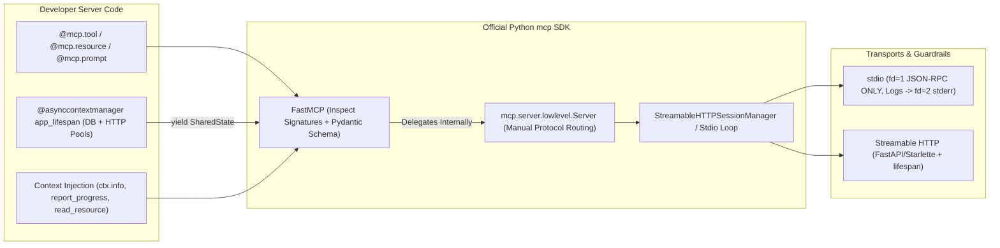
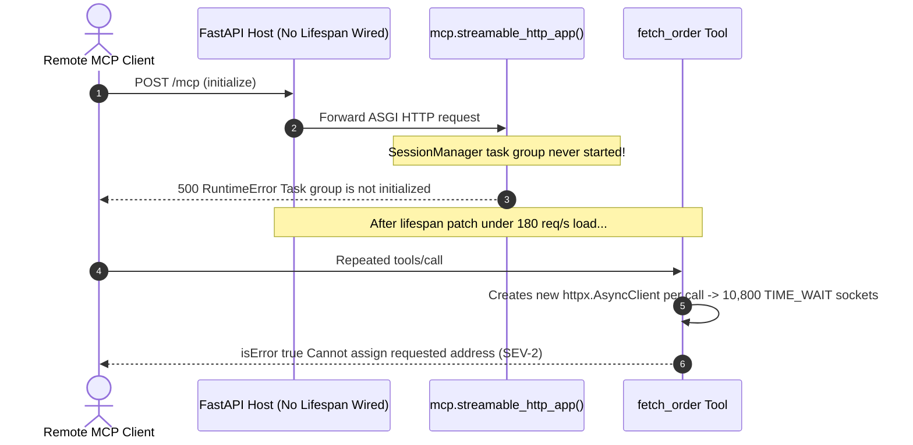

# Module 12: Building Your First MCP Server (Python SDK)

> **Prerequisites:** [Module 06: Transports: Streamable HTTP and SSE](../06-transports-streamable-http-and-sse/README.md), [Module 08: Primitive: Tools](../08-primitive-tools/README.md), [Module 09: Primitive: Resources](../09-primitive-resources/README.md), and [Module 10: Primitive: Prompts](../10-primitive-prompts/README.md).  
> **Estimated Reading Time:** 35 minutes  
> **Target Audience:** Python Backend Engineers, AI Platform Developers, API Infrastructure Engineers

> [!TIP]
> **The Golden Rule of Building MCP Servers:** Default to **`FastMCP` (`mcp.server.fastmcp`) with an async `lifespan` pool and strict `stderr`-only diagnostics**, dropping to `mcp.server.lowlevel.Server` only for dynamic plugin schemas: never open fresh DB/HTTP clients per tool call, never write a single byte to `stdout` under `stdio` mode, and always bind `mcp.streamable_http_app()`'s lifespan when mounting onto FastAPI or Starlette.

---

## Why This Matters

Understanding JSON-RPC 2.0 wire frames ([Module 04](../04-the-protocol-json-rpc-foundations/README.md)) and MCP primitives ([Modules 08–10](../08-primitive-tools/README.md)) gives you protocol fluency—but shipping a reliable server in production requires choosing the right SDK abstraction and avoiding three subtle runtime traps:

1. **Per-Call Connection Churn:** Opening a new PostgreSQL connection or `httpx.AsyncClient()` inside every `@mcp.tool()` handler adds `30–80 ms` of TCP/TLS handshake latency per call and exhausts OS ephemeral ports under concurrent agent loops.
2. **Silent `stdio` Wire Corruption:** A single `print("Connected to DB")` or third-party debug banner on `stdout` breaks NDJSON framing instantly with `-32700 Parse error`.
3. **Unmounted ASGI Lifespan Crashes:** Calling `app.mount("/mcp", mcp.streamable_http_app())` in FastAPI *without* attaching `mcp_app.lifespan` leaves the Streamable HTTP `StreamableHTTPSessionManager` task group uninitialized—crashing every incoming HTTP request with `RuntimeError: Task group is not initialized`.

The official Python SDK (`mcp`) provides both **`FastMCP`** (fast, type-hint-driven decorator ergonomics) and **`mcp.server.lowlevel.Server`** (full wire control). Knowing exactly when to use each—and how to wire `Context`, `lifespan`, `stderr`, and ASGI mounts cleanly—takes you from prototype to production-grade server.

---

## 1. Python MCP SDK Architecture: `FastMCP` vs. `lowlevel.Server`



### `FastMCP` Decorator Mechanics (`mcp.server.fastmcp`)

`FastMCP` inspects Python function signatures, type annotations (`str`, `int`, `Annotated[int, Field(ge=1, le=100)]`, Pydantic `BaseModel`), and docstrings at registration time to generate valid JSON Schema (`inputSchema`), structured output validation, and RFC 6570 URI templates automatically:

- **`@mcp.tool()`**: Registers a model-controlled tool. Default values mark parameters optional in `inputSchema.required`; exceptions or explicit `CallToolResult(isError=True)` surface recoverable errors to the model.
- **`@mcp.resource("scheme://{param}/...")`**: Registers an application-controlled Resource or URI template. Parameter names in `{...}` map straight to function arguments!
- **`@mcp.prompt()`**: Registers a user-controlled slash prompt returning strings or `PromptMessage` lists (including `EmbeddedResource`).
- **`Context` Dependency Injection**: Adding `ctx: Context` (any parameter typed as `Context`) injects per-request MCP capabilities **excluded from the external JSON Schema** so the LLM never sees `ctx` in `tools/list`:
  - `await ctx.info("...")` / `warning` / `error` $\rightarrow$ sends structured `notifications/message` logging to client.
  - `await ctx.report_progress(progress=i, total=n)` $\rightarrow$ emits `notifications/progress`.
  - `await ctx.read_resource(uri)` $\rightarrow$ reads another registered resource programmatically.
  - `await ctx.session.create_message(...)` $\rightarrow$ invokes client `sampling/createMessage` (when supported by client capabilities).
  - `ctx.request_context.lifespan_context` $\rightarrow$ accesses shared DB/HTTP pools created once at server boot!

### Lifespan Resource Pools & Streamable HTTP ASGI Mounting

Never allocate connection pools globally at import time or lazily per tool call. Pass an `@asynccontextmanager` `lifespan` function into `FastMCP("name", lifespan=app_lifespan)`:

```python
@asynccontextmanager
async def app_lifespan(server: FastMCP) -> AsyncIterator[AppContext]:
    http_client = httpx.AsyncClient(timeout=httpx.Timeout(10.0), limits=httpx.Limits(max_connections=50))
    db_pool = await asyncpg.create_pool(dsn=os.environ["DATABASE_URL"], min_size=2, max_size=20)
    try:
        yield AppContext(http=http_client, db=db_pool)
    finally:
        await http_client.aclose()
        await db_pool.close()
```

When deploying remotely over **Streamable HTTP** inside Starlette or FastAPI:

1. **Single Server Mount:** Construct `mcp_app = mcp.streamable_http_app()` and pass **`lifespan=mcp_app.lifespan`** (or `mcp.session_manager.run()` inside a parent lifespan) to `FastAPI(...)`.
2. **Multiple Mounted MCP Servers:** Use `contextlib.AsyncExitStack` inside your FastAPI `lifespan` to call `await stack.enter_async_context(srv.session_manager.run())` for every mounted `FastMCP` instance (`Mount("/billing", app=billing_mcp.streamable_http_app())`, `Mount("/orders", app=orders_mcp.streamable_http_app())`).

### Strict `stderr`-Only Logging (`stdio` Wire Hygiene)

When running over `stdio` (`mcp.run(transport="stdio")`), `stdout` (`fd=1`) is exclusively reserved for `\n`-delimited JSON-RPC frames ([Module 05](../05-transports-stdio/README.md)):

- Configure Python's `logging` explicitly to `stream=sys.stderr` (never `sys.stdout`).
- Duplicate `fd=1` for the wire transport or guard entrypoints so accidental `print()` calls in third-party dependencies cannot corrupt JSON-RPC frames.
- Disable HTTP server banner/access logs to `stdout` if running a dual-mode CLI binary.

### Quantitative Mechanics: Lifespan Pooling & Ephemeral Port Math

- **Per-Call Handshake Latency Penalty:** For an agent workflow executing $K$ sequential tool calls against an external HTTPS/Postgres backend where TCP + TLS + auth handshake takes $L_{\text{conn}} \approx 45\text{ ms}$ and query execution takes $L_{\text{exec}} \approx 5\text{ ms}$:

$$L_{\text{unpooled}}(K) = K \cdot (L_{\text{conn}} + L_{\text{exec}}), \qquad L_{\text{pooled}}(K) = L_{\text{conn}} + K \cdot L_{\text{exec}}$$

Over $K = 40$ tool calls, unpooled calls take `2,000 ms` (`1,800 ms` wasted on handshakes!) versus `245 ms` pooled—an **`8.16x` speedup** on I/O setup overhead.

- **Ephemeral Port Exhaustion (`TIME_WAIT`):** Under Little's Law, if unpooled tool handlers open and close short-lived TCP sockets at rate $\lambda_{\text{calls}}$ req/s with OS `TIME_WAIT` duration $T_{\text{tw}} = 60\text{ s}$:

$$N_{\text{TIME\_WAIT}} = \lambda_{\text{calls}} \cdot T_{\text{tw}}$$

At $\lambda_{\text{calls}} = 300\text{ req/s}$, `18,000` ephemeral ports sit pinned in `TIME_WAIT`—rapidly colliding with OS ephemeral port limits (`~28,000` default Linux ports) and failing with `EADDRNOTAVAIL`. A bounded `lifespan` pool caps open backend sockets to `max_connections = 20–50`.

---

## 2. Systematic Comparison Matrix: `FastMCP` vs. `lowlevel.Server`

| Dimension | `FastMCP` (`mcp.server.fastmcp`) | `mcp.server.lowlevel.Server` |
| :--- | :--- | :--- |
| **Schema Generation** | Automatic via Python type hints, `Field(...)`, & docstrings | Manual JSON Schema dicts (`Tool(name=..., inputSchema=...)`) |
| **Routing & Dispatch** | Decorators (`@mcp.tool()`, `@mcp.resource()`, `@mcp.prompt()`) | Explicit async handlers (`@server.list_tools()`, `@server.call_tool()`) |
| **Dynamic Runtime Registration** | Best for static typed Python functions known at import time | **Ideal for dynamic schemas** (OpenAPI proxy, plugin registry, DB-driven tools) |
| **Context & Lifespan** | Built-in `ctx: Context` injection + typed `lifespan` context | Accessed via `server.request_context` + manual `lifespan` hook |
| **Pagination & Custom Errors** | Handled automatically with standard defaults | Full manual control over `cursor`/`nextCursor` and exact JSON-RPC error codes |
| **Streamable HTTP ASGI App** | One-liner `mcp.streamable_http_app()` | Manual `StreamableHTTPSessionManager` + Starlette ASGI wiring |

---

## 3. Production War Story Post-Mortem: The Unmounted Lifespan Crash & `TIME_WAIT` Exhaustion

| Field | Incident Details |
| :--- | :--- |
| **Severity** | **SEV-2** (100% Streamable HTTP 500 Errors + Backend Ephemeral Port Exhaustion Under Load) |
| **Detection / Resolution Time** | Detected immediately on staging smoke test (`500 Internal Server Error`) & follow-up load test / Mitigated in 2 hours (mounted `mcp_app.lifespan` + shared `lifespan` `httpx`/`asyncpg` pool + `stderr` logger) |
| **Impact** | Every `/mcp` HTTP request threw `RuntimeError: Task group is not initialized`; after patching lifespan, unpooled DB connections exhausted OS ephemeral ports at `180` tool calls/s |

### What Happened

An engineering team migrated an internal SQL/HTTP MCP server from local `stdio` to remote Streamable HTTP inside FastAPI. Three deployment bugs surfaced back-to-back:

1. **Missing ASGI Lifespan Wiring:** The team added `app = FastAPI()` and `app.mount("/mcp", mcp.streamable_http_app())` without connecting the sub-app's `lifespan`. Starlette skipped `StreamableHTTPSessionManager.run()`, so the first client `initialize` POST crashed with `RuntimeError: Task group is not initialized`.
2. **Per-Call `httpx.AsyncClient()` Allocation:** Inside `@mcp.tool() async def fetch_order(...)`, the developer wrote `async with httpx.AsyncClient() as client:` on every invocation. During a load test (`180` calls/s), TCP `TIME_WAIT` sockets piled up (`180 * 60 = 10,800` sockets alongside sibling microservices), triggering `OSError: [Errno 99] Cannot assign requested address` and adding `+55 ms` TLS handshake jitter per call.
3. **Stray `print()` in `stdio` Mode:** While debugging locally via `mcp.run()`, a shared telemetry helper ran `print(f"DB query {ms}ms")`, breaking the IDE's `stdio` JSON-RPC parser (`-32700`).



### Root Cause Analysis

- Starlette/FastAPI `Mount()` does **not** automatically invoke mounted sub-applications' `lifespan` handlers unless the parent app explicitly forwards or enters them.
- Allocating network clients inside `@mcp.tool()` bypasses HTTP/2 connection pooling and OS socket reuse.
- Relying on default `print()` in dual `stdio` + HTTP codebases leaves `stdout` unprotected.

### The Fix & Architectural Hardening

- **Mounted Lifespan + `AsyncExitStack`:** Passed `lifespan=mcp_app.lifespan` (and for multi-server mounts, entered `srv.session_manager.run()` inside FastAPI's `@asynccontextmanager lifespan`).
- **Pooled `lifespan` Context:** Moved `httpx.AsyncClient` and `asyncpg` pools into `FastMCP(..., lifespan=app_lifespan)`, reading them from `ctx.request_context.lifespan_context`.
- **Strict `stderr` Logger:** Configured Python `logging` exclusively on `sys.stderr` and verified zero `stdout` pollution with a CI `stdio` wire test.

---

## 4. Multi-Language Production Implementation: Official SDK Server Patterns with Lifespan & Pooled State

Below are idiomatic production MCP server definitions across **Go** (`github.com/modelcontextprotocol/go-sdk/mcp`), **TypeScript** (`@modelcontextprotocol/sdk`), **Python** (`mcp.server.fastmcp.FastMCP` + `lowlevel.Server` + FastAPI Streamable HTTP mount), and **C#** (`ModelContextProtocol`). All four keep diagnostic logs strictly off `stdout` and inject pooled dependencies cleanly.

````carousel

```go
// Official Go MCP SDK pattern (github.com/modelcontextprotocol/go-sdk/mcp)
package main

import (
	"context"
	"fmt"
	"log/slog"
	"net/http"
	"os"
	"time"

	"github.com/modelcontextprotocol/go-sdk/mcp"
)

type OrderQueryArgs struct {
	OrderID string `json:"order_id" jsonschema:"Order identifier to inspect"`
}

type ServerDeps struct {
	HTTP   *http.Client
	Logger *slog.Logger
}

func main() {
	// Strict stderr logging so stdio fd=1 stays pure JSON-RPC
	logger := slog.New(slog.NewJSONHandler(os.Stderr, nil))
	deps := &ServerDeps{
		HTTP:   &http.Client{Timeout: 5 * time.Second},
		Logger: logger,
	}

	server := mcp.NewServer(&mcp.Implementation{
		Name:    "orders-mcp-go",
		Version: "1.2.0",
	}, nil)

	mcp.AddTool(server, &mcp.Tool{
		Name:        "get_order_status",
		Description: "Fetch live order status using pooled HTTP transport",
	}, func(ctx context.Context, req *mcp.CallToolRequest, args OrderQueryArgs) (*mcp.CallToolResult, any, error) {
		deps.Logger.Info("fetching order", "order_id", args.OrderID)
		return &mcp.CallToolResult{
			Content: []mcp.Content{
				&mcp.TextContent{Text: fmt.Sprintf(`{"order_id":%q,"status":"SHIPPED"}`, args.OrderID)},
			},
		}, nil, nil
	})

	if err := server.Run(context.Background(), &mcp.StdioTransport{}); err != nil {
		logger.Error("mcp server exited", "err", err)
		os.Exit(1)
	}
}
```

<!-- slide -->

```typescript
// Official TypeScript MCP SDK pattern (@modelcontextprotocol/sdk)
import { McpServer, ResourceTemplate } from "@modelcontextprotocol/sdk/server/mcp.js";
import { StdioServerTransport } from "@modelcontextprotocol/sdk/server/stdio.js";
import { z } from "zod";

// Shared pooled client allocated once at startup (never per tool call)
const sharedApiHeaders = { "x-service": "orders-mcp" };
const logStderr = (msg: string) => process.stderr.write(`${msg}\n`);

const server = new McpServer({
  name: "orders-mcp-ts",
  version: "1.2.0",
});

server.registerTool(
  "reserve_inventory",
  {
    description: "Reserve SKU units atomically",
    inputSchema: z.object({
      sku: z.string().regex(/^[A-Z0-9-]{3,32}$/),
      qty: z.number().int().min(1).max(100),
    }),
  },
  async ({ sku, qty }) => {
    logStderr(`[INFO] reserving sku=${sku} qty=${qty} headers=${JSON.stringify(sharedApiHeaders)}`);
    return {
      content: [{ type: "text", text: JSON.stringify({ sku, reserved: qty, ok: true }) }],
    };
  },
);

server.registerResource(
  "warehouse-stock",
  new ResourceTemplate("inventory://{warehouse}/sku/{sku}", { list: undefined }),
  { description: "Live warehouse stock snapshot", mimeType: "application/json" },
  async (uri, { warehouse, sku }) => ({
    contents: [{ uri: uri.href, mimeType: "application/json", text: JSON.stringify({ warehouse, sku, available: 42 }) }],
  }),
);

async function main() {
  // Never call console.log() on stdio servers; alias console.log -> console.error defensively
  console.log = console.error;
  const transport = new StdioServerTransport();
  await server.connect(transport);
}

main().catch((err) => {
  logStderr(`Fatal startup error: ${String(err)}`);
  process.exit(1);
});
```

<!-- slide -->

```python
"""
orders_mcp_server.py
Official Python MCP SDK (FastMCP + Lifespan + Context + Streamable HTTP ASGI Mount).
Requires: pip install "mcp>=1.10" fastapi uvicorn httpx
"""
from collections.abc import AsyncIterator
from contextlib import asynccontextmanager
from dataclasses import dataclass
import logging
import sys
from typing import Annotated

from fastapi import FastAPI
import httpx
from mcp.server.fastmcp import Context, FastMCP
from pydantic import Field
from starlette.routing import Mount

# Strict stderr-only logging protects stdio JSON-RPC framing
logging.basicConfig(stream=sys.stderr, level=logging.INFO, format="%(asctime)s %(levelname)s %(message)s")
logger = logging.getLogger("orders_mcp")


@dataclass
class AppResources:
    http: httpx.AsyncClient
    warehouse_stock: dict[str, int]


@asynccontextmanager
async def app_lifespan(_server: FastMCP) -> AsyncIterator[AppResources]:
    logger.info("Booting shared httpx connection pool")
    async with httpx.AsyncClient(timeout=5.0, limits=httpx.Limits(max_connections=40)) as client:
        yield AppResources(http=client, warehouse_stock={"us-east:SKU-900": 42})
    logger.info("Closed shared httpx connection pool cleanly")


mcp = FastMCP("orders-mcp-server", lifespan=app_lifespan)


@mcp.tool()
async def reserve_stock(
    sku: Annotated[str, Field(pattern=r"^[A-Z0-9-]{3,32}$", description="Catalog SKU")],
    qty: Annotated[int, Field(ge=1, le=50, description="Units to reserve")],
    ctx: Context,
) -> str:
    """Reserve SKU units with progress notifications and pooled state."""
    await ctx.info(f"Checking inventory for {sku}")
    await ctx.report_progress(progress=1, total=2)
    state: AppResources = ctx.request_context.lifespan_context
    key = f"us-east:{sku}"
    avail = state.warehouse_stock.get(key, 0)
    if avail < qty:
        raise ValueError(f"Insufficient stock for {sku}: available={avail}")
    state.warehouse_stock[key] = avail - qty
    await ctx.report_progress(progress=2, total=2)
    return f"Reserved {qty}x {sku}; remaining={state.warehouse_stock[key]}"


@mcp.resource("inventory://{warehouse}/sku/{sku}", mime_type="application/json")
async def get_warehouse_stock(warehouse: str, sku: str, ctx: Context) -> str:
    """Application-controlled resource returning current stock JSON."""
    state: AppResources = ctx.request_context.lifespan_context
    avail = state.warehouse_stock.get(f"{warehouse}:{sku}", 0)
    return f'{{"warehouse":"{warehouse}","sku":"{sku}","available":{avail}}}'


@mcp.prompt()
def triage_backorder(sku: str) -> str:
    """User-triggered slash workflow to investigate SKU stockouts."""
    return f"Review stock levels for <sku>{sku}</sku> and propose supplier reorder quantities."


# Streamable HTTP ASGI mounting with mandatory lifespan forwarding:
mcp_http_app = mcp.streamable_http_app()
app = FastAPI(lifespan=mcp_http_app.lifespan, routes=[Mount("/mcp", app=mcp_http_app)])

# Note: For dynamic schemas loaded from DB/OpenAPI at runtime, drop down to:
#   from mcp.server.lowlevel import Server
#   low = Server("dynamic-server")
#   @low.list_tools() ... @low.call_tool() ...
```

<!-- slide -->

```csharp
// Official C# MCP SDK pattern (ModelContextProtocol)
using System.ComponentModel;
using Microsoft.Extensions.DependencyInjection;
using Microsoft.Extensions.Hosting;
using Microsoft.Extensions.Logging;
using ModelContextProtocol.Server;

var builder = Host.CreateApplicationBuilder(args);

// Route ALL logs to stderr so stdio stdout carries only JSON-RPC frames
builder.Logging.ClearProviders();
builder.Logging.AddConsole(opts => opts.LogToStandardErrorThreshold = LogLevel.Trace);

// Register pooled singleton HttpClient + MCP server
builder.Services.AddHttpClient("OrdersApi", c => c.Timeout = TimeSpan.FromSeconds(5));
builder.Services.AddMcpServer()
    .WithStdioServerTransport()
    .WithTools<InventoryTools>();

await builder.Build().RunAsync();

[McpServerToolType]
public sealed class InventoryTools(IHttpClientFactory httpFactory, ILogger<InventoryTools> logger)
{
    [McpServerTool, Description("Reserve SKU units via pooled HttpClient")]
    public string ReserveStock(
        [Description("Catalog SKU code")] string sku,
        [Description("Quantity between 1 and 50")] int qty)
    {
        if (qty is < 1 or > 50)
            throw new ArgumentOutOfRangeException(nameof(qty), "Quantity must be 1..50.");

        using var _ = httpFactory.CreateClient("OrdersApi");
        logger.LogInformation("Reserving {Qty} units of {Sku}", qty, sku);
        return $"{{\"sku\":\"{sku}\",\"reserved\":{qty},\"ok\":true}}";
    }
}
```

````

---

## 5. Practical Hands-On Verification CLI Workflows

Run these deterministic Python 3.13 scripts offline using only the Python standard library—no third-party packages required.

### Workflow 1: Signature-to-Schema Introspection & URI Template Dispatch (`FastMCP` Mechanics)

Verify how `FastMCP` reflects Python parameter types, defaults, and docstrings into JSON Schema (`tools/list`), executes `tools/call`, and extracts RFC 6570 template arguments in `resources/read`:

```bash
python -c '
import inspect, json, re, typing

TYPE_MAP = {int: "integer", float: "number", str: "string", bool: "boolean"}

class MiniFastMCP:
    def __init__(self, name):
        self.name = name
        self.tools = {}
        self.resources = []

    def tool(self):
        def deco(fn):
            hints = typing.get_type_hints(fn)
            sig = inspect.signature(fn)
            props, req = {}, []
            for pname, p in sig.parameters.items():
                if pname == "ctx":
                    continue
                ptype = TYPE_MAP.get(hints.get(pname, str), "string")
                props[pname] = {"type": ptype}
                if p.default is inspect.Parameter.empty:
                    req.append(pname)
            self.tools[fn.__name__] = {
                "fn": fn,
                "schema": {"name": fn.__name__, "description": (fn.__doc__ or "").strip(), "inputSchema": {"type": "object", "properties": props, "required": req}},
            }
            return fn
        return deco

    def resource(self, uri_template):
        pattern = "^" + re.sub(r"\{([a-zA-Z0-9_]+)\}", r"(?P<\1>[^/]+)", uri_template) + "$"
        regex = re.compile(pattern)
        def deco(fn):
            self.resources.append((uri_template, regex, fn))
            return fn
        return deco

    def call_tool(self, name, args):
        return self.tools[name]["fn"](**args)

    def read_resource(self, uri):
        for _, regex, fn in self.resources:
            m = regex.match(uri)
            if m:
                return fn(**m.groupdict())
        raise KeyError(f"Resource not found: {uri}")

mcp = MiniFastMCP("inventory-server")

@mcp.tool()
def reserve_stock(sku: str, qty: int = 1) -> str:
    """Reserve SKU units atomically in inventory."""
    return f"reserved {qty}x {sku}"

@mcp.resource("inventory://{warehouse}/sku/{sku}")
def get_stock(warehouse: str, sku: str) -> str:
    return json.dumps({"warehouse": warehouse, "sku": sku, "available": 42})

print("tools/list   :", json.dumps([v["schema"] for v in mcp.tools.values()]))
print("tools/call   :", mcp.call_tool("reserve_stock", {"sku": "SKU-900", "qty": 3}))
print("resources/read:", mcp.read_resource("inventory://us-east/sku/SKU-900"))
'
```

**Expected Output:**

```text
tools/list   : [{"name": "reserve_stock", "description": "Reserve SKU units atomically in inventory.", "inputSchema": {"type": "object", "properties": {"sku": {"type": "string"}, "qty": {"type": "integer"}}, "required": ["sku"]}}]
tools/call   : reserved 3x SKU-900
resources/read: {"warehouse": "us-east", "sku": "SKU-900", "available": 42}
```

### Workflow 2: `stdout` Isolation & NDJSON Frame Integrity Check

Demonstrate how an accidental `print()` corrupts the `stdio` JSON-RPC wire (`-32700`), and how redirecting `sys.stdout` to `sys.stderr` before writing protocol frames keeps `stdout` 100% binary-clean:

```bash
python -c '
import io, json, sys

def run_wire_demo(isolate_stdout):
    wire_buf = io.StringIO()
    err_buf = io.StringIO()
    old_out, old_err = sys.stdout, sys.stderr
    try:
        sys.stdout = err_buf if isolate_stdout else wire_buf
        sys.stderr = err_buf
        print("[db-pool] initializing 8 connections")
        frame = json.dumps({"jsonrpc": "2.0", "id": 1, "result": {"status": "healthy"}}, separators=(",", ":"))
        wire_buf.write(frame + "\n")
    finally:
        sys.stdout, sys.stderr = old_out, old_err

    corrupted = 0
    valid = 0
    for line in wire_buf.getvalue().splitlines():
        try:
            json.loads(line)
            valid += 1
        except json.JSONDecodeError:
            corrupted += 1
    return valid, corrupted, len(err_buf.getvalue().splitlines())

for iso in (False, True):
    v, c, e = run_wire_demo(iso)
    print(f"isolate_stdout={str(iso):<5} -> valid_jsonrpc_frames={v} | parse_errors(-32700)={c} | stderr_log_lines={e}")
'
```

**Expected Output:**

```text
isolate_stdout=False -> valid_jsonrpc_frames=1 | parse_errors(-32700)=1 | stderr_log_lines=0
isolate_stdout=True  -> valid_jsonrpc_frames=1 | parse_errors(-32700)=0 | stderr_log_lines=1
```

### Workflow 3: Lifespan Connection Pool vs. Per-Call Connection Benchmark

Simulate `60` concurrent tool executions (`pool_size = 8`, `handshake_ms = 45.0`, `query_ms = 5.0`) contrasting per-call connection creation against a `lifespan`-initialized pool:

```bash
python -c '
import asyncio, math

async def bench_pool(pooled, total_calls=60, pool_size=8, handshake_ms=45.0, query_ms=5.0):
    sem = asyncio.Semaphore(pool_size)
    sockets_opened = pool_size if pooled else 0
    active = 0
    peak_active = 0

    async def handle_call():
        nonlocal sockets_opened, active, peak_active
        if not pooled:
            sockets_opened += 1
        async with sem:
            active += 1
            peak_active = max(peak_active, active)
            await asyncio.sleep(0)
            active -= 1

    await asyncio.gather(*(handle_call() for _ in range(total_calls)))
    batches = math.ceil(total_calls / pool_size)
    sim_ms = (handshake_ms + batches * query_ms) if pooled else (batches * (handshake_ms + query_ms))
    print(f"pooled={str(pooled):<5} | calls={total_calls} | sockets_opened={sockets_opened:>2} | peak_active={peak_active} | simulated_ms={sim_ms:.1f}")

async def main():
    await bench_pool(False)
    await bench_pool(True)

asyncio.run(main())
'
```

**Expected Output:**

```text
pooled=False | calls=60 | sockets_opened=60 | peak_active=8 | simulated_ms=400.0
pooled=True  | calls=60 | sockets_opened= 8 | peak_active=8 | simulated_ms=85.0
```

### Hands-On Exercises

1. **Pydantic `Field` Constraints in Schema Introspection:** Extend Workflow 1's `MiniFastMCP` to parse `Annotated[int, (1, 50)]` metadata tuples into JSON Schema `minimum` and `maximum` fields so invalid LLM arguments fail early during validation.
2. **Multi-Server ASGI Lifespan Composition:** Write a 20-line FastAPI snippet (referencing `contextlib.AsyncExitStack`) that mounts *two* independent `FastMCP` instances (`/billing` and `/inventory`) on one server while starting both `session_manager.run()` loops cleanly.
3. **Optional Live MCP SDK Run (Requires `pip install mcp`):** Wrap `orders_mcp_server.py` from Section 4 in an empty virtualenv (`uv run --with mcp mcp dev orders_mcp_server.py`) and inspect generated `tools/list`, `resources/templates/list`, and `prompts/list` in the MCP Inspector.

### Independent Challenge

A team is building an **Enterprise OpenAPI-to-MCP Gateway** that loads `180` REST endpoints dynamically from a PostgreSQL catalog at startup and rotates endpoint schemas every 15 minutes without restarting the server process. Should they build this server with `FastMCP` decorators or `mcp.server.lowlevel.Server`? Explain how they should handle connection pooling, live schema reloads (`notifications/tools/list_changed`), and Streamable HTTP ASGI deployment.

<details><summary>Architectural Discussion</summary>

1. **Choose `mcp.server.lowlevel.Server`:** `FastMCP` excels when tools are fixed Python functions known at import time (`@mcp.tool()`). Here, `180` endpoints come dynamically from PostgreSQL JSON Schemas at runtime and mutate every 15 minutes; `lowlevel.Server` lets `@server.list_tools()` read the active catalog map directly and `@server.call_tool()` dispatch generically to an `httpx.AsyncClient`.
2. **Lifespan Pool + Hot Reload:** Initialize a single `httpx.AsyncClient` and `asyncpg` pool inside a lifespan context manager alongside a background refresh loop. Whenever the catalog version changes, swap the immutable routing dict atomically and emit `session.send_tool_list_changed()` (`notifications/tools/list_changed`).
3. **ASGI Transport:** Mount the `StreamableHTTPSessionManager` ASGI handler onto Starlette/FastAPI with the lifespan managing both the DB/HTTP pools and `session_manager.run()`.

</details>

---

## 6. Common Mistakes & Troubleshooting

- **Writing `print(...)` inside a `stdio` server:** Any non-JSON-RPC byte written to `stdout` breaks NDJSON parsing (`-32700`). Always route `logging` and third-party output strictly to `sys.stderr`.
- **Mounting `mcp.streamable_http_app()` without forwarding `lifespan`:** Causes `RuntimeError: Task group is not initialized` on the very first HTTP `/mcp` request because `session_manager.run()` never starts.
- **Letting `ctx: Context` leak into public tool arguments:** Never declare `ctx` with a wrong type or missing annotation in `FastMCP`—only exact `Context` annotations are stripped from `inputSchema` and injected at runtime.
- **Creating `httpx.AsyncClient` or DB connections inside `@mcp.tool()`:** Adds `30–80 ms` handshake latency per call and exhausts ephemeral ports under agent bursts. Always manage pools via `lifespan`.

---

## 7. Operational Validation Checkpoints & Checkpoint Quiz

### Operational Validation Checkpoints

<details><summary><strong>Checkpoint 1: Fixing `Task group is not initialized` on Streamable HTTP</strong></summary>

You mount a `FastMCP` server onto FastAPI via `app.mount("/mcp", mcp.streamable_http_app())`, start `uvicorn`, and send an `initialize` POST—only to get HTTP 500 `RuntimeError: Task group is not initialized`. Why did this happen and what is the 1-line fix?

**Validation:** FastAPI does not automatically run sub-application `lifespan` hooks inside `Mount`. Pass `lifespan=mcp_app.lifespan` to `FastAPI(...)` (or enter `mcp.session_manager.run()` inside your parent app's `@asynccontextmanager` lifespan using `AsyncExitStack` for multiple servers).

</details>

<details><summary><strong>Checkpoint 2: Preventing `ctx` from appearing in LLM `tools/list`</strong></summary>

An engineer writes `@mcp.tool() async def sync_data(table: str, ctx): ...` (forgetting the `: Context` type annotation). When an LLM calls `sync_data`, the server crashes with `TypeError` and the LLM asks for a `"ctx"` string parameter. Why?

**Validation:** `FastMCP` relies on the exact type hint `ctx: Context` (from `mcp.server.fastmcp`) to detect dependency injection, inject the live `Context` instance, and strip `ctx` from the generated JSON Schema `inputSchema`. Without `: Context`, `FastMCP` treats `ctx` as a normal string parameter required from the LLM.

</details>

<details><summary><strong>Checkpoint 3: Debugging `-32700 Parse error` only under `stdio` mode</strong></summary>

A server passes all unit tests over Streamable HTTP, yet fails immediately in Claude Desktop (`stdio` mode) with `-32700 Parse error: Unexpected token 'I'`. What is the cause?

**Validation:** Something in the server or an imported library wrote plain text starting with `'I'` (such as `print("Initializing DB...")` or a logger defaulted to `sys.stdout`) to file descriptor `1` (`stdout`). Over HTTP that print went to console logs harmlessly, whereas over `stdio` `stdout` *is* the JSON-RPC wire channel. Route all logs to `sys.stderr` and guard `fd=1`.

</details>

### Checkpoint Quiz

1. When should you prefer `mcp.server.lowlevel.Server` over `FastMCP` in the Python MCP SDK?
2. Which four capabilities does an injected `ctx: Context` provide inside a `@mcp.tool()` handler?
3. Why must database and HTTP client pools be created inside `FastMCP(..., lifespan=...)` rather than inside individual `@mcp.tool()` functions?
4. What happens in `stdio` transport if an underlying C library or Python `print()` writes `"OK\n"` to `stdout`?
5. When mounting two `FastMCP` servers onto one FastAPI application, how do you initialize both session managers safely?

<details><summary>Answers</summary>

1. Use **`mcp.server.lowlevel.Server`** when tools/resources are dynamic at runtime (e.g., generated from external OpenAPI specs or DB tables), or when you need manual pagination cursors and custom low-level JSON-RPC dispatch hooks.
2. `ctx: Context` provides (1) client logging (`ctx.info`, `warning`, `error`), (2) progress emission (`ctx.report_progress`), (3) programmatic resource/sampling calls (`ctx.read_resource`, `ctx.session.create_message`), and (4) access to shared `lifespan` pools (`ctx.request_context.lifespan_context`).
3. Per-call connections add TCP/TLS handshake latency on every tool call and exhaust OS ephemeral ports (`TIME_WAIT`) under bursty agent loops; `lifespan` initializes pools once on startup and closes them cleanly on shutdown.
4. `"OK\n"` is read by the host client as an invalid JSON-RPC message on the wire, triggering **`-32700 Parse error`** and often dropping the session.
5. Use `contextlib.AsyncExitStack` inside FastAPI's parent `@asynccontextmanager` `lifespan` function to enter `srv.session_manager.run()` for each mounted `FastMCP` instance.

</details>

---

## Further Reading & Sources

- [Model Context Protocol Python SDK (`modelcontextprotocol/python-sdk`)](https://github.com/modelcontextprotocol/python-sdk) — official `FastMCP`, `lowlevel.Server`, `Context`, `lifespan`, and `streamable_http_app` reference code.
- [MCP Docs: Build an MCP Server](https://modelcontextprotocol.io/docs/develop/build-server) — official tutorial covering `stdio` logging safety (`stderr` only) and server registration.
- [Module 05: Transports: stdio](../05-transports-stdio/README.md) — OS pipe buffering, `fd=1`/`fd=2` isolation, and clean subprocess shutdown.

## Next

[Module 13: Building an MCP Client](../13-building-an-mcp-client/README.md)
