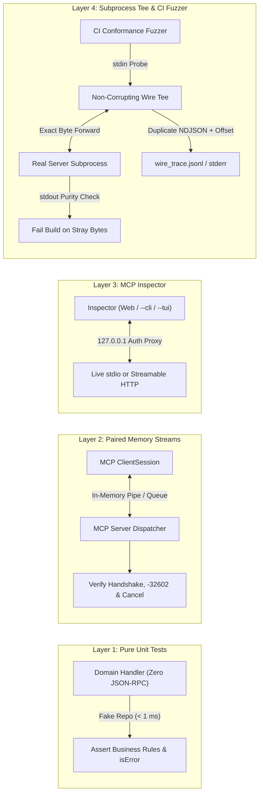
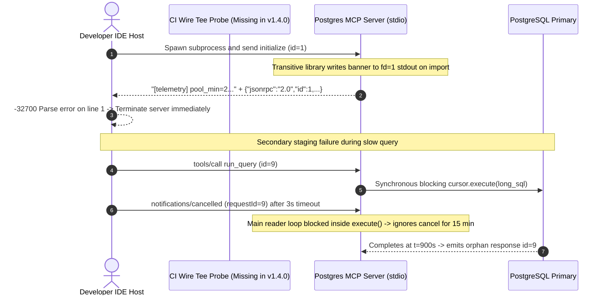

# Module 14: Testing and Debugging MCP Servers

> **Prerequisites:** [Module 04: The Protocol: JSON-RPC Foundations](../04-the-protocol-json-rpc-foundations/README.md), [Module 05: Transports: stdio](../05-transports-stdio/README.md), [Module 07: The Initialization Handshake](../07-the-initialization-handshake/README.md), [Module 12: Building Your First MCP Server](../12-building-your-first-mcp-server/README.md), and [Module 13: Building an MCP Client](../13-building-an-mcp-client/README.md).  
> **Estimated Reading Time:** 35 minutes  
> **Target Audience:** AI Backend Engineers, MCP Server Authors, QA & CI Infrastructure Engineers

> [!TIP]
> **The Golden Rule of MCP Server Testing & Debugging:** Separate **what a tool computes** from **how JSON-RPC bytes move**—unit-test pure domain logic without RPC boilerplate, verify full handshake and cancellation semantics over **in-memory paired streams** inside `pytest`, inspect interactive payloads with **MCP Inspector** (`Web` / `--cli` / `--tui`), and capture wire frames strictly via a **non-corrupting `stdio` tee or `stderr` sink** (`0` stray bytes on `stdout`).

---

## Why This Matters

An MCP server that passes local `pytest` function calls still crashes when plugged into Claude Desktop, Cursor, or VS Code Copilot. Why? Because MCP failures disproportionately occur at the **wire and lifecycle boundary**, not inside your SQL query or HTTP client:

- **Stray `stdout` pollution:** A newly upgraded database driver prints `[pool] ready` to `stdout`, corrupting the NDJSON framing on byte `1` and triggering `-32700 Parse error` before `initialize` completes.
- **Protocol vs. business-error confusion:** Returning a raw JSON-RPC `-32603 Internal error` when an upstream API times out instead of `result: { isError: true, content: [...] }` prevents the LLM from reading the error and self-correcting.
- **Blocking the reader loop on slow handlers:** Synchronous execution on the JSON-RPC read thread starves `notifications/cancelled` until after a `30 s` lock finishes, leaking database connections and late orphan replies.
- **Unverified pre-init state:** Accepting `tools/call` before `initialize` + `notifications/initialized` passes casual SDK demos and fails strict protocol hosts.

Spawning full subprocesses for all `500` tests in CI is equally unsustainable (`~325 s` of process-boot tax). A **4-layer MCP testing pyramid** gives you sub-second domain feedback while catching every framing, schema, lifecycle, and cancellation bug before release.

---

## 1. The 4-Layer MCP Testing Pyramid & Wire Debugging Mechanics

To balance test speed against transport fidelity, partition verification across four progressive isolation boundaries:

1. **Layer 1 — Pure Domain Logic Unit Tests (No MCP Transport):** Extract business functions (`run_readonly_sql(repo, query)`, `build_file_patch(...)`) into plain typed modules free of `Server` decorators or `sys.stdin`. Test SQL safety checks, pagination math, and domain exceptions in `< 1 ms` per test with fake repositories.
2. **Layer 2 — In-Memory Paired Client-Server Stream Tests (`pytest` / Memory Pipes):** Wire a real MCP `Server` and `ClientSession` over paired in-process memory streams (`anyio.create_memory_object_stream` / `mcp.shared.memory.create_connected_server_and_client_session` in Python, `io.Pipe()` in Go, `InMemoryTransport` in TypeScript, `System.IO.Pipelines.Pipe` in C#). Executes real JSON-RPC serialization, schema validation, `initialize` -> `notifications/initialized`, `tools/call`, and `notifications/cancelled` with zero OS process spawn cost.
3. **Layer 3 — Interactive & Scripted MCP Inspector (`@modelcontextprotocol/inspector`):** Launch the reference debugging client against live `stdio` or `Streamable HTTP` endpoints via Web UI (`npx @modelcontextprotocol/inspector ...`), terminal TUI (`--tui`), or scriptable CI CLI (`--cli --method tools/list`) to inspect schemas, resources, notifications, and round-trip latency interactively.
4. **Layer 4 — Non-Corrupting `stdio` Tee & CI Conformance Fuzz Harness:** Wrap the real compiled binary or Python entrypoint in a transparent **wire-capture tee proxy** that forwards `stdin`/`stdout` bytes verbatim while duplicating every JSON-RPC frame to a JSONL audit file (or `stderr`), then run automated adversarial conformance probes (pre-init rejection, `-32602` invalid params, hung cancellation deadline, malformed `stdout` framing check).



### Quantitative Mechanics: Suite Feedback Speed & Pipe Capture Bounds

- **4-Layer Suite Execution Latency ($T_{\text{suite}}$):** Given $N_{\text{unit}}$ pure tests ($t_{\text{unit}} \approx 0.4\text{ ms}$), $N_{\text{mem}}$ in-memory paired stream tests ($t_{\text{mem}} \approx 4.5\text{ ms}$), and $N_{\text{proc}}$ full subprocess wire probes ($t_{\text{spawn}} + t_{\text{init}} + t_{\text{rpc}} \approx 650\text{ ms}$):

$$T_{\text{suite}} = N_{\text{unit}} t_{\text{unit}} + N_{\text{mem}} t_{\text{mem}} + N_{\text{proc}} \left(t_{\text{spawn}} + t_{\text{init}} + t_{\text{rpc}}\right)$$

Running all `500` assertions as full subprocesses costs $T_{\text{sub}} = 500 \times 0.65\text{ s} = 325.0\text{ s}$ (`5.4 minutes`). Shifting to a `70% / 20% / 10%` pyramid cuts suite runtime nearly `10x` to `33.09 s` while still running `50` full OS subprocess wire checks on every PR.

- **Non-Corrupting `stdout` Purity Invariant:** Over `stdio`, every line emitted on `fd=1` (`stdout`) MUST satisfy:

$$\forall \ell \in \text{lines}(\texttt{stdout}): \quad \text{UTF8\_valid}(\ell) \;\land\; \text{JSON\_parseable}(\ell) \;\land\; \ell[\texttt{"jsonrpc"}] = \texttt{"2.0"} \;\land\; \text{raw\_newlines\_inside}(\ell) = 0$$

Even a single non-JSON diagnostic line (`[debug] loading schema`) on `stdout` violates the invariant and causes compliant MCP hosts to drop the connection immediately.

### Diagnosing Key Wire-Level Protocol Failure Modes

1. **Invalid Params (`-32602`) vs. Tool Business Failure (`isError: true`):**
   - Return JSON-RPC `error.code = -32602` when the caller violates the declared `inputSchema` (missing required field, wrong JSON type like string `"abc"` for `integer`, unknown tool name).
   - Return JSON-RPC `result` with `"isError": true` and actionable text inside `content[]` when schema types are valid (`limit: 10`, `sql: "SELECT * FROM missing_tbl"`), allowing the model to inspect the error and retry cleanly.
2. **Pre-Initialization State Enforcement (`-32600`):**
   - Reject any `tools/list`, `tools/call`, or `resources/read` arriving before `initialize` succeeds and `notifications/initialized` transitions the session to `READY` (allowing only `initialize` and `ping` pre-ready).
3. **Hung Cancellation (`notifications/cancelled`):**
   - Dispatch slow tools asynchronously off the JSON-RPC reader loop with a bound cancellation token (`asyncio.Task.cancel()` / `context.WithCancel` / `AbortController` / `CancellationTokenSource`). When `notifications/cancelled` arrives for `requestId`, cancel the worker and **suppress emitting a late JSON-RPC response** if the request was already removed from client tracking.
4. **Securing MCP Inspector Locally:**
   - Because `@modelcontextprotocol/inspector` bridges HTTP/WebSocket browser commands to local subprocess execution (`stdio`), bind strictly to `127.0.0.1` (never `0.0.0.0`), keep session authentication tokens enabled (`DANGEROUSLY_OMIT_AUTH` disabled), and verify `Origin` headers to prevent DNS-rebinding remote code execution.

---

## 2. Systematic Comparison Matrix: MCP Testing & Debugging Layers

| Testing / Debugging Layer | Primary Mechanism | Transport & Framing Bugs Caught | Typical Latency per Check | CI Automation Fit | Blind Spots |
| :--- | :--- | :--- | :--- | :--- | :--- |
| **Layer 1: Pure Domain Unit Tests** | Direct Python/Go/TS/C# function calls with fakes | `0%` (no JSON-RPC or pipes) | `0.2–1.0 ms` | **Mandatory (`70%+` of suite)** | Misses schema coercion, `stdout` pollution, lifecycle ordering |
| **Layer 2: Paired Memory Streams** | Real `Server` + `ClientSession` over `anyio`/pipe streams | JSON-RPC framing, `-32602` schemas, pre-init FSM, cancellation races | `2–8 ms` | **Mandatory (`20%` of suite)** | Misses OS pipe deadlocks (`64 KiB`), C-extension `fd=1` prints, `env` leaks |
| **Layer 3: MCP Inspector (`Web`/`--cli`/`--tui`)** | `@modelcontextprotocol/inspector` interactive or `--cli` probe | End-to-end UX, schema rendering, live notification order, latency | `0.5–3 s` | **`--cli` for smoke checks; Web UI for local dev** | Manual UI checks don't scale to regression fuzzing |
| **Layer 4: Wire Tee & Conformance Fuzzer** | `subprocess.Popen` tee + adversarial JSON-RPC probes | Stray `stdout` banners, `stderr` pipe freeze, SIGTERM reaping, Streamable HTTP SSE/headers | `300–900 ms` | **Targeted PR Gate (`5–10%` of suite)** | Slowest layer; redundant for pure business-logic permutations |

---

## 3. Production War Story Post-Mortem: The Silent `psycopg` Startup Banner & Hung Cancellation Outage

| Field | Incident Details |
| :--- | :--- |
| **Severity** | **SEV-2** (100% IDE Client Boot Failure + Postgres Connection Pool Exhaustion) |
| **Detection / Resolution Time** | Detected 12 minutes after internal developer CLI release via IDE crash reports / Mitigated in 90 minutes (FD isolation patch + async cancellation wrapper + CI tee gate) |
| **Impact** | `140` engineers blocked from using the internal Postgres MCP server in Cursor & Claude Desktop; `18` hung `EXPLAIN ANALYZE` queries held Postgres worker locks for `15` minutes after users clicked Cancel |

### What Happened

A platform team shipped `v1.4.0` of an internal Postgres MCP server. All `85` unit tests mocked the database repository at Layer 1 and passed in `0.3 s`. Immediately upon rollout, every developer IDE failed to start the server, printing `Server disconnected: invalid JSON` in host logs. Simultaneously, staging integration runners left `18` long-running analytics queries locked in PostgreSQL long after agent sessions timed out.

Two bugs combined silently:
1. A transitive DB telemetry library initialized at import time emitted a single informational line (`[telemetry] pool_min=2 pool_max=10\n`) directly to C-level `stdout` (`fd=1`), poisoning the very first NDJSON frame before `initialize`.
2. The `run_query` MCP tool ran `cursor.execute(sql)` synchronously inside the main JSON-RPC dispatch loop, blocking the stdin reader so `notifications/cancelled` was never processed until the query finished `15` minutes later.



### Root Cause Analysis

- **No Layer 2/4 Transport Verification:** Unit tests imported the handler module directly rather than running a full `stdio` subprocess handshake or paired memory stream test.
- **Python `sys.stdout` Reassignment Was Incomplete:** Setting `sys.stdout = sys.stderr` caught Python `print()`, but missed native `fd=1` writes from C-backed modules.
- **Single-Threaded RPC Dispatch:** Running blocking I/O on the stdin reader loop turned `notifications/cancelled` into a no-op during active queries.

### The Fix & Architectural Hardening

- **OS File-Descriptor Isolation at Entrypoint:** Duplicated `orig_fd = os.dup(1)` exclusively for the MCP NDJSON writer, then ran `os.dup2(2, 1)` before importing any third-party packages so every Python and C-level write to `fd=1` routes safely to `stderr`.
- **Non-Blocking Dispatch + Cancellation Token:** Offloaded DB queries to worker tasks bound to `requestId` cancellation events that issue `conn.cancel()` on PostgreSQL when `notifications/cancelled` arrives and suppress late response serialization.
- **Mandatory CI Layer 2 + Layer 4 Gates:** Added in-memory `ClientSession` handshake/cancellation tests plus a `stdio` wire-capture tee check failing the build on any non-JSON `stdout` byte.

---

## 4. Multi-Language Production Implementation: Non-Corrupting `stdio` Wire-Capture Tee & Conformance Probe

The 4-language implementations below demonstrate a **non-corrupting `stdio` wire-capture tee** paired with **strict protocol conformance validation** (verifying clean NDJSON `stdout`, pre-init rejection, `-32602` schema error handling, and cancellation timeout bounds) without injecting any debug bytes onto the server's `stdout` protocol pipe.

````carousel

```go
package mcptest

import (
	"bufio"
	"bytes"
	"context"
	"encoding/json"
	"errors"
	"fmt"
	"io"
	"os/exec"
	"time"
)

type WireRecord struct {
	Direction string `json:"direction"` // "client->server" | "server->client" | "stderr"
	LineNo    int    `json:"line_no"`
	ValidJSON bool   `json:"valid_json"`
	RawLine   string `json:"raw_line"`
}

// RunStdioConformanceProbe spawns an MCP server subprocess, tees all wire frames
// to an in-memory audit log without altering stdout/stdin bytes, and validates
// NDJSON purity + initialization handshake latency.
func RunStdioConformanceProbe(ctx context.Context, cmdPath string, args ...string) ([]WireRecord, error) {
	ctx, cancel := context.WithTimeout(ctx, 5*time.Second)
	defer cancel()

	cmd := exec.CommandContext(ctx, cmdPath, args...)
	stdin, err := cmd.StdinPipe()
	if err != nil {
		return nil, err
	}
	stdout, err := cmd.StdoutPipe()
	if err != nil {
		return nil, err
	}
	stderr, err := cmd.StderrPipe()
	if err != nil {
		return nil, err
	}
	if err := cmd.Start(); err != nil {
		return nil, err
	}

	var stderrBuf bytes.Buffer
	errDone := make(chan struct{})
	go func() {
		defer close(errDone)
		_, _ = io.Copy(&stderrBuf, io.LimitReader(stderr, 256*1024)) // Prevent 64 KiB pipe deadlock
	}()

	var trace []WireRecord
	sendFrame := func(payload map[string]any) error {
		b, mErr := json.Marshal(payload)
		if mErr != nil {
			return mErr
		}
		trace = append(trace, WireRecord{Direction: "client->server", LineNo: len(trace) + 1, ValidJSON: true, RawLine: string(b)})
		_, wErr := stdin.Write(append(b, '\n'))
		return wErr
	}

	// Probe 1: Pre-init call must return JSON-RPC -32600 instead of executing tool
	if err := sendFrame(map[string]any{"jsonrpc": "2.0", "id": 1, "method": "tools/list"}); err != nil {
		return trace, err
	}
	// Probe 2: Standard initialize request
	if err := sendFrame(map[string]any{
		"jsonrpc": "2.0", "id": 2, "method": "initialize",
		"params": map[string]any{"protocolVersion": "2025-06-18", "capabilities": map[string]any{}},
	}); err != nil {
		return trace, err
	}
	_ = stdin.Close() // Triggers EOF shutdown after processing buffered requests

	scanner := bufio.NewScanner(stdout)
	scanner.Buffer(make([]byte, 64*1024), 4*1024*1024)
	lineNo := 0
	for scanner.Scan() {
		lineNo++
		raw := scanner.Text()
		var envelope map[string]any
		isJSON := json.Unmarshal([]byte(raw), &envelope) == nil && envelope["jsonrpc"] == "2.0"
		trace = append(trace, WireRecord{Direction: "server->client", LineNo: lineNo, ValidJSON: isJSON, RawLine: raw})
		if !isJSON {
			return trace, fmt.Errorf("stdout purity violation at line %d: %q", lineNo, raw)
		}
	}
	<-errDone
	if waitErr := cmd.Wait(); waitErr != nil && !errors.Is(ctx.Err(), context.DeadlineExceeded) {
		return trace, fmt.Errorf("server exited non-zero (%v); stderr=%s", waitErr, stderrBuf.String())
	}
	return trace, nil
}
```

<!-- slide -->

```typescript
import { spawn } from "node:child_process";
import * as readline from "node:readline";

export interface WireFrameLog {
  readonly direction: "c2s" | "s2c";
  readonly lineNumber: number;
  readonly validJsonRpc: boolean;
  readonly raw: string;
}

export interface ConformanceSummary {
  readonly frames: WireFrameLog[];
  readonly stderrBytes: number;
  readonly purityViolation?: string;
}

export async function probeStdioServerPurity(
  command: string,
  args: readonly string[],
  timeoutMs = 5_000,
): Promise<ConformanceSummary> {
  const child = spawn(command, [...args], { stdio: ["pipe", "pipe", "pipe"] });
  const frames: WireFrameLog[] = [];
  let stderrBytes = 0;
  let purityViolation: string | undefined;

  // Always drain stderr continuously to avoid hitting the 64 KiB kernel pipe limit
  child.stderr.on("data", (chunk: Buffer) => {
    stderrBytes += chunk.length;
  });

  const rl = readline.createInterface({ input: child.stdout, crlfDelay: Infinity });
  let lineNumber = 0;

  rl.on("line", (line) => {
    lineNumber += 1;
    let validJsonRpc = false;
    try {
      const parsed = JSON.parse(line) as { jsonrpc?: unknown };
      validJsonRpc = parsed.jsonrpc === "2.0";
    } catch {
      validJsonRpc = false;
    }
    frames.push({ direction: "s2c", lineNumber, validJsonRpc, raw: line });
    if (!validJsonRpc && !purityViolation) {
      purityViolation = `Non-JSON-RPC line #${lineNumber} on stdout: ${line.slice(0, 120)}`;
    }
  });

  const writeRpc = (msg: Record<string, unknown>): void => {
    const compact = JSON.stringify(msg); // Guaranteed zero literal newlines
    frames.push({ direction: "c2s", lineNumber: frames.length + 1, validJsonRpc: true, raw: compact });
    child.stdin.write(`${compact}\n`);
  };

  writeRpc({ jsonrpc: "2.0", id: 1, method: "tools/list" }); // Expect -32600 pre-init rejection
  writeRpc({ jsonrpc: "2.0", id: 2, method: "initialize", params: { protocolVersion: "2025-06-18", capabilities: {} } });
  child.stdin.end();

  await new Promise<void>((resolve, reject) => {
    const timer = setTimeout(() => {
      child.kill("SIGKILL");
      reject(new Error(`Conformance probe timed out after ${timeoutMs}ms`));
    }, timeoutMs);
    child.once("close", () => {
      clearTimeout(timer);
      rl.close();
      resolve();
    });
  });

  return { frames, stderrBytes, purityViolation };
}
```

<!-- slide -->

```python
"""
mcp_conformance_tee.py
Non-corrupting stdio wire-capture tee + paired lifecycle conformance probe.
Separates wire capture onto a JSONL file/stderr while asserting 100% stdout NDJSON purity.
"""
from dataclasses import dataclass
import json
import subprocess
import sys
import threading
from typing import Any


@dataclass(frozen=True)
class TeeProbeReport:
    valid_frames: int
    corrupt_stdout_lines: tuple[str, ...]
    pre_init_error_code: int | None
    negotiated_version: str | None
    stderr_lines: tuple[str, ...]


def run_stdio_tee_probe(cmd: list[str], timeout_s: float = 5.0) -> TeeProbeReport:
    proc = subprocess.Popen(
        cmd,
        stdin=subprocess.PIPE,
        stdout=subprocess.PIPE,
        stderr=subprocess.PIPE,
        text=True,
        encoding="utf-8",
    )
    stderr_lines: list[str] = []

    def _drain_stderr() -> None:
        assert proc.stderr is not None
        for line in proc.stderr:
            stderr_lines.append(line.rstrip("\r\n"))

    drain_thread = threading.Thread(target=_drain_stderr, daemon=True)
    drain_thread.start()

    probes: list[dict[str, Any]] = [
        {"jsonrpc": "2.0", "id": 1, "method": "tools/call", "params": {"name": "ping"}},
        {"jsonrpc": "2.0", "id": 2, "method": "initialize", "params": {"protocolVersion": "2025-06-18", "capabilities": {}}},
        {"jsonrpc": "2.0", "method": "notifications/initialized"},
    ]
    wire_input = "".join(json.dumps(p, separators=(",", ":")) + "\n" for p in probes)

    assert proc.stdin is not None and proc.stdout is not None
    proc.stdin.write(wire_input)
    proc.stdin.close()

    corrupt: list[str] = []
    valid_count = 0
    pre_init_code: int | None = None
    version: str | None = None

    for raw_line in proc.stdout:
        stripped = raw_line.rstrip("\r\n")
        try:
            frame = json.loads(stripped)
        except json.JSONDecodeError:
            corrupt.append(stripped)
            continue
        if not isinstance(frame, dict) or frame.get("jsonrpc") != "2.0":
            corrupt.append(stripped)
            continue
        valid_count += 1
        if frame.get("id") == 1 and "error" in frame:
            pre_init_code = frame["error"].get("code")
        if frame.get("id") == 2 and "result" in frame:
            version = frame["result"].get("protocolVersion")

    proc.wait(timeout=timeout_s)
    drain_thread.join(timeout=1.0)
    return TeeProbeReport(
        valid_frames=valid_count,
        corrupt_stdout_lines=tuple(corrupt),
        pre_init_error_code=pre_init_code,
        negotiated_version=version,
        stderr_lines=tuple(stderr_lines),
    )


if __name__ == "__main__":
    # Self-contained probe target if invoked directly
    print("Ready: import run_stdio_tee_probe(cmd) in pytest CI gates", file=sys.stderr)
```

<!-- slide -->

```csharp
using System;
using System.Collections.Generic;
using System.Diagnostics;
using System.Text.Json;
using System.Threading;
using System.Threading.Tasks;

namespace GenAI.McpTesting;

public sealed record WireAuditResult(
    int ValidFrames,
    IReadOnlyList<string> CorruptStdoutLines,
    int? PreInitErrorCode,
    string? NegotiatedProtocolVersion,
    int StderrLineCount);

public static class StdioConformanceProbe
{
    public static async Task<WireAuditResult> ProbeAsync(
        string fileName,
        string arguments,
        CancellationToken ct = default)
    {
        using var timeoutCts = CancellationTokenSource.CreateLinkedTokenSource(ct);
        timeoutCts.CancelAfter(TimeSpan.FromSeconds(5));

        using var proc = new Process
        {
            StartInfo = new ProcessStartInfo
            {
                FileName = fileName,
                Arguments = arguments,
                RedirectStandardInput = true,
                RedirectStandardOutput = true,
                RedirectStandardError = true,
                UseShellExecute = false,
                CreateNoWindow = true
            }
        };
        proc.Start();

        var stderrLines = new List<string>();
        Task drainErr = Task.Run(async () =>
        {
            while (await proc.StandardError.ReadLineAsync(timeoutCts.Token) is { } errLine)
                stderrLines.Add(errLine);
        }, timeoutCts.Token);

        await proc.StandardInput.WriteLineAsync("{\"jsonrpc\":\"2.0\",\"id\":1,\"method\":\"tools/list\"}");
        await proc.StandardInput.WriteLineAsync("{\"jsonrpc\":\"2.0\",\"id\":2,\"method\":\"initialize\",\"params\":{\"protocolVersion\":\"2025-06-18\",\"capabilities\":{}}}");
        proc.StandardInput.Close();

        var corrupt = new List<string>();
        int validFrames = 0;
        int? preInitCode = null;
        string? protocolVersion = null;

        while (await proc.StandardOutput.ReadLineAsync(timeoutCts.Token) is { } rawLine)
        {
            try
            {
                using JsonDocument doc = JsonDocument.Parse(rawLine);
                JsonElement root = doc.RootElement;
                if (!root.TryGetProperty("jsonrpc", out JsonElement ver) || ver.GetString() != "2.0")
                {
                    corrupt.Add(rawLine);
                    continue;
                }
                validFrames++;
                if (root.TryGetProperty("id", out JsonElement idEl) && idEl.ValueKind == JsonValueKind.Number)
                {
                    int id = idEl.GetInt32();
                    if (id == 1 && root.TryGetProperty("error", out JsonElement errEl))
                        preInitCode = errEl.GetProperty("code").GetInt32();
                    if (id == 2 && root.TryGetProperty("result", out JsonElement resEl))
                        protocolVersion = resEl.GetProperty("protocolVersion").GetString();
                }
            }
            catch (JsonException)
            {
                corrupt.Add(rawLine);
            }
        }

        await Task.WhenAll(drainErr, proc.WaitForExitAsync(timeoutCts.Token));
        return new WireAuditResult(validFrames, corrupt, preInitCode, protocolVersion, stderrLines.Count);
    }
}
```

````

---

## 5. Practical Hands-On Verification CLI Workflows

Run these deterministic Python 3.13 verification scripts offline—no third-party packages or API keys required.

### Workflow 1: In-Process Paired Stream Conformance & Async Cancellation Test (Layer 2)

Verify pre-init rejection (`-32600`), handshake negotiation, schema parameter error (`-32602`), tool business error (`isError: true`), and non-blocking `notifications/cancelled` suppression using in-memory queues:

```bash
python -c '
import json, queue, threading, time

c2s, s2c = queue.Queue(), queue.Queue()

def server_loop():
    initialized = False
    cancel_events = {}
    def run_divide(mid, args, ev):
        if ev.wait(timeout=0.04):
            return
        s2c.put(json.dumps({"jsonrpc": "2.0", "id": mid, "result": {"isError": False, "content": [{"type": "text", "text": str(args["a"] / args["b"])}]}}))

    while (raw := c2s.get()) is not None:
        msg = json.loads(raw)
        mid, method, params = msg.get("id"), msg.get("method"), msg.get("params", {})
        if method == "notifications/initialized":
            initialized = True
            continue
        if method == "notifications/cancelled":
            if (ev := cancel_events.get(params.get("requestId"))) is not None:
                ev.set()
            continue
        if method == "initialize":
            s2c.put(json.dumps({"jsonrpc": "2.0", "id": mid, "result": {"protocolVersion": "2025-06-18", "capabilities": {"tools": {}}}}))
            continue
        if not initialized:
            s2c.put(json.dumps({"jsonrpc": "2.0", "id": mid, "error": {"code": -32600, "message": "Pre-init call rejected"}}))
            continue
        if method == "tools/call":
            name, args = params.get("name"), params.get("arguments", {})
            if name != "divide" or not isinstance(args.get("a"), (int, float)) or not isinstance(args.get("b"), (int, float)):
                s2c.put(json.dumps({"jsonrpc": "2.0", "id": mid, "error": {"code": -32602, "message": "Invalid tool params"}}))
            elif args["b"] == 0:
                s2c.put(json.dumps({"jsonrpc": "2.0", "id": mid, "result": {"isError": True, "content": [{"type": "text", "text": "Division by zero"}]}}))
            else:
                ev = threading.Event()
                cancel_events[mid] = ev
                threading.Thread(target=run_divide, args=(mid, args, ev), daemon=True).start()

t = threading.Thread(target=server_loop, daemon=True)
t.start()

def rpc(payload):
    c2s.put(json.dumps(payload))
    return json.loads(s2c.get(timeout=1.0))

r_pre = rpc({"jsonrpc": "2.0", "id": 1, "method": "tools/call", "params": {"name": "divide", "arguments": {"a": 6, "b": 2}}})
r_init = rpc({"jsonrpc": "2.0", "id": 2, "method": "initialize", "params": {"protocolVersion": "2025-06-18"}})
c2s.put(json.dumps({"jsonrpc": "2.0", "method": "notifications/initialized"}))
r_bad = rpc({"jsonrpc": "2.0", "id": 3, "method": "tools/call", "params": {"name": "divide", "arguments": {"a": "bad", "b": 2}}})
r_dom = rpc({"jsonrpc": "2.0", "id": 4, "method": "tools/call", "params": {"name": "divide", "arguments": {"a": 10, "b": 0}}})
c2s.put(json.dumps({"jsonrpc": "2.0", "id": 5, "method": "tools/call", "params": {"name": "divide", "arguments": {"a": 8, "b": 2}}}))
time.sleep(0.01)
c2s.put(json.dumps({"jsonrpc": "2.0", "method": "notifications/cancelled", "params": {"requestId": 5, "reason": "timeout"}}))
time.sleep(0.06)
late_reply = not s2c.empty()
c2s.put(None)
t.join(timeout=1.0)

pe_code, pe_msg = r_pre["error"]["code"], r_pre["error"]["message"]
ver = r_init["result"]["protocolVersion"]
be_code, be_msg = r_bad["error"]["code"], r_bad["error"]["message"]
dom_err = r_dom["result"]["isError"]
dom_txt = r_dom["result"]["content"][0]["text"]
print(f"Pre-init rejection : code={pe_code} ({pe_msg})")
print(f"Handshake version  : {ver}")
print(f"Invalid params     : code={be_code} ({be_msg})")
print(f"Domain failure     : isError={dom_err} text={dom_txt}")
print(f"Cancelled req id=5 : suppressed_late_reply={not late_reply}")
'
```

**Expected Output:**

```text
Pre-init rejection : code=-32600 (Pre-init call rejected)
Handshake version  : 2025-06-18
Invalid params     : code=-32602 (Invalid tool params)
Domain failure     : isError=True text=Division by zero
Cancelled req id=5 : suppressed_late_reply=True
```

### Workflow 2: Non-Corrupting `stdio` Wire Capture & `stdout` Purity Probe (Layer 4)

Spawn a real subprocess whose `stdout` is polluted by a simulated `[db-pool]` startup `print()` while diagnostics simultaneously write to `stderr`, and observe how the wire probe flags line `1` without losing line `2`:

```bash
python -c '
import json, subprocess, sys

server_code = """
import json, sys
print("[db-pool] connected to primary", flush=True)
for line in sys.stdin:
    req = json.loads(line)
    sys.stdout.write(json.dumps({"jsonrpc":"2.0","id":req["id"],"result":{"ok":True}}) + "\\n")
    sys.stdout.flush()
    sys.stderr.write("[audit] handled id=" + str(req["id"]) + "\\n")
    sys.stderr.flush()
"""
proc = subprocess.Popen(
    [sys.executable, "-c", server_code],
    stdin=subprocess.PIPE, stdout=subprocess.PIPE, stderr=subprocess.PIPE, text=True
)
req = json.dumps({"jsonrpc": "2.0", "id": 1, "method": "ping"}, separators=(",", ":")) + "\n"
out, err = proc.communicate(input=req, timeout=3)

wire_log = []
for idx, line in enumerate(out.splitlines(), 1):
    try:
        frame = json.loads(line)
        wire_log.append(("VALID_RPC", idx, frame.get("id")))
    except json.JSONDecodeError:
        wire_log.append(("CORRUPT_STDOUT", idx, line))

print(f"Captured stdout lines : {len(out.splitlines())}")
for kind, line_no, detail in wire_log:
    print(f"  line {line_no}: {kind} -> {detail!r}")
print(f"Captured stderr lines : {err.strip()!r}")
'
```

**Expected Output:**

```text
Captured stdout lines : 2
  line 1: CORRUPT_STDOUT -> '[db-pool] connected to primary'
  line 2: VALID_RPC -> 1
Captured stderr lines : '[audit] handled id=1'
```

### Workflow 3: Testing Pyramid Runtime Budget Sweep & MCP Inspector CLI

Quantify CI suite wall-clock runtime across `500` assertions (`0.4 ms` unit, `4.5 ms` memory stream, `650 ms` subprocess probe):

```bash
python -c '
def suite_time_sec(n_total=500, pct_unit=0.70, pct_mem=0.20, pct_proc=0.10):
    t_unit = (n_total * pct_unit) * 0.0004
    t_mem = (n_total * pct_mem) * 0.0045
    t_proc = (n_total * pct_proc) * 0.6500
    return t_unit, t_mem, t_proc, t_unit + t_mem + t_proc

profiles = [
    ("Naive All-Subprocess (0/0/100%)", 0.0, 0.0, 1.0),
    ("Subprocess-Heavy (30/20/50%)",    0.30, 0.20, 0.50),
    ("Balanced Pyramid (70/20/10%)",    0.70, 0.20, 0.10),
    ("Fast Unit-First (80/16/4%)",      0.80, 0.16, 0.04),
]
for label, pu, pm, pp in profiles:
    u, m, p, tot = suite_time_sec(500, pu, pm, pp)
    print(f"{label:<31} | unit={u:.2f}s mem={m:.2f}s proc={p:.2f}s | total={tot:.2f}s")
'
```

**Expected Output:**

```text
Naive All-Subprocess (0/0/100%) | unit=0.00s mem=0.00s proc=325.00s | total=325.00s
Subprocess-Heavy (30/20/50%)    | unit=0.06s mem=0.45s proc=162.50s | total=163.01s
Balanced Pyramid (70/20/10%)    | unit=0.14s mem=0.45s proc=32.50s | total=33.09s
Fast Unit-First (80/16/4%)      | unit=0.16s mem=0.36s proc=13.00s | total=13.52s
```

*(Optional — Requires Node.js `npx`)* To run an interactive or CI-scriptable Inspector check against a local server binary:

```bash
# Interactive Web UI (binds loopback 127.0.0.1 with session auth token)
npx @modelcontextprotocol/inspector python path/to/server.py

# Scriptable CLI mode for CI smoke checks
npx @modelcontextprotocol/inspector --cli python path/to/server.py --method tools/list
```

### Hands-On Exercises

1. **Fix `stdout` Pollution With FD Duplication:** Modify Workflow 2's inline `server_code` to duplicate `fd=1` (`wire_out = os.fdopen(os.dup(1), "w")`) and redirect `os.dup2(2, 1)` *before* `print("[db-pool] connected to primary")`. Verify `CORRUPT_STDOUT` drops to `0` and `[db-pool]` lands cleanly in `Captured stderr lines`.
2. **Fuzz Malformed JSON-RPC Framing:** Extend Workflow 1 to inject (a) an unparseable byte line `"{bad-json"`, (b) a JSON array batch `[{"jsonrpc":"2.0","id":1,"method":"ping"}]`, and (c) an `id: null` request. Assert that your dispatcher returns `-32700` for `(a)` and `-32600` for `(b)` and `(c)` without closing the session loop.
3. **Optional Live Inspector `--cli` Audit (Requires Node.js):** Run `npx @modelcontextprotocol/inspector --cli ... --method tools/call --tool-name divide --tool-arg a=10 --tool-arg b=0` against a local server and confirm the output payload exposes `isError: true` cleanly in JSON format.

### Independent Challenge

A team ships a Python MCP server using the official SDK (`FastMCP`) that wraps a compiled Rust PDF parser via Python bindings. Everything passes inside `pytest` using `create_connected_server_and_client_session` (Layer 2). Yet when deployed to Cursor over `stdio`, the server immediately fails with `JSON Parse error: Unexpected token 'P'` on the very first `initialize` call. Meanwhile, in CI load tests, cancelling slow PDF parses leaves orphan threads consuming `100%` CPU for `60` seconds. Why did Layer 2 pass while Cursor failed, and what exact two testing and runtime invariants close both gaps?

<details><summary>Architectural Discussion</summary>

Layer 2 (`create_connected_server_and_client_session`) runs over **in-memory Python object streams**, completely bypassing OS file descriptors `fd=1` (`stdout`) and `fd=2` (`stderr`). The compiled Rust binding wrote `"Parsing initialized...\n"` directly to C/OS `fd=1` (evading `sys.stdout` Python mocks), corrupting the `stdio` NDJSON wire channel while memory streams stayed clean. Simultaneously, without a Layer 4 `subprocess.Popen` wire-purity probe and an OS-level `os.dup2(2, 1)` FD isolation guard at server boot, C/Rust `stdout` noise escapes undetected. For cancellation, Layer 2 tests lacked a concurrent slow-tool + `notifications/cancelled` deadline assertion verifying that CPU-bound Rust work checks a cooperative cancellation flag and aborts within `< 200 ms`.

</details>

---

## 6. Common Mistakes & Troubleshooting

- **Writing `logging.info(...)` to `stdout` or calling `print()` in `stdio` handlers:** Any non-JSON text on `stdout` breaks NDJSON framing instantly. Always configure loggers to target `sys.stderr` (`console.error` in Node, `slog.NewTextHandler(os.Stderr, ...)` in Go) and enforce `os.dup2(2, 1)` after duplicating the wire FD.
- **Returning `-32603 Internal error` for user-recoverable tool errors:** Protocol errors (`-32603`) signal server crashes and often cause hosts to hide recovery context or tear down sessions. Return `result: { isError: true, content: [...] }` for bad SQL, missing records, or upstream `4xx`/`5xx` API failures.
- **Testing only with mocked tool functions or only with slow `npx` subprocesses:** Pure mocks miss `initialize` FSM ordering and schema mismatches, while `500` subprocess spawns stall CI for `5+` minutes. Combine Layer 1 (`70%`) + Layer 2 paired memory streams (`20%`) + Layer 4 subprocess probes (`10%`).
- **Binding MCP Inspector to `0.0.0.0` or disabling auth flags in shared environments:** Exposing Inspector's proxy over LAN/VPN allows cross-origin/DNS-rebinding requests to spawn arbitrary `stdio` commands on your workstation. Keep Inspector bound to `127.0.0.1` with session token verification enabled.

---

## 7. Operational Validation Checkpoints & Checkpoint Quiz

### Operational Validation Checkpoints

<details><summary><strong>Checkpoint 1: Distinguishing Layer 2 Memory Streams from Layer 4 Subprocess Probes</strong></summary>

Your `pytest` suite using `create_connected_server_and_client_session` passes 100% of `tools/call` assertions, yet users report `-32700 Parse error` on startup in Claude Desktop. What bug class escaped Layer 2 and how do you catch it in CI?

**Validation:** In-memory paired streams bypass OS file descriptors `fd=1`/`fd=2` and subprocess environment scrubbing. A native library banner, `print()` call, or `console.log()` emitted to `stdout` (`fd=1`) slips past Layer 2 silently. Catch it in CI by adding a Layer 4 `subprocess.Popen` wire tee probe asserting that every byte line emitted on child `stdout` parses as valid `"jsonrpc": "2.0"` NDJSON (`0` corrupt lines).

</details>

<details><summary><strong>Checkpoint 2: Auditing `-32602 Invalid params` vs. `isError: true` in Tool Tests</strong></summary>

An automated conformance test sends `{"name": "query_orders", "arguments": {"limit": "ten"}}` (where `limit` schema is `integer`), and a second test sends `{"name": "query_orders", "arguments": {"limit": 10, "order_id": "ORD-MISSING"}}`. What exact JSON-RPC responses should each produce?

**Validation:** The first request violates the tool's JSON Schema parameter type (`string` instead of `integer`), so the server MUST return a JSON-RPC `error` object with code `-32602` (`Invalid params`). The second request is schema-valid, so the server executes the lookup and returns a normal JSON-RPC `result` containing `"isError": true` and explanatory `content` so the LLM can recover.

</details>

<details><summary><strong>Checkpoint 3: Debugging Hung `notifications/cancelled` in Single-Threaded Loops</strong></summary>

When a test sends `tools/call` (`id=12`, sleeping `3 s`) followed `50 ms` later by `notifications/cancelled` (`requestId=12`), the server still replies with `id=12` `result` at `t = 3.0 s`. What architectural mistake caused the cancellation failure?

**Validation:** The server's JSON-RPC read loop executed the `tools/call` handler synchronously on the reader thread, preventing it from reading `notifications/cancelled` from `stdin` until after the `3 s` sleep completed. Dispatch tool handlers asynchronously on worker tasks/threads bound to per-request cancellation tokens while keeping the JSON-RPC reader loop continuously draining incoming notifications.

</details>

### Checkpoint Quiz

1. Why does the 4-layer MCP testing pyramid place `70%+` of tests in pure domain unit tests and paired in-memory streams rather than subprocess spawns?
2. How can you inspect `stdin`/`stdout` JSON-RPC wire traffic on a live `stdio` server without breaking NDJSON framing?
3. What security hazard arises if you run `@modelcontextprotocol/inspector` bound to `0.0.0.0` without authentication?
4. Name three protocol-level fuzz assertions every CI conformance suite should enforce against an MCP server.
5. Why does `sys.stdout = sys.stderr` in Python fail to prevent C-extension libraries from corrupting `stdio` transport?

<details><summary>Answers</summary>

1. Subprocess startup plus `initialize` handshake costs `~500–900 ms` per test (`325 s` for `500` tests), whereas pure unit tests (`~0.4 ms`) and paired memory streams (`~4.5 ms`) verify domain rules, schema validation, lifecycle ordering, and cancellation `10x–100x` faster, reserving subprocess probes for wire-level OS/FD validation.
2. Wrap the child process in a transparent **tee proxy** (or SDK stream hook) that forwards `stdin`/`stdout` bytes verbatim while duplicating frames out-of-band to `stderr` or a separate JSONL capture log file.
3. Unauthenticated or `0.0.0.0`-bound Inspector endpoints expose its `stdio` command launcher over local network/browser DNS-rebinding attacks, enabling remote code execution under the developer's OS privileges.
4. (a) Reject pre-init `tools/list` / `tools/call` requests with `-32600`; (b) reject malformed parameter types with `-32602` while returning `isError: true` for domain errors; (c) assert every `stdout` line parses as valid NDJSON (`0` stray text lines) and `notifications/cancelled` aborts slow tools within a bounded deadline without late orphan responses.
5. Reassigning `sys.stdout` only redirects Python-level `print()` calls; native C/Rust extensions write directly to POSIX/OS file descriptor `1` (`fd=1`), requiring `os.dup(1)` + `os.dup2(2, 1)` redirection at boot.

</details>

---

## Further Reading & Sources

- [Model Context Protocol — Inspector Documentation](https://modelcontextprotocol.io/docs/tools/inspector) — official guide covering Web UI, `--cli`, `--tui`, and loopback authentication security.
- [MCP Inspector Repository (`modelcontextprotocol/inspector`)](https://github.com/modelcontextprotocol/inspector) — reference Node/React inspector architecture and CLI flags.
- [Model Context Protocol Specification (2025-06-18 Base & Lifecycle)](https://modelcontextprotocol.io/specification/2025-06-18/basic/lifecycle) — normative `initialize`, `notifications/initialized`, and capability negotiation state transitions.
- [MCP Specification: Cancellation & Error Semantics](https://modelcontextprotocol.io/specification/2025-06-18/basic/utilities/cancellation) — normative handling of `notifications/cancelled` and async race conditions.
- [Module 05: Transports: stdio](../05-transports-stdio/README.md) — OS pipe deadlock math (`64 KiB` `stderr` drain) and `fd=1` isolation patterns.

## Next

[Module 15: Security and Trust Boundaries](../15-security-and-trust-boundaries/README.md)
