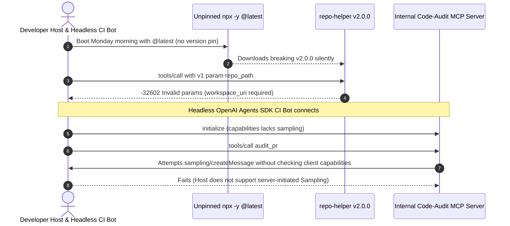

# Module 16: The MCP Ecosystem

> **Prerequisites:** [Module 01: The M×N Integration Problem](../01-the-mxn-integration-problem/README.md), [Module 03: Architecture: Hosts, Clients and Servers](../03-architecture-hosts-clients-and-servers/README.md), [Module 13: Building an MCP Client](../13-building-an-mcp-client/README.md), and [Module 15: Security and Trust Boundaries](../15-security-and-trust-boundaries/README.md).  
> **Estimated Reading Time:** 32 minutes  
> **Target Audience:** AI Platform Engineers, Developer Tooling Architects, Enterprise Integration Leads

> [!TIP]
> **The Golden Rule of the MCP Ecosystem:** Never reinvent commodity connectors—adopt reference servers (`filesystem`, `git`, `postgres`, `fetch`, `memory`) behind **immutable version/digest pins (`==2025.4.7`, `@2025.3.28`, `@sha256:...`), never floating `@latest` tags**, design servers to degrade gracefully across **host capability matrices** (since many agent SDKs only expose `Tools` rather than `Sampling` or `Prompts`), and keep **MCP (`Agent -> Tool/Resource`) strictly separated from A2A (`Agent -> Peer Agent`)** at the orchestration boundary.

---

## Why This Matters

Once your team understands how JSON-RPC wire framing and security boundaries work, the temptation is to treat MCP like an open app store: drop five community servers from GitHub into `claude_desktop_config.json`, pass `npx -y @org/mcp-server@latest`, and assume every AI host behaves identically.

In production, three ecosystem realities punish that shortcut immediately:

1. **Unpinned Supply-Chain Drift:** Running `npx -y pkg@latest` or `uvx pkg` executes freshly published third-party code on every session boot without integrity pinning. A minor upstream release can silently alter a tool schema—or inject malicious code directly inside your developer's UID (`env` secrets, SSH keys, cloud tokens).
2. **Host Capability Fragmentation:** A custom server that depends heavily on server-initiated `Sampling` (`sampling/createMessage`) and `Prompts` (`/slash` UI templates) runs smoothly inside VS Code Copilot—and crashes with capability errors or silent feature loss inside `OpenAI Agents SDK` or headless LangGraph loops that only load `Tools`.
3. **Protocol Boundary Confusion (MCP vs. A2A):** Teams force remote peer AI agents into MCP `tools/call` schemas (turning `30`-minute stateful reasoning workflows into fragile synchronous RPC wrappers) instead of composing **MCP vertically** (Agent $\leftrightarrow$ Tools/Resources) with **A2A horizontally** (Agent $\leftrightarrow$ Autonomous Agent).

---

## 1. Ecosystem Architecture: Reference Servers, Registries, Host Adapters & MCP + A2A

```mermaid
flowchart LR
    subgraph Reg["Discovery & Pinning Layer"]
        Registry["Official MCP Registry (server.json)"] -->|"Audit + Lock Version"| Pin["Immutable Pins (uvx==x.y.z / npm@x.y.z / oci@sha256)"]
    end

    subgraph Hosts["MCP Host Ecosystem"]
        CD["Claude Desktop / Cursor / VS Code Copilot"]
        SDK["OpenAI Agents SDK / LangGraph (langchain-mcp-adapters)"]
    end

    subgraph RefServers["Vertical Tool & Context Servers (MCP)"]
        FS["filesystem (Roots Guarded)"]
        Git["git (Repo Diff / Log)"]
        PG["postgres (Read-Only Schema + SQL)"]
        Fetch["fetch (Web -> Markdown + SSRF Guard)"]
        Mem["memory (Local Knowledge Graph)"]
    end

    subgraph PeerAgents["Horizontal Peer Agents (A2A)"]
        A2A["Autonomous Peer Agent (/.well-known/agent.json)"]
    end

    Pin --> Hosts
    Hosts -->|"MCP JSON-RPC 2.0 (Agent -> Tool/Data)"| RefServers
    Hosts -->|"A2A HTTP Tasks (Agent -> Peer Agent)"| A2A
    A2A -->|"Private Internal MCP Sessions"| RefServers
```



### Quantitative Ecosystem Mechanics: Schema Context Tax & Supply-Chain Drift

- **Multi-Server Schema Token Tax ($T_{\text{schemas}}$):** Every active MCP server mounted into a single host prompt injects $N_s$ tool definitions averaging $\bar{\tau}_{\text{tool}} \approx 150\text{–}220$ tokens per tool (JSON schema + descriptions):

$$T_{\text{schemas}} = \sum_{s=1}^{S} N_{s} \cdot \bar{\tau}_{\text{tool}}$$

Mounting `5` MCP servers exposing `18` tools each at `180` tokens/tool consumes `16,200` prompt tokens **on every single turn before the user asks a question**—driving up TTFT, token spend, and tool-selection confusion (`> 30` simultaneous tools noticeably degrades function-calling precision). Mount servers selectively per workspace or dynamically route tool subsets.

- **Unpinned Restart Drift Probability ($P_{\text{drift}}$):** Across a fleet performing $R$ container or developer IDE restarts per week with unpinned `@latest` packages carrying per-restart upstream release/compromise rate $p_{\text{change}}$:

$$P_{\text{drift}} = 1 - (1 - p_{\text{change}})^{R}$$

Immutable version pins (`uvx pkg==2025.4.7`, `npx --no-install pkg@2025.3.28`, `docker image@sha256:<64-hex>`) collapse $P_{\text{drift}} \to 0$ between reviewed upgrades.

### Navigating Official Reference Servers (`modelcontextprotocol/servers`)

| Reference Server | Package / Runtime | Exposed Primitives & Scope | Primary Production Guardrail |
| :--- | :--- | :--- | :--- |
| **`filesystem`** | Node / Docker reference server | `Tools` for reading, listing, and scoped editing of local directories | Enforce canonical `Roots` / explicit directory allowlists; never grant `/` or `~` |
| **`git`** | `uvx mcp-server-git` (Python) | Inspects `git status`, `git diff`, commit logs, and branch state cleanly | Restrict repo path via `--repository`; isolate write/push actions behind HITL |
| **`postgres`** | Reference Node / community Python/Go | `Resources` for table DDL schemas + `Tools` for read-only SQL queries | Connect via a **read-only DB role** (`DEFAULT TRANSACTION READ ONLY`) with `statement_timeout` |
| **`fetch`** | `uvx mcp-server-fetch` (Python) | Retrieves web URLs and converts HTML into clean Markdown chunks | Enforce **SSRF IP-blocklists** (`169.254.169.254`, RFC 1918 LAN) and treat fetched text as untrusted data |
| **`memory`** | Reference Node knowledge-graph server | Persists entities, relations, and observations across local sessions | Separate per-tenant / per-project graph stores to prevent cross-project context leaks |

### Official Registry (`server.json`) & Supply-Chain Pinning Rules

The **Official MCP Registry** (`registry.modelcontextprotocol.io` / `github.com/modelcontextprotocol/registry`) acts as a canonical metadata directory—publishing standardized `server.json` descriptors pointing to packages on PyPI (`uvx`), npm (`npx`), and OCI registries (Docker MCP catalog) without executing arbitrary registry-hosted binaries itself.

To enforce **zero-drift supply-chain hygiene** across developer workstations and CI containers:

1. **Ban `@latest` and Implicit Auto-Installs:** Reject `npx -y @org/server` or `npx @org/server@latest` in team configs. Require exact semver/calver pins (`@org/server@2025.3.28`) backed by lockfile integrity (`package-lock.json` / `npm ci` or pre-baked images).
2. **Pin PyPI Packages with `==` (and Hashes for CI):** Use `uvx mcp-server-fetch==2025.4.7` (or `uv tool install --from ...` with `uv.lock`) rather than bare `uvx mcp-server-fetch`.
3. **Pin Containerized Servers by SHA-256 Digest:** In the Docker MCP catalog or internal Kubernetes deployments, reference `mcp/postgres@sha256:<64-hex-digest>` rather than mutable `:latest` or `:v1` tags, paired with `--network=none` and `--read-only`.

### Composing MCP with Google / Linux Foundation A2A (Agent2Agent)

Backend architects frequently confuse **MCP** and **A2A** (`a2a-protocol.org`). They are **complementary, orthogonal layers**:

- **MCP is Vertical (`Agent -> Tool / Structured Resource`):** Standardizes how *one* AI agent invokes stateless or short-lived deterministic capabilities (`tools/call`, `resources/read`, `prompts/get`) whose schemas, arguments, and execution behavior are transparent to the caller.
- **A2A is Horizontal (`Agent -> Peer Autonomous Agent`):** Standardizes how an orchestrator discovers peer agents via `/.well-known/agent.json` (`AgentCard`), delegates long-running, stateful multi-turn tasks (`tasks/send`, `submitted -> working -> input-required -> completed`), and receives finished `Artifacts` **without** seeing the peer agent's private prompts, memory, or internal MCP database credentials!

---

## 2. Systematic Comparison Matrix: Host Compatibility & MCP vs. A2A

### Host & Framework Compatibility Matrix

| Host / Agent Framework | `stdio` | Streamable HTTP / SSE | `Tools` | `Resources` | `Prompts` | `Sampling` | `Roots` | Integration Pattern |
| :--- | :--- | :--- | :--- | :--- | :--- | :--- | :--- | :--- |
| **Claude Desktop** | Yes | Remote connectors / proxies | **Full** | **Full** | **Full** | Limited / Restricted | **Yes** (Configured dirs) | `claude_desktop_config.json` |
| **Cursor IDE** | Yes | Yes | **Full** | Partial | Partial | No | **Yes** (Workspace) | `.cursor/mcp.json` |
| **VS Code (GitHub Copilot)** | Yes | **Yes (OAuth 2.1)** | **Full** | **Full** | **Full** | **Full** | **Yes** (Workspace) | `.vscode/mcp.json` |
| **OpenAI Agents SDK** | `MCPServerStdio` | `MCPServerSse` / `StreamableHttp` | **Full** | Programmatic | `get_prompt()` | No (Agent loop owns LLM) | Manual env/config | Python/TS SDK server list |
| **LangGraph (`langchain-mcp-adapters`)** | `StdioConnection` | `StreamableHttpConnection` | **Full (`load_mcp_tools`)** | `load_mcp_resources` | `load_mcp_prompt` | No (Graph owns LLM) | Programmatic | `MultiServerMCPClient` |

### MCP vs. A2A Architectural Boundary Matrix

| Architectural Axis | Model Context Protocol (MCP) | Agent2Agent Protocol (A2A) |
| :--- | :--- | :--- |
| **Integration Axis** | **Vertical:** Agent $\leftrightarrow$ Tool / File / DB Resource | **Horizontal:** Orchestrator Agent $\leftrightarrow$ Autonomous Peer Agent |
| **Capability Discovery** | `initialize` + `tools/list`, `resources/list`, `prompts/list` | HTTP `GET /.well-known/agent.json` (`AgentCard`) |
| **Opacity & Encapsulation** | **Transparent schema:** Host sees exact tool parameters & raw tool outputs | **Opaque peer:** Caller sees high-level skills & task artifacts, never peer prompts/DBs |
| **Task Duration & State** | Short-to-medium RPC calls with optional `_meta.progressToken` | Asynchronous stateful task FSM (`submitted`, `working`, `input-required`, `completed`) |
| **Credential Trust Boundary** | Host grants scoped access to a tool/resource directly | Peer agent keeps its **own** private MCP servers & enterprise credentials internal |

---

## 3. Production War Story Post-Mortem: The Unpinned `npx @latest` Regression & Host Capability Mismatch

| Field | Incident Details |
| :--- | :--- |
| **Severity** | **SEV-1** (CI Pipeline Outage + Agent Workflow Breakage Across 2 Host Environments) |
| **Detection / Resolution Time** | Detected 25 minutes after Monday morning workstation restarts / Mitigated in 2 hours (pinned package digests + added capability-aware fallback path) |
| **Impact** | `65` developers hit `Method not found` / schema parse errors after an unpinned community package auto-updated via `npx -y ...@latest`, while deploying the team's new internal PR reviewer server into OpenAI Agents SDK failed silently because the server required `sampling/createMessage` |

### What Happened

A developer platform team deployed two ecosystem integrations simultaneously:
1. Their shared `.mcp.json` launched a community markdown/repo helper using `"command": "npx", "args": ["-y", "@example/repo-helper@latest"]`. Over the weekend, `@example/repo-helper` pushed a major breaking bump (`2.0.0`) that renamed a required argument from `repo_path` to `workspace_uri`. Every developer restarting Cursor or Claude Desktop on Monday morning auto-pulled `2.0.0`, breaking internal prompt chains instantly.
2. Separately, the team built an internal code-audit MCP server that worked inside VS Code Copilot because it relied on **`sampling/createMessage`** to summarize large diffs using the host's LLM. When platform engineers wired that exact server into a headless CI triage bot running **OpenAI Agents SDK**, every audit call threw `-32601` / capability missing because the SDK runner does not implement server-initiated `Sampling` callbacks.



### Root Cause Analysis

- **Floating Package Specifier (`@latest`):** `npx -y ...@latest` converted routine process restarts into unreviewed continuous deployments of external dependencies.
- **Unchecked Negotiated Host Capabilities:** The server assumed every MCP client implements `Sampling` instead of inspecting `clientCapabilities.sampling` during `initialize` and falling back cleanly (returning structured diff text to the caller agent when `sampling` is absent).

### The Fix & Architectural Hardening

- **Config Policy Linter in CI:** Added a pre-commit and gateway admission rule rejecting any `npx`, `uvx`, or `docker` MCP server definition lacking an immutable exact version (`==x.y.z`, `@x.y.z`) or SHA-256 OCI digest (`@sha256:...`).
- **Capability-Driven Graceful Degradation:** Updated the server to inspect `capabilities` negotiated in `initialize`; when `sampling` is absent (OpenAI Agents SDK, Cursor, LangGraph), the tool returns bounded raw diff excerpts so the host agent summarizes them directly in its own turn.

---

## 4. Multi-Language Production Implementation: Supply-Chain Pinning Linter & Host Capability Negotiator

Below is a production-ready **Ecosystem Config Pinner & Capability Negotiator** in **Go**, **TypeScript**, **Python**, and **C#**. It validates `mcp_servers.json` manifests (rejecting `@latest`, unversioned `uvx`, and un-digested Docker images) and negotiates graceful execution modes against varying Host capability sets.

````carousel

```go
package mcpecosystem

import (
	"fmt"
	"regexp"
	"strings"
)

var (
	npmPinnedRe    = regexp.MustCompile(`@\d+\.\d+\.\d+$`)
	dockerDigestRe = regexp.MustCompile(`@sha256:[a-f0-9]{64}$`)
)

type ServerLaunchSpec struct {
	Name    string
	Command string
	Args    []string
}

func ValidateSupplyChainPin(spec ServerLaunchSpec) error {
	joined := strings.Join(spec.Args, " ")
	if strings.Contains(joined, "@latest") || strings.Contains(joined, ":latest") {
		return fmt.Errorf("%s: floating :latest/@latest tag forbidden", spec.Name)
	}
	switch spec.Command {
	case "uvx":
		for _, a := range spec.Args {
			if strings.Contains(a, "==") {
				return nil
			}
		}
		return fmt.Errorf("%s: uvx requires exact ==version pin", spec.Name)
	case "npx":
		for _, a := range spec.Args {
			if npmPinnedRe.MatchString(a) {
				return nil
			}
		}
		return fmt.Errorf("%s: npx requires exact @x.y.z semver pin", spec.Name)
	case "docker":
		for _, a := range spec.Args {
			if dockerDigestRe.MatchString(a) {
				return nil
			}
		}
		return fmt.Errorf("%s: docker requires immutable @sha256:<64-hex> digest", spec.Name)
	default:
		return nil
	}
}

func SelectExecutionMode(hostCaps map[string]bool, wantsSampling bool) string {
	if !hostCaps["tools"] {
		return "UNSUPPORTED_HOST"
	}
	if wantsSampling && !hostCaps["sampling"] {
		return "DEGRADED_RETURN_RAW_CONTEXT"
	}
	return "FULL_NATIVE_MODE"
}
```

<!-- slide -->

```typescript
export interface ServerEntry {
  readonly name: string;
  readonly command: "uvx" | "npx" | "docker" | string;
  readonly args: readonly string[];
}

export interface PinCheckResult {
  readonly ok: boolean;
  readonly code: string;
}

const NPM_PIN_RE = /@\d+\.\d+\.\d+$/;
const OCI_DIGEST_RE = /@sha256:[a-f0-9]{64}$/;

export function validateSupplyChainPin(entry: ServerEntry): PinCheckResult {
  const joined = entry.args.join(" ");
  if (joined.includes("@latest") || joined.includes(":latest")) {
    return { ok: false, code: "REJECT_FLOATING_LATEST" };
  }
  if (entry.command === "uvx") {
    return entry.args.some((a) => a.includes("=="))
      ? { ok: true, code: "PINNED_OK" }
      : { ok: false, code: "REJECT_UNPINNED_PYPI" };
  }
  if (entry.command === "npx") {
    return entry.args.some((a) => NPM_PIN_RE.test(a))
      ? { ok: true, code: "PINNED_OK" }
      : { ok: false, code: "REJECT_UNPINNED_NPM" };
  }
  if (entry.command === "docker") {
    return entry.args.some((a) => OCI_DIGEST_RE.test(a))
      ? { ok: true, code: "PINNED_OK" }
      : { ok: false, code: "REJECT_MISSING_OCI_DIGEST" };
  }
  return { ok: true, code: "CUSTOM_BINARY_REVIEW_REQUIRED" };
}

export function resolveHostMode(
  hostCaps: ReadonlySet<string>,
  requiredCaps: readonly string[],
): { mode: "FULL" | "DEGRADED"; missing: string[] } {
  const missing = requiredCaps.filter((c) => !hostCaps.has(c));
  return missing.length === 0 ? { mode: "FULL", missing: [] } : { mode: "DEGRADED", missing };
}
```

<!-- slide -->

```python
"""
mcp_ecosystem_policy.py
Validates MCP registry/launch supply-chain pins and selects host capability fallbacks.
"""
from dataclasses import dataclass
import re

NPM_EXACT_RE = re.compile(r"@\d+\.\d+\.\d+$")
OCI_DIGEST_RE = re.compile(r"@sha256:[a-f0-9]{64}$")


@dataclass(frozen=True)
class PinValidationResult:
    server_name: str
    passed: bool
    status: str


def audit_server_pin(name: str, command: str, args: list[str]) -> PinValidationResult:
    joined = " ".join(args)
    if "@latest" in joined or ":latest" in joined:
        return PinValidationResult(name, False, "REJECT_FLOATING_LATEST")
    if command == "uvx" and not any("==" in a for a in args):
        return PinValidationResult(name, False, "REJECT_UNPINNED_PYPI")
    if command == "npx" and not any(NPM_EXACT_RE.search(a) for a in args):
        return PinValidationResult(name, False, "REJECT_UNPINNED_NPM")
    if command == "docker" and not any(OCI_DIGEST_RE.search(a) for a in args):
        return PinValidationResult(name, False, "REJECT_MISSING_OCI_DIGEST")
    return PinValidationResult(name, True, "PINNED_OK")


def select_host_capability_mode(host_caps: set[str], server_wants: set[str]) -> str:
    missing = sorted(server_wants - host_caps)
    if not missing:
        return "FULL_MODE"
    if "tools" in missing:
        return "INCOMPATIBLE_NO_TOOLS"
    return f"DEGRADED_FALLBACK(missing={','.join(missing)})"


def estimate_schema_token_tax(server_tool_counts: list[int], avg_tokens_per_tool: int = 180) -> int:
    return sum(count * avg_tokens_per_tool for count in server_tool_counts)
```

<!-- slide -->

```csharp
using System;
using System.Collections.Generic;
using System.Linq;
using System.Text.RegularExpressions;

namespace GenAI.McpEcosystem;

public sealed record McpServerLaunch(string Name, string Command, IReadOnlyList<string> Args);

public static class EcosystemPolicyGuard
{
    private static readonly Regex NpmExactRe = new(@"@\d+\.\d+\.\d+$", RegexOptions.Compiled);
    private static readonly Regex OciDigestRe = new(@"@sha256:[a-f0-9]{64}$", RegexOptions.Compiled);

    public static (bool Passed, string Code) ValidatePin(McpServerLaunch launch)
    {
        string joined = string.Join(" ", launch.Args);
        if (joined.Contains("@latest", StringComparison.OrdinalIgnoreCase) ||
            joined.Contains(":latest", StringComparison.OrdinalIgnoreCase))
        {
            return (false, "REJECT_FLOATING_LATEST");
        }

        return launch.Command switch
        {
            "uvx" => launch.Args.Any(a => a.Contains("==", StringComparison.Ordinal))
                ? (true, "PINNED_OK")
                : (false, "REJECT_UNPINNED_PYPI"),
            "npx" => launch.Args.Any(a => NpmExactRe.IsMatch(a))
                ? (true, "PINNED_OK")
                : (false, "REJECT_UNPINNED_NPM"),
            "docker" => launch.Args.Any(a => OciDigestRe.IsMatch(a))
                ? (true, "PINNED_OK")
                : (false, "REJECT_MISSING_OCI_DIGEST"),
            _ => (true, "PINNED_OK")
        };
    }

    public static string NegotiateMode(IReadOnlySet<string> hostCaps, IEnumerable<string> desiredCaps)
    {
        var missing = desiredCaps.Where(c => !hostCaps.Contains(c)).OrderBy(c => c).ToArray();
        return missing.Length == 0
            ? "FULL_MODE"
            : $"DEGRADED(missing={string.Join(",", missing)})";
    }
}
```

````

---

## 5. Practical Hands-On Verification CLI Workflows

Run these deterministic Python 3.13 verification scripts offline—no third-party packages or API keys required.

### Workflow 1: Supply-Chain Pinning Policy Linter (`uvx` / `npx` / `docker`)

Audit six real-world server launch declarations, failing floating `@latest` tags, unversioned PyPI packages, and mutable Docker tags while passing pinned digests:

```bash
python -c '
import re

configs = [
    ("fetch-prod",   "uvx",    ["mcp-server-fetch==2025.4.7"]),
    ("fetch-unsafe", "uvx",    ["mcp-server-fetch"]),
    ("fs-unsafe",    "npx",    ["-y", "@modelcontextprotocol/server-filesystem@latest", "/repo"]),
    ("fs-pinned",    "npx",    ["--no-install", "@modelcontextprotocol/server-filesystem@2025.3.28", "/repo"]),
    ("pg-digest",    "docker", ["run", "--rm", "-i", "--network=none", "mcp/postgres@sha256:" + "a"*64]),
    ("pg-tag-only",  "docker", ["run", "--rm", "-i", "mcp/postgres:latest"]),
]

def audit_server_pin(name, cmd, args):
    joined = " ".join(args)
    if "@latest" in joined or ":latest" in joined:
        return False, "REJECT_FLOATING_LATEST"
    if cmd == "uvx" and not any("==" in a for a in args):
        return False, "REJECT_UNPINNED_PYPI"
    if cmd == "npx" and not any(re.search(r"@\d+\.\d+\.\d+$", a) for a in args):
        return False, "REJECT_UNPINNED_NPM"
    if cmd == "docker" and not any(re.search(r"@sha256:[a-f0-9]{64}$", a) for a in args):
        return False, "REJECT_MISSING_OCI_DIGEST"
    return True, "PINNED_OK"

for name, cmd, args in configs:
    ok, reason = audit_server_pin(name, cmd, args)
    print(f"{name:<13} ({cmd:<6}) | pass={str(ok):<5} | {reason}")
'
```

**Expected Output:**

```text
fetch-prod    (uvx   ) | pass=True  | PINNED_OK
fetch-unsafe  (uvx   ) | pass=False | REJECT_UNPINNED_PYPI
fs-unsafe     (npx   ) | pass=False | REJECT_FLOATING_LATEST
fs-pinned     (npx   ) | pass=True  | PINNED_OK
pg-digest     (docker) | pass=True  | PINNED_OK
pg-tag-only   (docker) | pass=False | REJECT_FLOATING_LATEST
```

### Workflow 2: Host Capability Matrix & Schema Context-Tax Profiler

Evaluate which hosts support a server requesting `{"tools", "resources", "sampling"}` versus degraded fallback, and calculate cumulative prompt token tax across mounted servers:

```bash
python -c '
host_caps = {
    "Claude Desktop":      {"tools", "resources", "prompts", "roots"},
    "Cursor IDE":          {"tools", "roots"},
    "VS Code Copilot":     {"tools", "resources", "prompts", "sampling", "roots"},
    "OpenAI Agents SDK":   {"tools", "prompts"},
    "LangGraph Adapters":  {"tools", "resources", "prompts"},
}
server_reqs = {"tools", "resources", "sampling"}

for host, caps in host_caps.items():
    missing = ",".join(sorted(server_reqs - caps))
    mode = "FULL_MODE" if not missing else f"DEGRADED(missing={missing})"
    print(f"{host:<20} | {mode}")

for n_servers, tools_per_srv, tok_per_tool in [(2, 8, 180), (5, 18, 180), (10, 22, 200)]:
    tax = n_servers * tools_per_srv * tok_per_tool
    print(f"Schema tax ({n_servers:2d} servers x {tools_per_srv:2d} tools @ {tok_per_tool} tok) = {tax:,} prompt tokens")
'
```

**Expected Output:**

```text
Claude Desktop       | DEGRADED(missing=sampling)
Cursor IDE           | DEGRADED(missing=resources,sampling)
VS Code Copilot      | FULL_MODE
OpenAI Agents SDK    | DEGRADED(missing=resources,sampling)
LangGraph Adapters   | DEGRADED(missing=sampling)
Schema tax ( 2 servers x  8 tools @ 180 tok) = 2,880 prompt tokens
Schema tax ( 5 servers x 18 tools @ 180 tok) = 16,200 prompt tokens
Schema tax (10 servers x 22 tools @ 200 tok) = 44,000 prompt tokens
```

### Workflow 3: MCP vs. A2A Hybrid Orchestration Router

Classify vertical deterministic tool/resource lookups onto **MCP** versus opaque stateful multi-turn agent delegations onto **A2A**:

```bash
python -c '
requests = [
    ("read_postgres_schema",  {"kind": "resource_lookup", "stateful_workflow": False, "opaque_reasoning": False}),
    ("git_diff_head",         {"kind": "deterministic_tool", "stateful_workflow": False, "opaque_reasoning": False}),
    ("delegate_sec_triage",   {"kind": "autonomous_peer",   "stateful_workflow": True,  "opaque_reasoning": True}),
]

def route_protocol(req):
    if req["opaque_reasoning"] or req["stateful_workflow"]:
        return "A2A (AgentCard + tasks/send -> Peer Agent -> Private MCP)"
    return "MCP (Direct Host/Agent -> Server tools/call or resources/read)"

for name, meta in requests:
    print(f"{name:<22} -> {route_protocol(meta)}")
'
```

**Expected Output:**

```text
read_postgres_schema   -> MCP (Direct Host/Agent -> Server tools/call or resources/read)
git_diff_head          -> MCP (Direct Host/Agent -> Server tools/call or resources/read)
delegate_sec_triage    -> A2A (AgentCard + tasks/send -> Peer Agent -> Private MCP)
```

### Hands-On Exercises

1. **Pre-Release Semver Rejector:** Extend Workflow 1's regex so `npx` also rejects caret/tilde ranges (`^1.2.0`, `~2.1.0`) and untagged container images lacking both `:` and `@sha256:`.
2. **Context-Budget Admission Cap:** Modify Workflow 2 to fail mounting any additional MCP server once cumulative $T_{\text{schemas}}$ exceeds a `12,000`-token context budget, printing which servers were lazy-deferred.
3. **Optional Live Host/SDK Wiring (Requires API Key & `openai-agents` or `langchain-mcp-adapters`):** Point `MCPServerStdio` or `MultiServerMCPClient` at an official pinned `mcp-server-fetch` or `mcp-server-git` process and log the exact discovered tool count and schema character length.

### Independent Challenge

A platform architect wants to expose an internal "Autonomous Incident Commander" team agent—which runs multi-step log correlation, hypothesis testing, and PagerDuty triage across private observability stores over `3–10` minutes—to five external engineering bots across the company. Half the team proposes wrapping the Incident Commander as a single giant `run_incident_triage` MCP tool; the other half proposes exposing it over **A2A** while keeping its internal Postgres and Splunk connections behind **MCP**. Evaluate both designs across protocol coupling, credential blast radius, statefulness, and host compatibility.

<details><summary>Architectural Discussion</summary>

Wrapping an autonomous `3–10` minute multi-turn agent inside a raw MCP `tools/call` misuses MCP: callers must guess prompt-style arguments, long HTTP/SSE timeouts break brittle tool loops, and there is no standardized multi-turn `input-required` state machine or opaque artifact negotiation. Exposing the Incident Commander over **A2A (`/.well-known/agent.json` + `tasks/send`)** treats it as an autonomous peer agent with explicit lifecycle states (`submitted -> working -> input-required -> completed`), while allowing the Incident Commander to consume internal Postgres and Splunk privately over **MCP** without leaking downstream database credentials or raw schemas to external callers.

</details>

---

## 6. Common Mistakes & Troubleshooting

- **Shipping `npx -y @org/server@latest` or `uvx pkg` in shared team configurations:** Silently pulls unreviewed upstream releases and breaking schema changes on restart. Enforce exact `==x.y.z`, `@x.y.z`, or Docker `@sha256:...` digests in CI.
- **Mounting `8+` MCP servers into one flat agent prompt simultaneously:** Loading `150+` tool schemas burns `25,000+` prompt tokens per turn and degrades model tool selection accuracy. Scope servers per agent role or mount dynamically on demand.
- **Assuming every Host supports `Sampling` and `Resources` UI primitives:** Agent frameworks like OpenAI Agents SDK focus primarily on `Tools` and programmatic calls, whereas VS Code Copilot implements `Sampling` and `Roots`. Inspect negotiated client capabilities at `initialize` and fall back gracefully.
- **Giving `postgres` or `fetch` reference servers unrestricted production permissions:** Connect `postgres` strictly via a read-only database user (`READ ONLY`) with query timeouts, and put SSRF private-IP filters in front of `fetch`.

---

## 7. Operational Validation Checkpoints & Checkpoint Quiz

### Operational Validation Checkpoints

<details><summary><strong>Checkpoint 1: Auditing Supply-Chain Pinning for Production MCP Configs</strong></summary>

During a PR review, a developer submits `.vscode/mcp.json` containing `"command": "npx", "args": ["-y", "@modelcontextprotocol/server-postgres@latest", "postgres://..."]` alongside a Docker entry `"mcp/git:v1.2"`. Why should both entries fail your admission policy?

**Validation:** First, `-y @latest` downloads unreviewed npm releases dynamically on every restart, opening the door to breaking schemas or malicious transitive packages; it must be pinned to an exact version (`@x.y.z` with lockfile integrity). Second, mutable Docker tags (`:v1.2`) can be overwritten upstream—production container entries must specify an immutable `@sha256:<64-hex>` digest (and the Postgres connection string should use a read-only credential injected cleanly via secret store).

</details>

<details><summary><strong>Checkpoint 2: Handling Missing `Sampling` Capability Across Heterogeneous Hosts</strong></summary>

Your custom repository-audit MCP server succeeds in VS Code Copilot using `sampling/createMessage` to summarize file diffs, yet fails immediately when run via `langchain-mcp-adapters` inside LangGraph. How do you make one server portable across both?

**Validation:** Check the `capabilities` object negotiated during `initialize`. When `capabilities.sampling` is present (VS Code Copilot), the server may optionally delegate summarization via `sampling/createMessage`. When `sampling` is absent (LangGraph, Cursor, OpenAI Agents SDK), fall back gracefully by returning the bounded structured diff text inside the normal `tools/call` result so the host orchestrator's LLM performs summarization directly.

</details>

<details><summary><strong>Checkpoint 3: Selecting MCP vs. A2A at System Boundaries</strong></summary>

An enterprise team is building two integrations: (A) giving a coding assistant read-only access to local `git diff` and repository files, and (B) letting a Support Orchestrator delegate multi-step fraud investigations (`5` minutes, iterative evidence requests) to a Risk Analytics Agent owned by another department. Map each to MCP or A2A and justify why.

**Validation:** Integration (A) maps to **MCP** (`git` and `filesystem` servers over local `stdio` with `Roots`), because the caller is invoking deterministic, short-lived tools/resources directly. Integration (B) maps to **A2A** (`AgentCard` + stateful `tasks/send`), because the caller is delegating an opaque, long-running, multi-turn autonomous task across organizational boundaries where the Risk Agent must keep its internal prompts and downstream **MCP** data tools completely encapsulated.

</details>

### Checkpoint Quiz

1. What are the five classic official MCP reference servers, and what primary safety guardrail applies to `postgres` and `fetch`?
2. Why are floating `@latest` tags and `npx -y` dangerous in production MCP host configs?
3. Explain the "Schema Context Tax" when mounting many MCP servers simultaneously into one LLM loop.
4. Which major host/IDE vs. SDK differences matter most when designing servers that rely on `Sampling` or `Prompts`?
5. Summarize the architectural difference between **MCP** and **A2A** in one crisp rule.

<details><summary>Answers</summary>

1. `filesystem`, `git`, `postgres`, `fetch`, and `memory`. `postgres` must connect using a strict read-only role with timeouts; `fetch` must enforce SSRF private/metadata IP blocklists and treat fetched web text as untrusted data.
2. They auto-download unreviewed package versions on every host restart, exposing developer machines and containers to breaking schema changes, tool poisoning, or supply-chain malware compromises.
3. Every tool schema consumes `~150–220` prompt tokens per turn (`T_schemas = sum(N_s * tau_tool)`). Mounting `5–10` servers with `100+` combined tools wastes `16,000–44,000` tokens every turn and degrades tool-selection accuracy.
4. IDE/chat hosts (`VS Code Copilot`, `Claude Desktop`) expose rich `Resources`, `Prompts`, and `Roots` (and `Sampling` in VS Code), whereas programmatic agent frameworks (`OpenAI Agents SDK`, `LangGraph`) center primarily around `Tools` and do not implement server-initiated `Sampling` callbacks.
5. **MCP** connects an **Agent to Tools and Structured Resources** vertically (transparent schemas); **A2A** connects an **Agent to an Autonomous Peer Agent** horizontally (opaque skills, stateful tasks, and encapsulated private MCP tools).

</details>

---

## Further Reading & Sources

- [Official MCP Registry (`modelcontextprotocol/registry`)](https://github.com/modelcontextprotocol/registry) — canonical `server.json` discovery schema and registry API architecture.
- [Official MCP Reference Servers (`modelcontextprotocol/servers`)](https://github.com/modelcontextprotocol/servers) — reference implementations for `filesystem`, `git`, `postgres`, `fetch`, and `memory`.
- [OpenAI Agents SDK — MCP Integration Docs](https://openai.github.io/openai-agents-python/mcp/) — native `MCPServerStdio`, `MCPServerSse`, and `MCPServerStreamableHttp` host adapters.
- [LangChain Docs — Model Context Protocol (`langchain-mcp-adapters`)](https://docs.langchain.com/oss/python/langchain/mcp) — `MultiServerMCPClient` wiring tools, resources, and prompts into LangGraph workflows.
- [Agent2Agent (A2A) Protocol Specification](https://a2a-protocol.org/) — open horizontal peer-agent interoperability standard designed to compose alongside MCP.

## Next

[Module 17: Capstone Project](../17-capstone-project/README.md)
