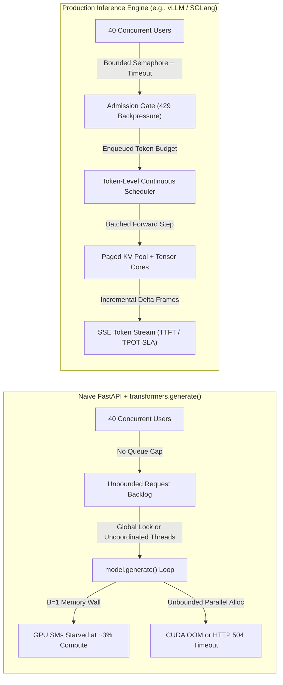
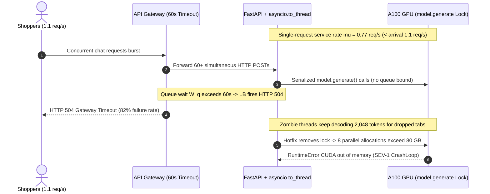

# Module 00: The Serving Problem

> **Prerequisites:** [Track 02: Transformer Architecture](../../02-transformer-architecture/README.md), [Track 05, Module 03: Memory Hierarchy and Bandwidth](../../05-gpus-and-genai-hardware/03-memory-hierarchy-and-bandwidth/README.md), [Track 05, Module 04: VRAM: The Real Constraint](../../05-gpus-and-genai-hardware/04-vram-the-real-constraint/README.md).  
> **Estimated Reading Time:** 30 minutes  
> **Target Audience:** AI Backend Engineers, Inference Serving Architects, SREs & Platform Engineers

> [!TIP]
> **The Golden Rule of LLM Serving:** Never wrap a local `transformers.generate()` loop behind a web server for production traffic. Autoregressive inference is a **stateful, variable-duration streaming queueing problem**: naive synchronous wrappers serialize concurrent users, starve GPU Tensor Cores near `3%` SM compute utilization, and crash with `CUDA Out Of Memory` under burst load. Production serving requires bounded admission control, token-level continuous scheduling, and SLA optimization over **TTFT**, **TPOT/ITL**, and **SLA-compliant Goodput**—not raw tokens per second.

---

## Why This Matters

In local development, loading a `7B` or `8B` model with Hugging Face `transformers` and calling `model.generate()` looks deceptively fast: a single prompt streams `128` tokens in `~1.2` seconds on an A100 or H100. Naturally, teams wrap that function inside a FastAPI endpoint, attach a Uvicorn worker, and declare the inference service ready for staging.

Ten minutes into load testing with `40` concurrent users, three catastrophic failures strike simultaneously:

1. **Cascading `HTTP 504 Gateway Timeout` Failures:** Because each request runs autoregressively for `1–15` seconds while holding the GPU lock (or spawning overlapping memory allocations), the arrival queue balloons non-linearly until Nginx/ALB cuts off connections at `60` seconds.
2. **Misleading GPU Utilization (`~3%` SM Compute):** Operators inspect `nvidia-smi` and see `GPU-Util: 95%`, assuming the GPU is maxed out—yet Nsight Compute (`sm__throughput.avg.pct_of_peak_sustained_elapsed`) reveals Streaming Multiprocessors sitting at `~3%` compute utilization because single-request decoding stalls waiting on High-Bandwidth Memory (HBM) weight reads.
3. **Sudden `CUDA Out Of Memory` Crashes:** Allowing `16` async workers to call `model.generate()` concurrently without centralized KV-cache budgeting overcommits VRAM as soon as several users simultaneously generate `1,500+` token responses.

Understanding *why* naive serving collapses—and the exact latency, throughput, and queueing SLIs that govern real-time token generation—sets the engineering foundation for every optimization in Track 14.

---

## 1. Anatomy of the Serving Collapse & Core SLIs

Unlike stateless REST endpoints (`GET /users/42` taking `12 ms` with `50 KB` heap allocation) or fixed-shape image classifiers (`ResNet-50` taking `4 ms` per forward pass), an autoregressive LLM endpoint has three uniquely hostile runtime properties:

1. **Sequential Token Dependency:** Generating `200` tokens requires `200` full sequential forward passes through every transformer layer.
2. **Dynamic, Unbounded Output Lengths:** You know the prompt length $L_p$ at request arrival, but output length $L_o$ is unknown until the model emits `<EOS>` (ranging anywhere from `12` tokens for a classification label to `3,000+` tokens for code generation).
3. **Stateful Per-Request Memory Growth:** Every generated token appends intermediate Key and Value states into GPU VRAM for the entire duration of the request.



### Quantitative Serving SLIs, Goodput & Little's Law

Production inference teams evaluate serving health using four strict Service Level Indicators (SLIs) plus **Goodput**:

| Metric | Formula / Definition | Typical Interactive Target | Primary Hardware Driver |
| :--- | :--- | :--- | :--- |
| **TTFT** (Time to First Token) | $t_{\text{first\_token}} - t_{\text{request\_arrived}}$ | `<= 250–500 ms` (chat/RAG) | Queue wait + Compute-bound prompt prefill |
| **ITL** (Inter-Token Latency) | $\Delta t_i = t_{\text{token\_}i} - t_{\text{token\_}(i-1)}$ | `p99 <= 100–150 ms` | Single step time; spikes catch prefill stalls |
| **TPOT** (Time Per Output Token) | $\text{TPOT} = \frac{t_{\text{last\_token}} - t_{\text{first\_token}}}{N_{\text{out}} - 1} = \overline{\text{ITL}}$ | `<= 30–50 ms/tok` (`20–33 tok/s`) | HBM memory-bandwidth bound decode speed |
| **E2EL** (End-to-End Latency) | $\text{E2EL} = \text{TTFT} + (N_{\text{out}} - 1) \cdot \text{TPOT}$ | Workload-dependent (`<= 5–15 s`) | Combined prefill, decode, and output length $N_{\text{out}}$ |
| **Goodput** | Throughput (req/s or tok/s) satisfying **all** SLA bounds simultaneously | Maximize under `p99` SLA gate | Optimal concurrency operating point before saturation |

- **Why Raw Throughput Lies:** Increasing batch size $B$ from `16` to `128` can quadruple raw system throughput (`tok/s`), yet push `TTFT` past `2,000 ms` or `TPOT` past `80 ms/tok`. Because users abandon stalled streams—or upstream callers hit HTTP timeouts—**raw throughput counts useless wasted GPU work**. **Goodput** measures *only* requests (or generated tokens belonging to requests) that satisfy:

$$\text{TTFT} \le \tau_{\text{TTFT}} \quad \land \quad \text{TPOT} \le \tau_{\text{TPOT}} \quad \land \quad p_{99}(\text{ITL}) \le \tau_{\text{ITL}}$$

- **Little's Law & Variable-Duration Queueing Collapse:** By **Little's Law**, the average number of requests $L$ trapped in the server equals arrival rate $\lambda$ times mean residence time $W$:

$$L = \lambda \cdot W = \lambda \cdot \left(W_q + \mathbb{E}[S]\right)$$

When a single-stream server takes mean service time $\mathbb{E}[S] = 1.2\text{ s}$ (capacity $\mu = 0.833\text{ req/s}$), traffic intensity is $\rho = \lambda \cdot \mathbb{E}[S]$. Under the Pollaczek-Khinchine formula for an `M/G/1` queue, queueing delay $W_q$ scales directly with the **squared coefficient of variation** $C_s^2 = \text{Var}(S) / \mathbb{E}[S]^2$ of output length:

$$W_q \approx \left(\frac{\rho}{1 - \rho}\right) \cdot \left(\frac{1 + C_s^2}{2}\right) \cdot \mathbb{E}[S]$$

For homogeneous web RPCs ($C_s^2 \approx 0.05$), hitting $\rho = 0.90$ multiplies wait by $\frac{1.05}{2} \approx 0.53$. For autoregressive LLMs mixing `20`-token JSON responses with `2,000`-token essays ($C_s^2 \approx 2.5\text{–}4.0$), the variance penalty $\frac{1 + C_s^2}{2}$ inflates queue time **`3x–5x` higher** at identical average utilization!

---

## 2. Systematic Comparison Matrix: Naive vs. Production Serving Patterns

| Architecture Dimension | Naive `transformers.generate()` Wrapper | Static-Batched Inference Server | Continuous Serving Engine (vLLM / SGLang) |
| :--- | :--- | :--- | :--- |
| **Concurrency Execution** | Serial lock (`B=1`) or uncoordinated process workers | Collects `N` requests, waits for *slowest* `<EOS>` | Iteration-level scheduling inserts/evicts sequences every token |
| **GPU SM Compute Util** | `~0.3%–3%` (starved by weight reads at `B=1`) | Moderate (`10%–35%`), drops to `1%` during padding tail | High (`40%–85%+`) across sustained mixed prefill/decode batches |
| **KV Cache Lifecycle** | Re-allocated contiguously per call; leaks/fragments | Pre-allocated to `max_model_len` per slot (huge waste) | Paged virtual memory blocks allocated strictly on demand |
| **Tail Latency (`p99 TTFT` / `ITL`)** | Catastrophic queue explosion (`10s–60s+`) | Head-of-line stalling waiting for batch formation & longest sequence | Bounded via `max_num_batched_tokens` and chunked prefill |
| **Variable Output Lengths** | Long generation blocks subsequent short requests | Short requests sit idle padded behind longest response | Finished requests exit immediately; freed slots refill next step |
| **Backpressure & Cancellation** | Client disconnect leaves GPU generating orphan tokens | Batch keeps running padded dead sequences | Stream abort immediately frees KV blocks & halts forward passes |

---

## 3. Production War Story Post-Mortem: The \$45,000 Launch-Day `transformers.generate()` Meltdown

| Field | Incident Details |
| :--- | :--- |
| **Severity** | **SEV-1** (Total AI Checkout Assistant Outage & Cascading Pod CrashLoopBackOff) |
| **Detection / Resolution Time** | Detected `4` minutes after marketing launch email via `HTTP 504` pager / Mitigated in `18` minutes via gateway rate cap + `max_tokens` clamp; resolved in `4` hours by migrating to dedicated vLLM engine |
| **Impact** | `82%` of checkout support requests failed with `HTTP 504`; `3` `A100-80GB` pods entered `CUDA OOM` crash loops; **\$45,000** in abandoned cart revenue and enterprise SLA credits |

### What Happened

An e-commerce platform shipped a product-comparison assistant backed by `Llama-3-8B-Instruct` inside a Python FastAPI service running `uvicorn --workers 4`. Each worker loaded a copy of the model (`16 GB` weights each—wait, `4` workers didn't even fit on `1` GPU, so they scaled to `1` worker with `asyncio.to_thread(model.generate)` and `max_new_tokens=2048`).

During the morning campaign spike, traffic climbed from `0.3 req/s` to `1.1 req/s`. Because average `model.generate()` latency was `1.3` seconds ($\mu = 0.77\text{ req/s}$), utilization breached $\rho > 1.0$. Unbounded FastAPI request queues filled to `190` pending coroutines. Even after users closed their browser tabs at the `15`-second mark, the synchronous PyTorch C++ extension inside `asyncio.to_thread()` ignored HTTP disconnects and kept decoding all `2,048` tokens on dead connections. When an engineer tried to "fix" throughput by bumping `uvicorn` to `2` GPU worker processes (`32 GB` weights) and removing the thread lock so `8` threads called `model.generate()` in parallel, overlapping dynamic PyTorch tensor allocations spiked VRAM past `80 GB` and crashed every pod.



### Root Cause Analysis

- **Zero Admission Control:** No bounded semaphore or queue-wait deadline rejected excess traffic when arrival rate $\lambda$ exceeded server service rate $\mu$.
- **Unstoppable Work on Client Disconnect:** Wrapping blocking C++/CUDA `model.generate()` in `asyncio.to_thread()` cannot preempt CUDA kernels when an HTTP client disconnects, turning canceled requests into zombie GPU compute.
- **No Continuous Batching or KV Memory Manager:** Executing requests serially left Tensor Cores idle (`~0.5%–3%` SM compute), while naive concurrent calls duplicated un-managed KV allocations until OOM.

### The Fix & Architectural Hardening

- **Dedicated Continuous-Batching Engine:** Migrated model execution out of FastAPI into a standalone vLLM serving tier implementing iteration-level scheduling and PagedAttention ([Modules 06–08](../06-continuous-batching/README.md)).
- **Gateway Admission Semaphore + `429 Retry-After`:** Capped in-flight queue wait at `1,500 ms` at the API gateway so excess bursts fail fast with `HTTP 429` rather than poisoning active users' latency via Little's Law queueing buildup.
- **Cancellation & Token Budget Clamping:** Propagated client disconnects (`req.Context().Done()` / `AbortSignal` / `CancellationToken`) to abort SSE streams immediately and enforced domain-calibrated `max_tokens` caps (`<= 512` for chat).

---

## 4. Multi-Language Production Implementation: SLA-Aware SSE Streaming Gateway & Telemetry Client

In production, backend engineers sit in front of the inference engine (OpenAI-compatible `/v1/chat/completions` SSE endpoint). Below is a complete **Admission-Controlled SSE Streaming Client & Goodput SLA Tracker** in **Go**, **TypeScript**, **Python**, and **C#**. Each implementation enforces:

1. **Bounded Admission Control:** Non-blocking semaphore acquisition with explicit queue timeout returning `429` backpressure before wasting GPU capacity.
2. **Client Cancellation Propagation:** Propagating request context/abort signals directly into the streaming HTTP request so disconnects free server KV blocks immediately.
3. **Exact SLI Telemetry:** Capturing wall-clock `TTFT`, per-token `ITL`, `TPOT`, `E2EL`, and binary Goodput SLA evaluation (`TTFT <= 500ms && TPOT <= 40ms`).

````carousel

```go
package servinggateway

import (
	"bufio"
	"bytes"
	"context"
	"encoding/json"
	"errors"
	"fmt"
	"net/http"
	"strings"
	"time"
)

var (
	ErrQueueSaturated = errors.New("admission queue saturated: backpressure 429")
	ErrUpstreamFail   = errors.New("upstream inference returned non-200")
)

type SLAThresholds struct {
	MaxTTFT time.Duration
	MaxTPOT time.Duration
}

type StreamMetrics struct {
	TTFT          time.Duration
	TPOT          time.Duration
	P99ITL        time.Duration
	E2EL          time.Duration
	OutputTokens  int
	GoodputPassed bool
	FullText      string
}

type GatewayClient struct {
	endpoint   string
	httpClient *http.Client
	sem        chan struct{}
	queueWait  time.Duration
	sla        SLAThresholds
}

func NewGatewayClient(endpoint string, maxInflight int, queueWait time.Duration, sla SLAThresholds) *GatewayClient {
	return &GatewayClient{
		endpoint:   strings.TrimRight(endpoint, "/"),
		httpClient: &http.Client{Timeout: 0}, // Rely on per-request context deadline for streaming
		sem:        make(chan struct{}, maxInflight),
		queueWait:  queueWait,
		sla:        sla,
	}
}

func (g *GatewayClient) StreamCompletion(ctx context.Context, model, prompt string, maxTokens int) (StreamMetrics, error) {
	if maxTokens <= 0 || maxTokens > 2048 {
		return StreamMetrics{}, fmt.Errorf("invalid maxTokens=%d: must be in [1, 2048]", maxTokens)
	}

	// Bounded admission control prevents Little's Law queue collapse
	admTimer := time.NewTimer(g.queueWait)
	defer admTimer.Stop()
	select {
	case g.sem <- struct{}{}:
		defer func() { <-g.sem }()
	case <-admTimer.C:
		return StreamMetrics{}, ErrQueueSaturated
	case <-ctx.Done():
		return StreamMetrics{}, ctx.Err()
	}

	payload, err := json.Marshal(map[string]any{
		"model":      model,
		"messages":   []map[string]string{{"role": "user", "content": prompt}},
		"max_tokens": maxTokens,
		"stream":     true,
	})
	if err != nil {
		return StreamMetrics{}, err
	}

	reqCtx, cancel := context.WithTimeout(ctx, 30*time.Second)
	defer cancel()

	req, err := http.NewRequestWithContext(reqCtx, http.MethodPost, g.endpoint+"/v1/chat/completions", bytes.NewReader(payload))
	if err != nil {
		return StreamMetrics{}, err
	}
	req.Header.Set("Content-Type", "application/json")
	req.Header.Set("Accept", "text/event-stream")

	start := time.Now()
	resp, err := g.httpClient.Do(req)
	if err != nil {
		return StreamMetrics{}, err
	}
	defer resp.Body.Close()

	if resp.StatusCode != http.StatusOK {
		return StreamMetrics{}, fmt.Errorf("%w: status=%d", ErrUpstreamFail, resp.StatusCode)
	}

	scanner := bufio.NewScanner(resp.Body)
	var sb strings.Builder
	var firstTokenAt, prevTokenAt time.Time
	var itls []time.Duration
	tokens := 0

	for scanner.Scan() {
		line := strings.TrimSpace(scanner.Text())
		if !strings.HasPrefix(line, "data:") {
			continue
		}
		data := strings.TrimSpace(strings.TrimPrefix(line, "data:"))
		if data == "[DONE]" {
			break
		}
		var chunk struct {
			Choices []struct {
				Delta struct {
					Content string `json:"content"`
				} `json:"delta"`
			} `json:"choices"`
		}
		if err := json.Unmarshal([]byte(data), &chunk); err != nil || len(chunk.Choices) == 0 {
			continue
		}
		delta := chunk.Choices[0].Delta.Content
		if delta == "" {
			continue
		}

		now := time.Now()
		if tokens == 0 {
			firstTokenAt = now
		} else {
			itls = append(itls, now.Sub(prevTokenAt))
		}
		prevTokenAt = now
		tokens++
		sb.WriteString(delta)
	}
	if err := scanner.Err(); err != nil {
		return StreamMetrics{}, err
	}
	if tokens == 0 {
		return StreamMetrics{}, errors.New("stream ended with zero content tokens")
	}

	end := time.Now()
	ttft := firstTokenAt.Sub(start)
	e2el := end.Sub(start)
	var tpot, p99 time.Duration
	if tokens > 1 {
		tpot = prevTokenAt.Sub(firstTokenAt) / time.Duration(tokens-1)
		p99 = computeP99(itls)
	}
	passed := ttft <= g.sla.MaxTTFT && tpot <= g.sla.MaxTPOT

	return StreamMetrics{
		TTFT:          ttft,
		TPOT:          tpot,
		P99ITL:        p99,
		E2EL:          e2el,
		OutputTokens:  tokens,
		GoodputPassed: passed,
		FullText:      sb.String(),
	}, nil
}

func computeP99(durations []time.Duration) time.Duration {
	if len(durations) == 0 {
		return 0
	}
	cp := append([]time.Duration(nil), durations...)
	for i := 1; i < len(cp); i++ {
		for j := i; j > 0 && cp[j] < cp[j-1]; j-- {
			cp[j], cp[j-1] = cp[j-1], cp[j]
		}
	}
	idx := int(float64(len(cp)-1) * 0.99)
	return cp[idx]
}
```

<!-- slide -->

```typescript
export interface SlaConfig {
  readonly maxTtftMs: number;
  readonly maxTpotMs: number;
  readonly queueTimeoutMs: number;
  readonly requestTimeoutMs: number;
}

export interface StreamSliReport {
  readonly ttftMs: number;
  readonly tpotMs: number;
  readonly p99ItlMs: number;
  readonly e2elMs: number;
  readonly outputTokens: number;
  readonly goodputOk: boolean;
  readonly text: string;
}

export class AdmissionRejectedError extends Error {
  readonly statusCode = 429;
  constructor(message: string) {
    super(message);
    this.name = "AdmissionRejectedError";
  }
}

export class BoundedServingClient {
  private active = 0;
  private readonly waiters: Array<() => void> = [];

  constructor(
    private readonly baseUrl: string,
    private readonly maxInflight: number,
    private readonly sla: SlaConfig,
  ) {
    if (maxInflight <= 0) throw new RangeError("maxInflight must be >= 1");
  }

  private acquireSlot(signal?: AbortSignal): Promise<void> {
    if (this.active < this.maxInflight) {
      this.active += 1;
      return Promise.resolve();
    }
    return new Promise((resolve, reject) => {
      const timer = setTimeout(() => {
        const idx = this.waiters.indexOf(onGrant);
        if (idx >= 0) this.waiters.splice(idx, 1);
        reject(new AdmissionRejectedError("Queue wait SLA exceeded; return HTTP 429"));
      }, this.sla.queueTimeoutMs);

      const onAbort = () => {
        clearTimeout(timer);
        const idx = this.waiters.indexOf(onGrant);
        if (idx >= 0) this.waiters.splice(idx, 1);
        reject(new Error("Client aborted while waiting in admission queue"));
      };

      const onGrant = () => {
        clearTimeout(timer);
        signal?.removeEventListener("abort", onAbort);
        this.active += 1;
        resolve();
      };

      signal?.addEventListener("abort", onAbort, { once: true });
      this.waiters.push(onGrant);
    });
  }

  private releaseSlot(): void {
    this.active -= 1;
    const next = this.waiters.shift();
    if (next) next();
  }

  async streamChat(
    model: string,
    prompt: string,
    maxTokens: number,
    outerSignal?: AbortSignal,
  ): Promise<StreamSliReport> {
    if (maxTokens < 1 || maxTokens > 2048) {
      throw new RangeError(`maxTokens=${maxTokens} violates gateway ceiling [1, 2048]`);
    }
    await this.acquireSlot(outerSignal);

    const timeoutController = new AbortController();
    const timeoutHandle = setTimeout(() => timeoutController.abort(), this.sla.requestTimeoutMs);
    const onOuterAbort = () => timeoutController.abort();
    outerSignal?.addEventListener("abort", onOuterAbort, { once: true });

    try {
      const t0 = performance.now();
      const resp = await fetch(`${this.baseUrl.replace(/\/$/, "")}/v1/chat/completions`, {
        method: "POST",
        headers: { "Content-Type": "application/json", Accept: "text/event-stream" },
        body: JSON.stringify({
          model,
          messages: [{ role: "user", content: prompt }],
          max_tokens: maxTokens,
          stream: true,
        }),
        signal: timeoutController.signal,
      });
      if (!resp.ok || !resp.body) {
        throw new Error(`Upstream inference error: HTTP ${resp.status}`);
      }

      const reader = resp.body.getReader();
      const decoder = new TextDecoder();
      let buffer = "";
      let firstTokenTime: number | null = null;
      let prevTokenTime = 0;
      const itls: number[] = [];
      const chunks: string[] = [];

      while (true) {
        const { done, value } = await reader.read();
        if (done) break;
        buffer += decoder.decode(value, { stream: true });
        const lines = buffer.split("\n");
        buffer = lines.pop() ?? "";

        for (const rawLine of lines) {
          const line = rawLine.trim();
          if (!line.startsWith("data:")) continue;
          const payload = line.slice(5).trim();
          if (payload === "[DONE]") break;
          const parsed = JSON.parse(payload) as {
            choices?: Array<{ delta?: { content?: string } }>;
          };
          const tokenText = parsed.choices?.[0]?.delta?.content ?? "";
          if (!tokenText) continue;

          const now = performance.now();
          if (firstTokenTime === null) {
            firstTokenTime = now;
          } else {
            itls.push(now - prevTokenTime);
          }
          prevTokenTime = now;
          chunks.push(tokenText);
        }
      }

      if (firstTokenTime === null) {
        throw new Error("Inference stream closed without generating a token");
      }

      const tEnd = performance.now();
      const ttftMs = firstTokenTime - t0;
      const e2elMs = tEnd - t0;
      const tpotMs = itls.length > 0 ? itls.reduce((a, b) => a + b, 0) / itls.length : 0;
      const sortedItl = [...itls].sort((a, b) => a - b);
      const p99ItlMs = sortedItl.length > 0 ? sortedItl[Math.floor((sortedItl.length - 1) * 0.99)] : 0;

      return {
        ttftMs,
        tpotMs,
        p99ItlMs,
        e2elMs,
        outputTokens: chunks.length,
        goodputOk: ttftMs <= this.sla.maxTtftMs && tpotMs <= this.sla.maxTpotMs,
        text: chunks.join(""),
      };
    } finally {
      clearTimeout(timeoutHandle);
      outerSignal?.removeEventListener("abort", onOuterAbort);
      this.releaseSlot();
    }
  }
}
```

<!-- slide -->

```python
"""
serving_sla_gateway.py
Async admission-controlled SSE streaming client tracking TTFT, TPOT, p99 ITL, and Goodput.
"""
from __future__ import annotations

import asyncio
from dataclasses import dataclass
import json
import time
from typing import AsyncIterator


class AdmissionSaturatedError(RuntimeError):
    """Raised when waiting requests exceed queue SLA -> map to HTTP 429 Retry-After."""


@dataclass(frozen=True)
class SlaThresholds:
    max_ttft_ms: float = 400.0
    max_tpot_ms: float = 40.0
    queue_timeout_s: float = 0.75
    request_timeout_s: float = 30.0


@dataclass(frozen=True)
class SliTelemetry:
    ttft_ms: float
    tpot_ms: float
    p99_itl_ms: float
    e2el_ms: float
    output_tokens: int
    goodput_passed: bool
    text: str


class BoundedInferenceGateway:
    def __init__(self, max_inflight: int, sla: SlaThresholds) -> None:
        if max_inflight < 1:
            raise ValueError("max_inflight must be >= 1")
        self._sem = asyncio.Semaphore(max_inflight)
        self._sla = sla

    async def execute_stream(
        self,
        sse_byte_stream: AsyncIterator[bytes],
        max_tokens: int,
    ) -> SliTelemetry:
        if not 1 <= max_tokens <= 2048:
            raise ValueError(f"max_tokens={max_tokens} outside safe [1, 2048] serving cap")

        try:
            await asyncio.wait_for(self._sem.acquire(), timeout=self._sla.queue_timeout_s)
        except asyncio.TimeoutError as exc:
            raise AdmissionSaturatedError("Queue wait exceeded; reject early with HTTP 429") from exc

        t_start = time.perf_counter()
        first_token_at: float | None = None
        prev_token_at: float = t_start
        itls_ms: list[float] = []
        fragments: list[str] = []

        try:
            async with asyncio.timeout(self._sla.request_timeout_s):
                buffer = ""
                async for raw_chunk in sse_byte_stream:
                    buffer += raw_chunk.decode("utf-8", errors="replace")
                    while "\n" in buffer:
                        line, buffer = buffer.split("\n", 1)
                        line = line.strip()
                        if not line.startswith("data:"):
                            continue
                        payload = line[5:].strip()
                        if payload == "[DONE]":
                            break
                        event = json.loads(payload)
                        delta = (
                            event.get("choices", [{}])[0]
                            .get("delta", {})
                            .get("content", "")
                        )
                        if not delta:
                            continue

                        now = time.perf_counter()
                        if first_token_at is None:
                            first_token_at = now
                        else:
                            itls_ms.append((now - prev_token_at) * 1000.0)
                        prev_token_at = now
                        fragments.append(delta)
                        if len(fragments) >= max_tokens:
                            break
        finally:
            self._sem.release()

        if first_token_at is None:
            raise RuntimeError("Upstream stream closed without emitting any token")

        t_end = time.perf_counter()
        ttft_ms = (first_token_at - t_start) * 1000.0
        e2el_ms = (t_end - t_start) * 1000.0
        tpot_ms = sum(itls_ms) / len(itls_ms) if itls_ms else 0.0
        sorted_itls = sorted(itls_ms)
        p99_itl_ms = sorted_itls[int((len(sorted_itls) - 1) * 0.99)] if sorted_itls else 0.0
        passed = ttft_ms <= self._sla.max_ttft_ms and tpot_ms <= self._sla.max_tpot_ms

        return SliTelemetry(
            ttft_ms=ttft_ms,
            tpot_ms=tpot_ms,
            p99_itl_ms=p99_itl_ms,
            e2el_ms=e2el_ms,
            output_tokens=len(fragments),
            goodput_passed=passed,
            text="".join(fragments),
        )
```

<!-- slide -->

```csharp
using System;
using System.Collections.Generic;
using System.Diagnostics;
using System.IO;
using System.Net.Http;
using System.Text;
using System.Text.Json;
using System.Threading;
using System.Threading.Tasks;

namespace GenAI.Serving;

public sealed record SlaBudget(
    double MaxTtftMs,
    double MaxTpotMs,
    TimeSpan QueueTimeout,
    TimeSpan RequestTimeout);

public sealed record SseStreamReport(
    double TtftMs,
    double TpotMs,
    double P99ItlMs,
    double E2elMs,
    int OutputTokens,
    bool GoodputPassed,
    string Content);

public sealed class ServingBackpressureException : Exception
{
    public ServingBackpressureException(string message) : base(message) { }
}

public sealed class SlaStreamingGatewayClient : IDisposable
{
    private readonly HttpClient _http;
    private readonly SemaphoreSlim _admissionGate;
    private readonly SlaBudget _sla;
    private readonly string _endpoint;

    public SlaStreamingGatewayClient(string endpoint, int maxInflight, SlaBudget sla, HttpClient? httpClient = null)
    {
        if (maxInflight < 1) throw new ArgumentOutOfRangeException(nameof(maxInflight));
        _endpoint = endpoint.TrimEnd('/');
        _admissionGate = new SemaphoreSlim(maxInflight, maxInflight);
        _sla = sla;
        _http = httpClient ?? new HttpClient { Timeout = Timeout.InfiniteTimeSpan };
    }

    public async Task<SseStreamReport> StreamCompletionAsync(
        string model,
        string prompt,
        int maxTokens,
        CancellationToken ct = default)
    {
        if (maxTokens is < 1 or > 2048)
            throw new ArgumentOutOfRangeException(nameof(maxTokens), "Must stay within [1, 2048]");

        if (!await _admissionGate.WaitAsync(_sla.QueueTimeout, ct))
            throw new ServingBackpressureException("Concurrency semaphore saturated; fail fast with HTTP 429.");

        using var linkedCts = CancellationTokenSource.CreateLinkedTokenSource(ct);
        linkedCts.CancelAfter(_sla.RequestTimeout);

        try
        {
            var bodyJson = JsonSerializer.Serialize(new
            {
                model,
                messages = new[] { new { role = "user", content = prompt } },
                max_tokens = maxTokens,
                stream = true
            });

            using var req = new HttpRequestMessage(HttpMethod.Post, $"{_endpoint}/v1/chat/completions")
            {
                Content = new StringContent(bodyJson, Encoding.UTF8, "application/json")
            };

            var sw = Stopwatch.StartNew();
            using var resp = await _http.SendAsync(req, HttpCompletionOption.ResponseHeadersRead, linkedCts.Token);
            resp.EnsureSuccessStatusCode();

            await using var stream = await resp.Content.ReadAsStreamAsync(linkedCts.Token);
            using var reader = new StreamReader(stream, Encoding.UTF8);

            double? ttftMs = null;
            double prevMs = 0;
            var itls = new List<double>();
            var output = new StringBuilder();
            int tokenCount = 0;

            while (!reader.EndOfStream)
            {
                linkedCts.Token.ThrowIfCancellationRequested();
                var line = await reader.ReadLineAsync(linkedCts.Token);
                if (string.IsNullOrWhiteSpace(line) || !line.StartsWith("data:", StringComparison.Ordinal))
                    continue;

                var payload = line.AsSpan(5).Trim();
                if (payload.SequenceEqual("[DONE]")) break;

                using var doc = JsonDocument.Parse(payload.ToString());
                if (!doc.RootElement.TryGetProperty("choices", out var choices) || choices.GetArrayLength() == 0)
                    continue;
                if (!choices[0].TryGetProperty("delta", out var delta) ||
                    !delta.TryGetProperty("content", out var contentElem))
                    continue;

                var token = contentElem.GetString();
                if (string.IsNullOrEmpty(token)) continue;

                double nowMs = sw.Elapsed.TotalMilliseconds;
                if (ttftMs is null) ttftMs = nowMs;
                else itls.Add(nowMs - prevMs);

                prevMs = nowMs;
                tokenCount++;
                output.Append(token);
            }

            if (ttftMs is null)
                throw new InvalidOperationException("SSE stream completed without content tokens.");

            double e2elMs = sw.Elapsed.TotalMilliseconds;
            double tpotMs = itls.Count > 0 ? Average(itls) : 0;
            double p99ItlMs = P99(itls);
            bool passed = ttftMs.Value <= _sla.MaxTtftMs && tpotMs <= _sla.MaxTpotMs;

            return new SseStreamReport(ttftMs.Value, tpotMs, p99ItlMs, e2elMs, tokenCount, passed, output.ToString());
        }
        finally
        {
            _admissionGate.Release();
        }
    }

    private static double Average(List<double> values)
    {
        double sum = 0;
        foreach (var v in values) sum += v;
        return sum / values.Count;
    }

    private static double P99(List<double> values)
    {
        if (values.Count == 0) return 0;
        var copy = new List<double>(values);
        copy.Sort();
        return copy[(int)((copy.Count - 1) * 0.99)];
    }

    public void Dispose() => _admissionGate.Dispose();
}
```

````

---

## 5. Practical Hands-On Verification CLI Workflows

Run these deterministic Python 3.13 verification scripts offline—no GPU, API keys, or third-party dependencies required.

### Workflow 1: Reproduce Little's Law & Output-Variance Queueing Collapse

Compare how a fixed-duration web RPC (`CV^2 = 0.05`) vs. a variable-length autoregressive LLM (`CV^2 = 2.50`) queues under rising arrival rate $\lambda$ for mean service time $\mathbb{E}[S] = 1.2\text{ s}$:

```bash
python -c '
def mg1_metrics(arrival_rps: float, mean_service_s: float, cv_squared: float):
    rho = arrival_rps * mean_service_s
    if rho >= 1.0:
        return rho, float("inf"), float("inf")
    wq = (rho / (1.0 - rho)) * ((1.0 + cv_squared) / 2.0) * mean_service_s
    w_total = wq + mean_service_s
    q_depth = arrival_rps * w_total
    return rho, w_total, q_depth

def fmt(val: float, unit: str = "") -> str:
    return "  UNSTABLE" if val == float("inf") else f"{val:6.2f}{unit}"

unit_s = "s"
print("=== Homogeneous RPC (CV^2=0.05) vs Autoregressive LLM (CV^2=2.50), E[S]=1.2s ===")
for rps in [0.40, 0.60, 0.75, 0.80, 0.85]:
    rho, wt_rpc, l_rpc = mg1_metrics(rps, 1.2, 0.05)
    _, wt_llm, l_llm = mg1_metrics(rps, 1.2, 2.50)
    print(f"lambda={rps:.2f} req/s (rho={rho*100:5.1f}%) | RPC W={fmt(wt_rpc, unit_s)} (L={fmt(l_rpc)}) | LLM W={fmt(wt_llm, unit_s)} (L={fmt(l_llm)})")
'
```

**Expected Output:**

```text
=== Homogeneous RPC (CV^2=0.05) vs Autoregressive LLM (CV^2=2.50), E[S]=1.2s ===
lambda=0.40 req/s (rho= 48.0%) | RPC W=  1.78s (L=  0.71) | LLM W=  3.14s (L=  1.26)
lambda=0.60 req/s (rho= 72.0%) | RPC W=  2.82s (L=  1.69) | LLM W=  6.60s (L=  3.96)
lambda=0.75 req/s (rho= 90.0%) | RPC W=  6.87s (L=  5.15) | LLM W= 20.10s (L= 15.07)
lambda=0.80 req/s (rho= 96.0%) | RPC W= 16.32s (L= 13.06) | LLM W= 51.60s (L= 41.28)
lambda=0.85 req/s (rho=102.0%) | RPC W=  UNSTABLE (L=  UNSTABLE) | LLM W=  UNSTABLE (L=  UNSTABLE)
```

Notice that at `90%` capacity (`0.75 req/s`), variable output length pushes average residence time `W` to **`20.10s`** (`3x` worse than a fixed-duration RPC at `6.87s`), holding `15` queued requests in flight; crossing `0.85 req/s` makes the queue diverge unboundedly (`UNSTABLE`).

### Workflow 2: Throughput vs. SLA-Compliant Goodput Across Batch Sizes

Sweep batch size `B` from `1` to `128` for `Llama-3-8B` (`FP16`, `512` prompt / `128` output tokens on `H100 SXM5`) under an interactive SLA (`TTFT <= 350 ms` and `TPOT <= 40 ms`):

```bash
python -c '
def simulate_batch_regime(batch_size: int, prompt_tok: int = 512, out_tok: int = 128):
    weight_gb = 16.0
    kv_per_tok_mb = 0.125
    hbm_bw_gb_s = 3350.0
    compute_eff_tflops = 450.0

    prefill_flops = 2 * (8e9) * batch_size * prompt_tok
    prefill_ms = max((weight_gb / hbm_bw_gb_s) * 1000, (prefill_flops / (compute_eff_tflops * 1e12)) * 1000)
    kv_gb = (batch_size * (prompt_tok + out_tok / 2) * kv_per_tok_mb) / 1024.0
    decode_step_ms = ((weight_gb + kv_gb) / hbm_bw_gb_s) * 1000 + 2.5 * (batch_size ** 0.45)

    ttft_ms = prefill_ms
    tpot_ms = decode_step_ms
    e2el_ms = ttft_ms + (out_tok - 1) * tpot_ms
    raw_tok_s = (batch_size * out_tok) / (e2el_ms / 1000.0)
    sla_ok = (ttft_ms <= 350.0) and (tpot_ms <= 40.0)
    goodput_tok_s = raw_tok_s if sla_ok else 0.0
    return ttft_ms, tpot_ms, e2el_ms, raw_tok_s, sla_ok, goodput_tok_s

for b in [1, 4, 16, 32, 64, 128]:
    ttft, tpot, e2el, raw, ok, gp = simulate_batch_regime(b)
    tag = "PASS" if ok else "FAIL"
    print(f"B={b:3d} | TTFT={ttft:6.1f} ms | TPOT={tpot:5.1f} ms | E2EL={e2el:7.1f} ms | Raw={raw:7.1f} tok/s | SLA={tag} | Goodput={gp:7.1f} tok/s")
'
```

**Expected Output:**

```text
B=  1 | TTFT=  18.2 ms | TPOT=  7.3 ms | E2EL=  944.9 ms | Raw=  135.5 tok/s | SLA=PASS | Goodput=  135.5 tok/s
B=  4 | TTFT=  72.8 ms | TPOT=  9.5 ms | E2EL= 1282.5 ms | Raw=  399.2 tok/s | SLA=PASS | Goodput=  399.2 tok/s
B= 16 | TTFT= 291.3 ms | TPOT= 13.8 ms | E2EL= 2046.1 ms | Raw= 1000.9 tok/s | SLA=PASS | Goodput= 1000.9 tok/s
B= 32 | TTFT= 582.5 ms | TPOT= 17.3 ms | E2EL= 2784.7 ms | Raw= 1470.9 tok/s | SLA=FAIL | Goodput=    0.0 tok/s
B= 64 | TTFT=1165.1 ms | TPOT= 22.4 ms | E2EL= 4005.4 ms | Raw= 2045.3 tok/s | SLA=FAIL | Goodput=    0.0 tok/s
B=128 | TTFT=2330.2 ms | TPOT= 29.7 ms | E2EL= 6096.2 ms | Raw= 2687.6 tok/s | SLA=FAIL | Goodput=    0.0 tok/s
```

Observe the classic Goodput cliff: raw throughput hits `2,687.6 tok/s` at `B=128`, yet `TTFT` blows past `350 ms` starting at `B=32`, collapsing Goodput to `0.0 tok/s`. Optimal Goodput (`1,000.9 tok/s`) occurs around `B=16`.

### Workflow 3: SSE Stream SLI Validator (`TTFT`, `TPOT`, `p99 ITL`, `E2EL`)

Verify how tracking `p99 ITL` catches mid-stream stalls that mean `TPOT` almost hides:

```bash
python -c '
import statistics

def analyze_sse_trace(request_start_ms: float, token_arrival_ms: list[float], ttft_sla: float = 300.0, tpot_sla: float = 40.0):
    ttft = token_arrival_ms[0] - request_start_ms
    itls = [b - a for a, b in zip(token_arrival_ms[:-1], token_arrival_ms[1:])]
    tpot = statistics.mean(itls)
    sorted_itls = sorted(itls)
    p99_idx = min(len(sorted_itls) - 1, int(0.99 * len(sorted_itls)))
    p99_itl = sorted_itls[p99_idx]
    e2el = token_arrival_ms[-1] - request_start_ms
    sla_pass = (ttft <= ttft_sla) and (tpot <= tpot_sla) and (p99_itl <= 150.0)
    return ttft, tpot, p99_itl, e2el, sla_pass

trace_a = [145.0] + [145.0 + 24.0 * i for i in range(1, 21)]
trace_b = [145.0]
t = 145.0
for i in range(1, 21):
    t += 420.0 if i == 9 else 24.0
    trace_b.append(t)

for name, tr in [("Healthy Stream", trace_a), ("Stalled Stream (Prefill Hijack)", trace_b)]:
    ttft, tpot, p99_itl, e2el, ok = analyze_sse_trace(0.0, tr)
    tag = "PASS" if ok else "FAIL"
    print(f"{name:<32} | TTFT={ttft:5.1f} ms | TPOT={tpot:5.1f} ms | p99_ITL={p99_itl:5.1f} ms | E2EL={e2el:6.1f} ms | SLA={tag}")
'
```

**Expected Output:**

```text
Healthy Stream                   | TTFT=145.0 ms | TPOT= 24.0 ms | p99_ITL= 24.0 ms | E2EL= 625.0 ms | SLA=PASS
Stalled Stream (Prefill Hijack)  | TTFT=145.0 ms | TPOT= 43.8 ms | p99_ITL=420.0 ms | E2EL=1021.0 ms | SLA=FAIL
```

*(Optional Live Server Check — requires a locally running OpenAI-compatible vLLM endpoint on port `8000`)*: You can measure live streaming `TTFT` and `E2EL` from the terminal with `curl -N -s -w "\nTTFT_header=%{time_starttransfer}s Total=%{time_total}s\n" http://localhost:8000/v1/chat/completions -H "Content-Type: application/json" -d '{"model":"meta-llama/Llama-3.1-8B-Instruct","messages":[{"role":"user","content":"Hello"}],"stream":true,"max_tokens":64}'`.

### Hands-On Exercises

1. **Find the Exact Saturation Point:** Modify Workflow 1 to sweep `rps` from `0.50` to `0.83` in increments of `0.02`. Identify the maximum arrival rate $\lambda_{\max}$ at which the LLM queue (`CV^2 = 2.50`) still meets a `TTFT <= 3.0s` budget, and compare it against how much higher the low-variance RPC (`CV^2 = 0.05`) scales.
2. **Tighten the Goodput Frontier:** Change Workflow 2's SLA to `TTFT <= 150 ms` and `TPOT <= 15 ms` (voice-agent SLA). Observe how peak batch Goodput drops and why reducing prefill time or splitting prefill across steps becomes mandatory.
3. **Stream Stall Detection:** Extend Workflow 3 to emit `50` tokens instead of `20` with a single `420 ms` freeze at token `9`. Calculate `TPOT` (mean `ITL`) vs `p99_ITL`—confirm that mean `TPOT` now stays under `33 ms` (`PASS` on naive average!) while `p99_ITL` catches the `420 ms` user-visible freeze.

### Independent Challenge

Your team operates an internal SQL-generation copilot backed by a single-GPU serving endpoint capable of processing `1.8` average requests/sec (`E[S] = 550 ms`). Currently, `80%` of requests return short `40`-token SQL queries (`250 ms`), while `20%` generate `1,500`-token schema explanations (`1,750 ms`), producing high output variance ($C_s^2 \approx 2.2$). Marketing plans to add a `4,000`-token codebase audit mode (`10%` of traffic) on the exact same endpoint without adding GPUs. Using **Little's Law**, the `M/G/1` queue formula, and **Goodput** principles, explain why this single change will degrade `p99 TTFT` even when average GPU utilization stays below `75%`, and design a **3-part gateway + scheduler mitigation** (using no extra GPUs).

<details><summary>Architectural Discussion</summary>

1. **Variance & Mean Drift:** Adding a `10%` long-tail mode (`~4.5s` service time) raises both mean service time $\mathbb{E}[S]$ (pushing $\rho$ closer to `1.0`) and service-time variance $C_s^2$ (scaling queueing delay $W_q \propto \frac{1 + C_s^2}{2}$). Short `40`-token SQL requests stall behind `4.5s` audit jobs, breaching their interactive `TTFT <= 400 ms` SLA and driving SQL Goodput toward zero.
2. **Three-Part Mitigation Without Extra GPUs:** (a) **Traffic Class Isolation / Separate Queues:** Route interactive SQL completions through a prioritized fast-lane token budget while placing `4,000`-token audits in a lower-priority background queue; (b) **Iteration-Level Continuous Batching + Chunked Prefill:** Prevent multi-second locks so SQL tokens continue advancing every `~30–50 ms` step alongside audit streams; (c) **Strict Admission Control + Output Caps:** Enforce `max_tokens` per route and fail excess audit bursts fast with `HTTP 429` before Little's Law queue depth spirals.

</details>

---

## 6. Common Mistakes & Troubleshooting

- **Trusting `nvidia-smi` `GPU-Util` as proof of Tensor Core saturation:** `nvidia-smi` polls whether *any* kernel is active during a sampling window, not whether Tensor Cores are doing useful FLOPs. A `B=1` `transformers.generate()` loop reading weights at `3%` compute efficiency often shows `90%+ GPU-Util`. Always inspect `sm__throughput` or token throughput vs. hardware peak.
- **Measuring only `E2EL` or average `TPOT`:** An average `TPOT` of `28 ms/tok` across a `100`-token stream hides a `900 ms` mid-generation pause if the other `99` tokens arrived at `19 ms/tok`. Always monitor **`p99 ITL`** alongside **`TTFT`**.
- **Forgetting to propagate HTTP disconnect cancellation:** Without passing `RequestContext` / `AbortSignal` / `CancellationToken` to the inference engine, impatient users clicking "Refresh" leave the server decoding orphaned tokens until `max_tokens`, wasting compute and pinning KV memory.
- **Evaluating serving stacks using raw `tok/s` at `B=256`:** Offline batch throughput benchmarks (`B=256`) look great on slides but violate interactive `TTFT` and `TPOT` SLAs. Always benchmark **Goodput** under explicit `TTFT` and `TPOT` bounds.

---

## 7. Operational Validation Checkpoints & Checkpoint Quiz

### Operational Validation Checkpoints

<details><summary><strong>Checkpoint 1: Diagnosing 95% nvidia-smi GPU-Util alongside 504 Timeouts</strong></summary>

An engineer wraps `model.generate()` in FastAPI with `asyncio.to_thread`. Under `25` concurrent users, `nvidia-smi` reads `GPU-Util: 94%`, VRAM is at `22 GB / 80 GB`, yet `60%` of callers hit `HTTP 504` after `30` seconds. Explain the root mechanism.

**Validation:** Requests are executing serially (`B=1`) inside the single GPU worker lock. `nvidia-smi` reports high `GPU-Util` simply because a memory-bandwidth-bound kernel is continuously active (`~0.3%–3%` SM compute utilization!), not because the chip is efficiently batched. Because arrival rate $\lambda$ exceeds the serial service rate $\mu$, **Little's Law** ($L = \lambda W$) drives queueing delay $W_q$ past the `30s` gateway timeout. Fix by replacing `model.generate()` with a continuous-batching serving engine (vLLM) and adding bounded admission backpressure (`429`).

</details>

<details><summary><strong>Checkpoint 2: Why Output-Length Variance Breaks Fixed-RPC Capacity Math</strong></summary>

A backend service handles `1.0 req/s` of fixed `500 ms` JSON lookups comfortably (`50%` load). A team replaces it with an LLM service that *also* averages `500 ms` per request, yet `p99` queue delay triples at `1.0 req/s`. Why?

**Validation:** By the `M/G/1` Pollaczek-Khinchine queue formula, queueing delay scales with $\frac{1 + C_s^2}{2}$, where $C_s^2$ is the squared coefficient of variation of service time. While deterministic RPCs have $C_s^2 \approx 0.05$, autoregressive LLM output lengths vary widely (`20` tokens to `1,500+` tokens), raising $C_s^2$ to `2.0–4.0` and causing severe queueing tail inflation even at identical average utilization $\rho = 0.50$.

</details>

<details><summary><strong>Checkpoint 3: Auditing a Goodput Regression After Tuning max_batch_size</strong></summary>

An operator increases server batch size from `16` to `96`. Dashboard `total_tokens_per_sec` doubles from `950 tok/s` to `1,920 tok/s`, yet customer complaints surge and SLA Goodput drops to `0 tok/s`. Diagnose why.

**Validation:** Batching `96` concurrent sequences pushed `TTFT` (and/or `TPOT`) beyond the interactive SLA threshold (e.g., `TTFT > 500 ms` or `TPOT > 50 ms`). Raw throughput rewards latency-blind accumulation, whereas **Goodput** strictly counts tokens from requests meeting *all* latency SLAs (`TTFT`, `TPOT`, `p99 ITL`). Lower concurrency via scheduler limits or `429` admission caps back to the peak Goodput operating knee (`~B=16`).

</details>

### Checkpoint Quiz

1. Define **TTFT**, **TPOT**, **ITL**, and **E2EL**, and explain why `p99 ITL` catches regressions that `TPOT` misses.
2. What distinguishes **Goodput** from raw serving throughput?
3. State **Little's Law** and explain why high output-length variance ($C_s^2$) accelerates queueing collapse in LLM serving.
4. Why does wrapping `transformers.generate()` in `asyncio` threads fail to solve concurrency or support request cancellation cleanly?
5. At what point does adding more queued requests *reduce* SLA-compliant Goodput to zero?

<details><summary>Answers</summary>

1. **TTFT** is time from request arrival to first emitted token; **ITL** is the gap between consecutive emitted tokens; **TPOT** is the average inter-token time across generation $\frac{\text{E2EL} - \text{TTFT}}{N_{\text{out}} - 1}$; **E2EL** is total request completion latency. Because `TPOT` averages across all tokens, a long `100`-token response can hide a multi-hundred-millisecond freeze that `p99 ITL` exposes immediately.
2. Raw throughput counts all generated tokens regardless of latency. **Goodput** counts only requests (or tokens from requests) satisfying every latency SLA bound simultaneously ($\text{TTFT} \le \tau_{\text{TTFT}} \land \text{TPOT} \le \tau_{\text{TPOT}}$).
3. Little's Law is $L = \lambda \cdot W$ (in-flight requests equal arrival rate times total latency). Because autoregressive response lengths vary widely ($C_s^2 \gg 0$), queueing wait $W_q \propto \frac{1 + C_s^2}{2}$ spikes sharply before $\rho$ even hits `100%`.
4. Blocking CUDA calls inside Python threads cannot share a unified paged KV cache or step-level batch scheduler—leading to either serial lock contention (`~3%` SM utilization) or OOM crashes—and PyTorch `generate()` cannot cheaply preempt mid-kernel when an HTTP client disconnects.
5. As soon as batch formation wait, prefill latency, or per-step KV memory reads push `TTFT` or `TPOT` above the configured SLA deadlines, every single completed request fails the SLA gate, dropping compliant Goodput to `0`.

</details>

---

## Further Reading & Sources

- [Efficient Memory Management for Large Language Model Serving with PagedAttention (Kwon et al., 2023)](https://arxiv.org/abs/2309.06180) — foundational analysis of LLM serving bottlenecks, KV memory fragmentation, and continuous serving throughput.
- [Taming Throughput-Latency Tradeoff in LLM Inference with Sarathi-Serve (Agrawal et al., 2024)](https://arxiv.org/abs/2403.02310) — deep dive on TTFT vs. TBT/ITL interference and throughput-optimal SLA scheduling.
- [DistServe: Disaggregating Prefill and Decoding for Goodput-optimized Large Language Model Serving (Zhong et al., 2024)](https://arxiv.org/abs/2401.09670) — formal definition and optimization of serving **Goodput** under TTFT and TPOT SLAs.
- [vLLM Documentation: Performance & Serving Engine Overview](https://docs.vllm.ai/en/latest/) — official documentation for production LLM serving architecture and metrics.

## Next

[Module 01: Inference vs. Training Workloads](../01-inference-vs-training-workloads/README.md)
