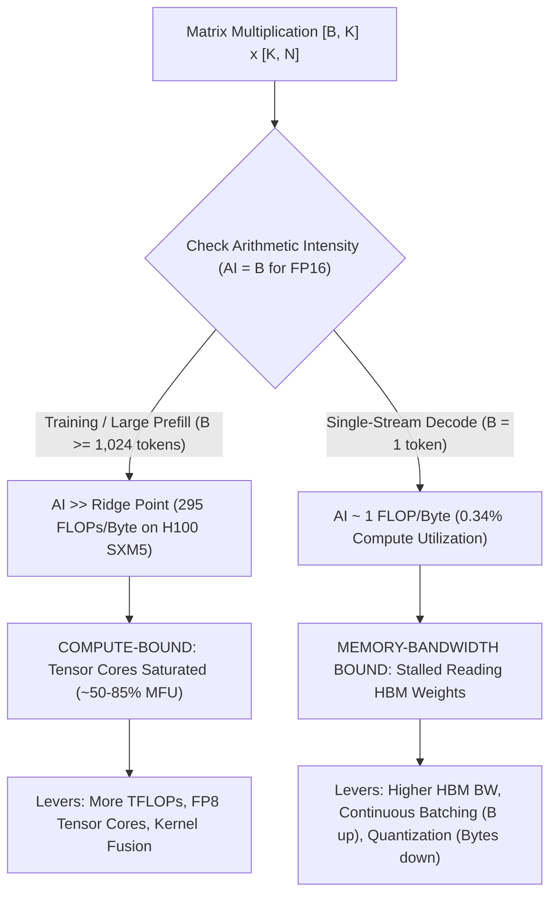
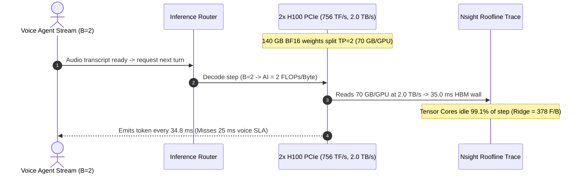

# Module 01: Inference vs. Training Workloads

> **Prerequisites:** [Module 00: The Serving Problem](../00-the-serving-problem/README.md), [Track 05, Module 02: CUDA Cores vs. Tensor Cores](../../05-gpus-and-genai-hardware/02-cuda-cores-vs-tensor-cores/README.md), [Track 05, Module 03: Memory Hierarchy and Bandwidth](../../05-gpus-and-genai-hardware/03-memory-hierarchy-and-bandwidth/README.md).  
> **Estimated Reading Time:** 35 minutes  
> **Target Audience:** AI Systems Engineers, Inference Serving Architects, ML Performance Engineers

> [!TIP]
> **The Golden Rule of Inference vs. Training Hardware Economics:** Training is **compute-bound** because large dense batches reuse every loaded weight across thousands of tokens (`AI >> Ridge Point`). Single-request autoregressive inference (`B=1`) is **catastrophically memory-bandwidth bound** because it streams gigabytes of weights from HBM just to emit one token (`AI ≈ 1 FLOP/Byte` vs. an H100 SXM5 ridge point of `~295 FLOPs/Byte`). To accelerate decoding below the ridge point, never buy more FLOPs alone—**move fewer weight bytes (quantization)** or **reuse every weight byte across more tokens (continuous batching)**.

---

## Why This Matters

Suppose your team serves a real-time coding assistant on `A100 80GB SXM4` GPUs (`312 TFLOP/s` dense FP16, `2.04 TB/s` HBM2e). Seeking lower single-stream token latency, leadership upgrades the cluster to `H100 PCIe` cards (`756 TFLOP/s` dense FP16—`2.42x` more Tensor Core compute—paired with `2.00 TB/s` HBM2e bandwidth).

You re-benchmark single-user generation (`B=1`) expecting `2.4x` faster responses. Instead, token latency does not improve at all—it stays flat (`~1.0x`), or slightly *regresses*! Yet when another team benchmarks `H100 SXM5` (`989 TFLOP/s`, `3.35 TB/s` HBM3), `B=1` decode speed jumps **`1.64x`**, matching the ratio `3.35 / 2.04` almost to the decimal.

Why did adding `444 TFLOP/s` of Tensor Core compute yield **zero** latency speedup at `B=1`? Because **training** and **autoregressive inference** live on opposite sides of the GPU **Roofline Model**, and their VRAM footprints belong to completely different worlds.

---

## 1. The Roofline Model, Arithmetic Intensity & Hardware Ridge Point

A GPU executes math on **Tensor Cores** fed by **High-Bandwidth Memory (HBM)** via on-chip SRAM. Whichever subsystem saturates first dictates wall-clock execution time.

### Core Roofline Equations

1. **Arithmetic Intensity ($\text{AI}$):** FLOPs executed per byte transferred between HBM and SRAM:

$$\text{AI} = \frac{\text{Total FLOPs}}{\text{Bytes Transferred (HBM} \leftrightarrow \text{SRAM)}}$$

2. **Attainable Performance ($P_{\text{att}}$):** Capped by either peak compute $P_{\text{peak}}$ or memory bandwidth $\text{BW}_{\text{HBM}}$ times $\text{AI}$:

$$P_{\text{att}} = \min\left(P_{\text{peak}}, \; \text{BW}_{\text{HBM}} \times \text{AI}\right)$$

3. **Hardware Ridge Point ($\text{AI}_{\text{ridge}}$):** The exact arithmetic intensity where a GPU transitions from memory-bandwidth bound to compute bound:

$$\text{AI}_{\text{ridge}} = \frac{P_{\text{peak}}}{\text{BW}_{\text{HBM}}}$$

| Accelerator (Dense FP16/BF16) | Peak Compute ($P_{\text{peak}}$) | HBM Bandwidth ($\text{BW}_{\text{HBM}}$) | Ridge Point ($\text{AI}_{\text{ridge}}$) | `B=1` Decode Utilization |
| :--- | :--- | :--- | :--- | :--- |
| **NVIDIA A100 80GB SXM4** | `312 TFLOP/s` | `2.039 TB/s` | `153.0 FLOPs/Byte` | `~0.65%` (`2.0 TF/s` achieved) |
| **NVIDIA H100 80GB PCIe** | `756 TFLOP/s` | `2.000 TB/s` | `378.0 FLOPs/Byte` | `~0.26%` (`2.0 TF/s` achieved) |
| **NVIDIA H100 80GB SXM5** | `989 TFLOP/s` | `3.350 TB/s` | `295.2 FLOPs/Byte` | `~0.34%` (`3.4 TF/s` achieved) |
| **NVIDIA L40S 48GB PCIe** | `362 TFLOP/s` | `0.864 TB/s` | `419.0 FLOPs/Byte` | `~0.24%` (`0.86 TF/s` achieved) |



### GEMM vs. GEMV Derivation: Why `B=1` Decode Hits `AI ≈ 1 FLOP/Byte`

Consider any transformer linear projection ($W_Q, W_K, W_V, W_O$, MLP up/gate/down) with weight matrix $W \in \mathbb{R}^{K \times N}$ processing $B$ tokens simultaneously ($X \in \mathbb{R}^{B \times K}$):

- **Total Floating-Point Operations:** Matrix multiplication costs $2$ FLOPs (multiply + add) per MAC:

$$\text{FLOPs} = 2 \cdot B \cdot K \cdot N$$

- **Total HBM Bytes Moved (FP16/BF16, `2 bytes/element`):**

$$\text{Bytes} = 2 \cdot (K N + B K + B N)$$

- **In Training ($B_{\text{tokens}} = \text{microbatch} \times L_{\text{seq}} \approx 4,096\text{ to }16,384$):** $K \cdot N$ is amortized across thousands of tokens, yielding high reuse ($\text{AI} \gg 295$). Forward + activation recomputation + backward `dgrad` (`dX = dY * W^T`) and `wgrad` (`dW = X^T * dY`) are all dense **Matrix-Matrix Multiplications (GEMMs)** sitting squarely on the flat **compute roof**.
- **In Single-Request Decode ($B = 1$):** We execute a **Matrix-Vector Multiplication (GEMV)** where $B = 1 \ll K, N$ (for example, $K=4096, N=14336$). Input/output vectors (`~8–28 KB`) vanish compared to the weight matrix (`~112 MB`), so $\text{Bytes} \approx 2 K N$:

$$\text{AI}(B) \approx \frac{2 \cdot B \cdot K \cdot N}{2 \cdot K \cdot N} = B \text{ FLOPs/Byte} \xrightarrow{B=1} \mathbf{1\text{ FLOP/Byte}}$$

For **weight-only INT4** (`0.5 bytes/param`), $\text{Bytes} \approx 0.5 K N$, raising arithmetic intensity to $\text{AI} \approx 4 \cdot B$ (`4 FLOPs/Byte` at `B=1`), cutting HBM transfer time by **`4x`** even with identical Tensor Core FLOP/s!

### Memory Footprint Breakdown: Training vs. Inference

Even when weights fit comfortably on a GPU for inference, training the *exact same model* demands **`8x–10x` more VRAM**:

1. **Training VRAM Footprint (Mixed Precision BF16 + FP32 AdamW):**
   - **Model Weights (BF16):** $2\text{ bytes/param}$ (`14.9 GiB` for `8B`)
   - **Gradients (BF16):** $2\text{ bytes/param}$ (`14.9 GiB` for `8B`)
   - **AdamW Optimizer States (FP32 master copy + momentum $m$ + variance $v$):** $4 + 4 + 4 = 12\text{ bytes/param}$ (`89.4 GiB` for `8B`!)
   - **Saved Activations:** Proportional to `layers * batch * seq_len * hidden`—often **`40–100+ GiB`** unless traded for recomputation via activation checkpointing.
2. **Inference VRAM Footprint (No Optimizer, No Gradients):**
   - **Model Weights:** $2\text{ bytes/param}$ in FP16/BF16 (or `1.0B` FP8 / `0.5B` INT4)
   - **Dynamic KV Cache:** Grows linearly with concurrent batch size $\times$ active sequence length ([Modules 03–04](../03-the-kv-cache/README.md))
   - **Activation Scratchpad:** Tiny transient buffer (`< 1 GiB`) overwritten layer-by-layer because backward pass never happens.

---

## 2. Systematic Comparison Matrix: Training vs. Offline Batch vs. Online Serving

| Engineering Dimension | Training (Pretraining / Fine-Tuning) | Offline Batch Inference | Online Autoregressive Serving |
| :--- | :--- | :--- | :--- |
| **Primary Hardware Bottleneck** | **Compute-bound** (Tensor Core TFLOP/s + AllReduce interconnect) | **Compute-bound** (huge batch sizes saturate ridge point) | **Split:** Prefill is compute-bound; Decode is **HBM bandwidth-bound** |
| **Dominant Matrix Kernel** | Large-batch `GEMM` (forward, activation `dgrad`, weight `wgrad`) | Large-batch `GEMM` (`B >= 256` tokens per step) | Prefill `GEMM` + small-batch Decode `GEMV` (`B = 1..64`) |
| **Arithmetic Intensity (FP16)** | `500–4,000+ FLOPs/Byte` (`AI >> Ridge`) | `256–2,048+ FLOPs/Byte` (`AI >= Ridge`) | `1–64 FLOPs/Byte` during Decode (`AI << Ridge`) |
| **Dominant Memory Consumer** | FP32 AdamW states (`12 B/param`) + multi-layer activation graph | Static weights + batched KV cache | Static weights + **dynamic variable-length KV cache** |
| **Primary Optimization Metric** | Total tokens/sec & Model FLOPs Utilization (MFU) | Total throughput (`tok/s`) & cost per million tokens | **Goodput** under strict `TTFT`, `TPOT`, `p99 ITL` SLAs |
| **Key Acceleration Levers** | Tensor/Pipeline/FSDP parallelism, FlashAttention, FP8 GEMMs | Huge continuous batches, offline prefix sorting | Continuous batching, PagedAttention, INT4/FP8 weights, speculative decoding |

---

## 3. Production War Story Post-Mortem: The \$62,000 "More TFLOPs" PCIe Upgrade Mistake

| Field | Incident Details |
| :--- | :--- |
| **Severity** | **SEV-2** (Missed Voice-Agent Latency SLA & Misallocated Annual Compute Commitment) |
| **Detection / Resolution Time** | Detected Day `1` of staging rollout via voice-agent `TPOT = 48 ms/tok` failure (`SLA <= 25 ms/tok`) / Mitigated in `3` days via INT4 AWQ quantization + Tensor Parallelism re-sharding; hardware SKU swapped at renewal |
| **Impact** | **\$62,000** locked into `1`-year reserved `8x H100 PCIe` contract that performed identically to legacy `A100 SXM4` at `B=1..4` streaming concurrency |

### What Happened

A conversational voice-AI startup needed to cut `Llama-3-70B` streaming latency from `34 ms/tok` (`~29 tok/s` on `2x A100 80GB SXM4`) down to `< 20 ms/tok` (`> 50 tok/s`) so spoken turn-taking felt natural. An infrastructure lead compared GPU vendor spec sheets solely on **FP16 TFLOP/s per dollar**: seeing `H100 PCIe` advertised at `756 TFLOP/s` (`2.4x` higher than A100's `312 TFLOP/s`) at a steep discount vs `H100 SXM5`, the team signed a `\$62,000` annual reservation for an `8x H100 PCIe` node.

When they deployed `Llama-3-70B` BF16 (`TP=2`, serving `B=1–4` voice calls per replica), `TPOT` actually **regressed slightly from `34.1 ms` to `34.8 ms`**! Nsight Systems traces showed Tensor Cores spending `99.1%` of every decode step stalled waiting on HBM reads because `H100 PCIe`'s `2.00 TB/s` memory bandwidth was identical to (slightly lower than) `A100 SXM4`'s `2.04 TB/s`.



### Root Cause Analysis

- **Spec-Sheet Selection Error:** The buyer evaluated `TFLOP/s` (training metric) instead of **HBM Bandwidth (`GB/s`)** and **Ridge Point**, ignoring that `B=1–4` decode has $\text{AI} \le 4 \ll 378$.
- **Uncompressed Weight Bytes:** Streaming `140 GB` of BF16 weights per token across `2` PCIe GPUs required `35 ms` minimum physics time (`140 GB / 4.0 TB/s`) regardless of how fast Tensor Cores were.

### The Fix & Architectural Hardening

- **Immediate Mitigation on Existing PCIe Hardware:** Applied **INT4 AWQ weight quantization** (`140 GB -> 35 GB`), slashing HBM weight bytes `4x` and dropping single-stream `TPOT` to `~10.5 ms/tok` (`95 tok/s`, easily beating the `< 25 ms` voice SLA!).
- **Procurement Gate Policy:** Added an automated Roofline Capacity Check (like the code in Section 4) requiring all future inference cluster specs to pass simulated `B=1` and `B=16` Roofline `TPOT`/`TTFT` targets before purchasing.

---

## 4. Multi-Language Production Implementation: Roofline & VRAM Capacity Analyzer

Before provisioning GPUs or tuning batch sizes, production serving teams embed deterministic Roofline and VRAM analyzers into capacity-planning pipelines and model deployment CI gates. Below are complete, validated implementations in **Go**, **TypeScript**, **Python**, and **C#**.

````carousel

```go
package roofline

import (
	"errors"
	"fmt"
)

type HardwareSpec struct {
	Name        string
	PeakTFLOPs  float64 // Dense Tensor Core TFLOP/s for target compute dtype
	HBMGBPerSec float64 // Total HBM bandwidth in GB/s across TP ranks
	TotalVRAMGB float64
}

type ModelWorkloadSpec struct {
	ActiveParamsB float64 // Billions of active parameters per token
	BytesPerParam float64 // 2.0 (BF16/FP16), 1.0 (FP8), 0.5 (INT4)
	Layers        int
	KVHeads       int
	HeadDim       int
}

type RooflineResult struct {
	RidgePointAI      float64
	ArithmeticInt     float64
	Regime            string
	AttainedTFLOPs    float64
	ComputeUtilPct    float64
	EstimatedStepMs   float64
	EstimatedTokPerS  float64
	InferenceWeightsGB float64
	TrainingAdamVRAMGB float64
}

func AnalyzeStep(hw HardwareSpec, model ModelWorkloadSpec, batchTokens int) (RooflineResult, error) {
	if hw.PeakTFLOPs <= 0 || hw.HBMGBPerSec <= 0 || hw.TotalVRAMGB <= 0 {
		return RooflineResult{}, errors.New("hardware specs must be strictly positive")
	}
	if model.ActiveParamsB <= 0 || model.BytesPerParam <= 0 || batchTokens < 1 {
		return RooflineResult{}, errors.New("model parameters, bytes/param, and batchTokens must be positive")
	}

	ridge := (hw.PeakTFLOPs * 1e12) / (hw.HBMGBPerSec * 1e9)
	flops := 2.0 * float64(batchTokens) * (model.ActiveParamsB * 1e9)
	weightBytes := model.ActiveParamsB * 1e9 * model.BytesPerParam
	ai := flops / weightBytes

	bwTFLOPs := (hw.HBMGBPerSec * 1e9 * ai) / 1e12
	attained := hw.PeakTFLOPs
	regime := "COMPUTE_BOUND"
	if bwTFLOPs < hw.PeakTFLOPs {
		attained = bwTFLOPs
		regime = "MEMORY_BANDWIDTH_BOUND"
	}

	stepMs := (flops / (attained * 1e12)) * 1000.0
	tokPerSec := float64(batchTokens) / (stepMs / 1000.0)
	weightsGiB := (model.ActiveParamsB * 1e9 * model.BytesPerParam) / (1024.0 * 1024.0 * 1024.0)
	// Mixed-precision training baseline: 2B weights + 2B grads + 12B FP32 master/AdamW = 16B/param (excluding activations)
	trainBaseGiB := (model.ActiveParamsB * 1e9 * 16.0) / (1024.0 * 1024.0 * 1024.0)

	if weightsGiB > hw.TotalVRAMGB {
		return RooflineResult{}, fmt.Errorf("weights %.1f GiB exceed GPU pool %.1f GiB", weightsGiB, hw.TotalVRAMGB)
	}

	return RooflineResult{
		RidgePointAI:       ridge,
		ArithmeticInt:      ai,
		Regime:             regime,
		AttainedTFLOPs:     attained,
		ComputeUtilPct:     (attained / hw.PeakTFLOPs) * 100.0,
		EstimatedStepMs:    stepMs,
		EstimatedTokPerS:   tokPerSec,
		InferenceWeightsGB: weightsGiB,
		TrainingAdamVRAMGB: trainBaseGiB,
	}, nil
}
```

<!-- slide -->

```typescript
export interface GpuClusterSpec {
  readonly name: string;
  readonly peakTflops: number;
  readonly hbmBandwidthGBps: number;
  readonly totalVramGiB: number;
}

export interface ModelFootprintSpec {
  readonly activeParamsBillions: number;
  readonly bytesPerWeight: number; // 2 = BF16, 1 = FP8, 0.5 = INT4
  readonly layers: number;
  readonly kvHeads: number;
  readonly headDim: number;
}

export interface RooflineReport {
  readonly ridgePointFlopPerByte: number;
  readonly arithmeticIntensity: number;
  readonly bottleneck: "MEMORY_BANDWIDTH_BOUND" | "COMPUTE_BOUND";
  readonly attainedTflops: number;
  readonly smComputeUtilizationPct: number;
  readonly stepLatencyMs: number;
  readonly throughputTokPerSec: number;
  readonly inferenceWeightsGiB: number;
  readonly trainingStaticStateGiB: number;
}

export function evaluateRooflineStep(
  gpu: GpuClusterSpec,
  model: ModelFootprintSpec,
  batchTokens: number,
): RooflineReport {
  if (gpu.peakTflops <= 0 || gpu.hbmBandwidthGBps <= 0 || gpu.totalVramGiB <= 0) {
    throw new RangeError("All GPU hardware metrics must be > 0");
  }
  if (model.activeParamsBillions <= 0 || model.bytesPerWeight <= 0 || batchTokens < 1) {
    throw new RangeError("Model activeParams, bytesPerWeight, and batchTokens must be > 0");
  }

  const GIB = 1024 ** 3;
  const weightBytes = model.activeParamsBillions * 1e9 * model.bytesPerWeight;
  const inferenceWeightsGiB = weightBytes / GIB;
  if (inferenceWeightsGiB > gpu.totalVramGiB) {
    throw new Error(
      `OOM at load: weights require ${inferenceWeightsGiB.toFixed(1)} GiB > ${gpu.totalVramGiB.toFixed(1)} GiB`,
    );
  }

  const ridgePoint = (gpu.peakTflops * 1e12) / (gpu.hbmBandwidthGBps * 1e9);
  const flops = 2.0 * batchTokens * (model.activeParamsBillions * 1e9);
  const ai = flops / weightBytes;

  const bandwidthCapTflops = (gpu.hbmBandwidthGBps * 1e9 * ai) / 1e12;
  const isMemoryBound = bandwidthCapTflops < gpu.peakTflops;
  const attainedTflops = isMemoryBound ? bandwidthCapTflops : gpu.peakTflops;
  const stepLatencyMs = (flops / (attainedTflops * 1e12)) * 1000.0;

  return {
    ridgePointFlopPerByte: ridgePoint,
    arithmeticIntensity: ai,
    bottleneck: isMemoryBound ? "MEMORY_BANDWIDTH_BOUND" : "COMPUTE_BOUND",
    attainedTflops,
    smComputeUtilizationPct: (attainedTflops / gpu.peakTflops) * 100.0,
    stepLatencyMs,
    throughputTokPerSec: batchTokens / (stepLatencyMs / 1000.0),
    inferenceWeightsGiB,
    trainingStaticStateGiB: (model.activeParamsBillions * 1e9 * 16.0) / GIB,
  };
}
```

<!-- slide -->

```python
"""
roofline_analyzer.py
Validates GPU hardware headroom, Roofline bottleneck regime, and Training vs. Inference VRAM sizing.
"""
from __future__ import annotations

from dataclasses import dataclass


@dataclass(frozen=True)
class GpuPoolSpec:
    name: str
    peak_tflops: float
    hbm_bw_gbs: float
    total_vram_gib: float


@dataclass(frozen=True)
class ModelSpec:
    active_params_b: float
    bytes_per_weight: float
    layers: int
    n_kv_heads: int
    head_dim: int


@dataclass(frozen=True)
class WorkloadAnalysis:
    ridge_ai: float
    arithmetic_intensity: float
    regime: str
    attained_tflops: float
    compute_util_pct: float
    step_ms: float
    tok_per_s: float
    inference_weights_gib: float
    training_static_gib: float


def analyze_roofline(gpu: GpuPoolSpec, model: ModelSpec, batch_tokens: int) -> WorkloadAnalysis:
    if gpu.peak_tflops <= 0 or gpu.hbm_bw_gbs <= 0 or gpu.total_vram_gib <= 0:
        raise ValueError("Hardware metrics must be strictly positive")
    if model.active_params_b <= 0 or model.bytes_per_weight <= 0 or batch_tokens < 1:
        raise ValueError("Model active_params_b, bytes_per_weight, and batch_tokens must be positive")

    gib = 1024 ** 3
    weight_bytes = model.active_params_b * 1e9 * model.bytes_per_weight
    weights_gib = weight_bytes / gib
    if weights_gib > gpu.total_vram_gib:
        raise MemoryError(f"Model weights ({weights_gib:.1f} GiB) exceed VRAM ({gpu.total_vram_gib:.1f} GiB)")

    ridge_ai = (gpu.peak_tflops * 1e12) / (gpu.hbm_bw_gbs * 1e9)
    flops = 2.0 * batch_tokens * (model.active_params_b * 1e9)
    ai = flops / weight_bytes

    bw_cap_tflops = (gpu.hbm_bw_gbs * 1e9 * ai) / 1e12
    if bw_cap_tflops < gpu.peak_tflops:
        regime = "MEMORY_BANDWIDTH_BOUND"
        attained = bw_cap_tflops
    else:
        regime = "COMPUTE_BOUND"
        attained = gpu.peak_tflops

    step_ms = (flops / (attained * 1e12)) * 1000.0
    tok_per_s = batch_tokens / (step_ms / 1000.0)
    # 2B BF16 weights + 2B BF16 grads + 12B FP32 master/AdamW = 16B/param (before activations)
    train_static_gib = (model.active_params_b * 1e9 * 16.0) / gib

    return WorkloadAnalysis(
        ridge_ai=ridge_ai,
        arithmetic_intensity=ai,
        regime=regime,
        attained_tflops=attained,
        compute_util_pct=(attained / gpu.peak_tflops) * 100.0,
        step_ms=step_ms,
        tok_per_s=tok_per_s,
        inference_weights_gib=weights_gib,
        training_static_gib=train_static_gib,
    )
```

<!-- slide -->

```csharp
using System;

namespace GenAI.Capacity;

public sealed record GpuPoolSpec(string Name, double PeakTflops, double HbmBandwidthGBps, double TotalVramGiB);

public sealed record ModelArchitectureSpec(
    double ActiveParamsBillions,
    double BytesPerWeight,
    int Layers,
    int KvHeads,
    int HeadDim);

public sealed record RooflineDiagnosis(
    double RidgePointAI,
    double ArithmeticIntensity,
    string Regime,
    double AttainedTflops,
    double ComputeUtilizationPct,
    double StepLatencyMs,
    double ThroughputTokPerSec,
    double InferenceWeightsGiB,
    double TrainingStaticStateGiB);

public static class RooflineEvaluator
{
    public static RooflineDiagnosis EvaluateStep(GpuPoolSpec gpu, ModelArchitectureSpec model, int batchTokens)
    {
        if (gpu.PeakTflops <= 0 || gpu.HbmBandwidthGBps <= 0 || gpu.TotalVramGiB <= 0)
            throw new ArgumentOutOfRangeException(nameof(gpu), "Hardware specs must be positive.");
        if (model.ActiveParamsBillions <= 0 || model.BytesPerWeight <= 0 || batchTokens < 1)
            throw new ArgumentOutOfRangeException(nameof(model), "Model and batch size must be positive.");

        const double GiB = 1024.0 * 1024.0 * 1024.0;
        double weightBytes = model.ActiveParamsBillions * 1e9 * model.BytesPerWeight;
        double weightsGiB = weightBytes / GiB;
        if (weightsGiB > gpu.TotalVramGiB)
            throw new InvalidOperationException($"OOM: Weights {weightsGiB:F1} GiB exceed VRAM {gpu.TotalVramGiB:F1} GiB.");

        double ridge = (gpu.PeakTflops * 1e12) / (gpu.HbmBandwidthGBps * 1e9);
        double flops = 2.0 * batchTokens * (model.ActiveParamsBillions * 1e9);
        double ai = flops / weightBytes;

        double bwCapTflops = (gpu.HbmBandwidthGBps * 1e9 * ai) / 1e12;
        bool memBound = bwCapTflops < gpu.PeakTflops;
        double attained = memBound ? bwCapTflops : gpu.PeakTflops;
        double stepMs = (flops / (attained * 1e12)) * 1000.0;

        return new RooflineDiagnosis(
            RidgePointAI: ridge,
            ArithmeticIntensity: ai,
            Regime: memBound ? "MEMORY_BANDWIDTH_BOUND" : "COMPUTE_BOUND",
            AttainedTflops: attained,
            ComputeUtilizationPct: (attained / gpu.PeakTflops) * 100.0,
            StepLatencyMs: stepMs,
            ThroughputTokPerSec: batchTokens / (stepMs / 1000.0),
            InferenceWeightsGiB: weightsGiB,
            TrainingStaticStateGiB: (model.ActiveParamsBillions * 1e9 * 16.0) / GiB);
    }
}
```

````

---

## 5. Practical Hands-On Verification CLI Workflows

Run these deterministic Python 3.13 verification scripts offline—no GPU, API keys, or third-party packages required.

### Workflow 1: Roofline Saturation Sweep (`B = 1` to `2048`) on H100 SXM5 vs. A100 SXM4

Measure exact Arithmetic Intensity, Compute Utilization percentage, step latency, and token throughput as batch token count crosses each GPU's Ridge Point for an `8B` FP16 model:

```bash
python -c '
def roofline_eval(gpu_name: str, peak_tflops: float, hbm_bw_gbs: float, active_params_b: float, bytes_per_weight: int, batches: list[int]):
    ridge_ai = (peak_tflops * 1e12) / (hbm_bw_gbs * 1e9)
    weight_bytes = active_params_b * 1e9 * bytes_per_weight
    print(f"=== {gpu_name} | Peak={peak_tflops:.0f} TFLOP/s | HBM={hbm_bw_gbs:.0f} GB/s | Ridge={ridge_ai:.1f} FLOP/Byte ===")
    for b in batches:
        flops = 2.0 * b * (active_params_b * 1e9)
        ai = flops / weight_bytes
        attained_tflops = min(peak_tflops, (hbm_bw_gbs * 1e9 * ai) / 1e12)
        util_pct = (attained_tflops / peak_tflops) * 100.0
        regime = "COMPUTE-BOUND" if ai >= ridge_ai else "MEMORY-BOUND "
        step_ms = (flops / (attained_tflops * 1e12)) * 1000.0
        tok_s = b / (step_ms / 1000.0)
        print(f"  B={b:4d} | AI={ai:6.1f} F/B | {regime} | Attained={attained_tflops:6.1f} TF/s ({util_pct:5.1f}%) | step={step_ms:5.2f} ms | {tok_s:7.1f} tok/s")

roofline_eval("H100 SXM5 (FP16)", 989.0, 3350.0, 8.0, 2, [1, 8, 64, 256, 295, 512, 2048])
roofline_eval("A100 80G SXM4 (FP16)", 312.0, 2039.0, 8.0, 2, [1, 8, 64, 153, 512])
'
```

**Expected Output:**

```text
=== H100 SXM5 (FP16) | Peak=989 TFLOP/s | HBM=3350 GB/s | Ridge=295.2 FLOP/Byte ===
  B=   1 | AI=   1.0 F/B | MEMORY-BOUND  | Attained=   3.4 TF/s (  0.3%) | step= 4.78 ms |   209.4 tok/s
  B=   8 | AI=   8.0 F/B | MEMORY-BOUND  | Attained=  26.8 TF/s (  2.7%) | step= 4.78 ms |  1675.0 tok/s
  B=  64 | AI=  64.0 F/B | MEMORY-BOUND  | Attained= 214.4 TF/s ( 21.7%) | step= 4.78 ms | 13400.0 tok/s
  B= 256 | AI= 256.0 F/B | MEMORY-BOUND  | Attained= 857.6 TF/s ( 86.7%) | step= 4.78 ms | 53600.0 tok/s
  B= 295 | AI= 295.0 F/B | MEMORY-BOUND  | Attained= 988.2 TF/s ( 99.9%) | step= 4.78 ms | 61765.6 tok/s
  B= 512 | AI= 512.0 F/B | COMPUTE-BOUND | Attained= 989.0 TF/s (100.0%) | step= 8.28 ms | 61812.5 tok/s
  B=2048 | AI=2048.0 F/B | COMPUTE-BOUND | Attained= 989.0 TF/s (100.0%) | step=33.13 ms | 61812.5 tok/s
=== A100 80G SXM4 (FP16) | Peak=312 TFLOP/s | HBM=2039 GB/s | Ridge=153.0 FLOP/Byte ===
  B=   1 | AI=   1.0 F/B | MEMORY-BOUND  | Attained=   2.0 TF/s (  0.7%) | step= 7.85 ms |   127.4 tok/s
  B=   8 | AI=   8.0 F/B | MEMORY-BOUND  | Attained=  16.3 TF/s (  5.2%) | step= 7.85 ms |  1019.5 tok/s
  B=  64 | AI=  64.0 F/B | MEMORY-BOUND  | Attained= 130.5 TF/s ( 41.8%) | step= 7.85 ms |  8156.0 tok/s
  B= 153 | AI= 153.0 F/B | MEMORY-BOUND  | Attained= 312.0 TF/s (100.0%) | step= 7.85 ms | 19497.9 tok/s
  B= 512 | AI= 512.0 F/B | COMPUTE-BOUND | Attained= 312.0 TF/s (100.0%) | step=26.26 ms | 19500.0 tok/s
```

Observe the magic of the memory-bound regime: on H100 SXM5, raising `B` from `1` to `64` keeps ideal weight-read step latency **flat (`4.78 ms`)** while scaling throughput **`64x`** (`209.4 -> 13,400.0 tok/s`)—until crossing `B = 295` hits the compute roof (`989.0 TF/s`), after which step time grows linearly with `B`.

### Workflow 2: Training vs. Inference Memory Footprint Breakdown (`8B` and `70B`)

Compare exact GiB allocations between mixed-precision AdamW training and BF16 inference at `B=8, L=4096`:

```bash
python -c '
def memory_breakdown(params_b: float, seq_len: int, micro_batch: int, hidden: int, layers: int, n_kv_heads: int, d_head: int):
    train_weights_gb = (params_b * 1e9 * 2) / (1024**3)
    train_grads_gb = (params_b * 1e9 * 2) / (1024**3)
    train_adam_gb = (params_b * 1e9 * 12) / (1024**3)
    train_act_gb = (2 * layers * micro_batch * seq_len * hidden * 2 * 4) / (1024**3)
    train_total = train_weights_gb + train_grads_gb + train_adam_gb + train_act_gb

    kv_per_tok_bytes = 2 * layers * n_kv_heads * d_head * 2
    inf_kv_gb = (micro_batch * seq_len * kv_per_tok_bytes) / (1024**3)
    inf_scratch_gb = 0.5
    inf_total = train_weights_gb + inf_kv_gb + inf_scratch_gb

    print(f"=== {params_b:.0f}B Model (B={micro_batch}, L={seq_len}) ===")
    print(f"  Training : Weights={train_weights_gb:5.1f} GB | Grads={train_grads_gb:5.1f} GB | AdamW_FP32={train_adam_gb:6.1f} GB | Activations={train_act_gb:5.1f} GB -> TOTAL={train_total:6.1f} GB")
    print(f"  Inference: Weights={train_weights_gb:5.1f} GB | KV_Cache={inf_kv_gb:5.2f} GB | Scratchpad={inf_scratch_gb:4.1f} GB -> TOTAL={inf_total:6.1f} GB ({train_total/inf_total:.1f}x smaller)")

memory_breakdown(8.0, 4096, 8, 4096, 32, 8, 128)
memory_breakdown(70.0, 4096, 8, 8192, 80, 8, 128)
'
```

**Expected Output:**

```text
=== 8B Model (B=8, L=4096) ===
  Training : Weights= 14.9 GB | Grads= 14.9 GB | AdamW_FP32=  89.4 GB | Activations= 64.0 GB -> TOTAL= 183.2 GB
  Inference: Weights= 14.9 GB | KV_Cache= 4.00 GB | Scratchpad= 0.5 GB -> TOTAL=  19.4 GB (9.4x smaller)
=== 70B Model (B=8, L=4096) ===
  Training : Weights=130.4 GB | Grads=130.4 GB | AdamW_FP32= 782.3 GB | Activations=320.0 GB -> TOTAL=1363.1 GB
  Inference: Weights=130.4 GB | KV_Cache=10.00 GB | Scratchpad= 0.5 GB -> TOTAL= 140.9 GB (9.7x smaller)
```

### Workflow 3: Weight Quantization (`BF16 -> FP8 -> INT4`) Decode Speedup on `Llama-3-70B`

Verify how shrinking weight bytes per parameter (`2.0 -> 1.0 -> 0.5`) directly accelerates memory-bound `B=1` decode on a `2x H100 SXM5` (`TP=2`, `6,700 GB/s` aggregate HBM) deployment:

```bash
python -c '
def quant_roofline(params_b: float = 70.0, batch: int = 1, agg_hbm_gbs: float = 6700.0, peak_fp16_tf: float = 1978.0):
    print(f"=== Quantization Impact on {params_b:.0f}B Decode (B={batch}, 2x H100 TP=2, Agg HBM={agg_hbm_gbs:.0f} GB/s) ===")
    for fmt, bpw, peak_tf in [("BF16 (2.0B)", 2.0, peak_fp16_tf), ("FP8  (1.0B)", 1.0, peak_fp16_tf * 2), ("INT4 (0.5B)", 0.5, peak_fp16_tf)]:
        weight_gb = (params_b * 1e9 * bpw) / 1e9
        flops = 2.0 * batch * (params_b * 1e9)
        ai = flops / (params_b * 1e9 * bpw)
        ridge = (peak_tf * 1e12) / (agg_hbm_gbs * 1e9)
        attained_tf = min(peak_tf, (agg_hbm_gbs * 1e9 * ai) / 1e12)
        step_ms = (flops / (attained_tf * 1e12)) * 1000.0
        print(f"  {fmt} | Weight_Traffic={weight_gb:5.1f} GB | AI={ai:4.1f} F/B (Ridge={ridge:5.1f}) | TPOT={step_ms:5.2f} ms ({1000/step_ms:5.1f} tok/s)")

quant_roofline()
'
```

**Expected Output:**

```text
=== Quantization Impact on 70B Decode (B=1, 2x H100 TP=2, Agg HBM=6700 GB/s) ===
  BF16 (2.0B) | Weight_Traffic=140.0 GB | AI= 1.0 F/B (Ridge=295.2) | TPOT=20.90 ms ( 47.9 tok/s)
  FP8  (1.0B) | Weight_Traffic= 70.0 GB | AI= 2.0 F/B (Ridge=590.4) | TPOT=10.45 ms ( 95.7 tok/s)
  INT4 (0.5B) | Weight_Traffic= 35.0 GB | AI= 4.0 F/B (Ridge=295.2) | TPOT= 5.22 ms (191.4 tok/s)
```

Notice that `INT4` (`0.5 bytes/param`) uses standard FP16 Tensor Cores (`1,978 TF/s` across `TP=2`, after dequantization in registers/SRAM) yet still runs **`2x` faster than FP8** (`5.22 ms` vs `10.45 ms`) at `B=1`, proving HBM bytes—not Tensor Core TFLOPs—govern small-batch decode!

### Hands-On Exercises

1. **Compute-Bound Crossover Under INT4 Quantization:** Modify Workflow 3 so `batch` sweeps `[1, 16, 64, 128, 256, 512]`. Observe at which batch size `INT4` (`Ridge = 295.2`, `AI = 4*B`) saturates the `FP16` Tensor Core roof (`B >= 74`), whereas `FP8` (`Ridge = 590.4`, `AI = 2*B`) does not hit its `2x` Tensor Core peak until `B >= 295`!
2. **Verify `L40S` vs. `A100` for Serving vs. Fine-Tuning:** Plug `NVIDIA L40S` (`362 TF/s`, `864 GB/s`) into Workflow 1 alongside `A100 SXM4` (`312 TF/s`, `2,039 GB/s`). Verify why `L40S` beats `A100` on large-batch prefill/fine-tuning (`B=1024`) while `A100` beats `L40S` by `2.36x` on interactive `B=1..32` decode!
3. **Long-Context KV Dominance:** In Workflow 2, set `seq_len=32768` and `micro_batch=16` for the `8B` inference line. Compute how the KV cache grows to `64.0 GB`—`4.3x` larger than the `14.9 GB` model weights themselves!

### Independent Challenge

A platform architect proposes serving a `Llama-3-8B` BF16 model (`16 GB` weights) on an `H100 NVL` (`94 GB` HBM3, `3.9 TB/s`, `~835 TFLOP/s` dense FP16) versus two `L4` PCIe GPUs (`24 GB` GDDR6 each, `300 GB/s` per GPU, `121 TFLOP/s` FP16 each). Compute both options' **Ridge Points**, **theoretical `B=1` decode `TPOT`**, and **max batch size before hitting Compute Saturation (`AI >= Ridge`)**. Recommend which SKU wins for (a) an interactive `< 15 ms/tok` coding assistant and (b) an offline high-volume nightly embedding/classification job, explaining why raw TFLOP/dollar misleads if used blindly.

<details><summary>Architectural Discussion</summary>

1. **H100 NVL:** $\text{AI}_{\text{ridge}} = \frac{835 \times 10^{12}}{3.9 \times 10^{12}} \approx 214.1\text{ FLOP/Byte}$. At `B=1`, `AI = 1`, weight transfer time is `16 GB / 3.9 TB/s = 4.10 ms` (`~244 tok/s`), and compute saturation hits at `B ≈ 215` concurrent tokens.
2. **2x L4 (TP=2 or independent replicas):** Per-GPU $\text{AI}_{\text{ridge}} = \frac{121 \times 10^{12}}{0.3 \times 10^{12}} \approx 403.3\text{ FLOP/Byte}$. Even with `TP=2` (`600 GB/s` aggregate bandwidth), `B=1` minimum weight read takes `16 GB / 600 GB/s = 26.7 ms` (`~37 tok/s`), failing the `< 15 ms/tok` SLA immediately unless quantized to `INT4` (`6.7 ms`), whereas `H100 NVL` hits `4.1 ms` in native BF16.
3. **Workload Recommendation:** **(a) Interactive `< 15 ms` coding assistant:** `H100 NVL` wins decisively thanks to `3.9 TB/s` HBM3 bandwidth (`6.5x–13x` faster memory wall). **(b) Offline nightly batch job (`B >= 512`):** Once `B` approaches the Ridge Point, compute cost per TFLOP/dollar dictates economics—if `2x–4x L4` nodes deliver cheaper TFLOP-hours and fit the working set, offline batch jobs can tolerate `50 ms+` step times while maximizing throughput per dollar.

</details>

---

## 6. Common Mistakes & Troubleshooting

- **Buying high-TFLOP/s, low-bandwidth PCIe GPUs for low-concurrency chatbots:** Adding Tensor Core TFLOPs never speeds up a memory-bandwidth-bound `B=1..32` decode loop. Check HBM bandwidth (`TB/s`) and Ridge Point before selecting SKUs.
- **Assuming `BF16` inference needs the same GPU count as `BF16` fine-tuning:** Full-parameter AdamW training needs `~16 bytes/param` plus massive multi-layer activations (`~183 GB` for `8B`), whereas inference needs only `2 bytes/param` plus KV cache (`~19 GB` for `8B` at `B=8, L=4096`). Never size serving VRAM from training clusters.
- **Expecting `INT4` weight quantization to speed up `B=512` offline batch jobs `4x`:** At `B=512` (above the `FP16` Ridge Point `295`), execution is **compute-bound**—and weight-only `INT4` still dequantizes weights into `FP16` before feeding Tensor Cores, yielding near `1.0x` (or even slightly slower due to dequant overhead!) speed at huge batch sizes. Quantize to **FP8** (native `2x` Tensor Core FLOPs!) when compute-bound, or **INT4** when memory-bound (`B < 64`).
- **Ignoring KV Cache HBM Reads at Long Contexts:** Our simplified Roofline formula `AI ≈ B` holds when context is short (`weight_bytes >> kv_bytes`). At `32K–128K` context with large batch sizes, reading the KV cache every decode step adds massive HBM traffic—covered next in [Modules 02–04](../02-prefill-and-decode-phases/README.md).

---

## 7. Operational Validation Checkpoints & Checkpoint Quiz

### Operational Validation Checkpoints

<details><summary><strong>Checkpoint 1: Explaining Flat B=1 Speed After Upgrading A100 SXM4 to H100 PCIe</strong></summary>

A team upgrades an interactive `B=1` serving node from `A100 80GB SXM4` (`312 TFLOP/s`, `2.04 TB/s`) to `H100 PCIe` (`756 TFLOP/s`, `2.00 TB/s`) and sees `0%` improvement in single-user `TPOT`. Explain why using the Roofline equation.

**Validation:** At `B=1` in FP16, linear layer GEMV arithmetic intensity is $\text{AI} \approx 1\text{ FLOP/Byte}$, sitting far below both GPUs' Ridge Points (`153` and `378 FLOPs/Byte`). Attainable performance is strictly $P_{\text{att}} = \text{BW}_{\text{HBM}} \times 1\text{ FLOP/Byte}$. Because `H100 PCIe` has virtually the same HBM bandwidth (`2.00 TB/s`) as `A100 SXM4` (`2.04 TB/s`), both achieve `~2.0 TFLOP/s` (`< 1%` of peak Tensor Cores) and identical weight-read latency.

</details>

<details><summary><strong>Checkpoint 2: Predicting When Batch Scaling Stops Giving "Free" Latency</strong></summary>

On an `H100 SXM5` running `BF16` inference, increasing active decode batch size from `B=1` to `B=64` improves throughput `64x` with almost constant per-step latency (`~4.8 ms`). Why does raising `B` further from `B=256` to `B=1024` suddenly start increasing per-step latency proportionally?

**Validation:** Below the `H100 SXM5` Ridge Point (`295.2 FLOPs/Byte`), step time is dominated by reading the fixed `16 GB` model weights from HBM (`16 GB / 3.35 TB/s = 4.78 ms`), so processing `1` token or `64` tokens costs nearly the same memory transfer time. Once `B` crosses `295`, $\text{AI} \ge \text{AI}_{\text{ridge}}$ shifts the kernel into the **compute-bound** regime (`989 TFLOP/s` ceiling), where step time must grow linearly with total FLOPs ($\propto B$).

</details>

<details><summary><strong>Checkpoint 3: Choosing INT4 vs. FP8 Under Opposite Batch Regimes</strong></summary>

An engineer compares `INT4` (weight-only dequantized to FP16 on H100) against native `FP8` (`1,979 TFLOP/s` FP8 Tensor Cores). Which precision wins for `B=1` real-time voice decoding, and which wins for `B=512` offline batch scoring?

**Validation:** At `B=1` (memory-bandwidth bound), `INT4` cuts HBM weight traffic in half vs. `FP8` (`0.5 B/param` vs `1.0 B/param`), making `INT4` `~2x` faster (`5.2 ms` vs `10.5 ms` on 70B `TP=2`). At `B=512` (compute-bound, `AI >> Ridge`), weight-only `INT4` falls back to `989 TFLOP/s` FP16 Tensor Cores plus dequantization overhead, whereas native `FP8` unlocks `1,979 TFLOP/s` (`2x` Tensor Core throughput), making `FP8` faster for massive compute-bound batches.

</details>

### Checkpoint Quiz

1. Write the exact formulas for **Arithmetic Intensity**, **Attainable Performance**, and **Hardware Ridge Point**.
2. Compute the Ridge Point (`FLOPs/Byte`) of a GPU with `500 TFLOP/s` FP16 compute and `2.5 TB/s` HBM bandwidth.
3. Why does a `70B` model require `~1,363 GB` during mixed-precision AdamW training (`B=8, L=4096`) yet only `~141 GB` for BF16 inference?
4. Derive why a transformer linear projection of `B` tokens in `BF16` (`2 bytes/param`) has $\text{AI} \approx B\text{ FLOPs/Byte}$.
5. Name two distinct software/architectural levers that accelerate a **memory-bandwidth-bound** inference workload without changing GPU hardware.

<details><summary>Answers</summary>

1. $\text{AI} = \frac{\text{FLOPs}}{\text{Bytes Moved}}$, $P_{\text{att}} = \min(P_{\text{peak}}, \text{BW}_{\text{HBM}} \times \text{AI})$, and $\text{AI}_{\text{ridge}} = \frac{P_{\text{peak}}}{\text{BW}_{\text{HBM}}}$.
2. $\frac{500 \times 10^{12}\text{ FLOP/s}}{2.5 \times 10^{12}\text{ B/s}} = \mathbf{200\text{ FLOPs/Byte}}$.
3. Mixed-precision AdamW training retains BF16 weights (`2 B/param`), BF16 gradients (`2 B/param`), FP32 master weights + momentum + variance (`12 B/param` = `~782 GB` on 70B), and multi-layer activation tensors (`~320 GB`), whereas inference keeps only weights (`~130 GB`), the active KV cache (`~10 GB`), and a small transient scratchpad.
4. Compute FLOPs $= 2 \cdot B \cdot K \cdot N$. When $B \ll K, N$, HBM traffic is dominated by loading the `2 * K * N` weight bytes, giving $\text{AI} \approx \frac{2 B K N}{2 K N} = B\text{ FLOPs/Byte}$.
5. (1) **Weight Quantization (`BF16 -> FP8/INT4`)** reduces weight bytes transferred per step (`2x–4x` speedup below ridge); (2) **Continuous Batching** increases effective tokens per step $B$, amortizing every loaded weight byte across many concurrent sequences to climb the Roofline slope.

</details>

---

## Further Reading & Sources

- [Roofline: An Insightful Visual Performance Model for Multicore Architectures (Williams et al., ACM 2009)](https://dl.acm.org/doi/10.1145/1498765.1498785) — original formulation of arithmetic intensity, hardware ridge points, and bandwidth vs. compute ceilings.
- [Efficiently Scaling Transformer Inference (Pope et al., 2022)](https://arxiv.org/abs/2211.05102) — canonical quantitative analysis of LLM memory-bandwidth bottlenecks, operational intensity, and latency-throughput Pareto frontiers.
- [NVIDIA H100 Tensor Core GPU Architecture Whitepaper](https://resources.nvidia.com/en-us-tensor-core) — official FP16/FP8 Tensor Core throughput (`989 / 1,979 TFLOP/s` dense) and HBM3 (`3.35 TB/s` SXM5) hardware specifications.
- [Track 05, Module 03: Memory Hierarchy and Bandwidth](../../05-gpus-and-genai-hardware/03-memory-hierarchy-and-bandwidth/README.md) — GPU memory hierarchy mechanics (`SRAM`, `L2`, `HBM`) underlying Roofline performance.

## Next

[Module 02: Prefill and Decode Phases](../02-prefill-and-decode-phases/README.md)
