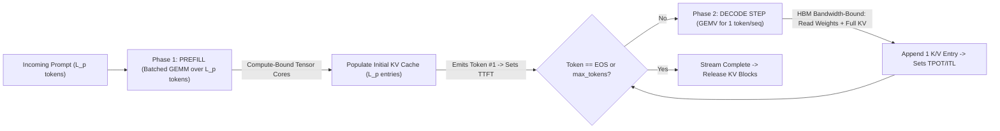
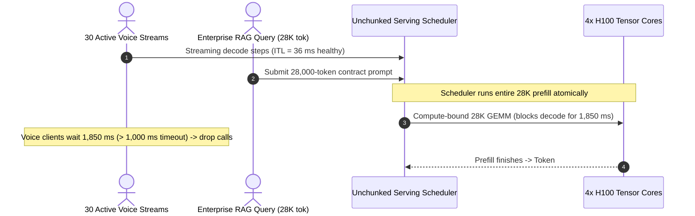

# Module 02: Prefill and Decode Phases

> **Prerequisites:** [Module 00: The Serving Problem](../00-the-serving-problem/README.md), [Module 01: Inference vs. Training Workloads](../01-inference-vs-training-workloads/README.md), [Track 02, Module 07: Attention Masks and Causal Masking](../../02-transformer-architecture/07-attention-masks-and-causal-masking/README.md).  
> **Estimated Reading Time:** 35 minutes  
> **Target Audience:** AI Backend Engineers, Inference Serving Architects, Low-Latency Platform Engineers

> [!TIP]
> **The Golden Rule of Prefill & Decode Scheduling:** Every LLM response executes as two opposing hardware workloads: **Prefill** processes all $L_p$ prompt tokens simultaneously via a **compute-bound GEMM** that sets **TTFT**, whereas **Decode** emits one token per step via a **memory-bandwidth-bound GEMV** that sets **TPOT/ITL**. Never schedule an unbounded long prefill onto a GPU alongside active decode streams—without **Chunked Prefill** or **Prefill/Decode Disaggregation**, one `24K`-token prompt freezes every co-located user mid-sentence (**Head-of-Line Blocking**).

---

## Why This Matters

Imagine your serving cluster powers a real-time customer support copilot running at a steady `18 ms/tok` (`55 tok/s`) across `31` simultaneous chats. Everything looks rock-solid—until user #32 pastes a `24,000`-token log dump for root-cause analysis.

On an unchunked scheduler, all `31` streaming users abruptly freeze mid-word for `1.4` seconds (`p99 ITL` spikes from `22 ms` to `1,420 ms`!), WebSocket voice integrations time out, and `TTFT` for queued short queries balloons. Why did one user's prompt hijack the entire GPU for over a second? Because **Prefill** and **Decode** obey completely different hardware regimes and collide inside the inference step scheduler.

---

## 1. Dissecting Prefill vs. Decode Mechanics

Every autoregressive generation splits into two sequential phases separated by the emission of the **very first output token**.



### Phase 1: Prefill (Parallel Prompt Processing -> Dictates `TTFT`)

When a request arrives with $L_p$ prompt tokens, **all $L_p$ tokens are already known**. Using an additive causal attention mask ($M_{i,j} = -\infty$ for $j > i$), the GPU processes the entire input sequence in a **single parallel forward pass** across all transformer layers:

- **Matrix Shape & Arithmetic Intensity:** Linear projections multiply $[L_p, d_{\text{model}}] \times [d_{\text{model}}, d_{\text{out}}]$—a true **Matrix-Matrix Multiplication (GEMM)**. Using Module 01's Roofline relation for FP16/BF16:

$$\text{FLOPs}_{\text{prefill}} \approx 2 \cdot L_p \cdot P_{\text{active}} + 4 \cdot n_{\text{layers}} \cdot L_p^2 \cdot d_{\text{model}}, \qquad \text{AI}_{\text{prefill}} \approx L_p \text{ FLOPs/Byte}$$

- **Hardware Regime:** For any prompt longer than the GPU Ridge Point ($L_p \ge 295$ on H100 SXM5), Prefill saturates Tensor Core FLOPs (**compute-bound**). Doubling $L_p$ from `2,048` to `4,096` roughly doubles `TTFT` (and at very long contexts `32K+`, the quadratic $L_p^2$ self-attention term pushes `TTFT` super-linearly).
- **Side Effect:** Prefill populates the initial **KV cache** for positions `1..L_p` and samples **Token #1**, marking `TTFT`.

### Phase 2: Decode (Autoregressive Token Loop -> Dictates `TPOT` & `ITL`)

Because Token `t+1` cannot be computed until Token `t` is sampled, Decode runs strictly sequentially, processing **one new token per active sequence** on each forward pass across $B$ concurrent users:

- **Matrix Shape & Arithmetic Intensity:** Linear projections multiply $[B, d_{\text{model}}] \times [d_{\text{model}}, d_{\text{out}}]$ (**GEMV** when $B=1$, skinny **GEMM** when $B \le 64$). Plus, every attention layer must read **all previously cached K/V states** for every active sequence:

$$\text{Bytes}_{\text{decode\_step}} \approx W_{\text{bytes}} + B \cdot L_{\text{ctx}} \cdot b_{\text{KV}}, \qquad \text{AI}_{\text{decode}} \approx \frac{2 \cdot B \cdot P_{\text{active}}}{W_{\text{bytes}} + B \cdot L_{\text{ctx}} \cdot b_{\text{KV}}}$$

- **Hardware Regime:** With `B=1..64`, $\text{AI}_{\text{decode}} \ll 295$, locking Decode firmly in the **HBM memory-bandwidth-bound** regime. At long contexts (`32K`) and high batch size (`B=32`), reading the KV cache (`B * L_ctx * b_KV`) can exceed reading the model weights themselves!

### The Interference Problem: Head-of-Line Blocking, Chunked Prefill & P/D Disaggregation

Co-locating Prefill and Decode on the same GPU introduces severe **Prefill-Decode Interference**:

1. **Unchunked Head-of-Line (HoL) Blocking:** Executing a `16,384`-token prefill atomically occupies Tensor Cores for hundreds of milliseconds (`~350–1,400 ms`), stalling every active decode user's next token (`ITL` spike) even though decode only needed `1` token per user. Conversely, pausing prefills behind decode starves incoming prompts' `TTFT`.
2. **Chunked Prefill (`Sarathi-Serve`):** Instead of running a `16,384`-token prompt in one giant pass, the scheduler enforces a hard per-step token ceiling **`max_num_batched_tokens`** (e.g., `512` or `1,024`). On each step, active decode requests claim `1` token each (`B_decode` tokens), and the remaining budget (`T_budget - B_decode`) takes one slice of the queued prefill prompt—piggybacking compute-bound prefill chunks onto memory-bound decode reads!

$$\text{Tokens}_{\text{step}} = B_{\text{decode}} + \min\left(L_{\text{remaining}}, \; T_{\text{budget}} - B_{\text{decode}}\right) \le T_{\text{budget}}$$

Bounding `Tokens_step <= T_budget` puts a deterministic ceiling on single-step latency so active decode `p99 ITL` stays smooth (`<= 30–50 ms`) regardless of incoming prompt lengths.
3. **Prefill / Decode Disaggregation (`DistServe`, `Splitwise`):** At massive scale, co-located chunked prefill still trades mild `TTFT` overhead (splitting prompts across multiple steps increases attention KV re-reads) and forces identical Tensor Parallelism across both phases. **Disaggregated serving** splits the cluster into dedicated **Prefill Pools** (compute-heavy GPUs generating initial KV blocks and Token #1) and dedicated **Decode Pools** (bandwidth-optimized GPUs running steady-state batched decoding), transferring populated KV cache blocks over ultra-fast **NVLink (`900 GB/s`)** or **InfiniBand RDMA (`400 Gbps`)**.

---

## 2. Systematic Comparison Matrix: Phase & Scheduling Architectures

| Dimension | Prefill Phase | Decode Phase | Chunked Hybrid Scheduler (Sarathi-Style) | Disaggregated Prefill / Decode Pool |
| :--- | :--- | :--- | :--- | :--- |
| **Primary Kernel Shape** | Parallel `GEMM` (`[L_p, d] x [d, d]`) | Sequential `GEMV` / skinny `GEMM` (`[B, d]`) | Piggybacked Decode + `C`-token Prefill `GEMM` | Isolated `GEMM` Pool + Isolated `GEMV` Pool |
| **Hardware Bottleneck** | **Compute-bound** (Tensor Core TFLOP/s) | **HBM bandwidth-bound** (Weights + KV reads) | Balanced near Ridge Point via `T_budget` | Independently tuned hardware & TP per phase |
| **Serving SLI Governed** | **TTFT** | **TPOT** and **ITL** | Bounded `p99 ITL` + predictable `TTFT` | Optimal Goodput (zero cross-phase stalls) |
| **KV Cache Access Pattern** | **Bulk Write** (`L_p` K/V pairs written once) | **Append + Full Read** (`1` write, `L_ctx` reads) | Concurrent decode read + chunked KV append | Bulk write on P-node -> RDMA/NVLink transfer -> D-node |
| **Primary Failure Mode** | Quadratic attention cost at `32K–128K` context | Starved SMs (`< 5%` MFU) & KV HBM saturation | Slight `TTFT` overhead on chunked long prompts | KV network serialization bottleneck over slow Ethernet |

---

## 3. Production War Story Post-Mortem: The `32K`-Context RAG Stutter Outage

| Field | Incident Details |
| :--- | :--- |
| **Severity** | **SEV-1** (Live Streaming Interruption & Voice-Call Timeout Cascade) |
| **Detection / Resolution Time** | Detected `12` minutes post-deploy via `p99 ITL > 500 ms` alert / Mitigated in `45` minutes by enabling chunked prefill (`max_num_batched_tokens=1024`) |
| **Impact** | `p99 ITL` spiked from `36 ms` to `1,850 ms` whenever enterprise RAG queries hit `28K`-token prompts; `1,900` active voice/streaming WebSocket sessions timed out (`1,000 ms` silence threshold) |

### What Happened

A SaaS platform ran a shared `Llama-3-70B` cluster (`4x H100 SXM5`) handling both low-latency voice transcripts (`300`-token prompts, `1,000 ms` client silence cutoff) and an enterprise document-RAG search endpoint (`8K–32K`-token prompts). The serving config prioritized low prefill delay by letting any newly arrived request run its full prefill step before resuming active decode streams.

Whenever an enterprise analyst queried a `28,000`-token contract bundle, the serving engine suspended all `30` live voice streams for a single monolithic `28K`-token prefill step lasting `1.85 seconds`. Voice clients detected `> 1,000 ms` audio silence, dropped their WebSocket connections with `StreamTimeout`, and immediately retried—triggering a retry storm that piled up more `28K` prefills.



### Root Cause Analysis

- **Unbounded Step Token Budget:** Without chunked prefill, step execution time scaled linearly/quadratically with the longest arriving prompt (`28,000` tokens), breaking the `<= 50 ms` `ITL` contract of every co-located decode user.
- **No Workload Disaggregation:** Latency-sensitive short voice streams shared the exact same unpartitioned GPU queue with heavy long-context RAG prefills.

### The Fix & Architectural Hardening

- **Enabled Chunked Prefill (`enable_chunked_prefill=True`, `max_num_batched_tokens=1024`):** Sliced `28K` prompts into `~28` sequential `1,000`-token chunks piggybacked onto active `30`-token decode steps, capping `Max_ITL` below `52 ms` (`0` dropped voice calls).
- **SLO-Tier Routing:** Routed `> 8K`-token document RAG workloads onto a separate worker pool (or dedicated prefill pool) isolated from interactive `< 1s` voice SLAs.

---

## 4. Multi-Language Production Implementation: Chunked-Prefill Token-Budget Step Scheduler

Below is a production-style **Sarathi-Style Chunked-Prefill Token-Budget Step Scheduler** in **Go**, **TypeScript**, **Python**, and **C#**. It implements iteration-level token budgeting:

1. Validates strict `max_num_batched_tokens` and `max_num_seqs` bounds.
2. Allocates `1` decode token to every active sequence first (protecting ongoing `ITL`).
3. Slices queued prefill sequences using only the remaining step token budget (`T_budget - B_decode`).
4. Records per-step execution latency, `TTFT`, and `Max_ITL` across the workload trace.

````carousel

```go
package scheduler

import (
	"errors"
	"fmt"
)

type SequenceState struct {
	ID               string
	TotalPromptTok   int
	PrefilledTok     int
	TargetOutputTok  int
	DecodedTok       int
	ArrivalStep      int
	FirstTokenStep   int
	FinishStep       int
	StepLatenciesMs  []float64
}

type SchedulerConfig struct {
	MaxNumBatchedTokens int
	MaxNumSeqs          int
	BaseStepMs          float64 // HBM weight-read floor
	MsPerToken          float64 // Compute scaling per batched token
}

type StepTelemetry struct {
	StepIndex    int
	DecodeTokens int
	PrefillChunk int
	TotalTokens  int
	StepMs       float64
}

type ChunkedScheduler struct {
	cfg     SchedulerConfig
	waiting []*SequenceState
	active  []*SequenceState
}

func NewChunkedScheduler(cfg SchedulerConfig) (*ChunkedScheduler, error) {
	if cfg.MaxNumBatchedTokens < 1 || cfg.MaxNumSeqs < 1 {
		return nil, errors.New("MaxNumBatchedTokens and MaxNumSeqs must be >= 1")
	}
	if cfg.MaxNumSeqs > cfg.MaxNumBatchedTokens {
		return nil, errors.New("MaxNumSeqs cannot exceed MaxNumBatchedTokens")
	}
	return &ChunkedScheduler{cfg: cfg}, nil
}

func (s *ChunkedScheduler) Enqueue(seq *SequenceState) {
	s.waiting = append(s.waiting, seq)
}

func (s *ChunkedScheduler) RunAllSteps() ([]StepTelemetry, []*SequenceState, error) {
	var logs []StepTelemetry
	var finished []*SequenceState
	step := 0

	for len(s.waiting) > 0 || len(s.active) > 0 {
		step++
		budget := s.cfg.MaxNumBatchedTokens
		decodeCount := 0
		prefillCount := 0

		// 1. Prioritize active decode requests (1 token each) to protect ITL
		var nextActive []*SequenceState
		for _, seq := range s.active {
			if budget == 0 {
				nextActive = append(nextActive, seq)
				continue
			}
			if seq.PrefilledTok < seq.TotalPromptTok {
				// Still finishing chunked prefill
				take := seq.TotalPromptTok - seq.PrefilledTok
				if take > budget {
					take = budget
				}
				seq.PrefilledTok += take
				prefillCount += take
				budget -= take
				if seq.PrefilledTok == seq.TotalPromptTok {
					seq.FirstTokenStep = step
					seq.DecodedTok = 1
				}
			} else {
				decodeCount++
				budget--
				seq.DecodedTok++
			}
			if seq.DecodedTok >= seq.TargetOutputTok {
				seq.FinishStep = step
				finished = append(finished, seq)
			} else {
				nextActive = append(nextActive, seq)
			}
		}
		s.active = nextActive

		// 2. Admit queued prefills strictly within remaining token & sequence budget
		for len(s.waiting) > 0 && len(s.active) < s.cfg.MaxNumSeqs && budget > 0 {
			seq := s.waiting[0]
			s.waiting = s.waiting[1:]
			take := seq.TotalPromptTok
			if take > budget {
				take = budget
			}
			seq.PrefilledTok = take
			prefillCount += take
			budget -= take
			if seq.PrefilledTok == seq.TotalPromptTok {
				seq.FirstTokenStep = step
				seq.DecodedTok = 1
			}
			if seq.DecodedTok >= seq.TargetOutputTok {
				seq.FinishStep = step
				finished = append(finished, seq)
			} else {
				s.active = append(s.active, seq)
			}
		}

		totalTok := decodeCount + prefillCount
		if totalTok == 0 {
			return nil, nil, fmt.Errorf("deadlock at step %d: budget exhausted", step)
		}
		stepMs := s.cfg.BaseStepMs + s.cfg.MsPerToken*float64(totalTok)
		for _, seq := range s.active {
			if seq.FirstTokenStep > 0 {
				seq.StepLatenciesMs = append(seq.StepLatenciesMs, stepMs)
			}
		}
		logs = append(logs, StepTelemetry{
			StepIndex:    step,
			DecodeTokens: decodeCount,
			PrefillChunk: prefillCount,
			TotalTokens:  totalTok,
			StepMs:       stepMs,
		})
	}
	return logs, finished, nil
}
```

<!-- slide -->

```typescript
export interface SequenceJob {
  readonly id: string;
  readonly promptTokens: number;
  readonly targetOutputTokens: number;
  prefilledTokens: number;
  decodedTokens: number;
  firstTokenAtMs?: number;
  finishedAtMs?: number;
  readonly itlHistoryMs: number[];
}

export interface ChunkedSchedulerConfig {
  readonly maxNumBatchedTokens: number;
  readonly maxNumSeqs: number;
  readonly baseStepMs: number;
  readonly msPerToken: number;
}

export interface StepAudit {
  readonly step: number;
  readonly decodeTokens: number;
  readonly prefillChunkTokens: number;
  readonly stepMs: number;
}

export class ChunkedPrefillScheduler {
  private readonly waiting: SequenceJob[] = [];
  private active: SequenceJob[] = [];
  private elapsedMs = 0;

  constructor(private readonly cfg: ChunkedSchedulerConfig) {
    if (cfg.maxNumBatchedTokens < 1 || cfg.maxNumSeqs < 1) {
      throw new RangeError("maxNumBatchedTokens and maxNumSeqs must be >= 1");
    }
    if (cfg.maxNumSeqs > cfg.maxNumBatchedTokens) {
      throw new RangeError("maxNumSeqs cannot exceed maxNumBatchedTokens");
    }
  }

  submit(job: SequenceJob): void {
    this.waiting.push(job);
  }

  drain(): { steps: StepAudit[]; completed: SequenceJob[] } {
    const steps: StepAudit[] = [];
    const completed: SequenceJob[] = [];
    let stepIndex = 0;

    while (this.waiting.length > 0 || this.active.length > 0) {
      stepIndex += 1;
      let budget = this.cfg.maxNumBatchedTokens;
      let decodeTokens = 0;
      let prefillChunkTokens = 0;
      const emittedThisStep: SequenceJob[] = [];
      const nextActive: SequenceJob[] = [];

      // 1. Protect active decode ITL and finish in-progress chunked prefills
      for (const job of this.active) {
        if (budget <= 0) {
          nextActive.push(job);
          continue;
        }
        if (job.prefilledTokens < job.promptTokens) {
          const take = Math.min(budget, job.promptTokens - job.prefilledTokens);
          job.prefilledTokens += take;
          prefillChunkTokens += take;
          budget -= take;
          if (job.prefilledTokens === job.promptTokens) {
            job.decodedTokens = 1;
            emittedThisStep.push(job);
          }
        } else {
          decodeTokens += 1;
          budget -= 1;
          job.decodedTokens += 1;
          emittedThisStep.push(job);
        }

        if (job.decodedTokens >= job.targetOutputTokens) {
          completed.push(job);
        } else {
          nextActive.push(job);
        }
      }
      this.active = nextActive;

      // 2. Admit queued prefills into remaining token budget
      while (this.waiting.length > 0 && this.active.length < this.cfg.maxNumSeqs && budget > 0) {
        const job = this.waiting.shift()!;
        const take = Math.min(budget, job.promptTokens);
        job.prefilledTokens = take;
        prefillChunkTokens += take;
        budget -= take;
        if (job.prefilledTokens === job.promptTokens) {
          job.decodedTokens = 1;
          emittedThisStep.push(job);
        }
        if (job.decodedTokens >= job.targetOutputTokens) {
          completed.push(job);
        } else {
          this.active.push(job);
        }
      }

      const totalTokens = decodeTokens + prefillChunkTokens;
      const stepMs = this.cfg.baseStepMs + this.cfg.msPerToken * totalTokens;
      this.elapsedMs += stepMs;

      for (const job of emittedThisStep) {
        if (job.firstTokenAtMs === undefined) {
          job.firstTokenAtMs = this.elapsedMs;
        } else {
          job.itlHistoryMs.push(stepMs);
        }
        if (job.decodedTokens >= job.targetOutputTokens) {
          job.finishedAtMs = this.elapsedMs;
        }
      }

      steps.push({ step: stepIndex, decodeTokens, prefillChunkTokens, stepMs });
    }

    return { steps, completed };
  }
}
```

<!-- slide -->

```python
"""
chunked_prefill_scheduler.py
Sarathi-style token-budget scheduler bounding step ITL across mixed decode and long prefill workloads.
"""
from __future__ import annotations

from collections import deque
from dataclasses import dataclass, field


@dataclass
class SequenceRequest:
    req_id: str
    prompt_tokens: int
    target_output_tokens: int
    prefilled_tokens: int = 0
    decoded_tokens: int = 0
    first_token_ms: float | None = None
    finished_ms: float | None = None
    itl_ms: list[float] = field(default_factory=list)


@dataclass(frozen=True)
class StepRecord:
    step: int
    decode_tokens: int
    prefill_chunk_tokens: int
    step_latency_ms: float


class ChunkedPrefillScheduler:
    def __init__(
        self,
        max_num_batched_tokens: int = 1024,
        max_num_seqs: int = 64,
        base_step_ms: float = 4.8,
        ms_per_token: float = 0.045,
    ) -> None:
        if max_num_batched_tokens < 1 or max_num_seqs < 1:
            raise ValueError("Batch token and sequence caps must be >= 1")
        if max_num_seqs > max_num_batched_tokens:
            raise ValueError("max_num_seqs cannot exceed max_num_batched_tokens")
        self.max_num_batched_tokens = max_num_batched_tokens
        self.max_num_seqs = max_num_seqs
        self.base_step_ms = base_step_ms
        self.ms_per_token = ms_per_token
        self.waiting: deque[SequenceRequest] = deque()
        self.active: list[SequenceRequest] = []
        self.clock_ms = 0.0

    def enqueue(self, req: SequenceRequest) -> None:
        if req.prompt_tokens < 1 or req.target_output_tokens < 1:
            raise ValueError("Prompt and target output tokens must be >= 1")
        self.waiting.append(req)

    def run_to_completion(self) -> tuple[list[StepRecord], list[SequenceRequest]]:
        history: list[StepRecord] = []
        completed: list[SequenceRequest] = []
        step_num = 0

        while self.waiting or self.active:
            step_num += 1
            budget = self.max_num_batched_tokens
            decode_toks = 0
            prefill_toks = 0
            emitted: list[SequenceRequest] = []
            still_active: list[SequenceRequest] = []

            # 1. Active sequences: advance ongoing decode (1 token) or remaining prefill chunks
            for req in self.active:
                if budget <= 0:
                    still_active.append(req)
                    continue
                if req.prefilled_tokens < req.prompt_tokens:
                    take = min(budget, req.prompt_tokens - req.prefilled_tokens)
                    req.prefilled_tokens += take
                    prefill_toks += take
                    budget -= take
                    if req.prefilled_tokens == req.prompt_tokens:
                        req.decoded_tokens = 1
                        emitted.append(req)
                else:
                    decode_toks += 1
                    budget -= 1
                    req.decoded_tokens += 1
                    emitted.append(req)

                if req.decoded_tokens >= req.target_output_tokens:
                    completed.append(req)
                else:
                    still_active.append(req)
            self.active = still_active

            # 2. Admit queued prefills into remaining token & sequence slots
            while self.waiting and len(self.active) < self.max_num_seqs and budget > 0:
                req = self.waiting.popleft()
                take = min(budget, req.prompt_tokens)
                req.prefilled_tokens = take
                prefill_toks += take
                budget -= take
                if req.prefilled_tokens == req.prompt_tokens:
                    req.decoded_tokens = 1
                    emitted.append(req)
                if req.decoded_tokens >= req.target_output_tokens:
                    completed.append(req)
                else:
                    self.active.append(req)

            total_toks = decode_toks + prefill_toks
            step_ms = self.base_step_ms + self.ms_per_token * total_toks
            self.clock_ms += step_ms

            for req in emitted:
                if req.first_token_ms is None:
                    req.first_token_ms = self.clock_ms
                else:
                    req.itl_ms.append(step_ms)
                if req.decoded_tokens >= req.target_output_tokens:
                    req.finished_ms = self.clock_ms

            history.append(StepRecord(step_num, decode_toks, prefill_toks, step_ms))

        return history, completed
```

<!-- slide -->

```csharp
using System;
using System.Collections.Generic;

namespace GenAI.Scheduling;

public sealed class SequenceJob
{
    public required string Id { get; init; }
    public required int PromptTokens { get; init; }
    public required int TargetOutputTokens { get; init; }
    public int PrefilledTokens { get; set; }
    public int DecodedTokens { get; set; }
    public double? FirstTokenMs { get; set; }
    public double? FinishedMs { get; set; }
    public List<double> ItlHistoryMs { get; } = new();
}

public sealed record StepAuditRecord(int Step, int DecodeTokens, int PrefillChunkTokens, double StepMs);

public sealed class ChunkedPrefillScheduler
{
    private readonly int _maxNumBatchedTokens;
    private readonly int _maxNumSeqs;
    private readonly double _baseStepMs;
    private readonly double _msPerToken;
    private readonly Queue<SequenceJob> _waiting = new();
    private List<SequenceJob> _active = new();
    private double _clockMs;

    public ChunkedPrefillScheduler(
        int maxNumBatchedTokens = 1024,
        int maxNumSeqs = 64,
        double baseStepMs = 4.8,
        double msPerToken = 0.045)
    {
        if (maxNumBatchedTokens < 1 || maxNumSeqs < 1 || maxNumSeqs > maxNumBatchedTokens)
            throw new ArgumentException("Invalid scheduler token/sequence limits.");

        _maxNumBatchedTokens = maxNumBatchedTokens;
        _maxNumSeqs = maxNumSeqs;
        _baseStepMs = baseStepMs;
        _msPerToken = msPerToken;
    }

    public void Enqueue(SequenceJob job) => _waiting.Enqueue(job);

    public (IReadOnlyList<StepAuditRecord> Steps, IReadOnlyList<SequenceJob> Completed) RunToCompletion()
    {
        var steps = new List<StepAuditRecord>();
        var completed = new List<SequenceJob>();
        int stepIndex = 0;

        while (_waiting.Count > 0 || _active.Count > 0)
        {
            stepIndex++;
            int budget = _maxNumBatchedTokens;
            int decodeToks = 0;
            int prefillToks = 0;
            var emitted = new List<SequenceJob>();
            var nextActive = new List<SequenceJob>();

            foreach (var job in _active)
            {
                if (budget <= 0)
                {
                    nextActive.Add(job);
                    continue;
                }
                if (job.PrefilledTokens < job.PromptTokens)
                {
                    int take = Math.Min(budget, job.PromptTokens - job.PrefilledTokens);
                    job.PrefilledTokens += take;
                    prefillToks += take;
                    budget -= take;
                    if (job.PrefilledTokens == job.PromptTokens)
                    {
                        job.DecodedTokens = 1;
                        emitted.Add(job);
                    }
                }
                else
                {
                    decodeToks++;
                    budget--;
                    job.DecodedTokens++;
                    emitted.Add(job);
                }

                if (job.DecodedTokens >= job.TargetOutputTokens) completed.Add(job);
                else nextActive.Add(job);
            }
            _active = nextActive;

            while (_waiting.Count > 0 && _active.Count < _maxNumSeqs && budget > 0)
            {
                var job = _waiting.Dequeue();
                int take = Math.Min(budget, job.PromptTokens);
                job.PrefilledTokens = take;
                prefillToks += take;
                budget -= take;
                if (job.PrefilledTokens == job.PromptTokens)
                {
                    job.DecodedTokens = 1;
                    emitted.Add(job);
                }
                if (job.DecodedTokens >= job.TargetOutputTokens) completed.Add(job);
                else _active.Add(job);
            }

            double stepMs = _baseStepMs + _msPerToken * (decodeToks + prefillToks);
            _clockMs += stepMs;

            foreach (var job in emitted)
            {
                if (job.FirstTokenMs is null) job.FirstTokenMs = _clockMs;
                else job.ItlHistoryMs.Add(stepMs);

                if (job.DecodedTokens >= job.TargetOutputTokens) job.FinishedMs = _clockMs;
            }

            steps.Add(new StepAuditRecord(stepIndex, decodeToks, prefillToks, stepMs));
        }

        return (steps, completed);
    }
}
```

````

---

## 5. Practical Hands-On Verification CLI Workflows

Run these deterministic Python 3.13 scripts offline—no GPU or third-party dependencies required.

### Workflow 1: Prefill vs. Decode Time Decomposition (`L_p = 512..32768`)

Quantify how prompt length $L_p$ vs. output length $L_o$ shifts the dominant fraction of `E2EL` between `TTFT` (Prefill) and `Decode` for `Llama-3-8B` BF16 on `1x H100 SXM5`:

```bash
python -c '
def phase_breakdown(prompt_len: int, output_len: int, batch: int = 1):
    params = 8e9
    weight_bytes = params * 2
    kv_bytes_per_tok = 2 * 32 * 8 * 128 * 2
    hbm_bw = 3350e9
    eff_compute = 750e12

    prefill_tokens = batch * prompt_len
    prefill_flops = 2.0 * params * prefill_tokens
    prefill_ms = max(weight_bytes / hbm_bw, prefill_flops / eff_compute) * 1000.0

    avg_ctx = prompt_len + output_len / 2.0
    kv_read_bytes = batch * avg_ctx * kv_bytes_per_tok
    step_bytes = weight_bytes + kv_read_bytes
    decode_step_ms = (step_bytes / hbm_bw) * 1000.0
    decode_total_ms = max(0, output_len - 1) * decode_step_ms
    e2el_ms = prefill_ms + decode_total_ms
    prefill_share = (prefill_ms / e2el_ms) * 100.0
    print(f"Lp={prompt_len:5d}, Lo={output_len:3d}, B={batch:2d} | Prefill(TTFT)={prefill_ms:6.1f} ms ({prefill_share:4.1f}%) | TPOT={decode_step_ms:5.2f} ms | Decode={decode_total_ms:6.1f} ms | E2EL={e2el_ms:7.1f} ms")

for lp, lo, b in [(512, 256, 1), (4096, 256, 1), (32768, 128, 1), (2048, 256, 16), (16384, 128, 8)]:
    phase_breakdown(lp, lo, b)
'
```

**Expected Output:**

```text
Lp=  512, Lo=256, B= 1 | Prefill(TTFT)=  10.9 ms ( 0.9%) | TPOT= 4.80 ms | Decode=1224.3 ms | E2EL= 1235.2 ms
Lp= 4096, Lo=256, B= 1 | Prefill(TTFT)=  87.4 ms ( 6.5%) | TPOT= 4.94 ms | Decode=1260.1 ms | E2EL= 1347.4 ms
Lp=32768, Lo=128, B= 1 | Prefill(TTFT)= 699.1 ms (47.6%) | TPOT= 6.06 ms | Decode= 769.7 ms | E2EL= 1468.8 ms
Lp= 2048, Lo=256, B=16 | Prefill(TTFT)= 699.1 ms (30.9%) | TPOT= 6.14 ms | Decode=1565.3 ms | E2EL= 2264.3 ms
Lp=16384, Lo=128, B= 8 | Prefill(TTFT)=2796.2 ms (68.9%) | TPOT= 9.92 ms | Decode=1260.4 ms | E2EL= 4056.6 ms
```

Notice the two regimes: for short chat (`512` in / `256` out), Prefill is **`0.9%`** of latency (`Decode` dominates `99.1%`); for `16K` batched RAG (`16,384` in / `128` out at `B=8`), Prefill explodes to **`68.9%`** of end-to-end latency (`2,796 ms`!).

### Workflow 2: Head-of-Line Blocking vs. Chunked Prefill (`Sarathi` Budget Sweep)

Simulate `16` active streaming decode users struck by an incoming `16,384`-token RAG prompt under unchunked vs. chunked step budgets (`2048`, `1024`, `512`):

```bash
python -c '
def simulate_chunked_schedule(prompt_tokens: int, active_decode_users: int, chunk_budget: int | None):
    def step_latency_ms(num_tokens: int) -> float:
        return 4.8 + 0.045 * num_tokens

    itls = []
    for _ in range(5):
        itls.append(step_latency_ms(active_decode_users))

    remaining_prefill = prompt_tokens
    prefill_steps = 0
    ttft_ms = 0.0
    while remaining_prefill > 0:
        if chunk_budget is None:
            take = remaining_prefill
            step_tokens = take
            lat = step_latency_ms(step_tokens)
            itls.append(lat)
        else:
            avail = max(1, chunk_budget - active_decode_users)
            take = min(remaining_prefill, avail)
            step_tokens = active_decode_users + take
            lat = step_latency_ms(step_tokens)
            itls.append(lat)
        remaining_prefill -= take
        prefill_steps += 1
        ttft_ms += lat

    for _ in range(5):
        itls.append(step_latency_ms(active_decode_users + 1))

    p50 = sorted(itls)[len(itls) // 2]
    p99 = max(itls)
    mode = "Unchunked (HoL Block)" if chunk_budget is None else f"Chunked (budget={chunk_budget})"
    print(f"{mode:<26} | prefill_steps={prefill_steps:2d} | RAG_TTFT={ttft_ms:6.1f} ms | Decode p50_ITL={p50:5.1f} ms | Max_ITL={p99:6.1f} ms")

for budget in [None, 2048, 1024, 512]:
    simulate_chunked_schedule(16384, 16, budget)
'
```

**Expected Output:**

```text
Unchunked (HoL Block)      | prefill_steps= 1 | RAG_TTFT= 742.1 ms | Decode p50_ITL=  5.6 ms | Max_ITL= 742.1 ms
Chunked (budget=2048)      | prefill_steps= 9 | RAG_TTFT= 787.0 ms | Decode p50_ITL=  5.6 ms | Max_ITL=  97.0 ms
Chunked (budget=1024)      | prefill_steps=17 | RAG_TTFT= 831.1 ms | Decode p50_ITL= 50.9 ms | Max_ITL=  50.9 ms
Chunked (budget=512)       | prefill_steps=34 | RAG_TTFT= 925.0 ms | Decode p50_ITL= 27.8 ms | Max_ITL=  27.8 ms
```

Observe the trade-off: dropping `chunk_budget` to `512` slices the `16K` prefill into `34` steps—raising the RAG prompt's `TTFT` mildly from `742.1 ms` to `925.0 ms` (`+183 ms`), while slashing `Max_ITL` for all `16` co-located decode users by **`26.7x`** (`742.1 ms -> 27.8 ms`).

### Workflow 3: Disaggregated Prefill-to-Decode KV Transfer Budget

Compute exact network transfer latency for serialized `Llama-3-70B` GQA KV caches across `NVLink`, `InfiniBand`, `100GbE RoCE`, and `25GbE TCP`:

```bash
python -c '
def kv_transfer_budget(prompt_tokens: int, layers: int = 80, n_kv_heads: int = 8, d_head: int = 128, dtype_bytes: int = 2):
    kv_bytes = prompt_tokens * 2 * layers * n_kv_heads * d_head * dtype_bytes
    kv_mb = kv_bytes / (1024**2)
    transports = [
        ("NVLink 4.0 (900 GB/s)", 900e9 * 0.85),
        ("InfiniBand NDR (400 Gbps)", (400e9 / 8) * 0.85),
        ("100GbE RoCEv2 (100 Gbps)", (100e9 / 8) * 0.85),
        ("25GbE TCP (25 Gbps)", (25e9 / 8) * 0.80),
    ]
    print(f"=== KV Payload for L_p={prompt_tokens:,} tok (Llama-3-70B GQA BF16): {kv_mb:.1f} MB ===")
    for name, bw in transports:
        tx_ms = (kv_bytes / bw) * 1000.0
        print(f"  {name:<28} -> transfer_time = {tx_ms:6.2f} ms")

for lp in [4096, 32768]:
    kv_transfer_budget(lp)
'
```

**Expected Output:**

```text
=== KV Payload for L_p=4,096 tok (Llama-3-70B GQA BF16): 1280.0 MB ===
  NVLink 4.0 (900 GB/s)        -> transfer_time =   1.75 ms
  InfiniBand NDR (400 Gbps)    -> transfer_time =  31.58 ms
  100GbE RoCEv2 (100 Gbps)     -> transfer_time = 126.32 ms
  25GbE TCP (25 Gbps)          -> transfer_time = 536.87 ms
=== KV Payload for L_p=32,768 tok (Llama-3-70B GQA BF16): 10240.0 MB ===
  NVLink 4.0 (900 GB/s)        -> transfer_time =  14.04 ms
  InfiniBand NDR (400 Gbps)    -> transfer_time = 252.65 ms
  100GbE RoCEv2 (100 Gbps)     -> transfer_time = 1010.58 ms
  25GbE TCP (25 Gbps)          -> transfer_time = 4294.97 ms
```

Look at why Disaggregated P/D requires NVLink or high-speed RDMA: transferring `10.24 GB` of KV state for a `32K` prompt takes `14.0 ms` over NVLink (`252.7 ms` over `400 Gbps` InfiniBand) vs. **`4.29 seconds`** over standard `25GbE` TCP!

### Hands-On Exercises

1. **Tune `chunk_budget` for a Strict `40 ms` ITL SLA:** Re-run Workflow 2 testing `chunk_budget` values `[768, 640, 512]` with `active_decode_users = 32`. Find the largest `chunk_budget` that keeps `Max_ITL <= 40.0 ms`.
2. **Analyze Long-Context KV HBM Bandwidth Crossover:** In Workflow 1, test `(lp=65536, lo=128, b=32)`. Compute what fraction of `step_bytes` comes from KV cache reads vs. the `16 GB` model weights—notice how long-context batched decode becomes **KV-bandwidth bound**!
3. **Quantize KV Cache (`BF16 -> FP8`) in Disaggregated Transfer:** Modify Workflow 3 by setting `dtype_bytes = 1` (`FP8` KV cache). Measure how `400 Gbps` InfiniBand transfer latency drops for `32K` context (`252.65 ms -> 126.32 ms`).

### Independent Challenge

A coding-assistant platform serves two request classes on an `8x H100 SXM5` node (`NVLink 4.0` intra-node interconnect): (1) inline autocomplete (`L_p = 1,200`, `L_o = 32`, strict `TTFT <= 120 ms`, `p99 ITL <= 20 ms`), and (2) whole-repo PR review (`L_p = 32,000`, `L_o = 600`, relaxed `TTFT <= 2,500 ms`). Explain why co-locating both classes on an unchunked engine fails the autocomplete SLA, compare **Chunked Prefill (`max_num_batched_tokens=512`)** vs **Disaggregated P/D (`4` Prefill GPUs + `4` Decode GPUs over NVLink)**, and recommend which architecture handles `32K` bursts with lowest `p99 ITL` and why.

<details><summary>Architectural Discussion</summary>

1. **Why Unchunked Co-Location Fails:** A single `32,000`-token PR review executes a monolithic compute-bound GEMM occupying Tensor Cores for several hundred milliseconds, stalling autocomplete decode steps (`p99 ITL >> 20 ms`) and queueing incoming autocomplete prefills (`TTFT >> 120 ms`).
2. **Chunked Prefill vs. Disaggregated P/D:**
   - **Chunked Prefill (`budget=512`):** Slices the `32K` prompt across `~64` steps, bounding decode `ITL` near `~25–30 ms` while sharing all `8` GPUs. However, `64` small prefill chunks still degrade autocomplete `TTFT` slightly when competing for step budgets and incur repeated KV re-reads during chunked self-attention.
   - **Disaggregated P/D over NVLink:** Isolates `32K` PR prefills onto dedicated Prefill GPUs (`TP=4` saturating Tensor Cores), transfers populated KV tensors across NVLink (`900 GB/s` -> `< 15 ms`), and streams decode exclusively on dedicated Decode GPUs. Because Prefill never preempts Decode steps, autocomplete `p99 ITL` stays strictly `< 20 ms` with zero cross-phase interference, while PR review `TTFT` finishes well inside its `2.5s` SLA.

</details>

---

## 6. Common Mistakes & Troubleshooting

- **Setting `max_num_batched_tokens` too high (e.g., `16384`) when enabling chunked prefill:** A huge step token budget defeats chunked prefill by letting giant prompts execute in a single `300 ms+` pass, re-introducing `ITL` stalls. Start between `512` and `2,048` tokens depending on your `ITL` SLA.
- **Disaggregating Prefill and Decode over standard `10GbE`/`25GbE` TCP:** As Workflow 3 demonstrates, shipping multi-gigabyte KV payloads over `25GbE` adds seconds of network serialization (`4.29s` for `32K` 70B), wiping out disaggregation gains. P/D disaggregation requires `NVLink` or `200–400 Gbps` RDMA (`InfiniBand`/`RoCEv2`).
- **Ignoring the hidden attention recomputation cost of tiny prefill chunks:** Making `max_num_batched_tokens` tiny (e.g., `64`) makes every prefill chunk repeatedly load prior KV history across dozens of steps, raising Prefill latency and hurting `TTFT`. Tune `max_num_batched_tokens` at the Pareto knee (`512–2048`).
- **Treating `TTFT` and `TPOT` as governed by the same GPU metric:** Raising `Tensor Parallelism` or switching to `FP8` Tensor Cores slashes compute-bound **Prefill `TTFT`**, whereas increasing HBM bandwidth or weight quantization cuts memory-bound **Decode `TPOT`**. Always profile which phase dominates your `E2EL` first.

---

## 7. Operational Validation Checkpoints & Checkpoint Quiz

### Operational Validation Checkpoints

<details><summary><strong>Checkpoint 1: Tracing Why One Long RAG Query Froze 30 Active Streaming Users</strong></summary>

A production dashboard shows healthy `28 ms` `ITL` across `30` concurrent users until a single `20K`-token legal contract query arrives, causing all `30` active streams to freeze for `900 ms`. Identify the mechanism and fix.

**Validation:** The scheduler executed an unchunked monolithic **Prefill** (`20,000`-token compute-bound GEMM) before advancing the next **Decode** step, creating **Head-of-Line (HoL) Blocking**. Enabling **Chunked Prefill** with `max_num_batched_tokens = 1024` reserves `30` tokens for active decode streams on every step and slices the `20K` prompt into `~20` bounded chunks, preventing multi-hundred-millisecond decode stalls.

</details>

<details><summary><strong>Checkpoint 2: Why Adding FP8 Compute Cut TTFT 1.8x While Leaving Long-Chat TPOT Almost Unchanged</strong></summary>

An engineer enables FP8 compute GEMMs on a `Llama-3-8B` BF16 deployment (leaving weights in `BF16` at runtime or testing `B=2` low concurrency) and observes `4,096`-token `TTFT` dropping nearly `2x` while `B=2` `TPOT` barely moves. Why?

**Validation:** At `L_p = 4,096`, **Prefill** sits well above the H100 Ridge Point (`AI = 4,096 >> 295`), so doubling Tensor Core FLOPs (`989 -> 1,979 TFLOP/s` in FP8) directly cuts compute-bound `TTFT`. At `B=2`, **Decode** has `AI ≈ 2 << 295` and remains strictly **HBM bandwidth-bound**; unless weight storage bytes themselves are compressed (`BF16 -> FP8/INT4` weights read from HBM), extra Tensor Core FLOPs cannot accelerate Decode.

</details>

<details><summary><strong>Checkpoint 3: Auditing a Broken Disaggregated P/D Prototype on Cloud VMs</strong></summary>

A team tests Prefill/Decode Disaggregation across two separate AWS instances connected via `25 Gbps` Ethernet for a `70B` GQA model (`16K` context). Instead of improving `E2EL`, latency regresses by `2.2` seconds per request. Explain why.

**Validation:** A `16K`-token prompt on `Llama-3-70B` (`80` layers, `8` KV heads, `d=128`, `BF16`) generates `5,120 MB` (`5.0 GiB`) of KV state. Shipping `5.0 GiB` over `25 Gbps` TCP (`~2.5 GB/s` effective payload) takes **`~2.05 seconds`** of pure network transfer delay—far exceeding the cost of co-located chunked prefill. Disaggregation requires `NVLink` or `400 Gbps` InfiniBand/RoCE RDMA.

</details>

### Checkpoint Quiz

1. Contrast **Prefill** and **Decode** across (a) matrix kernel type (`GEMM` vs `GEMV`), (b) hardware bottleneck, and (c) primary serving SLI governed.
2. Why does **Head-of-Line Blocking** happen when unchunked Prefills share a scheduler with active Decode streams?
3. How does **Sarathi-style Chunked Prefill** bound `p99 ITL` without stopping new requests from starting Prefill?
4. When does **Prefill/Decode Disaggregation** outperform co-located Chunked Prefill, and what interconnect requirement must be met?
5. For a `512`-token prompt generating `256` tokens at `B=1`, which phase dominates `E2EL`—and how does that flip at `L_p = 16,384, L_o = 128, B = 8`?

<details><summary>Answers</summary>

1. **Prefill:** Parallel `GEMM` (`[L_p, d]`), compute-bound on Tensor Cores, governs **TTFT**. **Decode:** Sequential `GEMV`/skinny `GEMM` (`[B, d]`), HBM memory-bandwidth bound (reading weights + full KV history), governs **TPOT/ITL**.
2. A large unchunked prompt (`L_p = 16K–32K`) executes as a single atomic compute-bound step lasting hundreds of milliseconds, freezing all active decode requests until the entire prefill finishes.
3. It enforces a hard `max_num_batched_tokens` step ceiling, scheduling `1` token per active decode sequence first and slicing incoming prefill prompts into bounded chunks filling the remaining token budget—capping per-step latency.
4. At high long-context traffic mixes where co-located prefill chunks degrade decode `TPOT`/`ITL` or require mismatched Tensor Parallelism ratios. It requires `NVLink` (`900 GB/s`) or `200–400 Gbps` RDMA (`InfiniBand`/`RoCE`) so KV cache transfer stays below a few tens of milliseconds.
5. At `(512, 256, B=1)`, Decode takes `> 98%` of `E2EL` (`1,224 ms` vs `11 ms` Prefill); at `(16384, 128, B=8)`, Prefill explodes to `~2.80s` (`~69%` of `E2EL`) because batched prefill tokens (`131,072` tokens) saturate Tensor Core FLOPs.

</details>

---

## Further Reading & Sources

- [Taming Throughput-Latency Tradeoff in LLM Inference with Sarathi-Serve (Agrawal et al., 2024)](https://arxiv.org/abs/2403.02310) — introduces chunked prefill and decode-maximal piggybacking to eliminate prefill-induced `ITL` stalls.
- [DistServe: Disaggregating Prefill and Decoding for Goodput-optimized Large Language Model Serving (Zhong et al., 2024)](https://arxiv.org/abs/2401.09670) — analyzes Prefill-Decode interference and Goodput optimization via physical phase separation.
- [Splitwise: Efficient Generative LLM Inference Using Phase Splitting (Patel et al., 2024)](https://arxiv.org/abs/2311.18677) — hardware specialization and RDMA/NVLink KV cache transfer across Prefill and Decode clusters.
- [vLLM Documentation: Chunked Prefill Tuning](https://docs.vllm.ai/en/latest/performance/optimization.html) — official configuration reference for `enable_chunked_prefill` and `max_num_batched_tokens`.

## Next

[Module 03: The KV Cache](../03-the-kv-cache/README.md)
