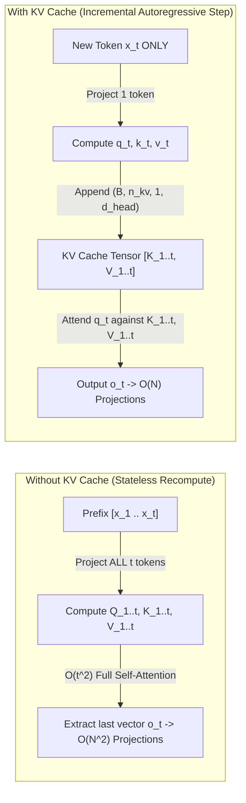
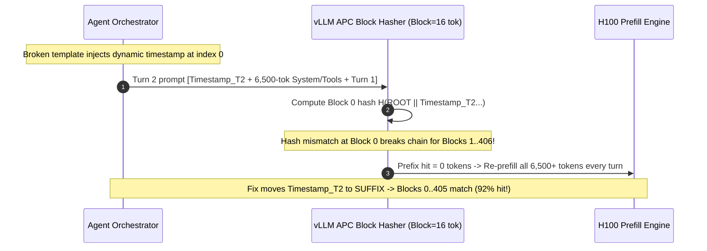

# Module 03: The KV Cache

> **Prerequisites:** [Module 02: Prefill and Decode Phases](../02-prefill-and-decode-phases/README.md), [Track 02, Module 07: Attention Masks and Causal Masking](../../02-transformer-architecture/07-attention-masks-and-causal-masking/README.md), [Track 02, Module 08: Multi-Head Attention](../../02-transformer-architecture/08-multi-head-attention/README.md).  
> **Estimated Reading Time:** 35 minutes  
> **Target Audience:** AI Backend Engineers, Inference Engine Developers, Transformer Systems Architects

> [!TIP]
> **The Golden Rule of KV Caching:** Because causal attention forbids earlier tokens from ever attending to future tokens, their **Key (`K`) and Value (`V`) vectors are mathematically immutable** once computed. Caching `[K_1..t, V_1..t]` cuts per-step decoding projection work from **$O(N^2)$ full-prefix recomputation down to $O(N)$ incremental steps**—trading VRAM capacity (tamed by **GQA**, **MLA**, and **Automatic Prefix Caching**) to eliminate orders-of-magnitude redundant FLOPs.

---

## Why This Matters

Suppose you generate a `4,096`-token response token by token **without** caching intermediate attention states. To predict token `4,096`, the model projects `K` and `V` for token #1 **all over again**—for the `4,096`th time! Across the whole response, the GPU performs over `1,366x` more QKV projection work than necessary (`8.39 million` token projections instead of `4,096`), collapsing throughput to a crawl.

Enabling the **KV Cache** eliminates every redundant projection instantaneously, producing **bit-for-bit identical output logits** (up to floating-point associativity). Yet that bargain swaps a compute bottleneck for a **VRAM capacity and HBM bandwidth problem**: caching `K` and `V` across dozens of concurrent `32K`-context users consumes tens of gigabytes of GPU memory—which is why modern frontier models evolved from **MHA** to **GQA** (`Llama-3`, `Qwen-2.5`) and **MLA** (`DeepSeek-V2/V3`), and why serving engines implement **Automatic Prefix Caching (APC)**.

---

## 1. Causal Invariance & Step-by-Step KV Cache Mechanics

In a causal decoder-only Transformer, position $i$ can attend only to positions $j \le i$ because future positions $j > i$ are masked with $-\infty$ prior to Softmax ([Track 02, Module 07](../../02-transformer-architecture/07-attention-masks-and-causal-masking/README.md)). Consequently, appending new token $x_t$ at step $t$ **never alters** hidden states, Keys, or Values at any earlier position $1 \dots t-1$.



### Exact Equations & Complexity Reduction

During **Decode Step $t$** (with cached tensors $K_{1:t-1}, V_{1:t-1}$ already resident in VRAM):

1. **Incremental Projection (Single Token $x_t$):**

$$q_t = x_t W_Q, \qquad k_t = x_t W_K, \qquad v_t = x_t W_V$$

2. **Cache Append (`concat` or Paged Slot Write):**

$$K_{1:t} = \text{Concat}(K_{1:t-1}, k_t), \qquad V_{1:t} = \text{Concat}(V_{1:t-1}, v_t)$$

3. **Vector-Matrix Causal Attention (Query $q_t$ over History $1 \dots t$):**

$$o_t = \text{Softmax}\left(\frac{q_t K_{1:t}^T}{\sqrt{d_{\text{head}}}}\right) V_{1:t}$$

- **Projection Cost Over $N$ Generated Tokens:**
  - *Without KV Cache:* Step $t$ projects $t$ tokens for $K$ and $V$ plus $t$ for $Q$ (or $1$ if sliced): $\sum_{t=1}^{N} t = \frac{N(N+1)}{2} \in \mathbf{O(N^2)}$ token projections, and $\sum_{t=1}^{N} t^2 \in \mathbf{O(N^3)}$ cumulative attention MACs if naive full attention runs every step.
  - *With KV Cache:* Step $t$ projects **exactly $1$ token** ($N$ total projections $\in \mathbf{O(N)}$), and executes a single vector-matrix dot product of length $t$ per step ($O(N)$ per step, $\mathbf{O(N^2)}$ cumulative across the full response).

### Architectural Compression: MHA -> MQA -> GQA -> MLA

Because every active token adds $2 \cdot n_{\text{layers}} \cdot n_{\text{kv\_heads}} \cdot d_{\text{head}} \cdot b_{\text{dtype}}$ bytes to VRAM (and must be read from HBM on every decode step!), model architects systematically compressed KV state size:

1. **Multi-Head Attention (MHA, Vaswani et al. 2017):** $n_{\text{kv}} = n_q$ (every query head owns dedicated $K$ and $V$ heads, e.g., `Llama-2-7B` `32:32`). Maximum KV memory (`512 KB/tok` in FP16) and HBM traffic.
2. **Multi-Query Attention (MQA, Shazeer 2019):** $n_{\text{kv}} = 1$ (all $n_q$ query heads share one single $K$ and one single $V$ head). Shrinks KV cache and attention HBM bandwidth by **$n_q\times$**, at minor quality/training-stability trade-offs.
3. **Grouped-Query Attention (GQA, Ainslie et al. 2023):** $1 < n_{\text{kv}} < n_q$, partitioning query heads into groups of size $g = n_q / n_{\text{kv}}$ sharing each KV head:
   - `Llama-3-8B`: `32` Q heads, `8` KV heads ($g = 4$) -> **`4x` smaller KV cache** (`128 KB/tok` FP16).
   - `Llama-3-70B` & `Qwen2.5-72B`: `64` Q heads, `8` KV heads ($g = 8$) -> **`8x` smaller KV cache** (`320 KB/tok` FP16 vs `2,560 KB/tok` if MHA!).
4. **Multi-Head Latent Attention (MLA, DeepSeek-V2/V3 2024):** Projects hidden state $h_t$ down into a tiny **joint compressed latent vector** $c_t^{KV} \in \mathbb{R}^{d_c}$ ($d_c = 512$) plus a decoupled RoPE key $k_t^R \in \mathbb{R}^{64}$. During inference, up-projection matrices $W_{UK}$ and $W_{UV}$ are mathematically absorbed into $W_Q$ and $W_O$, so **only $576$ scalars per token per layer** live in the KV cache (`67.5 KB/tok` across `60` layers—**`56.9x` smaller than equivalent 128-head MHA**!).

### Automatic Prefix Caching (APC / RadixAttention)

In production RAG, few-shot prompting, and multi-turn agents, `70%–95%` of prompt tokens repeat verbatim across requests (the `4,000`-token system prompt, JSON tool schemas, and prior chat turns). **Automatic Prefix Caching (APC)** partitions the KV cache into fixed token blocks (e.g., `16` tokens per block) keyed by a **causal chained content hash**:

$$h_i = \text{SHA-256}\left(h_{i-1} \parallel \text{tokens}[i \cdot B : (i+1) \cdot B]\right)$$

Because attention is strictly causal, Block $i$'s KV tensors depend *only* on the prefix tokens `0..(i+1)*B - 1`. If an incoming request matches hash $h_0, h_1, \dots, h_m$ in the serving engine's radix/hash table, the engine skips prefilling those `m * B` tokens entirely (**`0` FLOPs, zero duplicate KV allocation**), computing prefill *only* for the new suffix!

> **Critical Design Constraint:** Prefix caching is **all-or-nothing from token index 0**. Placing a single volatile token (like `timestamp=2026-11-11T10:15:02Z` or `request_id=uuid4()`) at the *start* of the system prompt alters $h_0$, breaking the hash chain for **every downstream block** (`0%` cache hit rate!). Always place static system instructions and tool definitions first, and dynamic metadata at the *end* (suffix).

---

## 2. Systematic Comparison Matrix: Attention & KV Reuse Strategies

| Strategy | KV Heads Ratio ($n_{\text{kv}} : n_q$) | Relative KV Memory & Bandwidth | Decode Complexity / Step | Quality & Training Stability | Cross-Request Prefix Reuse |
| :--- | :--- | :--- | :--- | :--- | :--- |
| **No KV Cache (Stateless)** | N/A (recomputed) | `0` persistent VRAM (`O(N^2)` recompute) | $O(t^2)$ compute catastrophe | Exact (slow) | None |
| **MHA KV Cache** | `1 : 1` (`32:32` / `64:64`) | **`1.0x` baseline** (huge VRAM wall) | $O(t)$ KV read per step | Gold-standard baseline | Via APC / Radix |
| **MQA KV Cache** | `1 : n_q` (`1:64`) | **`1 / n_q`** (`1.5%–3%` of MHA) | $O(t / n_q)$ KV read | Slight quality drop at scale | Via APC / Radix |
| **GQA (`Llama-3` / `Qwen`)** | `1 : g` (`8:32` or `8:64`) | **`1 / g`** (`12.5%–25%` of MHA) | $O(t / g)$ KV read | Matches MHA quality closely | Via APC / Radix |
| **MLA (`DeepSeek-V2/V3`)** | Joint Latent `d_c=512 + 64` | **`~1.8%` of 128-head MHA** (`56.9x` less) | $O(t)$ over compressed latent | Outperforms MHA via low-rank capacity | Compatible (block-hashed latents) |
| **APC / Radix KV Reuse** | Any (MHA/GQA/MLA) | **Zero duplicate KV** for shared prefixes | Skips prefill FLOPs for matched prefix | Bit-for-bit identical output | **`70%–95%`** on multi-turn agents |

---

## 3. Production War Story Post-Mortem: The `use_cache=False` Cliff & Prefix-Cache Miss Stampede

| Field | Incident Details |
| :--- | :--- |
| **Severity** | **SEV-2** (`14x` Long-Context Latency Regression + `\$1,900/day` Redundant Prefill Spend) |
| **Detection / Resolution Time** | Detected `22` minutes after fine-tuned adapter export & agent prompt rollout / Mitigated in `35` minutes via config restore & prompt reordering |
| **Impact** | `2,048`-token summarization `E2EL` spiked `14x` (`1.6s -> 22.4s`); meanwhile an agent orchestrator placing `Current UTC time:` at byte `0` triggered `0%` Automatic Prefix Cache hits across `12` H100 GPUs, wasting `\$1,900/day` in redundant prefill compute |

### What Happened

Two subtle KV-cache bugs struck the same AI platform within one week:

1. **The Silent `use_cache=False` Export:** To avoid a PyTorch gradient-checkpointing warning (`use_cache=True is incompatible with gradient checkpointing`) during QLoRA fine-tuning, a training script set `model.config.use_cache = False` and saved the merged checkpoint config to S3. When staging served that checkpoint through an unguarded HF-style baseline runner, every single decode token recomputed the entire context from scratch—sending `2,048`-token `E2EL` from `1.6s` to `22.4s`.
2. **The Timestamp-at-Line-1 Cache Poisoning:** After migrating to vLLM with `--enable-prefix-caching`, the platform expected `~80%` prefill savings across a `6,500`-token coding agent system prompt + `35` MCP tool schemas. Yet Prometheus metrics (`vllm:gpu_prefix_cache_hit_rate`) remained stuck at **`0.0%`**. Inspecting incoming payloads revealed a prompt template helper prepending `"[Request ID: req_98a1 | Time: 2026-11-11T10:14:55Z]\n"` on **line 1**—mutating Block #0 on every request and invalidating all `406` subsequent `16`-token blocks!



### Root Cause Analysis

- **Unchecked Training Artifacts in Serving Configs:** Fine-tuning scripts mutated `config.json` (`use_cache: false`) without a CI deployment lint check verifying inference flags before promotion.
- **Unaware Prefix Block Hashing:** Engineers assumed prefix caching performed fuzzy substring matching rather than strict chained hashing from token `0`, poisoning the entire prefix chain with a 12-token dynamic header.

### The Fix & Architectural Hardening

- **Deployment CI Lint Gate:** Added a pre-serving assertion verifying `use_cache == true` and validating `num_key_value_heads` (`GQA`) metadata before pushing model artifacts.
- **Deterministic Prompt Canonicalization:** Refactored all prompt builders to strictly enforce `[Immutable System Instructions] -> [Sorted Tool Schemas] -> [Multi-Turn History] -> [Dynamic Timestamp / Request Context / User Query]`, boosting `gpu_prefix_cache_hit_rate` from `0.0%` to **`84.6%`** and cutting agent `TTFT` by `4.2x`.

---

## 4. Multi-Language Production Implementation: GQA-Aware Automatic Prefix Cache Block Manager

Production serving engines combine **chained block hashing** with **reference-counted LRU eviction** and **exact GQA byte accounting**. Below are complete, clean implementations in **Go**, **TypeScript**, **Python**, and **C#** demonstrating:

1. **Chained SHA-256 Block Hashing (`block_size = 16`):** Guarantees Block `i` matches only if *every* preceding block `0..i-1` matched identically.
2. **Prefix Match & Reference Pinning:** Pins hit blocks (`ref_count++`) while sequences run so active KV pages cannot be evicted mid-generation, and decrements on completion (`ref_count--`) returning blocks to the LRU eviction pool.
3. **Exact GQA KV Byte Accounting:** Computes exact bytes allocated and saved per hit block (`2 * layers * n_kv_heads * d_head * block_size * dtype_bytes`).

````carousel

```go
package kvcache

import (
	"container/list"
	"crypto/sha256"
	"encoding/hex"
	"errors"
	"fmt"
	"strings"
)

type GqaCacheConfig struct {
	Layers     int
	KVHeads    int
	HeadDim    int
	DtypeBytes int
	BlockSize  int
	MaxBlocks  int
}

func (c GqaCacheConfig) BytesPerBlock() int64 {
	return int64(2) * int64(c.Layers) * int64(c.KVHeads) * int64(c.HeadDim) * int64(c.BlockSize) * int64(c.DtypeBytes)
}

type cacheBlock struct {
	hash     string
	refCount int
	lruElem  *list.Element
}

type PrefixLookupResult struct {
	BlockHashes       []string
	PrefixHitTokens   int
	ComputeTokens     int
	SavedBytes        int64
	EvictedBlockCount int
}

type PrefixCacheManager struct {
	cfg      GqaCacheConfig
	blocks   map[string]*cacheBlock
	evictLRU *list.List // Holds blocks with refCount == 0 (front = oldest)
}

func NewPrefixCacheManager(cfg GqaCacheConfig) (*PrefixCacheManager, error) {
	if cfg.BlockSize < 1 || cfg.MaxBlocks < 1 || cfg.KVHeads < 1 || cfg.Layers < 1 {
		return nil, errors.New("invalid GQA cache configuration parameters")
	}
	return &PrefixCacheManager{
		cfg:      cfg,
		blocks:   make(map[string]*cacheBlock),
		evictLRU: list.New(),
	}, nil
}

func ComputeChainedHashes(tokens []int, blockSize int) []string {
	fullBlocks := len(tokens) / blockSize
	hashes := make([]string, 0, fullBlocks)
	parent := "ROOT"
	for b := 0; b < fullBlocks; b++ {
		start := b * blockSize
		var sb strings.Builder
		sb.WriteString(parent)
		for i := start; i < start+blockSize; i++ {
			sb.WriteString(fmt.Sprintf(":%d", tokens[i]))
		}
		sum := sha256.Sum256([]byte(sb.String()))
		h := hex.EncodeToString(sum[:8])
		hashes = append(hashes, h)
		parent = h
	}
	return hashes
}

func (m *PrefixCacheManager) AllocatePrefix(tokens []int) (PrefixLookupResult, error) {
	hashes := ComputeChainedHashes(tokens, m.cfg.BlockSize)
	if len(hashes) > m.cfg.MaxBlocks {
		return PrefixLookupResult{}, fmt.Errorf("prompt requires %d blocks > pool capacity %d", len(hashes), m.cfg.MaxBlocks)
	}

	hitBlocks := 0
	chainValid := true
	pinned := make([]string, 0, len(hashes))
	evicted := 0

	for _, h := range hashes {
		if chainValid {
			if blk, ok := m.blocks[h]; ok {
				if blk.refCount == 0 && blk.lruElem != nil {
					m.evictLRU.Remove(blk.lruElem)
					blk.lruElem = nil
				}
				blk.refCount++
				pinned = append(pinned, h)
				hitBlocks++
				continue
			}
			chainValid = false
		}

		// Cache miss: evict oldest unreferenced block if pool is full
		for len(m.blocks) >= m.cfg.MaxBlocks {
			oldest := m.evictLRU.Front()
			if oldest == nil {
				return PrefixLookupResult{}, errors.New("KV pool exhausted: all blocks actively pinned")
			}
			victim := oldest.Value.(*cacheBlock)
			m.evictLRU.Remove(oldest)
			delete(m.blocks, victim.hash)
			evicted++
		}

		blk := &cacheBlock{hash: h, refCount: 1}
		m.blocks[h] = blk
		pinned = append(pinned, h)
	}

	hitTok := hitBlocks * m.cfg.BlockSize
	return PrefixLookupResult{
		BlockHashes:       pinned,
		PrefixHitTokens:   hitTok,
		ComputeTokens:     len(tokens) - hitTok,
		SavedBytes:        int64(hitBlocks) * m.cfg.BytesPerBlock(),
		EvictedBlockCount: evicted,
	}, nil
}

func (m *PrefixCacheManager) Release(hashes []string) {
	for _, h := range hashes {
		blk, ok := m.blocks[h]
		if !ok || blk.refCount <= 0 {
			continue
		}
		blk.refCount--
		if blk.refCount == 0 {
			blk.lruElem = m.evictLRU.PushBack(blk)
		}
	}
}
```

<!-- slide -->

```typescript
import { createHash } from "node:crypto";

export interface GqaPoolSpec {
  readonly layers: number;
  readonly kvHeads: number;
  readonly headDim: number;
  readonly dtypeBytes: number;
  readonly blockSize: number;
  readonly maxBlocks: number;
}

interface CacheBlock {
  readonly hash: string;
  refCount: number;
}

export interface PrefixAllocation {
  readonly blockHashes: readonly string[];
  readonly prefixHitTokens: number;
  readonly prefillComputeTokens: number;
  readonly savedKvBytes: number;
  readonly evictedBlocks: number;
}

export class PrefixKvBlockManager {
  private readonly blocks = new Map<string, CacheBlock>();
  private readonly evictableOrder = new Set<string>(); // Insertion-ordered LRU for refCount === 0
  readonly bytesPerBlock: number;

  constructor(private readonly spec: GqaPoolSpec) {
    if (spec.blockSize < 1 || spec.maxBlocks < 1 || spec.kvHeads < 1 || spec.layers < 1) {
      throw new RangeError("All GQA cache pool dimensions must be >= 1");
    }
    this.bytesPerBlock =
      2 * spec.layers * spec.kvHeads * spec.headDim * spec.blockSize * spec.dtypeBytes;
  }

  static chainedBlockHashes(tokenIds: readonly number[], blockSize: number): string[] {
    const fullCount = Math.floor(tokenIds.length / blockSize);
    const out: string[] = [];
    let parent = "ROOT";
    for (let b = 0; b < fullCount; b += 1) {
      const slice = tokenIds.slice(b * blockSize, (b + 1) * blockSize).join(",");
      const h = createHash("sha256").update(`${parent}:${slice}`).digest("hex").slice(0, 16);
      out.push(h);
      parent = h;
    }
    return out;
  }

  allocateAndPin(tokenIds: readonly number[]): PrefixAllocation {
    const hashes = PrefixKvBlockManager.chainedBlockHashes(tokenIds, this.spec.blockSize);
    if (hashes.length > this.spec.maxBlocks) {
      throw new Error(`Request needs ${hashes.length} KV blocks > max ${this.spec.maxBlocks}`);
    }

    let hitBlocks = 0;
    let prefixIntact = true;
    let evicted = 0;

    for (const hash of hashes) {
      const existing = this.blocks.get(hash);
      if (prefixIntact && existing) {
        if (existing.refCount === 0) {
          this.evictableOrder.delete(hash);
        }
        existing.refCount += 1;
        hitBlocks += 1;
        continue;
      }
      prefixIntact = false;

      if (existing) {
        // Same block hash appeared after break; reuse without counting as contiguous prefix hit
        if (existing.refCount === 0) this.evictableOrder.delete(hash);
        existing.refCount += 1;
        continue;
      }

      while (this.blocks.size >= this.spec.maxBlocks) {
        const lruVictim = this.evictableOrder.values().next().value;
        if (!lruVictim) {
          throw new Error("KV pool OOM: no unreferenced prefix blocks available to evict");
        }
        this.evictableOrder.delete(lruVictim);
        this.blocks.delete(lruVictim);
        evicted += 1;
      }

      this.blocks.set(hash, { hash, refCount: 1 });
    }

    const hitTokens = hitBlocks * this.spec.blockSize;
    return {
      blockHashes: hashes,
      prefixHitTokens: hitTokens,
      prefillComputeTokens: tokenIds.length - hitTokens,
      savedKvBytes: hitBlocks * this.bytesPerBlock,
      evictedBlocks: evicted,
    };
  }

  release(blockHashes: readonly string[]): void {
    for (const hash of blockHashes) {
      const blk = this.blocks.get(hash);
      if (!blk || blk.refCount <= 0) continue;
      blk.refCount -= 1;
      if (blk.refCount === 0) {
        this.evictableOrder.delete(hash);
        this.evictableOrder.add(hash); // Move to MRU tail of free list
      }
    }
  }
}
```

<!-- slide -->

```python
"""
prefix_kv_manager.py
GQA-aware Automatic Prefix Caching (APC) block manager with chained SHA-256 hashes & refcounted LRU eviction.
"""
from __future__ import annotations

from collections import OrderedDict
from dataclasses import dataclass
import hashlib
from typing import Sequence


@dataclass(frozen=True)
class GqaCacheSpec:
    layers: int
    n_kv_heads: int
    head_dim: int
    dtype_bytes: int = 2
    block_size: int = 16
    max_blocks: int = 1024

    @property
    def bytes_per_block(self) -> int:
        return 2 * self.layers * self.n_kv_heads * self.head_dim * self.block_size * self.dtype_bytes


@dataclass
class _KvBlock:
    block_hash: str
    ref_count: int = 0


@dataclass(frozen=True)
class PrefixMatchReport:
    block_hashes: tuple[str, ...]
    prefix_hit_tokens: int
    prefill_compute_tokens: int
    saved_kv_bytes: int
    evicted_blocks: int


class AutomaticPrefixCacheManager:
    def __init__(self, spec: GqaCacheSpec) -> None:
        if spec.block_size < 1 or spec.max_blocks < 1 or spec.n_kv_heads < 1 or spec.layers < 1:
            raise ValueError("All KV block and GQA parameters must be >= 1")
        self.spec = spec
        self._blocks: dict[str, _KvBlock] = {}
        self._evictable_lru: OrderedDict[str, _KvBlock] = OrderedDict()

    @staticmethod
    def compute_chained_hashes(token_ids: Sequence[int], block_size: int) -> list[str]:
        full_blocks = len(token_ids) // block_size
        parent = "ROOT"
        hashes: list[str] = []
        for idx in range(full_blocks):
            chunk = ",".join(str(t) for t in token_ids[idx * block_size : (idx + 1) * block_size])
            h = hashlib.sha256(f"{parent}:{chunk}".encode("utf-8")).hexdigest()[:16]
            hashes.append(h)
            parent = h
        return hashes

    def allocate_and_pin(self, token_ids: Sequence[int]) -> PrefixMatchReport:
        hashes = self.compute_chained_hashes(token_ids, self.spec.block_size)
        if len(hashes) > self.spec.max_blocks:
            raise MemoryError(f"Sequence needs {len(hashes)} blocks > pool capacity {self.spec.max_blocks}")

        hit_blocks = 0
        prefix_intact = True
        evicted = 0

        for h in hashes:
            blk = self._blocks.get(h)
            if prefix_intact and blk is not None:
                if blk.ref_count == 0:
                    self._evictable_lru.pop(h, None)
                blk.ref_count += 1
                hit_blocks += 1
                continue

            prefix_intact = False
            if blk is not None:
                if blk.ref_count == 0:
                    self._evictable_lru.pop(h, None)
                blk.ref_count += 1
                continue

            while len(self._blocks) >= self.spec.max_blocks:
                if not self._evictable_lru:
                    raise MemoryError("KV pool exhausted: all blocks pinned by active requests")
                victim_hash, _ = self._evictable_lru.popitem(last=False)
                del self._blocks[victim_hash]
                evicted += 1

            self._blocks[h] = _KvBlock(block_hash=h, ref_count=1)

        hit_tokens = hit_blocks * self.spec.block_size
        return PrefixMatchReport(
            block_hashes=tuple(hashes),
            prefix_hit_tokens=hit_tokens,
            prefill_compute_tokens=len(token_ids) - hit_tokens,
            saved_kv_bytes=hit_blocks * self.spec.bytes_per_block,
            evicted_blocks=evicted,
        )

    def release(self, block_hashes: Sequence[str]) -> None:
        for h in block_hashes:
            blk = self._blocks.get(h)
            if blk is None or blk.ref_count <= 0:
                continue
            blk.ref_count -= 1
            if blk.ref_count == 0:
                self._evictable_lru[h] = blk
                self._evictable_lru.move_to_end(h, last=True)
```

<!-- slide -->

```csharp
using System;
using System.Collections.Generic;
using System.Security.Cryptography;
using System.Text;

namespace GenAI.KvCache;

public sealed record GqaPoolConfig(
    int Layers,
    int KvHeads,
    int HeadDim,
    int DtypeBytes,
    int BlockSize,
    int MaxBlocks)
{
    public long BytesPerBlock => 2L * Layers * KvHeads * HeadDim * BlockSize * DtypeBytes;
}

public sealed record PrefixAllocationResult(
    IReadOnlyList<string> BlockHashes,
    int PrefixHitTokens,
    int PrefillComputeTokens,
    long SavedKvBytes,
    int EvictedBlocks);

public sealed class PrefixKvCacheManager
{
    private sealed class BlockEntry
    {
        public required string Hash { get; init; }
        public int RefCount { get; set; }
        public LinkedListNode<string>? LruNode { get; set; }
    }

    private readonly GqaPoolConfig _cfg;
    private readonly Dictionary<string, BlockEntry> _blocks = new(StringComparer.Ordinal);
    private readonly LinkedList<string> _evictableLru = new();

    public PrefixKvCacheManager(GqaPoolConfig cfg)
    {
        if (cfg.BlockSize < 1 || cfg.MaxBlocks < 1 || cfg.KvHeads < 1 || cfg.Layers < 1)
            throw new ArgumentOutOfRangeException(nameof(cfg), "All GQA cache pool dimensions must be >= 1.");
        _cfg = cfg;
    }

    public static List<string> ComputeChainedHashes(IReadOnlyList<int> tokenIds, int blockSize)
    {
        int fullBlocks = tokenIds.Count / blockSize;
        var hashes = new List<string>(fullBlocks);
        string parent = "ROOT";

        for (int b = 0; b < fullBlocks; b++)
        {
            var sb = new StringBuilder(parent);
            int start = b * blockSize;
            for (int i = start; i < start + blockSize; i++)
            {
                sb.Append(':').Append(tokenIds[i]);
            }
            byte[] digest = SHA256.HashData(Encoding.UTF8.GetBytes(sb.ToString()));
            string hex = Convert.ToHexString(digest.AsSpan(0, 8)).ToLowerInvariant();
            hashes.Add(hex);
            parent = hex;
        }
        return hashes;
    }

    public PrefixAllocationResult AllocateAndPin(IReadOnlyList<int> tokenIds)
    {
        var hashes = ComputeChainedHashes(tokenIds, _cfg.BlockSize);
        if (hashes.Count > _cfg.MaxBlocks)
            throw new InvalidOperationException($"Prompt requires {hashes.Count} blocks > pool limit {_cfg.MaxBlocks}.");

        int hitBlocks = 0;
        bool prefixIntact = true;
        int evicted = 0;

        foreach (var h in hashes)
        {
            if (_blocks.TryGetValue(h, out var existing))
            {
                if (existing.RefCount == 0 && existing.LruNode is not null)
                {
                    _evictableLru.Remove(existing.LruNode);
                    existing.LruNode = null;
                }
                existing.RefCount++;
                if (prefixIntact) hitBlocks++;
                continue;
            }

            prefixIntact = false;
            while (_blocks.Count >= _cfg.MaxBlocks)
            {
                if (_evictableLru.First is null)
                    throw new InvalidOperationException("KV cache pool exhausted: all blocks actively pinned.");
                string victimHash = _evictableLru.First.Value;
                _evictableLru.RemoveFirst();
                _blocks.Remove(victimHash);
                evicted++;
            }

            _blocks[h] = new BlockEntry { Hash = h, RefCount = 1 };
        }

        int hitTokens = hitBlocks * _cfg.BlockSize;
        return new PrefixAllocationResult(
            hashes,
            hitTokens,
            tokenIds.Count - hitTokens,
            (long)hitBlocks * _cfg.BytesPerBlock,
            evicted);
    }

    public void Release(IEnumerable<string> blockHashes)
    {
        foreach (var h in blockHashes)
        {
            if (!_blocks.TryGetValue(h, out var blk) || blk.RefCount <= 0) continue;
            blk.RefCount--;
            if (blk.RefCount == 0)
            {
                blk.LruNode = _evictableLru.AddLast(h);
            }
        }
    }
}
```

````

---

## 5. Practical Hands-On Verification CLI Workflows

Run these deterministic Python 3.13 scripts offline—no GPU or third-party dependencies required.

### Workflow 1: Exact Mathematical Equivalence & Compute Speedup of KV Caching

Implement scaled causal dot-product attention **without** vs. **with** KV caching from scratch in pure Python, assert exact numerical equivalence (`max_diff = 0.00e+00`), and measure exact QKV projection Multiply-Accumulates (`MACs`) across sequence lengths up to `4,096`:

```bash
python -c '
import math, random

def matvec(vec: list[float], mat: list[list[float]]) -> list[float]:
    d_out = len(mat[0])
    return [sum(vec[i] * mat[i][j] for i in range(len(vec))) for j in range(d_out)]

def softmax(xs: list[float]) -> list[float]:
    m = max(xs)
    exps = [math.exp(x - m) for x in xs]
    s = sum(exps)
    return [e / s for e in exps]

def make_matrix(rows: int, cols: int, rng: random.Random) -> list[list[float]]:
    return [[rng.uniform(-0.25, 0.25) for _ in range(cols)] for _ in range(rows)]

rng = random.Random(42)
d_model = 16
wq, wk, wv = make_matrix(d_model, d_model, rng), make_matrix(d_model, d_model, rng), make_matrix(d_model, d_model, rng)
seq_len = 32
tokens = [[rng.uniform(-1.0, 1.0) for _ in range(d_model)] for _ in range(seq_len)]

nocache_outputs = []
nocache_proj_macs = 0
for t in range(seq_len):
    ks = [matvec(tokens[i], wk) for i in range(t + 1)]
    vs = [matvec(tokens[i], wv) for i in range(t + 1)]
    qt = matvec(tokens[t], wq)
    nocache_proj_macs += (2 * (t + 1) + 1) * d_model * d_model
    scores = [sum(qt[d] * ks[j][d] for d in range(d_model)) / math.sqrt(d_model) for j in range(t + 1)]
    weights = softmax(scores)
    out_t = [sum(weights[j] * vs[j][d] for j in range(t + 1)) for d in range(d_model)]
    nocache_outputs.append(out_t)

k_cache, v_cache = [], []
kvcache_outputs = []
kvcache_proj_macs = 0
for t in range(seq_len):
    qt = matvec(tokens[t], wq)
    kt = matvec(tokens[t], wk)
    vt = matvec(tokens[t], wv)
    kvcache_proj_macs += 3 * d_model * d_model
    k_cache.append(kt)
    v_cache.append(vt)
    scores = [sum(qt[d] * k_cache[j][d] for d in range(d_model)) / math.sqrt(d_model) for j in range(t + 1)]
    weights = softmax(scores)
    out_t = [sum(weights[j] * v_cache[j][d] for j in range(t + 1)) for d in range(d_model)]
    kvcache_outputs.append(out_t)

max_diff = max(abs(a - b) for r1, r2 in zip(nocache_outputs, kvcache_outputs) for a, b in zip(r1, r2))
print(f"Max numerical divergence (N={seq_len}, d={d_model}): {max_diff:.2e}")
print(f"Projection MACs (No Cache) : {nocache_proj_macs:,}")
print(f"Projection MACs (KV Cache) : {kvcache_proj_macs:,} ({nocache_proj_macs / kvcache_proj_macs:.2f}x reduction)")
for n in [64, 256, 1024, 4096]:
    nc = sum(2 * (t + 1) + 1 for t in range(n))
    kv = 3 * n
    print(f"  Sequence N={n:4d} -> Recompute factor = {nc/kv:7.1f}x more QKV projection work without KV cache")
'
```

**Expected Output:**

```text
Max numerical divergence (N=32, d=16): 0.00e+00
Projection MACs (No Cache) : 278,528
Projection MACs (KV Cache) : 24,576 (11.33x reduction)
  Sequence N=  64 -> Recompute factor =    22.0x more QKV projection work without KV cache
  Sequence N= 256 -> Recompute factor =    86.0x more QKV projection work without KV cache
  Sequence N=1024 -> Recompute factor =   342.0x more QKV projection work without KV cache
  Sequence N=4096 -> Recompute factor =  1366.0x more QKV projection work without KV cache
```

### Workflow 2: MHA vs. GQA vs. MQA vs. MLA Compression Across Frontier Models

Quantify exact FP16 KV bytes per token and `32K`-context per-sequence VRAM across `Llama-2`, `Llama-3`, `Qwen2.5`, `MQA`, and `DeepSeek-V2`:

```bash
python -c '
def kv_bytes_per_token(layers: int, n_kv_heads: int, d_head: int, bytes_per_elem: int = 2) -> int:
    return 2 * layers * n_kv_heads * d_head * bytes_per_elem

specs = [
    ("Llama-2-7B  (MHA 32:32)", 32, 32, 32, 128, None),
    ("Llama-3-8B  (GQA 32:8) ", 32, 32, 8, 128, None),
    ("Llama-2-70B (GQA 64:8) ", 80, 64, 8, 128, None),
    ("Llama-3-70B (GQA 64:8) ", 80, 64, 8, 128, None),
    ("Qwen2.5-72B (GQA 64:8) ", 80, 64, 8, 128, None),
    ("Hypothetical MQA (64:1)", 80, 64, 1, 128, None),
    ("DeepSeek-V2 (MLA d_c=512+64)", 60, 128, 1, 128, 576),
]

print("=== FP16 KV Cache Footprint per Token & for 32K Context (1 Sequence) ===")
for name, layers, n_q, n_kv, d_head, mla_dim in specs:
    if mla_dim is None:
        b_tok = kv_bytes_per_token(layers, n_kv, d_head, 2)
        mha_ref = kv_bytes_per_token(layers, n_q, d_head, 2)
    else:
        b_tok = layers * mla_dim * 2
        mha_ref = kv_bytes_per_token(layers, n_q, d_head, 2)
    gb_32k = (b_tok * 32768) / (1024**3)
    ratio = mha_ref / b_tok
    print(f"  {name:<28} | {b_tok/1024:7.1f} KB/tok | 32K_ctx={gb_32k:6.2f} GB | {ratio:5.1f}x smaller than MHA")
'
```

**Expected Output:**

```text
=== FP16 KV Cache Footprint per Token & for 32K Context (1 Sequence) ===
  Llama-2-7B  (MHA 32:32)      |   512.0 KB/tok | 32K_ctx= 16.00 GB |   1.0x smaller than MHA
  Llama-3-8B  (GQA 32:8)       |   128.0 KB/tok | 32K_ctx=  4.00 GB |   4.0x smaller than MHA
  Llama-2-70B (GQA 64:8)       |   320.0 KB/tok | 32K_ctx= 10.00 GB |   8.0x smaller than MHA
  Llama-3-70B (GQA 64:8)       |   320.0 KB/tok | 32K_ctx= 10.00 GB |   8.0x smaller than MHA
  Qwen2.5-72B (GQA 64:8)       |   320.0 KB/tok | 32K_ctx= 10.00 GB |   8.0x smaller than MHA
  Hypothetical MQA (64:1)      |    40.0 KB/tok | 32K_ctx=  1.25 GB |  64.0x smaller than MHA
  DeepSeek-V2 (MLA d_c=512+64) |    67.5 KB/tok | 32K_ctx=  2.11 GB |  56.9x smaller than MHA
```

Notice that `Llama-3-8B` GQA (`128 KB/tok`) requires `4x` less KV VRAM at `32K` context than the smaller-parameter `Llama-2-7B` MHA (`512 KB/tok`), while `DeepSeek-V2`'s MLA latent cache drops a massive `60`-layer, `128`-head architecture all the way down to `67.5 KB/tok`!

### Workflow 3: Automatic Prefix Caching (`APC`) Hit-Rate Simulator

Verify why placing a single dynamic timestamp token at index `0` completely destroys Automatic Prefix Caching across a `6`-turn agent loop, while placing it at the suffix restores `79.3%` prefix reuse:

```bash
python -c '
import hashlib

def block_hashes(tokens: list[int], block_size: int = 16) -> list[str]:
    hashes = []
    parent_hash = "ROOT"
    for i in range(0, (len(tokens) // block_size) * block_size, block_size):
        chunk = ",".join(str(t) for t in tokens[i : i + block_size])
        h = hashlib.sha256(f"{parent_hash}:{chunk}".encode()).hexdigest()[:16]
        hashes.append(h)
        parent_hash = h
    return hashes

def run_agent_turns(timestamp_at_start: bool, sys_tokens: int = 2048, turns: int = 6, block_size: int = 16):
    kv_store = set()
    total_prompt_tok = 0
    total_hit_tok = 0
    history = []
    base_sys = list(range(1000, 1000 + sys_tokens))
    for turn in range(1, turns + 1):
        ts_tok = [90000 + turn]
        user_msg = list(range(50000 + turn * 64, 50000 + (turn + 1) * 64))
        if timestamp_at_start:
            prompt = ts_tok + base_sys + history + user_msg
        else:
            prompt = base_sys + history + ts_tok + user_msg
        b_hashes = block_hashes(prompt, block_size)
        hits = 0
        for bh in b_hashes:
            if bh in kv_store:
                hits += 1
            else:
                break
        for bh in b_hashes:
            kv_store.add(bh)
        hit_tok = hits * block_size
        total_prompt_tok += len(prompt)
        total_hit_tok += hit_tok
        history.extend(user_msg + list(range(70000 + turn * 32, 70000 + (turn + 1) * 32)))
    pct = (total_hit_tok / total_prompt_tok) * 100.0
    label = "Dynamic Timestamp FIRST (Broken)" if timestamp_at_start else "Static Prefix FIRST (Hardened)"
    print(f"{label:<32} | Prompt_Tok={total_prompt_tok:5d} | Prefix_Hit_Tok={total_hit_tok:5d} ({pct:5.1f}% cached)")

run_agent_turns(timestamp_at_start=True)
run_agent_turns(timestamp_at_start=False)
'
```

**Expected Output:**

```text
Dynamic Timestamp FIRST (Broken) | Prompt_Tok=14118 | Prefix_Hit_Tok=    0 (  0.0% cached)
Static Prefix FIRST (Hardened)   | Prompt_Tok=14118 | Prefix_Hit_Tok=11200 ( 79.3% cached)
```

### Hands-On Exercises

1. **Quantify Total Attention Dot-Product Savings in Workflow 1:** Extend Workflow 1 to also track attention score MACs (`q_t @ K_1..t^T` and `weights @ V_1..t`). Verify that without KV caching, total attention + projection FLOPs grow cubically ($O(N^3)$) vs. quadratically ($O(N^2)$) with KV caching.
2. **Test `Qwen2.5-7B` (`28` layers, `28` Q heads, `4` KV heads, `d_head = 128`) in Workflow 2:** Add `Qwen2.5-7B` to `specs` and compute its exact KB/token and `32K`-context GiB (`56.0 KB/tok`, `1.75 GB`—`7x` GQA compression!).
3. **Measure `block_size` Alignment Effects in Workflow 3:** In `run_agent_turns`, test `sys_tokens = 2040` (not divisible by `block_size = 16`) with `timestamp_at_start = False`. Explain why the final `8` static tokens sit inside the same `16`-token block as `ts_tok`, reducing turn-1 prefix reuse by `1` block until aligned to `2,048` tokens.

### Independent Challenge

Your team runs a multi-tenant AI support agent backed by `Llama-3-70B` (`80` layers, `64` Q heads, `8` KV heads, `d_head = 128`, `BF16` weights & KV cache). Each support session sends a `4,096`-token shared compliance & tool-schema preamble, followed by per-tenant policy docs (`1,024` tokens), plus multi-turn conversation history (`~1,000` tokens). Currently, the API server prepends `{"tenant_id": "acme", "utc_now": "..."}` as the first `20` tokens of the system prompt, and Automatic Prefix Caching (`--enable-prefix-caching`, `block_size=16`) reports `< 2%` hit rate. Re-order the prompt hierarchy for **maximum multi-tenant AND single-tenant prefix reuse**, compute exact bytes of KV state saved per shared `4,096`-token preamble hit (`320 KB/tok`), and verify whether `128` concurrent requests sharing that preamble pay `1x` or `128x` VRAM for those `4,096` tokens.

<details><summary>Architectural Discussion</summary>

1. **Optimal Causal Hierarchy:** Order segments strictly from **most global/static** to **most per-request/volatile**:
   `[1. Global Shared Compliance + Tool Schemas (4,096 tok, padded/aligned to block_size=16)]` -> `[2. Tenant Policy Docs (1,024 tok)]` -> `[3. Multi-Turn Chat History]` -> `[4. Dynamic utc_now / request_id + Latest User Turn]`.
2. **Exact KV Memory Math:** At `320 KB/tok` (`2 * 80 * 8 * 128 * 2 = 327,680 B/tok`), `4,096` shared tokens occupy `4,096 * 327,680 B = 1,342,177,280 B = 1.25 GiB` (`1,280 MiB`).
3. **VRAM & Compute Savings:** With APC enabled and static alignment, all `128` concurrent requests point their first `256` virtual KV block entries to the **exact same physical `1.25 GiB` KV blocks** (`1x` VRAM instead of `128 * 1.25 GiB = 160 GiB`!) and skip prefilling `4,096` tokens on every turn—while per-tenant policy blocks (`1,024` tokens) are additionally shared across all concurrent chats belonging to `"acme"`.

</details>

---

## 6. Common Mistakes & Troubleshooting

- **Injecting dynamic variables (`timestamp`, `uuid`, random few-shot ordering) at the top of the system prompt:** Even `1` changed token at index `0` alters Block 0's chained SHA-256 hash and collapses Automatic Prefix Cache hits to **`0%`**. Always append volatile metadata *after* immutable instructions and sorted tool schemas.
- **Confusing GQA parameter count with MHA KV cache size:** Using `num_attention_heads` (`64` in `Llama-3-70B`) instead of `num_key_value_heads` (`8` in `Llama-3-70B`) overestimates KV cache RAM and HBM read traffic by **`8x`**, leading to drastic under-provisioning of concurrency (`max_num_seqs`).
- **Deploying checkpoints with `use_cache=False` inherited from training configs:** Training frameworks disable KV caching during gradient checkpointing. Always validate exported `config.json` / `generation_config.json` so `use_cache` stays `true` in production.
- **Assuming Prefix Caching eliminates KV read bandwidth during Decode:** APC eliminates **Prefill FLOPs** and deduplicates **VRAM capacity** for shared prefixes—yet during **Decode**, every active sequence's attention kernel still reads those shared KV blocks from HBM unless specialized chunked/cascade attention kernels (like FlashInfer cascade attention) fuse reads across requests.

---

## 7. Operational Validation Checkpoints & Checkpoint Quiz

### Operational Validation Checkpoints

<details><summary><strong>Checkpoint 1: Proving Why KV Caching Preserves Exact Mathematical Equivalence</strong></summary>

A skeptical ML engineer worries that caching historical `K` and `V` vectors in an LLM serving engine is a lossy approximation compared to recomputing the full prefix from scratch at each step. Prove why it is mathematically lossless.

**Validation:** In a causal decoder Transformer, additive masking sets attention scores $S_{i, j} = -\infty$ for all $j > i$, guaranteeing token $i$'s hidden representation $h_i$ across all layers depends *solely* on tokens $1 \dots i$. Appending token $t$ never changes $h_1 \dots h_{t-1}$, so $k_i = x_i W_K$ and $v_i = x_i W_V$ remain bit-for-bit invariant across steps (up to floating-point addition order), cutting QKV projection work from $O(N^2)$ to $O(N)$.

</details>

<details><summary><strong>Checkpoint 2: Sizing GQA vs. MHA KV Footprint for Llama-3-70B</strong></summary>

Calculate the FP16 KV cache bytes per token for `Llama-3-70B` (`80` layers, `64` query heads, `8` KV heads, `d_head = 128`) and verify how much smaller it is than an equivalent `64`-KV-head MHA model.

**Validation:** $\text{Bytes/tok} = 2 \times 80 \times 8 \times 128 \times 2 = 327,680\text{ B} = \mathbf{320\text{ KB/tok}}$ (`10.0 GiB` per `32K`-token sequence). An equivalent `64`-head MHA model would need $2 \times 80 \times 64 \times 128 \times 2 = 2,621,440\text{ B} = 2.5\text{ MiB/tok}$ (`80.0 GiB` per `32K` sequence)—making GQA **`8x` smaller** in both VRAM capacity and decode KV bandwidth.

</details>

<details><summary><strong>Checkpoint 3: Debugging a 0% Automatic Prefix Cache Hit Rate in Production</strong></summary>

After enabling `--enable-prefix-caching` on a vLLM server hosting a multi-turn coding agent with a fixed `4,000`-token system prompt, `prefix_cache_hit_rate` stays at `0.0%`. You inspect two consecutive turns and notice the developer prepended `"Session: sess_8821 | Turn: 2\n"` at line 1. Explain the failure and fix.

**Validation:** Prefix caches use chained block hashing (`H(parent_hash || block_tokens)` starting from block 0). Mutating `"Turn: 1"` to `"Turn: 2"` inside the first `16`-token block alters Block 0's hash, breaking the hash chain for all remaining `249` blocks of the `4,000`-token system prompt. Move `Session`/`Turn` metadata to the **suffix** (just before the new user turn) so Blocks `0..249` share identical hashes across every user and turn.

</details>

### Checkpoint Quiz

1. Why does causal masking make historical Key (`K`) and Value (`V`) tensors immutable during autoregressive decoding?
2. Compare cumulative QKV projection complexity over $N$ generated tokens **without** vs. **with** KV caching.
3. Explain the architectural difference between **MHA**, **MQA**, **GQA**, and **MLA** (`DeepSeek-V2/V3`).
4. How does **Automatic Prefix Caching (APC)** detect matching prefixes safely across independent user requests?
5. In an agent prompt containing a `3,000`-token system instruction, `1,500`-token tool schemas, `500`-token chat history, and a `15`-token current UTC timestamp, what exact ordering maximizes APC reuse?

<details><summary>Answers</summary>

1. Causal masking forces $S_{i,j} = -\infty$ for $j > i$, so representations at positions $1 \dots t-1$ depend strictly on tokens $1 \dots t-1$ and cannot change when later tokens $x_t$ arrive.
2. Without KV caching, total token projections across $N$ steps equal $\sum_{t=1}^{N} t \in O(N^2)$ (and $O(N^3)$ if full $t \times t$ attention matrices are recomputed every step). With KV caching, only $1$ token is projected per step ($O(N)$ projections, $O(N^2)$ cumulative dot-product attention).
3. **MHA** assigns one K/V head per query head (`1:1`); **MQA** shares one K/V head across all query heads (`1:n_q`); **GQA** groups query heads to share $n_{\text{kv}}$ K/V heads (`8:64` = `8x` compression without quality loss); **MLA** compresses K/V into a shared low-rank latent vector (`d_c = 512 + 64` RoPE) and absorbs up-projections into $W_Q/W_O$, shrinking KV cache by `~57x` vs MHA.
4. It partitions token IDs into fixed blocks (e.g., `16` tokens) and computes chained cryptographic hashes $h_i = H(h_{i-1} \parallel \text{tokens}_i)$, ensuring two blocks match if and only if the *entire* causal token prefix from index `0` matches identically.
5. `[System Instructions (3,000 tok)] -> [Tool Schemas (1,500 tok)] -> [Chat History (500 tok)] -> [Current UTC Timestamp (15 tok) + New User Message]`.

</details>

---

## Further Reading & Sources

- [Attention Is All You Need (Vaswani et al., 2017)](https://arxiv.org/abs/1706.03762) — foundational Multi-Head Attention and causal masking specification.
- [Fast Transformer Decoding: One Write-Head is All You Need (Shazeer, 2019)](https://arxiv.org/abs/1911.02150) — Multi-Query Attention (MQA) proving KV memory bandwidth bottlenecks in autoregressive decoding.
- [GQA: Training Generalized Multi-Query Transformer Models from Multi-Head Checkpoints (Ainslie et al., 2023)](https://arxiv.org/abs/2305.13245) — Grouped-Query Attention powering `Llama-3`, `Mistral`, and `Qwen2.5`.
- [DeepSeek-V2: A Strong, Economical, and Efficient Mixture-of-Experts Language Model (DeepSeek-AI, 2024)](https://arxiv.org/abs/2405.04434) — introduces Multi-Head Latent Attention (MLA) for low-rank KV compression.
- [SGLang: Efficient Execution of Structured Language Model Programs (Zheng et al., 2023)](https://arxiv.org/abs/2312.07104) — RadixAttention tree-based prefix KV reuse across multi-turn agent loops.
- [vLLM Documentation: Automatic Prefix Caching](https://docs.vllm.ai/en/latest/features/automatic_prefix_caching.html) — official block-hashing design and configuration reference.

## Next

[Module 04: KV Cache Memory Math](../04-kv-cache-memory-math/README.md)
