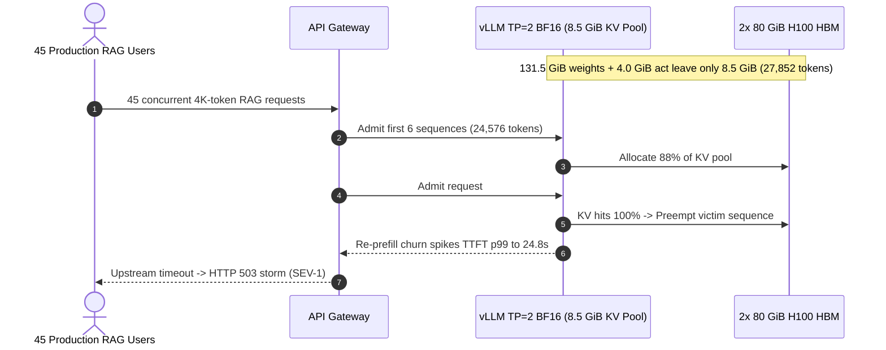

# Module 04: KV Cache Memory Math

> **Prerequisites:** [Module 02: Prefill and Decode Phases](../02-prefill-and-decode-phases/README.md), [Module 03: The KV Cache](../03-the-kv-cache/README.md), [Track 05, Module 04: VRAM: The Real Constraint](../../05-gpus-and-genai-hardware/04-vram-the-real-constraint/README.md), [Track 05, Module 05: Calculating a Model's Memory Requirements](../../05-gpus-and-genai-hardware/05-calculating-a-models-memory-requirements/README.md).  
> **Estimated Reading Time:** 35 minutes  
> **Target Audience:** AI Backend Engineers, Inference Serving Architects, Capacity Planners & SREs

> [!TIP]
> **The Golden Rule of KV Cache Memory Math:** Never provision inference GPUs by comparing model weight size against total VRAM alone. Production concurrency is governed strictly by **remaining KV-cache headroom**: $\text{VRAM}_{\text{total}} \cdot u - M_{\text{weights}} - M_{\text{act}}$. A `70B` BF16 model (`131.5 GiB` weights) on `2x 80 GiB` H100 GPUs leaves just `~8.5 GiB` for KV states—capping safe `4K`-context concurrency at `6` users, whereas adding two more GPUs (`4x 80 GiB`) or switching to `FP8` expands headroom `~9–18x` to `~118–120` concurrent users.

---

## Why This Matters

A common capacity-planning catastrophe unfolds like this: an engineer checks a model card for `Llama-3-70B`, multiplies `70.6B` parameters by `2` bytes (`BF16`), arrives at `~131.5 GiB` (`~141 GB`), and orders `2x 80 GiB` H100 instances (`160 GiB` total VRAM). On paper, `131.5 GiB < 160 GiB` looks comfortable with nearly `30 GiB` to spare.

Once deployed, the server boots—and immediately saturates at **`5–6` concurrent users** under `4K`-token RAG prompts, triggering cascading preemption pauses and HTTP `503` backpressure at traffic levels that a single `80 GiB` `Llama-3-8B` node handled effortlessly (`110` users). Worse, another team assumes a smaller `Llama-2-13B` (`24.2 GiB` weights) must support far higher concurrency than `Llama-3-70B` on `4x H100`, only to discover that `Llama-2-13B` uses **Multi-Head Attention (MHA)** (`800 KiB/token`), consuming **`2.5x` more VRAM per token** than `Llama-3-70B` **Grouped-Query Attention (GQA)** (`320 KiB/token`)!

Pinning down the exact per-token KV cache equation and solving for maximum safe concurrency $B_{\max}$ turns GPU sizing from guesswork into exact engineering arithmetic.

---

## 1. Exact Derivation of Per-Token KV Cache Bytes & Max Concurrency

During autoregressive inference (Module 03), every transformer layer caches two tensors for every token already processed (prompt + generated output): a **Key ($K$)** vector and a **Value ($V$)** vector across each key-value attention head.

```mermaid
flowchart LR
    VRAM["Total GPU Pool (N_TP x VRAM_gpu)"] -->|"Scale by u (0.90)"| Usable["Usable Budget (VRAM x u)"]
    Usable -->|"Subtract Fixed Weights"| SubW["Minus M_weights (Params + Scales)"]
    SubW -->|"Subtract Scratchpad"| SubAct["Minus M_act (Activations + CUDAGraphs)"]
    SubAct --> KVPool["Remaining KV Cache Pool (Bytes)"]
    KVPool -->|"Divide by B_tok"| MaxTok["Total Token Capacity"]
    MaxTok -->|"Divide by L_avg"| BMax["Max Safe Concurrency B_max"]
```



### Deriving Per-Token KV Footprint ($B_{\text{tok}}$)

For a single token at sequence position $t$:

1. **Two Tensors per Layer:** We cache both **Key** and **Value** projections ($\times 2$).
2. **All Transformer Layers:** Every decoder block maintains independent attention states ($\times n_{\text{layers}}$).
3. **Key-Value Attention Heads:** Only $n_{\text{kv\_heads}}$ (not $n_{\text{q\_heads}}$ under GQA/MQA!) are stored in the KV cache ($\times n_{\text{kv\_heads}}$).
4. **Head Dimension:** Each KV head stores a vector of width $d_{\text{head}}$ ($\times d_{\text{head}}$).
5. **Element Precision:** Usually `2` bytes (`FP16`/`BF16`) or `1` byte (`FP8` / `INT8` KV cache quantization) ($\times b_{\text{elem}}$).

Multiplying all five terms gives the exact **per-token KV cache footprint**:

$$B_{\text{tok}} = 2 \times n_{\text{layers}} \times n_{\text{kv\_heads}} \times d_{\text{head}} \times b_{\text{elem}} \quad [\text{bytes/token}]$$

For a single request reaching sequence length $L = L_p + L_o$ tokens, total KV memory is $L \cdot B_{\text{tok}}$. Across $B$ concurrent active requests averaging length $L_{\text{avg}}$, KV cache VRAM demand scales linearly with both concurrency and sequence length:

$$M_{\text{KV}}(B, L_{\text{avg}}) = B \times L_{\text{avg}} \times B_{\text{tok}}$$

### Worked Byte-Exact Model Comparison

Beware the binary (`KiB`/`MiB`/`GiB`, base $1024$) vs. decimal (`KB`/`MB`/`GB`, base $1000$) distinction when reading profiling tools (`nvidia-smi` reports `MiB`, hardware sheets advertise decimal `GB`, and weights in `70.6B` BF16 equal `141.2 GB` = `131.5 GiB`):

1. **Hypothetical 70B-Class MHA Baseline** ($n_{\text{layers}}=80, n_{\text{kv}}=64, d_{\text{head}}=128$, `BF16` $b_{\text{elem}}=2$):

$$B_{\text{tok}} = 2 \times 80 \times 64 \times 128 \times 2 = \mathbf{2,621,440\text{ bytes/token}} = 2,560\text{ KiB/tok} = \mathbf{2.50\text{ MiB/tok}} \; (\approx 2.62\text{ MB/tok})$$

   At $L = 32,768$ tokens, **one single request** consumes $32,768 \times 2.50\text{ MiB} = \mathbf{80.00\text{ GiB}}$, filling an entire 80 GiB H100 by itself! This exact memory explosion forced Meta to adopt **GQA** in both `Llama-2-70B` and `Llama-3-70B`.

2. **Llama-3-70B (and Llama-2-70B) GQA in FP16/BF16** ($n_{\text{layers}}=80, n_{\text{kv}}=8, d_{\text{head}}=128$, $b_{\text{elem}}=2$):

$$B_{\text{tok}} = 2 \times 80 \times 8 \times 128 \times 2 = \mathbf{327,680\text{ bytes/token}} = 320\text{ KiB/tok} = \mathbf{0.3125\text{ MiB/tok}} \; (\approx 327.68\text{ KB/tok})$$

   An **$8\times$ reduction** over 70B MHA: $4,096$ tokens now require $1.25\text{ GiB}$, and $32,768$ tokens require $10.00\text{ GiB}$.

3. **Llama-3-70B GQA with FP8 KV Cache Quantization** ($b_{\text{elem}}=1$):

$$B_{\text{tok}} = 2 \times 80 \times 8 \times 128 \times 1 = \mathbf{163,840\text{ bytes/token}} = 160\text{ KiB/tok} = \mathbf{0.15625\text{ MiB/tok}}$$

   Halving element width doubles maximum KV token capacity and cuts decode KV HBM bandwidth traffic by $2\times$ (at $L=4,096$, just $0.625\text{ GiB}$ per sequence).

4. **The 13B MHA Paradox (`Llama-2-13B` vs. `Llama-3-70B`):** `Llama-2-13B` ($n_{\text{layers}}=40, n_{\text{kv}}=40, d_{\text{head}}=128$, `FP16`) has $B_{\text{tok}} = 2 \times 40 \times 40 \times 128 \times 2 = \mathbf{819,200\text{ bytes/token}}$ (`800 KiB/tok` = `0.78125 MiB/tok`). Despite having $5.4\times$ fewer parameters, `Llama-2-13B` burns **$2.5\times$ more KV cache per token** than `Llama-3-70B`!

### Deriving Maximum Safe Concurrency ($B_{\max}$)

To guarantee zero `CUDA Out Of Memory` crashes under peak traffic, reserve a utilization factor $u \in (0, 1]$ (vLLM default `gpu_memory_utilization = 0.90`, leaving `10%` for CUDA driver contexts, NCCL buffers, and PyTorch allocator margins) and subtract static weights $M_{\text{weights}}$ plus runtime activations/CUDA graph capture memory $M_{\text{act}}$:

$$B_{\max} = \left\lfloor \frac{\text{VRAM}_{\text{total}} \cdot u - M_{\text{weights}} - M_{\text{act}}}{L_{\text{avg}} \cdot B_{\text{tok}}} \right\rfloor$$

Here $\text{VRAM}_{\text{total}} = N_{\text{TP}} \times \text{VRAM}_{\text{gpu}}$. When running **Tensor Parallelism ($N_{\text{TP}} > 1$)**, each GPU stores $1/N_{\text{TP}}$ of the KV heads **only as long as $N_{\text{TP}} \le n_{\text{kv\_heads}}$ and $n_{\text{kv\_heads}} \bmod N_{\text{TP}} = 0$**. If $N_{\text{TP}} > n_{\text{kv\_heads}}$ (for example, running `Llama-3-8B` with $n_{\text{kv}}=8$ across `TP=16`), the runtime must replicate KV heads across rank groups, multiplying cluster KV consumption by $\frac{N_{\text{TP}}}{n_{\text{kv\_heads}}}$ (`2x` KV bloat at `TP=16`)!

| Deployment Config (`80 GiB` H100/A100, `u=0.90`) | Usable Budget | $M_{\text{weights}} + M_{\text{act}}$ | Remaining KV Pool | $B_{\text{tok}}$ (KiB) | Max KV Tokens | $B_{\max}$ (`L=4,096`) |
| :--- | :---: | :---: | :---: | :---: | :---: | :---: |
| **Llama-3-8B BF16 (`1x80G`, TP=1)** | `72.0 GiB` | `14.96 + 2.0 GiB` | **`55.0 GiB`** | `128.0 KiB` | `450,887` | **`110` users** |
| **Llama-3-8B FP8-KV (`1x80G`, TP=1)** | `72.0 GiB` | `14.96 + 2.0 GiB` | **`55.0 GiB`** | `64.0 KiB` | `901,775` | **`220` users** |
| **Llama-2-13B MHA BF16 (`1x80G`, TP=1)** | `72.0 GiB` | `24.24 + 2.0 GiB` | **`45.8 GiB`** | `800.0 KiB` | `59,978` | **`14` users** |
| **Llama-3-70B BF16 (`2x80G`, TP=2)** | `144.0 GiB` | `131.5 + 4.0 GiB` | **`8.5 GiB`** | `320.0 KiB` | `27,852` | **`6` users** |
| **Llama-3-70B BF16 (`4x80G`, TP=4)** | `288.0 GiB` | `131.5 + 6.0 GiB` | **`150.5 GiB`** | `320.0 KiB` | `493,158` | **`120` users** |
| **Llama-3-70B FP8+FP8KV (`2x80G`, TP=2)** | `144.0 GiB` | `65.8 + 4.0 GiB` | **`74.2 GiB`** | `160.0 KiB` | `486,277` | **`118` users** |

---

## 2. Systematic Comparison Matrix: Attention & KV Storage Schemes

| Scheme | Example Model | $n_{\text{kv\_heads}}$ vs. $n_q$ | Relative $B_{\text{tok}}$ | Hardware / Quality Trade-off | Best Serving Workload |
| :--- | :--- | :---: | :---: | :--- | :--- |
| **MHA (Multi-Head Attention, FP16)** | Llama-2-7B / 13B, GPT-3 | $n_{\text{kv}} = n_q$ | `1.00x` (`Baseline`) | Zero projection sharing; explodes VRAM & decode HBM bandwidth at `> 4K` context | Legacy models or short `<= 2K` sequences |
| **GQA (Grouped-Query Attention, FP16)** | Llama-3-8B / 70B, Qwen-2.5 | $n_{\text{kv}} = n_q / 8$ | **`0.125x`** (`8x` smaller) | Negligible accuracy loss vs. MHA (`arXiv:2305.13245`); enables `8x` batch concurrency | General production RAG, chat, and coding APIs |
| **MQA (Multi-Query Attention, FP16)** | Falcon-40B, StarCoder | $n_{\text{kv}} = 1$ | **`0.0156x`** (`64x` vs 64-head MHA) | Tiny KV footprint, but cannot shard across `TP > 1` without KV head replication | High-throughput `TP=1` code completion |
| **GQA + FP8 KV Quantization** | Llama-3-70B (`--kv-cache-dtype fp8`) | $n_{\text{kv}} = n_q / 8$, `1B/elem` | **`0.0625x`** (`16x` vs MHA) | Doubles token capacity & halves KV HBM reads; `< 0.5%` perplexity shift when calibrated (`H100`/`L40S`) | Long-context (`16K–128K`) & high-concurrency serving |
| **MLA (Multi-Head Latent Attention)** | DeepSeek-V2 / V3 | Low-rank latent $d_c = 512$ + `64` RoPE | **`~0.05–0.07x`** | Compresses $K/V$ into shared latent vector before projection; absorbs up-projection into attention weights | Ultra-long-context MoE serving (`64K–128K`) |

---

## 3. Production War Story Post-Mortem: The `TP=2` Llama-3-70B Concurrency Cliff

| Field | Incident Details |
| :--- | :--- |
| **Severity** | **SEV-1** (94% Capacity Collapse, Continuous Preemptions & HTTP `503` Storm) |
| **Detection / Resolution Time** | Detected 18 minutes post-cutover via Prometheus `vllm:num_preemptions_total` alert / Mitigated in 42 minutes (rolled back to `TP=4`, later re-deployed on `TP=2` with `FP8` weights + `FP8` KV) |
| **Impact** | Max concurrency plummeted from `120` active users to `6`; `TTFT p99` spiked from `320 ms` to `24.8 s`; **\$4,200/hr** wasted retry traffic and SLA breach credits |

### What Happened

To trim GPU costs by `50%`, an infrastructure team migrated their `Llama-3-70B-Instruct` (`BF16`) customer RAG API from `4x 80 GiB H100` (`TP=4`) down to `2x 80 GiB H100` (`TP=2`). They validated two things in staging: (1) `70.6B * 2 bytes = 131.5 GiB < 160 GiB`, so weights fit comfortably across `2` GPUs, and (2) single-user test prompts (`B=1`, `2K` tokens) answered smoothly at `32 tok/s`.

Ten minutes after shifting production traffic (`45` concurrent RAG users averaging `4,096` prompt + output tokens), latency exploded. Prometheus showed GPU utilization dropping, `vllm:kv_cache_usage_perc` pinned at `100%`, and `vllm:num_preemptions_total` incrementing dozens of times per minute. At `TP=2` (`144 GiB` usable at `u=0.90`), subtracting `131.5 GiB` BF16 weights and `4.0 GiB` activation/CUDA graph overhead left just **`8.5 GiB` of KV cache pool** (`27,852` tokens total = **`6` concurrent `4K` sequences**!). Every 7th arriving user forced the scheduler into a vicious loop of queuing, preempting mid-stream requests, and re-prefilling them.



### Root Cause Analysis

- **Weight-Only Sizing Fallacy:** Capacity planning verified $M_{\text{weights}} < \text{VRAM}_{\text{total}}$ while ignoring $B_{\max}$ sensitivity to remaining headroom. Halving GPU count (`320 GiB -> 160 GiB`) did not halve KV capacity—because weights stayed fixed at `131.5 GiB`, **KV headroom collapsed `17.7x` (`150.5 GiB -> 8.5 GiB`)**!
- **Under-Scaled Staging Smoke Test:** Staging tested `B=1` concurrency (`1.25 GiB` KV), completely masking the `B=6` ceiling.

### The Fix & Architectural Hardening

- **Immediate Mitigation (`TP=4`):** Restored `4x 80 GiB H100` (`150.5 GiB` KV pool -> `B_max = 120` users at `4K` context).
- **Cost-Optimal Permanent Fix (`FP8` Weights + `FP8` KV on `TP=2`):** Enabled `FP8` weight quantization (`65.8 GiB`) plus `--kv-cache-dtype fp8` (`160 KiB/tok`), reclaiming **`74.2 GiB` KV pool (`486,277` tokens -> `B_max = 118` users)** on just `2x 80 GiB H100`—achieving the `50%` GPU savings *without* losing concurrency!
- **CI Sizing Gate:** Added an automated $B_{\max}$ check rejecting any deployment spec whose `B_max < 2 * target_peak_concurrency`.

---

## 4. Multi-Language Production Implementation: KV Memory & Concurrency Capacity Planner

Below is a production-grade **KV Cache Memory & Concurrency Calculator** across **Go**, **TypeScript**, **Python**, and **C#**. It computes exact per-token bytes ($B_{\text{tok}}$), accounts for Tensor Parallel KV-head replication when `TP > n_kv_heads`, flags weight-only OOM traps, and outputs exact `MaxTokens` and `MaxSafeConcurrency` ($B_{\max}$).

````carousel

```go
package kvmath

import (
	"errors"
	"fmt"
	"math"
)

const GiB = 1024.0 * 1024.0 * 1024.0

type ModelSpec struct {
	Name        string
	Layers      int
	QHeads      int
	KVHeads     int
	HeadDim     int
	KVBytes     int     // 2 for BF16/FP16, 1 for FP8/INT8
	WeightsGiB  float64
	ActHeadroom float64 // Activations + CUDA graph scratchpad (GiB)
}

type ClusterSpec struct {
	NumGPUs              int     // Tensor Parallelism degree (TP)
	VRAMPerGPU_GiB       float64
	GpuMemoryUtilization float64 // e.g., 0.90
}

type CapacityReport struct {
	BytesPerToken       int64
	ClusterKVMultiplier float64
	EffectiveBytesToken int64
	KVPoolGiB           float64
	MaxKVTokens         int64
	MaxConcurrency      int64
	Warning             string
}

func EvaluateKVCapacity(m ModelSpec, c ClusterSpec, avgSeqLen int) (CapacityReport, error) {
	if m.Layers <= 0 || m.KVHeads <= 0 || m.HeadDim <= 0 || m.KVBytes <= 0 || avgSeqLen <= 0 {
		return CapacityReport{}, errors.New("model dimensions, kv bytes, and avgSeqLen must be positive")
	}
	if c.NumGPUs <= 0 || c.VRAMPerGPU_GiB <= 0 || c.GpuMemoryUtilization <= 0 || c.GpuMemoryUtilization > 1.0 {
		return CapacityReport{}, errors.New("cluster GPUs, VRAM, and utilization (0,1] must be valid")
	}

	bTok := int64(2) * int64(m.Layers) * int64(m.KVHeads) * int64(m.HeadDim) * int64(m.KVBytes)

	// Guard TP > n_kv_heads replication penalty
	kvHeadsPerGPU := m.KVHeads / c.NumGPUs
	warn := ""
	if kvHeadsPerGPU < 1 {
		kvHeadsPerGPU = 1
		warn = fmt.Sprintf("TP (%d) > n_kv_heads (%d): KV heads replicated across GPUs", c.NumGPUs, m.KVHeads)
	} else if m.KVHeads%c.NumGPUs != 0 {
		return CapacityReport{}, fmt.Errorf("n_kv_heads (%d) not divisible by TP (%d)", m.KVHeads, c.NumGPUs)
	}
	mult := float64(c.NumGPUs*kvHeadsPerGPU) / float64(m.KVHeads)
	effBTok := int64(math.Round(float64(bTok) * mult))

	usableGiB := float64(c.NumGPUs) * c.VRAMPerGPU_GiB * c.GpuMemoryUtilization
	kvPoolGiB := usableGiB - m.WeightsGiB - m.ActHeadroom
	if kvPoolGiB <= 0 {
		return CapacityReport{
			BytesPerToken:       bTok,
			ClusterKVMultiplier: mult,
			EffectiveBytesToken: effBTok,
			KVPoolGiB:           0,
			Warning:             fmt.Sprintf("OOM: usable VRAM (%.1f GiB) <= weights+act (%.1f GiB)", usableGiB, m.WeightsGiB+m.ActHeadroom),
		}, nil
	}

	maxTokens := int64((kvPoolGiB * GiB) / float64(effBTok))
	bMax := maxTokens / int64(avgSeqLen)

	return CapacityReport{
		BytesPerToken:       bTok,
		ClusterKVMultiplier: mult,
		EffectiveBytesToken: effBTok,
		KVPoolGiB:           kvPoolGiB,
		MaxKVTokens:         maxTokens,
		MaxConcurrency:      bMax,
		Warning:             warn,
	}, nil
}
```

<!-- slide -->

```typescript
const GIB = 1024 ** 3;

export interface ModelKVSpec {
  readonly name: string;
  readonly layers: number;
  readonly kvHeads: number;
  readonly headDim: number;
  readonly kvBytesPerElem: 1 | 2;
  readonly weightsGiB: number;
  readonly activationGiB: number;
}

export interface ClusterBudget {
  readonly tpSize: number;
  readonly gpuVramGiB: number;
  readonly utilization: number; // e.g., 0.90
}

export interface ConcurrencyReport {
  readonly bytesPerToken: number;
  readonly replicationFactor: number;
  readonly effectiveBytesPerToken: number;
  readonly kvPoolGiB: number;
  readonly maxKvTokens: number;
  readonly bMax: number;
  readonly warning?: string;
}

export function computeMaxConcurrency(
  model: ModelKVSpec,
  cluster: ClusterBudget,
  avgSeqLen: number,
): ConcurrencyReport {
  if (model.layers <= 0 || model.kvHeads <= 0 || model.headDim <= 0 || avgSeqLen <= 0) {
    throw new RangeError("Model dimensions and avgSeqLen must be strictly positive");
  }
  if (cluster.tpSize <= 0 || cluster.utilization <= 0 || cluster.utilization > 1) {
    throw new RangeError("Invalid tpSize or gpu_memory_utilization");
  }

  const bytesPerToken = 2 * model.layers * model.kvHeads * model.headDim * model.kvBytesPerElem;
  let warning: string | undefined;

  let kvHeadsPerGpu: number;
  if (cluster.tpSize > model.kvHeads) {
    kvHeadsPerGpu = 1;
    warning = `TP (${cluster.tpSize}) exceeds n_kv_heads (${model.kvHeads}); KV replication inflates memory`;
  } else {
    if (model.kvHeads % cluster.tpSize !== 0) {
      throw new Error(`n_kv_heads (${model.kvHeads}) must be divisible by TP (${cluster.tpSize})`);
    }
    kvHeadsPerGpu = model.kvHeads / cluster.tpSize;
  }

  const replicationFactor = (cluster.tpSize * kvHeadsPerGpu) / model.kvHeads;
  const effectiveBytesPerToken = Math.round(bytesPerToken * replicationFactor);
  const usableGiB = cluster.tpSize * cluster.gpuVramGiB * cluster.utilization;
  const kvPoolGiB = usableGiB - model.weightsGiB - model.activationGiB;

  if (kvPoolGiB <= 0) {
    return {
      bytesPerToken,
      replicationFactor,
      effectiveBytesPerToken,
      kvPoolGiB: 0,
      maxKvTokens: 0,
      bMax: 0,
      warning: `OOM: usable VRAM (${usableGiB.toFixed(1)} GiB) exhausted by weights + activations`,
    };
  }

  const maxKvTokens = Math.floor((kvPoolGiB * GIB) / effectiveBytesPerToken);
  return {
    bytesPerToken,
    replicationFactor,
    effectiveBytesPerToken,
    kvPoolGiB,
    maxKvTokens,
    bMax: Math.floor(maxKvTokens / avgSeqLen),
    warning,
  };
}
```

<!-- slide -->

```python
"""
kv_capacity_planner.py
Exact per-token KV cache footprint and safe max concurrency (B_max) planner.
"""
from dataclasses import dataclass

GIB = 1024 ** 3


@dataclass(frozen=True)
class ModelKVConfig:
    name: str
    n_layers: int
    n_kv_heads: int
    d_head: int
    kv_bytes: int  # 2 for FP16/BF16, 1 for FP8/INT8
    weights_gib: float
    act_gib: float = 2.0


@dataclass(frozen=True)
class KVPlanResult:
    bytes_per_token: int
    replication_factor: float
    effective_bytes_per_token: int
    kv_pool_gib: float
    max_kv_tokens: int
    b_max: int
    warning: str | None = None


def plan_kv_capacity(
    model: ModelKVConfig,
    tp_size: int,
    gpu_vram_gib: float = 80.0,
    utilization: float = 0.90,
    avg_seq_len: int = 4096,
) -> KVPlanResult:
    if model.n_layers <= 0 or model.n_kv_heads <= 0 or model.d_head <= 0 or avg_seq_len <= 0:
        raise ValueError("Model geometry and avg_seq_len must be positive")
    if tp_size <= 0 or not (0.0 < utilization <= 1.0):
        raise ValueError("tp_size must be >= 1 and utilization in (0, 1]")

    b_tok = 2 * model.n_layers * model.n_kv_heads * model.d_head * model.kv_bytes
    warning: str | None = None

    if tp_size > model.n_kv_heads:
        kv_heads_per_gpu = 1
        warning = f"TP={tp_size} > n_kv_heads={model.n_kv_heads}: KV heads replicated!"
    elif model.n_kv_heads % tp_size != 0:
        raise ValueError(f"n_kv_heads={model.n_kv_heads} not divisible by tp_size={tp_size}")
    else:
        kv_heads_per_gpu = model.n_kv_heads // tp_size

    rep_factor = (tp_size * kv_heads_per_gpu) / model.n_kv_heads
    eff_b_tok = int(round(b_tok * rep_factor))

    usable_gib = tp_size * gpu_vram_gib * utilization
    kv_pool_gib = usable_gib - model.weights_gib - model.act_gib
    if kv_pool_gib <= 0.0:
        return KVPlanResult(
            bytes_per_token=b_tok,
            replication_factor=rep_factor,
            effective_bytes_per_token=eff_b_tok,
            kv_pool_gib=0.0,
            max_kv_tokens=0,
            b_max=0,
            warning=f"OOM: usable VRAM {usable_gib:.1f} GiB <= weights+act {model.weights_gib + model.act_gib:.1f} GiB",
        )

    max_tokens = int((kv_pool_gib * GIB) // eff_b_tok)
    return KVPlanResult(
        bytes_per_token=b_tok,
        replication_factor=rep_factor,
        effective_bytes_per_token=eff_b_tok,
        kv_pool_gib=kv_pool_gib,
        max_kv_tokens=max_tokens,
        b_max=max_tokens // avg_seq_len,
        warning=warning,
    )
```

<!-- slide -->

```csharp
using System;

namespace GenAI.Inference.KVMath;

public sealed record ModelKVSpec(
    string Name,
    int Layers,
    int KVHeads,
    int HeadDim,
    int KVBytesPerElem,
    double WeightsGiB,
    double ActivationGiB);

public sealed record CapacitySummary(
    long BytesPerToken,
    double ClusterReplicationFactor,
    long EffectiveBytesPerToken,
    double KVPoolGiB,
    long MaxKVTokens,
    long MaxSafeConcurrency,
    string? Warning);

public static class KVMemoryPlanner
{
    private const double GiB = 1024.0 * 1024.0 * 1024.0;

    public static CapacitySummary Calculate(
        ModelKVSpec model,
        int tpSize,
        double gpuVramGiB = 80.0,
        double utilization = 0.90,
        int avgSeqLen = 4096)
    {
        if (model.Layers <= 0 || model.KVHeads <= 0 || model.HeadDim <= 0 || avgSeqLen <= 0)
            throw new ArgumentOutOfRangeException(nameof(avgSeqLen), "Dimensions and context length must be positive.");
        if (tpSize <= 0 || utilization <= 0.0 || utilization > 1.0)
            throw new ArgumentOutOfRangeException(nameof(utilization), "TP >= 1 and utilization in (0, 1] required.");

        long bTok = 2L * model.Layers * model.KVHeads * model.HeadDim * model.KVBytesPerElem;
        string? warning = null;
        int kvHeadsPerGpu;

        if (tpSize > model.KVHeads)
        {
            kvHeadsPerGpu = 1;
            warning = $"TP={tpSize} exceeds KVHeads={model.KVHeads}; KV replication reduces token capacity.";
        }
        else if (model.KVHeads % tpSize != 0)
        {
            throw new ArgumentException($"KVHeads ({model.KVHeads}) must be divisible by TP ({tpSize}).");
        }
        else
        {
            kvHeadsPerGpu = model.KVHeads / tpSize;
        }

        double repFactor = (double)(tpSize * kvHeadsPerGpu) / model.KVHeads;
        long effBTok = (long)Math.Round(bTok * repFactor);
        double usableGiB = tpSize * gpuVramGiB * utilization;
        double kvPoolGiB = usableGiB - model.WeightsGiB - model.ActivationGiB;

        if (kvPoolGiB <= 0.0)
        {
            return new CapacitySummary(
                bTok, repFactor, effBTok, 0.0, 0, 0,
                $"OOM: usable VRAM ({usableGiB:F1} GiB) <= weights+act ({model.WeightsGiB + model.ActivationGiB:F1} GiB).");
        }

        long maxTokens = (long)Math.Floor((kvPoolGiB * GiB) / effBTok);
        long bMax = maxTokens / avgSeqLen;
        return new CapacitySummary(bTok, repFactor, effBTok, kvPoolGiB, maxTokens, bMax, warning);
    }
}
```

````

---

## 5. Practical Hands-On Verification CLI Workflows

Run these deterministic Python 3.13 verification scripts offline—no GPU hardware, third-party packages, or API keys required.

### Workflow 1: Exact Per-Token KV Footprint Across MHA, GQA, and FP8

Compute exact per-token bytes, KiB, MiB, `4K` context size, and `32K` context size across 70B MHA, 13B MHA, 7B MHA, 70B GQA, and 8B GQA configurations:

```bash
python -c '
models = [
    ("70B-Class MHA (Baseline)",     80, 64, 128, 2),
    ("Llama-2-13B MHA",              40, 40, 128, 2),
    ("Llama-2-7B MHA",               32, 32, 128, 2),
    ("Llama-3-70B GQA (BF16/FP16)",  80,  8, 128, 2),
    ("Llama-3-70B GQA (FP8 KV)",     80,  8, 128, 1),
    ("Llama-3-8B GQA (BF16/FP16)",   32,  8, 128, 2),
    ("Llama-3-8B GQA (FP8 KV)",      32,  8, 128, 1),
]
c1, c2, c3, c4, c5, c6 = "Model Config", "Bytes/Tok", "KiB/Tok", "MiB/Tok", "4K Ctx GiB", "32K Ctx GiB"
print(f"{c1:<28} | {c2:>10} | {c3:>8} | {c4:>9} | {c5:>10} | {c6:>11}")
print("-" * 91)
for name, layers, n_kv, d_head, bpe in models:
    b_tok = 2 * layers * n_kv * d_head * bpe
    print(f"{name:<28} | {b_tok:>10,} | {b_tok/1024:>8.2f} | {b_tok/(1024**2):>9.5f} | {b_tok*4096/(1024**3):>10.3f} | {b_tok*32768/(1024**3):>11.3f}")
'
```

**Expected Output:**

```text
Model Config                 |  Bytes/Tok |  KiB/Tok |   MiB/Tok | 4K Ctx GiB | 32K Ctx GiB
-------------------------------------------------------------------------------------------
70B-Class MHA (Baseline)     |  2,621,440 |  2560.00 |   2.50000 |     10.000 |      80.000
Llama-2-13B MHA              |    819,200 |   800.00 |   0.78125 |      3.125 |      25.000
Llama-2-7B MHA               |    524,288 |   512.00 |   0.50000 |      2.000 |      16.000
Llama-3-70B GQA (BF16/FP16)  |    327,680 |   320.00 |   0.31250 |      1.250 |      10.000
Llama-3-70B GQA (FP8 KV)     |    163,840 |   160.00 |   0.15625 |      0.625 |       5.000
Llama-3-8B GQA (BF16/FP16)   |    131,072 |   128.00 |   0.12500 |      0.500 |       4.000
Llama-3-8B GQA (FP8 KV)      |     65,536 |    64.00 |   0.06250 |      0.250 |       2.000
```

Notice two critical operational facts directly in the table: (1) `70B-Class MHA` at `32K` context consumes **`80.000 GiB`** for a single user, and (2) `Llama-2-13B MHA` (`800 KiB/tok`) eats **`2.5x` more KV cache per token** than `Llama-3-70B GQA` (`320 KiB/tok`).

### Workflow 2: Solve Max Safe Concurrency ($B_{\max}$) on 80 GiB H100/A100 Clusters

Reproduce the `TP=2` vs. `TP=4` and `BF16` vs. `FP8` concurrency jump on `80 GiB` H100/A100 GPUs (`u = 0.90`):

```bash
python -c '
GIB = 1024 ** 3
scenarios = [
    ("Llama-3-8B BF16 (1x80G, L=4K)",       1, 80, 0.90, 14.96, 2.0, 131072, 4096),
    ("Llama-3-8B FP8-KV (1x80G, L=4K)",     1, 80, 0.90, 14.96, 2.0,  65536, 4096),
    ("Llama-2-13B MHA BF16 (1x80G, L=4K)",  1, 80, 0.90, 24.24, 2.0, 819200, 4096),
    ("Llama-3-70B BF16 TP=2 (2x80G, L=4K)", 2, 80, 0.90, 131.5, 4.0, 327680, 4096),
    ("Llama-3-70B BF16 TP=4 (4x80G, L=4K)", 4, 80, 0.90, 131.5, 6.0, 327680, 4096),
    ("Llama-3-70B FP8+FP8KV TP=2 (L=4K)",   2, 80, 0.90,  65.8, 4.0, 163840, 4096),
    ("Llama-3-70B BF16 TP=4 (4x80G, L=32K)",4, 80, 0.90, 131.5, 6.0, 327680, 32768),
]
for name, gpus, gpu_gib, u, w_gib, act_gib, b_tok, l_avg in scenarios:
    kv_pool = (gpus * gpu_gib * u - w_gib - act_gib) * GIB
    max_tok = max(0, int(kv_pool // b_tok))
    b_max = max_tok // l_avg
    print(f"{name:<38} | KV_Pool={kv_pool/GIB:>5.1f} GiB | Max_Tok={max_tok:>7,} | B_max={b_max:>3}")
'
```

**Expected Output:**

```text
Llama-3-8B BF16 (1x80G, L=4K)          | KV_Pool= 55.0 GiB | Max_Tok=450,887 | B_max=110
Llama-3-8B FP8-KV (1x80G, L=4K)        | KV_Pool= 55.0 GiB | Max_Tok=901,775 | B_max=220
Llama-2-13B MHA BF16 (1x80G, L=4K)     | KV_Pool= 45.8 GiB | Max_Tok= 59,978 | B_max= 14
Llama-3-70B BF16 TP=2 (2x80G, L=4K)    | KV_Pool=  8.5 GiB | Max_Tok= 27,852 | B_max=  6
Llama-3-70B BF16 TP=4 (4x80G, L=4K)    | KV_Pool=150.5 GiB | Max_Tok=493,158 | B_max=120
Llama-3-70B FP8+FP8KV TP=2 (L=4K)      | KV_Pool= 74.2 GiB | Max_Tok=486,277 | B_max=118
Llama-3-70B BF16 TP=4 (4x80G, L=32K)   | KV_Pool=150.5 GiB | Max_Tok=493,158 | B_max= 15
```

### Workflow 3: Audit the Tensor Parallel (`TP > n_kv_heads`) Replication Penalty

Verify how overscaling Tensor Parallelism beyond `n_kv_heads = 8` (common on `Llama-3-8B` and `Llama-3-70B`) silently multiplies cluster KV cache footprint:

```bash
python -c '
for tp in [1, 2, 4, 8, 16]:
    n_kv_heads = 8
    kv_per_gpu = max(1, n_kv_heads // tp)
    mult = (tp * kv_per_gpu) / n_kv_heads
    eff_b_tok = int(2 * 32 * n_kv_heads * 128 * 2 * mult)
    print(f"TP={tp:>2} | kv_heads_per_GPU={kv_per_gpu} | cluster_KV_multiplier={mult:.1f}x | effective_B_tok={eff_b_tok:,} B/tok")
'
```

**Expected Output:**

```text
TP= 1 | kv_heads_per_GPU=8 | cluster_KV_multiplier=1.0x | effective_B_tok=131,072 B/tok
TP= 2 | kv_heads_per_GPU=4 | cluster_KV_multiplier=1.0x | effective_B_tok=131,072 B/tok
TP= 4 | kv_heads_per_GPU=2 | cluster_KV_multiplier=1.0x | effective_B_tok=131,072 B/tok
TP= 8 | kv_heads_per_GPU=1 | cluster_KV_multiplier=1.0x | effective_B_tok=131,072 B/tok
TP=16 | kv_heads_per_GPU=1 | cluster_KV_multiplier=2.0x | effective_B_tok=262,144 B/tok
```

### Hands-On Exercises

1. **Size an L40S (`48 GiB`) Fleet for `Qwen2.5-32B-Instruct`:** Check `Qwen2.5-32B` architecture specs (`64` layers, `8` KV heads, `d_head = 128`, `~61.0 GiB` BF16 weights vs. `~30.5 GiB` FP8/AWQ `~18 GiB`). Modify Workflow 2 to determine why BF16 requires `2x 48 GiB L40S` (`TP=2`) and solve $B_{\max}$ at `L_avg = 8,192` for BF16 vs. AWQ-INT4 (`1x 48 GiB`).
2. **Decode KV Bandwidth Crossover:** Combine Module 02's decode bandwidth formula ($\text{Bytes}_{\text{step}} = M_{\text{weights}} + B \cdot L_{\text{avg}} \cdot B_{\text{tok}}$) with Workflow 1 (`Llama-3-70B` `FP16` vs `FP8` KV). At `B = 64, L_avg = 16,384`, compute how many `GiB` of KV cache must be streamed from HBM on **every single decode token**!
3. **Optional Live GPU Telemetry Check (Requires NVIDIA GPU + vLLM):** Start `vllm serve` on a single GPU and inspect the startup log line `"# GPU blocks: <N>"`. Multiply `<N> * block_size (16) * B_tok` and verify that it matches `KV_Pool` from Workflow 2 within `~2%`!

### Independent Challenge

A financial-compliance platform serves `Llama-3-70B` (`80` layers, `8` KV heads, `d_head = 128`) over `4x 80 GiB H100` GPUs (`u = 0.90`, `M_act = 6.0 GiB`) for two distinct endpoints: (A) `4,096`-token Q&A targeting `100` concurrent requests, and (B) `32,768`-token prospectus summarization targeting `30` concurrent requests. Prove mathematically why **BF16 weights + BF16 KV** fails endpoint (B), evaluate whether **FP8 weights + FP8 KV** on the exact same `4x H100` hardware meets **both** SLAs simultaneously, and compute the new $B_{\max}$ for each endpoint.

<details><summary>Architectural Discussion</summary>

1. **BF16 Failure on Endpoint (B):** As verified in Workflow 2, `4x 80 GiB H100` (`288 GiB` usable) minus `131.5 GiB` BF16 weights and `6.0 GiB` activations leaves `150.5 GiB` KV pool (`493,158` tokens at `320 KiB/tok`). At `L = 4,096`, $B_{\max} = 120 \ge 100$ (passes A), but at `L = 32,768`, $B_{\max} = \lfloor 493,158 / 32,768 \rfloor = \mathbf{15} < 30$ (fails B by `2x`).
2. **FP8 Weights + FP8 KV on `4x H100`:** Quantizing weights to FP8 (`~65.8 GiB`) frees `65.7 GiB` immediately: KV pool expands to $288 - 65.8 - 6.0 = \mathbf{216.2\text{ GiB}}$. Simultaneously, FP8 KV cuts $B_{\text{tok}}$ in half (`160 KiB/tok`), yielding $\lfloor (216.2 \times 1024^3) / 163,840 \rfloor = \mathbf{1,416,888}$ tokens. At `L = 32,768`, $B_{\max} = \mathbf{43}$ concurrent users (`> 30`), and at `L = 4,096`, $B_{\max} = \mathbf{345}$ concurrent users (`> 100`)—satisfying both workloads on the same `4` GPUs!

</details>

---

## 6. Common Mistakes & Troubleshooting

- **Confusing `n_q_heads` with `n_kv_heads` in $B_{\text{tok}}$:** Using `64` query heads instead of `8` KV heads on `Llama-3-70B` overestimates KV cache size by **$8\times$** (`2.50 MiB/tok` vs `0.3125 MiB/tok`), leading teams to massively over-provision GPUs. Always inspect `"num_key_value_heads"` in `config.json`.
- **Setting `--gpu-memory-utilization 1.0` (`u = 1.0`):** Leaving `0%` buffer for PyTorch's CUDA caching allocator, NCCL peer-to-peer scratch buffers, or sidecar CUDA contexts causes intermittent `CUDA Out Of Memory` crashes during peak prefill bursts or CUDA graph capture. Keep $u \in [0.85, 0.92]$.
- **Using `L_avg` instead of peak tail `L_p95` when sizing static admission caps:** If average requests are `1,500` tokens (`B_max = 300`), a sudden batch of `25` users uploading `24K`-token PDFs instantly exhausts the KV pool (`600K` tokens) and triggers preemption storms. Reserve headroom or use vLLM's Automatic Prefix Caching + admission rate limits.
- **Assuming `13B` MHA is always cheaper to serve than `70B` GQA at long context:** Because `Llama-2-13B` consumes `800 KiB/tok` vs `Llama-3-70B`'s `320 KiB/tok`, at `B=32, L=16K`, `13B` consumes `400 GiB` of KV cache vs `160 GiB` for `70B`! Always calculate both $M_{\text{weights}}$ **and** $B \cdot L \cdot B_{\text{tok}}$.

---

## 7. Operational Validation Checkpoints & Checkpoint Quiz

### Operational Validation Checkpoints

<details><summary><strong>Checkpoint 1: Diagnosing Why a "Smaller" 13B Model OOMs Before a 70B Model at Long Context</strong></summary>

An engineer compares `Llama-2-13B` (`24.2 GiB` BF16 weights, `40` layers, `40` KV heads, `d_head=128`) on `1x 80 GiB H100` against `Llama-3-70B` (`131.5 GiB` BF16 weights, `80` layers, `8` KV heads, `d_head=128`) on `4x 80 GiB H100`. At `L = 16,384` tokens, why does `Llama-2-13B` cap out at just `3` concurrent users while `Llama-3-70B` (`TP=4`) supports `30`?

**Validation:** `Llama-2-13B` uses **MHA** (`n_kv=40`), requiring $2 \times 40 \times 40 \times 128 \times 2 = \mathbf{800\text{ KiB/token}}$ (`12.5 GiB` per `16K` request). With `45.8 GiB` KV headroom on `1x 80 GiB`, $B_{\max} = \lfloor 45.8 / 12.5 \rfloor = \mathbf{3}$ users. `Llama-3-70B` uses **GQA** (`n_kv=8`), requiring only **`320 KiB/token`** (`5.0 GiB` per `16K` request) across `150.5 GiB` KV headroom on `TP=4` ($B_{\max} = \mathbf{30}$ users).

</details>

<details><summary><strong>Checkpoint 2: Auditing a Misleading Weight-Only Deployment Spec</strong></summary>

A colleague proposes deploying `Llama-3-70B` (`BF16`, `131.5 GiB` weights) on `2x 80 GiB A100` (`u = 0.90`, `M_act = 4.0 GiB`) to serve `50` concurrent `4,096`-token chat sessions. Compute the exact KV pool and explain why the deployment fails SLA.

**Validation:** Usable VRAM is $2 \times 80 \times 0.90 = 144.0\text{ GiB}$. Subtracting `131.5 GiB` weights and `4.0 GiB` activation buffer leaves **`8.5 GiB`** (`27,852` tokens at `320 KiB/tok`). Divided by `4,096`, $B_{\max} = \mathbf{6}$ concurrent users—`8.3x` below the `50`-user requirement, triggering continuous queue backups and preemption stalls.

</details>

<details><summary><strong>Checkpoint 3: Preventing TP > n_kv_heads KV Replication Bloat</strong></summary>

An SRE increases Tensor Parallelism for `Llama-3-8B` (`n_kv_heads = 8`) from `TP = 8` to `TP = 16` across two 8-GPU nodes expecting `2x` more KV cache capacity per user. Verify what actually happens to per-token KV storage across the 16 GPUs.

**Validation:** Because a single KV attention head cannot be split across GPUs, `TP = 16 > n_kv_heads = 8` forces each pair of GPUs to **replicate** the same KV head (`1` KV head stored per GPU across `16` GPUs = `16` total KV head copies instead of `8`). Effective cluster $B_{\text{tok}}$ doubles from `131,072 B/tok` to `262,144 B/tok`, eliminating KV scaling gains while adding cross-node AllReduce latency! Use Data Parallelism (`2x TP=8` or `16x TP=1` replicas) instead.

</details>

### Checkpoint Quiz

1. Write the exact formula for per-token KV cache bytes $B_{\text{tok}}$, defining all five variables.
2. Compute the exact bytes/token and `MiB/token` for a `48`-layer model with `n_kv_heads = 8`, `d_head = 128` in `BF16` vs. `FP8` KV cache.
3. Why does halving Tensor Parallelism from `TP=4` (`320 GiB`) to `TP=2` (`160 GiB`) on `Llama-3-70B BF16` cut KV capacity by `~17.7x` rather than `2x`?
4. Why does `Llama-2-13B` consume `2.5x` more KV VRAM per token than `Llama-3-70B`?
5. What happens mechanically if $N_{\text{TP}} > n_{\text{kv\_heads}}$ during Tensor Parallel serving?

<details><summary>Answers</summary>

1. $B_{\text{tok}} = 2 \times n_{\text{layers}} \times n_{\text{kv\_heads}} \times d_{\text{head}} \times b_{\text{elem}}$, where `2` accounts for separate Key and Value tensors, $n_{\text{layers}}$ is decoder block count, $n_{\text{kv\_heads}}$ is KV head count per layer, $d_{\text{head}}$ is head dimension, and $b_{\text{elem}}$ is bytes per element (`2` for BF16/FP16, `1` for FP8).
2. In `BF16`: $2 \times 48 \times 8 \times 128 \times 2 = \mathbf{196,608\text{ bytes/token}}$ (`192 KiB` = `0.1875 MiB/tok`). In `FP8`: **`98,304 bytes/token`** (`96 KiB` = `0.09375 MiB/tok`).
3. Model weights remain fixed (`131.5 GiB`). At `TP=4`, KV gets $288 - 131.5 - 6 = 150.5\text{ GiB}$; at `TP=2`, KV gets $144 - 131.5 - 4 = 8.5\text{ GiB}$ (`150.5 / 8.5 = 17.7x` collapse).
4. `Llama-2-13B` uses MHA (`40` layers $\times$ `40` KV heads = `1,600` KV head-layers), whereas `Llama-3-70B` uses GQA (`80` layers $\times$ `8` KV heads = `640` KV head-layers), yielding $1600 / 640 = 2.5\times$ larger per-token KV state.
5. Each GPU must host at least `1` KV head, so KV heads are duplicated across rank subsets—inflating total cluster KV storage by $N_{\text{TP}} / n_{\text{kv\_heads}}$ while adding inter-GPU AllReduce communication overhead.

</details>

---

## Further Reading & Sources

- [GQA: Training Generalized Multi-Query Transformer Models from Multi-Head Checkpoints (Ainslie et al., 2023)](https://arxiv.org/abs/2305.13245) — introduces Grouped-Query Attention explaining the $8\times$ KV reduction behind modern `70B` models.
- [Efficiently Scaling Transformer Inference (Pope et al., 2022)](https://arxiv.org/abs/2211.05102) — formal derivation of KV cache memory vs. batch size, context length, and Multi-Query/TP tradeoffs.
- [Efficient Memory Management for Large Language Model Serving with PagedAttention (Kwon et al., SOSP 2023)](https://arxiv.org/abs/2309.06180) — empirical KV memory budgeting and allocation analysis on production GPUs.
- [vLLM Documentation: Performance & Optimization](https://docs.vllm.ai/en/latest/) — official documentation on `gpu_memory_utilization`, `kv_cache_dtype=fp8`, and Tensor Parallelism constraints.

## Next

[Module 05: Naive Batching and Its Waste](../05-naive-batching-and-its-waste/README.md)
