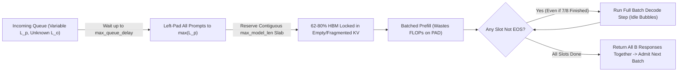
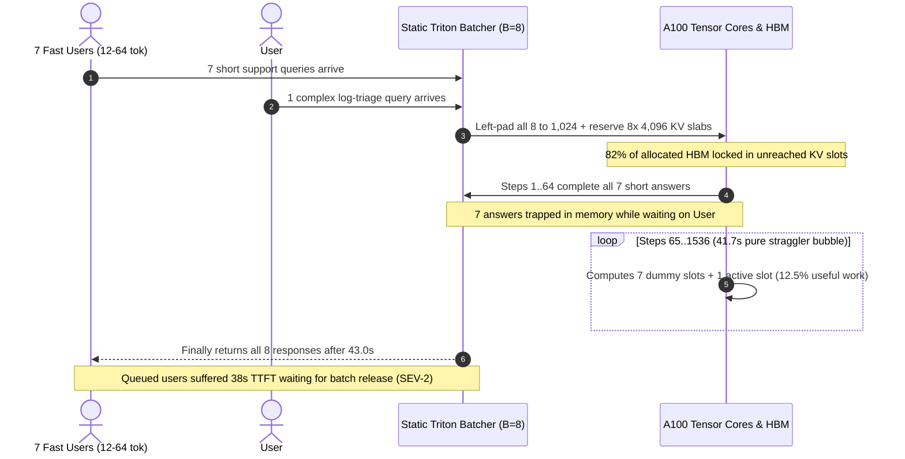

# Module 05: Naive Batching and Its Waste

> **Prerequisites:** [Module 02: Prefill and Decode Phases](../02-prefill-and-decode-phases/README.md), [Module 04: KV Cache Memory Math](../04-kv-cache-memory-math/README.md), [Track 02, Module 07: Attention Masks and Causal Masking](../../02-transformer-architecture/07-attention-masks-and-causal-masking/README.md).  
> **Estimated Reading Time:** 30 minutes  
> **Target Audience:** AI Backend Engineers, Inference Serving Architects, ML Systems & Performance Engineers

> [!TIP]
> **The Golden Rule of Naive Static Batching:** Treating autoregressive LLM generation like a fixed-shape tensor batch guarantees catastrophic GPU underutilization. Request-level (static) batching locks every sequence together from prompt prefill until the slowest straggler emits `<EOS>` and reserves contiguous `max_model_len` KV slabs upfront—burning **`60%–80%` of GPU HBM and compute cycles on padding and idle bubbles**, leaving just **`20%–38%`** of allocated KV memory holding live tokens.

---

## Why This Matters

An engineer builds a `Llama-3-8B` batch endpoint using standard Hugging Face `transformers.generate()` (or an early Triton dynamic batcher without iteration scheduling). They run a synthetic benchmark sending `8` identical `512`-token prompts capped at `max_new_tokens=128`. All `8` requests finish together at step `128`; GPU throughput looks great (`~282 tok/s`), and the dashboard shows `100%` slot utilization.

Then real production traffic hits. Seven users ask quick questions answered in `12–64` tokens, while the eighth user triggers a `1,536`-token JSON report or code refactor. Under static batching:

1. **The `7` finished requests cannot leave the batch:** They sit trapped inside the rectangular `[8, L]` tensor doing wasted compute until user #8 finishes at step `1,536` (`12x` longer!).
2. **Queued users #9–#24 cannot enter:** Even though `7` of `8` slots finished at step `64`, the GPU rejects new arrivals for `40+` seconds waiting for user #8.
3. **VRAM fills with empty reservations:** Because output length is unknown upfront and PyTorch requires contiguous tensors, each slot pre-allocates `max_model_len` (`4,096` tokens) of contiguous KV space—starving concurrency before real tokens even appear.

Understanding these exact mechanical wastes explains why static batching breaks in production—and directly motivates **Continuous Batching** (Module 06) and **PagedAttention** (Module 07).

---

## 1. Anatomy of Naive Static Batching & Its 4 Compounding Wastes

Static (request-level) batching adapts classical deep-learning minibatching (`ResNet-50` or `BERT` classification) to autoregressive generation. Because all sequences in a PyTorch batch share a single dense rectangular tensor `[B, L_max]`, the runtime enforces three rigid constraints: **padded inputs**, **lockstep execution until the final `<EOS>`**, and **contiguous KV pre-allocation**.



### The 4 Exact Sources of Waste

#### 1. Batch Formation Wait Delay
To populate a batch of size $B$, static batchers pause incoming requests until either $B$ requests accumulate or a timeout `max_queue_delay` (`50–250 ms`) expires. Under light or uneven QPS, early arrivals suffer pure queueing latency before prefill even begins—raising `TTFT` unnecessarily.

#### 2. Left-Padding Prompt Overhead
Because decoder-only models generate the next token from the rightmost sequence position, batched prompts must be **left-padded** to $L_{p,\max} = \max_{i=1..B} L_{p,i}$ using an attention mask that zeros out padding positions. Every prompt shorter than $L_{p,\max}$ wastes prefill GEMM FLOPs and KV slots:

$$\eta_{\text{prompt}} = \frac{\sum_{i=1}^{B} L_{p,i}}{B \cdot \max_i L_{p,i}}$$

If one user pastes a `1,024`-token document alongside seven `200`-token queries, prompt efficiency drops below `30%`.

#### 3. End-of-Sequence (`<EOS>`) Straggler Idle Bubbles
Unlike BERT classification (1 forward pass), autoregressive decode loops until **every** sequence in the batch emits `<EOS>` or hits `max_new_tokens`. Once sequence $i$ emits `<EOS>` at step $L_{o,i} = 24$, its slot remains locked inside the `[B, ...]` batch tensor while straggler $j$ runs to $L_{o,j} = 1,536$. Across all decode iterations, actual decode step utilization is governed by the **mean-to-max ratio**:

$$\eta_{\text{decode}} = \frac{\sum_{i=1}^{B} L_{o,i}}{B \cdot \max_{i=1..B} L_{o,i}}, \qquad \text{Bubble Waste} = 1 - \eta_{\text{decode}}$$

Even on benign chat workloads where average length is `150` tokens and `p95` length is `900` tokens, a batch of $B=16$ almost always contains at least one long generation (`1 - (1 - 0.05)^{16} = 56%` probability!), collapsing decode efficiency to `~15–25%`!

#### 4. Contiguous `max_model_len` Pre-Allocation & Fragmentation (`arXiv:2309.06180`)
Standard CUDA/PyTorch attention kernels (`FlashAttention` / `cuBLAS` strided batched GEMM) require each sequence's KV cache tensor to occupy a **contiguous** memory slice of shape `[max_model_len, n_kv_heads, d_head]`. Because output length $L_{o,i}$ cannot be predicted before decoding completes, static systems must reserve the worst-case slab (`max_model_len` or `L_p + max_tokens`) upfront.

In their landmark SOSP 2023 study (*PagedAttention*, `arXiv:2309.06180`), Kwon et al. measured existing contiguous serving engines (FasterTransformer and contiguous Orca) and discovered that **only `20.4%` to `38.2%` of allocated KV-cache memory actually stored live token states**. The remaining **`61.8%`–`79.6%`** vanished into three buckets:

1. **Reserved (Future) Slots (`~40–65%`):** Space allocated up to `max_seq_len` that requests never reach before hitting `<EOS>`.
2. **Internal Fragmentation (`~10–25%`):** Over-allocated contiguous slab capacity when a sequence finishes well inside its allocated power-of-2 or max-token chunk.
3. **External Fragmentation (`~4–15%`):** Non-contiguous gaps scattered between differently sized contiguous sequence allocations that cannot satisfy a new contiguous `max_seq_len` allocation request.

$$\text{Live KV Efficiency} = \frac{\sum_{i=1}^{B} (L_{p,i} + L_{o,i})}{M_{\text{KV\_pool\_tokens}}}, \qquad \text{Total Waste} = 1 - \text{Live KV Efficiency}$$

---

## 2. Systematic Comparison Matrix: Static Batching Regimes vs. Dynamic Serving

| Dimension | Single-Stream (`B=1`, No Batching) | Static Uniform Batch (`L_p=512, L_o=128`) | Static Skewed Prod Batch (`1 Straggler=1,536`) | Continuous + Paged Serving (Modules 06–07) |
| :--- | :--- | :--- | :--- | :--- |
| **Prompt Padding Waste** | `0%` (single sequence) | `0%` (identical prompts) | **`50%–75%`** (left-padded to `max L_p`) | **`0%`** (ragged packed tokens, no padding) |
| **EOS Straggler Bubbles** | `0%` (stops immediately) | `0%` (all end together) | **`75%–88%`** (`7/8` slots idle until max EOS) | **`0%`** (finished sequences exit every token step) |
| **Contiguous KV Reservation Waste** | Low (`1` user) | `~84%` (if reserving `4K` slab for `640` tokens) | **`62%–80%`** (`arXiv:2309.06180` baseline) | **`< 4%`** (`16`-token paged blocks, zero ext. frag) |
| **Max Effective Concurrency ($B$)** | `1` | Severely bounded by contiguous `L_max` slabs | Severely bounded (`~6–16` slabs) | **`3x–5x` higher** (`B_max` uses actual token count) |
| **Decode Arithmetic Intensity** | `~1 FLOP/Byte` (`~0.3%` SM util) | High (`B` live tokens/step) | Collapses back toward `B=1` as peers hit `<EOS>` | Sustained high `B` across every iteration |
| **Incoming Queue `TTFT`** | Stalled behind serial execution | Moderate | **Catastrophic HoL blocking** (`10–45s`) | Low (`ms`, admitted on very next token step) |

---

## 3. Production War Story Post-Mortem: The Runaway Markdown Straggler Collapse

| Field | Incident Details |
| :--- | :--- |
| **Severity** | **SEV-2** (6.6x Throughput Collapse, `p99 TTFT` Spike to `38 s`, Autoscaler Thrashing) |
| **Detection / Resolution Time** | Detected 25 minutes into peak traffic via `TTFT > 10s` SLO page / Mitigated in 1 hour (emergency `max_tokens=256` cap, followed by migration to continuous batching) |
| **Impact** | Support chat widget latency degraded from `0.9 s` to `38.4 s`; GPU fleet scaled from `4` to `16` A100 nodes (**\$11,500** daily cloud burn) yet throughput stayed flat |

### What Happened

An engineering team wrapped `Llama-3-8B` inside a Triton Inference Server Python backend using **dynamic request-level batching** (`max_batch_size=8`, `max_queue_delay_microseconds=50000`, `max_new_tokens=2048`). During load testing with synthetic uniform `128`-token outputs, each A100 served `~280 output tokens/sec` cleanly with `1.8s` E2EL.

In live customer support traffic, `~88%` of questions required `18–48` tokens (`"Reset your API key under Settings -> Security"`), while `~12%` triggered verbose troubleshooting checklists or hit a repetition loop hitting `1,536+` tokens. With `B=8`, probability dictated that nearly **every single batch (`1 - 0.88^8 = 64%`) contained at least one `1,500`-token straggler**.

As soon as the `7` fast users finished at token `48`, all `7` slots sat frozen inside the static batch for the next `1,488` decode steps (`~41.7 seconds`!). Incoming users queued behind closed batches, `p99 TTFT` jumped past `38` seconds, and the Kubernetes HPA spun up `4x` more A100 replicas whose GPUs sat `85%` idle inside straggler bubbles!



### Root Cause Analysis

- **Static Lockstep Batching:** Finished slots could not be freed or refilled mid-generation, letting `12%` tail requests dictate GPU utilization for `100%` of the batch.
- **Unbounded `max_new_tokens = 2,048` + Uniform Load Testing:** Uniform synthetic tests (`128` tokens) masked the `mean/max` collapse completely (`100%` slot utilization in staging vs `14.9%` in production).
- **Contiguous Pre-Allocation Bottleneck:** Reserving `4,096`-token contiguous slabs capped batch size at `B=8–14` even though average live length was `< 500` tokens.

### The Fix & Architectural Hardening

- **Immediate Mitigation:** Clamped `max_new_tokens = 384` on the chat endpoint (raising $\eta_{\text{decode}}$ from `14.9%` to `~52%`) and added repetition penalties to eliminate `1,536`-token runaway loops.
- **Permanent Fix:** Replaced static `transformers.generate()` batching with **vLLM continuous iteration-level batching + PagedAttention**, increasing per-node throughput **`5.8x`** and cutting the A100 fleet from `16` back down to `3` nodes.
- **Load-Test Skew Requirement:** Updated staging benchmarks to sample prompt and output lengths from production log-normal/Pareto distributions rather than fixed uniform lengths.

---

## 4. Multi-Language Production Implementation: Static Batch Waste & Fragmentation Auditor

Below is a deterministic **Static Batch Waste & KV Reservation Auditor** implemented across **Go**, **TypeScript**, **Python**, and **C#**. Pass any batch of observed `(PromptLen, OutputLen)` requests along with `MaxModelLen` and `ExternalFragRatio`, and it outputs exact prompt padding efficiency, decode straggler waste, contiguous KV live efficiency, and wall-clock throughput loss.

````carousel

```go
package staticwaste

import "errors"

type RequestShape struct {
	ID        string
	PromptLen int
	OutputLen int
}

type BatchWasteReport struct {
	BatchSize              int
	MaxPrompt              int
	MaxOutput              int
	PromptEfficiency       float64
	DecodeSlotUtilization  float64
	StragglerBubbleWaste   float64
	ContiguousKVLiveRatio  float64
	ContiguousKVWasteRatio float64
	EffectiveThroughputPct float64
}

func AuditStaticBatch(reqs []RequestShape, maxModelLen int, extFragFactor float64) (BatchWasteReport, error) {
	if len(reqs) == 0 || maxModelLen <= 0 || extFragFactor < 0 {
		return BatchWasteReport{}, errors.New("reqs non-empty, maxModelLen > 0, extFragFactor >= 0 required")
	}

	var maxP, maxO, sumP, sumO int
	for _, r := range reqs {
		if r.PromptLen <= 0 || r.OutputLen <= 0 || r.PromptLen+r.OutputLen > maxModelLen {
			return BatchWasteReport{}, errors.New("invalid request token lengths vs maxModelLen")
		}
		if r.PromptLen > maxP {
			maxP = r.PromptLen
		}
		if r.OutputLen > maxO {
			maxO = r.OutputLen
		}
		sumP += r.PromptLen
		sumO += r.OutputLen
	}

	b := len(reqs)
	paddedPrompt := float64(b * maxP)
	decodeSlots := float64(b * maxO)
	liveTotal := float64(sumP + sumO)
	contiguousPool := float64(b*maxModelLen) * (1.0 + extFragFactor)

	promptEff := float64(sumP) / paddedPrompt
	decodeUtil := float64(sumO) / decodeSlots
	kvLive := liveTotal / contiguousPool

	return BatchWasteReport{
		BatchSize:              b,
		MaxPrompt:              maxP,
		MaxOutput:              maxO,
		PromptEfficiency:       promptEff,
		DecodeSlotUtilization:  decodeUtil,
		StragglerBubbleWaste:   1.0 - decodeUtil,
		ContiguousKVLiveRatio:  kvLive,
		ContiguousKVWasteRatio: 1.0 - kvLive,
		EffectiveThroughputPct: decodeUtil * 100.0,
	}, nil
}
```

<!-- slide -->

```typescript
export interface StaticRequestShape {
  readonly id: string;
  readonly promptLen: number;
  readonly outputLen: number;
}

export interface StaticWasteMetrics {
  readonly batchSize: number;
  readonly maxPrompt: number;
  readonly maxOutput: number;
  readonly promptEfficiency: number;
  readonly decodeUtilization: number;
  readonly stragglerBubbleWaste: number;
  readonly contiguousKvLiveRatio: number;
  readonly contiguousKvWasteRatio: number;
}

export function auditStaticBatchWaste(
  batch: readonly StaticRequestShape[],
  maxModelLen: number,
  externalFragRatio = 0.08,
): StaticWasteMetrics {
  if (batch.length === 0 || maxModelLen <= 0 || externalFragRatio < 0) {
    throw new RangeError("Batch must be non-empty with valid maxModelLen and externalFragRatio");
  }

  let maxP = 0;
  let maxO = 0;
  let sumP = 0;
  let sumO = 0;

  for (const req of batch) {
    if (req.promptLen <= 0 || req.outputLen <= 0 || req.promptLen + req.outputLen > maxModelLen) {
      throw new RangeError(`Invalid sequence lengths on request ${req.id}`);
    }
    if (req.promptLen > maxP) maxP = req.promptLen;
    if (req.outputLen > maxO) maxO = req.outputLen;
    sumP += req.promptLen;
    sumO += req.outputLen;
  }

  const b = batch.length;
  const promptEfficiency = sumP / (b * maxP);
  const decodeUtilization = sumO / (b * maxO);
  const contiguousPoolSlots = b * maxModelLen * (1 + externalFragRatio);
  const contiguousKvLiveRatio = (sumP + sumO) / contiguousPoolSlots;

  return {
    batchSize: b,
    maxPrompt: maxP,
    maxOutput: maxO,
    promptEfficiency,
    decodeUtilization,
    stragglerBubbleWaste: 1 - decodeUtilization,
    contiguousKvLiveRatio,
    contiguousKvWasteRatio: 1 - contiguousKvLiveRatio,
  };
}
```

<!-- slide -->

```python
"""
static_batch_auditor.py
Computes prompt padding, EOS straggler bubbles, and contiguous KV reservation waste.
"""
from dataclasses import dataclass
from typing import Sequence


@dataclass(frozen=True)
class StaticReq:
    req_id: str
    prompt_len: int
    output_len: int


@dataclass(frozen=True)
class StaticWasteAudit:
    batch_size: int
    max_prompt: int
    max_output: int
    prompt_efficiency: float
    decode_utilization: float
    straggler_waste: float
    kv_live_ratio: float
    kv_waste_ratio: float


def audit_static_batch(
    batch: Sequence[StaticReq],
    max_model_len: int = 4096,
    external_frag_ratio: float = 0.08,
) -> StaticWasteAudit:
    if not batch or max_model_len <= 0 or external_frag_ratio < 0.0:
        raise ValueError("Batch cannot be empty and constraints must be valid")

    for r in batch:
        if r.prompt_len <= 0 or r.output_len <= 0 or (r.prompt_len + r.output_len) > max_model_len:
            raise ValueError(f"Request {r.req_id} exceeds max_model_len={max_model_len}")

    b = len(batch)
    max_p = max(r.prompt_len for r in batch)
    max_o = max(r.output_len for r in batch)
    sum_p = sum(r.prompt_len for r in batch)
    sum_o = sum(r.output_len for r in batch)

    prompt_eff = sum_p / (b * max_p)
    decode_util = sum_o / (b * max_o)
    contiguous_pool = b * max_model_len * (1.0 + external_frag_ratio)
    kv_live = (sum_p + sum_o) / contiguous_pool

    return StaticWasteAudit(
        batch_size=b,
        max_prompt=max_p,
        max_output=max_o,
        prompt_efficiency=prompt_eff,
        decode_utilization=decode_util,
        straggler_waste=1.0 - decode_util,
        kv_live_ratio=kv_live,
        kv_waste_ratio=1.0 - kv_live,
    )
```

<!-- slide -->

```csharp
using System;
using System.Collections.Generic;
using System.Linq;

namespace GenAI.Inference.Batching;

public sealed record StaticRequestShape(string RequestId, int PromptLen, int OutputLen);

public sealed record StaticBatchWasteReport(
    int BatchSize,
    int MaxPrompt,
    int MaxOutput,
    double PromptEfficiency,
    double DecodeSlotUtilization,
    double StragglerBubbleWaste,
    double ContiguousKvLiveRatio,
    double ContiguousKvWasteRatio);

public static class StaticBatchAuditor
{
    public static StaticBatchWasteReport Audit(
        IReadOnlyList<StaticRequestShape> batch,
        int maxModelLen = 4096,
        double externalFragRatio = 0.08)
    {
        if (batch is null || batch.Count == 0)
            throw new ArgumentException("Batch must contain at least one request.");
        if (maxModelLen <= 0 || externalFragRatio < 0)
            throw new ArgumentOutOfRangeException(nameof(maxModelLen), "Invalid memory bounds.");

        foreach (var r in batch)
        {
            if (r.PromptLen <= 0 || r.OutputLen <= 0 || r.PromptLen + r.OutputLen > maxModelLen)
                throw new ArgumentException($"Invalid token geometry for {r.RequestId}.");
        }

        int b = batch.Count;
        int maxP = batch.Max(r => r.PromptLen);
        int maxO = batch.Max(r => r.OutputLen);
        long sumP = batch.Sum(r => (long)r.PromptLen);
        long sumO = batch.Sum(r => (long)r.OutputLen);

        double promptEff = (double)sumP / (b * maxP);
        double decodeUtil = (double)sumO / (b * maxO);
        double contiguousPool = b * maxModelLen * (1.0 + externalFragRatio);
        double kvLive = (sumP + sumO) / contiguousPool;

        return new StaticBatchWasteReport(
            BatchSize: b,
            MaxPrompt: maxP,
            MaxOutput: maxO,
            PromptEfficiency: promptEff,
            DecodeSlotUtilization: decodeUtil,
            StragglerBubbleWaste: 1.0 - decodeUtil,
            ContiguousKvLiveRatio: kvLive,
            ContiguousKvWasteRatio: 1.0 - kvLive);
    }
}
```

````

---

## 5. Practical Hands-On Verification CLI Workflows

Run these deterministic Python 3.13 verification scripts offline—no GPUs or third-party dependencies required.

### Workflow 1: Measure Padding, Straggler Bubble & Contiguous KV Waste Under Uniform vs. Skewed Traffic

Compare a uniform synthetic batch (`512` prompt, `128` output) against a realistic skewed batch with one `1,536`-token straggler (`B=8`, `max_model_len=4096`):

```bash
python -c '
uniform_batch = [(f"U{i}", 512, 128) for i in range(8)]
skewed_batch = [
    ("R0", 180, 24),
    ("R1", 420, 48),
    ("R2", 260, 18),
    ("R3", 950, 96),
    ("R4", 310, 32),
    ("R5", 512, 64),
    ("R6", 200, 12),
    ("R7", 1024, 1536),
]

def audit_static(label, batch, max_model_len=4096):
    b = len(batch)
    max_p = max(p for _, p, _ in batch)
    max_o = max(o for _, _, o in batch)
    live_p = sum(p for _, p, _ in batch)
    live_o = sum(o for _, _, o in batch)
    live_tot = live_p + live_o
    pad_p = b * max_p
    dec_slots = b * max_o
    lockstep = b * (max_p + max_o)
    contig_kv = b * max_model_len
    print(f"{label} (B={b}, max_p={max_p}, max_o={max_o}):")
    print(f"  Prompt Padding Eff    : {live_p:,}/{pad_p:,} = {100*live_p/pad_p:5.1f}%")
    print(f"  Decode Slot Util      : {live_o:,}/{dec_slots:,} = {100*live_o/dec_slots:5.1f}% (Straggler Waste = {100*(1-live_o/dec_slots):4.1f}%)")
    print(f"  Lockstep Total Util   : {live_tot:,}/{lockstep:,} = {100*live_tot/lockstep:5.1f}%")
    print(f"  Contiguous KV Live    : {live_tot:,}/{contig_kv:,} = {100*live_tot/contig_kv:5.1f}% (Wasted KV = {100*(1-live_tot/contig_kv):4.1f}%)")

audit_static("Uniform Traffic", uniform_batch)
audit_static("Skewed Prod Traffic", skewed_batch)
'
```

**Expected Output:**

```text
Uniform Traffic (B=8, max_p=512, max_o=128):
  Prompt Padding Eff    : 4,096/4,096 = 100.0%
  Decode Slot Util      : 1,024/1,024 = 100.0% (Straggler Waste =  0.0%)
  Lockstep Total Util   : 5,120/5,120 = 100.0%
  Contiguous KV Live    : 5,120/32,768 =  15.6% (Wasted KV = 84.4%)
Skewed Prod Traffic (B=8, max_p=1024, max_o=1536):
  Prompt Padding Eff    : 3,856/8,192 =  47.1%
  Decode Slot Util      : 1,830/12,288 =  14.9% (Straggler Waste = 85.1%)
  Lockstep Total Util   : 5,686/20,480 =  27.8%
  Contiguous KV Live    : 5,686/32,768 =  17.4% (Wasted KV = 82.6%)
```

Even in the idealized uniform run, contiguous `4K` reservation leaves **`84.4%`** of KV memory empty; under realistic skewed traffic, **both** compute slots (`85.1%` decode bubble) **and** KV VRAM (`82.6%` empty/unused) collapse simultaneously!

### Workflow 2: Decompose Kwon et al. (`arXiv:2309.06180`) KV Memory Waste Breakdown

Simulate `16` variable-length sequences (`78` to `1,450` tokens) inside a contiguous `max_seq_len=2048` allocator with `2,600` non-contiguous external fragmentation slots:

```bash
python -c '
requests = [120, 340, 88, 512, 1450, 210, 95, 640, 380, 175, 920, 140, 260, 410, 78, 1180]
max_seq_len = 2048
ext_gap_slots = 2600
total_kv = len(requests) * max_seq_len + ext_gap_slots
live_tok = sum(requests)
reserved_slack = sum(max_seq_len - r for r in requests)
print(f"Total GPU KV Slots     : {total_kv:,}")
print(f"Live Token States      : {live_tok:,} ({100*live_tok/total_kv:5.1f}%)")
print(f"Reserved Unreached Pad : {reserved_slack:,} ({100*reserved_slack/total_kv:5.1f}%)")
print(f"External Frag Gap      : {ext_gap_slots:,} ({100*ext_gap_slots/total_kv:5.1f}%)")
print(f"Total Wasted KV Memory : {reserved_slack+ext_gap_slots:,} ({100*(reserved_slack+ext_gap_slots)/total_kv:5.1f}%)")
'
```

**Expected Output:**

```text
Total GPU KV Slots     : 35,368
Live Token States      : 6,998 ( 19.8%)
Reserved Unreached Pad : 25,770 ( 72.9%)
External Frag Gap      : 2,600 (  7.4%)
Total Wasted KV Memory : 28,370 ( 80.2%)
```

### Workflow 3: Quantify Wall-Clock Output Throughput Collapse Under Static Stragglers

Compute the exact effective output throughput (`tok/s`) when a `28 ms` step engine hits one `1,536`-token straggler in a static batch of `8`:

```bash
python -c '
uniform_batch = [(f"U{i}", 512, 128) for i in range(8)]
skewed_batch = [
    ("R0", 180, 24), ("R1", 420, 48), ("R2", 260, 18), ("R3", 950, 96),
    ("R4", 310, 32), ("R5", 512, 64), ("R6", 200, 12), ("R7", 1024, 1536),
]
step_ms = 28.0
prefill_ms = 45.0
for name, b_data in [("Uniform (128 tok)", uniform_batch), ("Skewed (1 straggler=1536)", skewed_batch)]:
    max_o = max(o for _, _, o in b_data)
    live_o = sum(o for _, _, o in b_data)
    wall_s = (prefill_ms + max_o * step_ms) / 1000.0
    actual_tps = live_o / wall_s
    peak_tps = (len(b_data) * max_o) / wall_s
    print(f"{name:<28} | wall={wall_s:5.2f}s | actual_tps={actual_tps:5.1f} tok/s vs capacity={peak_tps:5.1f} tok/s ({100*actual_tps/peak_tps:4.1f}% eff)")
'
```

**Expected Output:**

```text
Uniform (128 tok)            | wall= 3.63s | actual_tps=282.2 tok/s vs capacity=282.2 tok/s (100.0% eff)
Skewed (1 straggler=1536)    | wall=43.05s | actual_tps= 42.5 tok/s vs capacity=285.4 tok/s (14.9% eff)
```

### Hands-On Exercises

1. **Length-Bucketing Experiment (Micro-Batch Sorting):** Suppose you cannot immediately replace a static engine, so you route incoming requests into two length buckets: `short_bucket (max_new_tokens=128)` and `long_bucket (max_new_tokens=1536)`. Re-run Workflow 1 keeping `R0..R6` together (`max_o=96`) and isolating `R7` (`1536`). Measure how much decode efficiency recovers on `R0..R6`—and observe why isolating `R7` still wastes `7/8` of the long bucket!
2. **Simulate Batch Size $B = 32$ Straggler Probability:** Using Python `random.Random(42)`, generate `1,000` batches of `B = 32` requests where `90%` generate `U(20, 80)` tokens and `10%` generate `U(800, 1600)` tokens. Compute the percentage of static batches that contain **at least one** long straggler (`1 - 0.90^32 = 96.6%`) and compute average $\eta_{\text{decode}}$.
3. **Optional HuggingFace Static Baseline Probe (Requires PyTorch/GPU):** Run `model.generate(padding_side="left")` on `8` prompts of lengths `32..1024` with `max_new_tokens=512` and measure wall-clock time when `1` prompt skips early `<EOS>` versus when all `8` prompts share short outputs.

### Independent Challenge

A batch document-extraction service runs on `1x 80 GiB A100` (`55 GiB` usable KV headroom after weights, `Llama-3-8B` at `128 KiB/token` -> `450,887` total token slots). Under naive contiguous static batching (`max_model_len = 8,192`), how many concurrent slots $B_{\text{static}}$ can fit into VRAM simultaneously—and if actual request lengths average `450` tokens (`350` prompt + `100` output, with `1` in `12` requests producing `1,800` output tokens), what fraction of the GPU's KV memory and compute steps actually perform useful token generation? Compare that against theoretical headroom if slots held only live tokens.

<details><summary>Architectural Discussion</summary>

1. **Contiguous Static Slot Cap:** Each sequence reserves $8,192 \times 128\text{ KiB} = \mathbf{1.00\text{ GiB}}$ upfront, hard-capping static batch concurrency at just **$B_{\text{static}} = 55$** requests—even though `450` average live tokens need only `~56 MiB` (`18x` smaller!).
2. **Live KV Utilization:** Across `55` sequences averaging `450` tokens (`~24,750` live tokens vs `450,560` reserved slots), **only `5.5%` of KV VRAM stores real token data** (`94.5%` wasted in unused reservation slack!).
3. **Decode Bubble Efficiency:** With `p = 1/12` probability of a `1,800`-token straggler in a batch of `55` (`1 - (11/12)^{55} = 99.2%` chance!), decode step utilization collapses to $\approx \frac{100}{1800} \approx \mathbf{5.6\%}$ (`~94.4%` wasted decode iterations!). Continuous batching + PagedAttention solves both bottlenecks at once, jumping live KV efficiency above `95%` and restoring near-`100%` decode slot occupancy.

</details>

---

## 6. Common Mistakes & Troubleshooting

- **Benchmarking a static server with fixed-length synthetic loops (`prompt_len=512, max_tokens=128, ignore_eos=True`):** Uniform benchmarks erase both left-padding waste and `<EOS>` straggler bubbles, reporting `100%` slot utilization and masking the `5x–8x` throughput collapse that immediately strikes skewed production traffic.
- **Assuming `nvidia-smi GPU-Util: 99%` means zero static batching waste:** `nvidia-smi` measures the percentage of time *any* CUDA kernel is executing on the GPU—even if `7` out of `8` batch lanes are computing throwaway values on `<EOS>`-finished or left-padded positions! Always track **useful output tokens/sec** alongside `kv_cache_usage_perc`.
- **Trying to "fix" static batching purely by lowering `max_batch_size` to `2` or `4`:** Smaller static batches shrink straggler bubbles slightly, **but** drop arithmetic intensity back into the HBM memory-bandwidth wall (Module 01), hurting peak throughput. The real fix is **iteration-level continuous batching** (Module 06).
- **Forgetting `padding_side="left"` during manual Hugging Face batch generation:** Right-padding decoder prompts inserts `<PAD>` tokens *between* the prompt and the first generated token, corrupting attention context and outputting gibberish unless carefully masked.

---

## 7. Operational Validation Checkpoints & Checkpoint Quiz

### Operational Validation Checkpoints

<details><summary><strong>Checkpoint 1: Explaining Why One Long Request Crashed Batch Throughput 6x</strong></summary>

A team serves `B=8` concurrent requests with static batching (`28 ms/step`). Seven requests finish in `40` tokens while Request #8 runs to `1,200` tokens. Explain both why GPU throughput collapsed and why user #9 queued for `33+` seconds.

**Validation:** Static batching locks all `8` slots in a single rectangular tensor until Request #8 emits `<EOS>` at step `1,200`. For `1,160` iterations (`32.5 seconds`), `7/8` of batch capacity (`87.5%`) executes useless work for already-finished sequences (**straggler bubble waste** = $1 - \frac{7 \times 40 + 1200}{8 \times 1200} = 84.6\%$), while user #9 cannot be admitted into the `7` completed slots until the entire batch concludes.

</details>

<details><summary><strong>Checkpoint 2: Auditing Kwon et al.'s `20–38%` KV Memory Utilization Finding</strong></summary>

An operator inspects a static `FasterTransformer` deployment and finds `98%` of GPU VRAM allocated while only `24%` holds live prompt and generated KV states. Account for the missing `74%` of VRAM.

**Validation:** Contiguous static allocators force upfront reservation of `max_model_len` per active request without knowing output length (`EOS`). The missing `74%` breaks into: (1) **reserved future token slots** unreached before `<EOS>` (`~55–65%`), (2) **internal fragmentation** inside oversized contiguous slabs (`~10–15%`), and (3) **external fragmentation** gaps between variable-sized slabs too small to host a new full sequence (`~4–10%`).

</details>

<details><summary><strong>Checkpoint 3: Detecting Synthetic Benchmark Bias in Staging</strong></summary>

Staging load tests using `100` identical prompts (`L_p=256, L_o=128`) report `920 tok/s`, yet production logs (`L_p ~ [64..1500]`, `L_o ~ [16..1024]`) achieve only `190 tok/s` on identical hardware. What masked the `4.8x` drop?

**Validation:** Identical prompt and output lengths yield $\eta_{\text{prompt}} = 100\%$ and $\eta_{\text{decode}} = 100\%$ under static batching because every sequence finishes on step `128` simultaneously. Production length variance introduces both left-padding waste on prompts and massive `<EOS>` straggler bubbles on decode, destroying `~80%` of batch efficiency.

</details>

### Checkpoint Quiz

1. Write the formula for **decode step slot utilization** $\eta_{\text{decode}}$ in a static batch of size $B$, and explain why high output variance destroys it.
2. What are the **three distinct categories of KV cache waste** identified by Kwon et al. (`arXiv:2309.06180`) in contiguous static engines, and roughly what fraction of VRAM remained live?
3. Why must decoder-only Transformers use **left-padding** rather than right-padding in static batched `generate()` calls?
4. Why does increasing batch size $B$ in a static batcher *increase* the probability of straggler stalls?
5. Which two production architectural pillars directly eliminate static batching's compute bubbles and contiguous memory waste?

<details><summary>Answers</summary>

1. $\eta_{\text{decode}} = \frac{\sum_{i=1}^{B} L_{o,i}}{B \cdot \max_i L_{o,i}}$. Because the entire batch stalls until $\max_i L_{o,i}$ completes, a single long outlier turns every shorter request's remaining steps into idle bubbles.
2. (1) **Reserved slots** for unreached future tokens up to `max_model_len`, (2) **internal fragmentation** inside over-allocated contiguous regions, and (3) **external fragmentation** between adjacent contiguous sequence blocks. Only **`20.4%–38.2%`** of allocated KV memory stored live tokens.
3. Autoregressive generation appends new tokens immediately to the rightmost index of the prompt tensor; right-padding places `<PAD>` tokens directly before generation, breaking positional continuity unless custom packed/ragged kernels are used.
4. If each request has probability $p$ of being a long outlier, the probability that a static batch of size $B$ contains at least one outlier is $1 - (1 - p)^B$, rapidly approaching `100%` as $B$ grows.
5. **Continuous (Iteration-Level) Batching** (Module 06) eliminates `<EOS>` straggler bubbles and left-padding via packed per-step scheduling, and **PagedAttention** (Module 07) eliminates contiguous pre-allocation and external fragmentation via fixed-size block tables.

</details>

---

## Further Reading & Sources

- [Efficient Memory Management for Large Language Model Serving with PagedAttention (Kwon et al., SOSP 2023)](https://arxiv.org/abs/2309.06180) — empirical breakdown of reserved slots, internal/external fragmentation, and `20.4%–38.2%` KV live utilization in prior serving engines.
- [Orca: A Distributed Serving System for Transformer-Based Generative Models (Yu et al., OSDI 2022)](https://www.usenix.org/conference/osdi22/presentation/yu) — canonical analysis of request-level batching bubbles and early termination/late-join stalls.
- [Hugging Face Transformers: Generation Strategies & Batch Padding Pitfalls](https://huggingface.co/docs/transformers/llm_tutorial) — official guide demonstrating left-padding requirements for static decoder batching.

## Next

[Module 06: Continuous Batching](../06-continuous-batching/README.md)
