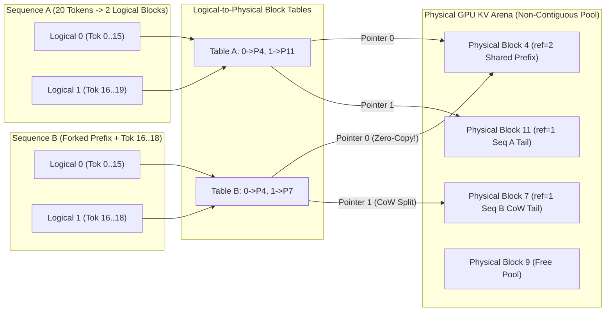
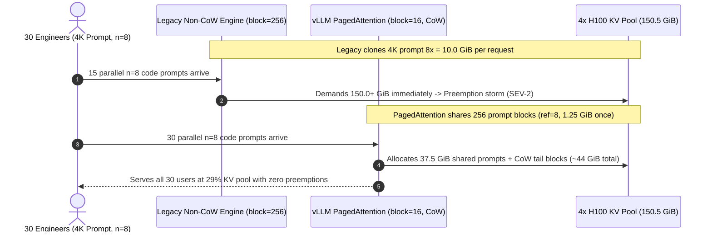

# Module 07: PagedAttention

> **Prerequisites:** [Module 04: KV Cache Memory Math](../04-kv-cache-memory-math/README.md), [Module 05: Naive Batching and Its Waste](../05-naive-batching-and-its-waste/README.md), [Module 06: Continuous Batching](../06-continuous-batching/README.md).  
> **Estimated Reading Time:** 35 minutes  
> **Target Audience:** AI Systems Engineers, Inference Engine Architects, GPU Runtime & Platform Engineers

> [!TIP]
> **The Golden Rule of PagedAttention:** Never force GPU KV caches into contiguous `max_model_len` tensors. Partition GPU HBM into a pool of fixed-size physical **KV blocks** (`block_size = 16` tokens) indexed via a per-sequence **Block Table**—just like OS virtual memory pages. This eliminates **external fragmentation completely**, bounds **internal fragmentation to strictly `< B_block` (at most `B_block - 1`) tokens per sequence**, and unlocks **zero-copy Copy-on-Write (`ref_count`)** prefix and beam sharing.

---

## Why This Matters

In Module 06, **Continuous Batching** solved compute-step straggler bubbles—but left an equally severe memory wall untouched. If your engine still stores each sequence's KV cache inside a contiguous PyTorch slice `[max_model_len, n_kv_heads, d_head]`, then even with iteration-level scheduling:

1. **You Still Waste `62%–80%` of HBM:** Reserving `max_model_len` upfront locks huge contiguous slabs for tokens that may never be generated.
2. **Parallel Sampling (`n = 4`) & System Prompts Multiply VRAM Waste:** Generating `4` candidate completions from a `3,000`-token prompt or serving `100` RAG users sharing the exact same `2,048`-token policy prompt duplicates identical prompt KV states `4x` or `100x` across VRAM.
3. **Batch Concurrency Hits an Artificial Ceiling:** Without freeing unreached KV slots, $B$ cannot scale high enough to lift decode off the HBM memory-bandwidth wall (Module 01).

**PagedAttention** (Kwon et al., SOSP 2023, `arXiv:2309.06180`) adapts classic **operating-system virtual memory paging** directly onto GPU HBM and the CUDA attention kernel—converting fragmented KV allocations into a high-density, shareable block pool.

---

## 1. Virtual Memory Paging on GPU HBM & Copy-on-Write Mechanics



### The Exact OS Virtual Memory Mapping

| OS Virtual Memory Concept | PagedAttention GPU Equivalent | Mechanical Purpose |
| :--- | :--- | :--- |
| **Virtual Address Space** | Logical KV Blocks (`0, 1, 2, ...`) | Contiguous logical view per request regardless of physical HBM layout |
| **Page Table** | Per-Sequence **Block Table** (`int32[max_blocks]`) | Maps `logical_block_idx -> physical_block_id` |
| **Physical RAM Page (`4 KB`)** | Fixed-Size Physical **KV Block** (`block_size = 16` tokens) | Uniformly shaped HBM allocation unit inside pre-allocated arena |
| **Demand Paging** | On-Demand Tail Allocation | Allocates a new block **only** when `seq_len % block_size == 0` |
| **Copy-on-Write (`fork()`)** | Reference Counted Blocks (`ref_count`) | Shares full prompt/beam blocks zero-copy; copies only on tail mutation |

### Exact Block Size & Fragmentation Equations

Given block size $B_{\text{block}}$ (typically `16` tokens in vLLM) and per-token KV footprint $B_{\text{tok}}$ (Module 04):

1. **Physical Block Byte Size ($S_{\text{block}}$):**

$$S_{\text{block}} = B_{\text{block}} \times 2 \times n_{\text{layers}} \times n_{\text{kv\_heads}} \times d_{\text{head}} \times b_{\text{elem}}$$

   - For `Llama-3-8B` (`BF16`, $B_{\text{tok}} = 128\text{ KiB/tok}$): $S_{\text{block}} = 16 \times 128\text{ KiB} = \mathbf{2.00\text{ MiB/block}}$.
   - For `Llama-3-70B` (`BF16`, $B_{\text{tok}} = 320\text{ KiB/tok}$): $S_{\text{block}} = 16 \times 320\text{ KiB} = \mathbf{5.00\text{ MiB/block}}$.

2. **Total Pre-Allocated GPU Blocks ($N_{\text{blocks}}$):** On startup, vLLM allocates a single monolithic KV arena across `KV_Pool` bytes:

$$N_{\text{blocks}} = \left\lfloor \frac{\text{VRAM}_{\text{total}} \cdot u - M_{\text{weights}} - M_{\text{act}}}{S_{\text{block}}} \right\rfloor$$

3. **Bounded Fragmentation Guarantees:**
   - **External Fragmentation:** **Strictly `0` bytes.** Because every block has identical tensor dimensions `[B_block, n_kv_heads, d_head]`, any slot in the `free_blocks` stack satisfies any request without memory compaction.
   - **Internal Fragmentation:** A sequence of length $L$ occupies $\lceil L / B_{\text{block}} \rceil$ blocks. Only the final tail block can contain unused token slots, so wasted tokens are **strictly $< B_{\text{block}}$ (at most $B_{\text{block}} - 1$ tokens per sequence)**—averaging $\frac{B_{\text{block}} - 1}{2} = 7.5$ tokens (`< 1.5%` on a `512`-token response vs `62%–80%` under contiguous static slabs!).

### Zero-Copy Sharing & Copy-on-Write (`ref_count`)

When generating multiple completions from one prompt (`n = 4` / `best_of = 8` parallel sampling, or beam search) or sharing a system prompt across users (**Automatic Prefix Caching / APC**):

1. **Prompt Fork (`ref_count++`):** All `n` child sequences populate their **Block Tables** with the exact same physical block IDs `[P0, P1, P2]` and increment `ref_count` on each shared block from `1` to `n`. Zero HBM duplication occurs!
2. **Decoding Copy-on-Write (`CoW`):** Suppose the prompt has `10` tokens with `B_block = 4` (`[P0(4), P1(4), P2(2)]`). When `beam_0` emits token `11`, its tail block `P2` has `ref_count = 4 > 1`. PagedAttention:
   - Allocates one new block `P3`,
   - Copies **only the `2` existing tokens** in `P2` (`[109, 110]`) into `P3`,
   - Appends token `11` into `P3`, decrements `ref_count[P2]` (`4 -> 3`), and updates `beam_0`'s table entry `2 -> P3`.
   - Crucially, **full prefix blocks `P0` and `P1` are NEVER copied**, and when the final remaining sequence (`beam_3`) sees `ref_count[P2] == 1`, it writes directly into `P2` in-place!
3. **Automatic Prefix Caching (APC):** Whenever a full block (`len == B_block`) is populated, its cryptographic hash `(parent_block_hash, token_ids)` registers in a GPU block cache table. Even after a user's request finishes (`ref_count` drops to `0`), the block moves to an **evictable LRU free queue** rather than being wiped—letting subsequent requests matching the exact prefix blocks reuse pre-computed KV tensors with **zero prefill compute and zero duplicate VRAM**!

### How the Custom PagedAttention CUDA Kernel Reads Non-Contiguous Blocks

Standard `FlashAttention` assumes contiguous KV tensors `[B, seq_len, H_kv, D]` via fixed pointer arithmetic. The **PagedAttention** CUDA kernel instead takes an auxiliary `int32` metadata tensor `block_tables[num_seqs, max_num_blocks]` plus `context_lens[num_seqs]`. Inside the GPU threadblock:

- Each warp iterates over logical block indices `j = 0 .. ceil(L_i / B_block) - 1`,
- Looks up the physical HBM base pointer `phys_blk = block_tables[seq_idx, j]`,
- Loads `[B_block, d_head]` K and V tiles via **128-bit coalesced vector loads** into GPU SRAM,
- Computes online tiled softmax (`Q @ K_j^T` -> rescale accumulator -> `+ P_j @ V_j`) **directly in-place across non-contiguous physical blocks** without ever copying blocks into a contiguous temporary tensor!

---

## 2. Systematic Comparison Matrix: Contiguous KV vs. PagedAttention Configurations

| Allocation Strategy | External Fragmentation | Worst-Case Internal Waste / Seq | Prefix & Beam Sharing | Kernel Memory Access Pattern | Trade-Off / Sweet Spot |
| :--- | :---: | :---: | :--- | :--- | :--- |
| **Contiguous `max_model_len` Slab** | `4%–15%` | Up to `max_model_len - 1` (`60%–80%` waste) | None (must duplicate full prompts) | Single contiguous pointer stride | Broken for dynamic serving (`20–38%` live KV) |
| **PagedAttention (`B_block = 8`)** | `0%` | `<= 7` tokens (`< 0.9%` typical) | Ultra-fine (`8`-token prefix hits) | Smaller tiles; higher Block Table metadata overhead | Slightly lower CUDA memory coalescing efficiency |
| **PagedAttention (`B_block = 16`, Default)** | **`0%`** | **`<= 15` tokens (`~1.5%` typical)** | **Optimal (`16`-token APC + CoW)** | **128-bit coalesced vector loads + high SRAM reuse** | **Production Gold Standard across vLLM** |
| **PagedAttention (`B_block = 32`)** | `0%` | `<= 31` tokens (`~3.4%` typical) | Coarser prefix alignment (`32` tok) | Maximum tensor-core tile occupancy on Hopper/FlashAttn | Ideal for ultra-long `64K–128K` FP8 workloads |
| **PagedAttention (`B_block = 256`)** | `0%` | `<= 255` tokens (`~25%+` on short replies) | Poor prefix granularity on short prompts | Fast block lookup, severe tail waste | Avoid unless prompts/outputs always exceed `16K+` |

---

## 3. Production War Story Post-Mortem: The `best_of=8` Duplication & Oversized-Block OOM

| Field | Incident Details |
| :--- | :--- |
| **Severity** | **SEV-2** (6x Drop in Max Concurrency & Frequent Preemptions on Agentic Code Ranking) |
| **Detection / Resolution Time** | Detected 40 minutes after launching `n=8` self-consistency voting / Mitigated in 30 minutes |
| **Impact** | `Llama-3-70B` (`TP=4`, `150 GiB` KV pool) stalled at just `5` concurrent users instead of `30+`; `TTFT p99` jumped to `9.4 s` |

### What Happened

A coding-assistant team launched an internal self-consistency endpoint requesting `n = 8` parallel candidate patches per `4,096`-token repository prompt (`best_of=8` / `n=8`), served via a custom PyTorch attention wrapper that cloned the prompt KV cache for each candidate and allocated KV space in `256`-token chunks (`block_size = 256`) to simplify tensor indexing.

Two memory bugs hit simultaneously:

1. **Zero Prompt Sharing (`8x` Duplication):** Instead of sharing `4,096` prompt tokens via CoW block tables (`1.25 GiB` once), the engine cloned the prompt KV `8` times—consuming **`10.0 GiB` per user** before generating a single token!
2. **Oversized `256`-Token Tail Waste:** When `8` short `60`-token candidate patches diverged after the prompt, each branch allocated a full `256`-token chunk (`196` wasted tokens per branch $\times 8 = 1,568$ wasted tokens = `490 MiB` pure tail slack per user!).

With `150.5 GiB` total KV capacity on `4x H100`, max safe concurrency plunged from **`~65` requests** (with CoW + `block_size=16`) down to **`~14` requests**, starving morning developer bursts!



### Root Cause Analysis

- **Absent `ref_count` CoW Sharing:** Duplicating read-only prompt KV matrices multiplied prompt HBM demand by $n = 8$.
- **Excessive `block_size = 256`:** Oversized blocks inflated tail internal fragmentation on short completions and prevented fine-grained prefix sharing.

### The Fix & Architectural Hardening

- **Migrated to vLLM PagedAttention (`block_size = 16`, `--enable-prefix-caching`):** Enabled CoW prompt sharing across `n=8` candidates (`ref_count=8` on `256` shared prompt blocks) plus cross-request prefix caching on common repository instructions—slashing per-request KV usage **`~7x`** and expanding safe concurrency beyond `60` simultaneous `n=8` coding jobs.

---

## 4. Multi-Language Production Implementation: PagedAttention Block Allocator & CoW Simulator

Below is a complete, production-structured **PagedAttention Physical Block Allocator with Logical Block Tables & Copy-on-Write (`Fork` + `AppendToken`)** across **Go**, **TypeScript**, **Python**, and **C#**. It models free-block tracking, `ref_count` lifecycle, on-demand block growth, and tail-only CoW splitting.

````carousel

```go
package pagedkv

import (
	"errors"
	"fmt"
)

type SequenceTable struct {
	SeqID       string
	TokenLen    int
	BlockTable  []int // logical block index -> physical block ID
}

type PagedKVAllocator struct {
	BlockSize   int
	FreeList    []int
	RefCounts   []int
	BlockTokens [][]int // simulated token contents per physical block
	Sequences   map[string]*SequenceTable
}

func NewPagedKVAllocator(numPhysBlocks, blockSize int) (*PagedKVAllocator, error) {
	if numPhysBlocks <= 0 || blockSize <= 0 {
		return nil, errors.New("numPhysBlocks and blockSize must be positive")
	}
	free := make([]int, numPhysBlocks)
	for i := 0; i < numPhysBlocks; i++ {
		free[i] = i
	}
	return &PagedKVAllocator{
		BlockSize:   blockSize,
		FreeList:    free,
		RefCounts:   make([]int, numPhysBlocks),
		BlockTokens: make([][]int, numPhysBlocks),
		Sequences:   make(map[string]*SequenceTable),
	}, nil
}

func (a *PagedKVAllocator) allocBlock() (int, error) {
	if len(a.FreeList) == 0 {
		return -1, errors.New("KV OOM: no free physical blocks available")
	}
	blk := a.FreeList[0]
	a.FreeList = a.FreeList[1:]
	a.RefCounts[blk] = 1
	a.BlockTokens[blk] = nil
	return blk, nil
}

func (a *PagedKVAllocator) AllocatePrompt(seqID string, promptTokens []int) error {
	if len(promptTokens) == 0 {
		return errors.New("prompt cannot be empty")
	}
	var table []int
	for i := 0; i < len(promptTokens); i += a.BlockSize {
		end := i + a.BlockSize
		if end > len(promptTokens) {
			end = len(promptTokens)
		}
		blk, err := a.allocBlock()
		if err != nil {
			// Rollback partially allocated blocks on OOM
			for _, b := range table {
				a.decref(b)
			}
			return err
		}
		a.BlockTokens[blk] = append([]int(nil), promptTokens[i:end]...)
		table = append(table, blk)
	}
	a.Sequences[seqID] = &SequenceTable{SeqID: seqID, TokenLen: len(promptTokens), BlockTable: table}
	return nil
}

func (a *PagedKVAllocator) Fork(srcID, dstID string) error {
	src, ok := a.Sequences[srcID]
	if !ok {
		return fmt.Errorf("source sequence %q not found", srcID)
	}
	copiedTable := make([]int, len(src.BlockTable))
	copy(copiedTable, src.BlockTable)
	for _, blk := range copiedTable {
		a.RefCounts[blk]++
	}
	a.Sequences[dstID] = &SequenceTable{SeqID: dstID, TokenLen: src.TokenLen, BlockTable: copiedTable}
	return nil
}

func (a *PagedKVAllocator) AppendToken(seqID string, tokenID int) error {
	seq, ok := a.Sequences[seqID]
	if !ok {
		return fmt.Errorf("sequence %q not found", seqID)
	}
	if seq.TokenLen%a.BlockSize == 0 {
		blk, err := a.allocBlock()
		if err != nil {
			return err
		}
		a.BlockTokens[blk] = []int{tokenID}
		seq.BlockTable = append(seq.BlockTable, blk)
	} else {
		tailIdx := len(seq.BlockTable) - 1
		tailBlk := seq.BlockTable[tailIdx]
		if a.RefCounts[tailBlk] > 1 {
			// Copy-on-Write strictly on shared partially-filled tail block
			newBlk, err := a.allocBlock()
			if err != nil {
				return err
			}
			a.BlockTokens[newBlk] = append(append([]int(nil), a.BlockTokens[tailBlk]...), tokenID)
			a.decref(tailBlk)
			seq.BlockTable[tailIdx] = newBlk
		} else {
			a.BlockTokens[tailBlk] = append(a.BlockTokens[tailBlk], tokenID)
		}
	}
	seq.TokenLen++
	return nil
}

func (a *PagedKVAllocator) decref(blk int) {
	a.RefCounts[blk]--
	if a.RefCounts[blk] == 0 {
		a.BlockTokens[blk] = nil
		a.FreeList = append(a.FreeList, blk)
	}
}

func (a *PagedKVAllocator) FreeSequence(seqID string) {
	if seq, ok := a.Sequences[seqID]; ok {
		for _, blk := range seq.BlockTable {
			a.decref(blk)
		}
		delete(a.Sequences, seqID)
	}
}
```

<!-- slide -->

```typescript
export interface SequenceMapping {
  tokenLen: number;
  blockTable: number[];
}

export class PagedKVAllocator {
  private readonly freeBlocks: number[];
  private readonly refCounts: number[];
  private readonly blockTokens: number[][];
  private readonly sequences = new Map<string, SequenceMapping>();

  constructor(
    numPhysicalBlocks: number,
    public readonly blockSize = 16,
  ) {
    if (numPhysicalBlocks <= 0 || blockSize <= 0) {
      throw new RangeError("numPhysicalBlocks and blockSize must be strictly positive");
    }
    this.freeBlocks = Array.from({ length: numPhysicalBlocks }, (_, i) => i);
    this.refCounts = new Array(numPhysicalBlocks).fill(0);
    this.blockTokens = Array.from({ length: numPhysicalBlocks }, () => []);
  }

  private allocBlock(): number {
    const blk = this.freeBlocks.shift();
    if (blk === undefined) {
      throw new Error("KV OOM: physical block pool exhausted");
    }
    this.refCounts[blk] = 1;
    this.blockTokens[blk] = [];
    return blk;
  }

  private decref(blk: number): void {
    this.refCounts[blk] -= 1;
    if (this.refCounts[blk] === 0) {
      this.blockTokens[blk] = [];
      this.freeBlocks.push(blk);
    }
  }

  allocatePrompt(seqId: string, promptTokens: readonly number[]): void {
    if (promptTokens.length === 0) throw new RangeError("Prompt cannot be empty");
    const table: number[] = [];
    try {
      for (let i = 0; i < promptTokens.length; i += this.blockSize) {
        const blk = this.allocBlock();
        this.blockTokens[blk] = promptTokens.slice(i, i + this.blockSize);
        table.push(blk);
      }
      this.sequences.set(seqId, { tokenLen: promptTokens.length, blockTable: table });
    } catch (err) {
      table.forEach((b) => this.decref(b));
      throw err;
    }
  }

  forkSequence(srcId: string, dstId: string): void {
    const src = this.sequences.get(srcId);
    if (!src) throw new Error(`Unknown sequence ${srcId}`);
    for (const blk of src.blockTable) {
      this.refCounts[blk] += 1;
    }
    this.sequences.set(dstId, { tokenLen: src.tokenLen, blockTable: [...src.blockTable] });
  }

  appendToken(seqId: string, tokenId: number): void {
    const seq = this.sequences.get(seqId);
    if (!seq) throw new Error(`Unknown sequence ${seqId}`);
    if (seq.tokenLen % this.blockSize === 0) {
      const newBlk = this.allocBlock();
      this.blockTokens[newBlk] = [tokenId];
      seq.blockTable.push(newBlk);
    } else {
      const tailBlk = seq.blockTable[seq.blockTable.length - 1];
      if (this.refCounts[tailBlk] > 1) {
        const newBlk = this.allocBlock();
        this.blockTokens[newBlk] = [...this.blockTokens[tailBlk], tokenId];
        this.decref(tailBlk);
        seq.blockTable[seq.blockTable.length - 1] = newBlk;
      } else {
        this.blockTokens[tailBlk].push(tokenId);
      }
    }
    seq.tokenLen += 1;
  }

  freeSequence(seqId: string): void {
    const seq = this.sequences.get(seqId);
    if (!seq) return;
    seq.blockTable.forEach((b) => this.decref(b));
    this.sequences.delete(seqId);
  }

  usedBlockCount(): number {
    return this.refCounts.filter((rc) => rc > 0).length;
  }
}
```

<!-- slide -->

```python
"""
paged_kv_allocator.py
PagedAttention logical-to-physical block allocator with zero-copy CoW forking.
"""
from collections import deque
from dataclasses import dataclass, field


@dataclass
class SequenceEntry:
    token_len: int
    block_table: list[int] = field(default_factory=list)


class PagedKVAllocator:
    def __init__(self, num_physical_blocks: int, block_size: int = 16):
        if num_physical_blocks <= 0 or block_size <= 0:
            raise ValueError("num_physical_blocks and block_size must be positive")
        self.block_size = block_size
        self.free_blocks: deque[int] = deque(range(num_physical_blocks))
        self.ref_counts: list[int] = [0] * num_physical_blocks
        self.block_tokens: list[list[int]] = [[] for _ in range(num_physical_blocks)]
        self.sequences: dict[str, SequenceEntry] = {}

    def _alloc_block(self) -> int:
        if not self.free_blocks:
            raise MemoryError("KV OOM: physical block pool exhausted")
        blk = self.free_blocks.popleft()
        self.ref_counts[blk] = 1
        self.block_tokens[blk] = []
        return blk

    def _decref(self, blk: int) -> None:
        self.ref_counts[blk] -= 1
        if self.ref_counts[blk] == 0:
            self.block_tokens[blk] = []
            self.free_blocks.append(blk)

    def allocate_prompt(self, seq_id: str, prompt_tokens: list[int]) -> None:
        if not prompt_tokens:
            raise ValueError("prompt_tokens cannot be empty")
        table: list[int] = []
        try:
            for i in range(0, len(prompt_tokens), self.block_size):
                blk = self._alloc_block()
                self.block_tokens[blk] = list(prompt_tokens[i : i + self.block_size])
                table.append(blk)
            self.sequences[seq_id] = SequenceEntry(token_len=len(prompt_tokens), block_table=table)
        except MemoryError:
            for blk in table:
                self._decref(blk)
            raise

    def fork(self, src_id: str, dst_id: str) -> None:
        src = self.sequences[src_id]
        for blk in src.block_table:
            self.ref_counts[blk] += 1
        self.sequences[dst_id] = SequenceEntry(token_len=src.token_len, block_table=list(src.block_table))

    def append_token(self, seq_id: str, token_id: int) -> None:
        seq = self.sequences[seq_id]
        if seq.token_len % self.block_size == 0:
            new_blk = self._alloc_block()
            self.block_tokens[new_blk] = [token_id]
            seq.block_table.append(new_blk)
        else:
            tail_blk = seq.block_table[-1]
            if self.ref_counts[tail_blk] > 1:
                # CoW ONLY on the shared partially-filled tail block
                new_blk = self._alloc_block()
                self.block_tokens[new_blk] = list(self.block_tokens[tail_blk]) + [token_id]
                self._decref(tail_blk)
                seq.block_table[-1] = new_blk
            else:
                self.block_tokens[tail_blk].append(token_id)
        seq.token_len += 1

    def free_sequence(self, seq_id: str) -> None:
        seq = self.sequences.pop(seq_id, None)
        if seq:
            for blk in seq.block_table:
                self._decref(blk)

    def used_blocks(self) -> int:
        return sum(1 for rc in self.ref_counts if rc > 0)
```

<!-- slide -->

```csharp
using System;
using System.Collections.Generic;
using System.Linq;

namespace GenAI.Inference.PagedAttention;

public sealed class PagedKVAllocator
{
    private sealed class SeqEntry
    {
        public int TokenLen { get; set; }
        public List<int> BlockTable { get; } = new();
    }

    public int BlockSize { get; }
    private readonly Queue<int> _freeBlocks;
    private readonly int[] _refCounts;
    private readonly List<int>[] _blockTokens;
    private readonly Dictionary<string, SeqEntry> _sequences = new();

    public PagedKVAllocator(int numPhysicalBlocks, int blockSize = 16)
    {
        if (numPhysicalBlocks <= 0 || blockSize <= 0)
            throw new ArgumentOutOfRangeException(nameof(numPhysicalBlocks), "Pool and block sizes must be positive.");
        BlockSize = blockSize;
        _freeBlocks = new Queue<int>(Enumerable.Range(0, numPhysicalBlocks));
        _refCounts = new int[numPhysicalBlocks];
        _blockTokens = Enumerable.Range(0, numPhysicalBlocks).Select(_ => new List<int>()).ToArray();
    }

    private int AllocBlock()
    {
        if (_freeBlocks.Count == 0)
            throw new InvalidOperationException("KV OOM: physical block pool exhausted.");
        int blk = _freeBlocks.Dequeue();
        _refCounts[blk] = 1;
        _blockTokens[blk].Clear();
        return blk;
    }

    private void Decref(int blk)
    {
        _refCounts[blk]--;
        if (_refCounts[blk] == 0)
        {
            _blockTokens[blk].Clear();
            _freeBlocks.Enqueue(blk);
        }
    }

    public void AllocatePrompt(string seqId, IReadOnlyList<int> promptTokens)
    {
        if (promptTokens.Count == 0) throw new ArgumentException("Prompt cannot be empty.");
        var entry = new SeqEntry { TokenLen = promptTokens.Count };
        try
        {
            for (int i = 0; i < promptTokens.Count; i += BlockSize)
            {
                int blk = AllocBlock();
                int count = Math.Min(BlockSize, promptTokens.Count - i);
                for (int j = 0; j < count; j++) _blockTokens[blk].Add(promptTokens[i + j]);
                entry.BlockTable.Add(blk);
            }
            _sequences[seqId] = entry;
        }
        catch
        {
            foreach (int blk in entry.BlockTable) Decref(blk);
            throw;
        }
    }

    public void Fork(string srcId, string dstId)
    {
        var src = _sequences[srcId];
        var dst = new SeqEntry { TokenLen = src.TokenLen };
        foreach (int blk in src.BlockTable)
        {
            _refCounts[blk]++;
            dst.BlockTable.Add(blk);
        }
        _sequences[dstId] = dst;
    }

    public void AppendToken(string seqId, int tokenId)
    {
        var seq = _sequences[seqId];
        if (seq.TokenLen % BlockSize == 0)
        {
            int newBlk = AllocBlock();
            _blockTokens[newBlk].Add(tokenId);
            seq.BlockTable.Add(newBlk);
        }
        else
        {
            int tailBlk = seq.BlockTable[^1];
            if (_refCounts[tailBlk] > 1)
            {
                int newBlk = AllocBlock();
                _blockTokens[newBlk].AddRange(_blockTokens[tailBlk]);
                _blockTokens[newBlk].Add(tokenId);
                Decref(tailBlk);
                seq.BlockTable[^1] = newBlk;
            }
            else
            {
                _blockTokens[tailBlk].Add(tokenId);
            }
        }
        seq.TokenLen++;
    }

    public void FreeSequence(string seqId)
    {
        if (_sequences.Remove(seqId, out var seq))
        {
            foreach (int blk in seq.BlockTable) Decref(blk);
        }
    }

    public int UsedBlocks => _refCounts.Count(rc => rc > 0);
}
```

````

---

## 5. Practical Hands-On Verification CLI Workflows

Run these deterministic Python 3.13 verification scripts offline—no GPU hardware or external dependencies required.

### Workflow 1: Measure Contiguous vs. PagedAttention Fragmentation Across Block Sizes

Sweep `block_size` across `8, 16, 32, 64, 128` against contiguous `max_model_len = 4096` reservation over `16` realistic variable-length sequences (`6,583` live tokens):

```bash
python -c '
import math
lengths = [45, 130, 512, 89, 1020, 310, 67, 740, 195, 410, 1520, 28, 330, 615, 92, 480]
max_model_len = 4096
live = sum(lengths)
contig_alloc = len(lengths) * max_model_len
print(f"Live tokens across {len(lengths)} sequences: {live:,}")
print(f"Contiguous Static (L_max={max_model_len}): alloc={contig_alloc:,} | waste={100*(contig_alloc-live)/contig_alloc:5.2f}%")
for blk_sz in [8, 16, 32, 64, 128]:
    alloc = sum(math.ceil(l / blk_sz) * blk_sz for l in lengths)
    internal_frag = alloc - live
    pct_waste = 100.0 * internal_frag / alloc
    total_blocks = alloc // blk_sz
    print(f"PagedAttention block_size={blk_sz:>3} | blocks={total_blocks:>4} | alloc={alloc:>5} | tail_waste={internal_frag:>4} tok ({pct_waste:5.2f}%)")
'
```

**Expected Output:**

```text
Live tokens across 16 sequences: 6,583
Contiguous Static (L_max=4096): alloc=65,536 | waste=89.96%
PagedAttention block_size=  8 | blocks= 830 | alloc= 6640 | tail_waste=  57 tok ( 0.86%)
PagedAttention block_size= 16 | blocks= 418 | alloc= 6688 | tail_waste= 105 tok ( 1.57%)
PagedAttention block_size= 32 | blocks= 213 | alloc= 6816 | tail_waste= 233 tok ( 3.42%)
PagedAttention block_size= 64 | blocks= 111 | alloc= 7104 | tail_waste= 521 tok ( 7.33%)
PagedAttention block_size=128 | blocks=  58 | alloc= 7424 | tail_waste= 841 tok (11.33%)
```

Observe how `block_size = 16` shrinks KV allocation from **`65,536` slots (`89.96%` waste) down to `6,688` slots (`1.57%` tail waste)**—with **zero** external fragmentation!

### Workflow 2: Trace Copy-on-Write (`CoW`) Block Tables During `n=4` Parallel Sampling

Simulate a `10`-token prompt (`block_size = 4` -> blocks `0`, `1`, and partial tail block `2` holding `[109, 110]`) forked across `4` parallel completions (`beam_0..beam_3`), then execute `1` decode step per beam:

```bash
python -c '
class PagedKVPool:
    def __init__(self, num_phys_blocks, block_size=4):
        self.block_size = block_size
        self.free_blocks = list(range(num_phys_blocks))
        self.ref_count = {b: 0 for b in range(num_phys_blocks)}
        self.block_tokens = {b: [] for b in range(num_phys_blocks)}
        self.sequences = {}

    def allocate_prompt(self, seq_id, prompt_tokens):
        table = []
        for i in range(0, len(prompt_tokens), self.block_size):
            chunk = prompt_tokens[i:i + self.block_size]
            blk = self.free_blocks.pop(0)
            self.ref_count[blk] = 1
            self.block_tokens[blk] = list(chunk)
            table.append(blk)
        self.sequences[seq_id] = {"len": len(prompt_tokens), "table": table}

    def fork_sequence(self, src_id, dst_id):
        src = self.sequences[src_id]
        for blk in src["table"]:
            self.ref_count[blk] += 1
        self.sequences[dst_id] = {"len": src["len"], "table": list(src["table"])}

    def append_token(self, seq_id, token_id):
        seq = self.sequences[seq_id]
        table = seq["table"]
        if seq["len"] % self.block_size == 0:
            new_blk = self.free_blocks.pop(0)
            self.ref_count[new_blk] = 1
            self.block_tokens[new_blk] = [token_id]
            table.append(new_blk)
        else:
            tail_blk = table[-1]
            if self.ref_count[tail_blk] > 1:
                new_blk = self.free_blocks.pop(0)
                self.ref_count[new_blk] = 1
                self.block_tokens[new_blk] = list(self.block_tokens[tail_blk]) + [token_id]
                self.ref_count[tail_blk] -= 1
                table[-1] = new_blk
            else:
                self.block_tokens[tail_blk].append(token_id)
        seq["len"] += 1

    def used_blocks(self):
        return sum(1 for rc in self.ref_count.values() if rc > 0)

pool = PagedKVPool(num_phys_blocks=32, block_size=4)
prompt = [101, 102, 103, 104, 105, 106, 107, 108, 109, 110]
pool.allocate_prompt("beam_0", prompt)
for i in range(1, 4):
    pool.fork_sequence("beam_0", f"beam_{i}")

init_rc = [pool.ref_count[b] for b in pool.sequences["beam_0"]["table"]]
print(f"After 4x CoW fork (10-tok prompt): used_blocks={pool.used_blocks()} (vs 12 naive) | ref_counts={init_rc}")
for i in range(4):
    pool.append_token(f"beam_{i}", 900 + i)
print(f"After 1 decode step across 4 beams: used_blocks={pool.used_blocks()} (vs 12 naive)")
for i in range(4):
    tbl = pool.sequences[f"beam_{i}"]["table"]
    print(f"  beam_{i} block_table={tbl} | tail_tokens={pool.block_tokens[tbl[-1]]}")
'
```

**Expected Output:**

```text
After 4x CoW fork (10-tok prompt): used_blocks=3 (vs 12 naive) | ref_counts=[4, 4, 4]
After 1 decode step across 4 beams: used_blocks=6 (vs 12 naive)
  beam_0 block_table=[0, 1, 3] | tail_tokens=[109, 110, 900]
  beam_1 block_table=[0, 1, 4] | tail_tokens=[109, 110, 901]
  beam_2 block_table=[0, 1, 5] | tail_tokens=[109, 110, 902]
  beam_3 block_table=[0, 1, 2] | tail_tokens=[109, 110, 903]
```

Look closely at `beam_3`: when `beam_0..2` forked their tail blocks (`3, 4, 5`), `ref_count[2]` decremented down to `1`, allowing `beam_3` to write token `903` **directly into block `2` in-place**, while blocks `0` and `1` stay shared across all `4` beams (`6` physical blocks vs `12`!).

### Workflow 3: Compute GPU Block Arena Capacity & Automatic Prefix Caching Savings

Verify total physical blocks on an `80 GiB H100` (`Llama-3-8B FP16`, `55.0 GiB` KV headroom) and measure VRAM savings when `100` concurrent users share a `2,048`-token system prompt under Automatic Prefix Caching (APC):

```bash
python -c '
kv_pool_gib = 55.0
block_size = 16
b_tok_8b = 131072
block_bytes = block_size * b_tok_8b
total_gpu_blocks = int((kv_pool_gib * (1024**3)) // block_bytes)
sys_prompt_tok = 2048
user_tok = 256
shared_blocks = sys_prompt_tok // block_size
unique_blocks = (user_tok + block_size - 1) // block_size
naive_blocks = 100 * (shared_blocks + unique_blocks)
apc_blocks = shared_blocks + 100 * unique_blocks
print(f"80 GiB H100 (Llama-3-8B FP16): block_bytes={block_bytes/(1024**2):.2f} MiB | total_gpu_blocks={total_gpu_blocks:,}")
print(f"100 users x (2048 sys + 256 user): without_APC={naive_blocks:,} blocks ({100*naive_blocks/total_gpu_blocks:5.1f}% KV) | with_APC={apc_blocks:,} blocks ({100*apc_blocks/total_gpu_blocks:5.1f}% KV)")
'
```

**Expected Output:**

```text
80 GiB H100 (Llama-3-8B FP16): block_bytes=2.00 MiB | total_gpu_blocks=28,160
100 users x (2048 sys + 256 user): without_APC=14,400 blocks ( 51.1% KV) | with_APC=1,728 blocks (  6.1% KV)
```

### Hands-On Exercises

1. **Test Exact Block-Boundary Alignment (`len = 12`):** Change `prompt` in Workflow 2 from `10` tokens to `12` tokens (`[101..112]`, an exact multiple of `block_size = 4`). Verify that `beam_0..beam_3` allocate fresh tail blocks `[3, 4, 5, 6]` with **zero CoW copying needed** because the previous tail block is already full and read-only!
2. **Trace Block Freeing & Reuse:** Extend Workflow 2 by freeing `beam_0`, `beam_1`, and `beam_2` after `append_token`. Check `pool.ref_count[0]` (`4 -> 1`), confirm blocks `0` and `1` stay alive for `beam_3`, and confirm freeing `beam_3` finally returns `0` and `1` to `free_blocks` (`used_blocks() == 0`).
3. **Optional Live APC Prefix Hit Observation (Requires GPU + vLLM):** Start `vllm serve` with `--enable-prefix-caching`, send two identical `2,500`-token system prompts with different final user questions, and verify `vllm:prefix_cache_hits` rises in `/metrics` while the second request's `TTFT` drops sharply!

### Independent Challenge

A RAG system injects a shared `1,800`-token tool + schema preamble at the start of every request, followed by `~500` tokens of user-specific retrieved passages, and generates `150` output tokens. Yet when the team turns on `--enable-prefix-caching` (`block_size = 16`), `/metrics` shows **`0%` prefix cache hit rate**! Inspecting their prompt builder reveals they placed `<timestamp>2026-11-11T10:15:02Z</timestamp>` on line 2 (`token #14`) before the `1,800`-token schema. Explain at the **PagedAttention Block-Hash** level why even a single dynamic token at position `#14` invalidated all `112` downstream blocks—and show how reordering just two fields raises cache hit rate above `95%`.

<details><summary>Architectural Discussion</summary>

1. **Why All 112 Blocks Missed Cache:** In Automatic Prefix Caching (APC), every full `16`-token block's lookup key is hashed recursively: `hash(block_k) = H(hash(block_{k-1}), tokens[16k : 16k+16])`. Because `<timestamp>` changed inside **Block `0`** (`tokens 0..15`), `hash(block_0)` mutated—which cascaded into completely different `hash(block_1), ..., hash(block_112)` across all `1,800` static schema tokens!
2. **The Two-Line Fix:** Move dynamic per-request metadata (`<timestamp>`, `user_id`, `request_id`) **after** the static `1,800`-token system prompt and tool definitions (aligning static content cleanly to block boundaries). Now the first `112` blocks (`1,792` tokens) produce identical prefix hashes across every user and achieve `~100%` prefix cache hits, skipping both duplicate VRAM storage and redundant prefill computation!

</details>

---

## 6. Common Mistakes & Troubleshooting

- **Placing dynamic fields (`timestamp`, `UUID`, `user_name`) at the top of system prompts when using APC:** Breaks chained prefix block hashes from Block `0` onward, forcing `0%` prefix cache hits and wasting prefill FLOPs. Always place invariant instructions/schemas first and dynamic inputs last.
- **Setting `--block-size 64` or `128` without measuring sequence-length distributions:** Large blocks inflate tail internal fragmentation (`7%–15%` waste on short chat replies) and reduce APC prefix match granularity. Keep the default `block_size = 16` unless profiling proves `32` benefits ultra-long contexts.
- **Assuming PagedAttention uses scatter-gather CPU/GPU memory copies per step:** A frequent misconception is that PagedAttention copies non-contiguous blocks into a contiguous buffer before FlashAttention runs. The custom PagedAttention kernel reads directly via `block_tables` inside GPU SRAM registers—no extra copy pass occurs.
- **Ignoring `ref_count` leaks in custom forks/aborts:** If a client disconnects mid-stream (`AbortRequest`) and a custom scheduler forgets to decrement `ref_count` on every block in its Block Table, physical blocks leak permanently until the GPU hits fake `100%` KV saturation.

---

## 7. Operational Validation Checkpoints & Checkpoint Quiz

### Operational Validation Checkpoints

<details><summary><strong>Checkpoint 1: Bounding Internal and External Fragmentation in PagedAttention</strong></summary>

A team transitions from a contiguous `max_model_len = 4,096` allocator (`78%` KV waste) to PagedAttention with `block_size = 16`. Prove the exact worst-case internal and external fragmentation bounds per active sequence.

**Validation:** **External fragmentation is strictly `0` bytes** because every physical block has uniform shape and any free block satisfies any sequence slot. **Internal fragmentation is strictly `< 16` (`<= 15`) tokens per sequence**—occurring solely in the final partially-filled tail block (since all preceding blocks are `100%` full). Across typical `500`-token sequences, average waste drops to `7.5 / 500 = 1.5%`!

</details>

<details><summary><strong>Checkpoint 2: Tracing Copy-on-Write (`CoW`) on Parallel Beam Expansion</strong></summary>

A `36`-token prompt (`block_size = 16`) is forked into `n = 4` parallel completions (`C0..C3`). How many physical blocks exist immediately after prompt prefill, and how many *new* physical blocks are allocated after all `4` completions decode **1 token each**?

**Validation:** `36` tokens occupy $\lceil 36 / 16 \rceil = 3$ physical blocks: two full blocks (`0..15`, `16..31`) and one tail block (`32..35`, `4` tokens) with `ref_counts = [4, 4, 4]`. After decoding `1` token per completion (`37` tokens), full blocks `0` and `1` stay shared (`ref_count = 4`, zero copies!), while `C0, C1, C2` each trigger CoW on the partial tail block (`3` new blocks allocated, `ref_count` of original tail drops `4 -> 1`) and `C3` appends directly in-place (`0` copy needed). Total blocks grow from `3` to **`6`** (versus `12` without CoW!).

</details>

<details><summary><strong>Checkpoint 3: Debugging Zero Prefix-Cache Hits Under `--enable-prefix-caching`</strong></summary>

A team turns on `--enable-prefix-caching` for a `4,000`-token agent system prompt, yet `vllm:prefix_cache_hits` stays at `0` across `1,000` requests. Inspecting the prompt shows `"Request ID: req_9821\n"` prepended at token `0`. Why did caching fail?

**Validation:** PagedAttention APC hashes each full `16`-token block chained from the previous block hash (`H(prev_hash, block_tokens)`). Modifying `"Request ID"` inside Block `0` alters every subsequent block hash down the entire `4,000`-token prompt (`0` hits!). Moving `"Request ID"` to the *end* of the invariant prompt immediately turns all `250` shared blocks into `100%` cache hits.

</details>

### Checkpoint Quiz

1. Map the three OS virtual memory components (**Page Table**, **Physical Frame**, **Virtual Page**) to their exact **PagedAttention** counterparts.
2. Calculate the byte size of one physical KV block (`block_size = 16`) for `Llama-3-70B` in `BF16` (`320 KiB/token`) vs. `FP8` (`160 KiB/token`).
3. When a forked sequence appends a token onto a shared block (`ref_count > 1`), which blocks get copied—the entire prefix or only the tail block?
4. Why does `block_size = 16` outperform both `block_size = 2` and `block_size = 256` on production GPUs?
5. How does the PagedAttention CUDA kernel execute attention across non-contiguous physical blocks without first copying them into a contiguous buffer?

<details><summary>Answers</summary>

1. **Page Table** $\leftrightarrow$ per-sequence `Block Table` (`logical_blk -> physical_blk`); **Physical Frame** $\leftrightarrow$ fixed-size physical `KV Block` inside GPU HBM; **Virtual Page** $\leftrightarrow$ contiguous logical token chunk `0, 1, 2, ...` per sequence.
2. In `BF16`: $16 \times 320\text{ KiB} = \mathbf{5,120\text{ KiB} = 5.00\text{ MiB/block}}$. In `FP8`: $16 \times 160\text{ KiB} = \mathbf{2,560\text{ KiB} = 2.50\text{ MiB/block}}$.
3. **Strictly the partially-filled tail block only** (if `len % block_size != 0` and `ref_count > 1`). All earlier full prefix blocks remain untouched and shared zero-copy (`ref_count` unchanged).
4. `block_size = 2` creates excessive block-table lookups and poor GPU memory coalescing; `block_size = 256` causes high tail internal fragmentation and coarse prefix-cache misses. `16` (or `32` for ultra-long contexts) hits the sweet spot of coalesced 128-bit CUDA vector loads and `< 2–3%` tail waste.
5. Each threadblock reads `block_tables[seq_id, logical_blk]` to fetch physical HBM pointers directly into GPU SRAM registers, computing tiled online softmax across scattered physical blocks on the fly.

</details>

---

## Further Reading & Sources

- [Efficient Memory Management for Large Language Model Serving with PagedAttention (Kwon et al., SOSP 2023)](https://arxiv.org/abs/2309.06180) — canonical paper introducing PagedAttention, Block Tables, Copy-on-Write beam/prefix sharing, and the custom PagedAttention CUDA kernel.
- [vLLM Documentation: Automatic Prefix Caching & Design](https://docs.vllm.ai/en/latest/) — official documentation on APC block hashing, `block_size`, and PagedAttention runtime internals.
- [Track 05, Module 08: FlashAttention and Memory-Efficient Kernels](../../05-gpus-and-genai-hardware/08-flashattention-and-memory-efficient-kernels/README.md) — online tiled softmax SRAM mechanics extended by PagedAttention kernels.

## Next

[Module 08: vLLM: Getting Started](../08-vllm-getting-started/README.md)
