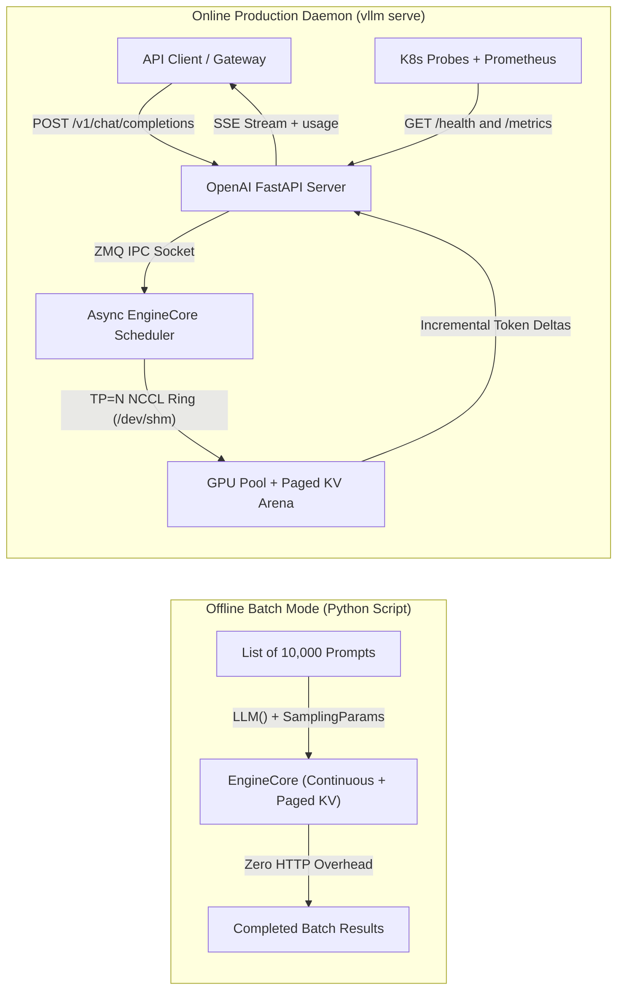
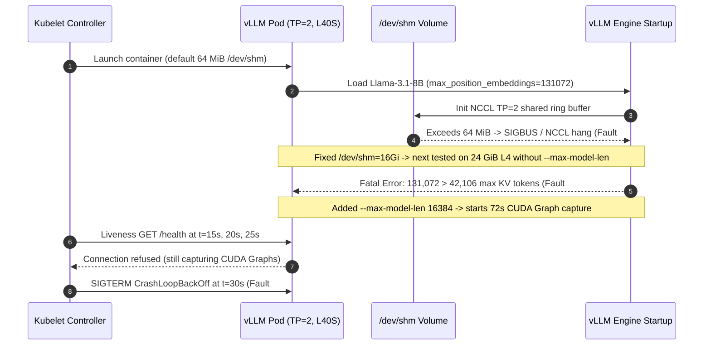

# Module 08: vLLM: Getting Started

> **Prerequisites:** [Module 06: Continuous Batching](../06-continuous-batching/README.md), [Module 07: PagedAttention](../07-pagedattention/README.md), [Track 05, Module 10: Model and Tensor Parallelism](../../05-gpus-and-genai-hardware/10-model-and-tensor-parallelism/README.md).  
> **Estimated Reading Time:** 35 minutes  
> **Target Audience:** AI Backend Engineers, MLOps & Kubernetes Platform Engineers, Production Inference SREs

> [!TIP]
> **The Golden Rule of Running vLLM:** Treat `vLLM` as a stateful, GPU-resident serving daemon rather than a lightweight Python helper. Always size `--max-model-len` and `--gpu-memory-utilization` against your physical KV pool before booting (`128K` default `config.json` limits crash smaller GPUs), mount ample `/dev/shm` (`--ipc=host` or `16 GiB` memory volume) for Tensor Parallel NCCL rings, protect `30–180 s` CUDA graph warmup with a Kubernetes `startupProbe`, and monitor `/metrics` (`kv_cache_usage_perc` and `num_preemptions_total`) continuously.

---

## Why This Matters

In Modules 04 through 07, you derived KV cache memory budgets, exposed static batching's `60%–80%` waste, traced continuous iteration-level scheduling, and modeled PagedAttention's `block_size=16` block tables. **vLLM** unites all four into a high-throughput, OpenAI-compatible inference engine.

Yet teams running `vllm serve` for the first time routinely stumble over three infrastructure traps that have nothing to do with transformer math:

1. **Silent `/dev/shm` NCCL Deadlocks:** Docker caps `/dev/shm` at **`64 MB`** by default. Launching multi-GPU Tensor Parallelism (`--tensor-parallel-size 2` or `4`) fills `64 MB` during PyTorch/NCCL shared-memory ring initialization, hanging indefinitely or crashing with `SIGBUS` / `NCCL unhandled system error`.
2. **`128K` `config.json` Startup Crashes:** Modern open-weight checkpoints like `Llama-3.1-8B-Instruct` set `"max_position_embeddings": 131072`. Leaving `--max-model-len` unset on a `24 GiB L4/A10G` (`~5.1 GiB` KV pool = `42,106` tokens) triggers an immediate fatal startup error because `131,072 > 42,106`.
3. **Aggressive Probe `CrashLoopBackOff`:** Loading `15–140 GiB` of safetensors and capturing CUDA Graphs takes **`30–180` seconds**. A standard `10s` Kubernetes liveness probe kills healthy pods mid-startup.

Learning both **offline batch (`LLM`)** and **online daemon (`vllm serve`)** modes alongside core flags, health probes, and `/metrics` observability turns vLLM into a rock-solid production primitive.

---

## 1. Offline Batch (`LLM`) vs. Online Daemon (`vllm serve`) Architecture

vLLM offers two distinct execution patterns powered by the exact same continuous-batching + PagedAttention core engine:



### Pattern A: Offline Batch Inference (`LLM` + `SamplingParams`)

Use Python's `vllm.LLM` class **strictly for offline batch pipelines** (evaluation harnesses, dataset labeling, document ingestion enrichment) where all prompts are known upfront and HTTP streaming is unnecessary:

```python
from vllm import LLM, SamplingParams

# Initialize engine once (pins model weights + allocates Paged KV pool)
llm = LLM(
    model="meta-llama/Llama-3.1-8B-Instruct",
    dtype="bfloat16",
    max_model_len=8192,
    gpu_memory_utilization=0.90,
    enable_prefix_caching=True,
)

sampling = SamplingParams(
    temperature=0.0,       # Deterministic greedy decoding for eval/extraction
    top_p=1.0,
    max_tokens=512,        # Always cap max_tokens to bound straggler tail risk
    stop=["</json>"],
)

outputs = llm.generate(["Extract SKU from: ...", "Summarize SLA: ..."], sampling)
for out in outputs:
    print(out.outputs[0].text)
```

Why `llm.generate(all_prompts)` crushes `for p in prompts: llm.generate([p])`: passing the entire prompt list lets the internal continuous scheduler saturate GPU Tensor Cores across hundreds of sequences simultaneously instead of degrading back to `B=1` memory-bandwidth speeds!

### Pattern B: Online OpenAI-Compatible Production Server (`vllm serve`)

For live user traffic, run `vllm serve` as an isolated microservice exposing OpenAI-compatible endpoints (`/v1/chat/completions`, `/v1/completions`, `/v1/models`), operational probes (`/health`, `/version`), and Prometheus metrics (`/metrics`):

```bash
# Example multi-GPU production launch (Linux/Docker GPU host)
docker run --rm --gpus all \
  --ipc=host \
  -p 8000:8000 \
  -v /mnt/nvme/hf-cache:/root/.cache/huggingface \
  vllm/vllm-openai:latest \
  --model /root/.cache/huggingface/Llama-3.1-70B-Instruct \
  --served-model-name llama-3.1-70b \
  --tensor-parallel-size 4 \
  --dtype bfloat16 \
  --max-model-len 16384 \
  --gpu-memory-utilization 0.90 \
  --enable-prefix-caching
```

### Core Startup Flags & Hardware Gotchas

| Flag | Typical Value | Exact Mechanical Behavior | Critical Production Pitfall |
| :--- | :--- | :--- | :--- |
| **`--model`** | Local NVMe path or HF repo ID | Loads safetensors weights & tokenizer `config.json` | Pulling `140 GB` from HuggingFace Hub during autoscaling adds `5–15 min` cold-start latency; bake weights onto node NVMe/PVC |
| **`--tensor-parallel-size`** (`-tp`) | `1`, `2`, `4`, `8` | Shards model layers & `n_kv_heads` across `N` GPUs over NVLink | Must satisfy `n_kv_heads % TP == 0` for clean sharding; requires `--ipc=host` / large `/dev/shm` |
| **`--max-model-len`** | `8192`, `16384`, `32768` | Caps max `prompt + completion` tokens per sequence | Default reads `config.json` (`131,072` on Llama-3.1!), failing startup validation on `24–48 GiB` GPUs |
| **`--gpu-memory-utilization`** | `0.88–0.92` (`0.90` default) | Reserves fraction of total GPU VRAM for weights + KV pool + activations | Setting `1.0` triggers runtime OOM; lower to `0.80` if sharing GPU with sidecar models |
| **`--dtype`** | `bfloat16` (Ampere/Hopper/Ada) / `float16` (T4/V100) | Selects compute and weight storage precision | Turing (`T4`) & Volta (`V100`) lack native `BF16` Tensor Cores—explicitly pass `--dtype float16` |
| **`--enable-prefix-caching`** | Flag (on by default in V1) | Enables hashed PagedAttention prefix block reuse (`APC`) | Dynamic metadata placed *before* system prompts defeats block hashing (`0%` hit rate, Module 07) |
| **`--kv-cache-dtype`** | `auto` / `fp8` | Quantizes cached $K/V$ blocks (`2 B -> 1 B`) on Hopper/Ada | Requires `H100`/`L40S` (`FP8` support); `2x` KV token capacity and `~2x` smaller KV HBM traffic |

### Container `/dev/shm`, Kubernetes Probes & Prometheus `/metrics`

1. **Fixing Container `/dev/shm` (`NCCL` & IPC):** Both PyTorch `multiprocessing` IPC and NCCL shared-memory transport write buffers into `/dev/shm`. Docker's `64 MB` default breaks `TP >= 2`. Always set `--ipc=host` (or `--shm-size=16g`) in Docker, and in Kubernetes mount a memory-backed `emptyDir`:

```yaml
volumes:
  - name: shm
    emptyDir:
      medium: Memory
      sizeLimit: 16Gi
volumeMounts:
  - mountPath: /dev/shm
    name: shm
```

2. **Kubernetes Startup, Readiness & Liveness Probes:** Never point an aggressive `livenessProbe` directly at `/health` without a `startupProbe`: CUDA graph capture + weight loading take `30–180s`. Configure a `startupProbe` (`GET /health`, `periodSeconds: 10`, `failureThreshold: 30` = `5 min` budget), then attach `readinessProbe` (`GET /health`, `periodSeconds: 5`) and gentle `livenessProbe` (`GET /health`, `periodSeconds: 15`, `failureThreshold: 4`).
3. **Must-Watch Prometheus `/metrics` (`GET :8000/metrics`):**
   - `vllm:num_requests_running` & `vllm:num_requests_waiting`: Immediate queue pressure and autoscaling trigger (`waiting > 0` signals saturation).
   - `vllm:kv_cache_usage_perc` (range `0.0–1.0`): Live PagedAttention block occupancy. Alert at `>= 0.85`; shed load before `0.95`.
   - `vllm:num_preemptions_total`: Must hold steady at **`0`** during healthy load. Any positive slope indicates KV thrashing.
   - `vllm:time_to_first_token_seconds` & `vllm:inter_token_latency_seconds` / `vllm:time_per_output_token_seconds`: Histograms powering Module 00's SLA Goodput dashboards.

---

## 2. Systematic Comparison Matrix: `LLM()` Offline vs. `vllm serve` Online vs. Naive Wrapper

| Capability | Naive `FastAPI + transformers` | vLLM Offline (`LLM` + `SamplingParams`) | vLLM Online (`vllm serve` Daemon) |
| :--- | :--- | :--- | :--- |
| **Scheduling & Memory** | Static lockstep / single-stream lock | Continuous batching + PagedAttention | Continuous batching + PagedAttention (`AsyncEngine`) |
| **Transport & Framing** | Blocking HTTP or brittle custom threads | Direct Python in-process list execution | FastAPI + OpenAI REST `/v1/*` + SSE chunk streaming |
| **Multi-GPU `TP` Support** | `device_map="auto"` (naive pipeline stall) | Built-in NCCL Tensor Parallelism | Built-in NCCL Tensor Parallelism (`ZMQ` decoupled) |
| **Probes & Telemetry** | Custom boilerplate | Python return objects (`RequestOutput`) | Built-in `/health`, `/version`, Prometheus `/metrics` |
| **Token Usage Accounting** | Manual token counting | `len(out.outputs[0].token_ids)` | `stream_options: {"include_usage": true}` |
| **Ideal Workload** | Local debugging only | Offline evals, batch labeling, dataset gen | Production interactive APIs, RAG, streaming agents |

---

## 3. Production War Story Post-Mortem: The Kubernetes `Llama-3.1-8B` Triple-Fault Outage

| Field | Incident Details |
| :--- | :--- |
| **Severity** | **SEV-1** (New Cluster Pods Stuck in `CrashLoopBackOff`, Zero Capacity Available) |
| **Detection / Resolution Time** | Detected immediately during staging->prod canary deploy / Resolved in 55 minutes |
| **Impact** | Canary deploy stalled `100%` of new GPU pods across `8` Kubernetes nodes; delayed release and triggered fallback to legacy endpoints |

### What Happened

A backend engineer deployed `vllm/vllm-openai` serving `Llama-3.1-8B-Instruct` on `2x 48 GiB L40S` Kubernetes pods (`--tensor-parallel-size 2`) with default container manifests. Three failures fired back-to-back as the team debugged:

1. **Fault #1 (`64 MB` `/dev/shm` Hang):** Pod #1 froze during `NCCL AllReduce` ring warmup and crashed with `SIGBUS` because Kubernetes omitted an `emptyDir: medium: Memory` mount at `/dev/shm`, defaulting to `64 MiB`.
2. **Fault #2 (`131,072` `max_model_len` Trap):** Even after fixing `/dev/shm` on a single-GPU `24 GiB L4` test pod, vLLM exited immediately with `ValueError: The model's max seq len (131072) is larger than the maximum number of tokens that can be stored in KV cache (42106)`. Nobody passed `--max-model-len` to override `Llama-3.1`'s `128K` `config.json` default.
3. **Fault #3 (`30s` Liveness Probe Kill):** Once `--max-model-len 16384` was added, `vllm serve` took `72` seconds to load weights and capture CUDA graphs (`torch.compile` + `CUDAGraph`). Because the Helm chart carried a standard web-app `livenessProbe` (`initialDelaySeconds: 15`, `periodSeconds: 5`, `failureThreshold: 3`), kubelet sent `SIGTERM` at `t = 30s`—trapping every pod in endless `CrashLoopBackOff`!



### Root Cause Analysis

- **Web-App Defaults Applied to Stateful GPU Daemons:** `64 MB` `/dev/shm` and `15s` liveness probes work for stateless Go/Node APIs, not multi-gigabyte NCCL GPU engines capturing CUDA graphs.
- **Unbounded Model Config Defaults:** `Llama-3.1`'s `128K` context ceiling assumes multi-GPU VRAM unless explicitly constrained via `--max-model-len`.

### The Fix & Architectural Hardening

- Added `emptyDir: { medium: Memory, sizeLimit: 16Gi }` on `/dev/shm` across all inference Helm charts.
- Mandated explicit `--max-model-len 16384` and `--gpu-memory-utilization 0.90` in container startup lint checks.
- Added a dedicated `startupProbe` (`httpGet: /health`, `periodSeconds: 10`, `failureThreshold: 30`) so kubelet waits patiently for weight loading and CUDA graph warmup before activating `readinessProbe` and `livenessProbe`.

---

## 4. Multi-Language Production Implementation: Hardened OpenAI-Compatible vLLM Client & Telemetry Gate

Below is a production-ready **vLLM Health/Metrics Gate & OpenAI SSE Streaming Client** across **Go**, **TypeScript**, **Python**, and **C#**. It checks `/health`, scrapes Prometheus `/metrics` (`kv_cache_usage_perc` and `num_preemptions_total`) to apply client-side backpressure before saturating the GPU, and streams `/v1/chat/completions` with `stream_options.include_usage` and strict timeouts.

````carousel

```go
package vllmclient

import (
	"bufio"
	"bytes"
	"context"
	"encoding/json"
	"errors"
	"fmt"
	"io"
	"net/http"
	"regexp"
	"strconv"
	"strings"
	"time"
)

type VLLMClient struct {
	BaseURL    string
	HTTPClient *http.Client
}

type MetricsSnapshot struct {
	KVUsagePerc float64
	Waiting     float64
	Preemptions float64
}

type ChatStreamResult struct {
	Text             string
	PromptTokens     int
	CompletionTokens int
	FinishReason     string
}

var metricRe = regexp.MustCompile(`^([a-zA-Z0-9_:]+)(?:\{[^}]*\})?\s+([0-9.eE+-]+)$`)

func NewVLLMClient(baseURL string, timeout time.Duration) *VLLMClient {
	return &VLLMClient{
		BaseURL:    strings.TrimRight(baseURL, "/"),
		HTTPClient: &http.Client{Timeout: timeout},
	}
}

func (c *VLLMClient) CheckReady(ctx context.Context) error {
	req, err := http.NewRequestWithContext(ctx, http.MethodGet, c.BaseURL+"/health", nil)
	if err != nil {
		return err
	}
	resp, err := c.HTTPClient.Do(req)
	if err != nil {
		return err
	}
	defer resp.Body.Close()
	if resp.StatusCode != http.StatusOK {
		return fmt.Errorf("vLLM /health returned HTTP %d", resp.StatusCode)
	}
	return nil
}

func (c *VLLMClient) ScrapeMetrics(ctx context.Context) (MetricsSnapshot, error) {
	req, err := http.NewRequestWithContext(ctx, http.MethodGet, c.BaseURL+"/metrics", nil)
	if err != nil {
		return MetricsSnapshot{}, err
	}
	resp, err := c.HTTPClient.Do(req)
	if err != nil {
		return MetricsSnapshot{}, err
	}
	defer resp.Body.Close()
	if resp.StatusCode != http.StatusOK {
		return MetricsSnapshot{}, fmt.Errorf("vLLM /metrics returned HTTP %d", resp.StatusCode)
	}

	var snap MetricsSnapshot
	sc := bufio.NewScanner(resp.Body)
	for sc.Scan() {
		line := strings.TrimSpace(sc.Text())
		if line == "" || strings.HasPrefix(line, "#") {
			continue
		}
		m := metricRe.FindStringSubmatch(line)
		if len(m) != 3 {
			continue
		}
		val, convErr := strconv.ParseFloat(m[2], 64)
		if convErr != nil {
			continue
		}
		switch m[1] {
		case "vllm:kv_cache_usage_perc":
			snap.KVUsagePerc = val
		case "vllm:num_requests_waiting":
			snap.Waiting = val
		case "vllm:num_preemptions_total":
			snap.Preemptions = val
		}
	}
	return snap, sc.Err()
}

func (c *VLLMClient) StreamChat(ctx context.Context, model, prompt string, maxTokens int, kvCeiling float64) (ChatStreamResult, error) {
	snap, err := c.ScrapeMetrics(ctx)
	if err == nil && snap.KVUsagePerc >= kvCeiling {
		return ChatStreamResult{}, fmt.Errorf("backpressure: KV usage %.1f%% >= ceiling %.1f%%", snap.KVUsagePerc*100, kvCeiling*100)
	}

	payload := map[string]any{
		"model":          model,
		"messages":       []map[string]string{{"role": "user", "content": prompt}},
		"temperature":    0.0,
		"max_tokens":     maxTokens,
		"stream":         true,
		"stream_options": map[string]bool{"include_usage": true},
	}
	bodyBytes, err := json.Marshal(payload)
	if err != nil {
		return ChatStreamResult{}, err
	}

	req, err := http.NewRequestWithContext(ctx, http.MethodPost, c.BaseURL+"/v1/chat/completions", bytes.NewReader(bodyBytes))
	if err != nil {
		return ChatStreamResult{}, err
	}
	req.Header.Set("Content-Type", "application/json")

	resp, err := c.HTTPClient.Do(req)
	if err != nil {
		return ChatStreamResult{}, err
	}
	defer resp.Body.Close()
	if resp.StatusCode != http.StatusOK {
		raw, _ := io.ReadAll(io.LimitReader(resp.Body, 512))
		return ChatStreamResult{}, fmt.Errorf("vLLM HTTP %d: %s", resp.StatusCode, string(raw))
	}

	var out strings.Builder
	var res ChatStreamResult
	reader := bufio.NewReader(resp.Body)
	for {
		line, readErr := reader.ReadString('\n')
		if len(line) > 0 && strings.HasPrefix(line, "data: ") {
			rawJSON := strings.TrimSpace(strings.TrimPrefix(line, "data: "))
			if rawJSON == "[DONE]" {
				break
			}
			var chunk struct {
				Choices []struct {
					Delta        struct{ Content string `json:"content"` } `json:"delta"`
					FinishReason string                                   `json:"finish_reason"`
				} `json:"choices"`
				Usage *struct {
					PromptTokens     int `json:"prompt_tokens"`
					CompletionTokens int `json:"completion_tokens"`
				} `json:"usage"`
			}
			if jsonErr := json.Unmarshal([]byte(rawJSON), &chunk); jsonErr == nil {
				if len(chunk.Choices) > 0 {
					out.WriteString(chunk.Choices[0].Delta.Content)
					if chunk.Choices[0].FinishReason != "" {
						res.FinishReason = chunk.Choices[0].FinishReason
					}
				}
				if chunk.Usage != nil {
					res.PromptTokens = chunk.Usage.PromptTokens
					res.CompletionTokens = chunk.Usage.CompletionTokens
				}
			}
		}
		if readErr != nil {
			if errors.Is(readErr, io.EOF) {
				break
			}
			return res, readErr
		}
	}
	res.Text = out.String()
	return res, nil
}
```

<!-- slide -->

```typescript
export interface VllmMetricsSnapshot {
  readonly kvUsagePerc: number;
  readonly waitingRequests: number;
  readonly preemptionsTotal: number;
}

export interface StreamedCompletion {
  readonly text: string;
  readonly finishReason: string | null;
  readonly promptTokens: number;
  readonly completionTokens: number;
}

const METRIC_LINE = /^([a-zA-Z0-9_:]+)(?:\{[^}]*\})?\s+([0-9.eE+-]+)$/;

export function parseVllmPrometheus(expositionText: string): VllmMetricsSnapshot {
  let kvUsagePerc = 0;
  let waitingRequests = 0;
  let preemptionsTotal = 0;

  for (const raw of expositionText.split(/\r?\n/)) {
    const line = raw.trim();
    if (!line || line.startsWith("#")) continue;
    const match = METRIC_LINE.exec(line);
    if (!match) continue;
    const val = Number(match[2]);
    if (match[1] === "vllm:kv_cache_usage_perc") kvUsagePerc = val;
    if (match[1] === "vllm:num_requests_waiting") waitingRequests = val;
    if (match[1] === "vllm:num_preemptions_total") preemptionsTotal = val;
  }
  return { kvUsagePerc, waitingRequests, preemptionsTotal };
}

export class VllmServingClient {
  constructor(
    private readonly baseUrl: string,
    private readonly timeoutMs = 30_000,
  ) {}

  async checkHealth(): Promise<boolean> {
    const resp = await fetch(`${this.baseUrl}/health`, { signal: AbortSignal.timeout(3_000) });
    return resp.ok;
  }

  async streamChatCompletion(
    model: string,
    prompt: string,
    maxTokens = 512,
    kvCeiling = 0.90,
  ): Promise<StreamedCompletion> {
    const metricsResp = await fetch(`${this.baseUrl}/metrics`, { signal: AbortSignal.timeout(3_000) });
    if (metricsResp.ok) {
      const snap = parseVllmPrometheus(await metricsResp.text());
      if (snap.kvUsagePerc >= kvCeiling) {
        throw new Error(`Backpressure: vLLM KV usage ${(snap.kvUsagePerc * 100).toFixed(1)}% >= ${(kvCeiling * 100).toFixed(1)}%`);
      }
    }

    const resp = await fetch(`${this.baseUrl}/v1/chat/completions`, {
      method: "POST",
      headers: { "Content-Type": "application/json" },
      signal: AbortSignal.timeout(this.timeoutMs),
      body: JSON.stringify({
        model,
        messages: [{ role: "user", content: prompt }],
        temperature: 0.0,
        max_tokens: maxTokens,
        stream: true,
        stream_options: { include_usage: true },
      }),
    });
    if (!resp.ok || !resp.body) {
      throw new Error(`vLLM request failed with HTTP ${resp.status}`);
    }

    const reader = resp.body.getReader();
    const decoder = new TextDecoder();
    let buffer = "";
    const parts: string[] = [];
    let finishReason: string | null = null;
    let promptTokens = 0;
    let completionTokens = 0;

    while (true) {
      const { value, done } = await reader.read();
      if (done) break;
      buffer += decoder.decode(value, { stream: true });
      const lines = buffer.split("\n");
      buffer = lines.pop() ?? "";

      for (const rawLine of lines) {
        if (!rawLine.startsWith("data: ")) continue;
        const payload = rawLine.slice(6).trim();
        if (payload === "[DONE]") break;
        const parsed = JSON.parse(payload);
        const choice = parsed.choices?.[0];
        if (choice?.delta?.content) parts.push(choice.delta.content);
        if (choice?.finish_reason) finishReason = choice.finish_reason;
        if (parsed.usage) {
          promptTokens = parsed.usage.prompt_tokens ?? 0;
          completionTokens = parsed.usage.completion_tokens ?? 0;
        }
      }
    }
    return { text: parts.join(""), finishReason, promptTokens, completionTokens };
  }
}
```

<!-- slide -->

```python
"""
vllm_prod_client.py
Stdlib-only OpenAI-compatible vLLM health/metrics gate and SSE stream consumer.
"""
from dataclasses import dataclass
import json
import re
import urllib.request

METRIC_PATTERN = re.compile(r"^([a-zA-Z0-9_:]+)(?:\{[^}]*\})?\s+([0-9.eE+-]+)$")


@dataclass(frozen=True)
class VllmHealthState:
    kv_usage_perc: float
    waiting_requests: int
    preemptions_total: int


@dataclass(frozen=True)
class StreamResponse:
    text: str
    finish_reason: str | None
    prompt_tokens: int
    completion_tokens: int


def parse_metrics(prometheus_body: str) -> VllmHealthState:
    vals: dict[str, float] = {}
    for line in prometheus_body.splitlines():
        s = line.strip()
        if not s or s.startswith("#"):
            continue
        match = METRIC_PATTERN.match(s)
        if match:
            vals[match.group(1)] = float(match.group(2))
    return VllmHealthState(
        kv_usage_perc=vals.get("vllm:kv_cache_usage_perc", 0.0),
        waiting_requests=int(vals.get("vllm:num_requests_waiting", 0.0)),
        preemptions_total=int(vals.get("vllm:num_preemptions_total", 0.0)),
    )


def stream_vllm_chat(
    base_url: str,
    model: str,
    prompt: str,
    max_tokens: int = 512,
    kv_ceiling: float = 0.90,
    timeout_s: float = 30.0,
) -> StreamResponse:
    base = base_url.rstrip("/")
    with urllib.request.urlopen(f"{base}/health", timeout=3.0) as hresp:
        if hresp.status != 200:
            raise RuntimeError(f"vLLM /health failed: {hresp.status}")

    with urllib.request.urlopen(f"{base}/metrics", timeout=3.0) as mresp:
        state = parse_metrics(mresp.read().decode("utf-8"))
        if state.kv_usage_perc >= kv_ceiling:
            raise RuntimeError(f"Shed load: KV usage {state.kv_usage_perc:.1%} >= {kv_ceiling:.1%}")

    payload = json.dumps({
        "model": model,
        "messages": [{"role": "user", "content": prompt}],
        "temperature": 0.0,
        "max_tokens": max_tokens,
        "stream": True,
        "stream_options": {"include_usage": True},
    }).encode("utf-8")

    req = urllib.request.Request(
        f"{base}/v1/chat/completions",
        data=payload,
        headers={"Content-Type": "application/json"},
        method="POST",
    )

    chunks: list[str] = []
    finish_reason: str | None = None
    prompt_tok = 0
    comp_tok = 0

    with urllib.request.urlopen(req, timeout=timeout_s) as resp:
        for raw_line in resp:
            line = raw_line.decode("utf-8").strip()
            if not line.startswith("data: "):
                continue
            body = line[6:].strip()
            if body == "[DONE]":
                break
            obj = json.loads(body)
            choices = obj.get("choices") or []
            if choices:
                delta = choices[0].get("delta", {})
                if "content" in delta and delta["content"]:
                    chunks.append(delta["content"])
                if choices[0].get("finish_reason"):
                    finish_reason = choices[0]["finish_reason"]
            if obj.get("usage"):
                prompt_tok = int(obj["usage"].get("prompt_tokens", 0))
                comp_tok = int(obj["usage"].get("completion_tokens", 0))

    return StreamResponse("".join(chunks), finish_reason, prompt_tok, comp_tok)
```

<!-- slide -->

```csharp
using System;
using System.Collections.Generic;
using System.IO;
using System.Net.Http;
using System.Net.Http.Json;
using System.Text;
using System.Text.Json;
using System.Text.RegularExpressions;
using System.Threading;
using System.Threading.Tasks;

namespace GenAI.Inference.VllmClient;

public sealed record VllmMetricsSnapshot(double KvUsagePerc, int Waiting, int Preemptions);
public sealed record VllmStreamOutcome(string Text, string? FinishReason, int PromptTokens, int CompletionTokens);

public sealed class HardenedVllmClient
{
    private static readonly Regex MetricRegex = new(@"^([a-zA-Z0-9_:]+)(?:\{[^}]*\})?\s+([0-9.eE+-]+)$", RegexOptions.Compiled);
    private readonly HttpClient _http;
    private readonly string _baseUrl;

    public HardenedVllmClient(HttpClient http, string baseUrl)
    {
        _http = http ?? throw new ArgumentNullException(nameof(http));
        _baseUrl = baseUrl.TrimEnd('/');
    }

    public async Task<VllmMetricsSnapshot> ScrapeMetricsAsync(CancellationToken ct)
    {
        string body = await _http.GetStringAsync($"{_baseUrl}/metrics", ct);
        double kv = 0;
        int wait = 0, pre = 0;

        foreach (string raw in body.Split('\n'))
        {
            string line = raw.Trim();
            if (line.Length == 0 || line.StartsWith('#')) continue;
            var match = MetricRegex.Match(line);
            if (!match.Success || !double.TryParse(match.Groups[2].Value, out double val)) continue;

            switch (match.Groups[1].Value)
            {
                case "vllm:kv_cache_usage_perc": kv = val; break;
                case "vllm:num_requests_waiting": wait = (int)val; break;
                case "vllm:num_preemptions_total": pre = (int)val; break;
            }
        }
        return new VllmMetricsSnapshot(kv, wait, pre);
    }

    public async Task<VllmStreamOutcome> StreamChatAsync(
        string model,
        string prompt,
        int maxTokens = 512,
        double kvCeiling = 0.90,
        CancellationToken ct = default)
    {
        var health = await _http.GetAsync($"{_baseUrl}/health", ct);
        health.EnsureSuccessStatusCode();

        var snap = await ScrapeMetricsAsync(ct);
        if (snap.KvUsagePerc >= kvCeiling)
            throw new InvalidOperationException($"Backpressure triggered: KV pool at {snap.KvUsagePerc:P1}.");

        var payload = new
        {
            model,
            messages = new[] { new { role = "user", content = prompt } },
            temperature = 0.0,
            max_tokens = maxTokens,
            stream = true,
            stream_options = new { include_usage = true }
        };

        using var req = new HttpRequestMessage(HttpMethod.Post, $"{_baseUrl}/v1/chat/completions")
        {
            Content = JsonContent.Create(payload)
        };
        using var resp = await _http.SendAsync(req, HttpCompletionOption.ResponseHeadersRead, ct);
        resp.EnsureSuccessStatusCode();

        using var stream = await resp.Content.ReadAsStreamAsync(ct);
        using var reader = new StreamReader(stream);

        var text = new StringBuilder();
        string? finishReason = null;
        int promptTok = 0, compTok = 0;

        while (!reader.EndOfStream)
        {
            string? line = await reader.ReadLineAsync(ct);
            if (line is null || !line.StartsWith("data: ", StringComparison.Ordinal)) continue;
            string data = line[6..].Trim();
            if (data == "[DONE]") break;

            using var doc = JsonDocument.Parse(data);
            if (doc.RootElement.TryGetProperty("choices", out var choices) && choices.GetArrayLength() > 0)
            {
                var first = choices[0];
                if (first.TryGetProperty("delta", out var delta) && delta.TryGetProperty("content", out var content))
                    text.Append(content.GetString());
                if (first.TryGetProperty("finish_reason", out var fr) && fr.ValueKind == JsonValueKind.String)
                    finishReason = fr.GetString();
            }
            if (doc.RootElement.TryGetProperty("usage", out var usage) && usage.ValueKind == JsonValueKind.Object)
            {
                promptTok = usage.GetProperty("prompt_tokens").GetInt32();
                compTok = usage.GetProperty("completion_tokens").GetInt32();
            }
        }
        return new VllmStreamOutcome(text.ToString(), finishReason, promptTok, compTok);
    }
}
```

````

---

## 5. Practical Hands-On Verification CLI Workflows

Run these deterministic Python 3.13 verification workflows completely offline—no GPU hardware or live server required. (Optional GPU live commands follow at the end.)

### Workflow 1: Run a vLLM Startup Preflight Validator (`--max-model-len`, `TP`, `dtype`, `/dev/shm`)

Catch all three production launch traps (`131,072` `config.json` OOM on 24 GiB L4, `64 MiB` `/dev/shm` on `TP=2`, and T4/V100 `bfloat16` mismatch) **before** spinning up GPU nodes:

```bash
python -c '
def validate_launch(cfg):
    gib = 1024 ** 3
    errors = []
    n_kv = cfg["n_kv_heads"]
    tp = cfg["tp"]
    shm = cfg["dev_shm_mib"]
    arch = cfg["gpu_arch"]
    name = cfg["name"]
    if n_kv % tp != 0:
        errors.append(f"n_kv_heads ({n_kv}) not divisible by TP ({tp})")
    if tp > 1 and shm < 4096:
        errors.append(f"/dev/shm={shm} MiB < 4096 MiB for NCCL TP={tp} (add --ipc=host or shm_size=16g)")
    if arch in ("T4", "V100") and cfg["dtype"] == "bfloat16":
        errors.append(f"{arch} lacks native BF16 Tensor Cores (pass --dtype float16)")

    total_vram = tp * cfg["vram_gib"] * gib
    kv_pool = total_vram * cfg["util"] - (cfg["weights_gib"] * gib) - (cfg["act_gib"] * gib)
    b_tok = 2 * cfg["layers"] * n_kv * cfg["d_head"] * cfg["kv_bytes"]
    max_kv_tok = max(0, int(kv_pool // b_tok))
    req_len = cfg["max_model_len"] if cfg["max_model_len"] is not None else cfg["config_max_pos"]
    if req_len > max_kv_tok:
        errors.append(f"FATAL_STARTUP: effective max_model_len ({req_len:,}) > max KV tokens ({max_kv_tok:,})")

    status = "PASS" if not errors else "FAIL"
    print(f"[{status}] {name}")
    print(f"       KV_Pool={kv_pool/gib:.1f} GiB ({max_kv_tok:,} tok) | effective_max_model_len={req_len:,}")
    for e in errors:
        print(f"       -> {e}")

specs = [
    {
        "name": "Trap A: Llama-3.1-8B on 1x 24GiB L4 (no --max-model-len)",
        "layers": 32, "n_kv_heads": 8, "d_head": 128, "kv_bytes": 2,
        "weights_gib": 14.96, "act_gib": 1.5, "vram_gib": 24, "tp": 1, "util": 0.90,
        "config_max_pos": 131072, "max_model_len": None, "dev_shm_mib": 16384, "gpu_arch": "L4", "dtype": "bfloat16",
    },
    {
        "name": "Trap B: Llama-3.1-8B on 2x 48GiB L40S (Docker default 64MiB /dev/shm)",
        "layers": 32, "n_kv_heads": 8, "d_head": 128, "kv_bytes": 2,
        "weights_gib": 14.96, "act_gib": 3.0, "vram_gib": 48, "tp": 2, "util": 0.90,
        "config_max_pos": 131072, "max_model_len": 32768, "dev_shm_mib": 64, "gpu_arch": "L40S", "dtype": "bfloat16",
    },
    {
        "name": "Pass C: Llama-3.1-8B on 1x 80GiB H100 (--max-model-len 16384, --ipc=host)",
        "layers": 32, "n_kv_heads": 8, "d_head": 128, "kv_bytes": 2,
        "weights_gib": 14.96, "act_gib": 2.0, "vram_gib": 80, "tp": 1, "util": 0.90,
        "config_max_pos": 131072, "max_model_len": 16384, "dev_shm_mib": 16384, "gpu_arch": "H100", "dtype": "bfloat16",
    },
]
for s in specs:
    validate_launch(s)
'
```

**Expected Output:**

```text
[FAIL] Trap A: Llama-3.1-8B on 1x 24GiB L4 (no --max-model-len)
       KV_Pool=5.1 GiB (42,106 tok) | effective_max_model_len=131,072
       -> FATAL_STARTUP: effective max_model_len (131,072) > max KV tokens (42,106)
[FAIL] Trap B: Llama-3.1-8B on 2x 48GiB L40S (Docker default 64MiB /dev/shm)
       KV_Pool=68.4 GiB (560,660 tok) | effective_max_model_len=32,768
       -> /dev/shm=64 MiB < 4096 MiB for NCCL TP=2 (add --ipc=host or shm_size=16g)
[PASS] Pass C: Llama-3.1-8B on 1x 80GiB H100 (--max-model-len 16384, --ipc=host)
       KV_Pool=55.0 GiB (450,887 tok) | effective_max_model_len=16,384
```

### Workflow 2: Parse vLLM Prometheus `/metrics` & Trigger Backpressure Gates

Verify parsing of real vLLM Prometheus metrics (`vllm:kv_cache_usage_perc`, `vllm:num_requests_waiting`, `vllm:num_preemptions_total`) to trigger automated load-shedding / scale-out alerts:

```bash
python -c '
import re
sample_metrics = """
# HELP vllm:num_requests_running Number of requests currently running on GPU.
# TYPE vllm:num_requests_running gauge
vllm:num_requests_running{model_name="meta-llama/Llama-3.1-8B-Instruct"} 42.0
# HELP vllm:num_requests_waiting Number of requests waiting to be processed.
# TYPE vllm:num_requests_waiting gauge
vllm:num_requests_waiting{model_name="meta-llama/Llama-3.1-8B-Instruct"} 19.0
# HELP vllm:kv_cache_usage_perc KV-cache usage. 1 means 100 percent usage.
# TYPE vllm:kv_cache_usage_perc gauge
vllm:kv_cache_usage_perc{model_name="meta-llama/Llama-3.1-8B-Instruct"} 0.914
# HELP vllm:num_preemptions_total Cumulative number of preemption from the engine.
# TYPE vllm:num_preemptions_total counter
vllm:num_preemptions_total{model_name="meta-llama/Llama-3.1-8B-Instruct"} 14.0
"""
parsed = {}
for line in sample_metrics.strip().splitlines():
    if line.startswith("#") or not line.strip():
        continue
    m = re.match(r"^([a-zA-Z0-9_:]+)(?:\{[^}]*\})?\s+([0-9.eE+-]+)$", line.strip())
    if m:
        parsed[m.group(1)] = float(m.group(2))

running = int(parsed.get("vllm:num_requests_running", 0))
waiting = int(parsed.get("vllm:num_requests_waiting", 0))
kv_pct = parsed.get("vllm:kv_cache_usage_perc", 0.0)
preemptions = int(parsed.get("vllm:num_preemptions_total", 0))
alerts = []
if kv_pct >= 0.85:
    alerts.append(f"WARN_KV_PRESSURE ({kv_pct*100:.1f}% >= 85%)")
if waiting >= 10:
    alerts.append(f"WARN_QUEUE_BACKLOG ({waiting} waiting)")
if preemptions > 0:
    alerts.append(f"CRITICAL_PREEMPTION_ACTIVE ({preemptions} total)")
print(f"Running={running} | Waiting={waiting} | KV_Util={kv_pct*100:.1f}% | Preemptions={preemptions}")
decision = "SHED_LOAD_OR_SCALE_OUT" if alerts else "HEALTHY"
print(f"Action={decision} | Alerts={alerts}")
'
```

**Expected Output:**

```text
Running=42 | Waiting=19 | KV_Util=91.4% | Preemptions=14
Action=SHED_LOAD_OR_SCALE_OUT | Alerts=['WARN_KV_PRESSURE (91.4% >= 85%)', 'WARN_QUEUE_BACKLOG (19 waiting)', 'CRITICAL_PREEMPTION_ACTIVE (14 total)']
```

### Workflow 3: OpenAI SSE Stream Frame Parser & Optional Live `vllm serve` Test

Decode OpenAI Server-Sent Events (`data: ...` -> `data: [DONE]`) including `stream_options.include_usage` billing/token telemetry:

```bash
python -c '
import json
sse_frames = [
    "data: " + json.dumps({"id": "cmpl-1", "choices": [{"delta": {"content": "PagedAttention"}}]}),
    "data: " + json.dumps({"id": "cmpl-1", "choices": [{"delta": {"content": " cuts waste."}}]}),
    "data: " + json.dumps({"id": "cmpl-1", "choices": [{"delta": {}, "finish_reason": "stop"}], "usage": {"prompt_tokens": 142, "completion_tokens": 3, "total_tokens": 145}}),
    "data: [DONE]",
]
chunks, usage, finish = [], None, None
for frame in sse_frames:
    if not frame.startswith("data: "):
        continue
    payload = frame[6:].strip()
    if payload == "[DONE]":
        break
    obj = json.loads(payload)
    choice = obj["choices"][0]
    text = choice["delta"].get("content")
    if text:
        chunks.append(text)
    if choice.get("finish_reason"):
        finish = choice["finish_reason"]
    if obj.get("usage"):
        usage = obj["usage"]
assembled = "".join(chunks)
print(f"Assembled={assembled!r} | finish_reason={finish} | usage={usage}")
'
```

**Expected Output:**

```text
Assembled='PagedAttention cuts waste.' | finish_reason=stop | usage={'prompt_tokens': 142, 'completion_tokens': 3, 'total_tokens': 145}
```

**(Optional GPU Host Only — Smoke-Testing a Live `vllm serve` Instance):**

```bash
# 1. Start server (e.g., Qwen2.5-1.5B-Instruct on a single GPU)
vllm serve Qwen/Qwen2.5-1.5B-Instruct --max-model-len 4096 --gpu-memory-utilization 0.90

# 2. Verify readiness + inspect live Prometheus counters
curl -sf http://localhost:8000/health && echo "READY"
curl -s http://localhost:8000/metrics | grep -E "kv_cache_usage_perc|num_requests_running|num_preemptions_total"

# 3. Query OpenAI-compatible chat completion with token usage
curl -s http://localhost:8000/v1/chat/completions \
  -H "Content-Type: application/json" \
  -d '{"model":"Qwen/Qwen2.5-1.5B-Instruct","messages":[{"role":"user","content":"Explain PagedAttention in 1 sentence."}],"max_tokens":64,"temperature":0.0}'
```

### Hands-On Exercises

1. **Validate `T4` (`16 GiB`, Turing) Launch Rules:** Add a `Trap D` test entry to Workflow 1 for `Llama-3.1-8B` on `1x 16 GiB T4` (`dtype="bfloat16"`, `max_model_len=4096`). Confirm the validator flags both `T4 lacks native BF16 Tensor Cores` **and** `KV_Pool <= 0` (`OOM`: `16 * 0.9 = 14.4 GiB < 14.96 GiB` BF16 weights!)—proving why `T4` requires `AWQ`/`GPTQ` 4-bit weights (`~4.5 GiB`) and `--dtype float16`.
2. **Audit `stream_options.include_usage` Missing Usage Bug:** In Workflow 3, remove `"usage"` from the final frame (which happens if an OpenAI client forgets `stream_options={"include_usage": True}`). Notice how streaming gateways lose exact `prompt_tokens`/`completion_tokens` metering unless that flag is explicitly passed!
3. **Optional Docker `/dev/shm` Check (Linux Host):** Inside any Docker container launched *without* `--ipc=host`, run `df -h /dev/shm` and observe `64M`; re-run with `--ipc=host` or `--shm-size=16g` and verify `16G+` headroom.

### Independent Challenge

Your team plans to migrate an existing `Llama-3.1-8B-Instruct` pipeline from an **offline evaluation script** (running `10,000` nightly RAG audits) and a **real-time chat API** (`p99 TTFT <= 350 ms`, deployed on `2x 48 GiB L40S` GPUs in Kubernetes) onto vLLM. Design the exact startup topology for **both** workloads: specify whether each uses `LLM()` or `vllm serve`, choose `TP` vs. `2x` single-GPU replicas (`DP`), select exact values for `--dtype`, `--max-model-len`, `--gpu-memory-utilization`, and `--enable-prefix-caching`, and write out the Kubernetes `/dev/shm` mount and `startupProbe`/`readinessProbe` settings.

<details><summary>Architectural Discussion</summary>

1. **Nightly Eval Job (`10,000` audits):** Use **offline `vllm.LLM(...)`** inside a Kubernetes `Job` passing all `10,000` prompts in batches (or a single `llm.generate(prompts, sampling_params)` call) with `SamplingParams(temperature=0.0, max_tokens=512)` and `enable_prefix_caching=True`. No HTTP server, zero SSE overhead.
2. **Real-Time Chat API (`2x 48 GiB L40S`):** Because `Llama-3.1-8B BF16` weights are just `14.96 GiB`, **`TP=2` is suboptimal here**: running **`2` independent `TP=1` replicas** (Data Parallelism behind a load balancer) avoids cross-GPU NCCL `AllReduce` latency on every token and gives each `48 GiB` pod `26.2 GiB` KV headroom (`~214,958` tokens!). Set `--dtype bfloat16`, `--max-model-len 16384`, `--gpu-memory-utilization 0.90`, and `--enable-prefix-caching`.
3. **Kubernetes Pod Hardening:** Mount `emptyDir: { medium: Memory, sizeLimit: 16Gi }` at `/dev/shm` (critical if scaling to `TP=2+` later or using PyTorch multiprocessing workers), protect weight + CUDA graph capture with `startupProbe: { httpGet: { path: /health, port: 8000 }, periodSeconds: 10, failureThreshold: 30 }`, and route traffic only once `readinessProbe` succeeds on `/health`.

</details>

---

## 6. Common Mistakes & Troubleshooting

- **Launching `TP >= 2` in Docker/K8s with default `64 MB` `/dev/shm`:** Causes hangs during `NCCL` ring initialization or random `SIGBUS` crashes. Always pass `--ipc=host` (`--shm-size=16g`) in Docker and mount a memory `emptyDir` on `/dev/shm` in Kubernetes.
- **Omitting `--max-model-len` on `128K` context models (`Llama-3.1`, `Qwen-2.5`):** vLLM reads `max_position_embeddings` (`131,072`) from `config.json` and aborts startup if KV cache cannot hold at least one `131K` sequence. Explicitly bound `--max-model-len` to your actual application ceiling (`8192`–`32768`).
- **Using `livenessProbe` without `startupProbe`:** Weight loading + `CUDA Graph` compilation routinely take `30–180s`. Without `startupProbe`, Kubernetes restarts the pod mid-warmup infinitely.
- **Calling `llm.generate([single_prompt])` in a Python `for` loop during offline batch jobs:** Defeats continuous batching by forcing `B=1` on every call (`~20x` slower!). Pass the entire prompt list to `llm.generate(prompts, sampling_params)` so the scheduler packs hundreds of concurrent sequences automatically.
- **Forgetting `--dtype float16` on older `T4`/`V100` GPUs:** `T4` (`sm_75`) and `V100` (`sm_70`) crash on startup if a model defaults to `bfloat16` (`Bfloat16 is only supported on GPUs with compute capability >= 8.0`). Pass `--dtype float16` (or upgrade to L4/L40S/A100/H100).

---

## 7. Operational Validation Checkpoints & Checkpoint Quiz

### Operational Validation Checkpoints

<details><summary><strong>Checkpoint 1: Diagnosing a Startup `max_seq_len` Fatal Error on `Llama-3.1-8B`</strong></summary>

An engineer runs `vllm serve meta-llama/Llama-3.1-8B-Instruct` on a `24 GiB L4` GPU and hits: `ValueError: The model's max seq len (131072) is larger than the maximum number of tokens that can be stored in KV cache (42106)`. Explain why this happened and how to fix it without upgrading GPUs.

**Validation:** `Llama-3.1`'s `config.json` declares `max_position_embeddings: 131072`. On a `24 GiB` L4 (`21.6 GiB` usable at `u=0.90` minus `~15 GiB` BF16 weights and `~1.5 GiB` activations = `~5.1 GiB` KV pool), only `42,106` tokens fit at `128 KiB/tok`. Explicitly pass `--max-model-len 16384` (or `8192`) to cap maximum sequence allocation safely inside the `42,106`-token KV arena.

</details>

<details><summary><strong>Checkpoint 2: Resolving a `TP=4` Container `NCCL` Hang During Pod Boot</strong></summary>

A `70B` pod (`--tensor-parallel-size 4`) passes single-GPU smoke tests locally, yet hangs indefinitely during worker initialization inside Kubernetes and logs `NCCL error` / `Bus error`. Inspecting `df -h /dev/shm` inside the container shows `64M`. Identify the root cause and fix.

**Validation:** Multi-GPU Tensor Parallelism uses PyTorch shared-memory IPC and NCCL SHM transports via `/dev/shm`. Docker/Kubernetes defaults `/dev/shm` to `64 MiB`, which overflows immediately under `TP=4` tensor descriptor exchange. Mount an `emptyDir` with `medium: Memory` and `sizeLimit: 16Gi` at `/dev/shm` in Kubernetes (or `--ipc=host` in Docker).

</details>

<details><summary><strong>Checkpoint 3: Auditing `vllm serve` Saturation via Prometheus `/metrics`</strong></summary>

A live dashboard reports `vllm:num_requests_running = 38`, `vllm:num_requests_waiting = 27`, `vllm:kv_cache_usage_perc = 0.96`, and `vllm:num_preemptions_total` climbing by `12` per minute. What state is the vLLM engine in, and what immediate operational action is required?

**Validation:** The KV cache pool is completely saturated (`96%`), leaving `27` queued requests waiting (`TTFT` rising linearly) while running requests trigger active **preemptions** (`12/min`) as output lengths grow. Stop sending unbounded bursts: return `HTTP 429` backpressure from the upstream gateway when `waiting` or `kv_cache_usage_perc >= 0.85` spikes, and trigger horizontal replica autoscale-out (`HPA` on `num_requests_waiting` / `kv_cache_usage_perc`).

</details>

### Checkpoint Quiz

1. When should an engineering team choose offline `vllm.LLM` (`llm.generate`) vs. online `vllm serve`?
2. Why does omitting `--max-model-len` frequently crash `Llama-3.1` or `Qwen-2.5` startups on `24–48 GiB` GPUs?
3. What causes Docker containers running `--tensor-parallel-size 2` or `4` to hang or fail with `SIGBUS` on boot, and what are the Docker and Kubernetes fixes?
4. Why should a Kubernetes deployment configure a **`startupProbe`** targeting `GET /health` before enabling `livenessProbe`?
5. Which three Prometheus counters/gauges exposed on `/metrics` provide the earliest warning of KV exhaustion and autoscaling lag?

<details><summary>Answers</summary>

1. Use offline **`LLM` + `SamplingParams`** for batch pipelines (offline evaluation, bulk labeling, synthetic generation) where all prompts are available upfront and HTTP streaming isn't needed; use online **`vllm serve`** for live APIs requiring OpenAI REST compatibility, SSE token streaming, `/health` probes, and Prometheus `/metrics`.
2. Those models default to `131,072` (`128K`) `max_position_embeddings` in `config.json`. If remaining KV headroom holds fewer than `131,072` tokens (e.g., `~42K` tokens on a `24 GiB L4`), vLLM aborts startup unless `--max-model-len` bounds sequence length below KV capacity.
3. Docker defaults `/dev/shm` to `64 MiB`, starving PyTorch IPC and NCCL shared-memory buffers. Fix with `--ipc=host` (or `--shm-size=16g`) in Docker, or mount an `emptyDir: { medium: Memory, sizeLimit: 16Gi }` volume at `/dev/shm` in Kubernetes.
4. Loading multi-gigabyte weights and compiling/capturing CUDA Graphs takes `30–180` seconds. A short `livenessProbe` without `startupProbe` kills healthy vLLM pods mid-startup, causing `CrashLoopBackOff`.
5. `vllm:kv_cache_usage_perc` (alerts when `>= 0.85`), `vllm:num_requests_waiting` (indicates queue buildup & scale-out need), and `vllm:num_preemptions_total` (any rate `> 0` confirms KV thrashing).

</details>

---

## Further Reading & Sources

- [vLLM Documentation: Quickstart & OpenAI-Compatible Server (`vllm serve`)](https://docs.vllm.ai/en/latest/) — official CLI flags, `LLM` offline API, and `SamplingParams` reference.
- [vLLM Documentation: Docker Deployment & Shared Memory (`/dev/shm`)](https://docs.vllm.ai/en/latest/deployment/docker/) — official container deployment instructions covering `--ipc=host`, volume mounts, and Tensor Parallelism.
- [vLLM Documentation: Production Metrics (`/metrics`)](https://docs.vllm.ai/en/latest/design/metrics/) — complete Prometheus gauge and histogram specification for monitoring KV usage, waiting queues, and preemptions.
- [Efficient Memory Management for Large Language Model Serving with PagedAttention (Kwon et al., SOSP 2023)](https://arxiv.org/abs/2309.06180) — foundational systems paper describing vLLM's engine architecture.

## Next

[Module 09: vLLM: Configuration and Tuning](../09-vllm-configuration-and-tuning/README.md)
