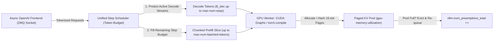
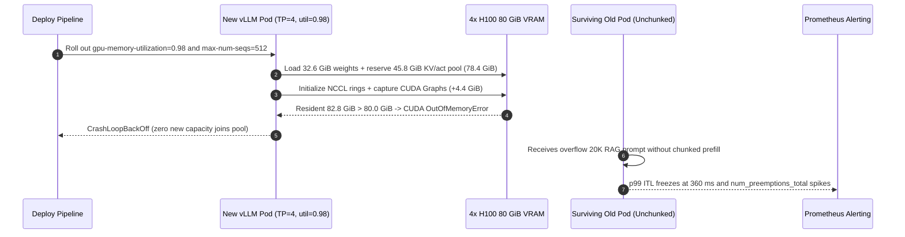

# Module 09: vLLM: Configuration and Tuning

> **Prerequisites:** [Module 08: vLLM: Getting Started](../08-vllm-getting-started/README.md), [Module 07: PagedAttention](../07-pagedattention/README.md), [Module 04: KV Cache Memory Math](../04-kv-cache-memory-math/README.md), and [Module 02: Prefill and Decode Phases](../02-prefill-and-decode-phases/README.md).  
> **Estimated Reading Time:** 40 minutes  
> **Target Audience:** AI Infrastructure Engineers, Inference Serving Architects, Production SREs

> [!TIP]
> **The Golden Rule of vLLM Production Tuning:** Never treat `vllm serve` defaults as production capacity planning—every tuning knob trades off **KV cache headroom**, **Inter-Token Latency (`p99 ITL`)**, and **aggregate throughput (`tok/s`)**. Keep `--gpu-memory-utilization` inside **`0.88–0.92`** (reserving headroom for CUDA graphs, `torch.compile`, and NCCL buffers), enable **`--enable-chunked-prefill`** with a tuned `--max-num-batched-tokens` (`2048–8192`) to prevent `20K`-token prompts from freezing live streams, restrict **`--tensor-parallel-size`** strictly within a single NVLink node, and alert immediately whenever Prometheus **`vllm:num_preemptions_total`** climbs above zero.

---

## Why This Matters

Out of the box, `vllm serve meta-llama/Llama-3.1-70B-Instruct` boots cleanly and passes your smoke test. Then production traffic hits. At 40 concurrent users, `p99 ITL` abruptly freezes for `380 ms` mid-sentence whenever one enterprise customer pastes an `18,000`-token contract. At 95 concurrent users, throughput collapses `3x` while `TTFT` spikes past `6 seconds` because the KV pool filled up and vLLM started **preempting** active sequences (evicting and recomputing KV blocks from scratch). An engineer reacts by bumping `--gpu-memory-utilization 0.98`—and every pod enters a `CrashLoopBackOff` with `CUDA out of memory` during CUDA Graph capture.

Understanding vLLM's exact memory partitioning, step-budget scheduler (across both **V0** and the **V1** engine), parallelism topology, and telemetry alerts turns guesswork into deterministic capacity engineering.

---

## 1. vLLM V0/V1 Engine Architecture & Core Tuning Knobs

In vLLM's **V1 engine architecture**, the HTTP/OpenAI API frontend runs in an isolated process communicating over ZeroMQ (`ZMQ`) with a streamlined GPU **EngineCore** scheduler loop. The V1 scheduler unifies prefill and decode into a single **token-budgeted step**, enables **Chunked Prefill** and **Automatic Prefix Caching (APC)** efficiently by default, and eliminates Python scheduling overhead via persistent batch tensors and CUDA Graph / `torch.compile` execution.



### Knob 1: VRAM Partitioning (`--gpu-memory-utilization`, `--kv-cache-dtype`, `--max-num-seqs`)

At startup, vLLM runs a dummy forward pass at `max_num_batched_tokens` to profile peak activation memory, then freezes the **PagedAttention KV cache pool** to fill the remaining budget under fraction $u \in (0, 1]$ (`--gpu-memory-utilization`):

$$M_{\text{KV}} = u \cdot M_{\text{GPU}} - M_{\text{weights}} - M_{\text{act+graphs}}$$

where $M_{\text{act+graphs}}$ includes transient activation scratchpads, `torch.compile` buffers, and captured **CUDA Graphs** across batch sizes. Critically, **external GPU allocations**—CUDA driver context (`~0.8–1.4 GiB`), NCCL AllReduce communication rings (`~1.2–2.2 GiB` under `TP=4/8`), and PyTorch caching allocator fragmentation—still consume physical VRAM alongside $u \cdot M_{\text{GPU}}$:

- **Too Low ($u \le 0.80$):** Leaves `10+ GiB` of idle VRAM per GPU, shrinking $M_{\text{KV}}$ and triggering **KV preemption storms** under burst concurrency (`vllm:num_preemptions_total` climbs).
- **Sweet Spot ($u \in [0.88, 0.92]$):** Maximizes concurrent KV blocks while preserving `6.4–9.6 GiB` of safety margin on an `80 GiB` H100 for CUDA Graphs, NCCL rings, and long-context spikes.
- **Too High ($u \ge 0.95$):** Risks immediate `CUDA OOM` during CUDA Graph warmup or multi-GPU NCCL initialization (or when co-located monitoring/sidecar processes touch VRAM).

To expand concurrency without buying GPUs or risking OOM, set **`--kv-cache-dtype fp8`** (Hopper/Ada FP8 E4M3 or E5M2). On `Llama-3.1-70B` (`80` layers, `8` GQA KV heads, `d_head = 128`, `TP = 4`), per-GPU KV memory drops from `80 KiB/token` (`FP16`) to **`40 KiB/token` (`FP8`)**—doubling max concurrent sequences and halving KV HBM bandwidth during decode with negligible (`< 0.1` perplexity) quality impact.

Cap active sequences explicitly via **`--max-num-seqs`** (`128–512` for low-latency chat, up to `1024+` for high-throughput batch):

$$N_{\text{safe\_seqs}} \le \left\lfloor \frac{M_{\text{KV}}}{b_{\text{KV}} \cdot \bar{L}_{\text{ctx}}} \right\rfloor$$

### Knob 2: Step Budget & Head-of-Line Protection (`--enable-chunked-prefill`, `--max-num-batched-tokens`)

As established in [Module 02](../02-prefill-and-decode-phases/README.md), unchunked prefill stalls active decode users (**Head-of-Line Blocking**). With **`--enable-chunked-prefill`**, every scheduler iteration packs all active decode tokens first (`1` token per running sequence) and fills remaining token capacity up to **`--max-num-batched-tokens`** with slices of queued prompts:

- **`2048` tokens (Latency-Optimized):** Tight `p99 ITL` (`~35–55 ms`) because no single CUDA step runs a huge GEMM; slightly lower aggregate throughput (`tok/s`) and longer `TTFT` on `20K+` prompts due to more frequent weight-read passes.
- **`4096–8192` tokens (Balanced Production Pareto):** Saturates Tensor Cores on prefill chunks while capping decode interruption under `~80–150 ms`.
- **`16384+` tokens (Offline Batch / High-Throughput):** Peak `tok/s` per GPU dollar, unsuitable for strict interactive `p99 ITL < 80 ms` SLAs.

> **V0 vs. V1 Note:** In vLLM V0 (`< v0.8`), chunked prefill defaulted to `False` and `--max-num-batched-tokens` defaulted higher when disabled. In **vLLM V1** (`VLLM_USE_V1=1`), chunked prefill is **always on**, and `--max-num-batched-tokens` directly controls the chunk ceiling (`default 2048–8192` depending on hardware/version). Always pin both explicitly in your Helm/systemd manifest so upgrades never silently alter SLA behavior.

### Knob 3: Parallelism Topology (`--tensor-parallel-size` vs. `--pipeline-parallel-size`)

- **Tensor Parallelism (`--tensor-parallel-size` / `TP`):** Shards every attention head and MLP projection across `TP` GPUs. Requires **2 `AllReduce` barriers per transformer layer per forward step** (`160` blocking network syncs per token on an `80`-layer model!). Keep `TP` strictly **inside a single NVLink/NVSwitch node** (`900 GB/s`, `~5 us` hop latency) and ensure `TP` evenly divides `n_kv_heads` (for example, `TP = 2, 4, 8` on `8` KV heads; `TP = 8` on `70B` avoids cross-head replication). Never span `TP` across `100 GbE` Ethernet nodes—`160` network barriers destroy token latency.
- **Pipeline Parallelism (`--pipeline-parallel-size` / `PP`):** Splits contiguous layer blocks across nodes (`1` point-to-point activation send per stage transition). Tolerates `100–400 Gbps` InfiniBand/RoCE between nodes, but introduces **pipeline bubble inefficiency** when active microbatches $M$ are scarce:

$$\text{Bubble Fraction} = \frac{PP - 1}{M + PP - 1}$$

At $PP=2, M=4$, `20%` of GPU time sits idle (`Bubble = 20%`); at $M=64$, bubble drops to `1.5%`. Prefer `TP=4/8` single-node replicas scaled horizontally over `PP>1` unless a single model's weights (`405B+`) physically exceed one `8`-GPU node.

### Knob 4: Prefix Caching, CUDA Graphs & Debugging (`--enable-prefix-caching`, `--enforce-eager`)

- **`--enable-prefix-caching` (APC):** Hashes `16`-token KV pages by prefix content hash ([Module 03](../03-the-kv-cache/README.md)), slashing RAG/agent `TTFT` `3x–10x`. Verify `vllm:prefix_cache_hits_total / vllm:prefix_cache_queries_total` in Prometheus; keep system instructions at token index `0` and dynamic timestamps at the suffix.
- **CUDA Graphs vs. `--enforce-eager`:** By default, vLLM captures CUDA Graphs for common decode batch sizes (`1, 2, 4, ..., max_capture_size`) to eliminate CPU Python kernel-launch overhead (`~3–6 ms/step` savings at small `B`). Only pass **`--enforce-eager`** temporarily while debugging kernel crashes or diagnosing tight VRAM headroom (disabling graphs frees `~1.5–3.0 GiB` VRAM at the cost of `15%–35%` slower small-batch decode!).
- **Preemption Monitoring (`vllm:num_preemptions_total`):** Whenever KV blocks exhaust under `--max-num-seqs`, vLLM halts the newest sequence (`RECOMPUTE` mode in V1, or `SWAP` in V0). Watch `rate(vllm:num_preemptions_total[1m])` and `vllm:kv_cache_usage_perc`; sustained `kv_cache_usage_perc > 0.85` with non-zero preemptions means lower `--max-num-seqs`, enable `--kv-cache-dtype fp8`, or trigger horizontal autoscaling.

---

## 2. Systematic Comparison Matrix: vLLM Tuning Profiles by SLA Tier

| Workload Profile | `--gpu-memory-utilization` | `--enable-chunked-prefill` & `--max-num-batched-tokens` | `--kv-cache-dtype` | `--max-num-seqs` | Parallelism Strategy | Target Telemetry Thresholds |
| :--- | :--- | :--- | :--- | :--- | :--- | :--- |
| **Interactive Voice / Realtime Copilot** (`p99 ITL < 45 ms`) | `0.90` | `True`, `2048` | `fp8` (Hopper/Ada) or `auto` | `64–128` | Max intra-node NVLink `TP` (`TP=4` or `8`), `PP=1` | `num_preemptions_total == 0`, `kv_cache_usage < 0.80` |
| **Balanced Multi-Tenant RAG / Agent API** (`p99 ITL < 100 ms`) | `0.90–0.92` | `True`, `4096` + `--enable-prefix-caching` | `fp8` | `256` | Smallest `TP` fitting weights + KV (`TP=2` or `4`), replicate | `rate(preemptions[5m]) < 0.05/s`, `APC hit > 60%` |
| **Offline Batch Extraction / Eval** (Max `tok/s / \$`) | `0.92–0.94` | `True`, `8192–16384` | `fp8` | `512–1024` | Min `TP` (`TP=1` with quant or `TP=2/4`), high batch | Near `100%` compute saturation, controlled queue |
| **Multi-Node Frontier (`405B+` FP8)** | `0.88–0.90` | `True`, `4096` | `fp8` | `128–256` | `TP=8` intra-node NVLink $\times$ `PP=2` inter-node IB | Monitor PP bubble (`M >= 32`) + RDMA health |
| **Crash / Kernel Debug Only** | `0.85` | `True`, `2048` | `auto` | `32` | `--enforce-eager` (disables CUDA Graphs + `torch.compile`) | Inspect stack traces cleanly without graph replay |

---

## 3. Production War Story Post-Mortem: The `0.98` Utilization OOM & `360 ms` Preemption Seesaw

| Field | Incident Details |
| :--- | :--- |
| **Severity** | **SEV-1** (Full Inference Cluster Crash Loop & Customer Streaming Timeout) |
| **Detection / Resolution Time** | Triggered 12 minutes after vLLM Helm config rollout / Mitigated in 38 minutes via config rollback + FP8 KV + Chunked Prefill patch |
| **Impact** | `100%` of `8` `4x H100` replicas entered `CrashLoopBackOff` on rollout; surviving old pods hit `360 ms` ITL stalls and **\$42,000** SLA credit breach |

### What Happened

An AI platform team served `Llama-3.1-70B-Instruct` (`BF16`, `TP=4` across `4x H100 80 GiB` nodes) powering a live coding assistant (`p99 ITL <= 90 ms` SLA). Following a new RAG launch expanding average prompts to `8,500` tokens, Prometheus alerted on `vllm:kv_cache_usage_perc = 0.99` and `vllm:num_preemptions_total` climbing at `4.2 preemptions/sec`. Every preempted sequence silently dropped its KV blocks and waited seconds to re-prefill.

To "give vLLM more KV cache," an on-call engineer pushed `--gpu-memory-utilization 0.98` and simultaneously left `--enable-chunked-prefill` off while increasing `--max-num-seqs 512`.



### Root Cause Analysis

1. **Unaccounted External VRAM Overhead:** Setting `--gpu-memory-utilization 0.98` instructed vLLM to claim `78.4 GiB` per `80 GiB` H100 (`32.6 GiB` weights + `4.2 GiB` profiled activations + `41.6 GiB` KV pool). During CUDA Graph capture and NCCL AllReduce initialization across `TP=4`, external CUDA driver + NCCL buffers added `4.4 GiB`, pushing peak resident memory to `82.8 GiB` and triggering instant startup OOMs.
2. **Unbounded Step Prefills:** Surviving pods ran without `--enable-chunked-prefill`, so incoming `20K`-token RAG prompts monopolized Tensor Cores atomically, causing `360 ms` decode stalls across active coding streams.
3. **Oversized `max-num-seqs` vs. FP16 KV:** Allowing `512` sequences against FP16 KV (`80 KiB/tok/GPU`) exceeded physical KV capacity whenever average context exceeded `900` tokens, amplifying `vllm:num_preemptions_total`.

### The Fix & Architectural Hardening

- **Safe Utilization + FP8 KV Cache:** Set `--gpu-memory-utilization 0.90` (`~4.0 GiB` driver/NCCL headroom) combined with **`--kv-cache-dtype fp8`**, expanding `4x H100` KV capacity from `461K` to **`922K` tokens** (`2x`) without touching total VRAM utilization.
- **Chunked Prefill & APC:** Pinned `--enable-chunked-prefill`, `--max-num-batched-tokens 4096`, `--enable-prefix-caching`, and `--max-num-seqs 192`.
- **Pre-Deploy Guardrail + Preemption Alert:** Added an automated config validator in CI rejecting `util > 0.93` or unchunked deployments, and wired PagerDuty alerts on `rate(vllm:num_preemptions_total[2m]) > 0.1`.

---

## 4. Multi-Language Production Implementation: vLLM Config Preflight & Preemption Guard

Below is a production-ready **vLLM Configuration Validator & Prometheus Preemption Watcher** in **Go**, **TypeScript**, **Python**, and **C#**. It validates VRAM safety margins (`weights + KV + CUDA graphs + external NCCL`), enforces intra-node `TP` alignment against `n_kv_heads`, rejects unchunked latency-hostile flags, and polls vLLM's `/metrics` endpoint with explicit HTTP timeouts to trigger circuit-breaker alerts when `vllm:num_preemptions_total` climbs.

````carousel

```go
package vllmops

import (
	"context"
	"fmt"
	"io"
	"net/http"
	"strconv"
	"strings"
	"time"
)

type EngineConfig struct {
	ModelParamsB          float64
	WeightBytesPerParam   float64
	NumLayers             int
	NumKVHeads            int
	HeadDim               int
	GPUMemoryGiB          float64
	GPUMemoryUtilization  float64
	KVCacheDtype          string // "fp16" or "fp8"
	TensorParallelSize    int
	PipelineParallelSize  int
	GPUsPerNode           int
	MaxNumSeqs            int
	ExpectedAvgContextTok int
	MaxNumBatchedTokens   int
	EnableChunkedPrefill  bool
}

type PreflightReport struct {
	SafeToDeploy       bool
	EstimatedKVPoolGiB float64
	MaxKVTokens        int
	PeakResidentGiB    float64
	Errors             []string
}

func ValidateEngineConfig(cfg EngineConfig) PreflightReport {
	var errs []string
	if cfg.GPUMemoryUtilization > 0.93 {
		errs = append(errs, fmt.Sprintf("gpu-memory-utilization %.2f exceeds 0.93 OOM safety ceiling", cfg.GPUMemoryUtilization))
	}
	if cfg.TensorParallelSize > cfg.GPUsPerNode {
		errs = append(errs, fmt.Sprintf("TP=%d exceeds single-node NVLink GPUs (%d); use PP across nodes", cfg.TensorParallelSize, cfg.GPUsPerNode))
	}
	if cfg.NumKVHeads%cfg.TensorParallelSize != 0 {
		errs = append(errs, fmt.Sprintf("TP=%d does not evenly divide n_kv_heads=%d", cfg.TensorParallelSize, cfg.NumKVHeads))
	}
	if !cfg.EnableChunkedPrefill || cfg.MaxNumBatchedTokens > 8192 {
		errs = append(errs, "chunked prefill must be enabled with max-num-batched-tokens <= 8192 for interactive SLAs")
	}

	weightsGiB := (cfg.ModelParamsB * 1e9 * cfg.WeightBytesPerParam) / (float64(cfg.TensorParallelSize*cfg.PipelineParallelSize) * (1 << 30))
	profiledGraphActGiB := 4.2
	externalNCCLGiB := 4.4
	budgetGiB := cfg.GPUMemoryUtilization * cfg.GPUMemoryGiB
	kvPoolGiB := budgetGiB - weightsGiB - profiledGraphActGiB
	peakGiB := budgetGiB + externalNCCLGiB

	if peakGiB > cfg.GPUMemoryGiB {
		errs = append(errs, fmt.Sprintf("projected peak VRAM %.2f GiB exceeds %.1f GiB GPU limit", peakGiB, cfg.GPUMemoryGiB))
	}
	if kvPoolGiB <= 0 {
		errs = append(errs, "zero KV cache memory remaining after weights and CUDA graphs")
	}

	kvBytesPerElem := 2.0
	if cfg.KVCacheDtype == "fp8" {
		kvBytesPerElem = 1.0
	}
	kvBytesPerTokGPU := (2.0 * float64(cfg.NumLayers) * float64(cfg.NumKVHeads) * float64(cfg.HeadDim) * kvBytesPerElem) / float64(cfg.TensorParallelSize*cfg.PipelineParallelSize)
	maxKVTokens := 0
	if kvPoolGiB > 0 {
		maxKVTokens = int((kvPoolGiB * float64(1<<30)) / kvBytesPerTokGPU)
	}
	if cfg.MaxNumSeqs*cfg.ExpectedAvgContextTok > maxKVTokens {
		errs = append(errs, fmt.Sprintf("max-num-seqs=%d at avg_ctx=%d requires %d tokens > %d KV capacity (preemption risk)",
			cfg.MaxNumSeqs, cfg.ExpectedAvgContextTok, cfg.MaxNumSeqs*cfg.ExpectedAvgContextTok, maxKVTokens))
	}

	return PreflightReport{
		SafeToDeploy:       len(errs) == 0,
		EstimatedKVPoolGiB: kvPoolGiB,
		MaxKVTokens:        maxKVTokens,
		PeakResidentGiB:    peakGiB,
		Errors:             errs,
	}
}

// ScrapePreemptionMetric polls vLLM /metrics with strict timeout and parses vllm:num_preemptions_total.
func ScrapePreemptionMetric(ctx context.Context, metricsURL string) (float64, error) {
	ctx, cancel := context.WithTimeout(ctx, 2*time.Second)
	defer cancel()

	req, err := http.NewRequestWithContext(ctx, http.MethodGet, metricsURL, nil)
	if err != nil {
		return 0, err
	}
	resp, err := http.DefaultClient.Do(req)
	if err != nil {
		return 0, err
	}
	defer resp.Body.Close()

	body, err := io.ReadAll(io.LimitReader(resp.Body, 1<<20))
	if err != nil {
		return 0, err
	}
	for _, line := range strings.Split(string(body), "\n") {
		if strings.HasPrefix(line, "vllm:num_preemptions_total") && !strings.HasPrefix(line, "#") {
			fields := strings.Fields(line)
			if len(fields) >= 2 {
				return strconv.ParseFloat(fields[len(fields)-1], 64)
			}
		}
	}
	return 0, fmt.Errorf("vllm:num_preemptions_total metric not found")
}
```

<!-- slide -->

```typescript
export interface VllmEngineConfig {
  readonly modelParamsB: number;
  readonly weightBytesPerParam: number;
  readonly numLayers: number;
  readonly numKvHeads: number;
  readonly headDim: number;
  readonly gpuMemoryGiB: number;
  readonly gpuMemoryUtilization: number;
  readonly kvCacheDtype: "fp16" | "fp8";
  readonly tensorParallelSize: number;
  readonly pipelineParallelSize: number;
  readonly gpusPerNode: number;
  readonly maxNumSeqs: number;
  readonly expectedAvgContextTok: number;
  readonly maxNumBatchedTokens: number;
  readonly enableChunkedPrefill: boolean;
}

export interface PreflightAssessment {
  readonly safe: boolean;
  readonly kvPoolGiB: number;
  readonly maxKvTokens: number;
  readonly projectedPeakGiB: number;
  readonly violations: readonly string[];
}

export function validateVllmConfig(cfg: VllmEngineConfig): PreflightAssessment {
  const violations: string[] = [];

  if (cfg.gpuMemoryUtilization > 0.93) {
    violations.push(`gpu-memory-utilization=${cfg.gpuMemoryUtilization} exceeds 0.93 OOM ceiling`);
  }
  if (cfg.tensorParallelSize > cfg.gpusPerNode) {
    violations.push(`TP=${cfg.tensorParallelSize} crosses node boundary (${cfg.gpusPerNode} GPUs/node)`);
  }
  if (cfg.numKvHeads % cfg.tensorParallelSize !== 0) {
    violations.push(`TP=${cfg.tensorParallelSize} must divide numKvHeads=${cfg.numKvHeads}`);
  }
  if (!cfg.enableChunkedPrefill || cfg.maxNumBatchedTokens > 8192) {
    violations.push("Enable chunked prefill with maxNumBatchedTokens <= 8192 for ITL stability");
  }

  const totalShards = cfg.tensorParallelSize * cfg.pipelineParallelSize;
  const gib = 1024 ** 3;
  const weightsGiB = (cfg.modelParamsB * 1e9 * cfg.weightBytesPerParam) / (totalShards * gib);
  const graphAndActGiB = 4.2;
  const externalNcclGiB = 4.4;
  const budgetGiB = cfg.gpuMemoryUtilization * cfg.gpuMemoryGiB;
  const kvPoolGiB = budgetGiB - weightsGiB - graphAndActGiB;
  const projectedPeakGiB = budgetGiB + externalNcclGiB;

  if (projectedPeakGiB > cfg.gpuMemoryGiB) {
    violations.push(`Projected peak ${projectedPeakGiB.toFixed(1)} GiB > ${cfg.gpuMemoryGiB} GiB VRAM`);
  }

  const kvBytes = cfg.kvCacheDtype === "fp8" ? 1 : 2;
  const kvBytesPerTok = (2 * cfg.numLayers * cfg.numKvHeads * cfg.headDim * kvBytes) / totalShards;
  const maxKvTokens = kvPoolGiB > 0 ? Math.floor((kvPoolGiB * gib) / kvBytesPerTok) : 0;

  if (cfg.maxNumSeqs * cfg.expectedAvgContextTok > maxKvTokens) {
    violations.push(`Concurrency cap ${cfg.maxNumSeqs} * ${cfg.expectedAvgContextTok} exceeds KV tokens (${maxKvTokens})`);
  }

  return {
    safe: violations.length === 0,
    kvPoolGiB: Number(kvPoolGiB.toFixed(2)),
    maxKvTokens,
    projectedPeakGiB: Number(projectedPeakGiB.toFixed(2)),
    violations,
  };
}

export async function pollPreemptionsTotal(metricsUrl: string, timeoutMs = 2000): Promise<number> {
  const controller = new AbortController();
  const timer = setTimeout(() => controller.abort(), timeoutMs);
  try {
    const res = await fetch(metricsUrl, { signal: controller.signal });
    if (!res.ok) throw new Error(`Metrics HTTP ${res.status}`);
    const text = await res.text();
    for (const line of text.split("\n")) {
      if (line.startsWith("vllm:num_preemptions_total") && !line.startsWith("#")) {
        const val = Number(line.trim().split(/\s+/).pop());
        if (!Number.isNaN(val)) return val;
      }
    }
    throw new Error("vllm:num_preemptions_total missing from /metrics");
  } finally {
    clearTimeout(timer);
  }
}
```

<!-- slide -->

```python
"""
vllm_preflight_guard.py
Pre-deployment vLLM engine config validator and live Prometheus preemption watchdog.
"""
from dataclasses import dataclass
import urllib.request


@dataclass(frozen=True)
class VllmConfig:
    model_params_b: float
    weight_bytes_per_param: float
    num_layers: int
    num_kv_heads: int
    head_dim: int
    gpu_memory_gib: float
    gpu_memory_utilization: float
    kv_cache_dtype: str  # "fp16" | "fp8"
    tensor_parallel_size: int
    pipeline_parallel_size: int
    gpus_per_node: int
    max_num_seqs: int
    expected_avg_ctx_tok: int
    max_num_batched_tokens: int
    enable_chunked_prefill: bool


@dataclass(frozen=True)
class PreflightResult:
    safe_to_deploy: bool
    kv_pool_gib: float
    max_kv_tokens: int
    peak_vram_gib: float
    errors: tuple[str, ...]


def validate_vllm_config(cfg: VllmConfig) -> PreflightResult:
    errors: list[str] = []
    if cfg.gpu_memory_utilization > 0.93:
        errors.append(f"gpu-memory-utilization={cfg.gpu_memory_utilization:.2f} exceeds 0.93 OOM margin")
    if cfg.tensor_parallel_size > cfg.gpus_per_node:
        errors.append(f"TP={cfg.tensor_parallel_size} exceeds node NVLink GPUs={cfg.gpus_per_node}")
    if cfg.num_kv_heads % cfg.tensor_parallel_size != 0:
        errors.append(f"TP={cfg.tensor_parallel_size} must divide num_kv_heads={cfg.num_kv_heads}")
    if not cfg.enable_chunked_prefill or cfg.max_num_batched_tokens > 8192:
        errors.append("Requires --enable-chunked-prefill with --max-num-batched-tokens <= 8192")

    shards = cfg.tensor_parallel_size * cfg.pipeline_parallel_size
    gib = 1024**3
    weights_gib = (cfg.model_params_b * 1e9 * cfg.weight_bytes_per_param) / (shards * gib)
    graph_and_act_gib = 4.2
    external_nccl_gib = 4.4
    budget_gib = cfg.gpu_memory_utilization * cfg.gpu_memory_gib
    kv_pool_gib = budget_gib - weights_gib - graph_and_act_gib
    peak_vram_gib = budget_gib + external_nccl_gib

    if peak_vram_gib > cfg.gpu_memory_gib:
        errors.append(f"Peak resident VRAM {peak_vram_gib:.1f} GiB > {cfg.gpu_memory_gib:.1f} GiB")

    kv_elem_bytes = 1 if cfg.kv_cache_dtype == "fp8" else 2
    kv_bytes_per_tok = (2 * cfg.num_layers * cfg.num_kv_heads * cfg.head_dim * kv_elem_bytes) / shards
    max_kv_tokens = int((kv_pool_gib * gib) / kv_bytes_per_tok) if kv_pool_gib > 0 else 0

    if cfg.max_num_seqs * cfg.expected_avg_ctx_tok > max_kv_tokens:
        errors.append(
            f"Requested {cfg.max_num_seqs * cfg.expected_avg_ctx_tok:,} KV tokens > capacity {max_kv_tokens:,}"
        )

    return PreflightResult(
        safe_to_deploy=not errors,
        kv_pool_gib=round(kv_pool_gib, 2),
        max_kv_tokens=max_kv_tokens,
        peak_vram_gib=round(peak_vram_gib, 2),
        errors=tuple(errors),
    )


def fetch_preemptions_total(metrics_url: str, timeout_s: float = 2.0) -> float:
    with urllib.request.urlopen(metrics_url, timeout=timeout_s) as resp:
        for raw_line in resp.read().decode("utf-8").splitlines():
            if raw_line.startswith("vllm:num_preemptions_total") and not raw_line.startswith("#"):
                return float(raw_line.split()[-1])
    raise KeyError("vllm:num_preemptions_total not exposed")
```

<!-- slide -->

```csharp
using System;
using System.Collections.Generic;
using System.Globalization;
using System.Net.Http;
using System.Threading;
using System.Threading.Tasks;

namespace GenAI.VllmOps;

public sealed record VllmEngineConfig(
    double ModelParamsB,
    double WeightBytesPerParam,
    int NumLayers,
    int NumKvHeads,
    int HeadDim,
    double GpuMemoryGiB,
    double GpuMemoryUtilization,
    string KvCacheDtype,
    int TensorParallelSize,
    int PipelineParallelSize,
    int GpusPerNode,
    int MaxNumSeqs,
    int ExpectedAvgContextTok,
    int MaxNumBatchedTokens,
    bool EnableChunkedPrefill);

public sealed record PreflightOutcome(
    bool SafeToDeploy,
    double KvPoolGiB,
    int MaxKvTokens,
    double PeakResidentGiB,
    IReadOnlyList<string> Errors);

public static class VllmConfigGuard
{
    public static PreflightOutcome Validate(VllmEngineConfig cfg)
    {
        var errors = new List<string>();
        if (cfg.GpuMemoryUtilization > 0.93)
            errors.Add($"gpu-memory-utilization {cfg.GpuMemoryUtilization:F2} exceeds 0.93 OOM safety cap.");
        if (cfg.TensorParallelSize > cfg.GpusPerNode)
            errors.Add($"TP={cfg.TensorParallelSize} exceeds node NVLink GPUs ({cfg.GpusPerNode}).");
        if (cfg.NumKvHeads % cfg.TensorParallelSize != 0)
            errors.Add($"TP={cfg.TensorParallelSize} must divide numKvHeads={cfg.NumKvHeads}.");
        if (!cfg.EnableChunkedPrefill || cfg.MaxNumBatchedTokens > 8192)
            errors.Add("Enable chunked prefill with max-num-batched-tokens <= 8192.");

        int shards = cfg.TensorParallelSize * cfg.PipelineParallelSize;
        const double giB = 1024.0 * 1024.0 * 1024.0;
        double weightsGiB = (cfg.ModelParamsB * 1e9 * cfg.WeightBytesPerParam) / (shards * giB);
        double budgetGiB = cfg.GpuMemoryUtilization * cfg.GpuMemoryGiB;
        double kvPoolGiB = budgetGiB - weightsGiB - 4.2;
        double peakGiB = budgetGiB + 4.4;

        if (peakGiB > cfg.GpuMemoryGiB)
            errors.Add($"Projected peak VRAM {peakGiB:F1} GiB > {cfg.GpuMemoryGiB:F1} GiB.");

        double kvBytes = string.Equals(cfg.KvCacheDtype, "fp8", StringComparison.Ordinal) ? 1.0 : 2.0;
        double kvBytesPerTok = (2.0 * cfg.NumLayers * cfg.NumKvHeads * cfg.HeadDim * kvBytes) / shards;
        int maxKvTokens = kvPoolGiB > 0 ? (int)((kvPoolGiB * giB) / kvBytesPerTok) : 0;

        if (cfg.MaxNumSeqs * cfg.ExpectedAvgContextTok > maxKvTokens)
            errors.Add($"Planned concurrency exceeds {maxKvTokens:N0} KV tokens (preemption risk).");

        return new PreflightOutcome(errors.Count == 0, Math.Round(kvPoolGiB, 2), maxKvTokens, Math.Round(peakGiB, 2), errors);
    }

    public static async Task<double> ReadPreemptionsTotalAsync(HttpClient http, Uri metricsUri, CancellationToken ct)
    {
        using var cts = CancellationTokenSource.CreateLinkedTokenSource(ct);
        cts.CancelAfter(TimeSpan.FromSeconds(2));
        string payload = await http.GetStringAsync(metricsUri, cts.Token);
        foreach (string line in payload.Split('\n'))
        {
            if (line.StartsWith("vllm:num_preemptions_total", StringComparison.Ordinal) && !line.StartsWith("#", StringComparison.Ordinal))
            {
                string[] parts = line.Trim().Split(' ', StringSplitOptions.RemoveEmptyEntries);
                if (parts.Length >= 2 && double.TryParse(parts[^1], NumberStyles.Float, CultureInfo.InvariantCulture, out double val))
                    return val;
            }
        }
        throw new KeyNotFoundException("vllm:num_preemptions_total not found in Prometheus scrape.");
    }
}
```

````

---

## 5. Practical Hands-On Verification CLI Workflows

Run Workflows 1–3 offline using Python 3.13 stdlib—no GPUs or external packages required. Workflow 4 shows the real production `vllm serve` CLI and Prometheus scrape commands when running against a live GPU node.

### Workflow 1: VRAM Utilization, FP8 KV Cache & Preemption/OOM Sweep

Model `Llama-3.1-70B` (`BF16`, `TP=4` on `80 GiB` H100s) serving `112` concurrent `4,096`-token requests across `--gpu-memory-utilization` (`0.80–0.96`) and `--kv-cache-dtype` (`fp16` vs `fp8`):

```bash
python -c '
total_vram_gib = 80.0
weights_per_gpu_gib = (70e9 * 2) / (4 * 1024**3)
runtime_graph_act_gib = 4.20
external_nccl_driver_gib = 4.40

configs = [
    (0.80, "fp16", 112, 4096),
    (0.88, "fp16", 112, 4096),
    (0.90, "fp16", 112, 4096),
    (0.92, "fp16", 112, 4096),
    (0.96, "fp16", 112, 4096),
    (0.90, "fp8",  112, 4096),
]
for util, kv_dtype, reqs, avg_ctx in configs:
    kv_bytes_per_tok_gpu = (2 * 80 * 8 * 128 * (2 if kv_dtype == "fp16" else 1)) / 4
    budget_gib = util * total_vram_gib
    kv_pool_gib = budget_gib - weights_per_gpu_gib - runtime_graph_act_gib
    peak_resident_gib = budget_gib + external_nccl_driver_gib
    max_kv_tokens = int((kv_pool_gib * 1024**3) / kv_bytes_per_tok_gpu)
    needed_tokens = reqs * avg_ctx
    if peak_resident_gib > total_vram_gib:
        status = f"CRASH_OOM ({peak_resident_gib:.1f}>{total_vram_gib:.0f} GiB)"
    elif needed_tokens > max_kv_tokens:
        shortfall = needed_tokens - max_kv_tokens
        status = f"PREEMPTION_STORM (-{shortfall:,} tok)"
    else:
        headroom = ((max_kv_tokens - needed_tokens) / max_kv_tokens) * 100
        status = f"HEALTHY ({headroom:.1f}% KV headroom)"
    print(f"util={util:.2f} kv={kv_dtype:<4} | kv_pool={kv_pool_gib:5.2f} GiB | max_tok={max_kv_tokens:7,} | peak={peak_resident_gib:5.1f} GiB | {status}")
'
```

**Expected Output:**

```text
util=0.80 kv=fp16 | kv_pool=27.20 GiB | max_tok=356,564 | peak= 68.4 GiB | PREEMPTION_STORM (-102,188 tok)
util=0.88 kv=fp16 | kv_pool=33.60 GiB | max_tok=440,450 | peak= 74.8 GiB | PREEMPTION_STORM (-18,302 tok)
util=0.90 kv=fp16 | kv_pool=35.20 GiB | max_tok=461,422 | peak= 76.4 GiB | HEALTHY (0.6% KV headroom)
util=0.92 kv=fp16 | kv_pool=36.80 GiB | max_tok=482,393 | peak= 78.0 GiB | HEALTHY (4.9% KV headroom)
util=0.96 kv=fp16 | kv_pool=40.00 GiB | max_tok=524,336 | peak= 81.2 GiB | CRASH_OOM (81.2>80 GiB)
util=0.90 kv=fp8  | kv_pool=35.20 GiB | max_tok=922,844 | peak= 76.4 GiB | HEALTHY (50.3% KV headroom)
```

Notice how `0.80` starves KV into preemptions (`-102,188` tokens short), `0.96` crashes OOM (`81.2 > 80 GiB`), and `0.90 + fp8` delivers **`50.3%` KV headroom** at a safe `76.4 GiB` peak!

### Workflow 2: Chunked Prefill & `--max-num-batched-tokens` Pareto Curve

Simulate `32` ongoing decode users interrupted by two `20,480`-token prompts, comparing unchunked scheduling against chunked prefill across step token budgets (`1024` to `8192`):

```bash
python -c '
def sim_scheduler(chunked: bool, max_batched_tokens: int):
    decode_remaining = [24] * 32
    prefill_queue = []
    itls, ttfts = [], []
    clock_ms, step, total_tokens_done = 0.0, 0, 0
    while any(r > 0 for r in decode_remaining) or prefill_queue:
        if step == 2:
            prefill_queue.extend([{"rem": 20480, "arrived": clock_ms}, {"rem": 20480, "arrived": clock_ms}])
        active_decodes = sum(1 for r in decode_remaining if r > 0)
        prefill_toks = 0
        if prefill_queue and not chunked:
            p = prefill_queue.pop(0)
            step_ms = 11.5 + p["rem"] * 0.017
            clock_ms += step_ms
            ttfts.append(clock_ms - p["arrived"])
            if active_decodes > 0:
                itls.append(step_ms)
            total_tokens_done += p["rem"]
            step += 1
            continue
        if prefill_queue and chunked:
            budget = max(1, max_batched_tokens - active_decodes)
            take = min(budget, prefill_queue[0]["rem"])
            prefill_queue[0]["rem"] -= take
            prefill_toks = take
            if prefill_queue[0]["rem"] == 0:
                p = prefill_queue.pop(0)
                ttfts.append(clock_ms + 11.5 + (active_decodes + prefill_toks) * 0.017 - p["arrived"])
        batch_toks = active_decodes + prefill_toks
        step_ms = 11.5 + batch_toks * 0.017
        clock_ms += step_ms
        if active_decodes > 0:
            itls.append(step_ms)
            for i in range(len(decode_remaining)):
                if decode_remaining[i] > 0:
                    decode_remaining[i] -= 1
                    total_tokens_done += 1
        total_tokens_done += prefill_toks
        step += 1
    itls_sorted = sorted(itls)
    p50_itl = itls_sorted[len(itls_sorted) // 2]
    p99_itl = itls_sorted[min(len(itls_sorted) - 1, int(0.99 * len(itls_sorted)))]
    avg_ttft = sum(ttfts) / len(ttfts)
    tps = total_tokens_done / (clock_ms / 1000.0)
    mode = "UNCHUNKED" if not chunked else f"CHUNKED({max_batched_tokens})"
    print(f"{mode:<16} | p50_ITL={p50_itl:5.1f} ms | p99_ITL={p99_itl:5.1f} ms | avg_TTFT={avg_ttft:6.1f} ms | agg_tps={tps:7,.0f} tok/s")

for cfg in [(False, 0), (True, 1024), (True, 2048), (True, 4096), (True, 8192)]:
    sim_scheduler(*cfg)
'
```

**Expected Output:**

```text
UNCHUNKED        | p50_ITL= 12.0 ms | p99_ITL=359.7 ms | avg_TTFT= 539.5 ms | agg_tps= 41,381 tok/s
CHUNKED(1024)    | p50_ITL= 28.9 ms | p99_ITL= 28.9 ms | avg_TTFT= 896.2 ms | agg_tps= 34,333 tok/s
CHUNKED(2048)    | p50_ITL= 46.3 ms | p99_ITL= 46.3 ms | avg_TTFT= 721.0 ms | agg_tps= 42,347 tok/s
CHUNKED(4096)    | p50_ITL= 14.8 ms | p99_ITL= 81.1 ms | avg_TTFT= 630.6 ms | agg_tps= 42,347 tok/s
CHUNKED(8192)    | p50_ITL= 12.0 ms | p99_ITL=150.8 ms | avg_TTFT= 576.4 ms | agg_tps= 42,347 tok/s
```

### Workflow 3: Tensor Parallel (`TP`) AllReduce vs. Pipeline Parallel (`PP`) Bubble Model

Quantify why intra-node NVLink `TP` dominates while cross-node `TP` collapses compared to `PP=2` with deep microbatching:

```bash
python -c '
configs_par = [
    ("TP=4, PP=1 (1x4 NVLink)",     4, 1, 900e9,  0.005, 32, 16.0),
    ("TP=8, PP=1 (1x8 NVLink)",     8, 1, 900e9,  0.005, 32, 11.0),
    ("TP=8, PP=1 (2x4 100GbE TCP)", 8, 1, 12.5e9, 0.085, 32, 11.0),
    ("TP=4, PP=2 (m=4 micro)",      4, 2, 900e9,  0.005,  4, 16.0),
    ("TP=4, PP=2 (m=16 micro)",     4, 2, 900e9,  0.005, 16, 16.0),
    ("TP=4, PP=2 (m=64 micro)",     4, 2, 900e9,  0.005, 64, 16.0),
]
for label, tp, pp, bw_bps, hop_lat_ms, microbatches, base_compute_ms in configs_par:
    layers = 80 // pp
    msg_bytes = 32 * 8192 * 2
    ar_per_step_ms = pp * layers * 2 * ((2 * (tp - 1) / tp) * (msg_bytes / bw_bps) * 1000.0 + hop_lat_ms)
    p2p_send_ms = (pp - 1) * ((msg_bytes / 12.5e9) * 1000.0 + 0.045)
    bubble_frac = (pp - 1) / (microbatches + pp - 1)
    eff_step_ms = (base_compute_ms + ar_per_step_ms + p2p_send_ms) / (1.0 - bubble_frac)
    print(f"{label:<28} | AllReduce={ar_per_step_ms:5.2f} ms | Bubble={bubble_frac*100:5.1f}% | Eff_Step={eff_step_ms:6.2f} ms")
'
```

**Expected Output:**

```text
TP=4, PP=1 (1x4 NVLink)      | AllReduce= 0.94 ms | Bubble=  0.0% | Eff_Step= 16.94 ms
TP=8, PP=1 (1x8 NVLink)      | AllReduce= 0.96 ms | Bubble=  0.0% | Eff_Step= 11.96 ms
TP=8, PP=1 (2x4 100GbE TCP)  | AllReduce=25.34 ms | Bubble=  0.0% | Eff_Step= 36.34 ms
TP=4, PP=2 (m=4 micro)       | AllReduce= 0.94 ms | Bubble= 20.0% | Eff_Step= 21.28 ms
TP=4, PP=2 (m=16 micro)      | AllReduce= 0.94 ms | Bubble=  5.9% | Eff_Step= 18.09 ms
TP=4, PP=2 (m=64 micro)      | AllReduce= 0.94 ms | Bubble=  1.5% | Eff_Step= 17.29 ms
```

### Workflow 4: Production `vllm serve` Launch & Prometheus Telemetry Probe (Requires GPU Node)

```bash
# Launch tuned production Llama-3.1-70B on 4x H100 NVLink GPUs
vllm serve meta-llama/Llama-3.1-70B-Instruct \
  --tensor-parallel-size 4 \
  --gpu-memory-utilization 0.90 \
  --kv-cache-dtype fp8 \
  --enable-chunked-prefill \
  --max-num-batched-tokens 4096 \
  --max-num-seqs 192 \
  --enable-prefix-caching

# Poll live KV utilization and preemption metrics
curl -s http://localhost:8000/metrics | grep -E "vllm:(num_preemptions_total|kv_cache_usage_perc|prefix_cache_hits_total)"
```

### Hands-On Exercises

1. **Compute Your Own Capacity Ceiling:** Modify Workflow 1 for a `2x A100 80 GiB` node running `Qwen2.5-32B-Instruct` (`BF16`, `64` layers, `8` KV heads, `head_dim=128`) at `--gpu-memory-utilization 0.90`. Calculate exact `max_kv_tokens` in both `fp16` and `fp8` KV cache.
2. **Enforce Eager Trade-Off Experiment:** In Workflow 1, reduce `runtime_graph_act_gib` from `4.20` to `1.80 GiB` (simulating `--enforce-eager` skipping CUDA Graph capture). Compute how many extra KV tokens that unlocks, and contrast that gain against losing `~20%–30%` low-batch decode speed.
3. **Chunk Budget Tuning:** Extend Workflow 2 with `CHUNKED(3072)` and `4` simultaneous `20,480`-token prompts. Record where `p99_ITL` crosses `100 ms`.

### Independent Challenge

Your team deploys `Llama-3.1-70B-Instruct` (`FP16`) across two `4x L40S 48 GiB` nodes connected by `100 GbE` Ethernet (no NVLink between nodes). An engineer launches vLLM with `--tensor-parallel-size 8 --gpu-memory-utilization 0.96 --max-num-seqs 256` and complains that (1) startup occasionally crashes with `NCCL OOM`, (2) even when it boots, `B=1` decode is `3x` slower than expected (`~95 ms/tok`), and (3) `vllm:prefix_cache_hits_total` stays `0` despite identical `3,000`-token system prompts. Identify all four misconfigurations and write the corrected launch topology.

<details><summary>Architectural Discussion</summary>

1. **Cross-Node `TP=8` over `100 GbE`:** Running `TP=8` across two nodes forces `160` blocking `AllReduce` barriers per token across slow Ethernet (`25+ ms` pure sync overhead). Fix: keep `--tensor-parallel-size 4 --pipeline-parallel-size 2` so `TP=4` stays inside each `4`-GPU host and only `1` P2P activation transfer crosses the network per pipeline stage.
2. **`--gpu-memory-utilization 0.96` OOM:** Leaves `< 2 GiB` per `48 GiB` GPU for NCCL rings, CUDA context, and graph capture. Fix: lower to `0.90` and enable `--kv-cache-dtype fp8` (or use `AWQ` 4-bit weights, Module 11) so `70B` + generous KV fits comfortably.
3. **Oversized `max-num-seqs=256` on `48 GiB` GPUs:** Risk of preemption storms under long prompts; cap at `64–128` based on actual KV block count.
4. **`0%` Prefix Cache Hits:** Either `--enable-prefix-caching` was omitted or the application prepended a dynamic timestamp/UUID at token index `0` ([Module 03](../03-the-kv-cache/README.md)); enable APC and move volatile request IDs to the prompt suffix.

</details>

---

## 6. Common Mistakes & Troubleshooting

- **Setting `--gpu-memory-utilization 0.98–0.99` to squeeze more concurrency:** External CUDA driver allocations, PyTorch memory fragmentation, and NCCL buffers will push physical usage past `100%` during graph capture or high-batch spikes. Always cap at `0.88–0.92` (`<= 0.93` with explicit soak testing) and use `--kv-cache-dtype fp8` for more KV headroom instead.
- **Leaving `--enforce-eager` enabled in production:** Useful for stack-trace debugging or saving `~2 GiB` in tight dev setups, but disabling CUDA Graphs and `torch.compile` adds substantial Python kernel-launch overhead per decode step, hurting `TTFT` and `ITL` at low-to-medium concurrency.
- **Assuming `--max-num-seqs 256` guarantees 256 active users without checking KV capacity:** `--max-num-seqs` is only a scheduler *upper bound*. If average context length exceeds $M_{\text{KV}} / (256 \cdot b_{\text{KV}})$, vLLM continuously preempts and recomputes sequences while `vllm:num_preemptions_total` climbs.
- **Spanning `--tensor-parallel-size` across nodes without NVLink/RoCE RDMA:** Even `2` nodes over `100 GbE` TCP turns `160` per-step AllReduces into a latency wall. Use intra-node `TP` (`<= GPUs_per_node`) paired with `PP` only when model weights exceed one node.

---

## 7. Operational Validation Checkpoints & Checkpoint Quiz

### Operational Validation Checkpoints

<details><summary><strong>Checkpoint 1: Diagnosing sudden p99 ITL spikes alongside normal p50 ITL</strong></summary>

Your `Llama-3.1-70B` cluster holds a clean `15 ms` `p50 ITL`, yet every few minutes `p99 ITL` shoots up to `410 ms`, causing WebSocket streaming clients to stutter. CPU load and `num_preemptions_total` are both flat at `0`. What configuration parameter fixes this immediately?

**Validation:** Active decode streams are suffering **Head-of-Line Blocking** from unchunked long prefills (or an overly huge `--max-num-batched-tokens` like `32768`). Enable **`--enable-chunked-prefill`** and tighten **`--max-num-batched-tokens 2048–4096`** so long prompts are sliced across multiple steps without freezing ongoing decode streams.

</details>

<details><summary><strong>Checkpoint 2: Interpreting rising vllm:num_preemptions_total under peak traffic</strong></summary>

Prometheus shows `vllm:kv_cache_usage_perc` pinned at `0.98` and `rate(vllm:num_preemptions_total[1m]) = 2.6/s` while `p95 TTFT` balloons from `0.4 s` to `7.2 s`. Explain what vLLM is physically doing and name three concrete remedies.

**Validation:** Every incoming decode step has exhausted free `16`-token physical KV blocks in PagedAttention. To let older running sequences finish, the scheduler **preempts** newer requests—evicting their KV blocks and re-queuing them for full prompt recomputation (`TTFT` explodes). Remedies: (1) enable **`--kv-cache-dtype fp8`** to double KV block capacity, (2) cap **`--max-num-seqs`** or raise **`--gpu-memory-utilization`** safely from `0.85` to `0.90–0.92`, and (3) scale horizontal replicas via KEDA/HPA before `kv_cache_usage_perc` crosses `0.85`.

</details>

<details><summary><strong>Checkpoint 3: Resolving TP vs. n_kv_heads crash or waste on Llama-3-8B</strong></summary>

An engineer launches `Llama-3.1-8B-Instruct` (`8` GQA KV heads) on an `8x H100` node with `--tensor-parallel-size 8` and compares it to `8` independent `--tensor-parallel-size 1` replicas behind a load balancer. Which configuration yields dramatically higher cluster throughput and why?

**Validation:** `8` independent **`TP=1` replicas** win decisively for `8B` models! An `8B` model (`14.9 GiB` BF16) fits comfortably inside one `80 GiB` H100 with `~55 GiB` left for KV cache. Running `TP=8` adds `64` blocking NVLink AllReduces per token step across all `8` GPUs for zero capacity benefit, whereas `8` independent `TP=1` instances eliminate AllReduce synchronization completely and scale aggregate throughput linearly `8x`.

</details>

### Checkpoint Quiz

1. Why does setting `--gpu-memory-utilization 0.98` often cause `CUDA OOM` even though `2%` of `80 GiB` (`1.6 GiB`) sounds free?
2. How does `--max-num-batched-tokens` govern the trade-off between `p99 ITL` and aggregate throughput when `--enable-chunked-prefill` is active?
3. Write the exact formula for Pipeline Parallelism (`PP`) bubble fraction in terms of stage count $PP$ and concurrent microbatches $M$. Why should you avoid `TP` across Ethernet nodes?
4. How does `--kv-cache-dtype fp8` reduce *both* VRAM preemption risk and decode step latency?
5. When is `--enforce-eager` appropriate, and what performance cost does it carry if left enabled in production?

<details><summary>Answers</summary>

1. vLLM's memory utilization fraction governs weights, profiled activations, and the reserved KV pool, while **external allocations**—CUDA driver context, NCCL AllReduce communication rings (`TP=4/8`), CUDA Graph metadata, and PyTorch allocator fragmentation—often add `3–5 GiB` on top, pushing total resident VRAM past `80 GiB`.
2. Smaller `--max-num-batched-tokens` (`1024–2048`) limits how many prefill tokens share each step with decode streams, keeping `p99 ITL` tight (`~30–50 ms`) at the cost of extra forward weight-read passes (lower `tok/s`). Larger budgets (`4096–8192+`) amortize weight reads for higher `tok/s` and faster long-prompt `TTFT`, while letting larger prefill chunks stretch `ITL`.
3. $\text{Bubble} = \frac{PP - 1}{M + PP - 1}$. You avoid cross-node `TP` over Ethernet because `TP` executes `2 * n_layers` blocking `AllReduce` barriers on *every single token*, turning `~160` network round-trips per token into catastrophic latency collapse.
4. `fp8` halves KV byte width (`2 bytes -> 1 byte/element`), **doubling** max concurrent KV tokens in the same `M_KV` VRAM pool (preventing preemptions) while cutting HBM attention KV reads in half during memory-bandwidth-bound decode.
5. `--enforce-eager` is strictly for kernel debugging or tight dev memory relief (`~2 GiB` saved). Leaving it on disables CUDA Graph replay and `torch.compile`, adding `~3–6 ms` of CPU launch latency per forward step (`15%–35%` slower low-batch generation).

</details>

---

## Further Reading & Sources

- [vLLM Official Documentation](https://docs.vllm.ai/en/latest/) — authoritative reference for `EngineArgs` (`--gpu-memory-utilization`, `--max-num-batched-tokens`, `--kv-cache-dtype`), V1 engine optimization, and Prometheus production metrics (`vllm:num_preemptions_total`, `vllm:kv_cache_usage_perc`).
- [vLLM GitHub Repository](https://github.com/vllm-project/vllm) — source implementation of the V0/V1 scheduler, PagedAttention block manager, and CUDA Graph capture pipeline.
- [Taming Throughput-Latency Tradeoffs in LLM Inference with Sarathi-Serve (Agrawal et al., 2024)](https://arxiv.org/abs/2403.02310) — foundational paper behind chunked-prefill stall-free batching.
- [Module 03: The KV Cache](../03-the-kv-cache/README.md) — causal chained content hashing rules for Automatic Prefix Caching (`APC`).

## Next

[Module 10: Speculative Decoding](../10-speculative-decoding/README.md)
