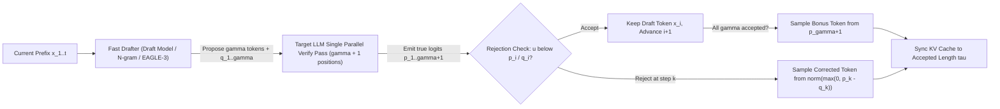
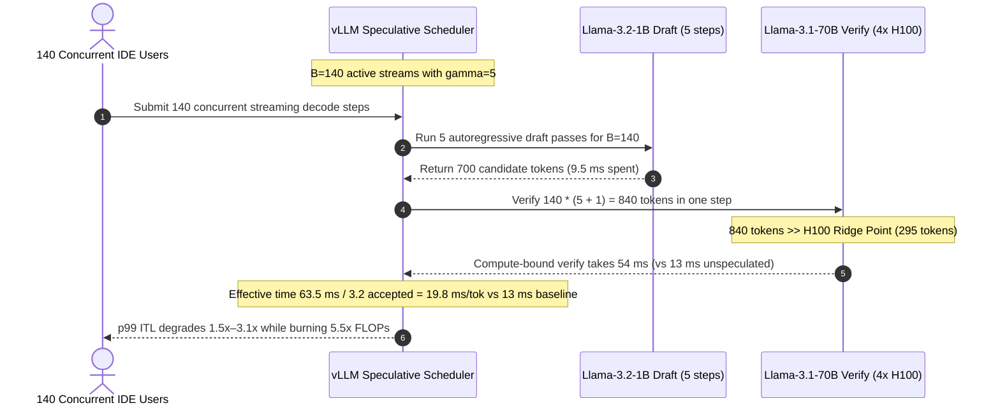

# Module 10: Speculative Decoding

> **Prerequisites:** [Module 09: vLLM: Configuration and Tuning](../09-vllm-configuration-and-tuning/README.md), [Module 02: Prefill and Decode Phases](../02-prefill-and-decode-phases/README.md), and [Module 01: Inference vs. Training Workloads](../01-inference-vs-training-workloads/README.md).  
> **Estimated Reading Time:** 40 minutes  
> **Target Audience:** AI Performance Engineers, Inference Engine Architects, Low-Latency Serving Developers

> [!TIP]
> **The Golden Rule of Speculative Decoding:** At low concurrency (`B = 1–32`), autoregressive decoding sits far below the GPU compute ridge point—reading `140 GB` of `70B` weights from HBM takes nearly the same wall-clock time whether verifying `1` token or `6` tokens simultaneously. Speculative decoding converts that idle Tensor Core slack into **`2x–4x` faster token latency with zero mathematical change to the target output distribution** via exact rejection sampling—*until* high batch concurrency pushes `B * (gamma + 1)` across the compute roof, where speculation silently flips from speedup into a throughput-destroying **slowdown**.

---

## Why This Matters

Suppose your coding agent streams diffs from `Llama-3.1-70B` on `4x H100` (`B=1`). Reading `140 GB` of weights from `13.4 TB/s` aggregate HBM takes `~10.5 ms` per step—capping pure decode at `~90 tok/s`, even though `99.6%` of your Tensor Core FLOPs sit completely idle!

Yet if you naively ask a smaller `1B` model to guess tokens directly, answer quality drops. **Speculative Decoding** (Leviathan et al., `arXiv:2211.17192`; Chen et al., `arXiv:2302.01318`) solves both problems simultaneously: a fast drafter proposes $\gamma$ candidate tokens cheaply, the large target model verifies all $\gamma + 1$ positions in **one single parallel forward pass** (paying the `140 GB` weight-read price *once* for up to $\gamma + 1$ emitted tokens!), and exact **modified rejection sampling** preserves the target distribution **bit-for-bit mathematically**. Turn it on for low-concurrency copilot streams and latency drops `2.4x–3.7x`; forget to disable or throttle it when concurrency surges past `B=96`, however, and verifying `96 * 6 = 576` tokens per step saturates Tensor Cores and slashes capacity!

---

## 1. Memory-Bandwidth Slack, Lossless Rejection Sampling & Draft Topologies

Standard decoding executes a skinny `[B, K] x [K, N]` GEMV (`AI ~ B FLOPs/Byte`, vs. H100 ridge point `295 FLOPs/Byte`). Because `B = 1..32` sits well left of the ridge point, verifying $\gamma = 5$ speculative tokens alongside the current token (`6` tokens per sequence) costs almost identical HBM transfer time (`~11–14 ms`) as generating `1` token!



### Exact Lossless Rejection Sampling (`arXiv:2211.17192` / `arXiv:2302.01318`)

For each drafted position $i = 1, \dots, \gamma$ where the drafter proposed token $x_i \sim q_i(x)$:

1. **Acceptance Test:** Draw $u \sim \text{Uniform}(0, 1)$.
   - If $p_i(x_i) \ge q_i(x_i)$, **accept $x_i$ deterministically** (probability `1`).
   - Otherwise ($p_i(x_i) < q_i(x_i)$), accept $x_i$ with probability $p_i(x_i) / q_i(x_i)$.
2. **Exact Residual Correction on First Rejection (Step $k$):** Discard draft tokens $k \dots \gamma$ (and rollback their KV entries), then sample the exact replacement token $x_k^*$ from the normalized positive residual distribution:

$$p'_k(x) = \frac{\max\big(0, \; p_k(x) - q_k(x)\big)}{\sum_{y \in V} \max\big(0, \; p_k(y) - q_k(y)\big)}$$

3. **Bonus Token:** If all $\gamma$ draft tokens pass, sample an extra $(\gamma+1)$-th token directly from $p_{\gamma+1}(x)$—meaning every verification pass emits between **$1$ and $\gamma + 1$** tokens!

**Proof Sketch of Exact Equivalence:** For any token $v \in V$, the probability of emitting $v$ equals the probability $v$ is proposed and accepted, plus the probability some token is rejected and $v$ is drawn from the residual:

$$P(\text{emit } v) = q(v)\min\left(1, \frac{p(v)}{q(v)}\right) + \left(1 - \sum_x q(x)\min\left(1, \frac{p(x)}{q(x)}\right)\right) \cdot \frac{\max(0, p(v) - q(v))}{\sum_y \max(0, p(y) - q(y))} = p(v)$$

Because the rejection rate simplifies identically to $\sum_y \max(0, p(y) - q(y))$, the denominators cancel—proving **zero statistical drift** from pure target sampling, at any temperature $T \ge 0$!

### Expected Accepted Tokens & The Speedup Equation

Assuming average token acceptance probability $\alpha \in [0, 1]$ across $\gamma$ speculative steps, the expected number of accepted tokens per verification cycle (including the guaranteed minimum of 1 token) is a geometric series:

$$E[\tau] = \frac{1 - \alpha^{\gamma + 1}}{1 - \alpha}$$

If generating a single draft token costs fraction $c = T_{\text{draft}} / T_{\text{target}}$ of a target step, and the verification pass executes in roughly $1$ target step time while below the GPU compute roof, net latency speedup $S$ is:

$$S = \frac{E[\tau]}{c \cdot \gamma + 1} \qquad \text{(Low-Batch Memory-Bound Regime)}$$

**The Batch-Saturation Cliff ($B^*$):** Real GPU hardware does *not* stay memory-bandwidth bound forever. Under batch size $B$, baseline decode runs $B$ tokens per step while speculative verification runs $B \cdot (\gamma + 1)$ tokens per step:

$$T_{\text{verify}}(B) = \max\left(T_{\text{mem}}(B), \; \frac{2 \cdot P_{\text{active}} \cdot B \cdot (\gamma + 1)}{\text{FLOPs}_{\text{eff}}}\right)$$

Once $B \cdot (\gamma + 1) \ge \text{AI}_{\text{ridge}}$ (around `B = 64–128` on H100s at $\gamma=5$), $T_{\text{verify}}(B)$ scales linearly $(\gamma+1)\times$ while $E[\tau]$ stays capped below $\gamma + 1$, forcing $S < 1.0\times$!

### Comparing Draft Strategies

1. **Independent Draft Model (`Llama-3.2-1B` for `70B`):** Requires matching tokenizer + extra VRAM for draft weights and draft KV cache; achieves `~1.8x–2.5x` speedup on general chat.
2. **N-gram / Prompt Lookup Decoding (`method: "ngram"`):** Zero extra weights and zero draft VRAM—scans the input prompt/context for matching $n$-gram suffixes to copy verbatim spans (`RAG` quotes, code refactoring, JSON editing). Delivers **`3x–5x`** speedup on extractive tasks, drops to `~1.05x` on creative prose.
3. **Medusa (`arXiv:2401.10774`):** Attaches $\gamma$ parallel linear LM heads onto the target model's last hidden state (`tree-based attention` verification). Eliminates separate draft models, though independent heads cannot condition on each other without tree expansion, yielding slightly lower $\alpha$ than autoregressive drafters.
4. **EAGLE / EAGLE-2 / EAGLE-3 (`arXiv:2503.01840`):** State-of-the-art **feature-level / multi-layer fused autoregressive draft head** (~`0.2B–0.6B` parameters). EAGLE-3 fuses multi-layer internal hidden features from the target model with direct token prediction (`training-time test`), driving acceptance $\alpha > 0.84$ (`E[tau] > 4.0` at $\gamma=5$) with tiny draft latency ($c \approx 0.015\text{–}0.02$).

---

## 2. Systematic Comparison Matrix: Speculative Decoding Strategies

| Strategy | Extra Draft VRAM | Draft Cost Ratio ($c$) | Typical $\alpha$ (Code / RAG / Chat) | Tree / Multi-Token Conditioning | Best Use Case | Primary Failure Mode |
| :--- | :--- | :--- | :--- | :--- | :--- | :--- |
| **Separate Draft Model** (`70B + 1B/3B`) | `1–6 GiB` + draft KV | `0.04–0.09` | `0.78 / 0.74 / 0.68` | Full autoregressive | General low-batch serving with spare VRAM | Tokenizer mismatch or draft VRAM squeeze |
| **N-gram / Prompt Lookup** (`ngram`) | **`0 GiB`** | `< 0.005` | `0.82 / 0.88 / 0.14` | Exact span copy | RAG grounding, code diffs, entity extraction | Near-zero gains (`1.0x`) on creative writing |
| **Medusa Multi-Head** | `0.4–1.5 GiB` | `0.015–0.03` | `0.70 / 0.72 / 0.64` | Tree attention mask | Single-model deploy without draft KV cache | Lower acceptance depth without cross-token dependency |
| **EAGLE / EAGLE-2 / EAGLE-3** | `0.5–1.8 GiB` | **`0.012–0.025`** | **`0.86 / 0.88 / 0.80`** | Dynamic draft tree + multi-layer fusion | Highest `B=1–48` universal latency speedup | Requires model-specific trained EAGLE head |
| **No Speculation (Standard Decode)** | `0 GiB` | `0` | N/A | N/A | **High-concurrency (`B >= 96`)** saturation | Leaves `B=1–16` Tensor Cores idle |

---

## 3. Production War Story Post-Mortem: The Black-Friday `B=140` Speculative Throughput Collapse

| Field | Incident Details |
| :--- | :--- |
| **Severity** | **SEV-2** (Latency SLA Breach & `3.1x` GPU Cluster Cost Blowup During Traffic Spike) |
| **Detection / Resolution Time** | Triggered at 09:42 UTC during peak traffic surge / Mitigated in 22 minutes via dynamic batch cutoff & rolling spec disable |
| **Impact** | `p99 ITL` jumped from `26 ms` to **`138 ms`**; autoscaler spun up `24` unnecessary H100 GPUs (**\$1,700/hr** burn) before root cause identified |

### What Happened

An enterprise developer-copilot team ran `Llama-3.1-70B` (`TP=4`) with `--speculative-config '{"method": "draft_model", "model": "meta-llama/Llama-3.2-1B-Instruct", "num_speculative_tokens": 5}'`. In staging benchmarks (`B=1..8`), decoding flew at `2.4x` baseline speed (`12 ms -> 5 ms effective/token`).

When Monday morning US/EU traffic overlapped (`B=140` concurrent requests per replica), engineers expected slight queuing. Instead, `p99 ITL` degraded catastrophically (`3.1x` *worse* than turning speculation off!), dragging the entire cluster into continuous autoscaling loops.



### Root Cause Analysis

1. **Silent Crossing of the Compute Roof ($B^*$):** At `B=1`, `6` verification tokens sat deep inside HBM-bandwidth territory (`11 ms`). At `B=140`, verifying `140 * 6 = 840` tokens crossed well past the H100 compute ridge point, turning a `13 ms` step into a `54 ms` compute-saturated GEMM plus `9.5 ms` draft loop (`63.5 ms` total!).
2. **Wasted Rejected FLOPs:** With $\alpha \approx 0.72$ ($\gamma=5$), `~45%` of those `840` verified tokens were thrown away after saturating Tensor Cores—burning `6x` FLOPs for only `3.2` accepted tokens (`S = 0.65x`, slower than baseline!).
3. **Lack of Dynamic Speculation Disable Threshold:** The serving tier kept `num_speculative_tokens=5` pinned statically regardless of active batch concurrency $B$.

### The Fix & Architectural Hardening

- **Batch-Aware Speculative Cutoff:** Enabled dynamic speculation throttling disabling speculative drafting whenever running batch size $B > B^*$ (`B = 48` for `Draft-1B`, `B = 80` for `EAGLE-3`), restoring native `13 ms` single-token verification at peak load.
- **Upgraded Draft Strategy (`Draft-1B` -> `EAGLE-3` / `ngram`):** Replaced the `1B` draft model on code-edit endpoints with `EAGLE-3` (`c=0.02`, zero separate KV pool) and `ngram` prompt lookup on RAG extraction endpoints.
- **Telemetry Gate:** Tracked `vllm:spec_decode_draft_acceptance_rate` and `vllm:num_requests_running` side by side on Grafana dashboards with alerts whenever acceptance dropped below `0.55` or running batch exceeded $B^*$.

---

## 4. Multi-Language Production Implementation: Lossless Rejection Sampler & Dynamic Batch Gate

Below is a clean production implementation of **Exact Lossless Speculative Rejection Sampling (`arXiv:2211.17192`) + Dynamic Batch-Saturation Cutoff** in **Go**, **TypeScript**, **Python**, and **C#**. Notice how every language enforces probability normalization, exact positive residual sampling $\text{norm}(\max(0, p-q))$, and automatic speculation bypass once concurrent batch $B \ge B_{\max}$ protects the cluster from compute-bound slowdowns.

````carousel

```go
package specdecode

import (
	"math"
	"math/rand"
)

// VerifySpeculativeStep performs exact lossless rejection sampling across gamma draft tokens.
// Returns accepted tokens (1 .. gamma+1) with exact distribution matching targetProbs.
func VerifySpeculativeStep(
	draftTokens []int,
	draftProbs [][]float64,  // [gamma][vocab]
	targetProbs [][]float64, // [gamma+1][vocab]
	rng *rand.Rand,
) []int {
	gamma := len(draftTokens)
	accepted := make([]int, 0, gamma+1)

	for i := 0; i < gamma; i++ {
		tok := draftTokens[i]
		p := targetProbs[i][tok]
		q := math.Max(draftProbs[i][tok], 1e-12)

		if rng.Float64() < math.Min(1.0, p/q) {
			accepted = append(accepted, tok)
			continue
		}
		// Reject at step i: sample exact residual norm(max(0, p_i - q_i))
		corrected := sampleResidual(targetProbs[i], draftProbs[i], rng)
		accepted = append(accepted, corrected)
		return accepted
	}
	// All gamma accepted -> emit bonus token from targetProbs[gamma]
	bonus := sampleCategorical(targetProbs[gamma], rng)
	accepted = append(accepted, bonus)
	return accepted
}

func sampleResidual(p, q []float64, rng *rand.Rand) int {
	res := make([]float64, len(p))
	sum := 0.0
	for v := range p {
		diff := p[v] - q[v]
		if diff > 0 {
			res[v] = diff
			sum += diff
		}
	}
	if sum <= 1e-12 {
		return sampleCategorical(p, rng)
	}
	for v := range res {
		res[v] /= sum
	}
	return sampleCategorical(res, rng)
}

func sampleCategorical(probs []float64, rng *rand.Rand) int {
	u := rng.Float64()
	acc := 0.0
	for i, pr := range probs {
		acc += pr
		if u <= acc {
			return i
		}
	}
	return len(probs) - 1
}

// EffectiveSpeculativeGamma throttles or disables speculation before compute saturation.
func EffectiveSpeculativeGamma(activeBatchSize, baseGamma int, ridgeTokens int) int {
	if activeBatchSize <= 0 || baseGamma <= 0 {
		return 0
	}
	// Never let verify batch activeBatchSize * (gamma + 1) exceed ~85% of ridge tokens
	safeMaxTokens := int(float64(ridgeTokens) * 0.85)
	if activeBatchSize >= safeMaxTokens {
		return 0 // Bypass speculation cleanly at high concurrency
	}
	maxGamma := (safeMaxTokens / activeBatchSize) - 1
	if maxGamma < 1 {
		return 0
	}
	if maxGamma < baseGamma {
		return maxGamma
	}
	return baseGamma
}
```

<!-- slide -->

```typescript
export function sampleCategorical(probs: readonly number[], rng: () => number): number {
  const u = rng();
  let acc = 0;
  for (let i = 0; i < probs.length; i += 1) {
    acc += probs[i];
    if (u <= acc) return i;
  }
  return probs.length - 1;
}

export function sampleResidual(
  p: readonly number[],
  q: readonly number[],
  rng: () => number,
): number {
  const residual = new Array<number>(p.length);
  let total = 0;
  for (let v = 0; v < p.length; v += 1) {
    const diff = p[v] - q[v];
    const pos = diff > 0 ? diff : 0;
    residual[v] = pos;
    total += pos;
  }
  if (total <= 1e-12) return sampleCategorical(p, rng);
  for (let v = 0; v < residual.length; v += 1) {
    residual[v] /= total;
  }
  return sampleCategorical(residual, rng);
}

export function verifySpeculativeDraft(
  draftTokens: readonly number[],
  draftProbs: readonly (readonly number[])[],
  targetProbs: readonly (readonly number[])[],
  rng: () => number = Math.random,
): number[] {
  const accepted: number[] = [];
  for (let i = 0; i < draftTokens.length; i += 1) {
    const tok = draftTokens[i];
    const p = targetProbs[i][tok];
    const q = Math.max(draftProbs[i][tok], 1e-12);
    if (rng() < Math.min(1, p / q)) {
      accepted.push(tok);
    } else {
      accepted.push(sampleResidual(targetProbs[i], draftProbs[i], rng));
      return accepted;
    }
  }
  accepted.push(sampleCategorical(targetProbs[draftTokens.length], rng));
  return accepted;
}

export function selectSafeGamma(
  activeBatchSize: number,
  configuredGamma: number,
  gpuRidgeTokens = 295,
): number {
  if (activeBatchSize <= 0 || configuredGamma <= 0) return 0;
  const safeCap = Math.floor(gpuRidgeTokens * 0.85);
  const dynamicGamma = Math.floor(safeCap / activeBatchSize) - 1;
  return dynamicGamma >= 1 ? Math.min(configuredGamma, dynamicGamma) : 0;
}
```

<!-- slide -->

```python
"""
speculative_verifier.py
Exact lossless speculative rejection sampler (Leviathan et al. / Chen et al.) with dynamic batch gate.
"""
import random
from typing import Sequence


def sample_categorical(probs: Sequence[float], rng: random.Random) -> int:
    u = rng.random()
    acc = 0.0
    for idx, prob in enumerate(probs):
        acc += prob
        if u <= acc:
            return idx
    return len(probs) - 1


def sample_residual(p: Sequence[float], q: Sequence[float], rng: random.Random) -> int:
    residual = [max(0.0, pv - qv) for pv, qv in zip(p, q)]
    z = sum(residual)
    if z <= 1e-12:
        return sample_categorical(p, rng)
    return sample_categorical([val / z for val in residual], rng)


def verify_speculative_step(
    draft_tokens: Sequence[int],
    draft_probs: Sequence[Sequence[float]],
    target_probs: Sequence[Sequence[float]],
    rng: random.Random,
) -> list[int]:
    emitted: list[int] = []
    for i, tok in enumerate(draft_tokens):
        p_tok = target_probs[i][tok]
        q_tok = max(draft_probs[i][tok], 1e-12)
        if rng.random() < min(1.0, p_tok / q_tok):
            emitted.append(tok)
        else:
            emitted.append(sample_residual(target_probs[i], draft_probs[i], rng))
            return emitted
    emitted.append(sample_categorical(target_probs[len(draft_tokens)], rng))
    return emitted


def dynamic_gamma_cutoff(active_batch_size: int, base_gamma: int, ridge_tokens: int = 295) -> int:
    if active_batch_size <= 0 or base_gamma <= 0:
        return 0
    safe_verify_budget = int(ridge_tokens * 0.85)
    max_gamma = (safe_verify_budget // active_batch_size) - 1
    return min(base_gamma, max_gamma) if max_gamma >= 1 else 0
```

<!-- slide -->

```csharp
using System;
using System.Collections.Generic;

namespace GenAI.SpeculativeDecoding;

public static class SpeculativeVerifier
{
    public static IReadOnlyList<int> VerifyStep(
        IReadOnlyList<int> draftTokens,
        IReadOnlyList<double[]> draftProbs,
        IReadOnlyList<double[]> targetProbs,
        Random rng)
    {
        var emitted = new List<int>(draftTokens.Count + 1);
        for (int i = 0; i < draftTokens.Count; i++)
        {
            int tok = draftTokens[i];
            double p = targetProbs[i][tok];
            double q = Math.Max(draftProbs[i][tok], 1e-12);
            if (rng.NextDouble() < Math.Min(1.0, p / q))
            {
                emitted.Add(tok);
            }
            else
            {
                emitted.Add(SampleResidual(targetProbs[i], draftProbs[i], rng));
                return emitted;
            }
        }
        emitted.Add(SampleCategorical(targetProbs[draftTokens.Count], rng));
        return emitted;
    }

    private static int SampleResidual(double[] p, double[] q, Random rng)
    {
        var res = new double[p.Length];
        double sum = 0.0;
        for (int v = 0; v < p.Length; v++)
        {
            double diff = p[v] - q[v];
            if (diff > 0)
            {
                res[v] = diff;
                sum += diff;
            }
        }
        if (sum <= 1e-12) return SampleCategorical(p, rng);
        for (int v = 0; v < res.Length; v++) res[v] /= sum;
        return SampleCategorical(res, rng);
    }

    private static int SampleCategorical(double[] probs, Random rng)
    {
        double u = rng.NextDouble(), acc = 0.0;
        for (int i = 0; i < probs.Length; i++)
        {
            acc += probs[i];
            if (u <= acc) return i;
        }
        return probs.Length - 1;
    }

    public static int SelectSafeGamma(int activeBatchSize, int baseGamma, int ridgeTokens = 295)
    {
        if (activeBatchSize <= 0 || baseGamma <= 0) return 0;
        int safeBudget = (int)(ridgeTokens * 0.85);
        int maxGamma = (safeBudget / activeBatchSize) - 1;
        return maxGamma >= 1 ? Math.Min(baseGamma, maxGamma) : 0;
    }
}
```

````

---

## 5. Practical Hands-On Verification CLI Workflows

Run Workflows 1–3 offline on Python 3.13 stdlib—no GPUs or external packages needed. Workflow 4 provides the live `vllm serve` speculative configuration CLI.

### Workflow 1: Mathematical Proof of Lossless Rejection Sampling

Run `80,000` draws from a mismatched draft distribution $q$ against target distribution $p$ and measure **Total Variation Distance (TVD)** between empirical output counts and true $p$:

```bash
python -c '
import random
rng = random.Random(42)
vocab = ["def", "return", "x", "if", "None", "else"]
p = [0.42, 0.25, 0.14, 0.10, 0.06, 0.03]
q = [0.22, 0.35, 0.18, 0.05, 0.15, 0.05]

def sample_dist(probs):
    r, acc = rng.random(), 0.0
    for i, prob in enumerate(probs):
        acc += prob
        if r <= acc:
            return i
    return len(probs) - 1

def run_rejection(mode: str, n_draws: int = 80_000):
    counts = [0] * len(vocab)
    accepted = 0
    for _ in range(n_draws):
        x = sample_dist(q)
        if mode == "exact":
            if rng.random() < min(1.0, p[x] / q[x]):
                counts[x] += 1
                accepted += 1
            else:
                res = [max(0.0, p[i] - q[i]) for i in range(len(vocab))]
                z = sum(res)
                counts[sample_dist([v / z for v in res])] += 1
        else:
            if p[x] >= 0.7 * q[x]:
                counts[x] += 1
                accepted += 1
            else:
                counts[sample_dist(p)] += 1
    emp = [c / n_draws for c in counts]
    tvd = 0.5 * sum(abs(e - t) for e, t in zip(emp, p))
    print(f"mode={mode:<6} | accept={accepted/n_draws:.3f} | TVD={tvd:.5f} | emp={[round(x, 3) for x in emp]} | target={p}")

run_rejection("exact")
run_rejection("buggy")
'
```

**Expected Output:**

```text
mode=exact  | accept=0.751 | TVD=0.00208 | emp=[0.42, 0.249, 0.139, 0.1, 0.061, 0.03] | target=[0.42, 0.25, 0.14, 0.1, 0.06, 0.03]
mode=buggy  | accept=0.799 | TVD=0.22062 | emp=[0.302, 0.4, 0.21, 0.068, 0.012, 0.007] | target=[0.42, 0.25, 0.14, 0.1, 0.06, 0.03]
```

Even with a wildly inaccurate drafter (`q` under-predicts `"def"` at `0.22` vs `0.42`), **exact rejection sampling matches `[0.42, 0.25, 0.14, 0.10, 0.06, 0.03]` down to Monte Carlo noise (`TVD = 0.002`)**, whereas naive threshold acceptance warps the output distribution completely (`TVD = 0.221`)!

### Workflow 2: Speedup Law & Batch-Saturation Crossover ($B^*$)

Sweep batch concurrency $B \in [1, 192]$ for `Llama-3.1-70B` (`FP16`, `4x H100 SXM5`) comparing `Draft-1B` vs `EAGLE-3`:

```bash
python -c '
def target_step_ms(tokens_processed: int, active_seqs: int, kv_ctx_len: int = 2048) -> float:
    weight_kv_bytes = 140e9 + active_seqs * kv_ctx_len * 81920
    mem_ms = (weight_kv_bytes / 13.4e12) * 1000.0
    comp_ms = (2 * 70e9 * tokens_processed / 2450e12) * 1000.0
    return max(mem_ms, comp_ms) + 0.6

for strategy, gamma, alpha, c_ratio in [
    ("Draft-1B (c=0.06, a=0.72)", 5, 0.72, 0.06),
    ("EAGLE-3  (c=0.02, a=0.84)", 5, 0.84, 0.02),
]:
    print(f"\n--- {strategy} ---")
    expected_tau = (1.0 - alpha**(gamma + 1)) / (1.0 - alpha)
    for b in [1, 4, 16, 32, 48, 64, 96, 128, 192]:
        t_base = target_step_ms(b, b)
        verify_toks = b * (gamma + 1)
        t_verify = target_step_ms(verify_toks, b)
        t_draft = gamma * (c_ratio * 10.45 + b * 0.012)
        t_spec = t_verify + t_draft
        speedup = (expected_tau * t_base) / t_spec
        regime = "SPEEDUP" if speedup >= 1.05 else ("BREAKEVEN" if speedup >= 0.95 else "SLOWDOWN_SATURATED")
        print(f"B={b:3d} | verify_toks={verify_toks:4d} | base={t_base:5.2f}ms | spec={t_spec:5.2f}ms | S={speedup:.2f}x ({regime})")
'
```

**Expected Output:**

```text

--- Draft-1B (c=0.06, a=0.72) ---
B=  1 | verify_toks=   6 | base=11.06ms | spec=14.26ms | S=2.38x (SPEEDUP)
B=  4 | verify_toks=  24 | base=11.10ms | spec=14.47ms | S=2.36x (SPEEDUP)
B= 16 | verify_toks=  96 | base=11.25ms | spec=15.34ms | S=2.25x (SPEEDUP)
B= 32 | verify_toks= 192 | base=11.45ms | spec=16.63ms | S=2.12x (SPEEDUP)
B= 48 | verify_toks= 288 | base=11.65ms | spec=23.07ms | S=1.55x (SPEEDUP)
B= 64 | verify_toks= 384 | base=11.85ms | spec=29.52ms | S=1.23x (SPEEDUP)
B= 96 | verify_toks= 576 | base=12.25ms | spec=42.41ms | S=0.89x (SLOWDOWN_SATURATED)
B=128 | verify_toks= 768 | base=12.65ms | spec=55.30ms | S=0.70x (SLOWDOWN_SATURATED)
B=192 | verify_toks=1152 | base=13.45ms | spec=81.08ms | S=0.51x (SLOWDOWN_SATURATED)

--- EAGLE-3  (c=0.02, a=0.84) ---
B=  1 | verify_toks=   6 | base=11.06ms | spec=12.17ms | S=3.69x (SPEEDUP)
B=  4 | verify_toks=  24 | base=11.10ms | spec=12.38ms | S=3.63x (SPEEDUP)
B= 16 | verify_toks=  96 | base=11.25ms | spec=13.25ms | S=3.44x (SPEEDUP)
B= 32 | verify_toks= 192 | base=11.45ms | spec=14.54ms | S=3.19x (SPEEDUP)
B= 48 | verify_toks= 288 | base=11.65ms | spec=20.98ms | S=2.25x (SPEEDUP)
B= 64 | verify_toks= 384 | base=11.85ms | spec=27.43ms | S=1.75x (SPEEDUP)
B= 96 | verify_toks= 576 | base=12.25ms | spec=40.32ms | S=1.23x (SPEEDUP)
B=128 | verify_toks= 768 | base=12.65ms | spec=53.21ms | S=0.96x (BREAKEVEN)
B=192 | verify_toks=1152 | base=13.45ms | spec=78.99ms | S=0.69x (SLOWDOWN_SATURATED)
```

### Workflow 3: Domain Acceptance & Draft Strategy Comparison

Compute expected accepted tokens $E[\tau] = \frac{1 - \alpha^{\gamma+1}}{1 - \alpha}$ and single-stream speedup $S = \frac{E[\tau]}{c \cdot \gamma + 1}$ across real enterprise workloads:

```bash
python -c '
workloads = [
    ("RAG Extractive Quote",  "Prompt-Lookup(N-gram)", 0.88, 6, 0.004),
    ("Code Diff / Refactor",  "Prompt-Lookup(N-gram)", 0.82, 6, 0.004),
    ("Code Diff / Refactor",  "EAGLE-3",               0.86, 5, 0.020),
    ("JSON Tool Calling",     "EAGLE-3",               0.83, 5, 0.020),
    ("Creative Fiction",      "Draft-1B",              0.56, 5, 0.050),
    ("Creative Fiction",      "Prompt-Lookup(N-gram)", 0.14, 5, 0.004),
]
for domain, method, alpha, gamma, c in workloads:
    e_tau = (1.0 - alpha**(gamma + 1)) / (1.0 - alpha)
    s_b1 = e_tau / (c * gamma + 1.0)
    print(f"{domain:<22} | {method:<21} | alpha={alpha:.2f} | E[tau]={e_tau:.2f} tok | B=1_Speedup={s_b1:.2f}x")
'
```

**Expected Output:**

```text
RAG Extractive Quote   | Prompt-Lookup(N-gram) | alpha=0.88 | E[tau]=4.93 tok | B=1_Speedup=4.81x
Code Diff / Refactor   | Prompt-Lookup(N-gram) | alpha=0.82 | E[tau]=4.17 tok | B=1_Speedup=4.07x
Code Diff / Refactor   | EAGLE-3               | alpha=0.86 | E[tau]=4.25 tok | B=1_Speedup=3.87x
JSON Tool Calling      | EAGLE-3               | alpha=0.83 | E[tau]=3.96 tok | B=1_Speedup=3.60x
Creative Fiction       | Draft-1B              | alpha=0.56 | E[tau]=2.20 tok | B=1_Speedup=1.76x
Creative Fiction       | Prompt-Lookup(N-gram) | alpha=0.14 | E[tau]=1.16 tok | B=1_Speedup=1.14x
```

### Workflow 4: Enabling Speculative Decoding in `vllm serve` (Requires GPU Node)

```bash
# 1. Zero-extra-VRAM N-gram / Prompt Lookup for RAG & Code Refactoring
vllm serve meta-llama/Llama-3.1-70B-Instruct \
  --tensor-parallel-size 4 \
  --speculative-config '{"method": "ngram", "num_speculative_tokens": 5, "prompt_lookup_max": 4}'

# 2. Separate Draft Model or EAGLE-3 Drafter
vllm serve meta-llama/Llama-3.1-70B-Instruct \
  --tensor-parallel-size 4 \
  --speculative-config '{"method": "eagle3", "model": "yuhuili/EAGLE3-LLaMA3.1-Instruct-70B", "num_speculative_tokens": 5}'
```

### Hands-On Exercises

1. **Optimal $\gamma$ Search:** Modify Workflow 3 to sweep $\gamma \in \{2, 3, 4, 5, 6, 8, 10\}$ for `Draft-1B` ($c=0.08$, $\alpha=0.68$) and locate the exact $\gamma^*$ maximizing single-stream speedup $S$. Explain why increasing $\gamma$ past $\gamma^*$ actually lowers speedup.
2. **Temperature & Acceptance Shift:** In Workflow 1, sharpen `p` toward deterministic greedy sampling (`p = [0.95, 0.03, 0.01, 0.005, 0.003, 0.002]`) vs flat high-temperature sampling (`p = [0.24, 0.22, 0.18, 0.15, 0.12, 0.09]`) against `q` and verify `TVD` stays near `0.002` in both cases.
3. **Adaptive Batch Gate Verification:** Run `dynamic_gamma_cutoff` from the Python slide across `B = 1..128` for `ridge_tokens=295`, recording the exact batch threshold where speculation steps down from $\gamma=5 \to 3 \to 1 \to 0$.

### Independent Challenge

A financial document-extraction pipeline runs `Qwen2.5-72B-Instruct` on `4x H100` (`40` concurrent batch jobs, `24K` retrieved financial tables per prompt, `600`-token structured JSON outputs quoting verbatim figures from the tables). Leadership proposes provisioning a `Qwen2.5-3B` draft model with $\gamma=6$. Critique this proposal and recommend a faster, zero-VRAM-overhead alternative, citing both acceptance mechanics and batch-compute saturation.

<details><summary>Architectural Discussion</summary>

Two flaws hurt the `3B` draft proposal: (1) At `B=40` with $\gamma=6$, speculative verification sends `40 * 7 = 280` tokens into `72B` right up against the H100 compute saturation cliff, while `6` autoregressive passes of a `3B` model add `~12–15 ms` draft overhead and steal `~6 GiB` of KV VRAM (`24K` contexts need every GiB of KV!); (2) because the workload quotes verbatim snippets and structured schema fields directly from the `24K` context, **N-gram / Prompt Lookup (`method: "ngram"`, `num_speculative_tokens: 4`)**—or a tiny **`EAGLE-3`** head with `gamma=3`—achieves high acceptance with **near-zero draft latency (`c < 0.005`) and zero extra KV cache fragmentation**, staying safely below the compute roof at `B=40`.

</details>

---

## 6. Common Mistakes & Troubleshooting

- **Running speculative decoding permanently under `B >= 96` high-concurrency load:** Speculative verification multiplies Tensor Core FLOPs per step by $(\gamma + 1)$. Once $B \cdot (\gamma + 1)$ crosses the compute roof, speculative decoding *slows down* every user and wastes GPU capacity. Always gate or step down $\gamma$ as active batch $B$ climbs.
- **Using a draft model with a mismatched tokenizer/vocabulary:** Even a single differing merge rule or special token ID breaks token-by-token probability alignment $p_i(x) / q_i(x)$, crashing acceptance rates or raising runtime index errors. Always verify exact tokenizer vocab equivalence (`len(vocab)` and token-ID hashes).
- **Picking $\gamma = 10+$ because "more tokens per step sounds faster":** When $\alpha = 0.70$, the probability of accepting all `10` tokens is $0.70^{10} \approx 2.8\%$. Draft steps `6..10` execute and get thrown away `97%` of the time while inflating draft latency $c \cdot \gamma$ and verification FLOPs! Optimal $\gamma$ is almost always **`3–5`**.
- **Deploying `Prompt Lookup (ngram)` on creative open-ended chatbots:** Copy-based $n$-gram matching rarely finds verbatim 3+ token spans in open-ended dialogue ($\alpha < 0.15$), adding scheduling checks for negligible gain. Reserve `ngram` for RAG citations, document editing, SQL/code diffs, and structured summarization.

---

## 7. Operational Validation Checkpoints & Checkpoint Quiz

### Operational Validation Checkpoints

<details><summary><strong>Checkpoint 1: Auditing whether speculative decoding is lossless at temperature = 0.8</strong></summary>

A compliance reviewer objects to enabling `EAGLE-3` on a legal summarization endpoint: *"How can we guarantee the small `0.3B` EAGLE head won't slip lower-quality wording into legal summaries?"* Give the exact mathematical guarantee.

**Validation:** Exact speculative decoding (Leviathan et al. / Chen et al.) uses **modified rejection sampling**: drafted token $x_i$ is accepted with probability $\min(1, p_i(x_i) / q_i(x_i))$ and any rejected position resamples directly from $\text{norm}(\max(0, p_i - q_i))$. Mathematically, the marginal probability of emitting any vocabulary token $v$ equals **$p_i(v)$ identically**, proving that output text has the exact same probability distribution as running the target `70B` model alone (up to standard floating-point non-associativity).

</details>

<details><summary><strong>Checkpoint 2: Diagnosing zero speedup after enabling Draft-7B on a 14B target</strong></summary>

An engineer pairs a `7B` draft model (`c = 0.50` relative step cost) with a `14B` target model ($\gamma = 5$, observed acceptance $\alpha = 0.78$). Decode actually became **slower** even at `B=1`. Compute $E[\tau]$ and $S$ to prove why.

**Validation:** With $\alpha = 0.78$ and $\gamma = 5$, $E[\tau] = \frac{1 - 0.78^6}{1 - 0.78} = \frac{1 - 0.2252}{0.22} \approx 3.52\text{ tokens}$. However, drafting `5` tokens on a `7B` model costs $c \cdot \gamma = 0.50 \times 5 = 2.50$ target steps! Thus $S = \frac{3.52}{2.50 + 1} = \frac{3.52}{3.50} \approx \mathbf{1.01\times}$ (and with KV rollback + launch overhead, $< 0.95\times$ net **slowdown**!). A drafter must satisfy **$c \ll 0.10$** (`0.5B–1.5B` or `EAGLE-3` for a `70B` target, not half the target's parameter count).

</details>

<details><summary><strong>Checkpoint 3: Handling a high-concurrency latency regression on a speculated cluster</strong></summary>

Traffic doubles from `B=12` to `B=110` on a `4x H100` `70B + Draft-1B (gamma=5)` deployment, and `p99 ITL` degrades from `19 ms` to `78 ms` while `GPU SM Utilization` hits `98%`. Explain the mechanism and the exact fix.

**Validation:** At `B=12`, verifying `72` tokens sat well under the H100 compute roof (`S ~ 2.3x`). At `B=110`, verifying `110 * 6 = 660` tokens saturates Tensor Core FLOPs (`98% SM`), making each verification step `~4x` slower than single-token decode while rejected speculative tokens waste massive compute. Fix by enforcing a dynamic batch cutoff (stepping $\gamma \to 0$ once $B > 48$) or routing latency-sensitive `B <= 32` streams separately from high-concurrency batch pools.

</details>

### Checkpoint Quiz

1. Why does single-stream (`B=1`) autoregressive decoding leave over `99%` of H100 Tensor Cores idle, and how does speculative verification exploit that slack?
2. Write the exact modified rejection sampling acceptance criterion and residual correction formula when $p(x) < q(x)$.
3. Compute $E[\tau]$ and single-stream speedup $S$ when $\alpha = 0.80$, $\gamma = 4$, and draft step ratio $c = 0.03$.
4. Why does increasing batch size $B$ eventually push speculative decoding below $S = 1.0\times$?
5. Contrast **Prompt Lookup (`ngram`)** against **EAGLE-3** in terms of VRAM footprint, draft cost, and workload suitability.

<details><summary>Answers</summary>

1. At `B=1`, `AI ~ 1 FLOP/Byte` vs. H100 ridge point `295 FLOPs/Byte`, so decode stalls waiting on HBM weight reads. Speculative verification evaluates $\gamma + 1$ draft tokens in a single parallel target pass, reading model weights from HBM *once* while converting idle Tensor Core compute into multi-token progress.
2. Accept proposed token $x \sim q$ with probability $\min(1, p(x)/q(x))$; if rejected, discard remaining draft tokens and sample from $p'(x) = \frac{\max(0, p(x) - q(x))}{\sum_y \max(0, p(y) - q(y))}$.
3. $E[\tau] = \frac{1 - 0.80^5}{1 - 0.80} = \frac{1 - 0.32768}{0.20} = \mathbf{3.36\text{ tokens}}$. Speedup $S = \frac{3.36}{0.03 \cdot 4 + 1} = \frac{3.36}{1.12} = \mathbf{3.00\times}$.
4. Speculative verification processes $B \cdot (\gamma + 1)$ tokens per step instead of $B$. Once $B \cdot (\gamma + 1)$ crosses the GPU compute ridge point, verification time grows linearly with $(\gamma + 1)$ while $E[\tau] \le \gamma + 1$ (usually strictly lower due to rejections), making $S < 1.0\times$.
5. **Prompt Lookup (`ngram`)** requires `0 GiB` extra VRAM and virtually zero draft time (`c < 0.005`), excelling at RAG extraction and code edits where output spans echo prompt text, but fails on creative/novel phrasing. **EAGLE-3** uses a lightweight (`~0.5–1.5 GiB`) multi-layer feature-fused head (`c ~ 0.015–0.025`) to achieve high acceptance (`~0.80–0.88`) across general chat, JSON tool-use, and reasoning models alike.

</details>

---

## Further Reading & Sources

- [Fast Inference from Transformers via Speculative Decoding (Leviathan et al., 2022)](https://arxiv.org/abs/2211.17192) — original proof of lossless rejection sampling and speedup analysis.
- [Accelerating Large Language Model Decoding with Speculative Sampling (Chen et al., 2023)](https://arxiv.org/abs/2302.01318) — DeepMind's concurrent speculative sampling formulation on 70B models.
- [EAGLE-3: Scaling up Inference Acceleration of Large Language Models via Training-Time Test (Li et al., 2025)](https://arxiv.org/abs/2503.01840) — multi-layer feature fusion and direct token prediction achieving state-of-the-art acceptance.
- [vLLM Official Documentation](https://docs.vllm.ai/en/latest/) — configuring `--speculative-config` (`draft_model`, `ngram`, `medusa`, `eagle`) and speculative decode Prometheus metrics.
- [Module 01: Inference vs. Training Workloads](../01-inference-vs-training-workloads/README.md) — Roofline arithmetic intensity and H100 ridge point derivations.

## Next

[Module 11: Quantized Serving: AWQ and GPTQ](../11-quantized-serving-awq-and-gptq/README.md)
