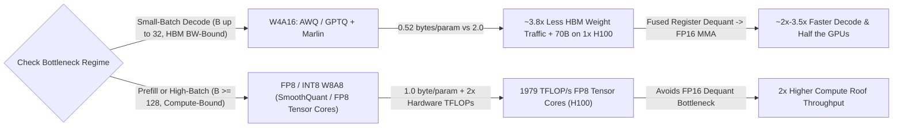
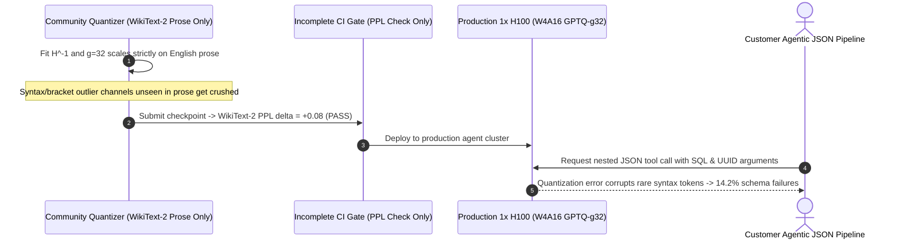

# Module 11: Quantized Serving: AWQ and GPTQ

> **Prerequisites:** [Module 10: Speculative Decoding](../10-speculative-decoding/README.md), [Module 09: vLLM: Configuration and Tuning](../09-vllm-configuration-and-tuning/README.md), and [Module 01: Inference vs. Training Workloads](../01-inference-vs-training-workloads/README.md).  
> **Estimated Reading Time:** 40 minutes  
> **Target Audience:** AI Systems Engineers, Inference Optimization Leads, ML Platform Architects

> [!TIP]
> **The Golden Rule of Quantized LLM Serving:** Match your quantization format to your hardware bottleneck, never to a marketing headline. Weight-only **`W4A16` (AWQ / GPTQ + Marlin kernels)** slashes HBM traffic and VRAM footprint nearly **`4x`**, accelerating low-batch decode (`B = 1–32`) and squeezing `70B` models onto one `80 GiB` GPU—yet dequantizes back to `FP16` Tensor Cores at high concurrency (`B >= 128`). When Tensor Core compute saturates (`prefill` or large batches), switch to **`W8A8` / `FP8`** (`1979 TFLOP/s` on H100)—and never ship a quantized checkpoint without testing **JSON tool calling and coding**, because `WikiText-2` perplexity hides catastrophic calibration overfitting.

---

## Why This Matters

A `Llama-3.1-70B` checkpoint in `BF16` consumes `130.4 GiB` of weights—forcing at least **two** `80 GiB` H100 GPUs before caching a single KV token, while streaming `130.4 GiB` from HBM on every token step. Quantize those weights to **4-bit `AWQ` (`g=128`)** and the model shrinks to **`33.9 GiB`**—fitting comfortably on **one single H100** with `~40 GiB` of free VRAM for KV cache, cutting single-stream decode latency nearly in half (`21.7 ms -> 11.7 ms`), and cutting GPU rental cost `50%`.

Yet quantization carries two traps that catch teams off guard in production:
1. Using a naive un-fused dequantization kernel (`AutoGPTQ` slow path) or deploying `W4A16` on a `256`-concurrent-batch throughput cluster actually makes high-batch latency **worse** than `FP8`!
2. Quantizing with a narrow prose calibration set (`WikiText-2`) can preserve prose perplexity (`+0.08`) while silently breaking `5%–14%` of structured JSON tool calls and coding tasks!

---

## 1. Weight-Only (`W4A16`) vs. Activation+Weight (`W8A8` / `FP8`) Roofline Physics

Quantizing weights vs. activations shifts completely different parts of the GPU Roofline curve ([Module 01](../01-inference-vs-training-workloads/README.md)):



### Exact Bytes-per-Parameter & Group-Size (`g=128`) Overhead

In **4-bit group quantization**, weights are partitioned along the input channel dimension into blocks of $g$ weights (typically $g = 128$) sharing one `FP16` scale ($16\text{ bits}$) and (for asymmetric quantization) one `4`-bit zero-point ($4\text{ bits}$):

$$\text{Bytes/Param}_{\text{W4A16}}(g) = 0.5 + \frac{2.0 + 0.5}{g} \xrightarrow{g=128} 0.5 + \frac{2.5}{128} = \mathbf{0.5195\text{ bytes/param}}$$

- **`g=128` (Production Standard):** Adds only **`3.9%`** metadata overhead (`33.9 GiB` for `70B`), yielding clean `128`-element warp alignment for fast Tensor Core loads.
- **`g=32`:** Adds `15.6%` metadata overhead (`37.8 GiB` for `70B`), marginal quality improvement over `g=128`, higher calibration-overfitting risk, and extra dequantization pressure.
- **Per-Channel (`g = d_in`):** Zero group overhead (`0.501 B/param`), but suffers severe accuracy loss when a single outlier weight stretches the quantization range across thousands of channels.

### Why `W4A16` Accelerates Decode (`B=1`) Yet Slows High-Batch Compute (`B=256`)

During `W4A16` execution, weights sit in HBM as `INT4` (`~0.52 B/param`), multiplying low-batch Arithmetic Intensity nearly **`3.85x`**:

$$\text{AI}_{\text{W4A16}}(B) \approx \frac{2 \cdot B}{0.5195} \approx \mathbf{3.85 \cdot B\text{ FLOPs/Byte}}$$

At `B=1`, HBM traffic drops from `2.0 B/param` to `0.52 B/param`, giving near-linear latency speedups—*provided* the kernel does not stall in slow Python/CUDA dequantization. However, NVIDIA Ampere/Hopper Tensor Cores lack native `FP16 x INT4` matrix-multiply instructions; every `W4A16` GEMM **must unpack `INT4 -> FP16` in registers** before executing `FP16` MMA (`989 TFLOP/s` on H100). Once $B \ge 80$, `W4A16` hits the `FP16` compute ceiling (`989 TF/s`), whereas **`FP8` (`W8A8`)** executes directly on **`FP8` Tensor Cores (`1979 TFLOP/s`)**—running **`2x` faster** at high batch and prefill!

### GPTQ vs. AWQ vs. Marlin Kernels

1. **GPTQ (`arXiv:2210.17323`, Frantar et al.):** Applies second-order Optimal Brain Quantization layer-by-layer using the approximate inverse Hessian $H^{-1} = (2 X X^T + \lambda I)^{-1}$. As each column $w_q$ is rounded to 4 bits, GPTQ redistributes the error across unquantized weights proportional to $-H^{-1}_{:,q} / [H^{-1}]_{q,q}$.
   - *Catch:* Computing and inverting $H$ relies heavily on calibration sample statistics ($X$). Using `--act-order` (`desc_act=True`) quantizes high-variance columns first, improving accuracy at the cost of non-contiguous weight permutation (historically incompatible with fast fused kernels until Marlin added permutation support).
2. **AWQ (`arXiv:2306.00978`, Lin et al.):** Observes that **`~0.1%–1%` of input channels** carry disproportionately massive activation magnitudes (`|X_j|`), making their paired weight errors amplify output distortion $\Delta Y = X \cdot \Delta W$ dramatically. Instead of storing awkward mixed-precision tensors, AWQ introduces an exact mathematical equivalence via per-channel scale vector $s$ ($s_j \approx \bar{|X_j|}^\alpha$):

$$Y = X W = \big(X \cdot \text{diag}(s)^{-1}\big)\big(\text{diag}(s) \cdot W\big) \;\xrightarrow{\text{quantize}}\; \big(X \cdot s^{-1}\big) \cdot Q(s \cdot W)$$

   Scaling salient weights *up* before `INT4` rounding preserves their relative resolution inside the group quantization grid without distorting hardware uniformity—making AWQ fast to calibrate and notably resilient across out-of-distribution tasks (code, tool calling, multilingual prompts).
3. **Marlin (`awq_marlin` / `gptq_marlin` in vLLM):** Naive `W4A16` kernels unpack 4-bit integers in separate global memory round-trips or stall shared memory (`~1.2x` speedup or even *slower* than FP16 at `B=16`). **Marlin** pre-reorders weights offline into Tensor Core register-friendly layouts, pipelines `cp.async` global-to-shared loads, unpacks `INT4 -> FP16` with bitwise ALU tricks inside registers concurrently with `mma.sync`, and achieves near-ideal `3.5x–3.9x` memory-bandwidth saturation up to `B ~ 32–64`. Always pass `--quantization awq_marlin` (or `gptq_marlin`, auto-selected in modern vLLM) over legacy unoptimized kernels!

---

## 2. Systematic Comparison Matrix: Quantization Formats & Kernels

| Format & Kernel | Weight Precision | Activation / Compute Precision | `70B` Weight VRAM (`g=128`) | `B=1–16` Decode Speedup | `B=128+` / Prefill Compute | Accuracy & Tool-Call Robustness | Ideal Hardware & Serving Scenario |
| :--- | :--- | :--- | :--- | :--- | :--- | :--- | :--- |
| **BF16 / FP16 Baseline** | `16-bit` | `FP16 / BF16` (`989 TF/s` H100) | `130.4 GiB` (needs `2x` 80G) | `1.0x` baseline | `1.0x` baseline | Gold-standard reference | Reference evals & unlimited multi-GPU budget |
| **FP8 (`W8A8` dynamic/static)** | `8-bit` | **`FP8`** (`1979 TF/s` H100) | `65.2 GiB` (`1x` 80G tight) | `~1.6x–1.9x` (`1 GPU`) | **`~1.9x` (Best high-batch)** | Near-lossless (`< 0.1` PPL delta) | **H100 / Ada / Blackwell** high-concurrency & long prefill |
| **AWQ + Marlin (`W4A16`, `g=128`)** | `4-bit` (`0.52 B/p`) | `FP16` (`989 TF/s` H100) | **`33.9 GiB`** (`1x` 80G + huge KV) | **`~2.8x–3.6x`** | Degrades to `FP16` roof (`<= 1.0x` vs FP8) | **High** (if calibrated on mixed prose+code) | **A100 / L40S / H100 low-to-mid concurrency** & single-GPU `70B` |
| **GPTQ + Marlin (`W4A16`, `g=128`)** | `4-bit` (`0.52 B/p`) | `FP16` (`989 TF/s` H100) | **`33.9 GiB`** | **`~2.8x–3.5x`** | Degrades to `FP16` roof | Good, **higher risk of calibration drift** | Huge Hugging Face ecosystem, verify OOD code/JSON gates |
| **SmoothQuant (`INT8 W8A8`)** | `8-bit` | `INT8` Tensor Cores | `65.2 GiB` | `~1.7x` | `~1.8x` (Ampere INT8) | Moderate (sensitive to activation spikes) | **A100 / older GPUs** lacking native FP8 Tensor Cores |

---

## 3. Production War Story Post-Mortem: The `WikiText-2` Calibration Tool-Calling Collapse

| Field | Incident Details |
| :--- | :--- |
| **Severity** | **SEV-2** (Silent Agent Failure Rate Surge After Quantized Cost-Optimization Rollout) |
| **Detection / Resolution Time** | Detected 18 hours post-canary via customer support ticket wave / Mitigated in 45 minutes by reverting to mixed-calibrated `AWQ-Marlin` |
| **Impact** | Structured JSON tool-call syntax errors jumped from `0.6%` to **`14.2%`** (`8,400` failed agent executions); **\$19,000** support remediation cost |

### What Happened

To cut `Llama-3.1-70B` GPU spend by `50%` (moving from `2x H100 BF16` down to `1x H100` with `~46 GiB` KV cache), an ML platform team pulled a community `W4A16 GPTQ (g=32)` checkpoint from Hugging Face. Before shipping, their CI benchmark checked standard `WikiText-2` perplexity: `5.12` (`BF16`) vs `5.20` (`GPTQ-g32`, only `+0.08` delta!). Confident in the `+0.08` score, they promoted it to production.

Within hours, agent pipelines emitting nested JSON schemas (`{"tool": "sql_query", "args": {...}}`) began throwing malformed keys, unescaped brackets, and wrong numeric argument types at `14.2%` error rate—while prose chat summaries looked completely normal.



### Root Cause Analysis

1. **Calibration Overfitting (`g=32` + Prose-Only Samples):** Community quantizers frequently calibrate on `128` samples of `WikiText-2` (encyclopedia prose lacking curly braces, TypeScript/Python syntax, or tool-calling special tokens). At tight group size `g=32`, Hessian updates and scale factors overfitted heavily to prose channel statistics, distorting weight channels activated specifically by structured JSON/code delimiters!
2. **Blind CI Gate (`WikiText-2` Only):** Measuring perplexity exclusively on held-out English prose leaves out-of-distribution syntax and reasoning degradation completely invisible.
3. **Kernel Mismatch:** Alongside accuracy drift, the checkpoint lacked Marlin layout conversion, losing `35%` of expected decode speed on legacy dequantization fallback.

### The Fix & Architectural Hardening

- **Mixed-Domain Calibration (`AWQ g=128`):** Re-quantized internally using **AWQ (`g=128`)** over a balanced `512`-sample calibration blend (`40%` general text, `30%` code/SQL, `30%` multi-turn JSON tool traces) and converted to **`awq_marlin`** kernels.
- **Multi-Metric Release Gate:** Added mandatory CI assertions requiring **zero release** unless `delta_PPL <= 0.15`, `tool_schema_accuracy_drop <= 1.0%`, `coding_eval_drop <= 1.5%`, and token-logit `KL(BF16 || Quant) <= 0.03` on a `200`-prompt golden canary suite.

---

## 4. Multi-Language Production Implementation: Quantization Sizer, Roofline & Release Gate

Below is a production-ready **Quantized Serving Hardware Sizer & CI Quality Gate** in **Go**, **TypeScript**, **Python**, and **C#**. It calculates exact `g=128` metadata weight footprints, determines minimum `80 GiB` GPUs and remaining KV cache, warns when concurrency crosses the `W4A16 -> FP8` crossover, and enforces multi-metric accuracy release gates (`PPL`, `JSON tool-call drop`, `KL divergence`).

````carousel

```go
package quantops

import (
	"fmt"
	"math"
)

type QuantFormat string

const (
	FormatBF16 QuantFormat = "bf16"
	FormatFP8  QuantFormat = "fp8"
	FormatAWQ  QuantFormat = "awq_marlin"
	FormatGPTQ QuantFormat = "gptq_marlin"
)

type QuantEvalCandidate struct {
	Name              string
	Format            QuantFormat
	GroupSize         int
	ParamsB           float64
	Perplexity        float64
	ToolCallPassPct   float64
	KLDivergence      float64
}

type ReleaseDecision struct {
	Approved            bool
	WeightsGiB          float64
	Min80GiBGPUs        int
	RecommendedEngine   string
	GateFailures        []string
}

func BytesPerParam(format QuantFormat, groupSize int) float64 {
	switch format {
	case FormatBF16:
		return 2.0
	case FormatFP8:
		return 1.0
	case FormatAWQ, FormatGPTQ:
		if groupSize <= 0 {
			groupSize = 128
		}
		// 4-bit weights (0.5B) + FP16 scale (2B) + INT4 zero-point (0.5B) per group
		return 0.5 + 2.5/float64(groupSize)
	default:
		return 2.0
	}
}

func EvaluateQuantRelease(
	cand QuantEvalCandidate,
	basePPL float64,
	baseToolPct float64,
	peakConcurrency int,
) ReleaseDecision {
	bpp := BytesPerParam(cand.Format, cand.GroupSize)
	weightsGiB := (cand.ParamsB * 1e9 * bpp) / float64(1<<30)
	// Reserve ~14 GiB/GPU for KV cache & runtime graphs on 80 GiB H100
	minGPUs := int(math.Ceil(weightsGiB / 66.0))
	if minGPUs < 1 {
		minGPUs = 1
	}

	var failures []string
	if cand.Perplexity-basePPL > 0.15 {
		failures = append(failures, fmt.Sprintf("PPL delta +%.3f exceeds +0.15 ceiling", cand.Perplexity-basePPL))
	}
	if baseToolPct-cand.ToolCallPassPct > 1.0 {
		failures = append(failures, fmt.Sprintf("Tool-call accuracy dropped %.2f%% (> 1.0%% gate)", baseToolPct-cand.ToolCallPassPct))
	}
	if cand.KLDivergence > 0.03 {
		failures = append(failures, fmt.Sprintf("KL divergence %.4f exceeds 0.030 threshold", cand.KLDivergence))
	}

	rec := string(cand.Format)
	if (cand.Format == FormatAWQ || cand.Format == FormatGPTQ) && peakConcurrency >= 128 {
		failures = append(failures, fmt.Sprintf("Concurrency %d saturates FP16 dequant Tensor Cores; prefer FP8 W8A8", peakConcurrency))
		rec = "fp8"
	}

	return ReleaseDecision{
		Approved:          len(failures) == 0,
		WeightsGiB:        math.Round(weightsGiB*100) / 100,
		Min80GiBGPUs:      minGPUs,
		RecommendedEngine: rec,
		GateFailures:      failures,
	}
}
```

<!-- slide -->

```typescript
export type QuantFormat = "bf16" | "fp8" | "awq_marlin" | "gptq_marlin";

export interface QuantCandidate {
  readonly name: string;
  readonly format: QuantFormat;
  readonly groupSize: number;
  readonly paramsB: number;
  readonly evalPpl: number;
  readonly toolCallPassPct: number;
  readonly klDivergence: number;
}

export interface ReleaseGateResult {
  readonly approved: boolean;
  readonly weightsGiB: number;
  readonly min80GiBGPUs: number;
  readonly failures: readonly string[];
}

export function effectiveBytesPerParam(format: QuantFormat, groupSize = 128): number {
  if (format === "bf16") return 2.0;
  if (format === "fp8") return 1.0;
  return 0.5 + 2.5 / Math.max(1, groupSize);
}

export function runQuantReleaseGate(
  cand: QuantCandidate,
  baseline: { ppl: number; toolCallPassPct: number },
  expectedPeakBatch: number,
): ReleaseGateResult {
  const bpp = effectiveBytesPerParam(cand.format, cand.groupSize);
  const weightsGiB = (cand.paramsB * 1e9 * bpp) / 1024 ** 3;
  const min80GiBGPUs = Math.max(1, Math.ceil(weightsGiB / 66.0));
  const failures: string[] = [];

  if (cand.evalPpl - baseline.ppl > 0.15) {
    failures.push(`PPL regression +${(cand.evalPpl - baseline.ppl).toFixed(3)} > +0.15`);
  }
  if (baseline.toolCallPassPct - cand.toolCallPassPct > 1.0) {
    failures.push(`Tool-call drop -${(baseline.toolCallPassPct - cand.toolCallPassPct).toFixed(2)}% > 1.0%`);
  }
  if (cand.klDivergence > 0.03) {
    failures.push(`Logit KL ${cand.klDivergence.toFixed(4)} > 0.030`);
  }
  if ((cand.format === "awq_marlin" || cand.format === "gptq_marlin") && expectedPeakBatch >= 128) {
    failures.push(`Peak batch ${expectedPeakBatch} crosses W4A16 dequant roof; switch to FP8`);
  }

  return {
    approved: failures.length === 0,
    weightsGiB: Number(weightsGiB.toFixed(2)),
    min80GiBGPUs,
    failures,
  };
}
```

<!-- slide -->

```python
"""
quant_release_gate.py
Quantization VRAM capacity calculator and multi-metric CI/CD release gate.
"""
from dataclasses import dataclass
import math


@dataclass(frozen=True)
class QuantCandidate:
    name: str
    fmt: str  # "bf16" | "fp8" | "awq_marlin" | "gptq_marlin"
    group_size: int
    params_b: float
    eval_ppl: float
    tool_call_pass_pct: float
    kl_divergence: float


@dataclass(frozen=True)
class GateOutcome:
    approved: bool
    weights_gib: float
    min_h100_gpus: int
    failures: tuple[str, ...]


def bytes_per_param(fmt: str, group_size: int = 128) -> float:
    if fmt == "bf16":
        return 2.0
    if fmt == "fp8":
        return 1.0
    if fmt in {"awq_marlin", "gptq_marlin"}:
        return 0.5 + 2.5 / max(1, group_size)
    raise ValueError(f"Unsupported quantization format: {fmt}")


def verify_quant_release(
    cand: QuantCandidate,
    baseline_ppl: float,
    baseline_tool_pct: float,
    peak_batch_concurrency: int,
) -> GateOutcome:
    bpp = bytes_per_param(cand.fmt, cand.group_size)
    weights_gib = (cand.params_b * 1e9 * bpp) / (1024**3)
    min_gpus = max(1, math.ceil(weights_gib / 66.0))
    failures: list[str] = []

    if cand.eval_ppl - baseline_ppl > 0.15:
        failures.append(f"dPPL=+{cand.eval_ppl - baseline_ppl:.3f} exceeds +0.15")
    if baseline_tool_pct - cand.tool_call_pass_pct > 1.0:
        failures.append(f"Tool-call pass dropped {baseline_tool_pct - cand.tool_call_pass_pct:.2f}% (>1.0%)")
    if cand.kl_divergence > 0.03:
        failures.append(f"KL={cand.kl_divergence:.4f} exceeds 0.030")
    if cand.fmt in {"awq_marlin", "gptq_marlin"} and peak_batch_concurrency >= 128:
        failures.append(f"Batch={peak_batch_concurrency} saturates FP16 dequant Tensor Cores; use fp8")

    return GateOutcome(
        approved=not failures,
        weights_gib=round(weights_gib, 2),
        min_h100_gpus=min_gpus,
        failures=tuple(failures),
    )
```

<!-- slide -->

```csharp
using System;
using System.Collections.Generic;

namespace GenAI.QuantOps;

public sealed record QuantCandidate(
    string Name,
    string Format,
    int GroupSize,
    double ParamsB,
    double EvalPpl,
    double ToolCallPassPct,
    double KlDivergence);

public sealed record GateReport(
    bool Approved,
    double WeightsGiB,
    int MinH100Gpus,
    IReadOnlyList<string> Failures);

public static class QuantReleaseGate
{
    public static double BytesPerParam(string format, int groupSize = 128) => format switch
    {
        "bf16" => 2.0,
        "fp8" => 1.0,
        "awq_marlin" or "gptq_marlin" => 0.5 + 2.5 / Math.Max(1, groupSize),
        _ => throw new ArgumentOutOfRangeException(nameof(format), format, "Unknown format.")
    };

    public static GateReport Evaluate(
        QuantCandidate cand,
        double baselinePpl,
        double baselineToolPct,
        int peakConcurrency)
    {
        double bpp = BytesPerParam(cand.Format, cand.GroupSize);
        double weightsGiB = (cand.ParamsB * 1e9 * bpp) / (1024.0 * 1024.0 * 1024.0);
        int minGpus = Math.Max(1, (int)Math.Ceiling(weightsGiB / 66.0));
        var failures = new List<string>();

        if (cand.EvalPpl - baselinePpl > 0.15)
            failures.Add($"PPL delta +{(cand.EvalPpl - baselinePpl):F3} exceeds +0.15.");
        if (baselineToolPct - cand.ToolCallPassPct > 1.0)
            failures.Add($"Tool-call accuracy dropped {(baselineToolPct - cand.ToolCallPassPct):F2}% (> 1.0%).");
        if (cand.KlDivergence > 0.03)
            failures.Add($"KL divergence {cand.KlDivergence:F4} exceeds 0.030.");
        if ((cand.Format is "awq_marlin" or "gptq_marlin") && peakConcurrency >= 128)
            failures.Add($"Concurrency {peakConcurrency} exceeds W4A16 compute crossover; deploy fp8.");

        return new GateReport(failures.Count == 0, Math.Round(weightsGiB, 2), minGpus, failures);
    }
}
```

````

---

## 5. Practical Hands-On Verification CLI Workflows

Run Workflows 1–3 locally on Python 3.13 stdlib—zero GPUs or external packages required. Workflow 4 shows the real `vllm serve` quantized deployment commands.

### Workflow 1: `BF16` vs. `FP8` vs. `W4A16-Marlin (g=128)` VRAM & Roofline Crossover

Compare exact weight memory (`g=128` metadata included), minimum `80 GiB` H100 GPUs, `B=1` memory-bound latency, and `B=256` compute-bound latency across `8B` and `70B`:

```bash
python -c '
specs = [
    ("Llama-3.1-8B  BF16",     8e9,  2.0000, 989e12),
    ("Llama-3.1-8B  FP8",      8e9,  1.0000, 1979e12),
    ("Llama-3.1-8B  AWQ-g128", 8e9,  0.5195, 989e12),
    ("Llama-3.1-70B BF16",    70e9,  2.0000, 989e12),
    ("Llama-3.1-70B FP8",     70e9,  1.0000, 1979e12),
    ("Llama-3.1-70B AWQ-g128",70e9,  0.5195, 989e12),
]
for name, params, b_per_p, peak_flops in specs:
    wt_gib = (params * b_per_p) / (1024**3)
    min_h100s = 1 if wt_gib <= 72.0 else (2 if wt_gib <= 144.0 else 4)
    total_bw = 3.35e12 * min_h100s
    total_flops = peak_flops * min_h100s
    b1_ms = ((params * b_per_p) / total_bw) * 1000.0 + 0.8
    b256_mem_ms = ((params * b_per_p) / total_bw) * 1000.0
    b256_comp_ms = ((2 * params * 256) / (0.7 * total_flops)) * 1000.0
    b256_ms = max(b256_mem_ms, b256_comp_ms) + 0.8
    regime_256 = "COMPUTE" if b256_comp_ms > b256_mem_ms else "MEM_BW"
    print(f"{name:<24} | wt={wt_gib:5.1f} GiB | GPUs={min_h100s} | B1_step={b1_ms:5.2f} ms | B256_step={b256_ms:5.2f} ms ({regime_256})")
'
```

**Expected Output:**

```text
Llama-3.1-8B  BF16       | wt= 14.9 GiB | GPUs=1 | B1_step= 5.58 ms | B256_step= 6.72 ms (COMPUTE)
Llama-3.1-8B  FP8        | wt=  7.5 GiB | GPUs=1 | B1_step= 3.19 ms | B256_step= 3.76 ms (COMPUTE)
Llama-3.1-8B  AWQ-g128   | wt=  3.9 GiB | GPUs=1 | B1_step= 2.04 ms | B256_step= 6.72 ms (COMPUTE)
Llama-3.1-70B BF16       | wt=130.4 GiB | GPUs=2 | B1_step=21.70 ms | B256_step=26.68 ms (COMPUTE)
Llama-3.1-70B FP8        | wt= 65.2 GiB | GPUs=1 | B1_step=21.70 ms | B256_step=26.67 ms (COMPUTE)
Llama-3.1-70B AWQ-g128   | wt= 33.9 GiB | GPUs=1 | B1_step=11.66 ms | B256_step=52.57 ms (COMPUTE)
```

Look at the exact crossover for `70B`: `AWQ-g128` runs **`1.86x` faster at `B=1` (`11.66 ms` vs `21.70 ms`)** on one GPU, yet at `B=256`, **`FP8` wins `1.97x` (`26.67 ms` vs `52.57 ms`)** because `FP8` engages `1979 TFLOP/s` Tensor Cores instead of `FP16` dequantization!

### Workflow 2: AWQ Salience Protection vs. Naive RTN & Calibration Overfitting

Demonstrate mathematically how AWQ per-channel salience scaling cuts quantization output MSE nearly `4x` vs. naive Round-to-Nearest (`RTN`), AND how calibrating strictly on prose breaks out-of-distribution (`OOD`) code/JSON channels:

```bash
python -c '
import random
rng = random.Random(7)
d_in, d_out = 64, 32
W = [[rng.gauss(0, 0.12) for _ in range(d_out)] for _ in range(d_in)]

def make_activations(n_rows, outlier_channels):
    X = []
    for _ in range(n_rows):
        row = [rng.gauss(0, 0.4) for _ in range(d_in)]
        for ch in outlier_channels:
            row[ch] = rng.gauss(0, 9.0)
        X.append(row)
    return X

X_calib_prose   = make_activations(64, [0, 1])
X_calib_diverse = make_activations(32, [0, 1]) + make_activations(32, [0, 1, 14, 29])
X_eval_prose    = make_activations(64, [0, 1])
X_eval_code     = make_activations(64, [0, 1, 14, 29])

def matmul(X, M):
    return [[sum(x[k] * M[k][j] for k in range(d_in)) for j in range(d_out)] for x in X]

def quant_dequant_group(M, scales, group_size=32):
    Q = [[0.0]*d_out for _ in range(d_in)]
    for j in range(d_out):
        for g0 in range(0, d_in, group_size):
            g1 = min(d_in, g0 + group_size)
            scaled = [M[i][j] * scales[i] for i in range(g0, g1)]
            amax = max(abs(v) for v in scaled) or 1e-8
            step = amax / 7.0
            for idx, i in enumerate(range(g0, g1)):
                q = max(-7, min(7, round(scaled[idx] / step)))
                Q[i][j] = (q * step) / scales[i]
    return Q

def mse(A, B):
    return sum((A[r][c] - B[r][c])**2 for r in range(len(A)) for c in range(len(A[0]))) / (len(A)*len(A[0]))

def awq_scales(X_cal, alpha=0.5):
    means = [sum(abs(row[i]) for row in X_cal)/len(X_cal) for i in range(d_in)]
    med = sorted(means)[len(means)//2]
    return [max(1.0, (m / med)**alpha) for m in means]

W_rtn       = quant_dequant_group(W, [1.0]*d_in, group_size=32)
W_awq_prose = quant_dequant_group(W, awq_scales(X_calib_prose, 0.5), group_size=32)
W_awq_mix   = quant_dequant_group(W, awq_scales(X_calib_diverse, 0.5), group_size=32)

for label, X_test in [("In-Domain Prose", X_eval_prose), ("OOD Code/JSON", X_eval_code)]:
    Y_ref = matmul(X_test, W)
    print(f"Eval={label:<15} | RTN_MSE={mse(Y_ref, matmul(X_test, W_rtn)):.4f} | AWQ_ProseOnly={mse(Y_ref, matmul(X_test, W_awq_prose)):.4f} | AWQ_MixedCalib={mse(Y_ref, matmul(X_test, W_awq_mix)):.4f}")
'
```

**Expected Output:**

```text
Eval=In-Domain Prose | RTN_MSE=0.0205 | AWQ_ProseOnly=0.0055 | AWQ_MixedCalib=0.0069
Eval=OOD Code/JSON   | RTN_MSE=0.0497 | AWQ_ProseOnly=0.1539 | AWQ_MixedCalib=0.0194
```

### Workflow 3: Automated Perplexity + Tool-Calling CI Release Gate

Verify why checking `WikiText-2` perplexity alone lets broken checkpoints pass while multi-metric gating blocks them cleanly:

```bash
python -c '
candidates = [
    ("BF16-Baseline",        5.12, 94.2, 0.000),
    ("W4A16-AWQ-g128",       5.21, 93.6, 0.018),
    ("W4A16-GPTQ-g128",      5.25, 93.3, 0.024),
    ("W4A16-GPTQ-g32-Prose", 5.20, 88.9, 0.062),
]
base_ppl, base_tool = 5.12, 94.2
for name, ppl, tool_acc, kl in candidates:
    dppl = ppl - base_ppl
    dtool = base_tool - tool_acc
    passed = (dppl <= 0.15) and (dtool <= 1.0) and (kl <= 0.03)
    verdict = "PASS" if passed else "FAIL_GATE"
    print(f"{name:<22} | dPPL=+{dppl:.2f} | tool_drop=-{dtool:.1f}% | KL={kl:.3f} -> {verdict}")
'
```

**Expected Output:**

```text
BF16-Baseline          | dPPL=+0.00 | tool_drop=-0.0% | KL=0.000 -> PASS
W4A16-AWQ-g128         | dPPL=+0.09 | tool_drop=-0.6% | KL=0.018 -> PASS
W4A16-GPTQ-g128        | dPPL=+0.13 | tool_drop=-0.9% | KL=0.024 -> PASS
W4A16-GPTQ-g32-Prose   | dPPL=+0.08 | tool_drop=-5.3% | KL=0.062 -> FAIL_GATE
```

### Workflow 4: Serving AWQ/GPTQ with Marlin Kernels vs. FP8 in `vllm serve` (Requires GPU)

```bash
# 1. Single-GPU 70B low-batch latency & high KV capacity via AWQ + Marlin kernel
vllm serve hugging-quants/Meta-Llama-3.1-70B-Instruct-AWQ-INT4 \
  --quantization awq_marlin \
  --gpu-memory-utilization 0.90 \
  --kv-cache-dtype fp8

# 2. High-concurrency Hopper FP8 W8A8 serving
vllm serve neuralmagic/Meta-Llama-3.1-70B-Instruct-FP8 \
  --quantization fp8 \
  --gpu-memory-utilization 0.90 \
  --max-num-seqs 256
```

### Hands-On Exercises

1. **Compute Group-Size Metadata Cost:** Modify Workflow 1 to compute `Llama-3.1-70B` exact weight GiB for `g=32` (`0.5 + 2.5/32 = 0.5781 B/param`), `g=64`, and `g=128`, and calculate how many `4K`-context `FP8` KV sequences `g=32` sacrifices relative to `g=128` on one `80 GiB` H100.
2. **Alpha Sensitivity Sweep in AWQ:** In Workflow 2, test `alpha = 0.25, 0.50, 0.75, 1.00` inside `awq_scales(X_calib_diverse, alpha)` and observe the classic U-shaped MSE curve balancing salient channel protection against non-salient quantization noise.
3. **Crossover Batch Solver:** Extend Workflow 1 to sweep `B = 16, 32, 64, 96, 128, 192, 256` comparing `70B FP8 (1 GPU)` vs `70B AWQ-g128 (1 GPU)` to pinpoint the exact batch size where `FP8` overtakes `AWQ` in step latency.

### Independent Challenge

Your team needs to serve `Qwen2.5-72B-Instruct` on `4x L40S 48 GiB` PCIe GPUs (`864 GB/s` HBM/GDDR6 bandwidth, native FP8 Tensor Cores, `~48 GiB` VRAM/GPU). Leadership wants `TP=2` replicas (2 independent `2x L40S` replicas = `96 GiB` VRAM per replica) rather than `TP=4`, handling `B = 12–24` concurrent RAG coding queries. Would you deploy `BF16`, `FP8`, or `AWQ-g128 (awq_marlin)`? Justify quantitatively with VRAM capacity, GDDR6 bandwidth speedup, and Tensor Core behavior.

<details><summary>Architectural Discussion</summary>

`BF16` (`134 GiB`) physically cannot fit on `2x L40S` (`96 GiB` total). Between `FP8` (`~67 GiB` weights) and `AWQ-g128 Marlin` (`~35 GiB` weights), **`AWQ-g128` (`awq_marlin`) wins decisively** on `L40S` at `B = 12–24`: (1) `L40S` has relatively tight memory bandwidth (`864 GB/s` per GPU vs `3.35 TB/s` on H100), so halving weight traffic again from `FP8` (`67 GiB`) to `AWQ` (`35 GiB`) cuts `B = 12–24` decode step latency nearly **`1.9x`**; and (2) `AWQ` leaves `~50 GiB` of free VRAM per `2x L40S` replica for long RAG KV caches (`FP8` KV cache), whereas `FP8` weights (`67 GiB`) leave only `~18 GiB` for KV across two GPUs—causing severe preemption storms on long RAG prompts!

</details>

---

## 6. Common Mistakes & Troubleshooting

- **Loading an AWQ/GPTQ model without Marlin kernels:** Running `--quantization awq` on unoptimized legacy CUDA kernels or `bitsandbytes` NF4 in production often yields *slower* decode than `FP16`. Always verify vLLM logs show `Using Marlin kernel` (`--quantization awq_marlin` / `gptq_marlin`).
- **Deploying `W4A16` expecting `2x` speedup on long prefill (`TTFT`):** Prefill (`L_p = 4,096`) is Tensor-Core compute-bound, and `W4A16` unpacks `INT4 -> FP16` before executing `FP16` MACs (`989 TFLOP/s`). For faster `TTFT` and `B >= 128` batch throughput on Hopper/Ada, use **`FP8` (`W8A8`)**.
- **Trusting `WikiText-2` perplexity alone as a quantization QA gate:** Narrow prose calibration can score `< +0.10` perplexity delta while silently corrupting JSON braces, tool arguments, and math reasoning. Gate every quantized artifact on tool-use schemas, code benchmarks, and KL divergence.
- **Combining `W4A16` + uncalibrated `INT4` KV cache prematurely:** Aggressive `4`-bit weights stacked with overly aggressive KV compression can compound attention noise across `16K+` contexts; pair `W4A16` weights safely with **`FP8` KV cache** (`--kv-cache-dtype fp8`), not experimental lower-bit KV without rigorous long-context needle-in-haystack validation.

---

## 7. Operational Validation Checkpoints & Checkpoint Quiz

### Operational Validation Checkpoints

<details><summary><strong>Checkpoint 1: Explaining why AWQ sped up chat decode 2.9x yet failed to speed up 8K prefill</strong></summary>

After migrating `Llama-3.1-70B` from `2x A100 BF16` to `1x A100 AWQ-Marlin`, single-user decode latency dropped from `41 ms/tok` to `14 ms/tok`, yet `8,192`-token prompt `TTFT` barely improved (and even lagged slightly). Explain why using the Roofline model.

**Validation:** At `B=1` decode, Arithmetic Intensity sits at `~1 FLOP/Byte` (HBM-bandwidth bound); `AWQ` cuts weight bytes read from HBM nearly `3.85x` (`130.4 GiB -> 33.9 GiB`), cutting memory transfer time proportionally. During `8,192`-token prefill (`AI >> 153 FLOPs/Byte`), the GPU is strictly **Tensor-Core compute-bound**, and `W4A16` must dequantize weights to `FP16` in registers and run the exact same `312 TFLOP/s` FP16 Tensor Core math (plus slight bit-unpacking instruction overhead)—yielding zero prefill speedup.

</details>

<details><summary><strong>Checkpoint 2: Auditing calibration dataset bias in a GPTQ regression</strong></summary>

A quantized `GPTQ-g32` model passes `WikiText-2` evaluation (`+0.07` PPL) but emits broken Python indentation and malformed SQL `JOIN` syntax in production. Why did smaller group size (`g=32`) worsen rather than help OOD reliability?

**Validation:** Smaller group size (`g=32`) fits `4x` more per-group scale parameters and inverse-Hessian adjustments strictly to the calibration corpus (`WikiText-2` English prose). When weights responsible for rare code/SQL token patterns sit outside prose activation statistics, aggressive `g=32` overfitting amplifies OOD distortion (`MSE` jumped `3x` in Workflow 2). Fix by switching to **AWQ (`g=128`)** calibrated on a diverse mix of prose, code, and structured JSON tool calls.

</details>

<details><summary><strong>Checkpoint 3: Sizing 70B memory footprint accurately with group metadata</strong></summary>

An engineer estimates `Llama-3.1-70B INT4` occupies `70e9 * 0.5 / 1024^3 = 32.6 GiB`, yet vLLM reports `33.9 GiB` loaded on disk/VRAM for `AWQ g=128` (and `37.7 GiB` for `g=32`). Account for the missing `1.3–5.1 GiB`.

**Validation:** Weight-only group quantization stores an `FP16` scale (`2 bytes`) plus `INT4` zero-point (`0.5 bytes`) for every group of $g$ weights, adding `2.5 / g` bytes per parameter. At `g=128`, effective footprint is `0.5195 B/param` (`33.9 GiB`, `+3.9%`); at `g=32`, it rises to `0.5781 B/param` (`37.7 GiB`, `+15.6%`).

</details>

### Checkpoint Quiz

1. Why does `W4A16` boost Arithmetic Intensity at low batch $B$, and what happens to `W4A16` vs. `FP8` once $B$ saturates compute on an H100?
2. Compute the exact effective bytes/parameter and `70B` weight GiB for symmetric `W4A16` at `g=128` (`2.5 bytes` metadata per group).
3. How does **AWQ** protect the `~1%` salient weight channels without introducing mixed-precision sparse storage overhead?
4. Why does **Marlin** dramatically outperform naive `W4A16` dequantization kernels?
5. Name three mandatory evaluation gates beyond prose perplexity (`WikiText-2`) before promoting any quantized model to production.

<details><summary>Answers</summary>

1. At low $B$, `W4A16` moves `~3.85x` fewer weight bytes from HBM (`0.5195 B/param` vs `2.0 B/param`), raising $\text{AI} \approx 3.85 \cdot B$ and cutting HBM-bound decode latency. Once high $B$ saturates compute, `W4A16` dequantizes back to `FP16` Tensor Cores (`989 TFLOP/s`), whereas `FP8` executes directly on `1979 TFLOP/s` FP8 Tensor Cores (`2x` faster compute).
2. $\text{Bytes/Param} = 0.5 + \frac{2.5}{128} = 0.51953\text{ B/param}$. For $70\times 10^9$ parameters: $\frac{70\times 10^9 \times 0.51953}{1024^3} \approx \mathbf{33.87\text{ GiB}}$.
3. AWQ scales salient input weight rows up by $s_j$ before quantization and inversely scales activations down by $s_j^{-1}$ ($Y = (X s^{-1})(Q(s W))$), preserving precision inside a completely uniform `INT4` matrix layout.
4. Marlin pre-packs weights into Tensor Core register layouts and fuses asynchronous shared-memory prefetching (`cp.async`), bitwise `INT4 -> FP16` register unpacking, and `mma` execution into one overlapped pipeline—eliminating extra global memory round-trips.
5. (1) Structured JSON / tool-calling schema adherence accuracy, (2) coding / reasoning task evaluation (`HumanEval` / internal golden test suite), and (3) output token-distribution `KL divergence` against the `BF16` reference model.

</details>

---

## Further Reading & Sources

- [AWQ: Activation-aware Weight Quantization for LLM Compression and Acceleration (Lin et al., 2023)](https://arxiv.org/abs/2306.00978) — derivation of per-channel activation salience protection.
- [GPTQ: Accurate Post-Training Quantization for Generative Pre-trained Transformers (Frantar et al., 2022)](https://arxiv.org/abs/2210.17323) — inverse Hessian one-shot layerwise weight quantization.
- [vLLM Official Docs: Quantization Overview (`awq_marlin`, `gptq_marlin`, `fp8`)](https://docs.vllm.ai/en/latest/) — supported quantized weight kernels and hardware compatibility matrices.
- [Module 01: Inference vs. Training Workloads](../01-inference-vs-training-workloads/README.md) — Roofline model equations proving why weight bytes govern `B=1` decode.

## Next

[Module 12: Alternatives: TGI, TensorRT-LLM, Ollama](../12-alternatives-tgi-tensorrt-llm-ollama/README.md)
