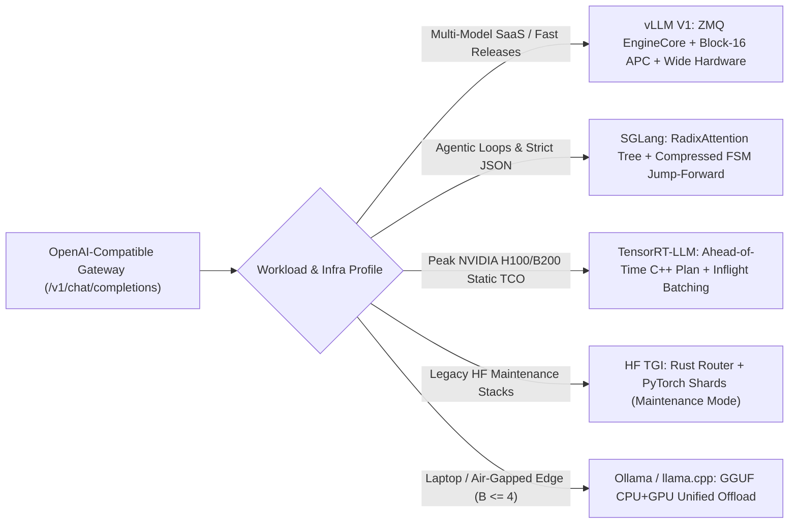
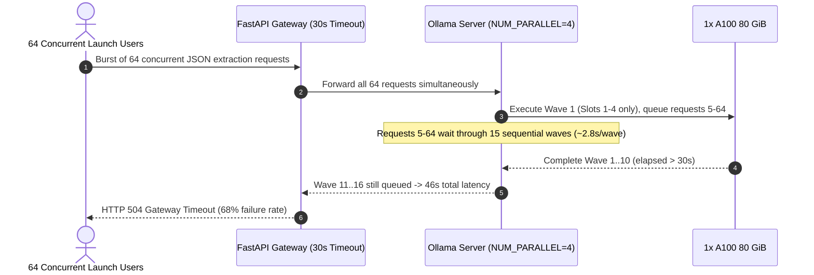

# Module 12: Alternatives: TGI, TensorRT-LLM, Ollama

> **Prerequisites:** [Module 11: Quantized Serving: AWQ and GPTQ](../11-quantized-serving-awq-and-gptq/README.md), [Module 09: vLLM: Configuration and Tuning](../09-vllm-configuration-and-tuning/README.md), and [Module 08: vLLM: Getting Started](../08-vllm-getting-started/README.md).  
> **Estimated Reading Time:** 40 minutes  
> **Target Audience:** AI Platform Architects, Principal Infrastructure Engineers, Technical Founders

> [!TIP]
> **The Golden Rule of Serving Engine Selection:** Standardize your API integration on the OpenAI wire protocol (`/v1/chat/completions`) and choose your backend engine strictly by **operational constraint**, never hype: use **vLLM (V1)** as your balanced Day-1 default with fastest new-model velocity, **SGLang** when multi-turn agentic prefix branching (`RadixAttention`) and strict JSON structured outputs (`XGrammar`/compressed FSM) dominate, **TensorRT-LLM** when locked onto static NVIDIA H100/B200 shapes chasing the final `15%–25%` TCO ceiling, and **Ollama / `llama.cpp`** strictly for local laptops and air-gapped single-user edge devices—never high-concurrency multi-tenant datacenter APIs. Note also that Hugging Face placed **TGI into maintenance mode**, steering greenfield deployments toward vLLM or SGLang.

---

## Why This Matters

A serving engine choice locks in far more than `tokens/sec`. Pick **Ollama** for a multi-tenant B2B launch because local setup took two commands, and at `32` concurrent enterprise users your fixed-slot queue explodes to `23` seconds per response. Pick **TensorRT-LLM** too early while your applied-AI team swaps between `Qwen`, `Llama`, and `DeepSeek` every Friday, and platform engineers burn half their week babysitting `45`-minute GPU-SKU-locked `trtllm-build` pipelines. Conversely, ignore **SGLang** on a high-throughput multi-turn JSON agent workload and leave `20%+` prefix cache hits and compressed FSM speedups on the table.

Because every modern engine exposes an OpenAI-compatible HTTP surface, your architecture can decouple client gateways from backend engines—letting you deploy the right runtime for each latency, cost, and iteration-velocity tier.

---

## 1. Architectural Anatomy of the 5 Production Serving Engines

All datacenter engines implement continuous iteration-level batching and paged KV caches ([Modules 06–07](../06-continuous-batching/README.md)), yet their schedulers, prefix structures, compilation models, and constrained-decoding pipelines diverge sharply:



### 1. vLLM (V1 Engine — Apache-2.0)

- **Core Architecture:** Python/C++/CUDA multiprocess engine (`V1` isolates HTTP API serialization from the GPU `EngineCore` via `ZMQ`), unified chunked prefill scheduler, block-hashed Automatic Prefix Caching (`block_size = 16`), and broad hardware coverage (`NVIDIA`, `AMD ROCm`, `Google TPU`, `AWS Neuron`, `Intel Gaudi`).
- **Strengths:** Fastest Day-0 support for newly released open-weight models (`DeepSeek`, `Qwen`, `Llama`, `Gemma`, multimodal VLMs), huge `Marlin`/`FP8`/`EAGLE` ecosystem, clean Prometheus telemetry, and zero offline compilation step (`1`-minute cold startup).
- **Trade-offs:** Slightly behind custom TensorRT-LLM on peak static NVIDIA Hopper/Blackwell throughput (`~10%–20%`), and `16`-token block alignment in APC leaves tiny tail fragments on unaligned prompt branches compared to token-exact radix trees.

### 2. SGLang (`arXiv:2312.07104` — Apache-2.0)

Why **SGLang** belongs in any modern vLLM alternatives evaluation: alongside vLLM, SGLang has become a co-primary datacenter standard for agentic and structured-generation workloads:

- **RadixAttention (Token-Exact Prefix Tree):** Instead of flat `16`-token hash tables, SGLang stores active and evicted KV cache blocks inside a **Radix Tree** (prefix tree) in GPU VRAM with tree-aware LRU eviction. Multi-turn conversations, few-shot branching, Tree-of-Thought forks, and shared RAG documents reuse prefixes down to exact single-token branch edges.
- **Zero-Overhead Compressed FSM & Jump-Forward Decoding (`XGrammar`):** When generating strict JSON schemas or regex grammars, naive token masking recomputes regex state in Python (`~3–5 ms/tok` CPU stall!). SGLang compiles grammars into compressed finite-state machines (`XGrammar` / `llguidance` / `Outlines`) that mask illegal logits in `< 40–80 us` AND **jump-forward** across deterministic syntax strings (emitting `{"status": "` in one step instead of wasting forward passes token-by-token!).

### 3. NVIDIA TensorRT-LLM (`trtllm-build` / `trtllm-serve`)

- **Core Architecture:** Ahead-of-time graph compiler converting Hugging Face weights into tightly fused **TensorRT `.engine` binary plans** (`C++` Executor runtime with in-flight batching, custom `XQA` paged attention kernels, `FP8`/`FP4` TensorRT plugins, and Triton Integration).
- **Strengths:** Delivers the **highest single-GPU/multi-GPU throughput and lowest `p99 ITL`** on locked NVIDIA Hopper/Blackwell production SKUs—trimming `10%–25%` off GPU bills at massive steady scale.
- **Trade-offs:** Heavy operational friction: building engines takes `15–60+ minutes`, compiled plans are **hardware-locked** (an engine built for `H100 SXM5` crashes on `L40S` or `A100`), shape bounds (`--max_batch_size`, `--max_seq_len`, `--max_num_tokens`) must be specified at build time, and brand-new model architectures take weeks longer to support.

### 4. Hugging Face Text Generation Inference (`TGI`)

- **Core Architecture:** Pioneering Rust HTTP/gRPC gateway (`text-generation-router`) orchestrating Python/CUDA shard workers via gRPC, incorporating FlashAttention, Safetensors streaming, continuous batching, and PagedAttention.
- **Critical Industry Update:** Hugging Face formally moved **TGI into maintenance mode**, redirecting new production deployments to **vLLM** or **SGLang**. While existing TGI deployments continue running reliably, avoid building greenfield clusters on TGI due to slower support for modern `V1` schedulers, `FP8`, `EAGLE-3`, and `MLA` kernels.

### 5. Ollama & `llama.cpp` (`GGUF`)

- **Core Architecture:** Developer-friendly Go daemon wrapping **`llama.cpp`** and **`GGUF`** quantized formats (`Q4_K_M`, `Q8_0`), featuring hybrid **CPU + GPU layer offloading** and first-class **Apple Silicon Metal / Unified Memory** execution.
- **Strengths:** Zero-friction local setup (`ollama pull qwen2.5:14b`), runs `70B` models smoothly on consumer MacBooks or mixed CPU+8GB GPU edge boxes, ideal for IDE autocomplete privacy and air-gapped single-user workstations.
- **Why It Fails Multi-Tenant APIs:** Concurrency relies on static slot duplication (`OLLAMA_NUM_PARALLEL`, typically `1–4` slots duplicating KV allocations) rather than dynamic PagedAttention continuous batching across `64–256` users. Pushing `32–64` concurrent API calls onto Ollama triggers massive request queueing and VRAM exhaustion.

---

## 2. Systematic Comparison Matrix: Production LLM Serving Engines

| Dimension | **vLLM (V1)** | **SGLang** | **NVIDIA TensorRT-LLM** | **Hugging Face TGI** | **Ollama / `llama.cpp`** |
| :--- | :--- | :--- | :--- | :--- | :--- |
| **KV Cache Architecture** | PagedAttention (`16`-tok block APC) | **RadixAttention** (Token-exact LRU tree) | Paged KV + Custom `XQA` C++ Runtime | PagedAttention (Legacy) | Static `GGUF` Context Slots (`NUM_PARALLEL`) |
| **Structured JSON Speed** | Fast (`XGrammar` / `Outlines`) | **Fastest** (`XGrammar` + Jump-Forward FSM) | Moderate (Guided decoding via C++ plugin) | Slow-to-Moderate (`Outlines` logits) | Slow regex grammar sampling |
| **Peak H100 Throughput / `\$`** | High (`~85%–92%` of peak) | **Very High (`~90%–96%`)** | **Peak (`100%` baseline reference)** | Moderate (`~65%–75%`) | Very Low at concurrency (`~12%` at `B>=16`) |
| **Cold Boot / Build Friction** | Fast (`~30–90 s`, zero compile) | Fast (`~30–90 s`, zero compile) | **Slow (`20–60+ min` GPU-locked build)** | Fast (`~30–90 s`) | **Instant (`< 5 s` GGUF mmap)** |
| **New-Model Velocity** | **Day-0 Industry Leader** | Very Fast (Day-0 to Day-3) | Lagging (Weeks for new architectures) | Maintenance Mode | Fast for `GGUF` text/vision |
| **Hardware Portability** | NVIDIA, AMD ROCm, TPU, Intel, CPU | NVIDIA, AMD ROCm | **NVIDIA Only** (SKU-specific binaries) | NVIDIA, ROCm, Gaudi (Legacy) | **CPU, Apple Metal, NVIDIA, AMD, Edge** |
| **Best Production Fit** | Balanced SaaS default, multi-LoRA, rapid R&D | Multi-turn agents, tree branching, strict JSON | Massive stable enterprise SKUs (`100+` H100s) | Legacy migrations only | Local dev laptops, privacy desktop, single-user edge |

---

## 3. Production War Story Post-Mortem: The "Easy Local Ollama" Launch Meltdown

| Field | Incident Details |
| :--- | :--- |
| **Severity** | **SEV-2** (`46`-Second API Timeouts & Pod OOM Crashes at Public Beta Launch) |
| **Detection / Resolution Time** | Detected 9 minutes after Product Hunt / enterprise beta announcement / Mitigated in 2 hours by swapping backend to `vLLM V1` behind existing OpenAI client |
| **Impact** | `68%` of checkout-copilot API requests hit `30 s` HTTP gateway timeouts; **\$14,500** lost conversion pipeline during launch window |

### What Happened

A startup built a customer-onboarding document analyzer locally using **Ollama** (`llama3.1:8b-instruct-q4_K_M`) wrapped behind a FastAPI backend. In local testing (`1–2` developers), Ollama streamed crisply at `~60 tok/s`. To save Kubernetes setup time before launch, the team packaged the exact Ollama container onto an `A100 80 GiB` VM (`OLLAMA_NUM_PARALLEL=4`, `OLLAMA_MAX_QUEUE=512`).

When launch traffic pushed concurrent users from `3` to `64`, latency did not scale gradually—it fell off a cliff (`2.5 s -> 46 s`!). Raising `OLLAMA_NUM_PARALLEL=32` immediately crashed the container with `CUDA OOM` because `32` full static context slots pre-allocated more VRAM than the `80 GiB` card possessed.



### Root Cause Analysis

1. **Fixed-Slot Batching vs. PagedAttention:** `OLLAMA_NUM_PARALLEL=4` capped true GPU execution concurrency to `4` requests while forcing requests `5..64` to wait in FIFO waves (`16` sequential waves $\times$ `~2.8 s` = `45 s`). Raising `OLLAMA_NUM_PARALLEL` statically reserves maximum `num_ctx` KV allocations per slot instead of sharing physical `16`-token blocks via PagedAttention—blowing VRAM immediately at `32` slots.
2. **Lack of Prefix Caching & Fast FSM:** All `64` requests shared an identical `2,400`-token extraction rubric, yet each wave re-prefilled the system rubric and paid slow grammar sampling overhead.

### The Fix & Architectural Hardening

- **Zero-Code-Rewrite Engine Swap (`vLLM V1` / `SGLang`):** Because FastAPI already called `/v1/chat/completions`, the team deployed **`vLLM V1`** (`AWQ-Marlin` + `--enable-prefix-caching` + `XGrammar` JSON schema) on the **exact same `A100 80 GiB`**.
- **Verified Outcome:** Under the same `64`-user load, `p99` end-to-end latency plummeted from **`46,080 ms` down to `3,062 ms`** (`15x` improvement) with `0` HTTP timeouts—using the identical GPU hardware!

---

## 4. Multi-Language Production Implementation: Engine-Agnostic OpenAI Router & SLA Failover

Because **vLLM**, **SGLang**, **TensorRT-LLM** (`trtllm-serve`), **TGI**, and **Ollama** all support the OpenAI `/v1/chat/completions` schema, production backends should **never** import engine-specific Python SDKs directly into business services. Below is a defensive **Workload-Aware Multi-Engine Router** in **Go**, **TypeScript**, **Python**, and **C#** that routes strict structured-JSON/agentic traffic to **SGLang**, balanced general chat to **vLLM V1** (with automatic fallback), and low-concurrency local dev traffic to **Ollama**—enforcing strict HTTP timeouts and JSON schema contracts.

````carousel

```go
package enginerouter

import (
	"bytes"
	"context"
	"encoding/json"
	"fmt"
	"io"
	"net/http"
	"time"
)

type WorkloadTier string

const (
	TierAgenticJSON WorkloadTier = "agentic_json"
	TierGeneralSaaS WorkloadTier = "general_saas"
	TierStaticPeak  WorkloadTier = "static_peak"
	TierLocalEdge   WorkloadTier = "local_edge"
)

type EngineEndpoint struct {
	Name    string
	BaseURL string
	Model   string
	Timeout time.Duration
}

type ChatRouter struct {
	client    *http.Client
	endpoints map[WorkloadTier][]EngineEndpoint
}

func NewChatRouter(endpoints map[WorkloadTier][]EngineEndpoint) *ChatRouter {
	return &ChatRouter{
		client:    &http.Client{},
		endpoints: endpoints,
	}
}

type ChatRequest struct {
	Model          string         `json:"model"`
	Messages       []map[string]string `json:"messages"`
	MaxTokens      int            `json:"max_tokens"`
	ResponseFormat map[string]any `json:"response_format,omitempty"`
}

func (r *ChatRouter) RouteCompletion(ctx context.Context, tier WorkloadTier, req ChatRequest) ([]byte, string, error) {
	candidates := r.endpoints[tier]
	if len(candidates) == 0 {
		return nil, "", fmt.Errorf("no endpoints configured for tier %s", tier)
	}

	var lastErr error
	for _, ep := range candidates {
		req.Model = ep.Model
		body, err := json.Marshal(req)
		if err != nil {
			return nil, "", err
		}

		reqCtx, cancel := context.WithTimeout(ctx, ep.Timeout)
		httpReq, err := http.NewRequestWithContext(reqCtx, http.MethodPost, ep.BaseURL+"/v1/chat/completions", bytes.NewReader(body))
		if err != nil {
			cancel()
			return nil, "", err
		}
		httpReq.Header.Set("Content-Type", "application/json")

		resp, err := r.client.Do(httpReq)
		if err == nil && resp.StatusCode >= 200 && resp.StatusCode < 300 {
			out, readErr := io.ReadAll(io.LimitReader(resp.Body, 4<<20))
			resp.Body.Close()
			cancel()
			if readErr == nil {
				return out, ep.Name, nil
			}
			lastErr = readErr
			continue
		}
		if resp != nil {
			resp.Body.Close()
			lastErr = fmt.Errorf("%s returned HTTP %d", ep.Name, resp.StatusCode)
		} else {
			lastErr = err
		}
		cancel()
	}
	return nil, "", fmt.Errorf("all engines failed for tier %s: %w", tier, lastErr)
}
```

<!-- slide -->

```typescript
export type WorkloadTier = "agentic_json" | "general_saas" | "static_peak" | "local_edge";

export interface EngineTarget {
  readonly engine: "sglang" | "vllm" | "trtllm" | "ollama";
  readonly baseUrl: string;
  readonly model: string;
  readonly timeoutMs: number;
}

export interface ChatPayload {
  readonly messages: ReadonlyArray<{ role: "system" | "user" | "assistant"; content: string }>;
  readonly max_tokens: number;
  readonly response_format?: Record<string, unknown>;
}

export async function dispatchOpenAICompatible(
  tier: WorkloadTier,
  routingTable: Record<WorkloadTier, readonly EngineTarget[]>,
  payload: ChatPayload,
): Promise<{ engine: string; response: unknown }> {
  const candidates = routingTable[tier] ?? [];
  if (candidates.length === 0) {
    throw new Error(`No serving targets configured for tier=${tier}`);
  }

  let lastError: unknown;
  for (const target of candidates) {
    const controller = new AbortController();
    const timer = setTimeout(() => controller.abort(), target.timeoutMs);
    try {
      const res = await fetch(`${target.baseUrl}/v1/chat/completions`, {
        method: "POST",
        headers: { "Content-Type": "application/json" },
        body: JSON.stringify({ model: target.model, ...payload }),
        signal: controller.signal,
      });
      if (!res.ok) {
        lastError = new Error(`${target.engine} HTTP ${res.status}`);
        continue;
      }
      return { engine: target.engine, response: await res.json() };
    } catch (err) {
      lastError = err;
    } finally {
      clearTimeout(timer);
    }
  }
  throw new Error(`All fallback engines failed for ${tier}: ${String(lastError)}`);
}
```

<!-- slide -->

```python
"""
engine_router.py
Engine-agnostic OpenAI-compatible router across SGLang, vLLM V1, TensorRT-LLM, and Ollama.
"""
from dataclasses import dataclass
import json
from typing import Any
import urllib.error
import urllib.request


@dataclass(frozen=True)
class EngineTarget:
    engine: str  # "sglang" | "vllm_v1" | "trtllm" | "ollama"
    base_url: str
    model: str
    timeout_s: float


def call_with_engine_failover(
    targets: list[EngineTarget],
    messages: list[dict[str, str]],
    max_tokens: int = 512,
    json_schema: dict[str, Any] | None = None,
) -> tuple[str, dict[str, Any]]:
    if not targets:
        raise ValueError("No serving targets configured")

    last_exc: Exception | None = None
    for target in targets:
        payload: dict[str, Any] = {
            "model": target.model,
            "messages": messages,
            "max_tokens": max_tokens,
        }
        if json_schema is not None:
            payload["response_format"] = {
                "type": "json_schema",
                "json_schema": {"name": "output_schema", "schema": json_schema},
            }

        req = urllib.request.Request(
            f"{target.base_url.rstrip('/')}/v1/chat/completions",
            data=json.dumps(payload).encode("utf-8"),
            headers={"Content-Type": "application/json"},
            method="POST",
        )
        try:
            with urllib.request.urlopen(req, timeout=target.timeout_s) as resp:
                return target.engine, json.loads(resp.read().decode("utf-8"))
        except (urllib.error.URLError, TimeoutError, json.JSONDecodeError) as exc:
            last_exc = exc

    raise RuntimeError(f"All serving engines failed: {last_exc}")
```

<!-- slide -->

```csharp
using System;
using System.Collections.Generic;
using System.Net.Http;
using System.Text;
using System.Text.Json;
using System.Threading;
using System.Threading.Tasks;

namespace GenAI.EngineRouter;

public sealed record EngineTarget(string EngineName, Uri BaseUri, string Model, TimeSpan Timeout);

public sealed class ServingEngineRouter
{
    private readonly HttpClient _http;
    private readonly IReadOnlyDictionary<string, IReadOnlyList<EngineTarget>> _routes;

    public ServingEngineRouter(HttpClient http, IReadOnlyDictionary<string, IReadOnlyList<EngineTarget>> routes)
    {
        _http = http;
        _routes = routes;
    }

    public async Task<(string Engine, string RawJson)> RouteChatAsync(
        string workloadTier,
        IReadOnlyList<object> messages,
        int maxTokens,
        CancellationToken ct)
    {
        if (!_routes.TryGetValue(workloadTier, out var targets) || targets.Count == 0)
            throw new InvalidOperationException($"No engines configured for tier '{workloadTier}'.");

        Exception? lastError = null;
        foreach (var target in targets)
        {
            using var cts = CancellationTokenSource.CreateLinkedTokenSource(ct);
            cts.CancelAfter(target.Timeout);

            var payload = JsonSerializer.Serialize(new { model = target.Model, messages, max_tokens = maxTokens });
            using var content = new StringContent(payload, Encoding.UTF8, "application/json");
            try
            {
                using var resp = await _http.PostAsync(new Uri(target.BaseUri, "/v1/chat/completions"), content, cts.Token);
                if (resp.IsSuccessStatusCode)
                    return (target.EngineName, await resp.Content.ReadAsStringAsync(cts.Token));
                lastError = new HttpRequestException($"{target.EngineName} HTTP {(int)resp.StatusCode}");
            }
            catch (Exception ex) when (ex is HttpRequestException or TaskCanceledException)
            {
                lastError = ex;
            }
        }
        throw new InvalidOperationException($"All failover engines failed for '{workloadTier}'.", lastError);
    }
}
```

````

---

## 5. Practical Hands-On Verification CLI Workflows

Run Workflows 1–3 offline using Python 3.13 stdlib—no GPUs or external servers needed. Workflow 4 summarizes live deployment commands across engines.

### Workflow 1: Engine TCO (`USD/1M tokens`) & Workload Fit Scorer

Compare throughput, unit token economics (`\$3.00/GPU-hr`), `p99 ITL`, build lead time, and weighted fit across **vLLM V1**, **SGLang**, **TensorRT-LLM**, **HF TGI**, and **Ollama**:

```bash
python -c '
engines = [
    {"name": "vLLM V1",        "tps": 1650, "ttft": 235, "itl": 24, "fsm_ms": 0.08, "build_m": 1,  "vel": 9.8, "edge": 2.0},
    {"name": "SGLang",         "tps": 1780, "ttft": 185, "itl": 21, "fsm_ms": 0.04, "build_m": 1,  "vel": 9.2, "edge": 2.0},
    {"name": "TensorRT-LLM",   "tps": 2050, "ttft": 155, "itl": 17, "fsm_ms": 0.18, "build_m": 45, "vel": 4.2, "edge": 1.0},
    {"name": "HF TGI (Maint)", "tps": 1180, "ttft": 340, "itl": 34, "fsm_ms": 0.45, "build_m": 2,  "vel": 3.5, "edge": 2.0},
    {"name": "Ollama/GGUF",    "tps": 210,  "ttft": 480, "itl": 68, "fsm_ms": 1.80, "build_m": 0,  "vel": 8.5, "edge": 10.0},
]
gpu_usd_hr = 3.00
for e in engines:
    usd_1m = (gpu_usd_hr / (e["tps"] * 3600)) * 1_000_000
    lat_score = max(0.0, 10.0 - (e["ttft"] - 140) / 40.0)
    fsm_score = max(0.0, 10.0 - e["fsm_ms"] * 12.0)
    agent_fit = 0.40 * lat_score + 0.35 * fsm_score + 0.25 * e["vel"]
    peak_fit  = 0.65 * (e["tps"] / 205.0) + 0.35 * lat_score
    name, tps, itl, build_m = e["name"], e["tps"], e["itl"], e["build_m"]
    print(f"{name:<15} | tps={tps:4d}/GPU | USD/1M={usd_1m:.3f} | p99_ITL={itl:2d}ms | build={build_m:2d}m | Agentic={agent_fit:.1f}/10 | PeakH100={peak_fit:.1f}/10")
'
```

**Expected Output:**

```text
vLLM V1         | tps=1650/GPU | USD/1M=0.505 | p99_ITL=24ms | build= 1m | Agentic=8.7/10 | PeakH100=7.9/10
SGLang          | tps=1780/GPU | USD/1M=0.468 | p99_ITL=21ms | build= 1m | Agentic=9.2/10 | PeakH100=8.8/10
TensorRT-LLM    | tps=2050/GPU | USD/1M=0.407 | p99_ITL=17ms | build=45m | Agentic=7.6/10 | PeakH100=9.9/10
HF TGI (Maint)  | tps=1180/GPU | USD/1M=0.706 | p99_ITL=34ms | build= 2m | Agentic=4.5/10 | PeakH100=5.5/10
Ollama/GGUF     | tps= 210/GPU | USD/1M=3.968 | p99_ITL=68ms | build= 0m | Agentic=2.7/10 | PeakH100=1.2/10
```

### Workflow 2: RadixAttention vs. Block-16 APC & Compressed FSM Overhead

Simulate a `16`-request branched multi-turn agentic batch (`2,395` shared system tokens + `394` branched turn tokens + `125` unique tokens -> `128` JSON tokens):

```bash
python -c '
requests = 16
shared_sys_toks = 2395
branch_shared_toks = 394
unique_suffix_toks = 125
gen_json_toks = 128

def sim_engine_batch(mode: str):
    if mode == "No-Cache + Naive-Regex":
        prefill_toks = requests * (shared_sys_toks + branch_shared_toks + unique_suffix_toks)
        fsm_ms_per_tok = 3.60
    elif mode == "vLLM-APC(b16) + XGrammar":
        aligned_sys = (shared_sys_toks // 16) * 16
        sys_tail = shared_sys_toks - aligned_sys
        aligned_branch = ((sys_tail + branch_shared_toks) // 16) * 16
        branch_tail = (sys_tail + branch_shared_toks) - aligned_branch
        prefill_toks = aligned_sys + 4 * (sys_tail + aligned_branch) + requests * (branch_tail + unique_suffix_toks)
        fsm_ms_per_tok = 0.08
    else:
        prefill_toks = shared_sys_toks + 4 * branch_shared_toks + requests * unique_suffix_toks
        fsm_ms_per_tok = 0.04
    prefill_ms = (prefill_toks / 18000.0) * 1000.0
    decode_ms = gen_json_toks * (14.0 + fsm_ms_per_tok)
    total_ms = prefill_ms + decode_ms
    hit_rate = (1.0 - prefill_toks / (requests * (shared_sys_toks + branch_shared_toks + unique_suffix_toks))) * 100
    print(f"{mode:<26} | prefill_toks={prefill_toks:6,} | hit={hit_rate:5.1f}% | prefill={prefill_ms:6.1f}ms | decode={decode_ms:6.1f}ms | total={total_ms:6.1f}ms")

for m in ["No-Cache + Naive-Regex", "vLLM-APC(b16) + XGrammar", "SGLang-Radix + CompFSM"]:
    sim_engine_batch(m)
'
```

**Expected Output:**

```text
No-Cache + Naive-Regex     | prefill_toks=46,624 | hit=  0.0% | prefill=2590.2ms | decode=2252.8ms | total=4843.0ms
vLLM-APC(b16) + XGrammar   | prefill_toks= 6,108 | hit= 86.9% | prefill= 339.3ms | decode=1802.2ms | total=2141.6ms
SGLang-Radix + CompFSM     | prefill_toks= 5,971 | hit= 87.2% | prefill= 331.7ms | decode=1797.1ms | total=2128.8ms
```

### Workflow 3: Why Local Fixed-Slot Runners (`Ollama`) Collapse Under Concurrency

Model concurrency scaling (`1 -> 64`) comparing `Ollama (OLLAMA_NUM_PARALLEL=4)` wave serialization against continuous-batching `vLLM V1`:

```bash
python -c '
for conc in [1, 2, 4, 8, 16, 32, 64]:
    waves = (conc + 3) // 4
    ollama_p99_ms = waves * (120 * (18.0 + 1.5 * min(conc, 4)))
    ollama_agg_tps = (conc * 120) / (ollama_p99_ms / 1000.0)
    vllm_step_ms = 14.0 + 0.18 * conc
    vllm_p99_ms = 120 * vllm_step_ms
    vllm_agg_tps = (conc * 120) / (vllm_p99_ms / 1000.0)
    print(f"conc={conc:2d} | Ollama(4-slot) p99={ollama_p99_ms:7,.0f}ms tps={ollama_agg_tps:6,.0f} | vLLM_V1 p99={vllm_p99_ms:6,.0f}ms tps={vllm_agg_tps:6,.0f}")
'
```

**Expected Output:**

```text
conc= 1 | Ollama(4-slot) p99=  2,340ms tps=    51 | vLLM_V1 p99= 1,702ms tps=    71
conc= 2 | Ollama(4-slot) p99=  2,520ms tps=    95 | vLLM_V1 p99= 1,723ms tps=   139
conc= 4 | Ollama(4-slot) p99=  2,880ms tps=   167 | vLLM_V1 p99= 1,766ms tps=   272
conc= 8 | Ollama(4-slot) p99=  5,760ms tps=   167 | vLLM_V1 p99= 1,853ms tps=   518
conc=16 | Ollama(4-slot) p99= 11,520ms tps=   167 | vLLM_V1 p99= 2,026ms tps=   948
conc=32 | Ollama(4-slot) p99= 23,040ms tps=   167 | vLLM_V1 p99= 2,371ms tps= 1,619
conc=64 | Ollama(4-slot) p99= 46,080ms tps=   167 | vLLM_V1 p99= 3,062ms tps= 2,508
```

### Workflow 4: Side-by-Side Engine Launch CLI Reference (Requires GPU / Local Host)

```bash
# 1. vLLM V1 (Balanced OpenAI Server)
vllm serve Qwen/Qwen2.5-72B-Instruct --tensor-parallel-size 4 --enable-prefix-caching

# 2. SGLang (RadixAttention + XGrammar Structured Outputs)
python -m sglang.launch_server --model-path Qwen/Qwen2.5-72B-Instruct --tp-size 4 --grammar-backend xgrammar

# 3. NVIDIA TensorRT-LLM (Compile Once Per GPU Architecture -> Serve C++ Runtime)
trtllm-build --checkpoint_dir ./qwen72b-ckpt --output_dir ./qwen72b-h100-engine --max_batch_size 256 --max_num_tokens 8192
trtllm-serve --engine_dir ./qwen72b-h100-engine --kv_cache_free_gpu_mem_frac 0.90

# 4. Ollama (Local Workstation / Air-Gapped Edge)
ollama run qwen2.5:14b
```

### Hands-On Exercises

1. **Jump-Forward JSON Gain:** In Workflow 2, assume `28` of the `128` JSON tokens are deterministic schema syntax (`{"decision": "`, `", "confidence": `) that SGLang's jump-forward FSM resolves with `0` extra GPU decode passes. Compute the exact extra speedup in milliseconds.
2. **TensorRT-LLM Break-Even Analysis:** Using Workflow 1's unit costs (`vLLM \$0.505/1M` vs `TRT-LLM \$0.407/1M`), calculate how many monthly output tokens your company must serve for `TRT-LLM`'s `\$0.098/1M` savings to pay back `15` hours/month of senior ML infra engineering build maintenance (`\$150/hr`).
3. **Gateway Contract Validation:** Test `call_with_engine_failover` (from the Python carousel slide) against two closed local ports (`http://127.0.0.1:59991`, `http://127.0.0.1:59992`) with `timeout_s=0.5` and confirm bounded fail-fast behavior under `1.1` seconds.

### Independent Challenge

A healthcare startup builds three distinct AI workloads: (A) an offline HIPAA air-gapped MacBook Pro (`64 GB` unified RAM) clinician note assistant (`B=1`), (B) a `120`-RPS multi-turn diagnostic agent calling `14` complex nested JSON schemas over shared `4K`-token clinical guidelines, and (C) an overnight batch summarization pipeline burning `80 billion` tokens/month on `64` rented `H100` GPUs. Recommend one distinct serving engine for each workload (A, B, and C) and explain why using a single engine across all three hurts either developer velocity, latency, or TCO.

<details><summary>Architectural Discussion</summary>

- **Workload A (Air-Gapped MacBook Pro `B=1`):** **`Ollama` / `llama.cpp` (`GGUF`)** — natively exploits Apple Silicon Metal unified memory with `0` CUDA dependency, instant cold start, and encrypted local offline privacy.
- **Workload B (`120`-RPS Multi-Turn Nested JSON Agents):** **`SGLang`** (with `vLLM V1` as hot standby) — `RadixAttention` reuses the `4K`-token shared guideline prefix and branched multi-turn histories down to exact tokens, while `XGrammar` + jump-forward decoding enforces `14` nested JSON schemas at `< 40 us/tok` overhead.
- **Workload C (`80B tokens/month` Batch on `64x H100`):** **`NVIDIA TensorRT-LLM`** (`FP8`) — `80B` tokens/month saves `~80,000 * \$0.06–\$0.10 = \$4,800–\$8,000/mo` over non-compiled runners once shapes (`max_batch_size`, `max_seq_len`) are stable across static nightly batch runs, easily justifying the one-time `trtllm-build` CI pipeline.

</details>

---

## 6. Common Mistakes & Troubleshooting

- **Shipping Ollama / `llama.cpp` into high-concurrency SaaS APIs:** Fixed parallel slot allocation forces requests above `NUM_PARALLEL` into multi-wave queues while blowing VRAM if slots are raised. Graduate to `vLLM` or `SGLang` before concurrency exceeds `4–8` users.
- **Building `TensorRT-LLM` engines before model selection stabilizes:** Compiled `.engine` files are tied to GPU compute capability (`SM90` H100 != `SM80` A100), TensorRT version, and `TP` size. Iterate rapidly on `vLLM` / `SGLang` first, then introduce `TRT-LLM` only when cluster spend justifies build-pipeline investment.
- **Starting new greenfield platforms on Hugging Face TGI:** Because TGI is in maintenance mode, teams adopting it today face slower support for `DeepSeek MLA`, `V1` zero-overhead scheduling, and `EAGLE-3` speculative kernels compared to `vLLM` and `SGLang`.
- **Hardcoding proprietary engine Python clients inside microservices:** Calling engine internals (`vllm.LLM`, `sglang.function`, or `trtllm.Executor`) inside web services couples business code to one runtime. Standardize on `/v1/chat/completions` HTTP/gRPC gateways so engines can be swapped or A/B benchmarked with zero application rewrites.

---

## 7. Operational Validation Checkpoints & Checkpoint Quiz

### Operational Validation Checkpoints

<details><summary><strong>Checkpoint 1: Diagnosing why a compiled TensorRT-LLM artifact crashed during autoscaling</strong></summary>

Your platform team compiled a `Llama-3.1-70B` `TensorRT-LLM` engine plan on a `4x H100 SXM5` dev instance and deployed it to an autoscaling pool containing mixed `H100` and `L40S` GPUs. Every `L40S` pod crashed immediately at engine load. Why?

**Validation:** `trtllm-build` compiles GPU-architecture-specific CUDA/TensorRT kernels (`SM90 Hopper` instructions, shared memory sizes, FP8 scheduling) tightly bound to the exact GPU SKU (`H100` != `L40S SM89 Ada`), TensorRT version, and `TP` topology used at compile time. Fix by scoping node selectors strictly per GPU SKU (`nodeSelector: nvidia.com/gpu.product=NVIDIA-H100`) and compiling per-SKU artifacts in CI—or using JIT/runtime-portable engines like **`vLLM`** or **`SGLang`**.

</details>

<details><summary><strong>Checkpoint 2: Why SGLang outperformed naive regex masking 12x on JSON agent traces</strong></summary>

A multi-turn tool-use agent generating `200`-token strict JSON responses suffered `~820 ms` slowdown under an unoptimized Python regex logits processor, which collapsed to `< 12 ms` total overhead after migrating to `SGLang` (`--grammar-backend xgrammar`). Explain both mechanisms speeding it up.

**Validation:** Two mechanisms eliminate the overhead: (1) **Compressed Finite-State Machine (`XGrammar`)** pre-computes context-independent vocabulary token masks in C++ (`~40 us/tok` instead of `3–4 ms/tok` Python regex traversal), and (2) **Jump-Forward Decoding** bypasses autoregressive forward passes whenever the JSON schema dictates deterministic fixed punctuation or keys (`{"result": "`), filling multi-token syntax spans directly.

</details>

<details><summary><strong>Checkpoint 3: Right-sizing a local developer laptop vs. staging cloud server</strong></summary>

An engineer insists on keeping `Ollama` on both their `M3 Max` MacBook Pro and their `8x H100` multi-tenant staging API for "dev-prod parity." Explain why preserving **API parity** (`/v1/chat/completions`) beats preserving **runtime binary parity** across edge and datacenter.

**Validation:** `Ollama` runs on MacBooks via Metal `GGUF` unified memory (`B=1`), whereas `8x H100` multi-tenant staging needs continuous batching, `PagedAttention`/`RadixAttention`, and `NVLink` `TP` (`vLLM` / `SGLang`)—at `64` users Ollama hits `46 s` queue delays vs `3 s` in `vLLM`. Maintain identical OpenAI HTTP `/v1/chat/completions` schemas across both environments while running `Ollama` locally and `vLLM`/`SGLang` in Kubernetes.

</details>

### Checkpoint Quiz

1. Why does **SGLang** belong alongside **vLLM** in modern production serving evaluations, and what does `RadixAttention` do differently from block-16 `APC`?
2. What is the key operational trade-off of **NVIDIA TensorRT-LLM** compared to **vLLM** and **SGLang**?
3. What is the current maintenance status of **Hugging Face TGI**, and what does that mean for new enterprise deployments?
4. Why does **`Ollama` / `llama.cpp`** perform wonderfully for local single-user workflows yet degrade severely above `8–16` concurrent API callers?
5. How do production engineering teams avoid vendor/engine lock-in when switching between **vLLM**, **SGLang**, and **TensorRT-LLM**?

<details><summary>Answers</summary>

1. SGLang brings **RadixAttention** (a token-exact LRU radix tree storing and sharing multi-turn KV prefixes without `16`-token block boundary waste) and **zero-overhead compressed FSM (`XGrammar`) + jump-forward decoding**, making it a premier choice alongside vLLM for agentic and structured JSON workloads.
2. TensorRT-LLM delivers peak static-shape NVIDIA throughput (`~10%–25%` TCO edge on Hopper/Blackwell), at the cost of `20–60+ min` GPU-SKU-locked `trtllm-build` compilation, rigid static shape ceilings, and slower new-model support.
3. Hugging Face moved TGI into **maintenance mode**, explicitly steering greenfield production workloads toward vLLM or SGLang.
4. Ollama relies on `GGUF` static parallel context slots (`OLLAMA_NUM_PARALLEL`) rather than dynamic PagedAttention continuous batching across large batches—forcing excess requests into sequential FIFO waves or causing OOM when static slots multiply.
5. By insulating business services behind an **OpenAI-compatible `/v1/chat/completions` API contract** and gateway router (`Go`/`TypeScript`/`Python`), allowing backend clusters to swap or canary-route between engines with zero application changes.

</details>

---

## Further Reading & Sources

- [vLLM Official Documentation](https://docs.vllm.ai/en/latest/) — V1 architecture, OpenAI server, and multi-hardware deployment guides.
- [SGLang Official Documentation](https://docs.sglang.ai/) — `RadixAttention`, `--grammar-backend xgrammar`, and OpenAI-compatible serving docs.
- [SGLang: Efficient Execution of Structured Language Model Programs (Zheng et al., 2023)](https://arxiv.org/abs/2312.07104) — original paper introducing `RadixAttention` and compressed FSM jump-forward decoding.
- [NVIDIA TensorRT-LLM Official Documentation](https://nvidia.github.io/TensorRT-LLM/) — `trtllm-build`, in-flight batching (`trtllm-serve`), and custom Hopper/Blackwell kernels.
- [Hugging Face Text Generation Inference (`TGI`) Docs](https://huggingface.co/docs/text-generation-inference/index) — architecture overview and current maintenance status guidance.
- [Ollama Official Repository](https://github.com/ollama/ollama) — `llama.cpp` / `GGUF` local runtime runner and `OLLAMA_NUM_PARALLEL` configuration reference.

## Next

[Module 13: Benchmarking Throughput and Latency](../13-benchmarking-throughput-and-latency/README.md)
