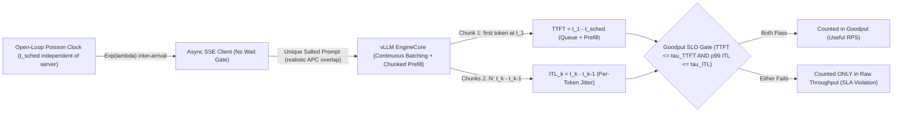
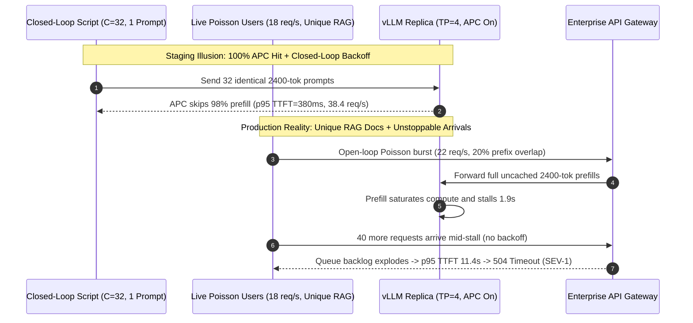

# Module 13: Benchmarking Throughput and Latency

> **Prerequisites:** [Module 02: Prefill and Decode Phases](../02-prefill-and-decode-phases/README.md), [Module 06: Continuous Batching](../06-continuous-batching/README.md), [Module 08: vLLM: Getting Started](../08-vllm-getting-started/README.md), and [Module 09: vLLM: Configuration and Tuning](../09-vllm-configuration-and-tuning/README.md).  
> **Estimated Reading Time:** 40 minutes  
> **Target Audience:** AI Performance Engineers, Inference Serving Architects, Capacity Planners & SREs

> [!TIP]
> **The Golden Rule of LLM Serving Benchmarks:** Never size a GPU fleet using closed-loop concurrency sweeps, non-streaming HTTP round-trips, or identical dummy prompts. Closed-loop workers pause whenever the engine stalls (**Coordinated Omission**), hiding queueing cliffs; identical prompts exploit **Automatic Prefix Caching (`APC`)** for fake `98%` cache-hit throughput; and raw `tokens/s` encourages shipping unbearably slow queues. Measure streaming SSE responses under **open-loop Poisson arrivals** (`vllm bench serve` or `guidellm`) with realistic token distributions and report **Goodput**—requests/sec simultaneously satisfying both `TTFT <= tau_TTFT` and `ITL <= tau_ITL` at `p95`/`p99`.

---

## Why This Matters

Every month, an engineering team celebrates an internal load test claiming `"Llama-3.1-70B on 4x H100 delivers 3,200 output tok/s at p95 latency 0.9 s."` They provision production capacity based on that spreadsheet—and on launch afternoon at just `16 req/s`, enterprise customers watch streaming responses freeze for `9.4 seconds` before the first token appears and stutter for `400 ms` mid-sentence.

What broke? Not vLLM. Three measurement fallacies stacked together in the benchmark harness:

1. **Coordinated Omission:** A closed-loop `asyncio.Semaphore(64)` script waited for each request to finish before sending the next. When a long prompt froze the GPU for `1.8 seconds`, the benchmark script politely stopped sending traffic—recording `1` slow request instead of the `28` queued requests real users would have fired during that window.
2. **Prefix-Cache Mirage (`APC = 98%`):** The script looped over one static `"Explain quantum computing in 200 words"` prompt, letting `--enable-prefix-caching` skip `95%+` of prefill FLOPs—an illusion that vanished the instant real users sent unique RAG documents.
3. **Throughput Without SLO Bounds (`Goodput` Blindness):** Reporting peak `tokens/s` at batch size `512` counted responses that took `6.5 seconds` to start streaming—counting useless SLA violations as "capacity."

Rigorous LLM benchmarking separates **streaming latency phases** (`TTFT`, `ITL`, `TPOT`, `E2EL`), anchors arrival clocks independently via **open-loop Poisson sampling**, salts unique prompt prefixes faithfully, and optimizes **Goodput** rather than vanity throughput.

---

## 1. Streaming Latency Mechanics, Coordinated Omission & Goodput

Unlike stateless REST APIs returning one atomic JSON payload, LLM inference streams tokens via **Server-Sent Events (`SSE`)**. Client-perceived responsiveness depends on two orthogonal GPU bottlenecks ([Module 02](../02-prefill-and-decode-phases/README.md)): compute-bound **prefill** (`TTFT`) and memory-bandwidth-bound **decode** (`ITL`/`TPOT`).



### Quantitative Mechanics: Streaming Metrics & Goodput Equations

For request $i$ scheduled at open-loop wall-clock timestamp $t_{i,\text{sched}}$, transmitted at $t_{i,\text{send}}$, and receiving $N_i \ge 2$ non-empty token deltas at client receive timestamps $t_{i,1}, t_{i,2}, \dots, t_{i,N_i}$:

- **Time to First Token ($\text{TTFT}_i$):**

$$\text{TTFT}_i = t_{i,1} - t_{i,\text{sched}}$$

Notice the anchor **$t_{i,\text{sched}}$**, not $t_{i,\text{send}}$! If the client benchmark process itself stalls (e.g., socket pool exhaustion or GIL contention) and sends the HTTP request `300 ms` late, anchoring to $t_{i,\text{sched}}$ preserves queue-delay accountability instead of hiding measurement stall.

- **Inter-Token Latency ($\text{ITL}_{i,k}$) vs. Time Per Output Token ($\text{TPOT}_i$):**

$$\text{ITL}_{i,k} = t_{i,k} - t_{i,k-1} \quad (k = 2, \dots, N_i), \qquad \text{TPOT}_i = \frac{t_{i,N_i} - t_{i,1}}{N_i - 1}$$

`TPOT` averages out pauses across an entire response. If a `200`-token response suffers one `420 ms` unchunked-prefill stall at token `45` and `198` smooth `14 ms` steps, `TPOT` reports a comforting `16.0 ms` (`62.5 tok/s`), whereas `p99 ITL` catches the `420 ms` UI freeze immediately! Always report **both** `TPOT` (mean streaming pace) and `p95`/`p99 ITL` (stutter tail).

- **End-to-End Latency ($\text{E2EL}_i$):**

$$\text{E2EL}_i = t_{i,N_i} - t_{i,\text{sched}} = \text{TTFT}_i + \sum_{k=2}^{N_i} \text{ITL}_{i,k}$$

- **SLO-Qualified Goodput ($\text{Goodput}(\lambda)$):**

Given interactive product SLO limits $(\tau_{\text{TTFT}}, \tau_{\text{TPOT}}, \tau_{\text{ITL}})$ over benchmark window $T$:

$$\text{Goodput}(\lambda) = \frac{1}{T} \sum_{i=1}^{M} \mathbb{I}\!\left(\text{TTFT}_i \le \tau_{\text{TTFT}} \;\land\; \text{TPOT}_i \le \tau_{\text{TPOT}} \;\land\; \text{p99}(\text{ITL}_i) \le \tau_{\text{ITL}}\right)$$

As arrival intensity $\lambda$ increases, raw throughput climbs monotonically until compute/KV saturation, while **Goodput forms an inverted-U curve**: once $\lambda$ crosses the knee point $\lambda_{\text{max\_goodput}}$, queueing backlog causes `90%+` of requests to breach $\tau_{\text{TTFT}}$, plunging Goodput toward `0 req/s` even as raw `tokens/s` stays high!

### Why Closed-Loop Testing Triggers Coordinated Omission

As formalized by Gil Tene (*How NOT to Measure Latency*), a **closed-loop** harness fixes concurrency $C$ workers, each waiting for response $i$ before scheduling request $i+1$. By **Little's Law** ($L = \lambda_{\text{eff}} \cdot W$):

$$\lambda_{\text{eff}} = \frac{C}{\bar{W}}$$

When the vLLM engine experiences a `2.0 s` KV preemption pause or GC freeze, response time $W$ jumps—causing the client's effective arrival rate $\lambda_{\text{eff}}$ to plummet automatically! Real production users do not stop clicking "Send" when your cluster stalls; traffic continues arriving as an **open-loop Poisson process** with exponential inter-arrival gaps:

$$\Delta t_k \sim \text{Exp}(\lambda) \implies \Delta t_k = -\frac{\ln(1 - U_k)}{\lambda}, \qquad U_k \sim \text{Uniform}[0, 1)$$

During a `2.0 s` freeze under $\lambda = 20\text{ req/s}$, `40` real requests pile into `vllm:num_requests_waiting`. Even after the freeze lifts at capacity $\mu = 24\text{ req/s}$, draining `40` queued requests at net rate $\mu - \lambda = 4\text{ req/s}$ takes `10.0 seconds`, inflating `p95`/`p99 TTFT` across hundreds of subsequent requests. Closed-loop concurrency sweeps are useful *only* to map peak theoretical saturation (`max_concurrency` throughput ceiling)—never to certify SLA tail latency.

### KV-Cache Prefix Realism & Unique Salting

With vLLM's **Automatic Prefix Caching (`--enable-prefix-caching`)** enabled by default in V1, sending `1,000` copies of an identical prompt caches every `16`-token KV block after request `#1`. That cuts prefill Tensor Core work by `~99%` and fabricates absurdly low `TTFT` and inflated Goodput. To measure reality:

- **Match Production Prefix Ratio:** Structure synthetic prompts as `[shared_system_prompt (S tokens)] + [unique_user_salt_and_context (U tokens)]`, where `S / (S + U)` mirrors your real workload (e.g., `1,500`-token static agent instructions + `2,500`-token unique per-request RAG context = `37.5%` prefix overlap).
- **Avoid Constant `max_tokens` Only:** Use sampled prompt/output length distributions (`ShareGPT`, `BurstGPT`, or log-normal/truncated-normal synthetic distributions) because variable decode lengths stress PagedAttention fragmentation and continuous-batching slot turnover far more accurately than uniform `512/128` shapes.

---

## 2. Systematic Comparison Matrix: LLM Benchmarking Methodologies

| Benchmark Approach | Arrival Generator | Coordinated Omission Safe? | Streaming Metrics Captured | APC Prefix Realism | Engineering Verdict |
| :--- | :--- | :--- | :--- | :--- | :--- |
| **Naive Thread / `Semaphore(C)` Loop** | Closed-loop (`wait -> send`) | **No** (stalls drop $\lambda_{\text{eff}}$) | Usually `E2EL` only | Poor if looping 1 prompt | Unacceptable for SLA capacity planning; creates false launch confidence |
| **Generic HTTP Load Tool (`k6` / `Locust` non-SSE)** | Open-loop or closed VUs | Only if open-arrival executor used | `E2EL` only (blinds `TTFT` vs `ITL`) | Typically static JSON body | Cannot detect chunked-prefill decode stutters or separate prefill bottlenecks |
| **`vllm bench serve` (Poisson Open-Loop)** | Open-loop (`--request-rate R`, `--burstiness`) | **Yes** (async scheduled arrivals) | `TTFT`, `TPOT`, `ITL`, `E2EL`, `--goodput` | High (`sharegpt`, `burstgpt`, `random`, prefix-len) | **Recommended vLLM-native CLI** for rapid CI regression & `--goodput` sweeps |
| **`guidellm run` (Sweep / Poisson Profile)** | Open-loop Poisson + auto rate-sweep | **Yes** (wall-clock anchored + reports) | Full `p50/p95/p99` `TTFT/ITL/TPOT/E2EL` + SLO | High (`synthetic`, HuggingFace datasets, chat) | **Recommended production capacity planner** for finding exact Goodput knees |
| **Shadow Traffic Replay (Mirrored Prod Logs)** | Exact production timestamps | **Yes** (authentic burstiness) | Full production distribution | **Exact** (real multi-turn tenant prefixes) | Gold standard pre-cutover validation once sanitized of PII |

---

## 3. Production War Story Post-Mortem: The \$65,000 Closed-Loop Launch Freeze

| Field | Incident Details |
| :--- | :--- |
| **Severity** | **SEV-1** (Enterprise Assistant Launch Timeout & Emergency GPU Over-Provisioning) |
| **Detection / Resolution Time** | Triggered 40 minutes into launch day peak / Mitigated in 2.5 hours by tripling replicas + capping gateway rate |
| **Impact** | `p95 TTFT` surged from `0.38 s` (staging claim) to **`11.4 s`** at `18 req/s`; `31%` of B2B streams aborted at `10 s` gateway timeout; **\$65,000** SLA credit payout |

### What Happened

Before launching a RAG code-review assistant on `Llama-3.1-70B-Instruct` (`TP=4` on `4x H100`, `--enable-prefix-caching`), an engineer validated cluster capacity using an internal Python script spawning `32` `asyncio` tasks in a `while True` loop sending the same `2,400`-token prompt (`"Review this Terraform snippet..."`) with `max_tokens=256`.

Staging reported **`38.4 req/s`**, **`p95 TTFT = 380 ms`**, and **`p95 TPOT = 28 ms`**. Leadership sized production at `2` replicas (`~76 req/s` theoretical budget) for an expected peak of `24 req/s`.

Forty minutes after general availability, traffic hit just **`18 req/s`** per replica—well below `38.4 req/s`. Yet Prometheus showed `vllm:num_requests_waiting` spiking past `45`, `vllm:kv_cache_usage_perc` hitting `0.97`, and customer gateways logging `504` timeouts after `10 seconds`.



### Root Cause Analysis

1. **Fake `98%` APC Prefill Bypass:** Staging reused one static prompt string across all `1,000` calls, letting APC bypass `~2,350` prefill tokens per request. Production RAG prompts shared only a `500`-token system prompt plus `1,900` unique retrieved tokens—multiplying actual prefill FLOPs per request nearly **`4x`**.
2. **Closed-Loop Coordinated Omission:** Whenever staging hit occasional compaction or CUDA pauses, the `32` closed-loop tasks stopped sending new requests while waiting, hiding queue buildup and masking the true Goodput knee (`~13 req/s` per replica under unique RAG context).
3. **Zero Goodput Gate in Release Checklist:** Staging measured aggregate `tokens/s` without failing the run when `p95 TTFT > 500 ms` or `p99 ITL > 60 ms`.

### The Fix & Architectural Hardening

- **Salted Open-Loop Benchmark Gate:** Replaced the closed-loop script with `vllm bench serve` / `guidellm` open-loop Poisson rate sweeps using production-representative `ShareGPT` + unique salted `system + RAG` prompts (`25%` prefix overlap).
- **Automated Goodput Regression Check:** Defined hard CI release gates (`TTFT_p95 <= 500 ms`, `ITL_p99 <= 60 ms`) to pinpoint each model tier's true per-replica Goodput knee (`13 req/s`), then scaled fleet size to `4` replicas with `40%` burst headroom.

---

## 4. Multi-Language Production Implementation: Open-Loop Poisson SSE Benchmarking & Goodput Evaluator

Below is a production-ready **Open-Loop Poisson SSE Benchmark Harness & Goodput Analyzer** in **Go**, **TypeScript**, **Python**, and **C#**. Every implementation schedules arrivals strictly against an independent monotonic timeline (`t_sched`), streams SSE `data:` token chunks while measuring `TTFT`, per-token `ITL`, `TPOT`, and `E2EL` anchored to `t_sched` (eliminating Coordinated Omission), enforces request timeouts, and computes **SLO-qualified Goodput** alongside `p50`/`p95`/`p99` latency quantiles.

````carousel

```go
package llmbench

import (
	"bufio"
	"bytes"
	"context"
	"encoding/json"
	"fmt"
	"math"
	"math/rand"
	"net/http"
	"sort"
	"strings"
	"sync"
	"time"
)

type BenchmarkConfig struct {
	EndpointURL   string
	Model         string
	RateRPS       float64
	Duration      time.Duration
	Timeout       time.Duration
	TTFTMaxMs     float64
	ITLP99MaxMs   float64
	SharedPrefix  string
	Seed          int64
}

type RequestMetrics struct {
	TTFTMs   float64
	TPOTMs   float64
	P99ITLMs float64
	E2ELMs   float64
	Tokens   int
	SLOPass  bool
	Err      error
}

type GoodputSummary struct {
	Completed   int
	Failed      int
	RawRPS      float64
	GoodputRPS  float64
	P95TTFTMs   float64
	P99ITLMs    float64
}

func RunOpenLoopPoisson(ctx context.Context, cfg BenchmarkConfig) GoodputSummary {
	client := &http.Client{Timeout: cfg.Timeout}
	rng := rand.New(rand.NewSource(cfg.Seed))

	var mu sync.Mutex
	var results []RequestMetrics
	var wg sync.WaitGroup

	startWall := time.Now()
	schedOffset := time.Duration(0)
	reqIdx := 0

	for schedOffset < cfg.Duration {
		// Exponential inter-arrival: -ln(1-U) / lambda
		u := rng.Float64()
		if u >= 0.999999 {
			u = 0.999999
		}
		gap := time.Duration((-math.Log(1.0-u) / cfg.RateRPS) * float64(time.Second))
		schedOffset += gap
		if schedOffset >= cfg.Duration {
			break
		}

		reqIdx++
		targetTime := startWall.Add(schedOffset)
		waitDur := time.Until(targetTime)
		if waitDur > 0 {
			timer := time.NewTimer(waitDur)
			select {
			case <-ctx.Done():
				timer.Stop()
				goto WAIT
			case <-timer.C:
			}
		}

		wg.Add(1)
		go func(id int, tSched time.Time) {
			defer wg.Done()
			m := executeStreamRequest(ctx, client, cfg, id, tSched)
			mu.Lock()
			results = append(results, m)
			mu.Unlock()
		}(reqIdx, targetTime)
	}

WAIT:
	wg.Wait()
	return summarizeGoodput(results, cfg.Duration.Seconds())
}

func executeStreamRequest(ctx context.Context, client *http.Client, cfg BenchmarkConfig, id int, tSched time.Time) RequestMetrics {
	// Unique salt prevents fake 100% APC prefix hits while preserving realistic shared system prompt
	prompt := fmt.Sprintf("%s\n[req_salt=%d] Summarize architectural tradeoffs for tenant shard %d.", cfg.SharedPrefix, id, id%97)
	bodyBytes, _ := json.Marshal(map[string]any{
		"model":       cfg.Model,
		"messages":    []map[string]string{{"role": "user", "content": prompt}},
		"max_tokens":  128,
		"temperature": 0,
		"stream":      true,
	})

	reqCtx, cancel := context.WithTimeout(ctx, cfg.Timeout)
	defer cancel()
	req, err := http.NewRequestWithContext(reqCtx, http.MethodPost, cfg.EndpointURL, bytes.NewReader(bodyBytes))
	if err != nil {
		return RequestMetrics{Err: err}
	}
	req.Header.Set("Content-Type", "application/json")

	resp, err := client.Do(req)
	if err != nil {
		return RequestMetrics{Err: err}
	}
	defer resp.Body.Close()
	if resp.StatusCode != http.StatusOK {
		return RequestMetrics{Err: fmt.Errorf("http status %d", resp.StatusCode)}
	}

	var tokenTimes []time.Time
	scanner := bufio.NewScanner(resp.Body)
	for scanner.Scan() {
		line := scanner.Text()
		if !strings.HasPrefix(line, "data:") {
			continue
		}
		payload := strings.TrimSpace(strings.TrimPrefix(line, "data:"))
		if payload == "[DONE]" {
			break
		}
		tokenTimes = append(tokenTimes, time.Now())
	}
	if err := scanner.Err(); err != nil || len(tokenTimes) == 0 {
		return RequestMetrics{Err: fmt.Errorf("stream incomplete: %v", err)}
	}

	ttftMs := tokenTimes[0].Sub(tSched).Seconds() * 1000.0
	e2elMs := tokenTimes[len(tokenTimes)-1].Sub(tSched).Seconds() * 1000.0
	var itls []float64
	for i := 1; i < len(tokenTimes); i++ {
		itls = append(itls, tokenTimes[i].Sub(tokenTimes[i-1]).Seconds()*1000.0)
	}
	p99ITL := quantile(itls, 0.99)
	tpotMs := 0.0
	if len(tokenTimes) > 1 {
		tpotMs = tokenTimes[len(tokenTimes)-1].Sub(tokenTimes[0]).Seconds() * 1000.0 / float64(len(tokenTimes)-1)
	}
	sloPass := ttftMs <= cfg.TTFTMaxMs && p99ITL <= cfg.ITLP99MaxMs
	return RequestMetrics{TTFTMs: ttftMs, TPOTMs: tpotMs, P99ITLMs: p99ITL, E2ELMs: e2elMs, Tokens: len(tokenTimes), SLOPass: sloPass}
}

func quantile(vals []float64, q float64) float64 {
	if len(vals) == 0 {
		return 0
	}
	cp := append([]float64(nil), vals...)
	sort.Float64s(cp)
	idx := int(math.Floor(q * float64(len(cp)-1)))
	return cp[idx]
}

func summarizeGoodput(results []RequestMetrics, durSec float64) GoodputSummary {
	var ttfts, itls []float64
	completed, failed, sloOk := 0, 0, 0
	for _, r := range results {
		if r.Err != nil {
			failed++
			continue
		}
		completed++
		ttfts = append(ttfts, r.TTFTMs)
		itls = append(itls, r.P99ITLMs)
		if r.SLOPass {
			sloOk++
		}
	}
	return GoodputSummary{
		Completed:  completed,
		Failed:     failed,
		RawRPS:     float64(completed) / durSec,
		GoodputRPS: float64(sloOk) / durSec,
		P95TTFTMs:  quantile(ttfts, 0.95),
		P99ITLMs:   quantile(itls, 0.99),
	}
}
```

<!-- slide -->

```typescript
export interface BenchmarkOptions {
  readonly endpointUrl: string;
  readonly model: string;
  readonly rateRps: number;
  readonly durationMs: number;
  readonly requestTimeoutMs: number;
  readonly ttftSloMs: number;
  readonly itlP99SloMs: number;
  readonly sharedPrefix: string;
}

export interface RequestSample {
  readonly ok: boolean;
  readonly ttftMs: number;
  readonly tpotMs: number;
  readonly p99ItlMs: number;
  readonly e2elMs: number;
  readonly sloPassed: boolean;
}

export interface BenchmarkSummary {
  readonly sent: number;
  readonly succeeded: number;
  readonly rawRps: number;
  readonly goodputRps: number;
  readonly p95TtftMs: number;
  readonly p99ItlMs: number;
}

function percentile(values: readonly number[], q: number): number {
  if (values.length === 0) return 0;
  const sorted = [...values].sort((a, b) => a - b);
  return sorted[Math.min(sorted.length - 1, Math.floor(q * (sorted.length - 1)))];
}

async function sendSseRequest(
  opts: BenchmarkOptions,
  reqId: number,
  tSchedMs: number,
): Promise<RequestSample> {
  const controller = new AbortController();
  const timer = setTimeout(() => controller.abort(), opts.requestTimeoutMs);
  const prompt = `${opts.sharedPrefix}\n[salt=${reqId}] Analyze incident logs for pod-${reqId % 113}.`;

  try {
    const resp = await fetch(opts.endpointUrl, {
      method: "POST",
      headers: { "Content-Type": "application/json" },
      signal: controller.signal,
      body: JSON.stringify({
        model: opts.model,
        messages: [{ role: "user", content: prompt }],
        max_tokens: 128,
        temperature: 0,
        stream: true,
      }),
    });
    if (!resp.ok || !resp.body) {
      return { ok: false, ttftMs: 0, tpotMs: 0, p99ItlMs: 0, e2elMs: 0, sloPassed: false };
    }

    const reader = resp.body.getReader();
    const decoder = new TextDecoder();
    const tokenTimestamps: number[] = [];
    let buffer = "";

    while (true) {
      const { value, done } = await reader.read();
      if (done) break;
      buffer += decoder.decode(value, { stream: true });
      const lines = buffer.split("\n");
      buffer = lines.pop() ?? "";
      for (const raw of lines) {
        const line = raw.trim();
        if (!line.startsWith("data:")) continue;
        const data = line.slice(5).trim();
        if (data === "[DONE]") break;
        tokenTimestamps.push(performance.now());
      }
    }

    if (tokenTimestamps.length === 0) {
      return { ok: false, ttftMs: 0, tpotMs: 0, p99ItlMs: 0, e2elMs: 0, sloPassed: false };
    }

    const ttftMs = tokenTimestamps[0] - tSchedMs;
    const lastTs = tokenTimestamps[tokenTimestamps.length - 1];
    const e2elMs = lastTs - tSchedMs;
    const itls: number[] = [];
    for (let i = 1; i < tokenTimestamps.length; i += 1) {
      itls.push(tokenTimestamps[i] - tokenTimestamps[i - 1]);
    }
    const p99ItlMs = percentile(itls, 0.99);
    const tpotMs =
      tokenTimestamps.length > 1
        ? (lastTs - tokenTimestamps[0]) / (tokenTimestamps.length - 1)
        : 0;
    const sloPassed = ttftMs <= opts.ttftSloMs && p99ItlMs <= opts.itlP99SloMs;
    return { ok: true, ttftMs, tpotMs, p99ItlMs, e2elMs, sloPassed };
  } catch {
    return { ok: false, ttftMs: 0, tpotMs: 0, p99ItlMs: 0, e2elMs: 0, sloPassed: false };
  } finally {
    clearTimeout(timer);
  }
}

export async function runOpenLoopPoissonBenchmark(
  opts: BenchmarkOptions,
): Promise<BenchmarkSummary> {
  const startWall = performance.now();
  const inFlight: Array<Promise<RequestSample>> = [];
  let schedOffsetMs = 0;
  let reqId = 0;

  while (schedOffsetMs < opts.durationMs) {
    const u = Math.min(0.999999, Math.random());
    schedOffsetMs += (-Math.log(1 - u) / opts.rateRps) * 1000;
    if (schedOffsetMs >= opts.durationMs) break;

    const targetMs = startWall + schedOffsetMs;
    const sleepMs = targetMs - performance.now();
    if (sleepMs > 0) {
      await new Promise((resolve) => setTimeout(resolve, sleepMs));
    }
    reqId += 1;
    // Anchor TTFT/E2EL to scheduled targetMs to prevent Coordinated Omission
    inFlight.push(sendSseRequest(opts, reqId, targetMs));
  }

  const samples = await Promise.all(inFlight);
  const okSamples = samples.filter((s) => s.ok);
  const durSec = opts.durationMs / 1000;
  const sloPassedCount = okSamples.filter((s) => s.sloPassed).length;

  return {
    sent: samples.length,
    succeeded: okSamples.length,
    rawRps: okSamples.length / durSec,
    goodputRps: sloPassedCount / durSec,
    p95TtftMs: percentile(okSamples.map((s) => s.ttftMs), 0.95),
    p99ItlMs: percentile(okSamples.map((s) => s.p99ItlMs), 0.99),
  };
}
```

<!-- slide -->

```python
"""
open_loop_goodput_bench.py
Open-loop Poisson SSE benchmark client anchored to scheduled arrival times (zero Coordinated Omission).
Requires `httpx` (`pip install httpx`) when targeting a live vLLM endpoint.
"""
import asyncio
from dataclasses import dataclass
import math
import random
import time
import httpx


@dataclass(frozen=True)
class BenchConfig:
    endpoint_url: str
    model: str
    rate_rps: float
    duration_s: float
    timeout_s: float = 15.0
    ttft_slo_ms: float = 500.0
    itl_p99_slo_ms: float = 60.0
    shared_prefix: str = "You are a strict SRE triage assistant."
    seed: int = 42


@dataclass(frozen=True)
class RequestOutcome:
    ok: bool
    ttft_ms: float
    tpot_ms: float
    p99_itl_ms: float
    e2el_ms: float
    slo_pass: bool


def quantile(values: list[float], q: float) -> float:
    if not values:
        return 0.0
    ordered = sorted(values)
    idx = min(len(ordered) - 1, int(q * (len(ordered) - 1)))
    return ordered[idx]


async def fire_sse_request(
    client: httpx.AsyncClient,
    cfg: BenchConfig,
    req_id: int,
    t_sched: float,
) -> RequestOutcome:
    # Unique request salt prevents artificial 100% APC cache-hit inflation
    prompt = f"{cfg.shared_prefix}\n[req_id={req_id}] Diagnose latency spike on shard-{req_id % 97}."
    payload = {
        "model": cfg.model,
        "messages": [{"role": "user", "content": prompt}],
        "max_tokens": 128,
        "temperature": 0.0,
        "stream": True,
    }
    tok_times: list[float] = []
    try:
        async with client.stream("POST", cfg.endpoint_url, json=payload, timeout=cfg.timeout_s) as resp:
            if resp.status_code != 200:
                return RequestOutcome(False, 0.0, 0.0, 0.0, 0.0, False)
            async for line in resp.aiter_lines():
                if not line.startswith("data:"):
                    continue
                data = line[5:].strip()
                if data == "[DONE]":
                    break
                tok_times.append(time.perf_counter())
    except httpx.HTTPError:
        return RequestOutcome(False, 0.0, 0.0, 0.0, 0.0, False)

    if not tok_times:
        return RequestOutcome(False, 0.0, 0.0, 0.0, 0.0, False)

    ttft_ms = (tok_times[0] - t_sched) * 1000.0
    e2el_ms = (tok_times[-1] - t_sched) * 1000.0
    itls = [(tok_times[i] - tok_times[i - 1]) * 1000.0 for i in range(1, len(tok_times))]
    p99_itl = quantile(itls, 0.99)
    tpot_ms = ((tok_times[-1] - tok_times[0]) * 1000.0 / (len(tok_times) - 1)) if len(tok_times) > 1 else 0.0
    slo_pass = (ttft_ms <= cfg.ttft_slo_ms) and (p99_itl <= cfg.itl_p99_slo_ms)
    return RequestOutcome(True, ttft_ms, tpot_ms, p99_itl, e2el_ms, slo_pass)


async def run_poisson_benchmark(cfg: BenchConfig) -> dict[str, float]:
    rng = random.Random(cfg.seed)
    limits = httpx.Limits(max_connections=1024, max_keepalive_connections=256)
    tasks: list[asyncio.Task[RequestOutcome]] = []
    t0 = time.perf_counter()
    offset = 0.0
    req_id = 0

    async with httpx.AsyncClient(limits=limits) as client:
        while offset < cfg.duration_s:
            offset += rng.expovariate(cfg.rate_rps)
            if offset >= cfg.duration_s:
                break
            t_sched = t0 + offset
            delay = t_sched - time.perf_counter()
            if delay > 0:
                await asyncio.sleep(delay)
            req_id += 1
            tasks.append(asyncio.create_task(fire_sse_request(client, cfg, req_id, t_sched)))

        outcomes = await asyncio.gather(*tasks)

    ok_runs = [o for o in outcomes if o.ok]
    slo_ok = sum(1 for o in ok_runs if o.slo_pass)
    return {
        "sent": float(len(outcomes)),
        "succeeded": float(len(ok_runs)),
        "raw_rps": len(ok_runs) / cfg.duration_s,
        "goodput_rps": slo_ok / cfg.duration_s,
        "p95_ttft_ms": quantile([o.ttft_ms for o in ok_runs], 0.95),
        "p99_itl_ms": quantile([o.p99_itl_ms for o in ok_runs], 0.99),
    }
```

<!-- slide -->

```csharp
using System;
using System.Collections.Generic;
using System.Diagnostics;
using System.IO;
using System.Linq;
using System.Net.Http;
using System.Text;
using System.Text.Json;
using System.Threading;
using System.Threading.Tasks;

namespace GenAI.LlmBench;

public sealed record BenchOptions(
    string EndpointUrl,
    string Model,
    double RateRps,
    TimeSpan Duration,
    TimeSpan Timeout,
    double TtftSloMs,
    double ItlP99SloMs,
    string SharedPrefix,
    int Seed = 42);

public sealed record RequestMetrics(
    bool Ok,
    double TtftMs,
    double TpotMs,
    double P99ItlMs,
    double E2elMs,
    bool SloPassed);

public sealed record GoodputSummary(
    int Sent,
    int Succeeded,
    double RawRps,
    double GoodputRps,
    double P95TtftMs,
    double P99ItlMs);

public static class OpenLoopPoissonRunner
{
    private static readonly HttpClient SharedClient = new() { Timeout = Timeout.InfiniteTimeSpan };

    public static async Task<GoodputSummary> RunAsync(BenchOptions opts, CancellationToken ct = default)
    {
        var rng = new Random(opts.Seed);
        var sw = Stopwatch.StartNew();
        var tasks = new List<Task<RequestMetrics>>();
        double offsetMs = 0;
        int reqId = 0;

        while (offsetMs < opts.Duration.TotalMilliseconds && !ct.IsCancellationRequested)
        {
            double u = Math.Min(0.999999, rng.NextDouble());
            offsetMs += (-Math.Log(1.0 - u) / opts.RateRps) * 1000.0;
            if (offsetMs >= opts.Duration.TotalMilliseconds) break;

            double waitMs = offsetMs - sw.Elapsed.TotalMilliseconds;
            if (waitMs > 1.0)
                await Task.Delay(TimeSpan.FromMilliseconds(waitMs), ct);

            double scheduledMs = offsetMs;
            reqId++;
            tasks.Add(SendStreamingAsync(opts, reqId, sw, scheduledMs, ct));
        }

        RequestMetrics[] outcomes = await Task.WhenAll(tasks);
        var ok = outcomes.Where(x => x.Ok).ToArray();
        double durSec = opts.Duration.TotalSeconds;

        return new GoodputSummary(
            Sent: outcomes.Length,
            Succeeded: ok.Length,
            RawRps: ok.Length / durSec,
            GoodputRps: ok.Count(x => x.SloPassed) / durSec,
            P95TtftMs: Quantile(ok.Select(x => x.TtftMs).ToArray(), 0.95),
            P99ItlMs: Quantile(ok.Select(x => x.P99ItlMs).ToArray(), 0.99));
    }

    private static async Task<RequestMetrics> SendStreamingAsync(
        BenchOptions opts,
        int reqId,
        Stopwatch clock,
        double scheduledMs,
        CancellationToken outerCt)
    {
        using var cts = CancellationTokenSource.CreateLinkedTokenSource(outerCt);
        cts.CancelAfter(opts.Timeout);

        string prompt = $"{opts.SharedPrefix}\n[salt={reqId}] Triage shard {reqId % 97}.";
        string json = JsonSerializer.Serialize(new
        {
            model = opts.Model,
            messages = new[] { new { role = "user", content = prompt } },
            max_tokens = 128,
            temperature = 0,
            stream = true
        });

        using var req = new HttpRequestMessage(HttpMethod.Post, opts.EndpointUrl)
        {
            Content = new StringContent(json, Encoding.UTF8, "application/json")
        };

        try
        {
            using HttpResponseMessage resp = await SharedClient.SendAsync(req, HttpCompletionOption.ResponseHeadersRead, cts.Token);
            if (!resp.IsSuccessStatusCode)
                return new RequestMetrics(false, 0, 0, 0, 0, false);

            await using Stream stream = await resp.Content.ReadAsStreamAsync(cts.Token);
            using var reader = new StreamReader(stream);
            var tokenTimes = new List<double>();

            while (!reader.EndOfStream)
            {
                string? line = await reader.ReadLineAsync(cts.Token);
                if (line is null || !line.StartsWith("data:", StringComparison.Ordinal)) continue;
                string data = line[5..].Trim();
                if (data == "[DONE]") break;
                tokenTimes.Add(clock.Elapsed.TotalMilliseconds);
            }

            if (tokenTimes.Count == 0)
                return new RequestMetrics(false, 0, 0, 0, 0, false);

            double ttftMs = tokenTimes[0] - scheduledMs;
            double e2elMs = tokenTimes[^1] - scheduledMs;
            var itls = new List<double>(Math.Max(0, tokenTimes.Count - 1));
            for (int i = 1; i < tokenTimes.Count; i++)
                itls.Add(tokenTimes[i] - tokenTimes[i - 1]);

            double p99Itl = Quantile(itls.ToArray(), 0.99);
            double tpot = tokenTimes.Count > 1 ? (tokenTimes[^1] - tokenTimes[0]) / (tokenTimes.Count - 1) : 0;
            bool passed = ttftMs <= opts.TtftSloMs && p99Itl <= opts.ItlP99SloMs;
            return new RequestMetrics(true, ttftMs, tpot, p99Itl, e2elMs, passed);
        }
        catch (Exception)
        {
            return new RequestMetrics(false, 0, 0, 0, 0, false);
        }
    }

    private static double Quantile(double[] vals, double q)
    {
        if (vals.Length == 0) return 0;
        Array.Sort(vals);
        int idx = Math.Min(vals.Length - 1, (int)(q * (vals.Length - 1)));
        return vals[idx];
    }
}
```

````

---

## 5. Practical Hands-On Verification CLI Workflows

Workflows 1 and 2 run completely offline using Python 3.13 standard library (`random`, `heapq`) to demonstrate Coordinated Omission and Goodput cliffs deterministically; Workflow 3 documents the exact `vllm bench serve` and `guidellm` commands for live GPU servers.

### Workflow 1: Closed-Loop Coordinated Omission vs. Open-Loop Poisson Arrivals

Simulate a serving engine (`mu = 22 req/s` nominal capacity) hitting a `1.8 s` preemption/GC stall at `t = 4.0 s` under `15 req/s` traffic, comparing `4` closed-loop workers against open-loop Poisson arrivals:

```bash
python -c '
import heapq, random

def sim_omission(mode: str, lam: float = 15.0, mu: float = 22.0, duration_s: float = 20.0, concurrency: int = 4):
    rng = random.Random(42)
    stall_start, stall_dur = 4.0, 1.8
    server_free = 0.0
    latencies_ms = []
    if mode == "closed_paced":
        period = concurrency / lam
        pq = [(i * (period / concurrency), i) for i in range(concurrency)]
        heapq.heapify(pq)
        while pq:
            t, wid = heapq.heappop(pq)
            if t >= duration_s:
                continue
            start = max(t, server_free)
            if start < stall_start + stall_dur and start + (1.0 / mu) > stall_start:
                start = max(start, stall_start + stall_dur)
            svc = rng.expovariate(mu)
            finish = start + svc
            server_free = finish
            latencies_ms.append((finish - t) * 1000.0)
            next_t = finish + max(0.0, period - (finish - t))
            if next_t < duration_s:
                heapq.heappush(pq, (next_t, wid))
    else:
        t = 0.0
        while t < duration_s:
            t += rng.expovariate(lam)
            if t >= duration_s:
                break
            start = max(t, server_free)
            if start < stall_start + stall_dur and start + (1.0 / mu) > stall_start:
                start = max(start, stall_start + stall_dur)
            svc = rng.expovariate(mu)
            finish = start + svc
            server_free = finish
            latencies_ms.append((finish - t) * 1000.0)
    latencies_ms.sort()
    n = len(latencies_ms)
    p50 = latencies_ms[int(0.50 * (n - 1))]
    p95 = latencies_ms[int(0.95 * (n - 1))]
    p99 = latencies_ms[int(0.99 * (n - 1))]
    slo_fail = sum(1 for x in latencies_ms if x > 500.0) / n * 100.0
    print(f"{mode:<14} | sent={n:3d} | p50={p50:6.1f} ms | p95={p95:6.1f} ms | p99={p99:6.1f} ms | >500ms_SLA={slo_fail:5.1f}%")

sim_omission("closed_paced")
sim_omission("open_poisson")
'
```

**Expected Output:**

```text
closed_paced   | sent=267 | p50=  70.3 ms | p95= 344.6 ms | p99=1943.1 ms | >500ms_SLA=  1.9%
open_poisson   | sent=281 | p50= 121.5 ms | p95=1714.0 ms | p99=1894.9 ms | >500ms_SLA= 17.8%
```

Closed-loop workers paused during the `1.8 s` freeze and reported only `1.9%` SLA failures (`p95 = 344.6 ms`); open-loop Poisson kept injecting requests on schedule, exposing the real **`1,714.0 ms` `p95` (`5x` worse)** and **`17.8%` SLA breach rate (`9.4x` higher)**.

### Workflow 2: Goodput Knee-Point Rate Sweep & APC Prefix-Hit Distortion

Sweep Poisson arrival rates $\lambda \in [6, 26]\text{ req/s}$ comparing fake identical prompts (`98%` APC prefix hit) against realistic salted RAG prompts (`25%` system-prefix overlap) under strict SLO bounds (`TTFT <= 500 ms` AND `p99 ITL <= 60 ms`):

```bash
python -c '
import random

def bench_sweep(apc_hit_rate: float, label: str):
    slo_ttft_ms, slo_itl_ms = 500.0, 60.0
    print(f"--- {label} (APC hit={apc_hit_rate*100:.0f}%) ---")
    for lam in [6, 10, 14, 18, 22, 26]:
        rng = random.Random(100 + lam)
        duration_s = 30.0
        t = 0.0
        prefill_busy_until = 0.0
        passed = 0
        total = 0
        ttfts, itls = [], []
        while t < duration_s:
            t += rng.expovariate(lam)
            if t >= duration_s:
                break
            total += 1
            eff_prefill_tok = 1024 * (1.0 - apc_hit_rate) + 32
            prefill_ms = 12.0 + eff_prefill_tok * 0.042
            start = max(t * 1000.0, prefill_busy_until)
            finish_prefill = start + prefill_ms
            prefill_busy_until = finish_prefill
            queue_ms = start - t * 1000.0
            est_conc = max(1.0, lam * (0.28 + queue_ms / 1000.0))
            ttft_ms = finish_prefill - t * 1000.0
            itl_ms = 18.0 + 0.65 * est_conc + (14.0 if (1.0 - apc_hit_rate) > 0.5 and lam >= 18 else 0.0) + rng.uniform(-2.0, 4.0)
            ttfts.append(ttft_ms)
            itls.append(itl_ms)
            if ttft_ms <= slo_ttft_ms and itl_ms <= slo_itl_ms:
                passed += 1
        ttfts.sort(); itls.sort()
        p95_ttft = ttfts[int(0.95 * (total - 1))]
        p99_itl = itls[int(0.99 * (total - 1))]
        goodput = passed / duration_s
        raw_rps = total / duration_s
        print(f"rate={lam:2d} req/s | raw={raw_rps:5.1f} req/s | p95_TTFT={p95_ttft:7.1f} ms | p99_ITL={p99_itl:5.1f} ms | goodput={goodput:5.1f} req/s")

bench_sweep(0.98, "Fake Dummy Prompt")
bench_sweep(0.25, "Realistic Unique RAG")
'
```

**Expected Output:**

```text
--- Fake Dummy Prompt (APC hit=98%) ---
rate= 6 req/s | raw=  6.4 req/s | p95_TTFT=   19.2 ms | p99_ITL= 23.0 ms | goodput=  6.4 req/s
rate=10 req/s | raw=  9.3 req/s | p95_TTFT=   22.7 ms | p99_ITL= 23.8 ms | goodput=  9.3 req/s
rate=14 req/s | raw= 15.3 req/s | p95_TTFT=   26.1 ms | p99_ITL= 24.5 ms | goodput= 15.3 req/s
rate=18 req/s | raw= 19.4 req/s | p95_TTFT=   27.6 ms | p99_ITL= 25.2 ms | goodput= 19.4 req/s
rate=22 req/s | raw= 21.7 req/s | p95_TTFT=   28.1 ms | p99_ITL= 26.0 ms | goodput= 21.7 req/s
rate=26 req/s | raw= 25.7 req/s | p95_TTFT=   36.4 ms | p99_ITL= 26.8 ms | goodput= 25.7 req/s
--- Realistic Unique RAG (APC hit=25%) ---
rate= 6 req/s | raw=  6.4 req/s | p95_TTFT=   84.9 ms | p99_ITL= 23.0 ms | goodput=  6.4 req/s
rate=10 req/s | raw=  9.3 req/s | p95_TTFT=  122.0 ms | p99_ITL= 23.9 ms | goodput=  9.3 req/s
rate=14 req/s | raw= 15.3 req/s | p95_TTFT=  197.6 ms | p99_ITL= 25.3 ms | goodput= 15.3 req/s
rate=18 req/s | raw= 19.4 req/s | p95_TTFT=  444.8 ms | p99_ITL= 43.7 ms | goodput= 18.9 req/s
rate=22 req/s | raw= 21.7 req/s | p95_TTFT=  882.1 ms | p99_ITL= 52.3 ms | goodput= 11.0 req/s
rate=26 req/s | raw= 25.7 req/s | p95_TTFT= 4901.1 ms | p99_ITL=124.9 ms | goodput=  0.8 req/s
```

Observe the inverted-U Goodput cliff: realistic RAG hits peak Goodput near `18.9 req/s`, then **collapses to `0.8 req/s`** at `26 req/s` (`p95 TTFT = 4.9 s`), whereas dummy repeated prompts falsely promise `25.7 req/s` clean capacity!

### Workflow 3: Live `vllm bench serve` & `guidellm` Commands (Requires Running vLLM Server)

Against a live OpenAI-compatible `vllm serve` endpoint (`http://localhost:8000`), run an open-loop Poisson sweep enforcing SLO Goodput constraints and realistic prefix distribution:

```bash
# Option A: vLLM built-in benchmark CLI with Goodput SLOs & percentile breakdowns
vllm bench serve \
  --backend openai-chat \
  --base-url http://localhost:8000 \
  --model meta-llama/Llama-3.1-70B-Instruct \
  --dataset-name random \
  --random-input-len 2048 \
  --random-output-len 256 \
  --random-prefix-len 512 \
  --num-prompts 500 \
  --request-rate 14 \
  --percentile-metrics ttft,tpot,itl,e2el \
  --goodput ttft:500 tpot:40 \
  --save-result

# Option B: GuideLLM automated Goodput rate sweep (saves interactive HTML/JSON report)
guidellm run \
  --backend kind=openai_http,target=http://localhost:8000 \
  --profile kind=sweep \
  --data kind=synthetic_text,prompt_tokens=2048,output_tokens=256 \
  --constraint kind=max_seconds,seconds=120
```

Note `--random-prefix-len 512` out of `2048` input tokens (`25%` shared prefix + `1,536` randomized tokens)—this preserves honest APC calibration without synthetic `98%` inflation.

### Hands-On Exercises

1. **Quantify Burstiness Degradation:** Modify Workflow 1's `open_poisson` generator to sample heavy-tailed **Gamma / lognormal bursty arrivals** (same `15 req/s` mean, higher variance) and verify how `p95` and `p99 TTFT` shift relative to smooth Poisson arrivals.
2. **Enforce Tighter `ITL` SLOs:** In Workflow 2, tighten `slo_itl_ms` from `60.0` down to `40.0` (voice assistant target). Record the new Goodput knee rate (`req/s`) and note whether `TTFT` or `ITL` fails first.
3. **Optional Live Probe (Requires GPU vLLM Instance):** Run `vllm bench serve` first with `--request-rate inf` (saturation dump) and then at `8, 12, 16, 20 req/s` while scraping `/metrics` (`vllm:prefix_cache_hits_total` and `vllm:num_preemptions_total`) to verify when preemptions trigger the Goodput cliff.

### Independent Challenge

A platform team plans to launch a document-summarization API (`3,000` input tokens, `300` output tokens, interactive SLA `TTFT p95 <= 800 ms` and `ITL p99 <= 50 ms`). Their vendor submits a benchmark slide showing `"240 req/min (4 req/s) at 16 concurrent threads, 0% errors, average latency 3.8 s"` from a non-streaming `wrk` run over a single `50`-token prompt. List **four concrete flaws** in that benchmark report and specify the exact CLI configuration required to measure true Goodput capacity.

<details><summary>Architectural Discussion</summary>

1. **Wrong Prompt Length (`50` vs `3,000` tokens):** Prefill compute scales linearly/quadratically across `60x` longer inputs, dramatically changing `TTFT` and KV VRAM headroom.
2. **APC Mirage (`1` static prompt vs `3,000`-token unique documents):** Without unique request salting or realistic `ShareGPT`/document prefix overlap, APC hits `~99%` and skips prefill compute entirely.
3. **Non-Streaming `E2EL` Average Hides `TTFT` and `ITL`:** `3.8 s` average latency hides whether `TTFT` took `3.2 s` or `ITL` stalled mid-stream; streaming SSE instrumentation is mandatory to validate `TTFT <= 800 ms` and `p99 ITL <= 50 ms`.
4. **Closed-Loop `16`-Thread Average vs. Open-Loop Poisson `p95/p99` Goodput:** Averages hide tail bursts and closed-loop concurrency omits queueing backlogs during stalls. Replace `wrk` with `vllm bench serve --dataset-name random --random-input-len 3000 --random-output-len 300 --random-prefix-len 400 --request-rate <sweep> --goodput ttft:800 tpot:45` (or `guidellm run --profile sweep`).

</details>

---

## 6. Common Mistakes & Troubleshooting

- **Reporting `--request-rate inf` saturation numbers as SLA capacity:** Sending `1,000` prompts at `t = 0` (`inf`) is useful only for offline batch max-throughput tests; interactive users experience catastrophic `10+ s` queue delays at batch saturation. Always sweep finite Poisson arrival rates to find the Goodput knee.
- **Ignoring client-side socket limits and `ulimit -n`:** A benchmark runner with `max_connections = 64` or default `1,024` file descriptors artificially queues outbound requests inside the client process—re-introducing Coordinated Omission unless `TTFT` is anchored to $t_{\text{sched}}$ and connection pools allow `>= 1024` open sockets.
- **Measuring `TPOT` alone and celebrating `"55 tok/s"`:** One `350 ms` chunked-prefill stall inside a `200`-token answer barely nudges mean `TPOT` (`+1.7 ms`), yet makes the streaming cursor visibly freeze for users. Always track **`p99 ITL`** alongside `TPOT`.
- **Warming up with zero discarded warmup requests:** The first `5–10` requests after boot trigger lazy CUDA kernel JIT compilation or cold cache states; run a brief warmup pass (`--num-prompts 20`) or exclude the initial transient window before collecting percentiles.

---

## 7. Operational Validation Checkpoints & Checkpoint Quiz

### Operational Validation Checkpoints

<details><summary><strong>Checkpoint 1: Detecting Coordinated Omission in a Staging Report</strong></summary>

A load test script creates `32` goroutines, each running `for { sendPrompt(); waitForFullResponse() }` at `15 req/s` average. During the test, vLLM hits a `2.2 s` KV compaction pause, yet the final dashboard shows `p95 latency = 310 ms` and `p99 = 2,210 ms`. Explain mathematically why `95%` of requests appeared healthy and how to fix the harness.

**Validation:** Closed-loop goroutines stopped issuing new requests while blocked on the `2.2 s` response, dropping $\lambda_{\text{eff}} = C / \bar{W}$ to near zero during the stall. Only the `32` in-flight goroutines observed the stall instead of the `~33` additional requests (`15 req/s * 2.2 s`) plus multi-second queue drain that open-loop Poisson users experience. Fix by decoupling an open-loop Poisson timer (`Exp(lambda)`) from response completion and anchoring `TTFT = t_first_tok - t_sched`.

</details>

<details><summary><strong>Checkpoint 2: Exposing Fake Prefix-Cache Throughput in CI</strong></summary>

Your CI benchmark sends `"Explain Kubernetes Pods"` `1,000` times with `--enable-prefix-caching` on, achieving `p95 TTFT = 28 ms` and `45 req/s`. When production launches with `2,048`-token customer PDFs sharing only a `256`-token system prompt, `p95 TTFT` jumps to `1,650 ms` at `15 req/s`. Explain why and design a faithful synthetic payload.

**Validation:** Identical dummy prompts yielded `~99.9%` APC block-hash hits, completely skipping Tensor Core prefill compute after request `#1`. Real PDFs share only `256 / 2048 = 12.5%` prefix overlap. Fix by generating prompts with `[fixed 256-token system instruction] + [unique per-request random UUID + 1,792 non-repeating tokens]` (or `--random-prefix-len 256 --random-input-len 2048`) so APC matches real traffic.

</details>

<details><summary><strong>Checkpoint 3: Optimizing for Goodput Rather Than Raw Tokens/Sec</strong></summary>

At `26 req/s`, a vLLM node outputs `3,850 tok/s` (`25.7 req/s` completed), yet `Goodput` (`TTFT <= 500 ms` AND `p99 ITL <= 60 ms`) drops to `0.8 req/s`. At `18 req/s`, raw output is lower (`2,800 tok/s`), yet `Goodput` peaks at `18.9 req/s`. Which operating point should trigger horizontal autoscaling and why?

**Validation:** Scale out well before **`18 req/s`** (e.g., around `~13–14 req/s` with `25%` headroom). Above the Goodput knee (`18.9 req/s`), arrival rate exceeds prefill/KV drain capacity, pushing `vllm:num_requests_waiting` up so nearly every request breaches `TTFT <= 500 ms`—turning `3,850 tok/s` of compute into wasted SLA failures.

</details>

### Checkpoint Quiz

1. How are client-side `TTFT`, `ITL`, `TPOT`, and `E2EL` defined mathematically for a streamed SSE request scheduled at $t_{\text{sched}}$?
2. Why does `p99 ITL` catch chunked-prefill stalls that `TPOT` obscures?
3. What causes **Coordinated Omission** in `ThreadPoolExecutor` / `asyncio.Semaphore(C)` load tests, and why do open-loop Poisson arrivals prevent it?
4. Define **Goodput** mathematically and describe the shape of the Goodput vs. arrival-rate $\lambda$ curve past saturation.
5. Why does `--enable-prefix-caching` distort identical-prompt benchmarks, and how do you structure synthetic prompts to avoid fake results?

<details><summary>Answers</summary>

1. $\text{TTFT} = t_{1} - t_{\text{sched}}$, $\text{ITL}_k = t_k - t_{k-1}$ ($k \ge 2$), $\text{TPOT} = \frac{t_N - t_1}{N - 1}$, and $\text{E2EL} = t_N - t_{\text{sched}}$.
2. `TPOT` averages total decode duration across all $N-1$ output tokens, diluting a single `350 ms` stall across `200` tokens (`+1.75 ms`), whereas `p99 ITL` inspects individual token-to-token deltas and exposes stuttering directly.
3. Closed-loop workers wait for responses before dispatching the next request, causing effective arrival rate $\lambda_{\text{eff}} = C / \bar{W}$ to drop automatically during server pauses and omit queued requests. Open-loop Poisson schedules each request independently at $\Delta t \sim \text{Exp}(\lambda)$ by wall clock, capturing full backlog and tail latency.
4. $\text{Goodput}(\lambda) = \frac{1}{T}\sum_i \mathbb{I}(\text{TTFT}_i \le \tau_{\text{TTFT}} \land \text{TPOT}_i \le \tau_{\text{TPOT}} \land \text{p99}(\text{ITL}_i) \le \tau_{\text{ITL}})$. It climbs linearly up to the knee point $\lambda_{\text{max}}$, then collapses sharply toward `0` as queue wait violates $\tau_{\text{TTFT}}$ while raw throughput plateaus.
5. Identical prompts produce `~100%` block-hash hits in APC, bypassing nearly all prefill compute after request `#1`. Prepend a fixed system prompt sized to match your true production overlap fraction followed by unique per-request random tokens/salts (or `--random-prefix-len`).

</details>

---

## Further Reading & Sources

- [vLLM Documentation: Benchmark Suites (`vllm bench`)](https://docs.vllm.ai/en/latest/benchmarking/) — official CLI documentation for `vllm bench serve`, `--goodput`, `--percentile-metrics`, and parameter sweeps.
- [GuideLLM (`vllm-project/guidellm`)](https://github.com/vllm-project/guidellm) — open-source SLO-aware LLM serving benchmark toolkit supporting open-loop Poisson profiles, automated rate sweeps, and `TTFT`/`ITL`/`TPOT` reporting.
- [HdrHistogram (`HdrHistogram/HdrHistogram`)](https://github.com/HdrHistogram/HdrHistogram) — Gil Tene's high-dynamic-range histogram reference and Coordinated Omission correction model.
- [vLLM Documentation: Automatic Prefix Caching Design](https://docs.vllm.ai/en/latest/design/prefix_caching/) — hash-chained block caching mechanics explaining why un-salted prompts inflate benchmark throughput.

## Next

[Module 14: Autoscaling and Multi-Replica Serving](../14-autoscaling-and-multi-replica-serving/README.md)
