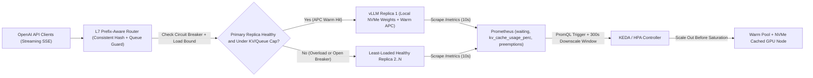
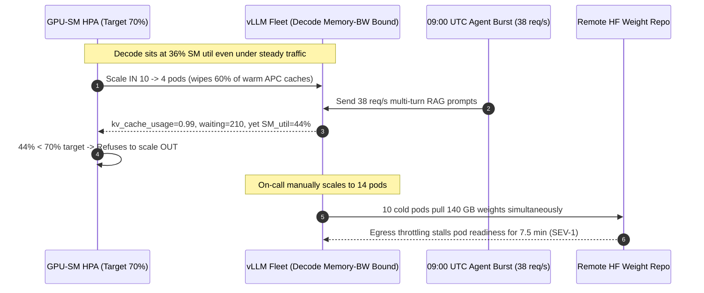

# Module 14: Autoscaling and Multi-Replica Serving

> **Prerequisites:** [Module 08: vLLM: Getting Started](../08-vllm-getting-started/README.md), [Module 09: vLLM: Configuration and Tuning](../09-vllm-configuration-and-tuning/README.md), and [Module 13: Benchmarking Throughput and Latency](../13-benchmarking-throughput-and-latency/README.md).  
> **Estimated Reading Time:** 40 minutes  
> **Target Audience:** AI Platform Engineers, Distributed Inference Architects, Kubernetes & Production SREs

> [!TIP]
> **The Golden Rule of Multi-Replica LLM Orchestration:** Never autoscale vLLM pods on CPU% or GPU SM Utilization (`DCGM_FI_DEV_GPU_UTIL`), and never balance multi-turn or RAG traffic with stateless Round-Robin. Autoregressive decode is HBM memory-bandwidth bound—hovering at `~30%–45%` SM compute utilization even while `vllm:kv_cache_usage_perc` hits `98%` and request queues explode. Scale via **KEDA / HPA on `vllm:num_requests_waiting` and KV-cache headroom (`vllm:kv_cache_usage_perc` / V0 `vllm:gpu_cache_usage_perc`)**, route requests with **bounded-load prefix-aware consistent hashing**, and shrink `5`-minute container weight pulls down to `< 45 s` using **NVMe node pre-staging, streaming safetensors, warm buffers, and gateway circuit breakers**.

---

## Why This Matters

Once a workload outgrows a single vLLM node (`Module 13`), teams drop `4` replicas behind a standard Kubernetes `Service` or Nginx Round-Robin ingress and attach an HPA targeting `70%` GPU SM utilization. Two failure modes strike almost immediately:

1. **False Scale-In Under Saturation:** At `09:00 AM`, customer traffic triples. Decode stays HBM bandwidth bound, so `DCGM_FI_DEV_GPU_UTIL` reports `36%` while `vllm:num_requests_waiting` piles past `160` and `p95 TTFT` hits `9.5 seconds`. Seeing `36% < 70%`, the autoscaler **kills half your replicas** right in the middle of peak traffic!
2. **Cache-Thrashing Load Balancers:** Eight replicas each cache `30 GiB` of `16`-token prefix blocks (`APC`). Yet stateless Round-Robin sprays sequential requests from the same RAG agent or tenant across all `8` pods, slashing cluster APC hit rates from `~95%` down to `~12%` and forcing `7x` redundant prefill compute.

Scaling a multi-replica LLM fleet demands **LLM-native signals** at both the L7 gateway and the Kubernetes autoscaler.

---

## 1. Multi-Replica Routing, Prefix Affinity & Telemetry-Driven Autoscaling

A production vLLM serving plane pairs a **KV-Prefix & Queue-Aware L7 Gateway** (such as `vllm-project/production-stack` router or an Envoy/Go/Rust semantic proxy) with a **Prometheus + KEDA** control loop and **pre-staged model weights** on GPU worker nodes.



### Why CPU% and GPU SM Utilization Fail Catastrophically

Standard Kubernetes HPA tracks CPU% or GPU SM active cycles (`DCGM_FI_DEV_GPU_UTIL`):

- **CPU% stays near `5%–15%`:** Tokenization and FastAPI/ZeroMQ serialization barely touch host CPU cores while GPUs choke.
- **GPU SM Utilization misleads in both directions:** As derived in [Module 01](../01-inference-vs-training-workloads/README.md), low-batch autoregressive decode executes `~2 * B` FLOPs per byte read from HBM—an order of magnitude below H100's `~295 FLOP/byte` compute ridge point. Worse, `DCGM_FI_DEV_GPU_UTIL` measures the fraction of time *at least one* CUDA kernel ran during a sample window, NOT Tensor Core saturation! A single `B=1` stream can show `95%` GPU util while `99%` of Tensor Core arithmetic sits idle, or memory-stall gaps can show `34%` util while the KV pool hits `100%` capacity and triggers preemption storms.

Instead, autoscale strictly on **vLLM engine queue and memory signals** (note the V0 vs. V1 metric alias):

| Signal | V1 Metric (`>= v0.8` V1) | V0 Legacy Metric | Healthy Range | Scale-Out / Shed Action |
| :--- | :--- | :--- | :--- | :--- |
| **Waiting Queue Depth** | `vllm:num_requests_waiting` | `vllm:num_requests_waiting` | `0–3` per replica | Scale out when avg waiting per replica `>= 4` |
| **KV Pool Occupancy** | `vllm:kv_cache_usage_perc` | `vllm:gpu_cache_usage_perc` | `< 0.72` | Scale out at `>= 0.75`; shed/spill at `>= 0.85` |
| **Preemption Rate** | `vllm:num_preemptions_total` | `vllm:num_preemptions_total` | `0 / sec` | Page SRE immediately if `rate > 0`; shed burst |
| **TTFT Headroom** | `vllm:time_to_first_token_seconds` | `vllm:time_to_first_token_seconds` | `p95 <= 0.8 * SLO` | Proactive autoscale before Goodput knee (`Module 13`) |

> **V0 vs. V1 Metric Alert Trap:** VLLM V0 exposed `vllm:gpu_cache_usage_perc`, whereas V1 standardized on **`vllm:kv_cache_usage_perc`**. Always check `/metrics` on your pinned container image (or use `max(vllm:kv_cache_usage_perc or vllm:gpu_cache_usage_perc)`) so an engine upgrade never breaks your KEDA scaler silently!

### KV-Cache Prefix-Aware Routing with Bounded Load

Under stateless Round-Robin across $R$ independent replicas, a repeated $P$-token system/RAG prefix must be cached separately on *all* $R$ GPUs—shrinking effective cluster prefix capacity by $R\times$:

$$\text{Cluster Effective Unique Prefix Capacity} = \begin{cases} C_{\text{replica}} & \text{Round-Robin (replicated } R\text{ times)} \\ R \cdot C_{\text{replica}} & \text{Prefix-Consistent Sharding} \end{cases}$$

To unlock $R\times$ cluster cache memory without overloading popular tenants:

1. **Extract Canonical Prefix Key:** Hash the immutable leading token block / `system + tool_defs + doc_prefix` (for example, first `512` characters or canonical prefix token slice aligned to `16`-token APC blocks) via SHA-256 / Rendezvous (Highest Random Weight) hashing across active replica IDs.
2. **Enforce Bounded Load (`(1 + epsilon) * avg_load`):** Pure consistent hashing creates hot spots when one enterprise tenant sends `40%` of requests. If the primary affinity replica exceeds either a **KV headroom cap** (`kv_usage >= 0.85`), a **waiting queue cap** (`waiting >= Q_max`), or a **bounded-load factor** (`active_load > (1 + epsilon) * cluster_avg`), spill gracefully to the next ranked replica in the hash preference list (or the least-loaded healthy replica).

### Cold-Start Weight-Pulling Math & Asymmetric Stabilization

Even the sharpest KEDA rule fails if new GPU pods take `6 minutes` to come ready. Total scale-out reaction delay $T_{\text{scale}}$ is:

$$T_{\text{scale}} = T_{\text{scrape}} + T_{\text{KEDA\_eval}} + T_{\text{node\_prov}} + T_{\text{pull\_weights}} + T_{\text{load\_CUDA\_graph}}$$

During $T_{\text{scale}}$, existing $R$ replicas must absorb traffic surges using reserved **headroom** (`1 - theta_scale`):

$$\text{Required Buffer Headroom} \;\Delta C \ge \int_{0}^{T_{\text{scale}}} \max\!\big(0,\; \lambda(t) - R \cdot \mu_{\text{goodput}}\big)\,dt$$

Cutting $T_{\text{scale}}$ from `360 s` to `40 s` reduces burst queue accumulation **`9x`**:

1. **Eliminate Live HuggingFace Downloads at Pod Boot:** Pulling `140 GB` of `70B` weights over public egress at `~400 MB/s` takes `~350 s`. Instead, mount pre-warmed **node-local NVMe HostPath/DaemonSet caches** (`> 5 GB/s` local disk), stream directly from S3/GCS with `Run:ai Model Streamer` / parallel `safetensors` (`10+ GB/s`), or bake weights into snapshot-backed node AMIs.
2. **Maintain a Warm Headroom Buffer:** Set `theta_kv = 0.72` (not `0.90`) and keep `minReplicaCount >= 2` (or `1` warm standby node) so sudden step bursts never hit `0.98` KV exhaustion before new pods pass `GET /health`.
3. **Asymmetric Cooldown (`stabilizationWindowSeconds: 300`):** Scale **UP** rapidly (`15–30 s` window) when queues grow, but wait **`>= 300 s`** before scaling **DOWN**. Rapid scale-in destroys warm `APC` KV caches and triggers violent scale-up/scale-down flapping (`thrashing`).
4. **Replica Failover & Circuit Breakers:** Track per-replica consecutive `5xx`/stream-timeouts (`OPEN` after `3` failures for `15 s` cooldown, `HALF_OPEN` single probe) and shed overflow with `HTTP 429` + `Retry-After` if *all* healthy replicas exceed `max_queue`.

---

## 2. Systematic Comparison Matrix: Routing & Autoscaling Strategies

| Strategy | Metric / Key Used | Cluster APC Efficiency | Tail Latency (`p95/p99`) | Failure / Thrash Risk | Recommended Use Case |
| :--- | :--- | :--- | :--- | :--- | :--- |
| **Stateless Round-Robin + CPU/GPU-SM HPA** | Modulo counter + `DCGM_FI_DEV_GPU_UTIL` | Poor ($1/R$) | Collapses under load | **Severe** (false scale-in at ~35% SM) | Never use for production LLMs |
| **Least-In-Flight Connections** | Active HTTP stream count | Poor ($1/R$) | Good for zero-prefix chat | Low skew, misses prefill cache hits | Short one-off queries with zero shared prefix |
| **Pure Prefix Consistent Hash** | `SHA256(prefix_slice)` -> Ring | Peak ($R\times$ cache) | Excellent until hot tenant skews | **High skew** if one tenant bursts `50%` | Uniformly distributed multi-tenant prefixes only |
| **Bounded-Load Prefix Hash + KEDA (`waiting` & `kv_perc`)** | Prefix hash + `waiting` + `kv_cache_usage_perc` | Near-peak (`90%–96%` hit) | **Lowest `p95`/`p99` TTFT** | Bounded skew + `300 s` scale-in guard | **Production Default** for RAG, agents & multi-tenant APIs |
| **Disaggregated Prefill / Decode (`P/D` Pools)** | Separate Prefill & Decode clusters + KV transfer | Dedicated pools | Eliminates P-D interference | Highest infra complexity (NIXL/RDMA) | Ultra-long-context (`32K–128K`) hyperscale fleets |

---

## 3. Production War Story Post-Mortem: The \$92,000 SM-Utilization Scale-In Spiral & Weight-Pull Storm

| Field | Incident Details |
| :--- | :--- |
| **Severity** | **SEV-1** (Multi-Region Inference Outage & Cascading HTTP `504` Timeouts) |
| **Detection / Resolution Time** | Triggered at 08:55 UTC Monday peak / Mitigated in 52 minutes via manual replica lock + emergency NVMe weight mount |
| **Impact** | Fleet dropped from `10` to `4` pods just before peak traffic; replacement pods took `7.5 minutes` to pull `140 GB` weights; **\$92,000** enterprise SLA breach |

### What Happened

A SaaS platform ran `Llama-3.1-70B-Instruct` (`TP=4`) on Kubernetes with `HPA` targeting `DCGM_FI_DEV_GPU_UTIL = 70%`, `minReplicas: 4`, `maxReplicas: 16`, and pods downloading model weights from HuggingFace Hub into an ephemeral `emptyDir` at boot.

Between `08:30` and `08:55 UTC`, steady conversational decode traffic kept `DCGM_FI_DEV_GPU_UTIL` hovering between `32%` and `41%` across `10` warm replicas. Seeing utilization well below `70%`, Kubernetes HPA quietly **scaled the deployment DOWN from `10` pods to `4` pods**, wiping out `60%` of the fleet's warm APC KV caches.

At `09:00 UTC`, automated enterprise cron agents burst `38 req/s`. The `4` remaining pods saturated immediately (`vllm:kv_cache_usage_perc = 0.99`, `vllm:num_requests_waiting = 210`). Because memory-bandwidth-bound decode still held SM util at `44%`, HPA refused to scale up for `14` minutes until manual intervention bumped `replicas = 14`—at which point `10` brand-new pods concurrently saturated NAT egress downloading `140 GB` weights each (`~7.5 min` boot lag!).



### Root Cause Analysis

1. **GPU SM Utilization Blindness:** `DCGM_FI_DEV_GPU_UTIL` never crossed `45%` during memory-bandwidth-bound decode saturation, actively triggering scale-in right before traffic spiked.
2. **Cold Egress Weight Pulls (`~7.5 min`):** Downloading `140 GB` per pod over shared egress at boot stretched `T_scale` far longer than burst tolerance.
3. **Aggressive Scale-In Destroying Warm APC State:** Short scale-down stabilization evicted warm prefix blocks right before morning traffic.

### The Fix & Architectural Hardening

- **KEDA on Queue Depth + KV Headroom:** Replaced SM-utilization HPA with KEDA querying `avg(vllm:num_requests_waiting) > 4` OR `max(vllm:kv_cache_usage_perc) > 0.72`, paired with `stabilizationWindowSeconds: 300` on scale-down.
- **NVMe DaemonSet Model Cache + `minReplicas: 6` Warm Floor:** Pre-synced `safetensors` shards onto local NVMe node storage (`< 40 s` weight load) and enforced bounded-load prefix routing plus `HTTP 429` gateway load shedding whenever all replicas exceeded `kv >= 0.88`.

---

## 4. Multi-Language Production Implementation: Bounded-Load Prefix-Aware Router, Circuit Breaker & KEDA Scaler

Below is a production-ready **Multi-Replica Bounded-Load Prefix-Aware Router & Autoscaling Evaluator** in **Go**, **TypeScript**, **Python**, and **C#**. It computes deterministic Rendezvous (HRW) SHA-256 affinity over canonical prompt prefixes, spills gracefully to the least-loaded healthy replica whenever the primary exceeds `(1 + epsilon) * avg_load` or `kv_usage >= 0.85`, trips per-replica circuit breakers on consecutive errors with half-open recovery probes, sheds excess traffic with `HTTP 429` under fleet saturation, and evaluates KEDA scale-out/scale-in decisions with asymmetric cooldowns.

````carousel

```go
package vllmrouter

import (
	"crypto/sha256"
	"encoding/binary"
	"errors"
	"sort"
	"sync"
	"time"
)

var (
	ErrFleetSaturated = errors.New("all replicas saturated: shed with HTTP 429")
	ErrNoHealthyNodes = errors.New("no healthy replicas available")
)

type ReplicaState struct {
	ID             string
	WaitingQueue   int
	RunningSeqs    int
	KVUsagePerc    float64
	Failures       int
	CircuitOpenEnd time.Time
}

type RouterConfig struct {
	MaxKVUsage      float64
	MaxWaitingQueue int
	LoadBoundFactor float64 // e.g., 1.35
	FailureLimit    int
	BreakerCooldown time.Duration
}

type PrefixRouter struct {
	mu       sync.RWMutex
	replicas map[string]*ReplicaState
	cfg      RouterConfig
}

func NewPrefixRouter(ids []string, cfg RouterConfig) *PrefixRouter {
	m := make(map[string]*ReplicaState, len(ids))
	for _, id := range ids {
		m[id] = &ReplicaState{ID: id}
	}
	return &PrefixRouter{replicas: m, cfg: cfg}
}

func hrwScore(prefixKey, replicaID string) uint64 {
	sum := sha256.Sum256([]byte(prefixKey + "|" + replicaID))
	return binary.BigEndian.Uint64(sum[:8])
}

func (r *PrefixRouter) Route(prefixKey string, now time.Time) (string, error) {
	r.mu.RLock()
	defer r.mu.RUnlock()

	var healthy []*ReplicaState
	totalLoad := 0
	for _, rep := range r.replicas {
		if now.Before(rep.CircuitOpenEnd) {
			continue
		}
		healthy = append(healthy, rep)
		totalLoad += rep.WaitingQueue + rep.RunningSeqs
	}
	if len(healthy) == 0 {
		return "", ErrNoHealthyNodes
	}

	avgLoad := float64(totalLoad) / float64(len(healthy))
	sort.Slice(healthy, func(i, j int) bool {
		return hrwScore(prefixKey, healthy[i].ID) > hrwScore(prefixKey, healthy[j].ID)
	})

	// Pass 1: Bounded-load affinity match preserving APC locality
	for _, rep := range healthy {
		repLoad := float64(rep.WaitingQueue + rep.RunningSeqs)
		underBound := repLoad <= avgLoad*r.cfg.LoadBoundFactor || repLoad <= 4
		if underBound && rep.KVUsagePerc < r.cfg.MaxKVUsage && rep.WaitingQueue < r.cfg.MaxWaitingQueue {
			return rep.ID, nil
		}
	}

	// Pass 2: Spill to least-loaded replica still below hard shed limits
	sort.Slice(healthy, func(i, j int) bool {
		return (healthy[i].WaitingQueue + healthy[i].RunningSeqs) < (healthy[j].WaitingQueue + healthy[j].RunningSeqs)
	})
	best := healthy[0]
	if best.KVUsagePerc >= 0.92 || best.WaitingQueue >= r.cfg.MaxWaitingQueue*2 {
		return "", ErrFleetSaturated
	}
	return best.ID, nil
}

func (r *PrefixRouter) RecordFailure(replicaID string, now time.Time) {
	r.mu.Lock()
	defer r.mu.Unlock()
	if rep, ok := r.replicas[replicaID]; ok {
		rep.Failures++
		if rep.Failures >= r.cfg.FailureLimit {
			rep.CircuitOpenEnd = now.Add(r.cfg.BreakerCooldown)
		}
	}
}

func (r *PrefixRouter) RecordSuccess(replicaID string) {
	r.mu.Lock()
	defer r.mu.Unlock()
	if rep, ok := r.replicas[replicaID]; ok {
		rep.Failures = 0
		rep.CircuitOpenEnd = time.Time{}
	}
}
```

<!-- slide -->

```typescript
import { createHash } from "node:crypto";

export interface ReplicaSnapshot {
  readonly id: string;
  waitingQueue: number;
  runningSeqs: number;
  kvUsagePerc: number;
  consecutiveFailures: number;
  circuitOpenUntilMs: number;
}

export interface RouterPolicy {
  readonly maxKvUsage: number;       // e.g., 0.85
  readonly maxWaitingQueue: number;  // e.g., 16
  readonly loadBoundFactor: number;  // e.g., 1.35
  readonly failureThreshold: number; // e.g., 3
  readonly breakerCooldownMs: number;
}

export type RouteDecision =
  | { readonly action: "FORWARD"; readonly replicaId: string; readonly affinityHit: boolean }
  | { readonly action: "SHED_429"; readonly reason: string };

function rendezvousHash(prefixKey: string, replicaId: string): bigint {
  const hex = createHash("sha256").update(`${prefixKey}|${replicaId}`).digest("hex").slice(0, 16);
  return BigInt(`0x${hex}`);
}

export class BoundedPrefixRouter {
  private readonly nodes = new Map<string, ReplicaSnapshot>();

  constructor(replicaIds: readonly string[], private readonly policy: RouterPolicy) {
    for (const id of replicaIds) {
      this.nodes.set(id, {
        id,
        waitingQueue: 0,
        runningSeqs: 0,
        kvUsagePerc: 0,
        consecutiveFailures: 0,
        circuitOpenUntilMs: 0,
      });
    }
  }

  route(prefixKey: string, nowMs: number = Date.now()): RouteDecision {
    const healthy = [...this.nodes.values()].filter((n) => nowMs >= n.circuitOpenUntilMs);
    if (healthy.length === 0) {
      return { action: "SHED_429", reason: "all_circuit_breakers_open" };
    }

    const totalLoad = healthy.reduce((acc, n) => acc + n.waitingQueue + n.runningSeqs, 0);
    const avgLoad = totalLoad / healthy.length;

    const ranked = [...healthy].sort((a, b) => {
      const ha = rendezvousHash(prefixKey, a.id);
      const hb = rendezvousHash(prefixKey, b.id);
      return hb > ha ? 1 : hb < ha ? -1 : 0;
    });

    for (let i = 0; i < ranked.length; i += 1) {
      const cand = ranked[i];
      const load = cand.waitingQueue + cand.runningSeqs;
      const withinBound = load <= avgLoad * this.policy.loadBoundFactor || load <= 4;
      if (
        withinBound &&
        cand.kvUsagePerc < this.policy.maxKvUsage &&
        cand.waitingQueue < this.policy.maxWaitingQueue
      ) {
        return { action: "FORWARD", replicaId: cand.id, affinityHit: i === 0 };
      }
    }

    const least = [...healthy].sort(
      (a, b) => a.waitingQueue + a.runningSeqs - (b.waitingQueue + b.runningSeqs),
    )[0];
    if (least.kvUsagePerc >= 0.92 || least.waitingQueue >= this.policy.maxWaitingQueue * 2) {
      return { action: "SHED_429", reason: "cluster_kv_and_queue_saturated" };
    }
    return { action: "FORWARD", replicaId: least.id, affinityHit: least.id === ranked[0].id };
  }

  reportOutcome(replicaId: string, ok: boolean, nowMs: number = Date.now()): void {
    const node = this.nodes.get(replicaId);
    if (!node) return;
    if (ok) {
      node.consecutiveFailures = 0;
      node.circuitOpenUntilMs = 0;
    } else {
      node.consecutiveFailures += 1;
      if (node.consecutiveFailures >= this.policy.failureThreshold) {
        node.circuitOpenUntilMs = nowMs + this.policy.breakerCooldownMs;
      }
    }
  }
}
```

<!-- slide -->

```python
"""
bounded_prefix_router.py
Multi-replica KV-prefix-aware Rendezvous router with circuit breakers and KEDA scaling advice.
"""
from dataclasses import dataclass
import hashlib
import math
import time


@dataclass
class ReplicaHealth:
    replica_id: str
    waiting: int = 0
    running: int = 0
    kv_usage_perc: float = 0.0
    failures: int = 0
    breaker_open_until: float = 0.0


@dataclass(frozen=True)
class RouteResult:
    shed_429: bool
    replica_id: str
    reason: str


def _hrw_score(prefix_key: str, replica_id: str) -> int:
    digest = hashlib.sha256(f"{prefix_key}|{replica_id}".encode("utf-8")).digest()
    return int.from_bytes(digest[:8], "big")


class BoundedPrefixRouter:
    def __init__(
        self,
        replica_ids: list[str],
        max_kv: float = 0.85,
        max_waiting: int = 16,
        bound_factor: float = 1.35,
        failure_limit: int = 3,
        cooldown_s: float = 15.0,
    ) -> None:
        self.replicas = {rid: ReplicaHealth(rid) for rid in replica_ids}
        self.max_kv = max_kv
        self.max_waiting = max_waiting
        self.bound_factor = bound_factor
        self.failure_limit = failure_limit
        self.cooldown_s = cooldown_s

    def select_replica(self, prefix_key: str, now: float | None = None) -> RouteResult:
        t = time.monotonic() if now is None else now
        healthy = [r for r in self.replicas.values() if t >= r.breaker_open_until]
        if not healthy:
            return RouteResult(shed_429=True, replica_id="", reason="all_breakers_open")

        avg_load = sum(r.waiting + r.running for r in healthy) / len(healthy)
        ranked = sorted(healthy, key=lambda r: _hrw_score(prefix_key, r.replica_id), reverse=True)

        for idx, rep in enumerate(ranked):
            load = rep.waiting + rep.running
            under_bound = (load <= avg_load * self.bound_factor) or (load <= 4)
            if under_bound and rep.kv_usage_perc < self.max_kv and rep.waiting < self.max_waiting:
                tag = "primary_apc_affinity" if idx == 0 else "bounded_spill_affinity"
                return RouteResult(shed_429=False, replica_id=rep.replica_id, reason=tag)

        least = min(healthy, key=lambda r: (r.waiting + r.running, r.kv_usage_perc))
        if least.kv_usage_perc >= 0.92 or least.waiting >= self.max_waiting * 2:
            return RouteResult(shed_429=True, replica_id="", reason="fleet_kv_saturated")
        return RouteResult(shed_429=False, replica_id=least.replica_id, reason="least_loaded_fallback")

    def record_result(self, replica_id: str, ok: bool, now: float | None = None) -> None:
        rep = self.replicas.get(replica_id)
        if rep is None:
            return
        if ok:
            rep.failures = 0
            rep.breaker_open_until = 0.0
        else:
            rep.failures += 1
            if rep.failures >= self.failure_limit:
                rep.breaker_open_until = (time.monotonic() if now is None else now) + self.cooldown_s

    def recommend_replicas(self, min_rep: int = 2, max_rep: int = 16, target_wait_per_rep: float = 4.0) -> int:
        active = list(self.replicas.values())
        if not active:
            return min_rep
        total_waiting = sum(r.waiting for r in active)
        max_kv = max(r.kv_usage_perc for r in active)
        desired = len(active)
        if total_waiting / len(active) >= target_wait_per_rep or max_kv >= 0.72:
            desired = max(len(active) + 1, math.ceil(len(active) * max(max_kv / 0.65, (total_waiting / len(active)) / target_wait_per_rep)))
        elif total_waiting == 0 and max_kv < 0.35 and len(active) > min_rep:
            desired = len(active) - 1  # Gate with 300s KEDA stabilizationWindowSeconds before executing
        return max(min_rep, min(max_rep, desired))
```

<!-- slide -->

```csharp
using System;
using System.Collections.Generic;
using System.Linq;
using System.Security.Cryptography;
using System.Text;

namespace GenAI.MultiReplicaRouter;

public sealed class ReplicaStatus
{
    public required string Id { get; init; }
    public int WaitingQueue { get; set; }
    public int RunningSeqs { get; set; }
    public double KvUsagePerc { get; set; }
    public int ConsecutiveFailures { get; set; }
    public DateTimeOffset BreakerOpenUntil { get; set; } = DateTimeOffset.MinValue;
}

public sealed record RouteOutcome(bool Shed429, string? ReplicaId, string Reason);

public sealed class BoundedPrefixRouter
{
    private readonly Dictionary<string, ReplicaStatus> _replicas = new();
    private readonly double _maxKv;
    private readonly int _maxWaiting;
    private readonly double _boundFactor;
    private readonly int _failureLimit;
    private readonly TimeSpan _cooldown;

    public BoundedPrefixRouter(
        IEnumerable<string> replicaIds,
        double maxKv = 0.85,
        int maxWaiting = 16,
        double boundFactor = 1.35,
        int failureLimit = 3,
        TimeSpan? cooldown = null)
    {
        _maxKv = maxKv;
        _maxWaiting = maxWaiting;
        _boundFactor = boundFactor;
        _failureLimit = failureLimit;
        _cooldown = cooldown ?? TimeSpan.FromSeconds(15);
        foreach (var id in replicaIds)
            _replicas[id] = new ReplicaStatus { Id = id };
    }

    private static ulong HrwHash(string prefixKey, string replicaId)
    {
        byte[] bytes = SHA256.HashData(Encoding.UTF8.GetBytes($"{prefixKey}|{replicaId}"));
        return BitConverter.ToUInt64(bytes, 0);
    }

    public RouteOutcome Route(string prefixKey, DateTimeOffset now)
    {
        var healthy = _replicas.Values.Where(r => now >= r.BreakerOpenUntil).ToList();
        if (healthy.Count == 0)
            return new RouteOutcome(true, null, "all_breakers_open");

        double avgLoad = healthy.Average(r => r.WaitingQueue + r.RunningSeqs);
        var ranked = healthy.OrderByDescending(r => HrwHash(prefixKey, r.Id)).ToList();

        for (int i = 0; i < ranked.Count; i++)
        {
            var rep = ranked[i];
            int load = rep.WaitingQueue + rep.RunningSeqs;
            bool underBound = load <= avgLoad * _boundFactor || load <= 4;
            if (underBound && rep.KvUsagePerc < _maxKv && rep.WaitingQueue < _maxWaiting)
            {
                string tag = i == 0 ? "primary_apc_affinity" : "bounded_spill_affinity";
                return new RouteOutcome(false, rep.Id, tag);
            }
        }

        var least = healthy.OrderBy(r => r.WaitingQueue + r.RunningSeqs).First();
        if (least.KvUsagePerc >= 0.92 || least.WaitingQueue >= _maxWaiting * 2)
            return new RouteOutcome(true, null, "cluster_kv_saturated");

        return new RouteOutcome(false, least.Id, "least_loaded_fallback");
    }

    public void RecordOutcome(string replicaId, bool ok, DateTimeOffset now)
    {
        if (!_replicas.TryGetValue(replicaId, out var rep)) return;
        if (ok)
        {
            rep.ConsecutiveFailures = 0;
            rep.BreakerOpenUntil = DateTimeOffset.MinValue;
        }
        else
        {
            rep.ConsecutiveFailures++;
            if (rep.ConsecutiveFailures >= _failureLimit)
                rep.BreakerOpenUntil = now.Add(_cooldown);
        }
    }
}
```

````

---

## 5. Practical Hands-On Verification CLI Workflows

Workflows 1 and 2 run cleanly offline via Python 3.13 stdlib (`hashlib`, `collections`, `random`, `math`); Workflow 3 provides a reference Kubernetes KEDA `ScaledObject` and Prometheus alert manifest for live cluster deployment.

### Workflow 1: Multi-Replica Prefix-Cache Affinity & Load-Skew Simulator

Simulate `4` vLLM replicas (each caching `12` hot prefix slots = `48` total cluster slots) serving `1,600` requests across `40` Zipf-skewed enterprise tenants comparing `round_robin`, `least_queue`, `pure_prefix_hash`, and `bounded_prefix_hash`:

```bash
python -c '
import hashlib, random
from collections import OrderedDict

def sim_routing(policy: str, n_reqs: int = 1600, n_replicas: int = 4, cache_cap: int = 12, n_tenants: int = 40):
    rng = random.Random(7)
    caches = [OrderedDict() for _ in range(n_replicas)]
    loads = [0.0] * n_replicas
    hits = 0
    ttfts = []
    max_q = 0
    weights = [1.0 / ((i + 1) ** 1.1) for i in range(n_tenants)]
    total_w = sum(weights)
    probs = [w / total_w for w in weights]

    def pick_tenant():
        r = rng.random()
        acc = 0.0
        for idx, p in enumerate(probs):
            acc += p
            if r <= acc:
                return f"tenant_{idx:02d}_sys_prompt_v3"
        return f"tenant_{n_tenants-1:02d}_sys_prompt_v3"

    def hash_replicas(prefix: str):
        scored = []
        for rid in range(n_replicas):
            h = int(hashlib.sha256(f"{prefix}:{rid}".encode()).hexdigest(), 16)
            scored.append((h, rid))
        scored.sort(reverse=True)
        return [rid for _, rid in scored]

    for step in range(n_reqs):
        gap_ms = rng.expovariate(1.0 / 48.0)
        for rid in range(n_replicas):
            loads[rid] = max(0.0, loads[rid] - gap_ms)

        prefix = pick_tenant()
        if policy == "round_robin":
            chosen = step % n_replicas
        elif policy == "least_queue":
            chosen = min(range(n_replicas), key=lambda r: (loads[r], r))
        elif policy == "pure_prefix_hash":
            chosen = hash_replicas(prefix)[0]
        else:
            ranked = hash_replicas(prefix)
            avg_load = sum(loads) / n_replicas
            for cand in ranked:
                if loads[cand] <= max(160.0, 1.35 * avg_load):
                    chosen = cand
                    break
            else:
                chosen = min(range(n_replicas), key=lambda r: loads[r])

        if prefix in caches[chosen]:
            hits += 1
            caches[chosen].move_to_end(prefix)
            prefill_ms = 24.0
        else:
            if len(caches[chosen]) >= cache_cap:
                caches[chosen].popitem(last=False)
            caches[chosen][prefix] = True
            prefill_ms = 240.0

        ttft = loads[chosen] + prefill_ms
        loads[chosen] += prefill_ms
        max_q = max(max_q, int(loads[chosen] // 60.0))
        ttfts.append(ttft)

    ttfts.sort()
    p50 = ttfts[int(0.50 * (n_reqs - 1))]
    p95 = ttfts[int(0.95 * (n_reqs - 1))]
    p99 = ttfts[int(0.99 * (n_reqs - 1))]
    hit_pct = hits / n_reqs * 100.0
    print(f"{policy:<19} | APC_hit={hit_pct:5.1f}% | p50_TTFT={p50:5.1f} ms | p95_TTFT={p95:6.1f} ms | p99_TTFT={p99:6.1f} ms | max_q={max_q:2d}")

for p in ["round_robin", "least_queue", "pure_prefix_hash", "bounded_prefix_hash"]:
    sim_routing(p)
'
```

**Expected Output:**

```text
round_robin         | APC_hit= 66.2% | p50_TTFT=112.6 ms | p95_TTFT= 424.9 ms | p99_TTFT= 566.6 ms | max_q=12
least_queue         | APC_hit= 66.1% | p50_TTFT= 24.0 ms | p95_TTFT= 287.5 ms | p99_TTFT= 396.1 ms | max_q= 8
pure_prefix_hash    | APC_hit= 96.9% | p50_TTFT= 24.0 ms | p95_TTFT= 186.3 ms | p99_TTFT= 355.7 ms | max_q=11
bounded_prefix_hash | APC_hit= 95.9% | p50_TTFT= 24.0 ms | p95_TTFT= 148.7 ms | p99_TTFT= 277.1 ms | max_q= 7
```

Look closely: `round_robin` thrashes caches (`66.2%` APC hit, `424.9 ms` `p95 TTFT`), `pure_prefix_hash` spikes queue depth on hot Zipf tenants (`max_q=11`, `355.7 ms` `p99`), and **`bounded_prefix_hash` delivers `95.9%` APC hits alongside the lowest `p95` (`148.7 ms`), lowest `p99` (`277.1 ms`), and shallowest queue (`max_q=7`)**.

### Workflow 2: GPU-SM HPA vs. vLLM KEDA Autoscaler + Cold-Start Weight Lag Trace

Simulate a `20`-minute diurnal traffic wave (`14 -> 38 -> 14 req/s`, `10 s` ticks) comparing SM-utilization HPA against KEDA on waiting queue + KV headroom with `300 s` cold pulls vs. `40 s` NVMe pre-staged weights:

```bash
python -c '
import math

def sim_autoscale(policy: str, boot_delay_ticks: int, cooldown_ticks: int, min_rep_floor: int = 2):
    replicas = 4
    pending_boots = []
    cooldown_rem = 0
    cap_per_rep = 6.0
    kv_cap_per_rep = 32.0
    waiting = 0.0
    preemptions = 0
    sla_breach_ticks = 0
    min_rep, max_rep = 4, 4

    for t in range(120):
        lam = 38.0 if 20 <= t < 60 else 14.0
        still_booting = []
        for ready_t in pending_boots:
            if ready_t <= t:
                replicas += 1
            else:
                still_booting.append(ready_t)
        pending_boots = still_booting

        served = replicas * cap_per_rep
        waiting = max(0.0, waiting + (lam - served) * 10.0)
        active_load = min(lam, served) + waiting * 0.1
        kv_usage = min(1.0, active_load / (replicas * kv_cap_per_rep / 3.0))
        sm_util = min(46.0, 22.0 + 18.0 * min(1.0, lam / max(1.0, served)))

        if kv_usage >= 0.94 or waiting > 35:
            preemptions += int(max(1, waiting // 25))
            sla_breach_ticks += 1
        elif waiting > 12:
            sla_breach_ticks += 1

        total_planned = replicas + len(pending_boots)
        if policy == "gpu_sm_hpa":
            desired = max(min_rep_floor, min(12, math.ceil(replicas * (sm_util / 70.0))))
            if desired > total_planned:
                for _ in range(desired - total_planned):
                    pending_boots.append(t + boot_delay_ticks)
            elif desired < replicas and cooldown_rem == 0:
                replicas = max(min_rep_floor, replicas - 1)
                cooldown_rem = cooldown_ticks
        else:
            need_up = (waiting / replicas >= 3.0) or (kv_usage >= 0.72) or (lam > total_planned * cap_per_rep * 0.80)
            if need_up and total_planned < 12:
                needed = min(12, max(total_planned + 1, math.ceil((lam + waiting / 20.0) / (cap_per_rep * 0.80))))
                for _ in range(needed - total_planned):
                    pending_boots.append(t + boot_delay_ticks)
                cooldown_rem = cooldown_ticks
            elif not need_up and waiting == 0 and kv_usage < 0.45 and replicas > min_rep_floor and cooldown_rem == 0:
                replicas -= 1
                cooldown_rem = cooldown_ticks

        if cooldown_rem > 0:
            cooldown_rem -= 1
        min_rep = min(min_rep, replicas)
        max_rep = max(max_rep, replicas)

    print(f"{policy:<30} | rep={min_rep}..{max_rep:2d} | breach_ticks={sla_breach_ticks:3d}/120 | preemptions={preemptions:5d} | end_q={waiting:7.1f}")

sim_autoscale("gpu_sm_hpa", 18, 6, 2)
sim_autoscale("keda_cold_pull_300s", 30, 30, 2)
sim_autoscale("keda_nvme_prestage_40s", 4, 30, 2)
sim_autoscale("keda_nvme_40s_warm_floor4", 4, 30, 4)
'
```

**Expected Output:**

```text
gpu_sm_hpa                     | rep=2.. 4 | breach_ticks=113/120 | preemptions=36019 | end_q=11860.0
keda_cold_pull_300s            | rep=3..12 | breach_ticks= 44/120 | preemptions= 5618 | end_q=    0.0
keda_nvme_prestage_40s         | rep=3..12 | breach_ticks=  6/120 | preemptions=  112 | end_q=    0.0
keda_nvme_40s_warm_floor4      | rep=4..12 | breach_ticks=  6/120 | preemptions=   69 | end_q=    0.0
```

Look at the failure physics: `gpu_sm_hpa` scaled **down** to `2` replicas (`113/120` breach ticks, `11,860` queued requests); `keda_cold_pull_300s` burned `5,618` preemptions waiting `5` minutes for HF downloads; and `keda_nvme_40s_warm_floor4` cut preemptions **`98.8%`** (`5,618 -> 69`), with the remaining `60 s` transient absorbing the instantaneous step spike until the fast NVMe pods booted!

### Workflow 3: Reference Kubernetes KEDA `ScaledObject` & Prometheus Rule (Live Cluster)

Deploy KEDA scaling on **both** `vllm:num_requests_waiting` and KV cache pressure (`vllm:kv_cache_usage_perc` with V0 fallback) using asymmetric scale-down protection (`300 s`):

```yaml
apiVersion: keda.sh/v1alpha1
kind: ScaledObject
metadata:
  name: vllm-llama70b-scaler
  namespace: inference
spec:
  scaleTargetRef:
    name: vllm-llama70b
  pollingInterval: 10
  cooldownPeriod: 300
  minReplicaCount: 4
  maxReplicaCount: 16
  advanced:
    horizontalPodAutoscalerConfig:
      behavior:
        scaleUp:
          stabilizationWindowSeconds: 15
          policies:
            - type: Percent
              value: 100
              periodSeconds: 30
        scaleDown:
          stabilizationWindowSeconds: 300
          policies:
            - type: Pods
              value: 1
              periodSeconds: 120
  triggers:
    - type: prometheus
      metadata:
        serverAddress: http://prometheus-operated.monitoring.svc:9090
        query: avg(vllm:num_requests_waiting{deployment="vllm-llama70b"})
        threshold: "4"
    - type: prometheus
      metadata:
        serverAddress: http://prometheus-operated.monitoring.svc:9090
        query: max(vllm:kv_cache_usage_perc{deployment="vllm-llama70b"} or vllm:gpu_cache_usage_perc{deployment="vllm-llama70b"})
        threshold: "0.72"
```

### Hands-On Exercises

1. **Tune the Prefix Load Bound:** In Workflow 1, test `loadBoundFactor` values `1.05`, `1.35`, and `2.50`. Record the exact trade-off between `APC_hit%` and `max_q` / `p99_TTFT` on Zipf-skewed traffic.
2. **Achieve Zero Preemptions:** In Workflow 2, calculate what `min_rep_floor` warm standby buffer (plus proactive KV scaling trigger `0.62` instead of `0.72`) drops `preemptions` all the way to **`0`** under the `14 -> 38 req/s` instantaneous spike.
3. **Optional Live Cluster Validation:** Deploy the `ScaledObject` above alongside local NVMe `hostPath` model weights (`vLLM_LOGGING_LEVEL=INFO`) and measure actual pod `Ready` time during `replicas: 1 -> 2` scaling under `vllm bench serve` Poisson load.

### Independent Challenge

A financial-advisory team deploys `6` replicas of `Qwen-2.5-32B-Instruct` behind a Kubernetes `ClusterIP` Round-Robin service, with `512 GB` HF Hub model downloads on cold boot and an HPA rule `scale when DCGM_FI_DEV_GPU_UTIL > 75%`. Users complain of `6 s` `TTFT` even during quiet `15 req/s` mornings and total outages whenever bursts hit. Identify all **three architectural mistakes** and write the concrete remediation design covering routing, scaling signals, and cold-start buffering.

<details><summary>Architectural Discussion</summary>

1. **Mistake 1 (Stateless `ClusterIP` Round-Robin):** Destroys APC prefix cache locality across `6` replicas (`1/6` hit rate), forcing full recomputation of `4K–8K` advisory system prompts and pushing morning `TTFT` to `6 s`. **Fix:** Insert an L7 bounded-load prefix-consistent router (`production-stack` or Envoy/Go gateway) hashing leading `system + advisor_context` blocks while bounding per-pod queue/KV skew.
2. **Mistake 2 (HPA on `DCGM_FI_DEV_GPU_UTIL > 75%`):** Memory-bandwidth-bound decode stalls around `35%–45%` SM util even when queues overflow, preventing scale-out and causing false scale-in. **Fix:** Switch to KEDA querying `vllm:num_requests_waiting` (`threshold: 4`) and `vllm:kv_cache_usage_perc` (`threshold: 0.72`) with `stabilizationWindowSeconds: 300` on scale-down.
3. **Mistake 3 (Cold Network Weight Downloads):** Uncached Hub pulls introduce `4–8 min` scale-out lag (`T_scale`). **Fix:** Pre-stage weights on node-local NVMe via DaemonSet or parallel S3 streaming (`Run:ai Model Streamer`) + keep `>= 1` warm buffer replica and gateway `HTTP 429` load shedding above `kv >= 0.88`.

</details>

---

## 6. Common Mistakes & Troubleshooting

- **Using Kubernetes `ClusterIP` kube-proxy balancing for SSE streaming:** `kube-proxy` balances per TCP connection, not per HTTP request—meaning HTTP/2 or long-lived keep-alive pools from an API gateway stick permanently onto `1` or `2` vLLM pods! Always terminate TLS/HTTP/2 at an L7 AI gateway (`Envoy`, `production-stack`, or headless DNS pod discovery) so per-request routing actually reaches every pod.
- **Triggering autoscaling at `vllm:kv_cache_usage_perc >= 0.90`:** At `0.90`, active requests only need `10%` more decode tokens to hit `1.00` and start preempting during your `40–120 s` scale-out boot window. Trigger scale-out early at **`0.70–0.75`** (`30%` headroom buffer).
- **Omitting `stabilizationWindowSeconds` on scale-down:** Scaling in immediately after a `20 s` traffic lull kills warm APC replicas, forcing the next wave of requests onto cold GPUs with `0%` prefix cache hits. Keep scale-down cooldowns at **`300–600 s`**.
- **Pinning `pure_prefix_hash` without a load bound:** If `1` enterprise customer runs a CI batch against `1` system prompt, unbounded consistent hashing routes `100%` of that tenant's burst onto a single replica while `7` sibling replicas sit idle. Always enforce `(1 + epsilon)` load bounds + `max_kv` spill.

---

## 7. Operational Validation Checkpoints & Checkpoint Quiz

### Operational Validation Checkpoints

<details><summary><strong>Checkpoint 1: Diagnosing Why GPU-SM Autoscaling Scaled IN During Saturation</strong></summary>

During a `3x` traffic surge, Prometheus shows `vllm:num_requests_waiting = 95`, `vllm:kv_cache_usage_perc = 0.96`, and `vllm:num_preemptions_total` climbing rapidly—yet the Kubernetes HPA logs `current utilization: 38% (target 70%), scaling deployment from 8 -> 5 replicas`. Explain the physics behind `38%` utilization and specify the replacement KEDA signals.

**Validation:** Autoregressive decoding at production concurrencies sits far below GPU compute saturation because streaming weights and KV matrices from HBM memory bandwidth bottlenecks execution—leaving Tensor Cores idle `~60%+` of cycles (`38%` SM util) even when PagedAttention KV blocks hit `96%` and `95` requests wait in queue. Replace `DCGM_FI_DEV_GPU_UTIL` immediately with KEDA querying `vllm:num_requests_waiting` (e.g., `threshold: 4`) and `vllm:kv_cache_usage_perc` (`threshold: 0.72`).

</details>

<details><summary><strong>Checkpoint 2: Balancing Prefix-Cache Locality Against Hot-Tenant Skew</strong></summary>

Your team switches from Round-Robin to pure SHA-256 consistent hashing of `system_prompt` across `8` replicas. Average `APC` hit rate jumps from `18%` to `94%`, yet `p99 TTFT` worsens whenever Tenant A launches a bursty batch job. How do you preserve `> 90%` APC hits while capping `p99 TTFT`?

**Validation:** Pure consistent hashing pinned `100%` of Tenant A's burst onto one unlucky replica, creating an extreme hot-spot queue (`max_q` explosion) while sibling replicas sat idle. Implement **Bounded-Load Consistent Hashing** (HRW ranking): route to Tenant A's primary hash replica *only* while its queue/active load stays below `1.35 * cluster_avg` and `kv_usage < 0.85`; once exceeded, spill overflow seamlessly to the next highest-ranked healthy replica.

</details>

<details><summary><strong>Checkpoint 3: Preventing Cold-Start Weight-Pull Storms & Scale-Down Thrash</strong></summary>

Every time KEDA triggers a scale-out from `4` to `10` pods, `p99 TTFT` stays above `12 s` for `7 minutes` before stabilizing, and `10 minutes` later KEDA scales down so aggressively that the next burst hits cold pods again. Prescribe the two concrete fixes for weight startup lag and thrashing.

**Validation:** First, eliminate `5+ min` remote HuggingFace downloads by pre-staging weights on node-local NVMe via DaemonSet or parallel S3 `safetensors` streaming (`T_scale` drops from `360+ s` to `< 45 s`) and reserve warm buffer headroom (`theta_kv = 0.72`). Second, configure an asymmetric HPA/KEDA cooldown with `scaleUp.stabilizationWindowSeconds: 15` and `scaleDown.stabilizationWindowSeconds: 300` (limiting scale-in to `1` pod per `120 s`) so warm APC caches survive brief traffic dips.

</details>

### Checkpoint Quiz

1. Why do `CPU%` and `DCGM_FI_DEV_GPU_UTIL` fail as LLM horizontal autoscaling metrics?
2. Which Prometheus metric name changed between vLLM V0 and vLLM V1 for KV cache occupancy, and what safe threshold triggers scale-out before preemption?
3. Why does stateless Kubernetes `ClusterIP` balancing underperform on HTTP/2 clients AND hurt Automatic Prefix Caching (`APC`)?
4. Write the cold-start scale-out delay decomposition $T_{\text{scale}}$ and explain three ways to slash $T_{\text{scale}}$ under `60 seconds`.
5. Why should scale-down stabilization windows (`300–600 s`) be much longer than scale-up windows (`15–30 s`) in vLLM deployments?

<details><summary>Answers</summary>

1. Host CPU handles light tokenization (`~5%–15%`), while GPU decode is HBM memory-bandwidth bound (`~30%–45%` SM util even at `98%` KV exhaustion and huge waiting queues), causing HPA to under-report saturation or even scale down during traffic spikes.
2. V0 exposed `vllm:gpu_cache_usage_perc`, whereas V1 standardized on **`vllm:kv_cache_usage_perc`**. Trigger scale-out around **`0.70–0.75`** (`25%–30%` headroom) so new pods boot before KV occupancy hits `0.95–1.00` and triggers preemptions.
3. `kube-proxy` balances per TCP socket rather than per request (pinning persistent HTTP/2 pools to a subset of pods), and random per-pod spraying replicates shared prefixes $R\times$ instead of sharding them (`1/R` hit rate).
4. $T_{\text{scale}} = T_{\text{scrape}} + T_{\text{KEDA\_eval}} + T_{\text{node\_prov}} + T_{\text{pull\_weights}} + T_{\text{load\_CUDA\_graph}}$. Slash it via node-local NVMe weight caches, fast parallel S3 streaming (`Run:ai Model Streamer`), and warm node/pod pools.
5. Fast scale-up (`15–30 s`) caps burst queue growth, whereas aggressive scale-in destroys warm GPU `APC` prefix caches and causes rapid scale-out/scale-in thrashing across small traffic fluctuations.

</details>

---

## Further Reading & Sources

- [vLLM Production Stack (`vllm-project/production-stack`)](https://github.com/vllm-project/production-stack) — official Kubernetes reference architecture implementing prefix-aware routing, LMCache integration, and KEDA Prometheus autoscaling.
- [vLLM Documentation: Production Metrics (`/metrics`)](https://docs.vllm.ai/en/latest/design/metrics/) — authoritative definitions of `vllm:num_requests_waiting`, `vllm:kv_cache_usage_perc`, `vllm:num_preemptions_total`, and latency histograms.
- [KEDA Documentation: Prometheus Scaler](https://keda.sh/docs/) — official specification for `ScaledObject`, PromQL `threshold`, `pollingInterval`, and HPA stabilization policies.
- [Kubernetes Documentation: Horizontal Pod Autoscaling](https://kubernetes.io/docs/tasks/run-application/horizontal-pod-autoscale/) — custom metrics bridging and asymmetric `behavior.scaleUp`/`behavior.scaleDown` rules.

## Next

[Module 15: Capstone Project](../15-capstone-project/README.md)
