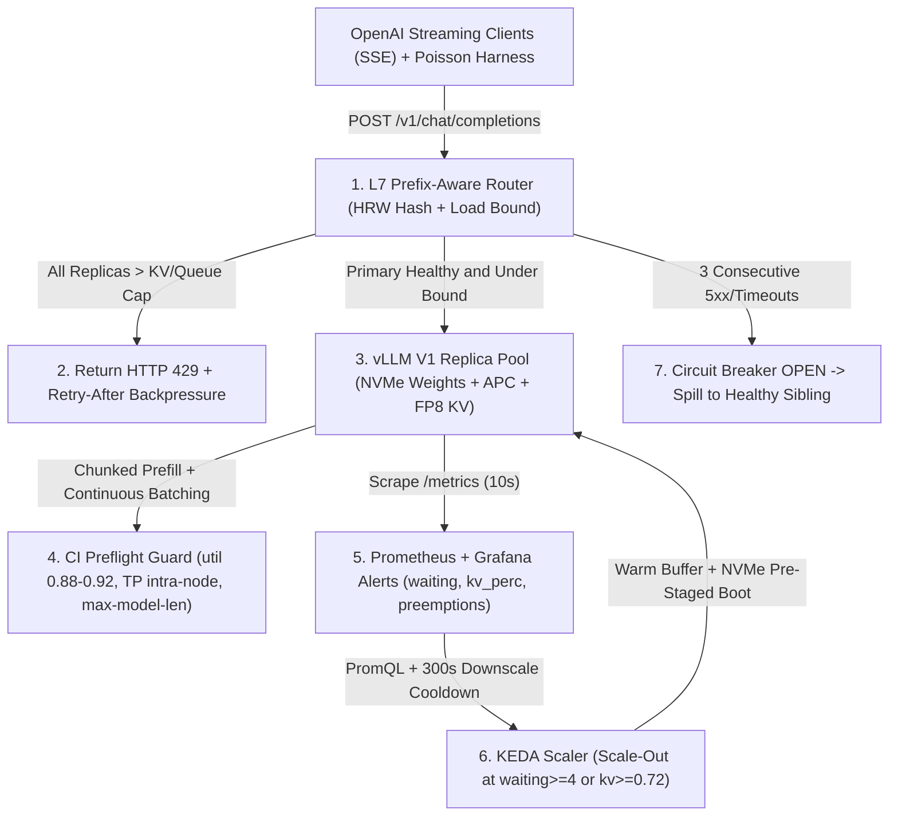
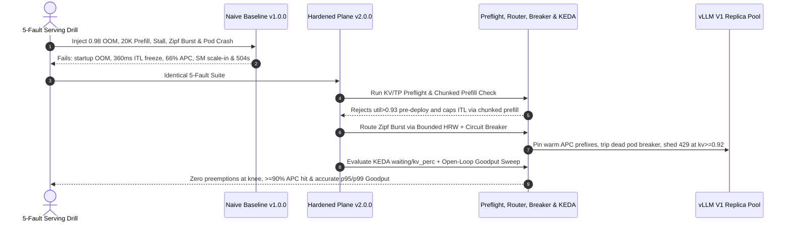

# Module 15: Capstone Project

> **Prerequisites:** Track 14 Modules 00–14 (especially [Module 04: KV Cache Memory Math](../04-kv-cache-memory-math/README.md), [Module 06: Continuous Batching](../06-continuous-batching/README.md), [Module 07: PagedAttention](../07-pagedattention/README.md), [Module 09: vLLM: Configuration and Tuning](../09-vllm-configuration-and-tuning/README.md), [Module 11: Quantized Serving: AWQ and GPTQ](../11-quantized-serving-awq-and-gptq/README.md), [Module 13: Benchmarking Throughput and Latency](../13-benchmarking-throughput-and-latency/README.md), and [Module 14: Autoscaling and Multi-Replica Serving](../14-autoscaling-and-multi-replica-serving/README.md)).  
> **Estimated Reading Time:** 25 minutes (Specification) / 6–8 hours (Implementation, Fault Injection & Benchmark Audit)  
> **Target Audience:** AI Infrastructure Engineers, Inference Platform Architects, MLOps & Production SREs

> [!TIP]
> **The Golden Rule of the vLLM Serving Capstone:** Never deploy an unvalidated single-node inference demo straight to production traffic. Every high-throughput LLM fleet must unite **physics-verified KV sizing** (`MHA`/`GQA`/`FP8`), **chunked-prefill SLA tuning**, **bounded-load prefix-aware L7 routing**, **open-loop Poisson Goodput certification**, and **queue/KV-driven KEDA autoscaling with pre-staged weights**. **No pre-solved codebase is provided here:** you must implement both a **Naive Baseline (`v1.0.0`)** and a **Production Serving Plane (`v2.0.0`)** from scratch, execute the mandatory 5-Fault Serving Drill, and publish paired telemetry in `SERVING_BENCHMARK_REPORT.md`.

---

## 1. Problem Statement & End-to-End Architecture

Across Modules 00–14, you derived KV cache memory budgets across MHA/GQA/FP8, traced static batching waste into continuous iteration-level scheduling, modeled PagedAttention `16`-token blocks, tuned vLLM chunked prefill and quantization (`AWQ`/`GPTQ`/`FP8`), eliminated Coordinated Omission in benchmarks, and designed prefix-aware multi-replica autoscalers.

Your capstone challenge is to synthesize those primitives into one **Production Multi-Replica vLLM Serving Plane, Prefix-Aware Router & Open-Loop SLA Benchmark Harness** tailored to a realistic enterprise inference workload—such as:

- **Multi-Tenant Enterprise RAG Copilot Hub:** Serves `4K–16K`-token prompts combining `1,500`-token per-tenant system/tool instructions with unique retrieved RAG contexts under strict interactive SLOs (`p95 TTFT <= 500 ms`, `p99 ITL <= 60 ms`), enforcing zero KV preemptions and `>= 90%` prefix-cache affinity.
- **High-Throughput Coding & Structured-JSON Agent Fleet:** Balances long-context code-diff prompts alongside low-latency token streaming across `4+` replicas, optimizing `W4A16 AWQ` / `FP8 KV` memory density and comparing `vLLM V1` vs. `SGLang`/`TensorRT-LLM` trade-offs in an Architecture Decision Record (`ADR.md`).
- **Bursty Multi-Region Internal Platform Gateway:** Absorbs `3x` diurnal traffic spikes safely using Prometheus + KEDA (`vllm:num_requests_waiting`, `vllm:kv_cache_usage_perc`) paired with node-local NVMe weight caching, replica circuit breakers, and graceful `HTTP 429` backpressure.

Regardless of domain, **you must author `ADR.md` (justifying KV precision, TP/PP topology, serving engine selection, and cold-start weight strategy), build both `v1.0.0` (Naive Baseline) and `v2.0.0` (Hardened Serving Plane), execute the mandatory 5-Fault SEV-1 Serving Drill, and publish honest paired numbers in `SERVING_BENCHMARK_REPORT.md`.**

### Target Production Multi-Replica vLLM Serving Architecture



---

## 2. Requirements Specification & Design Matrices

### Functional Requirements (FR)

- **FR-1 (`ADR.md` + Paired Baseline `v1.0.0` vs. Hardened `v2.0.0`):**
  - Author `ADR.md` covering model/hardware selection (`BF16` vs. `AWQ` vs. `FP8`), KV precision (`FP16` vs. `FP8`), intra-node `TP` vs. horizontal replication, engine choice (`vLLM V1` vs. `SGLang`/`TensorRT-LLM` tradeoffs), and weight cold-start mitigation.
  - Implement **`v1.0.0` Naive Baseline:** Uses unvalidated default `--gpu-memory-utilization`, unchunked prefill, stateless Round-Robin load balancing, GPU-SM-utilization autoscaling logic, and a closed-loop identical-prompt load script.
  - Implement **`v2.0.0` Production Serving Plane:** Full hardened architecture satisfying FR-2 through FR-5 deterministically.
- **FR-2 (KV Capacity Sizer & CI Preflight Validator):**
  - Implement a preflight CLI/library calculating exact per-token KV footprint ($2 \cdot L \cdot n_{\text{kv}} \cdot d_{\text{head}} \cdot b_{\text{KV}}$) across **MHA**, **GQA**, `FP16`, and `FP8` checkpoints, computing remaining $M_{\text{KV}}$ after weights and CUDA/NCCL overhead, capping `--max-model-len` and `--max-num-seqs`, rejecting `--gpu-memory-utilization > 0.93`, and banning cross-node `TP` (`TP > gpus_per_node`).
- **FR-3 (Chunked-Prefill Engine Configuration & Multi-Replica Bounded-Load Prefix Router):**
  - Configure vLLM (`--enable-chunked-prefill`, tuned `--max-num-batched-tokens`, `--enable-prefix-caching`, `--kv-cache-dtype fp8`) to isolate active decode streams from `20K`-token prefills.
  - Build an L7 SSE-streaming proxy implementing **Bounded-Load Rendezvous (HRW) Hashing** over leading prompt prefixes (`system + tenant/doc key`), spilling gracefully when the primary replica exceeds `(1 + epsilon) * avg_load` or `kv_usage >= 0.85`, isolating failed pods via per-replica **circuit breakers**, and shedding cluster overload via `HTTP 429`.
- **FR-4 (Prometheus/Grafana Observability & KEDA Queue/KV Autoscaler):**
  - Provide Prometheus scrape config, Grafana/Alertmanager rules (alerting immediately on `rate(vllm:num_preemptions_total[2m]) > 0`, `kv_cache_usage_perc >= 0.85`, and `TTFT/ITL` SLO burn), and a KEDA `ScaledObject` (supporting both V1 `vllm:kv_cache_usage_perc` and V0 `vllm:gpu_cache_usage_perc`, plus `stabilizationWindowSeconds: 300` scale-down cooldown).
- **FR-5 (Open-Loop Poisson Goodput Benchmark Harness):**
  - Build an asynchronous SSE benchmark runner generating open-loop Poisson arrivals (`Exp(lambda)`) anchored strictly to scheduled wall-clock timestamps (`t_sched`), salting unique prompt suffixes while preserving realistic prefix overlap (`20%–40%`), sweeping arrival rates, and computing **Goodput (req/s meeting simultaneous `TTFT <= tau_TTFT` AND `p99 ITL <= tau_ITL`)**.

### Non-Functional Requirements (NFR)

- **NFR-1 (Zero Uncaught Config OOMs or Coordinated Omission):** CI preflight rejects OOM-prone utilization (`> 0.93`) and unsafe `max_model_len` `100%` deterministically; open-loop harness anchors every latency metric to `t_sched` (never `t_send`).
- **NFR-2 (Strict Interactive Streaming SLOs):** Under calibrated target Goodput intensity, `v2.0.0` maintains `p95 TTFT <= 500 ms`, `p99 ITL <= 60 ms`, and **`vllm:num_preemptions_total == 0`**.
- **NFR-3 (Cache Affinity Without Hot-Spot Collapse):** Bounded-load prefix routing maintains **`>= 90%`** cluster APC hit efficiency on Zipf-skewed tenant traffic while capping max replica queue skew within `1.35x` cluster mean.
- **NFR-4 (Empirical Honesty Across `v1.0.0` vs. `v2.0.0`):** `SERVING_BENCHMARK_REPORT.md` reports paired baseline vs. hardened metrics (`Goodput req/s`, `p50/p95/p99 TTFT`, `p99 ITL`, `APC hit%`, `preemptions`, and `T_scale` recovery time) transparently.

### Technology & Implementation Choices Matrix

| Serving Subsystem | Production Open-Source Stack Option | Custom / Polyglot Option | Required Engineering Proof |
| :--- | :--- | :--- | :--- |
| **Inference Engine & Tuning** | `vLLM (V1)` (`--enable-chunked-prefill`, `fp8` KV, `APC`) | `vLLM` + `AWQ Marlin` or `SGLang` comparison | Zero startup OOMs; `p99 ITL <= 60 ms` under `20K` prefill interference |
| **KV Preflight & Telemetry** | `Prometheus` + `Grafana` + `vllm /metrics` | Go / TS / Python / C# preflight CLI + exporter | Accurate MHA vs. GQA vs. FP8 token capacity & `num_preemptions_total` alert |
| **L7 Prefix Router & Breakers** | `vllm-project/production-stack` router / Envoy ext_proc | Custom Go / TS / Python / C# SSE reverse proxy | Bounded-load HRW affinity (`>= 90%` APC hit), circuit breaker failover, `429` shed |
| **Autoscaling & Weight Caching** | `KEDA ScaledObject` + DaemonSet NVMe cache / `Run:ai Streamer` | Custom scaling controller + local `safetensors` mirror | Scales on `waiting` + `kv_perc` (not SM%); `< 45 s` boot + `300 s` cooldown |
| **SLA Goodput Harness** | `vllm bench serve --goodput` / `guidellm` | Custom async open-loop Poisson SSE runner | Exposes Coordinated Omission + fake `98%` APC; maps exact Goodput knee |

### Deliverable & Empirical Evidence Matrix

| Deliverable | Required Artifact | Acceptance Proof |
| :--- | :--- | :--- |
| **1. Architecture & Sizing Proof** | `ADR.md` + KV Capacity Sizer + Preflight Validator + unit tests | Validates MHA/GQA/FP8 headroom and rejects unsafe `util`/`TP` configs |
| **2. Tuned Serving & Observability** | `v1.0.0` vs. `v2.0.0` vLLM launch manifests + Prometheus/Grafana alerts + KEDA YAML | Clean V0/V1 metric queries, `0` preemptions at knee, `300 s` scale-in guard |
| **3. Bounded-Load Prefix Gateway** | L7 SSE router with HRW prefix affinity, circuit breakers & `429` backpressure | Preserves `>= 90%` APC locality while isolating hot-tenant bursts & dead pods |
| **4. Open-Loop Harness & Report** | Poisson Goodput runner + `SERVING_BENCHMARK_REPORT.md` (5-Fault Drill logs) | Paired `v1.0.0` vs. `v2.0.0` Goodput curves, `p95/p99` tails & drill traces |

---

## 3. Production SEV-1 Failure Drill (Mandatory 5-Fault Serving & Scaling Drill)

Execute this **simultaneous 5-fault SEV-1 drill** (against a live GPU cluster or deterministic discrete-event simulator + mock SSE backend pods) on both **`v1.0.0`** and **`v2.0.0`**, archiving raw logs in `SERVING_BENCHMARK_REPORT.md`:

1. **Fault 1 (Startup OOM & Unchunked `20K` Prefill Freeze):** Feed a deployment manifest requesting `--gpu-memory-utilization 0.98`, `--max-model-len 131072` on `2x 80 GiB` BF16 `70B`, and unchunked `20K`-token prompts alongside `32` live decode streams. Verify `v2.0.0` preflight blocks the unsafe manifest pre-deploy, while tuned chunked prefill keeps `p99 ITL <= 80 ms`.
2. **Fault 2 (Coordinated Omission + Fake APC Benchmark Mirage):** Inject a `1.8 s` server stall during `15 req/s` traffic and compare closed-loop static prompts against open-loop Poisson unique-salted prompts (`25%` prefix overlap). Verify `v2.0.0` harness catches the `p95 TTFT` backlog spike and isolates the true Goodput cliff.
3. **Fault 3 (Round-Robin APC Thrash + Hot-Tenant Skew):** Send `1,600` Zipf-skewed tenant requests (`40` tenants, `12` cache slots/replica across `4` replicas) where Tenant `0` fires a `40%` burst. Verify `v2.0.0` bounded-load HRW router maintains `>= 90%` APC hits while bounding max queue depth cleanly.
4. **Fault 4 (GPU-SM Scale-In Spiral + Cold Weight Pull):** Simulate a `14 -> 38 -> 14 req/s` diurnal surge where `DCGM_FI_DEV_GPU_UTIL` stays at `34%–44%`. Verify `v1.0.0` SM-HPA shrinks replicas and drops `5,000+` requests, while `v2.0.0` KEDA (`waiting` + `kv_perc`, NVMe cache, `300 s` cooldown) scales out proactively.
5. **Fault 5 (Replica Crash + Fleet Saturation Backpressure):** Kill `1` replica mid-stream (`502/timeout`) while pushing cluster KV occupancy above `0.92`. Verify `v2.0.0` trips the dead pod's circuit breaker within `3` failures, routes healthy traffic cleanly, and emits `HTTP 429` with `Retry-After` rather than letting `vllm:num_preemptions_total` spiral.



---

## 4. Multi-Language Starter Harness (`TODO` Scaffolds — Not a Full Solution)

Use the starter scaffold in your target language to standardize KV math inputs, preflight contracts, router affinity scoring, Goodput telemetry records, and autoscaler decision signatures. **Implement all `TODO` KV capacity calculators, preflight guardrails, bounded-load prefix routers, circuit breakers, open-loop Poisson SSE runners, and KEDA/Prometheus manifests yourself.**

````carousel

```go
package vllmcapstone

import (
	"context"
	"crypto/sha256"
	"encoding/binary"
	"time"
)

type EngineSpec struct {
	ModelName            string
	NumLayers            int
	NumKVHeads           int
	HeadDim              int
	KVBytesPerElem       int     // 2 for fp16, 1 for fp8
	WeightsGiB           float64
	TotalVRAMGiB         float64
	GPUMemoryUtilization float64
	TensorParallelSize   int
	GPUsPerNode          int
	MaxModelLen          int
	EnableChunkedPrefill bool
	MaxNumBatchedTokens  int
}

type ReplicaTelemetry struct {
	ID           string
	Waiting      int
	Running      int
	KVUsagePerc  float64
	Preemptions  int64
	Healthy      bool
}

type ServingPlaneContract interface {
	ValidatePreflight(spec EngineSpec, targetSeqs int) error
	SelectReplica(prefixKey string, replicas []ReplicaTelemetry) (replicaID string, shed429 bool)
	RunOpenLoopGoodput(ctx context.Context, rateRPS float64, dur time.Duration) (goodputRPS, p95TTFTMs, p99ITLMs float64, err error)
	EvaluateAutoscaler(replicas []ReplicaTelemetry, currentCount, minCount, maxCount int) int
}

func ComputeHRWScore(prefixKey, replicaID string) uint64 {
	sum := sha256.Sum256([]byte(prefixKey + "|" + replicaID))
	return binary.BigEndian.Uint64(sum[:8])
}

// TODO: Implement ValidatePreflight (MHA/GQA/FP8 KV budget math, util <= 0.93, TP <= GPUsPerNode, chunked-prefill SLA check)
// TODO: Implement BoundedPrefixRouter with per-replica circuit breakers & HTTP 429 overload shedding
// TODO: Implement OpenLoopPoissonRunner anchored to t_sched (TTFT, ITL, TPOT, E2EL, Goodput, unique prefix salting)
// TODO: Implement KedaScalingEvaluator (waiting queue + kv_cache_usage_perc + asymmetric 300s downscale cooldown)
// TODO: Implement 5-Fault Drill runner comparing v1.0.0 vs v2.0.0 and emitting SERVING_BENCHMARK_REPORT.md tables
```

<!-- slide -->

```typescript
import { createHash } from "node:crypto";

export interface EnginePreflightSpec {
  readonly modelName: string;
  readonly numLayers: number;
  readonly numKvHeads: number;
  readonly headDim: number;
  readonly kvBytesPerElem: 1 | 2;
  readonly weightsGiB: number;
  readonly totalVramGiB: number;
  readonly gpuMemoryUtilization: number;
  readonly tensorParallelSize: number;
  readonly gpusPerNode: number;
  readonly maxModelLen: number;
  readonly enableChunkedPrefill: boolean;
  readonly maxNumBatchedTokens: number;
}

export interface ReplicaMetrics {
  readonly replicaId: string;
  readonly waitingQueue: number;
  readonly runningSeqs: number;
  readonly kvUsagePerc: number;
  readonly preemptionsTotal: number;
  readonly circuitOpen: boolean;
}

export interface GoodputMetrics {
  readonly rawRps: number;
  readonly goodputRps: number;
  readonly p95TtftMs: number;
  readonly p99ItlMs: number;
}

export interface ServingPlaneContract {
  validatePreflight(spec: EnginePreflightSpec, expectedConcurrentSeqs: number): string[];
  routePrefix(prefixKey: string, replicas: readonly ReplicaMetrics[]): { action: "FORWARD" | "SHED_429"; replicaId?: string };
  runOpenLoopPoisson(rateRps: number, durationMs: number): Promise<GoodputMetrics>;
  recommendReplicaCount(replicas: readonly ReplicaMetrics[], minReplicas: number, maxReplicas: number): number;
}

export function computeHrwAffinity(prefixKey: string, replicaId: string): bigint {
  const hex = createHash("sha256").update(`${prefixKey}|${replicaId}`).digest("hex").slice(0, 16);
  return BigInt(`0x${hex}`);
}

// TODO: Implement KV capacity sizer (2 * L * H_kv * d_head * b_kv) & CI preflight validation rules
// TODO: Implement BoundedPrefixRouter (HRW ring + (1+epsilon) load bound + circuit breaker + 429 shedding)
// TODO: Implement OpenLoopPoissonBenchmark (wall-clock t_sched SSE tracking, salted RAG prompts, Goodput SLO gate)
// TODO: Implement KedaAutoscalerEvaluator (waiting + kv_cache_usage_perc + 300s downscale stabilization)
// TODO: Implement 5-Fault Drill harness generating paired v1.0.0 vs v2.0.0 metrics for SERVING_BENCHMARK_REPORT.md
```

<!-- slide -->

```python
"""
Starter scaffold for Track 14 Capstone: Production Multi-Replica vLLM Serving Plane.
Implement TODO KV capacity sizing, CI preflight checks, bounded-load prefix routing,
circuit breakers, open-loop Poisson Goodput benchmarking, and KEDA scaling policy yourself.
"""
from dataclasses import dataclass
import hashlib
from typing import Protocol


@dataclass(frozen=True)
class EngineSpec:
    model_name: str
    num_layers: int
    num_kv_heads: int
    head_dim: int
    kv_bytes_per_elem: int  # 2 = fp16, 1 = fp8
    weights_gib: float
    total_vram_gib: float
    gpu_memory_utilization: float
    tensor_parallel_size: int
    gpus_per_node: int
    max_model_len: int
    enable_chunked_prefill: bool
    max_num_batched_tokens: int


@dataclass(frozen=True)
class ReplicaState:
    replica_id: str
    waiting: int
    running: int
    kv_usage_perc: float
    preemptions_total: int
    circuit_open: bool = False


class ServingPlaneContract(Protocol):
    def validate_preflight(self, spec: EngineSpec, target_seqs: int) -> list[str]: ...
    def route_request(self, prefix_key: str, fleet: list[ReplicaState]) -> tuple[str, str]: ...
    def run_open_loop_sweep(self, rates_rps: list[float], duration_s: float) -> list[dict[str, float]]: ...
    def recommend_replicas(self, fleet: list[ReplicaState], min_rep: int, max_rep: int) -> int: ...


def compute_hrw_score(prefix_key: str, replica_id: str) -> int:
    digest = hashlib.sha256(f"{prefix_key}|{replica_id}".encode("utf-8")).digest()
    return int.from_bytes(digest[:8], "big")


# TODO: Implement kv_bytes_per_token() and validate_preflight() catching OOM util > 0.93 & cross-node TP
# TODO: Implement BoundedPrefixRouter with (1+epsilon) spill, circuit breaker recovery, and HTTP 429 shedding
# TODO: Implement async OpenLoopPoissonHarness anchored to t_sched with salted prompts & Goodput SLO evaluator
# TODO: Implement KedaScalingController using vllm:num_requests_waiting + vllm:kv_cache_usage_perc + 300s cooldown
# TODO: Implement 5-Fault SEV-1 Drill runner comparing v1.0.0 vs v2.0.0 into SERVING_BENCHMARK_REPORT.md
```

<!-- slide -->

```csharp
using System;
using System.Collections.Generic;
using System.Security.Cryptography;
using System.Text;
using System.Threading;
using System.Threading.Tasks;

namespace GenAI.VllmServingCapstone;

public sealed record EngineSpec(
    string ModelName,
    int NumLayers,
    int NumKvHeads,
    int HeadDim,
    int KvBytesPerElem,
    double WeightsGiB,
    double TotalVramGiB,
    double GpuMemoryUtilization,
    int TensorParallelSize,
    int GpusPerNode,
    int MaxModelLen,
    bool EnableChunkedPrefill,
    int MaxNumBatchedTokens);

public sealed record ReplicaSnapshot(
    string ReplicaId,
    int WaitingQueue,
    int RunningSeqs,
    double KvUsagePerc,
    long PreemptionsTotal,
    bool CircuitOpen);

public sealed record GoodputReport(double RawRps, double GoodputRps, double P95TtftMs, double P99ItlMs);

public interface IServingPlaneContract
{
    IReadOnlyList<string> ValidatePreflight(EngineSpec spec, int targetConcurrentSeqs);
    (bool Shed429, string? ReplicaId, string Reason) RoutePrefix(string prefixKey, IReadOnlyList<ReplicaSnapshot> fleet);
    Task<GoodputReport> RunOpenLoopPoissonAsync(double rateRps, TimeSpan duration, CancellationToken ct);
    int RecommendReplicaCount(IReadOnlyList<ReplicaSnapshot> fleet, int minReplicas, int maxReplicas);
}

public static class CapstoneAffinityHelper
{
    public static ulong ComputeHrwScore(string prefixKey, string replicaId)
    {
        byte[] hash = SHA256.HashData(Encoding.UTF8.GetBytes($"{prefixKey}|{replicaId}"));
        return BitConverter.ToUInt64(hash, 0);
    }

    // TODO: Implement KV capacity sizer (MHA/GQA/FP8) and CI preflight safety assertions
    // TODO: Implement BoundedPrefixRouter with circuit breaker state machine and HTTP 429 backpressure
    // TODO: Implement OpenLoopPoissonRunner anchored to scheduled stopwatch timestamps (zero Coordinated Omission)
    // TODO: Implement KedaAutoscalerPolicy (waiting + kv_cache_usage_perc + 300s scale-down window)
    // TODO: Implement 5-Fault Drill comparing v1.0.0 vs v2.0.0 and outputting SERVING_BENCHMARK_REPORT.md
}
```

````

---

## 5. Automated Acceptance Verification CLI Checks

Before submitting or reviewing your capstone implementation, run deterministic smoke checks modeled on these two Python 3.13 scripts verifying MHA vs. GQA vs. FP8 KV capacity math, bounded-load prefix affinity, open-loop Goodput SLA scoring, and KEDA scaling thresholds.

### Acceptance Check 1: KV Capacity Sizer Across MHA, GQA, and FP8 KV

Verify that your capacity sizer reproduces exact per-token KV footprints and maximum `4K`-context sequence capacity across `Llama-2-13B` (MHA FP16), `Llama-3.1-70B` (GQA FP16), and `Llama-3.1-70B` (GQA FP8):

```bash
python -c '
def kv_bytes_per_token(layers: int, kv_heads: int, head_dim: int, kv_bytes: int) -> int:
    return 2 * layers * kv_heads * head_dim * kv_bytes

specs = [
    ("Llama-2-13B (MHA FP16, 1xH100)",   40, 40, 128, 2, 24.2,  80.0, 0.90, 4096),
    ("Llama-3.1-70B (GQA FP16, 4xH100)", 80,  8, 128, 2, 131.5, 320.0, 0.90, 4096),
    ("Llama-3.1-70B (GQA FP8,  4xH100)", 80,  8, 128, 1, 131.5, 320.0, 0.90, 4096),
]
for label, L, h_kv, d, b_kv, weights_gib, vram_gib, util, ctx in specs:
    bpt = kv_bytes_per_token(L, h_kv, d, b_kv)
    act_overhead_gib = 3.5 * (vram_gib / 80.0)
    kv_pool_gib = max(0.0, vram_gib * util - weights_gib - act_overhead_gib)
    max_tokens = int((kv_pool_gib * (1024 ** 3)) // bpt)
    max_4k_seqs = max_tokens // ctx
    print(f"{label:<34} | kv={bpt//1024:3d} KiB/tok | pool={kv_pool_gib:5.1f} GiB | max_4K_seqs={max_4k_seqs:3d}")
'
```

**Expected Output:**

```text
Llama-2-13B (MHA FP16, 1xH100)     | kv=800 KiB/tok | pool= 44.3 GiB | max_4K_seqs= 14
Llama-3.1-70B (GQA FP16, 4xH100)   | kv=320 KiB/tok | pool=142.5 GiB | max_4K_seqs=114
Llama-3.1-70B (GQA FP8,  4xH100)   | kv=160 KiB/tok | pool=142.5 GiB | max_4K_seqs=228
```

### Acceptance Check 2: Bounded-Load Prefix Affinity, Open-Loop Goodput & KEDA Scale-Out Gate

Verify that your router preserves primary APC affinity under balanced load, spills gracefully under hot-tenant saturation, evaluates joint `TTFT + ITL` Goodput accurately, and triggers KEDA scaling on queue/KV pressure:

```bash
python -c '
import hashlib, math

def hrw_pick(prefix_key: str, replicas: list[str], loads: dict[str, int], kv: dict[str, float]) -> tuple[str, str]:
    avg_load = sum(loads.values()) / len(replicas)
    ranked = sorted(
        replicas,
        key=lambda rid: int.from_bytes(hashlib.sha256(f"{prefix_key}|{rid}".encode()).digest()[:8], "big"),
        reverse=True,
    )
    for idx, rid in enumerate(ranked):
        if (loads[rid] <= max(4.0, 1.35 * avg_load)) and kv[rid] < 0.85:
            return rid, ("PRIMARY_APC" if idx == 0 else "BOUNDED_SPILL")
    least = min(replicas, key=lambda r: (loads[r], kv[r]))
    return ("SHED_429", "SATURATED") if kv[least] >= 0.92 else (least, "LEAST_LOADED")

def goodput_rps(samples: list[tuple[float, float]], duration_s: float, max_ttft_ms: float = 500.0, max_itl_ms: float = 60.0) -> tuple[float, float]:
    passed = sum(1 for ttft, itl in samples if ttft <= max_ttft_ms and itl <= max_itl_ms)
    return passed / duration_s, (passed / len(samples)) * 100.0

def keda_target(cur_replicas: int, waiting: int, max_kv: float, max_replicas: int = 16) -> int:
    if max_kv >= 0.72 or (waiting / max(1, cur_replicas)) >= 4.0:
        return min(max_replicas, max(cur_replicas + 1, cur_replicas + math.ceil(waiting / 8.0)))
    return cur_replicas

reps = ["vllm-0", "vllm-1", "vllm-2", "vllm-3"]
p1 = hrw_pick("tenant_acme_sys_v2", reps, {"vllm-0": 2, "vllm-1": 2, "vllm-2": 2, "vllm-3": 2}, {"vllm-0": 0.45, "vllm-1": 0.40, "vllm-2": 0.42, "vllm-3": 0.41})
p2 = hrw_pick("tenant_acme_sys_v2", reps, {"vllm-0": 18, "vllm-1": 2, "vllm-2": 18, "vllm-3": 18}, {"vllm-0": 0.89, "vllm-1": 0.40, "vllm-2": 0.89, "vllm-3": 0.89})
gp, pct = goodput_rps([(190, 29), (410, 44), (590, 42), (310, 74), (255, 36), (485, 58)], 0.5)
print(f"Prefix Affinity (healthy)  : {p1}")
print(f"Bounded Spill (hot/full)   : {p2}")
print(f"Open-Loop Goodput Check    : {gp:.1f} req/s (SLO_pass={pct:.1f}%)")
print(f"KEDA Healthy (w=2, kv=.52) : 4 -> {keda_target(4, 2, 0.52)}")
print(f"KEDA Burst   (w=19,kv=.88) : 4 -> {keda_target(4, 19, 0.88)}")
'
```

**Expected Output:**

```text
Prefix Affinity (healthy)  : ('vllm-3', 'PRIMARY_APC')
Bounded Spill (hot/full)   : ('vllm-1', 'BOUNDED_SPILL')
Open-Loop Goodput Check    : 8.0 req/s (SLO_pass=66.7%)
KEDA Healthy (w=2, kv=.52) : 4 -> 4
KEDA Burst   (w=19,kv=.88) : 4 -> 7
```

---

## 6. Milestone Checklist, Evaluation Rubric & Design Hints

### 5-Milestone Execution Checklist

- [ ] **Milestone 1 — `ADR.md`, KV Sizer & `v1.0.0` Naive Baseline:** Document quantization (`BF16`/`AWQ`/`FP8`), parallelism (`TP` vs. replication), and engine choices in `ADR.md`; build the KV capacity preflight calculator and unhardened `v1.0.0` baseline.
- [ ] **Milestone 2 — Tuned `vLLM V1` Manifests & Observability Stack:** Author safe serving configs (`util 0.88–0.92`, `--enable-chunked-prefill`, `--max-num-batched-tokens`, `--kv-cache-dtype fp8`, `--enable-prefix-caching`), Prometheus scrape targets, and Grafana/Alertmanager preemption alerts.
- [ ] **Milestone 3 — Bounded-Load Prefix Router & Circuit Breakers:** Implement L7 SSE proxy with Rendezvous SHA-256 prefix pinning, `(1+epsilon)` load spill, per-replica circuit breakers, and `HTTP 429` cluster load shedding.
- [ ] **Milestone 4 — Open-Loop Poisson Goodput Harness & KEDA Autoscaler:** Implement wall-clock anchored SSE benchmark sweeping arrival rates with salted realistic prefixes (`TTFT + p99 ITL` SLOs) plus KEDA `ScaledObject` (`waiting` + `kv_perc`, NVMe cache, `300 s` scale-in cooldown).
- [ ] **Milestone 5 — 5-Fault SEV-1 Drill & `SERVING_BENCHMARK_REPORT.md`:** Execute Faults 1–5 against both `v1.0.0` and `v2.0.0`, publishing raw paired Goodput curves, `p50/p95/p99` tails, APC hit rates, and preemption counts.

### Grading & Self-Evaluation Rubric (100 Points)

| Category | Weight | Criteria for Full Credit |
| :--- | :--- | :--- |
| **`ADR.md` & KV Preflight Safety** | 20 pts | Sound MHA/GQA/FP8 capacity math; deterministic rejection of `util > 0.93`, cross-node `TP`, and oversized `max-model-len` |
| **Chunked Prefill & Prefix Router** | 25 pts | `p99 ITL <= 60 ms` under `20K` prompts; `>= 90%` APC locality via bounded HRW; clean circuit breaker failover + `HTTP 429` shed |
| **Open-Loop Poisson Harness** | 20 pts | Zero Coordinated Omission (`t_sched` anchored); unique prefix salting; accurate Goodput inverted-U knee identification |
| **KEDA Autoscaling & Cold-Start Defense** | 15 pts | Scales on `waiting` + `kv_cache_usage_perc` (supporting V0/V1 names); asymmetric `>= 300 s` cooldown; pre-staged/streaming weights |
| **5-Fault Drill & Empirical Honesty** | 20 pts | Complete paired `v1.0.0` vs. `v2.0.0` trace evidence in `SERVING_BENCHMARK_REPORT.md` with honest failure/recovery metrics |

<details><summary>Architectural Design Hints (Without Spoilers)</summary>

1. **Test Both Mock SSE Backends and Real `vllm serve` Deterministically:** Build lightweight local mock SSE workers supporting configurable `prefill_ms`, `itl_ms`, `apc_cache`, and artificial fault toggles (pod stalls, `503` crashes, KV saturation) so your entire CI suite validates the router, Goodput harness, and KEDA controller in under `30 seconds` on CPU before spending GPU budget.
2. **Align Prefix Hash Slices to `16`-Token Boundaries:** When hashing prompt prefixes in your gateway, extract only the deterministic system instructions / tool schemas / static tenant document header (never timestamps or per-request IDs!), ensuring every request for that tenant maps to identical `16`-token PagedAttention prefix blocks.
3. **Support Both V0 and V1 KV Prometheus Names:** Write PromQL rules like `max(vllm:kv_cache_usage_perc or vllm:gpu_cache_usage_perc)` so your autoscaler and Grafana panels survive vLLM minor upgrades seamlessly.

</details>

<details><summary>Common Capstone Pitfalls to Avoid</summary>

1. **Anchoring `TTFT` to `t_send` Instead of `t_sched`:** If your benchmark client slows down or hits socket limits, measuring from `t_send` re-introduces Coordinated Omission silently.
2. **Routing With Unbounded Consistent Hashing:** Pure prefix hashing lets one bursty enterprise tenant starve on a single replica while sibling replicas sit `80%` idle—always enforce a load bound and KV ceiling.
3. **Omitting `v1.0.0` From Your Benchmark Report:** Your capstone report must demonstrate empirically how `v1.0.0` fails under Faults 1–5 before proving how `v2.0.0` contains them.
4. **Shipping Single-Metric Throughput Slides:** Always report Goodput alongside *both* `p95 TTFT` and `p99 ITL`—never raw `tok/s` alone.

</details>

---

## 7. Operational Validation Checkpoints

<details><summary><strong>Checkpoint 1: Proving Zero Preemptions & Bounded `p99 ITL` Under `20K` Prefill Bursts</strong></summary>

During Fault 1, two `20,480`-token prompts arrive while `32` streaming decode sessions are running. What concrete telemetry proves `v2.0.0` prevented Head-of-Line freezing and KV thrashing compared to `v1.0.0`?

**Validation:** Preflight logs prove `v2.0.0` rejected `--gpu-memory-utilization 0.98` before deployment and provisioned `0.90` + `--kv-cache-dtype fp8` (`2x` KV blocks). Under load, Prometheus shows `rate(vllm:num_preemptions_total[5m]) == 0` while streaming benchmark telemetry confirms `p99 ITL` dropped from `~360 ms` (`v1.0.0` unchunked) down inside the `<= 80 ms` SLA target (`--enable-chunked-prefill --max-num-batched-tokens 4096`).

</details>

<details><summary><strong>Checkpoint 2: Demonstrating Real Goodput vs. Fake APC + Coordinated Omission</strong></summary>

In Fault 2, `v1.0.0`'s closed-loop identical-prompt benchmark reports `25+ req/s` passing SLA despite a `1.8 s` stall, while `v2.0.0` reports a lower Goodput knee at `~14–18 req/s`. How do you defend why `v2.0.0`'s lower number is the only production-safe capacity metric?

**Validation:** `v1.0.0` cheated twice: closed-loop workers stopped emitting requests during the `1.8 s` stall (Coordinated Omission) and identical prompts exploited `98%` APC cache hits to bypass prefill compute. `v2.0.0` anchored arrivals strictly to `t_sched` using open-loop Poisson scheduling and salted unique RAG suffixes (`25%` prefix overlap), capturing the full `1.8 s` backlog drain and exposing the true Goodput cliff before launch.

</details>

<details><summary><strong>Checkpoint 3: Auditing Bounded Prefix Routing, Circuit Breaking & KEDA Recovery</strong></summary>

In Faults 3–5, Tenant `0` drives `40%` of requests, `1` of `4` replicas dies mid-surge, and arrival rate spikes `2.7x`. What evidence in `SERVING_BENCHMARK_REPORT.md` proves graceful degradation and rapid recovery?

**Validation:** Gateway metrics show bounded-load HRW holding cluster APC hits `>= 90%` while spilling Tenant `0`'s burst cleanly (`max_queue` capped near sibling mean); replica `breaker_state` transitions to `OPEN` after `3` consecutive errors (`0` dropped subsequent requests to the dead pod); KEDA triggers scale-out immediately on `vllm:num_requests_waiting >= 4` / `kv_cache_usage_perc >= 0.72` (never SM%) with `< 45 s` NVMe boot; and excess overflow receives fast `HTTP 429` instead of cascading `504` timeouts.

</details>

---

## Further Reading & Sources

- [vLLM Documentation: Benchmark Suites & Design Docs](https://docs.vllm.ai/en/latest/benchmarking/) — official CLI specification for `vllm bench serve`, `--goodput`, and percentile streaming metrics.
- [vLLM Production Stack (`vllm-project/production-stack`)](https://github.com/vllm-project/production-stack) — Kubernetes-native reference deployment for prefix-aware routing, Prometheus monitoring, and KEDA autoscaling.
- [GuideLLM (`vllm-project/guidellm`)](https://github.com/vllm-project/guidellm) — open-loop Poisson workload generator and SLO Goodput profiler.
- [Efficient Memory Management for Large Language Model Serving with PagedAttention (Kwon et al., SOSP 2023)](https://arxiv.org/abs/2309.06180) — foundational systems paper on paged KV blocks and preemption mechanics.
- [Taming Throughput-Latency Tradeoffs in LLM Inference with Sarathi-Serve (Agrawal et al., 2024)](https://arxiv.org/abs/2403.02310) — theoretical and empirical basis for chunked-prefill stall-free scheduling.

## Next

[Track 15, Module 00: Why GenAI Evaluation Is Hard](../../15-evaluation-observability-and-safety/00-why-genai-evaluation-is-hard/README.md)
