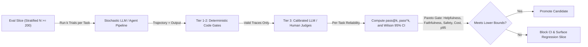
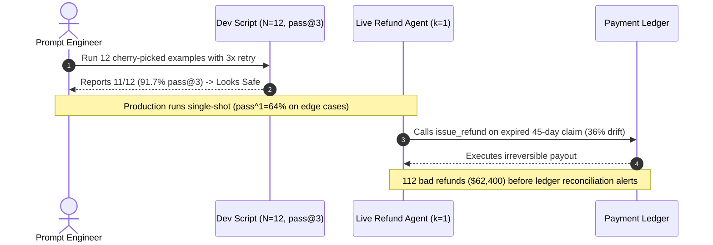

# Module 00: Why GenAI Evaluation Is Hard

> **Prerequisites:** [Track 07, Module 15: Prompt Evaluation and Iteration](../../07-prompt-engineering/15-prompt-evaluation-and-iteration/README.md), [Track 09, Module 13: Evaluating Generation Quality](../../09-retrieval-augmented-generation/13-evaluating-generation-quality/README.md), and [Track 10, Module 15: Agent Failure Modes and Debugging](../../10-ai-agents/15-agent-failure-modes-and-debugging/README.md).  
> **Estimated Reading Time:** 30 minutes  
> **Target Audience:** AI Backend Engineers, ML Platform Engineers, Staff/Principal Software Engineers

> [!TIP]
> **The Golden Rule of GenAI Evaluation:** Never ship a prompt edit, model snapshot upgrade, or RAG change on "10 vibes examples" or a single lucky run—treat every LLM pipeline as a stochastic, multi-dimensional system gated by **`pass^k` consistency**, **Wilson score confidence bounds**, and explicit Pareto trade-offs across Helpfulness, Faithfulness, Safety, Latency, and Cost.

---

## Why This Matters

In deterministic backend engineering, if `calculateRefund(order)` passes `10` unit tests on Monday, it passes `10,000` times on Friday unless someone touches the code. An assertion either holds (`expected == actual`) or fails loudly in CI.

With Generative AI, every core assumption of traditional testing collapses:

1. **Same input, different output:** Even with `temperature = 0`, GPU floating-point reduction non-associativity, Mixture-of-Experts (MoE) capacity routing across dynamic batch sizes, and silent provider snapshot updates cause repeated calls to diverge.
2. **Infinite valid paraphrases:** `"Your refund of \$42.50 has been issued"` and `"We credited \$42.50 back to your card"` are both 100% valid, making exact string match (`==`) and $n$-gram overlap metrics (`BLEU`, `ROUGE`) nearly useless for open-ended generation.
3. **Hidden multi-dimensional trade-offs:** A prompt edit that boosts Helpfulness by `+6%` frequently degrades Faithfulness by `-9%` (hallucinated policy exceptions), doubles output token spend, or slips past a safety guardrail.
4. **Statistical noise disguised as signal:** On a `10`-example "vibes spreadsheet," scoring `8/10` (`80%`) has a 95% Wilson confidence interval spanning **`49.0%` to `94.3%`**—a `45.3`-percentage-point blind spot that hides catastrophic production regressions until paying users discover them.

---

## 1. Core Mechanics: Why Traditional Assertions Break



### Non-Determinism: `pass@k` (Capability Ceiling) vs. `pass^k` (Production Reliability)

When evaluating stochastic models or multi-turn tool agents, running each test case once ($k = 1$) hides variance. As highlighted in Anthropic's *Demystifying Evals for AI Agents* and the $\tau$-bench benchmark (`arXiv:2406.12045`), two complementary multi-trial metrics tell opposite stories:

- **$\text{pass@}k$ (Capability Ceiling):** Probability that the system succeeds **at least once** in $k$ independent attempts. Useful when a human or compiler picks the valid attempt (e.g., code synthesis). For single-trial success probability $p_i$, or finite sample $n \ge k$ with $c_i$ passes (Chen et al., `arXiv:2107.03374`):

$$\text{pass@}k_i = 1 - (1 - p_i)^k, \qquad \widehat{\text{pass@}k}_i = 1 - \frac{\binom{n - c_i}{k}}{\binom{n}{k}}$$

- **$\text{pass}^k$ (Production Consistency Floor):** Probability that the system succeeds on **all $k$ consecutive independent trials**. Essential for autonomous production workflows (refunds, database mutations, customer support) where any single failure causes a customer incident:

$$\text{pass}^k = \frac{1}{M} \sum_{i=1}^{M} p_i^k$$

Observe the dramatic divergence at $p = 0.85$ across $k = 5$ runs:
- $\text{pass@}5 = 1 - (1 - 0.85)^5 = \mathbf{99.99\%}$ (looks flawless in a demo!)
- $\text{pass}^5 = 0.85^5 = \mathbf{44.37\%}$ (fails more than half the time when strict consistency is required!)

**Critical Mathematical Pitfall (Jensen's Inequality):** Never compute suite-level $\text{pass}^k$ by averaging task pass rates first and raising the mean to $k$ (`mean(p)^k`). Because $f(x) = x^k$ is strictly convex and $g(x) = 1 - (1-x)^k$ is strictly concave on $[0, 1]$, pooling across heterogeneous tasks before applying the exponent biases both metrics (`mean(p)^k` underestimates heterogeneous $\text{pass}^k$, while `1 - (1 - mean(p))^k` overestimates $\text{pass@}k$). Always compute per-task $p_i^k$ first, then average over tasks $i = 1 \dots M$.

### Reference-Based vs. Reference-Free Evaluation & Paraphrase Equivalence

Because valid natural-language responses form infinite equivalence classes, evaluation metrics split into two families:

1. **Reference-Based Metrics:** Compare model output $\hat{y}$ against a curated ground-truth target $y^*$.
   - *Lexical (`Exact Match`, `BLEU`, `ROUGE-L`):* Fast and deterministic, but brittle to valid synonyms (`"2 weeks"` vs. `"14 days"`) unless normalized or restricted to canonical structured fields.
   - *Semantic / Judge-Guided (`Embedding Cosine`, `Reference-Guided LLM Judge`):* Captures paraphrase equivalence, yet requires calibration because embedding similarity fails on subtle logical negations (`"covered"` vs. `"not covered"` have cosine similarity `> 0.90`).
2. **Reference-Free Metrics:** Evaluate properties directly from `(input, retrieved_context, trajectory, output)` without needing a single static target string. Examples include JSON schema validity, tool-execution invariants, citation entailment (`Faithfulness`), and policy compliance.

### Multi-Dimensional Trade-Offs & Silent Prompt Regressions

Production GenAI quality is never a scalar number—it is a **5-dimensional Pareto frontier**:

$$\mathcal{V}(\text{candidate}) = \big(\text{Helpfulness},\ \text{Faithfulness},\ \text{Safety},\ \text{Latency}_{p95},\ \text{Cost}_{1\text{k}}\big)$$

Adding an aggressive `"If unsure, say you cannot answer"` instruction raises Faithfulness (`88% -> 98%`) while crashing Helpfulness (`82% -> 65%`) via over-refusal. Conversely, switching a prompt to encourage `"comprehensive, detailed explanations"` lifts perceived Helpfulness while silently injecting parametric guesses (lowering Faithfulness) and doubling output token cost (`O_tokens`). Without automated multi-dimensional regression gating on every commit, engineers play "whack-a-mole": fixing Tuesday's edge case silently breaks `12%` of Monday's working traffic.

### Statistical Significance: Why `N = 10` Vibes Testing Proves Nothing

When evaluating a binary pass/fail metric on $N$ test cases with $s$ successes ($\hat{p} = s/N$), standard textbook Wald intervals ($\hat{p} \pm z\sqrt{\hat{p}(1-\hat{p})/N}$) collapse near $0\%$ or $100\%$ and overshoot $[0, 1]$ at small $N$. Production eval harnesses use the **Wilson Score Confidence Interval** (Wilson, 1927):

$$\text{CI}_{\text{Wilson}} = \frac{\hat{p} + \frac{z^2}{2N} \pm z\sqrt{\frac{\hat{p}(1 - \hat{p})}{N} + \frac{z^2}{4N^2}}}{1 + \frac{z^2}{N}}$$

where $z = 1.96$ for a 95% confidence level. To compare a baseline pass rate $p_1$ against a candidate $p_2 = p_1 + \Delta$ with Type-I error $\alpha = 0.05$ ($z_\alpha = 1.96$) and $80\%$ statistical power ($z_\beta = 0.8416$), the minimum sample size per arm (with pooled $\bar{p} = \frac{p_1 + p_2}{2}$) is:

$$N \ge \left\lceil \frac{\left(z_\alpha\sqrt{2\bar{p}(1-\bar{p})} + z_\beta\sqrt{p_1(1-p_1) + p_2(1-p_2)}\right)^2}{\Delta^2} \right\rceil$$

Detecting a `+10 pp` lift from `80% -> 90%` requires **`N >= 199`** independent cases; detecting a realistic `+5 pp` lift (`80% -> 85%`) requires **`N >= 906`** (or paired McNemar testing over the exact same frozen benchmark items to increase sensitivity).

---

## 2. Systematic Comparison Matrix: Testing Paradigms

| Dimension | Traditional Unit Tests | "10 Vibes Examples" Prompting | Production GenAI Eval Harness |
| :--- | :--- | :--- | :--- |
| **Determinism** | Strictly deterministic (`100%` repeatable) | Single lucky run (`pass@1` illusion) | Multi-trial (`pass@k` & `pass^k` per task) |
| **Equivalence Class** | Single canonical return value / exception | Ad-hoc visual inspection by prompt author | Typed assertions + reference-free invariants + calibrated judge |
| **Sample Size $N$** | Boundary cases (`N = 5–20` per unit) | `N = 5–15` cherry-picked happy paths | Stratified $N \ge 200\text{–}1{,}000$ with Wilson 95% CI bounds |
| **Metrics Tracked** | Boolean pass/fail + code coverage | Scalar hunch ("looks better to me") | Multi-dimensional vector (Helpfulness, Faithfulness, Safety, p95, Cost) |
| **Regression Detection** | Immediate compiler/assertion failure | Discovered by angry users post-deploy | Automated CI lower-bound & paired regression block |
| **Provider Update Safety** | Immune unless runtime changes | Blind to silent model weight updates | Scheduled nightly drift checks across model snapshots |

---

## 3. Production War Story Post-Mortem: The `pass@3` Refund Issuance Outage

| Field | Incident Details |
| :--- | :--- |
| **Severity** | **SEV-1** (Unauthorized Financial Credits & Emergency Feature Rollback) |
| **Detection / Resolution Time** | Detected 18 hours post-deploy by automated Stripe reconciliation alert / Mitigated in 25 minutes via feature flag rollback |
| **Impact** | `112` duplicate-charge disputes auto-credited erroneously outside the 30-day policy window; **\$62,400** net unrecoverable payouts |

### What Happened

A fintech support team rewrote the system prompt for their autonomous Refund Triage Agent (`issue_refund` tool) to make responses sound warmer and more decisive. Before deploying, the lead engineer ran `12` hand-picked QA examples through a local test script configured with automatic retry-on-failure (`3` attempts per task, reporting **`11/12 = 91.7%` `pass@3`**).

In production, the live agent executed single-shot (`k = 1`, no silent retries after tool execution). Under real customer phrasing involving partial chargebacks and expired 30-day return windows, single-trial policy compliance had actually dropped from `93%` to `64%`. Because `pass@3` hid the `36%` single-run failure variance (`1 - 0.36^3 = 95.3%` chance of passing *at least once* in 3 tries!), and `N = 12` had a 95% Wilson CI of `[64.6%, 98.5%]`, the regression passed review completely undetected.



### Root Cause Analysis

- **Metric mismatch:** Used optimistic `pass@3` capability scoring to approve an autonomous financial mutation agent that required strict `pass^3` reliability.
- **Underpowered sample (`N = 12`):** `N = 12` lacked statistical power to detect even a `25`-percentage-point drop in edge-case adherence.
- **Missing multi-dimensional gate:** Evaluated `"tone"` subjectively without deterministic assertions verifying `days_since_purchase <= 30` before `issue_refund`.

### Architectural Hardening & Verified Fix

- **Replaced `N = 12` with Stratified `N = 300` Eval Suite:** Added dedicated slices for expired windows, split tenders, and partial chargebacks.
- **Enforced `pass^3 >= 95%` + Deterministic Policy Guard:** Required 3/3 consecutive passes per financial task and added hard code-level assertions blocking `issue_refund` when `order_age_days > 30`.
- **Wilson Lower-Bound CI Gate:** CI blocks merges whenever the 95% Wilson lower confidence bound on Faithfulness or Policy Compliance falls below the baseline lower bound.

---

## 4. Multi-Language Production Implementation: Statistical Eval Release Gate

Below is a production-ready **Statistical Release Gate** across **Go**, **TypeScript**, **Python**, and **C#**. It computes per-task **`pass@k`** and **`pass^k`**, exact **Wilson Score 95% confidence bounds**, and enforces **multi-dimensional Pareto gates** (Helpfulness, Faithfulness, Safety, p95 Latency, and Cost per 1k requests) before allowing a candidate prompt or model to ship.

````carousel

```go
package evalgate

import (
	"fmt"
	"math"
)

type TaskTrialResult struct {
	TaskID   string
	Trials   int
	Passes   int
}

type DimensionScore struct {
	Successes int
	Total     int
}

type CandidateMetrics struct {
	Name         string
	Helpfulness  DimensionScore
	Faithfulness DimensionScore
	Safety       DimensionScore
	P95LatencyMs float64
	CostPer1kUSD float64
	TaskTrials   []TaskTrialResult
}

type ReleasePolicy struct {
	MinHelpfulnessLCB  float64
	MinFaithfulnessLCB float64
	MinSafetyLCB       float64
	MinPassPowK        float64
	MaxP95LatencyMs    float64
	MaxCostPer1kUSD    float64
	KConsistency       int
}

type GateDecision struct {
	Approved    bool
	Reasons     []string
	MeanPassAtK float64
	MeanPassPowK float64
}

func WilsonCI(successes, n int, z float64) (p, lower, upper float64) {
	if n <= 0 {
		return 0, 0, 0
	}
	p = float64(successes) / float64(n)
	z2 := z * z
	nf := float64(n)
	denom := 1.0 + z2/nf
	center := (p + z2/(2.0*nf)) / denom
	margin := (z * math.Sqrt((p*(1.0-p)/nf)+(z2/(4.0*nf*nf)))) / denom
	return p, math.Max(0, center-margin), math.Min(1, center+margin)
}

func ComputeMultiTrialMetrics(tasks []TaskTrialResult, k int) (meanPassAtK, meanPassPowK float64) {
	if len(tasks) == 0 || k <= 0 {
		return 0, 0
	}
	var sumAt, sumPow float64
	for _, t := range tasks {
		if t.Trials <= 0 {
			continue
		}
		pi := float64(t.Passes) / float64(t.Trials)
		// Compute per-task first to prevent Jensen's pooling error.
		sumAt += 1.0 - math.Pow(1.0-pi, float64(k))
		sumPow += math.Pow(pi, float64(k))
	}
	count := float64(len(tasks))
	return sumAt / count, sumPow / count
}

func EvaluateReleaseGate(c CandidateMetrics, p ReleasePolicy) GateDecision {
	const z95 = 1.959963984540054
	var reasons []string

	_, helpLCB, _ := WilsonCI(c.Helpfulness.Successes, c.Helpfulness.Total, z95)
	_, faithLCB, _ := WilsonCI(c.Faithfulness.Successes, c.Faithfulness.Total, z95)
	_, safeLCB, _ := WilsonCI(c.Safety.Successes, c.Safety.Total, z95)

	meanAt, meanPow := ComputeMultiTrialMetrics(c.TaskTrials, p.KConsistency)

	if helpLCB < p.MinHelpfulnessLCB {
		reasons = append(reasons, fmt.Sprintf("helpfulness Wilson LCB %.3f < %.3f", helpLCB, p.MinHelpfulnessLCB))
	}
	if faithLCB < p.MinFaithfulnessLCB {
		reasons = append(reasons, fmt.Sprintf("faithfulness Wilson LCB %.3f < %.3f", faithLCB, p.MinFaithfulnessLCB))
	}
	if safeLCB < p.MinSafetyLCB {
		reasons = append(reasons, fmt.Sprintf("safety Wilson LCB %.3f < %.3f", safeLCB, p.MinSafetyLCB))
	}
	if meanPow < p.MinPassPowK {
		reasons = append(reasons, fmt.Sprintf("pass^%d %.3f < %.3f", p.KConsistency, meanPow, p.MinPassPowK))
	}
	if c.P95LatencyMs > p.MaxP95LatencyMs {
		reasons = append(reasons, fmt.Sprintf("p95 latency %.1fms > %.1fms", c.P95LatencyMs, p.MaxP95LatencyMs))
	}
	if c.CostPer1kUSD > p.MaxCostPer1kUSD {
		reasons = append(reasons, fmt.Sprintf("cost $%.2f/1k > $%.2f/1k", c.CostPer1kUSD, p.MaxCostPer1kUSD))
	}

	return GateDecision{
		Approved:     len(reasons) == 0,
		Reasons:      reasons,
		MeanPassAtK:  meanAt,
		MeanPassPowK: meanPow,
	}
}
```

<!-- slide -->

```typescript
export interface TaskTrialResult {
  readonly taskId: string;
  readonly trials: number;
  readonly passes: number;
}

export interface DimensionScore {
  readonly successes: number;
  readonly total: number;
}

export interface CandidateMetrics {
  readonly name: string;
  readonly helpfulness: DimensionScore;
  readonly faithfulness: DimensionScore;
  readonly safety: DimensionScore;
  readonly p95LatencyMs: number;
  readonly costPer1kUsd: number;
  readonly taskTrials: readonly TaskTrialResult[];
}

export interface ReleasePolicy {
  readonly minHelpfulnessLcb: number;
  readonly minFaithfulnessLcb: number;
  readonly minSafetyLcb: number;
  readonly minPassPowK: number;
  readonly maxP95LatencyMs: number;
  readonly maxCostPer1kUsd: number;
  readonly kConsistency: number;
}

export interface GateDecision {
  readonly approved: boolean;
  readonly reasons: readonly string[];
  readonly meanPassAtK: number;
  readonly meanPassPowK: number;
}

export function wilsonCi(
  successes: number,
  n: number,
  z = 1.959963984540054,
): { p: number; lower: number; upper: number } {
  if (n <= 0) return { p: 0, lower: 0, upper: 0 };
  const p = successes / n;
  const z2 = z * z;
  const denom = 1 + z2 / n;
  const center = (p + z2 / (2 * n)) / denom;
  const margin = (z * Math.sqrt((p * (1 - p)) / n + z2 / (4 * n * n))) / denom;
  return { p, lower: Math.max(0, center - margin), upper: Math.min(1, center + margin) };
}

export function computeMultiTrialMetrics(
  tasks: readonly TaskTrialResult[],
  k: number,
): { meanPassAtK: number; meanPassPowK: number } {
  if (tasks.length === 0 || k <= 0) return { meanPassAtK: 0, meanPassPowK: 0 };
  let sumAt = 0;
  let sumPow = 0;
  for (const t of tasks) {
    if (t.trials <= 0) continue;
    const pi = t.passes / t.trials;
    // Compute per-task metrics before averaging across tasks.
    sumAt += 1 - Math.pow(1 - pi, k);
    sumPow += Math.pow(pi, k);
  }
  return { meanPassAtK: sumAt / tasks.length, meanPassPowK: sumPow / tasks.length };
}

export function evaluateReleaseGate(
  candidate: CandidateMetrics,
  policy: ReleasePolicy,
): GateDecision {
  const reasons: string[] = [];
  const helpLcb = wilsonCi(candidate.helpfulness.successes, candidate.helpfulness.total).lower;
  const faithLcb = wilsonCi(candidate.faithfulness.successes, candidate.faithfulness.total).lower;
  const safeLcb = wilsonCi(candidate.safety.successes, candidate.safety.total).lower;
  const { meanPassAtK, meanPassPowK } = computeMultiTrialMetrics(
    candidate.taskTrials,
    policy.kConsistency,
  );

  if (helpLcb < policy.minHelpfulnessLcb) {
    reasons.push(`helpfulness LCB ${helpLcb.toFixed(3)} < ${policy.minHelpfulnessLcb.toFixed(3)}`);
  }
  if (faithLcb < policy.minFaithfulnessLcb) {
    reasons.push(`faithfulness LCB ${faithLcb.toFixed(3)} < ${policy.minFaithfulnessLcb.toFixed(3)}`);
  }
  if (safeLcb < policy.minSafetyLcb) {
    reasons.push(`safety LCB ${safeLcb.toFixed(3)} < ${policy.minSafetyLcb.toFixed(3)}`);
  }
  if (meanPassPowK < policy.minPassPowK) {
    reasons.push(`pass^${policy.kConsistency} ${meanPassPowK.toFixed(3)} < ${policy.minPassPowK.toFixed(3)}`);
  }
  if (candidate.p95LatencyMs > policy.maxP95LatencyMs) {
    reasons.push(`p95 latency ${candidate.p95LatencyMs}ms > ${policy.maxP95LatencyMs}ms`);
  }
  if (candidate.costPer1kUsd > policy.maxCostPer1kUsd) {
    reasons.push(`cost $${candidate.costPer1kUsd.toFixed(2)}/1k > $${policy.maxCostPer1kUsd.toFixed(2)}/1k`);
  }

  return { approved: reasons.length === 0, reasons, meanPassAtK, meanPassPowK };
}
```

<!-- slide -->

```python
"""
eval_release_gate.py
Multi-dimensional statistical release gate enforcing pass^k reliability and Wilson 95% lower bounds.
"""
from dataclasses import dataclass
import math
from typing import Sequence


@dataclass(frozen=True)
class TaskTrialResult:
    task_id: str
    trials: int
    passes: int


@dataclass(frozen=True)
class DimensionScore:
    successes: int
    total: int


@dataclass(frozen=True)
class CandidateMetrics:
    name: str
    helpfulness: DimensionScore
    faithfulness: DimensionScore
    safety: DimensionScore
    p95_latency_ms: float
    cost_per_1k_usd: float
    task_trials: tuple[TaskTrialResult, ...]


@dataclass(frozen=True)
class ReleasePolicy:
    min_helpfulness_lcb: float
    min_faithfulness_lcb: float
    min_safety_lcb: float
    min_pass_pow_k: float
    max_p95_latency_ms: float
    max_cost_per_1k_usd: float
    k_consistency: int = 3


def wilson_ci(successes: int, n: int, z: float = 1.959963984540054) -> tuple[float, float, float]:
    if n <= 0:
        return 0.0, 0.0, 0.0
    p = successes / n
    z2 = z * z
    denom = 1.0 + z2 / n
    center = (p + z2 / (2.0 * n)) / denom
    margin = (z * math.sqrt((p * (1.0 - p) / n) + (z2 / (4.0 * n * n)))) / denom
    return p, max(0.0, center - margin), min(1.0, center + margin)


def multi_trial_metrics(tasks: Sequence[TaskTrialResult], k: int) -> tuple[float, float]:
    if not tasks or k <= 0:
        return 0.0, 0.0
    pass_at_sum = 0.0
    pass_pow_sum = 0.0
    valid = 0
    for task in tasks:
        if task.trials <= 0:
            continue
        pi = task.passes / task.trials
        # Aggregate per-task power/complement values rather than pooling p first.
        pass_at_sum += 1.0 - (1.0 - pi) ** k
        pass_pow_sum += pi ** k
        valid += 1
    if valid == 0:
        return 0.0, 0.0
    return pass_at_sum / valid, pass_pow_sum / valid


def evaluate_release_gate(candidate: CandidateMetrics, policy: ReleasePolicy) -> dict[str, object]:
    reasons: list[str] = []
    _, help_lcb, _ = wilson_ci(candidate.helpfulness.successes, candidate.helpfulness.total)
    _, faith_lcb, _ = wilson_ci(candidate.faithfulness.successes, candidate.faithfulness.total)
    _, safe_lcb, _ = wilson_ci(candidate.safety.successes, candidate.safety.total)
    mean_at, mean_pow = multi_trial_metrics(candidate.task_trials, policy.k_consistency)

    if help_lcb < policy.min_helpfulness_lcb:
        reasons.append(f"helpfulness_lcb={help_lcb:.3f}<{policy.min_helpfulness_lcb:.3f}")
    if faith_lcb < policy.min_faithfulness_lcb:
        reasons.append(f"faithfulness_lcb={faith_lcb:.3f}<{policy.min_faithfulness_lcb:.3f}")
    if safe_lcb < policy.min_safety_lcb:
        reasons.append(f"safety_lcb={safe_lcb:.3f}<{policy.min_safety_lcb:.3f}")
    if mean_pow < policy.min_pass_pow_k:
        reasons.append(f"pass^{policy.k_consistency}={mean_pow:.3f}<{policy.min_pass_pow_k:.3f}")
    if candidate.p95_latency_ms > policy.max_p95_latency_ms:
        reasons.append(f"p95_ms={candidate.p95_latency_ms:.1f}>{policy.max_p95_latency_ms:.1f}")
    if candidate.cost_per_1k_usd > policy.max_cost_per_1k_usd:
        reasons.append(f"cost_1k=${candidate.cost_per_1k_usd:.2f}>${policy.max_cost_per_1k_usd:.2f}")

    return {
        "candidate": candidate.name,
        "approved": len(reasons) == 0,
        "reasons": reasons,
        "mean_pass_at_k": round(mean_at, 4),
        "mean_pass_pow_k": round(mean_pow, 4),
    }
```

<!-- slide -->

```csharp
using System;
using System.Collections.Generic;

namespace GenAI.EvalGate;

public readonly record struct TaskTrialResult(string TaskId, int Trials, int Passes);
public readonly record struct DimensionScore(int Successes, int Total);

public sealed record CandidateMetrics(
    string Name,
    DimensionScore Helpfulness,
    DimensionScore Faithfulness,
    DimensionScore Safety,
    double P95LatencyMs,
    double CostPer1kUsd,
    IReadOnlyList<TaskTrialResult> TaskTrials);

public sealed record ReleasePolicy(
    double MinHelpfulnessLcb,
    double MinFaithfulnessLcb,
    double MinSafetyLcb,
    double MinPassPowK,
    double MaxP95LatencyMs,
    double MaxCostPer1kUsd,
    int KConsistency = 3);

public sealed record GateDecision(
    bool Approved,
    IReadOnlyList<string> Reasons,
    double MeanPassAtK,
    double MeanPassPowK);

public static class StatisticalReleaseGate
{
    public static (double P, double Lower, double Upper) WilsonCi(
        int successes,
        int n,
        double z = 1.959963984540054)
    {
        if (n <= 0) return (0, 0, 0);
        double p = (double)successes / n;
        double z2 = z * z;
        double denom = 1.0 + z2 / n;
        double center = (p + z2 / (2.0 * n)) / denom;
        double margin = (z * Math.Sqrt((p * (1.0 - p) / n) + (z2 / (4.0 * n * n)))) / denom;
        return (p, Math.Max(0.0, center - margin), Math.Min(1.0, center + margin));
    }

    public static (double MeanPassAtK, double MeanPassPowK) ComputeMultiTrialMetrics(
        IReadOnlyList<TaskTrialResult> tasks,
        int k)
    {
        if (tasks.Count == 0 || k <= 0) return (0, 0);
        double sumAt = 0, sumPow = 0;
        int count = 0;
        foreach (var t in tasks)
        {
            if (t.Trials <= 0) continue;
            double pi = (double)t.Passes / t.Trials;
            sumAt += 1.0 - Math.Pow(1.0 - pi, k);
            sumPow += Math.Pow(pi, k);
            count++;
        }
        return count == 0 ? (0, 0) : (sumAt / count, sumPow / count);
    }

    public static GateDecision Evaluate(CandidateMetrics candidate, ReleasePolicy policy)
    {
        var reasons = new List<string>();
        double helpLcb = WilsonCi(candidate.Helpfulness.Successes, candidate.Helpfulness.Total).Lower;
        double faithLcb = WilsonCi(candidate.Faithfulness.Successes, candidate.Faithfulness.Total).Lower;
        double safeLcb = WilsonCi(candidate.Safety.Successes, candidate.Safety.Total).Lower;
        var (meanAt, meanPow) = ComputeMultiTrialMetrics(candidate.TaskTrials, policy.KConsistency);

        if (helpLcb < policy.MinHelpfulnessLcb)
            reasons.Add($"helpfulness LCB {helpLcb:F3} < {policy.MinHelpfulnessLcb:F3}");
        if (faithLcb < policy.MinFaithfulnessLcb)
            reasons.Add($"faithfulness LCB {faithLcb:F3} < {policy.MinFaithfulnessLcb:F3}");
        if (safeLcb < policy.MinSafetyLcb)
            reasons.Add($"safety LCB {safeLcb:F3} < {policy.MinSafetyLcb:F3}");
        if (meanPow < policy.MinPassPowK)
            reasons.Add($"pass^{policy.KConsistency} {meanPow:F3} < {policy.MinPassPowK:F3}");
        if (candidate.P95LatencyMs > policy.MaxP95LatencyMs)
            reasons.Add($"p95 latency {candidate.P95LatencyMs:F1}ms > {policy.MaxP95LatencyMs:F1}ms");
        if (candidate.CostPer1kUsd > policy.MaxCostPer1kUsd)
            reasons.Add($"cost ${candidate.CostPer1kUsd:F2}/1k > ${policy.MaxCostPer1kUsd:F2}/1k");

        return new GateDecision(reasons.Count == 0, reasons, meanAt, meanPow);
    }
}
```

````

---

## 5. Practical Hands-On Verification CLI Workflows

Run these offline Python 3.13 verification scripts directly in your terminal—zero external packages or API keys required.

### Workflow 1: `pass@k` vs. `pass^k` Reliability Decay & Jensen's Inequality Trap

Simulate how capability (`pass@k`) rises toward `100%` while consistency (`pass^k`) collapses as trials $k$ increase, and measure the numerical error caused by pooling $p_i$ before applying the exponent:

```bash
python - << 'EOF'
def pass_at_k(p, k):
    return 1.0 - (1.0 - p) ** k

def pass_pow_k(p, k):
    return p ** k

print("=== Workflow 1A: pass@k vs pass^k Across k Trials ===")
for p in [0.95, 0.85, 0.70, 0.50]:
    row = [f"k={k}: at={pass_at_k(p, k):.1%}/pow={pass_pow_k(p, k):.1%}" for k in (1, 3, 5, 8)]
    print(f"p={p:.2f} | " + " | ".join(row))

print("\n=== Workflow 1B: Jensen Inequality Error When Pooling Before Exponent ===")
task_probs = [0.98, 0.95, 0.90, 0.85, 0.42]
k = 4
mean_p = sum(task_probs) / len(task_probs)
pooled_pow = mean_p ** k
true_pow = sum(p ** k for p in task_probs) / len(task_probs)
pooled_at = 1.0 - (1.0 - mean_p) ** k
true_at = sum(1.0 - (1.0 - p) ** k for p in task_probs) / len(task_probs)
print(f"task_probs={task_probs} (mean_p={mean_p:.2f})")
print(f"pass^{k}: Pooled={pooled_pow:.1%} vs True per-task avg={true_pow:.1%} [DELTA={(pooled_pow-true_pow)*100:+.1f} pp]")
print(f"pass@{k}: Pooled={pooled_at:.1%} vs True per-task avg={true_at:.1%} [DELTA={(pooled_at-true_at)*100:+.1f} pp]")
EOF
```

**Expected Output:**

```text
=== Workflow 1A: pass@k vs pass^k Across k Trials ===
p=0.95 | k=1: at=95.0%/pow=95.0% | k=3: at=100.0%/pow=85.7% | k=5: at=100.0%/pow=77.4% | k=8: at=100.0%/pow=66.3%
p=0.85 | k=1: at=85.0%/pow=85.0% | k=3: at=99.7%/pow=61.4% | k=5: at=100.0%/pow=44.4% | k=8: at=100.0%/pow=27.2%
p=0.70 | k=1: at=70.0%/pow=70.0% | k=3: at=97.3%/pow=34.3% | k=5: at=99.8%/pow=16.8% | k=8: at=100.0%/pow=5.8%
p=0.50 | k=1: at=50.0%/pow=50.0% | k=3: at=87.5%/pow=12.5% | k=5: at=96.9%/pow=3.1% | k=8: at=99.6%/pow=0.4%

=== Workflow 1B: Jensen Inequality Error When Pooling Before Exponent ===
task_probs=[0.98, 0.95, 0.9, 0.85, 0.42] (mean_p=0.82)
pass^4: Pooled=45.2% vs True per-task avg=58.9% [DELTA=-13.7 pp]
pass@4: Pooled=99.9% vs True per-task avg=97.7% [DELTA=+2.2 pp]
```

### Workflow 2: Why `N = 10` Vibes Testing Lies — Wilson Score 95% CIs & Power Sizing

Quantify how sample size $N$ governs confidence width at an observed `80.0%` pass rate and compute required $N$ per arm to distinguish real gains from noise:

```bash
python - << 'EOF'
import math

def wilson_ci(successes, n, z=1.959963984540054):
    if n == 0:
        return 0.0, 0.0, 0.0
    p = successes / n
    z2 = z * z
    denom = 1.0 + z2 / n
    center = (p + z2 / (2.0 * n)) / denom
    half = (z * math.sqrt((p * (1.0 - p) / n) + (z2 / (4.0 * n * n)))) / denom
    return p, max(0.0, center - half), min(1.0, center + half)

def required_n_two_prop(p1, delta):
    z_alpha = 1.959964  # alpha = 0.05 two-sided
    z_beta = 0.841621   # 80% statistical power
    p2 = p1 + delta
    p_bar = 0.5 * (p1 + p2)
    num = (z_alpha * math.sqrt(2.0 * p_bar * (1.0 - p_bar)) + z_beta * math.sqrt(p1 * (1.0 - p1) + p2 * (1.0 - p2))) ** 2
    return math.ceil(num / (delta * delta))

print("=== Wilson 95% CI Width at p_hat = 80.0% ===")
for n in [10, 30, 100, 300, 1000]:
    s = int(round(0.80 * n))
    p, lo, hi = wilson_ci(s, n)
    print(f"N={n:<4d} ({s:>3d}/{n:<4d}) | p={p:.1%} | 95% CI=[{lo:.1%}, {hi:.1%}] | width={(hi-lo)*100:5.1f} pp")

print("\n=== Required N per Arm (80% Power, alpha=0.05, Baseline=80%) ===")
for delta in [0.10, 0.05, 0.02]:
    print(f"Detect +{delta*100:2.0f} pp lift (80% -> {(0.80+delta)*100:.0f}%): N >= {required_n_two_prop(0.80, delta):,} per arm")
EOF
```

**Expected Output:**

```text
=== Wilson 95% CI Width at p_hat = 80.0% ===
N=10   (  8/10  ) | p=80.0% | 95% CI=[49.0%, 94.3%] | width= 45.3 pp
N=30   ( 24/30  ) | p=80.0% | 95% CI=[62.7%, 90.5%] | width= 27.8 pp
N=100  ( 80/100 ) | p=80.0% | 95% CI=[71.1%, 86.7%] | width= 15.5 pp
N=300  (240/300 ) | p=80.0% | 95% CI=[75.1%, 84.1%] | width=  9.0 pp
N=1000 (800/1000) | p=80.0% | 95% CI=[77.4%, 82.4%] | width=  5.0 pp

=== Required N per Arm (80% Power, alpha=0.05, Baseline=80%) ===
Detect +10 pp lift (80% -> 90%): N >= 199 per arm
Detect + 5 pp lift (80% -> 85%): N >= 906 per arm
Detect + 2 pp lift (80% -> 82%): N >= 6,039 per arm
```

### Workflow 3: Multi-Dimensional Trade-Off & Silent Regression Gate

Verify how a candidate prompt (`prompt_v2_verbose`) that increases Helpfulness by `+5.2 pp` gets blocked automatically because it silently crashes Faithfulness and blows latency/cost budgets:

```bash
python - << 'EOF'
import math

def wilson_lower(s, n, z=1.959964):
    p = s / n
    z2 = z * z
    denom = 1.0 + z2 / n
    center = (p + z2 / (2.0 * n)) / denom
    half = (z * math.sqrt((p * (1.0 - p) / n) + (z2 / (4.0 * n * n)))) / denom
    return max(0.0, center - half)

candidates = [
    {"name": "baseline_v1",        "n": 250, "help": 205, "faith": 230, "safe": 248, "p95_ms": 1150, "cost_1k": 3.40},
    {"name": "prompt_v2_verbose",  "n": 250, "help": 218, "faith": 203, "safe": 248, "p95_ms": 2340, "cost_1k": 6.95},
    {"name": "prompt_v3_abstain",  "n": 250, "help": 162, "faith": 245, "safe": 250, "p95_ms": 980,  "cost_1k": 2.85},
    {"name": "prompt_v4_balanced", "n": 250, "help": 220, "faith": 235, "safe": 249, "p95_ms": 1220, "cost_1k": 3.65},
]
floors = {"help_lcb": 0.75, "faith_lcb": 0.87, "safe_lcb": 0.97, "max_p95_ms": 1500, "max_cost_1k": 4.50}

for c in candidates:
    n, name, p95, cost = c["n"], c["name"], c["p95_ms"], c["cost_1k"]
    h_lcb, f_lcb, s_lcb = wilson_lower(c["help"], n), wilson_lower(c["faith"], n), wilson_lower(c["safe"], n)
    reasons = []
    if h_lcb < floors["help_lcb"]: reasons.append(f"help_lcb={h_lcb:.1%}<75.0%")
    if f_lcb < floors["faith_lcb"]: reasons.append(f"faith_lcb={f_lcb:.1%}<87.0%")
    if s_lcb < floors["safe_lcb"]: reasons.append(f"safe_lcb={s_lcb:.1%}<97.0%")
    if p95 > floors["max_p95_ms"]: reasons.append(f"p95={p95}ms>1500ms")
    if cost > floors["max_cost_1k"]: reasons.append(f"cost=${cost:.2f}>$4.50")
    verdict = "SHIP" if not reasons else "BLOCK (" + ", ".join(reasons) + ")"
    print(f"{name:<18} | help={c['help']/n:.1%}(lcb {h_lcb:.1%}) | faith={c['faith']/n:.1%}(lcb {f_lcb:.1%}) | safe={c['safe']/n:.1%} | p95={p95}ms | ${cost:.2f}/1k -> {verdict}")
EOF
```

**Expected Output:**

```text
baseline_v1        | help=82.0%(lcb 76.8%) | faith=92.0%(lcb 88.0%) | safe=99.2% | p95=1150ms | $3.40/1k -> SHIP
prompt_v2_verbose  | help=87.2%(lcb 82.5%) | faith=81.2%(lcb 75.9%) | safe=99.2% | p95=2340ms | $6.95/1k -> BLOCK (faith_lcb=75.9%<87.0%, p95=2340ms>1500ms, cost=$6.95>$4.50)
prompt_v3_abstain  | help=64.8%(lcb 58.7%) | faith=98.0%(lcb 95.4%) | safe=100.0% | p95=980ms | $2.85/1k -> BLOCK (help_lcb=58.7%<75.0%)
prompt_v4_balanced | help=88.0%(lcb 83.4%) | faith=94.0%(lcb 90.3%) | safe=99.6% | p95=1220ms | $3.65/1k -> SHIP
```

### Hands-On Exercises

1. **Paired McNemar Sensitivity:** Modify Workflow 2 to simulate two prompt runs on the *exact same* `N = 100` items where 85 pass both, 5 pass only candidate, and 0 regress (`b = 5, c = 0`). Compute the McNemar $\chi^2 = \frac{(|b - c| - 1)^2}{b + c}$ and see why paired tests detect smaller regressions far earlier than unpaired two-proportion z-tests.
2. **Strict `pass^k` Budget:** Adjust `ReleasePolicy` in the Python carousel implementation to require `min_pass_pow_k = 0.85` at `k_consistency = 3`, and verify the minimum per-trial reliability $p$ needed ($p \ge 0.85^{1/3} = 0.9473$).
3. **Optional Live Variance Probe (Requires API Key):** Send the exact same ambiguous user query to an LLM API `10` consecutive times at `temperature=0.0` (fixing `seed` if supported) and `temperature=0.7`, logging exact string uniqueness and functional equivalence across runs.

### Independent Challenge

Your team maintains an enterprise SQL copilot (`N = 150` golden queries). A prompt engineer swaps the system prompt from `v1` (`82%` valid SQL, `p95 = 900 ms`, `\$2.10/1k`) to `v2` (`88%` valid SQL on `N = 25` hand-picked examples, `p95 = 2,100 ms`, `\$5.80/1k`, plus `2` unobserved cases where `v2` drops `WHERE tenant_id = ?` filters). Identify every flaw in the promotion evidence and design the statistical + multi-dimensional CI gate needed before `v2` could ever reach production.

<details><summary>Architectural Discussion</summary>

Three compounding flaws invalidate `v2`'s promotion: (1) **Underpowered & Cherry-Picked Sample (`N = 25`):** `22/25 = 88.0%` has a 95% Wilson CI of `[70.0%, 95.8%]`, overlapping completely with `v1`'s `82%` baseline—no statistically significant lift was proven; (2) **Missing Security/Safety Dimension:** dropping `WHERE tenant_id = ?` is a critical SEV-1 cross-tenant authorization failure that must have a `100%` deterministic AST/SQL predicate floor regardless of overall SQL syntax rate; (3) **Pareto Budget Violation:** `2.3x` latency and `2.76x` cost inflation violate production SLOs. A proper CI gate runs all `N = 150+` frozen queries with `pass^3` consistency checks, hard tenant-predicate AST assertions (`0` violations permitted), Wilson lower-bound regression gating, and explicit `p95_ms` / `cost_per_1k` thresholds.

</details>

---

## 6. Common Mistakes & Troubleshooting

- **Claiming "deterministic" results from `temperature = 0` alone:** Floating-point batching variations on GPU clusters, MoE routing, and unpinned model aliases (`gpt-4o` vs `gpt-4o-2024-08-06`) still introduce run-to-run drift. Pin exact snapshot IDs and track `pass^k` on critical slices.
- **Using exact-string match or ROUGE on open-ended answers:** Lexical overlap metrics punish valid paraphrases and reward verbose keyword stuffing that contradicts the facts. Match exact schema fields deterministically and evaluate semantic claims with calibrated judges.
- **Reporting only a single scalar average score:** Averaging Helpfulness, Safety, and Latency—or hiding a `30%` collapse on rare adversarial slices inside a `90%` overall average—masks critical outages. Always gate per-slice and per-dimension.
- **Shipping on `N = 10`–`30` evaluations:** Small-sample confidence intervals span `28–45` percentage points, turning CI checks into a random coin flip.

---

## 7. Operational Validation Checkpoints & Checkpoint Quiz

### Operational Validation Checkpoints

<details><summary><strong>Checkpoint 1: Diagnosing why a 99% pass@5 coding agent fails in automated CI</strong></summary>

An internal DevOps bot scores `99.2%` on `pass@5` during sandbox testing, yet fails `31%` of single-shot production webhook runs. Explain the discrepancy mathematically.

**Validation:** At a per-trial reliability of $p = 0.69$, $\text{pass@}5 = 1 - (1 - 0.69)^5 = 99.7\%$, whereas single-shot production execution equals $\text{pass}^1 = 69\%$ (`31%` failure rate). `pass@5` only asks whether *at least one* of five retries succeeded, masking massive run-to-run flakiness. Autonomous single-shot workflows must be gated on $\text{pass}^k$ consistency rather than $\text{pass@}k$.

</details>

<details><summary><strong>Checkpoint 2: Evaluating a "statistically significant" improvement claimed on 15 examples</strong></summary>

A teammate proposes deploying a new RAG prompt because score rose from `11/15` (`73.3%`) to `13/15` (`86.7%`). Using Wilson score intervals, evaluate whether this warrants a rollout.

**Validation:** For `11/15` (`73.3%`), the 95% Wilson CI is `[48.0%, 89.1%]`; for `13/15` (`86.7%`), the 95% Wilson CI is `[62.1%, 96.3%]`. The intervals overlap massively (`62.1%–89.1%`), and flipping just two outputs could completely reverse the ranking. Expanding the benchmark to $N \ge 200\text{–}300$ paired samples is required before claiming a real improvement.

</details>

<details><summary><strong>Checkpoint 3: Preventing silent regressions across competing quality dimensions</strong></summary>

After tuning a customer-support system prompt to fix verbose apologies, average Helpfulness holds steady at `84%`, yet customer escalation tickets jump `3x`. What evaluation gap caused this?

**Validation:** The eval suite collapsed evaluation into a single `Helpfulness` score and omitted orthogonal dimensions (`Faithfulness` / `Policy Compliance` / `Safety`) and stratified edge slices. Removing apology boilerplate inadvertently deleted the abstention instruction on unsupported claims, driving hallucinations while Helpfulness appeared flat.

</details>

### Checkpoint Quiz

1. Why can two calls to the same LLM API with `temperature = 0` still produce different tokens?
2. Write the algebraic relationship between single-trial pass probability $p$, $\text{pass@}k$, and $\text{pass}^k$.
3. Why does pooling task pass probabilities (`mean(p)^k`) produce an incorrect estimate of suite-level $\text{pass}^k$?
4. Roughly how wide is the 95% Wilson confidence interval when you observe `8/10` (`80%`) passes?
5. Name the 5 core dimensions of a production GenAI Pareto evaluation vector.

<details><summary>Answers</summary>

1. Non-associative GPU floating-point reductions across dynamic server batch sizes, Mixture-of-Experts routing tie-breaking under concurrent load, and unpinned backend model snapshot rollouts.
2. For single-trial success probability $p$, $\text{pass@}k = 1 - (1 - p)^k$ (at least one success) and $\text{pass}^k = p^k$ (all $k$ trials succeed).
3. By Jensen's inequality, because $x^k$ is strictly convex for $k > 1$, applying the exponent to the mean (`mean(p)^k`) differs systematically from averaging per-task $p_i^k$ across heterogeneous task difficulties.
4. `[49.0%, 94.3%]`—a `45.3`-percentage-point span (`width = 45.3 pp`).
5. **Helpfulness** (task utility), **Faithfulness** (grounding / zero hallucination), **Safety / Policy Compliance**, **Latency ($p_{95}$)**, and **Cost per 1k requests**.

</details>

---

## Further Reading & Sources

- [Anthropic Engineering: Demystifying Evals for AI Agents](https://www.anthropic.com/engineering/demystifying-evals-for-ai-agents) — clear distinction between `pass@k` capability and `pass^k` production consistency, plus layered code/model/human graders.
- [τ-bench: A Benchmark for Tool-Agent-User Interaction in Real-World Domains (Yao et al., 2024)](https://arxiv.org/abs/2406.12045) — introduces $\text{pass}^k$ consistency evaluations exposing reliability collapse across repeated agent trials.
- [Evaluating Large Language Models Trained on Code (Chen et al., 2021)](https://arxiv.org/abs/2107.03374) — formal unbiased finite-sample estimator for $\text{pass@}k$.
- [Evidently AI: Complete Guide to LLM Evaluation](https://www.evidentlyai.com/llm-guide/llm-evaluation) — practical taxonomy of reference-based vs. reference-free metrics and production monitoring.
- [Hamel Husain: Your AI Product Needs Evals](https://hamel.dev/blog/posts/evals/) — foundational practitioner playbook on moving beyond vibes testing to disciplined evaluation loops.

## Next

[Module 01: Building an Eval Dataset](../01-building-an-eval-dataset/README.md)
