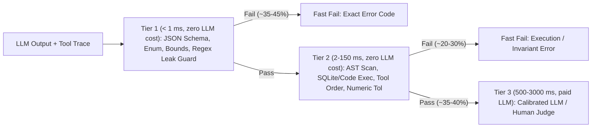
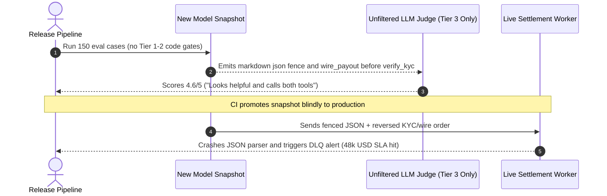

# Module 02: Deterministic Evals and Assertions

> **Prerequisites:** [Module 01: Building an Eval Dataset](../01-building-an-eval-dataset/README.md), [Track 07, Module 08: Structured Output Prompting](../../07-prompt-engineering/08-structured-output-prompting/README.md), and [Track 10, Module 04: Tools Definition and Schemas](../../10-ai-agents/04-tools-definition-and-schemas/README.md).  
> **Estimated Reading Time:** 30 minutes  
> **Target Audience:** AI Backend Engineers, Platform Engineers, Test Automation Engineers

> [!TIP]
> **The Golden Rule of Deterministic Evals:** Always run **cheap, fast, \$0-LLM, 100%-deterministic assertions first**—JSON Schema checks, regex/bounds invariants, AST safety scans, sandboxed SQL/code execution, tool-call sequence checks, and numeric tolerances catch **`60%+` of production failures in `< 5 ms`** before a slow, costly LLM judge ever runs.

---

## Why This Matters

Many engineering teams reach straight for an LLM judge (`GPT-4o` or `Claude`) to grade every test output—even when checking whether the model returned valid JSON, omitted an API secret, executed the right SQL query, or stayed inside numeric bounds.

Paying `\$0.015` and waiting `1,200 ms` per sample for an LLM judge to notice a trailing Markdown triple-backtick fence, a missing `currency` field, or an out-of-order `issue_refund` tool call is both wasteful and noisy. Worse, LLM judges routinely rubber-stamp subtle structural bugs (`4/5` for plausible prose containing broken JSON or invalid SQL syntax). Deterministic code assertions turn your evaluation harness into a **tiered pre-filter funnel**: fast, zero-cost, zero-variance assertions reject broken trajectories in microseconds, reserving expensive semantic judges exclusively for outputs that are structurally and executionally sound.

---

## 1. The Tiered Eval Funnel & 6 Deterministic Assertion Primitives



### Quantitative Economics of Deterministic Short-Circuiting

Suppose an evaluation suite of $N$ test items would otherwise invoke an LLM judge costing $c_{\text{judge}}$ and taking $t_{\text{judge}}$ per sample. If Tier 1 and Tier 2 deterministic assertions reject fraction $r_{\text{det}} \in [0, 1]$ of traces in negligible time $t_{\text{det}} \ll t_{\text{judge}}$ at `\$0` API cost, total judge spend and average wall-clock latency per item scale down directly:

$$\text{Cost}_{\text{tiered}} = N \cdot (1 - r_{\text{det}}) \cdot c_{\text{judge}}, \qquad L_{\text{avg}} = t_{\text{det}} + (1 - r_{\text{det}}) \cdot t_{\text{judge}}$$

At $r_{\text{det}} = 0.625$ (`62.5%` deterministic short-circuit rate) across `100,000` CI + shadow eval items per month (`c_judge = \$0.015`), deterministic pre-filtering cuts judge spend from **\$1,500/month down to \$562.50/month**—saving **\$937.50/month** while producing zero-variance root-cause error codes (`MARKDOWN_FENCE_LEAK`, `TOOL_ORDER_VIOLATION`) instead of vague judge prose.

### The 6 Production Deterministic Assertion Families

1. **JSON Schema & Typed Bounds Assertions:** Parse raw JSON strictly (rejecting unrequested Markdown code-fence wrappers when raw JSON is required), validate `required` keys, `additionalProperties: false`, enum membership (`{"APPROVE", "DENY"}`), string length limits, and array cardinalities.
2. **Regex & Format / Security Invariants:** Verify canonical formats (`^\d{4}-\d{2}-\d{2}$` ISO dates, mandatory inline citations `\[chunk_\d+\]`) and block forbidden leakage (`sk-live-[a-zA-Z0-9]+`, SSNs, internal stack traces, or banned system-prompt strings).
3. **AST Syntax & Static Safety Gates:** Parse generated Python, TypeScript, or SQL into an Abstract Syntax Tree (`ast.parse` in Python) before executing anything. Reject syntax errors immediately and walk AST nodes to block forbidden imports (`os`, `subprocess`, `socket`) or dynamic execution calls (`eval`, `exec`, `__import__`).
4. **Sandboxed Execution Gates (SQLite / Unit Tests):** Never grade generated SQL or code via brittle string comparison (`sql == gold_sql`)—equivalent queries differ in aliases, join order, and whitespace. Execute generated SQL against a deterministic in-memory `sqlite3` fixture (and generated Python/Go against unit test fixtures inside an isolated sandbox) and compare canonicalized result rows.
5. **Tool-Call Argument & Topological Order Assertions:** Inspect the agent execution trace rather than just the final message. Assert `must_call` / `forbid_call` sets, typed argument invariants (`0 < refund_cents <= invoice_balance_cents`), and ordered subsequence invariants (e.g., `auth_user` must complete *before* `get_invoice`, which must precede `issue_refund`).
6. **Numeric & Financial Tolerance Matching:** Normalize formatting (`"\$1,250.00"` -> `1250.0`) and compare extracted scalars against gold answers using combined absolute and relative tolerance:

$$|\hat{y} - y| \le \text{atol} + \text{rtol} \cdot |y|$$

With `atol = 0.01` (`1` cent) and `rtol = 1e-4`, `125.004` passes against `125.00` without brittle float equality failures, while `140.00` fails deterministically.

---

## 2. Systematic Comparison Matrix: Deterministic Assertion Primitives

| Primitive | Typical Latency | LLM Cost | What It Catches Best | Primary Blind Spot / Pitfall |
| :--- | :--- | :--- | :--- | :--- |
| **JSON Schema & Enum Bounds** | `< 0.5 ms` | `\$0` | Missing keys, wrong types, markdown fence leaks, hallucinated enum tags | Cannot verify whether field string content is factually grounded |
| **Regex & Leak Patterns** | `< 0.2 ms` | `\$0` | Secret tokens (`sk-live-`), malformed ISO dates, missing `[chunk_id]` tags | Brittle when used to parse complex nested syntax or natural language |
| **AST Syntax & Safety Scan** | `0.5–3 ms` | `\$0` | Broken generated syntax, RCE imports (`subprocess`), `eval`/`exec` abuse | Valid, safe syntax can still compute the wrong business logic |
| **Sandboxed SQLite / Pytest Exec** | `2–150 ms` | `\$0` | Semantic SQL/code correctness regardless of aliases, formatting, or join style | Requires seeded edge-case test fixtures; unsandboxed execution is dangerous |
| **Tool-Call Order & Arg Bounds** | `< 0.5 ms` | `\$0` | Reordered side effects (`refund` before `auth`), out-of-range dollar args | Assumes tool telemetry is logged deterministically in the trace |
| **Numeric Tolerance Match** | `< 0.2 ms` | `\$0` | Calculation/rounding errors (`\$140` vs `\$125`) while tolerating `\$125.004` | Must strip currency symbols/commas carefully; watch `%` vs decimal (`0.05` vs `5`) |

---

## 3. Production War Story Post-Mortem: The Unparsed Fence & Inverted Tool-Call Outage

| Field | Incident Details |
| :--- | :--- |
| **Severity** | **SEV-1** (Settlement Worker Parser Crash & Unauthorized Payout Sequence) |
| **Detection / Resolution Time** | Detected 42 minutes post-deploy via dead-letter queue spike / Mitigated in 18 minutes via prompt rollback + deterministic CI gate rollout |
| **Impact** | `3.8%` of automated payout workflows crashed downstream workers with `JSONDecodeError` or skipped KYC verification; **\$48,000** in SLA settlement credits |

### What Happened

A payments team migrated their automated vendor-payout copilot to a newer model snapshot. Before deploying, they ran their `150`-item evaluation harness—which relied **100% on an LLM-as-Judge** prompted with `"Rate 1-5 if the assistant extracted the payout amount and called the right tools."`

The LLM judge scored the new snapshot **`4.6 / 5.0`** (higher than the previous `4.4 / 5.0`!) because the model's explanations sounded crisper. In reality, two breaking bugs had slipped through:
1. On `2.9%` of requests, the model wrapped JSON outputs inside Markdown triple-backtick fences, crashing downstream strict `json.loads()` consumers.
2. On `0.9%` of requests, the agent invoked `wire_payout` **before** calling `verify_kyc`. Seeing both tool names in the transcript, the LLM judge gave `4/5` and ignored execution order!



### Root Cause Analysis

- **No Tier-1 Structural Gate:** Downstream parsers expected strict raw JSON, yet CI had zero `json.loads()` / fence-prohibition assertions.
- **No Tier-2 Tool-Order Invariant:** CI checked neither ordered tool subsequences (`verify_kyc -> wire_payout`) nor argument bounds.
- **Misplaced Trust in LLM Judges:** Delegating crisp binary invariants to a fuzzy `1–5` LLM rubric wasted `\$2.25` per CI run while missing deterministic failures.

### Architectural Hardening & Verified Fix

- **Mandatory Tier 1+2 Pre-Filter Gate:** Added `< 5 ms` schema validation (rejecting markdown fences), numeric tolerance checks (`atol = 0.01`), and topological tool-call ordering assertions (`verify_kyc` strictly prior to `wire_payout`) ahead of every LLM judge run.
- **Production Runtime Guardrails:** Enforced identical schema + order validation inside the runtime tool router ([Module 11](../11-guardrails-output-validation/README.md)) so an out-of-order tool call is rejected before executing `wire_payout`.

---

## 4. Multi-Language Production Implementation: Tiered Deterministic Eval Engine

Below is a production-ready **Deterministic Assertion Pre-Filter Engine** across **Go**, **TypeScript**, **Python**, and **C#**. It validates strict raw JSON + enum/numeric tolerance, blocks secret token leaks, verifies ordered tool-call subsequences, and short-circuits broken traces before Tier-3 LLM judge execution.

````carousel

```go
package deteval

import (
	"encoding/json"
	"math"
	"regexp"
	"strings"
)

var secretPattern = regexp.MustCompile(`sk-live-[a-zA-Z0-9]+`)

type PayoutPayload struct {
	Decision  string  `json:"decision"`
	RefundUSD float64 `json:"refund_usd"`
}

type EvalTrace struct {
	TraceID   string
	RawOutput string
	ToolCalls []string
	GoldUSD   float64
}

type AssertionResult struct {
	Passed             bool
	FailureCode        string
	InvokeTier3LLMJudge bool
}

func HasOrderedSubsequence(calls, required []string) bool {
	idx := 0
	for _, c := range calls {
		if idx < len(required) && c == required[idx] {
			idx++
		}
	}
	return idx == len(required)
}

func EvaluateDeterministic(tr EvalTrace) AssertionResult {
	if strings.Contains(tr.RawOutput, "```") {
		return AssertionResult{Passed: false, FailureCode: "MARKDOWN_FENCE_LEAK", InvokeTier3LLMJudge: false}
	}
	if secretPattern.MatchString(tr.RawOutput) {
		return AssertionResult{Passed: false, FailureCode: "SECRET_TOKEN_LEAK", InvokeTier3LLMJudge: false}
	}

	var parsed PayoutPayload
	dec := json.NewDecoder(strings.NewReader(tr.RawOutput))
	dec.DisallowUnknownFields()
	if err := dec.Decode(&parsed); err != nil {
		return AssertionResult{Passed: false, FailureCode: "SCHEMA_OR_JSON_ERROR", InvokeTier3LLMJudge: false}
	}

	if parsed.Decision != "APPROVE" && parsed.Decision != "DENY" {
		return AssertionResult{Passed: false, FailureCode: "ENUM_VIOLATION", InvokeTier3LLMJudge: false}
	}

	tol := 0.01 + 1e-4*math.Abs(tr.GoldUSD)
	if math.Abs(parsed.RefundUSD-tr.GoldUSD) > tol {
		return AssertionResult{Passed: false, FailureCode: "NUMERIC_OUT_OF_TOLERANCE", InvokeTier3LLMJudge: false}
	}

	if !HasOrderedSubsequence(tr.ToolCalls, []string{"auth_user", "get_invoice"}) {
		return AssertionResult{Passed: false, FailureCode: "TOOL_ORDER_VIOLATION", InvokeTier3LLMJudge: false}
	}

	return AssertionResult{Passed: true, FailureCode: "PASS_TO_TIER3_JUDGE", InvokeTier3LLMJudge: true}
}
```

<!-- slide -->

```typescript
export interface EvalTrace {
  readonly traceId: string;
  readonly rawOutput: string;
  readonly toolCalls: readonly string[];
  readonly goldUsd: number;
}

export interface AssertionResult {
  readonly passed: boolean;
  readonly failureCode: string;
  readonly invokeTier3Judge: boolean;
}

const SECRET_RE = /sk-live-[a-zA-Z0-9]+/;
const ALLOWED_DECISIONS = new Set(["APPROVE", "DENY"]);

export function hasOrderedSubsequence(
  calls: readonly string[],
  required: readonly string[],
): boolean {
  let idx = 0;
  for (const call of calls) {
    if (idx < required.length && call === required[idx]) {
      idx += 1;
    }
  }
  return idx === required.length;
}

export function evaluateDeterministic(trace: EvalTrace): AssertionResult {
  if (trace.rawOutput.includes("```")) {
    return { passed: false, failureCode: "MARKDOWN_FENCE_LEAK", invokeTier3Judge: false };
  }
  if (SECRET_RE.test(trace.rawOutput)) {
    return { passed: false, failureCode: "SECRET_TOKEN_LEAK", invokeTier3Judge: false };
  }

  let obj: unknown;
  try {
    obj = JSON.parse(trace.rawOutput);
  } catch {
    return { passed: false, failureCode: "INVALID_JSON", invokeTier3Judge: false };
  }

  if (typeof obj !== "object" || obj === null || Array.isArray(obj)) {
    return { passed: false, failureCode: "SCHEMA_TYPE_ERROR", invokeTier3Judge: false };
  }

  const record = obj as Record<string, unknown>;
  if (typeof record.decision !== "string" || !ALLOWED_DECISIONS.has(record.decision)) {
    return { passed: false, failureCode: "ENUM_VIOLATION", invokeTier3Judge: false };
  }
  if (typeof record.refund_usd !== "number" || !Number.isFinite(record.refund_usd)) {
    return { passed: false, failureCode: "MISSING_OR_INVALID_AMOUNT", invokeTier3Judge: false };
  }

  const tol = 0.01 + 1e-4 * Math.abs(trace.goldUsd);
  if (Math.abs(record.refund_usd - trace.goldUsd) > tol) {
    return { passed: false, failureCode: "NUMERIC_OUT_OF_TOLERANCE", invokeTier3Judge: false };
  }

  if (!hasOrderedSubsequence(trace.toolCalls, ["auth_user", "get_invoice"])) {
    return { passed: false, failureCode: "TOOL_ORDER_VIOLATION", invokeTier3Judge: false };
  }

  return { passed: true, failureCode: "PASS_TO_TIER3_JUDGE", invokeTier3Judge: true };
}
```

<!-- slide -->

```python
"""
deterministic_gate.py
Tier-1 and Tier-2 deterministic assertions acting as a zero-cost short-circuit gate ahead of LLM judges.
"""
from dataclasses import dataclass
import json
import math
import re
from typing import Sequence

SECRET_RE = re.compile(r"sk-live-[a-zA-Z0-9]+")
ALLOWED_DECISIONS = frozenset({"APPROVE", "DENY"})
REQUIRED_TOOL_ORDER = ("auth_user", "get_invoice")


@dataclass(frozen=True)
class EvalTrace:
    trace_id: str
    raw_output: str
    tool_calls: tuple[str, ...]
    gold_usd: float


@dataclass(frozen=True)
class AssertionResult:
    passed: bool
    code: str
    invoke_tier3_judge: bool


def has_ordered_subsequence(calls: Sequence[str], required: Sequence[str]) -> bool:
    idx = 0
    for call in calls:
        if idx < len(required) and call == required[idx]:
            idx += 1
    return idx == len(required)


def evaluate_deterministic(trace: EvalTrace) -> AssertionResult:
    if "```" in trace.raw_output:
        return AssertionResult(False, "MARKDOWN_FENCE_LEAK", False)
    if SECRET_RE.search(trace.raw_output):
        return AssertionResult(False, "SECRET_TOKEN_LEAK", False)

    try:
        obj = json.loads(trace.raw_output)
    except json.JSONDecodeError:
        return AssertionResult(False, "INVALID_JSON", False)

    if not isinstance(obj, dict):
        return AssertionResult(False, "SCHEMA_TYPE_ERROR", False)
    if obj.get("decision") not in ALLOWED_DECISIONS:
        return AssertionResult(False, "ENUM_VIOLATION", False)

    val = obj.get("refund_usd")
    if isinstance(val, bool) or not isinstance(val, (int, float)) or not math.isfinite(val):
        return AssertionResult(False, "INVALID_NUMERIC_FIELD", False)

    tol = 0.01 + 1e-4 * abs(trace.gold_usd)
    if abs(val - trace.gold_usd) > tol:
        return AssertionResult(False, "NUMERIC_OUT_OF_TOLERANCE", False)

    if not has_ordered_subsequence(trace.tool_calls, REQUIRED_TOOL_ORDER):
        return AssertionResult(False, "TOOL_ORDER_VIOLATION", False)

    return AssertionResult(True, "PASS_TO_TIER3_JUDGE", True)
```

<!-- slide -->

```csharp
using System;
using System.Collections.Generic;
using System.Text.Json;
using System.Text.RegularExpressions;

namespace GenAI.DeterministicEval;

public sealed record EvalTrace(
    string TraceId,
    string RawOutput,
    IReadOnlyList<string> ToolCalls,
    double GoldUsd);

public sealed record AssertionResult(
    bool Passed,
    string FailureCode,
    bool InvokeTier3Judge);

public static partial class DeterministicGate
{
    [GeneratedRegex(@"sk-live-[a-zA-Z0-9]+", RegexOptions.CultureInvariant)]
    private static partial Regex SecretPattern();

    private static readonly string[] RequiredOrder = ["auth_user", "get_invoice"];

    public static bool HasOrderedSubsequence(
        IReadOnlyList<string> calls,
        IReadOnlyList<string> required)
    {
        int idx = 0;
        foreach (var call in calls)
        {
            if (idx < required.Count && string.Equals(call, required[idx], StringComparison.Ordinal))
                idx++;
        }
        return idx == required.Count;
    }

    public static AssertionResult Evaluate(EvalTrace trace)
    {
        if (trace.RawOutput.Contains("```", StringComparison.Ordinal))
            return new(false, "MARKDOWN_FENCE_LEAK", false);

        if (SecretPattern().IsMatch(trace.RawOutput))
            return new(false, "SECRET_TOKEN_LEAK", false);

        JsonDocument doc;
        try
        {
            doc = JsonDocument.Parse(trace.RawOutput);
        }
        catch (JsonException)
        {
            return new(false, "INVALID_JSON", false);
        }

        using (doc)
        {
            if (doc.RootElement.ValueKind != JsonValueKind.Object)
                return new(false, "SCHEMA_TYPE_ERROR", false);

            if (!doc.RootElement.TryGetProperty("decision", out var decEl) ||
                decEl.ValueKind != JsonValueKind.String ||
                (decEl.GetString() != "APPROVE" && decEl.GetString() != "DENY"))
            {
                return new(false, "ENUM_VIOLATION", false);
            }

            if (!doc.RootElement.TryGetProperty("refund_usd", out var valEl) ||
                !valEl.TryGetDouble(out double refundUsd) ||
                !double.IsFinite(refundUsd))
            {
                return new(false, "INVALID_NUMERIC_FIELD", false);
            }

            double tol = 0.01 + 1e-4 * Math.Abs(trace.GoldUsd);
            if (Math.Abs(refundUsd - trace.GoldUsd) > tol)
                return new(false, "NUMERIC_OUT_OF_TOLERANCE", false);
        }

        if (!HasOrderedSubsequence(trace.ToolCalls, RequiredOrder))
            return new(false, "TOOL_ORDER_VIOLATION", false);

        return new(true, "PASS_TO_TIER3_JUDGE", true);
    }
}
```

````

---

## 5. Practical Hands-On Verification CLI Workflows

Run these offline Python 3.13 verification scripts locally—zero external dependencies or API keys required.

### Workflow 1: Tier 1 & Tier 2 Deterministic Pre-Filter Gate + Judge Cost Savings

Evaluate `8` agent traces through JSON Schema, enum bounds, secret-leak regex, numeric tolerance, and ordered tool-call assertions—verifying `< 5 ms` execution and `%` judge calls short-circuited:

```bash
python - << 'EOF'
import json, re, time

traces = [
    {"id": "t1", "raw": "{\"decision\":\"APPROVE\",\"refund_usd\":125.0}", "tools": ["auth_user", "get_invoice", "issue_refund"], "gold_usd": 125.00, "expect_ok": True},
    {"id": "t2", "raw": "```json\n{\"decision\":\"APPROVE\",\"refund_usd\":125.0}\n```", "tools": ["auth_user", "get_invoice", "issue_refund"], "gold_usd": 125.00, "expect_ok": False},
    {"id": "t3", "raw": "{\"decision\":\"APPROVE\",\"refund_usd\":125.004}", "tools": ["auth_user", "get_invoice", "issue_refund"], "gold_usd": 125.00, "expect_ok": True},
    {"id": "t4", "raw": "{\"decision\":\"APPROVE\",\"refund_usd\":140.0}", "tools": ["auth_user", "get_invoice", "issue_refund"], "gold_usd": 125.00, "expect_ok": False},
    {"id": "t5", "raw": "{\"decision\":\"APPROVE\",\"refund_usd\":125.0}", "tools": ["issue_refund", "auth_user"], "gold_usd": 125.00, "expect_ok": False},
    {"id": "t6", "raw": "{\"decision\":\"APPROVE\",\"refund_usd\":125.0,\"note\":\"key sk-live-9941a\"}", "tools": ["auth_user", "get_invoice", "issue_refund"], "gold_usd": 125.00, "expect_ok": False},
    {"id": "t7", "raw": "{\"decision\":\"PENDING\",\"refund_usd\":125.0}", "tools": ["auth_user", "get_invoice", "issue_refund"], "gold_usd": 125.00, "expect_ok": False},
    {"id": "t8", "raw": "{\"decision\":\"DENY\",\"refund_usd\":0.0}", "tools": ["auth_user", "get_invoice"], "gold_usd": 0.00, "expect_ok": True},
]

SECRET_RE = re.compile(r"sk-live-[a-zA-Z0-9]+")
ALLOWED_DECISIONS = {"APPROVE", "DENY"}
REQ_ORDER = ["auth_user", "get_invoice"]

def run_det_assertions(tr):
    if "```" in tr["raw"]:
        return False, "MARKDOWN_FENCE_LEAK"
    if SECRET_RE.search(tr["raw"]):
        return False, "SECRET_TOKEN_LEAK"
    try:
        obj = json.loads(tr["raw"])
    except json.JSONDecodeError:
        return False, "INVALID_JSON"
    if obj.get("decision") not in ALLOWED_DECISIONS:
        return False, "ENUM_VIOLATION"
    val = obj.get("refund_usd")
    if not isinstance(val, (int, float)) or abs(val - tr["gold_usd"]) > 0.01 + 1e-4 * abs(tr["gold_usd"]):
        return False, "NUMERIC_OUT_OF_TOLERANCE"
    idx = 0
    for call in tr["tools"]:
        if idx < len(REQ_ORDER) and call == REQ_ORDER[idx]:
            idx += 1
    if idx != len(REQ_ORDER):
        return False, "TOOL_ORDER_VIOLATION"
    return True, "PASS_TO_TIER3_JUDGE"

t0 = time.perf_counter()
blocked = 0
for tr in traces:
    ok, code = run_det_assertions(tr)
    if not ok:
        blocked += 1
    print(f"  {tr['id']} | ok={str(ok):<5} | code={code}")
elapsed_ms = (time.perf_counter() - t0) * 1000.0
saved_pct = blocked / len(traces)
sla_status = "PASS (< 5.0 ms SLA)" if elapsed_ms < 5.0 else f"SLOW ({elapsed_ms:.2f} ms)"
print(f"Latency gate: {sla_status} for {len(traces)} traces")
print(f"Short-circuited {blocked}/{len(traces)} ({saved_pct:.1%}) before Tier-3 LLM judge ($0.015/call saved -> {saved_pct:.1%} judge cost cut)")
EOF
```

**Expected Output:**

```text
  t1 | ok=True  | code=PASS_TO_TIER3_JUDGE
  t2 | ok=False | code=MARKDOWN_FENCE_LEAK
  t3 | ok=True  | code=PASS_TO_TIER3_JUDGE
  t4 | ok=False | code=NUMERIC_OUT_OF_TOLERANCE
  t5 | ok=False | code=TOOL_ORDER_VIOLATION
  t6 | ok=False | code=SECRET_TOKEN_LEAK
  t7 | ok=False | code=ENUM_VIOLATION
  t8 | ok=True  | code=PASS_TO_TIER3_JUDGE
Latency gate: PASS (< 5.0 ms SLA) for 8 traces
Short-circuited 5/8 (62.5%) before Tier-3 LLM judge ($0.015/call saved -> 62.5% judge cost cut)
```

### Workflow 2: Sandboxed SQLite Execution Eval vs. Brittle String Matching

Prove why comparing generated SQL by executing against an in-memory `sqlite3` fixture eliminates false negatives on valid syntax variations while reliably failing missing `WHERE` filters:

```bash
python - << 'EOF'
import sqlite3

conn = sqlite3.connect(":memory:")
conn.executescript("""
CREATE TABLE customers (id INTEGER PRIMARY KEY, tier TEXT);
CREATE TABLE orders (id INTEGER PRIMARY KEY, customer_id INTEGER, amount_cents INTEGER, status TEXT);
INSERT INTO customers VALUES (1, 'ENTERPRISE'), (2, 'PRO'), (3, 'ENTERPRISE');
INSERT INTO orders VALUES (10, 1, 50000, 'PAID'), (11, 1, 15000, 'CANCELLED'), (12, 2, 20000, 'PAID'), (13, 3, 30000, 'PAID');
""")

gold_sql = "SELECT c.tier, SUM(o.amount_cents) FROM customers c JOIN orders o ON c.id = o.customer_id WHERE o.status = 'PAID' GROUP BY c.tier ORDER BY c.tier"
candidates = [
    ("exact_match",      gold_sql),
    ("valid_reformatted","SELECT customers.tier, SUM(orders.amount_cents) FROM orders JOIN customers ON orders.customer_id = customers.id WHERE orders.status = 'PAID' GROUP BY customers.tier ORDER BY customers.tier"),
    ("missing_filter",   "SELECT c.tier, SUM(o.amount_cents) FROM customers c JOIN orders o ON c.id = o.customer_id GROUP BY c.tier ORDER BY c.tier"),
    ("syntax_error",     "SELECT c.tier SUM(o.amount_cents) FROM customers"),
]

gold_rows = conn.execute(gold_sql).fetchall()
for name, sql in candidates:
    str_ok = sql.strip() == gold_sql.strip()
    try:
        rows = conn.execute(sql).fetchall()
        exec_ok = rows == gold_rows
        err = "-"
    except sqlite3.Error as e:
        exec_ok = False
        err = type(e).__name__
    print(f"  {name:<18} | string_match={str(str_ok):<5} | sqlite_exec_match={str(exec_ok):<5} | err={err}")
EOF
```

**Expected Output:**

```text
  exact_match        | string_match=True  | sqlite_exec_match=True  | err=-
  valid_reformatted  | string_match=False | sqlite_exec_match=True  | err=-
  missing_filter     | string_match=False | sqlite_exec_match=False | err=-
  syntax_error       | string_match=False | sqlite_exec_match=False | err=OperationalError
```

### Workflow 3: Python `ast.parse` Syntax & Static Security Gate

Parse generated Python snippets via `ast.parse` and inspect AST nodes to block syntax errors, dangerous module imports (`subprocess`, `os`), and `eval()`/`exec()` injections before execution:

```bash
python - << 'EOF'
import ast

FORBIDDEN_IMPORTS = {"os", "subprocess", "socket"}
FORBIDDEN_CALLS = {"eval", "exec", "__import__"}

snippets = [
    ("safe_math",     "def discount(price, pct):\n    return round(price * (1 - pct), 2)"),
    ("syntax_broken", "def discount(price, pct)\n    return price"),
    ("rce_import",    "import subprocess\ndef run(x):\n    return subprocess.run(x)"),
    ("eval_call",     "def calc(expr):\n    return eval(expr)"),
]

def check_python_ast(code):
    try:
        tree = ast.parse(code)
    except SyntaxError as e:
        return False, f"SYNTAX_ERROR_L{e.lineno}"
    for node in ast.walk(tree):
        if isinstance(node, ast.Import):
            for alias in node.names:
                if alias.name.split(".")[0] in FORBIDDEN_IMPORTS:
                    return False, f"FORBIDDEN_IMPORT:{alias.name}"
        elif isinstance(node, ast.ImportFrom) and node.module:
            if node.module.split(".")[0] in FORBIDDEN_IMPORTS:
                return False, f"FORBIDDEN_IMPORT:{node.module}"
        elif isinstance(node, ast.Call) and isinstance(node.func, ast.Name):
            if node.func.id in FORBIDDEN_CALLS:
                return False, f"FORBIDDEN_CALL:{node.func.id}"
    return True, "AST_SAFE"

for label, code in snippets:
    ok, reason = check_python_ast(code)
    print(f"  {label:<14} | ok={str(ok):<5} | {reason}")
EOF
```

**Expected Output:**

```text
  safe_math      | ok=True  | AST_SAFE
  syntax_broken  | ok=False | SYNTAX_ERROR_L1
  rce_import     | ok=False | FORBIDDEN_IMPORT:subprocess
  eval_call      | ok=False | FORBIDDEN_CALL:eval
```

### Hands-On Exercises

1. **Multitenant SQL AST/Execution Fixture:** Add a second tenant (`tenant_id = 2`) into Workflow 2's SQLite fixture and write a deterministic check rejecting any generated SQL that fails to isolate rows to `tenant_id = 1`.
2. **Additional Keys & Type Strictness:** Modify Workflow 1's `run_det_assertions` to reject unexpected extra keys (`set(obj.keys()) - {"decision", "refund_usd"}`) and boolean traps (`isinstance(True, int) == True` in Python!).
3. **Optional Live Structured Output Benchmark (Requires API Key):** Run `20` invoice extraction queries against an LLM API with and without JSON Schema strict decoding (`response_format`), passing outputs through Workflow 1 to quantify the exact Tier-1 short-circuit savings.

### Independent Challenge

Your coding-assistant pipeline runs an expensive LLM-as-Judge (`\$0.025/sample`, `1.8 s/sample`) over `4,000` nightly evaluation samples asking `"Is this Python function correct and safe?"`. Profiling shows `48%` of failures have Python syntax errors, `12%` import banned libraries (`os.system`), and `15%` fail provided unit test assertions on empty list `[]` inputs. Calculate how much monthly judge spend and wall-clock time a Tier 1+2 deterministic pre-filter (`AST + pytest sandbox`) saves, and explain what remains for the Tier-3 LLM judge.

<details><summary>Architectural Discussion</summary>

Tier 1+2 deterministic assertions catch `48% + 12% + 15% = 75%` of failures (`3,000` of `4,000` items) in milliseconds at `\$0` LLM cost. Across `30` nightly runs/month (`120,000` total evals), invoking the Tier-3 judge on all items costs `120,000 * \$0.025 = \$3,000/month` and takes `60` judge-hours. Short-circuiting `75%` deterministically reduces judge calls to `30,000`, cutting monthly spend to **\$750/month** (`\$2,250/month` saved) and judge compute time by `4x`. Only the `25%` (`1,000`/night) syntactically valid, safe, passing solutions reach the Tier-3 judge to assess subjective properties like docstrings, API idiomaticity, and algorithmic clarity.

</details>

---

## 6. Common Mistakes & Troubleshooting

- **Running an LLM judge on invalid JSON or broken tool traces:** Letting Tier 3 run unconditionally wastes `50%–70%` of your eval budget and introduces noisy `"4/5"` ratings on unusable outputs.
- **Forgetting Python's `bool` subclass trap (`isinstance(True, int) == True`):** In Python numeric bounds checks, always guard `if isinstance(val, bool) or not isinstance(val, (int, float)):` before tolerance math.
- **Grading SQL or code via raw string equality:** Comparing `pred_sql == gold_sql` flags valid join orderings, table aliases, and spacing differences as false failures (`0%` score on `valid_reformatted` in Workflow 2). Always grade by sandboxed execution on rich seeded fixtures.
- **Executing LLM-generated code directly with `exec()` without AST checks or sandboxing:** Even inside CI eval harnesses, unvalidated LLM code can read `os.environ` API keys or trigger network calls. Always gate with AST safety walks and isolated container/WASM sandboxes.

---

## 7. Operational Validation Checkpoints & Checkpoint Quiz

### Operational Validation Checkpoints

<details><summary><strong>Checkpoint 1: Auditing an unexpected 100% SQL string-match failure</strong></summary>

An engineer reports their text-to-SQL eval accuracy dropped to `18%` after switching models, yet manual inspection shows almost every generated query returns the right table rows. Diagnose the eval bug.

**Validation:** The eval harness compared raw query strings (`pred.strip() == gold.strip()`) instead of executing queries against a deterministic fixture DB (`sqlite3` / Postgres test schema). The new model preferred explicit table names and `INNER JOIN` ordering rather than short table aliases, failing lexical matching despite 100% semantic equivalence.

</details>

<details><summary><strong>Checkpoint 2: Why a fintech agent passed evals despite out-of-order tool calls</strong></summary>

A refund agent scored `94%` with an LLM-as-Judge rubric checking `"Did the agent verify identity and issue the refund?"`, yet in production it called `issue_refund` *before* checking `get_fraud_score`. Fix the assertion layer.

**Validation:** Add a deterministic **ordered subsequence tool assertion** (`has_ordered_subsequence(calls, ["verify_identity", "get_fraud_score", "issue_refund"])`) in Tier 2 before the LLM judge runs. Execution invariants and strict ordering must never be left to natural-language LLM rubric interpretation.

</details>

<details><summary><strong>Checkpoint 3: Calculating ROI of a deterministic pre-filter before Tier 3</strong></summary>

Your CI pipeline executes `2,000` eval samples per PR at `\$0.020`/judge call (`1.5 s` latency). Adding deterministic JSON Schema + regex + AST checks eliminates `1,300` broken runs in `4 ms` total. Compute the new judge cost and latency savings.

**Validation:** Short-circuit rate $r_{\text{det}} = 1300/2000 = 65\%$. Judge calls drop from `2,000` (`\$40.00`/PR) to `700` (`\$14.00`/PR)—saving **`\$26.00` per PR (`65%`)** and cutting sequential judge compute time from `3,000 s` (`50 min`) to `1,050 s` (`17.5 min`) at zero accuracy loss.

</details>

### Checkpoint Quiz

1. Why should Tier-1 and Tier-2 deterministic assertions always execute *before* Tier-3 LLM judges?
2. Write the combined absolute + relative numeric tolerance condition for predicted $\hat{y}$ and target $y$.
3. Why is executing generated SQL against an in-memory `sqlite3` fixture superior to comparing SQL strings directly?
4. How does `ast.walk()` protect a code-generation eval harness before running generated functions?
5. Give two deterministic invariants you can assert on an agent's tool-call trajectory even when final text output varies wildly.

<details><summary>Answers</summary>

1. They run in `< 5 ms` at `\$0` cost with zero variance, immediately catching `60%+` of structural, safety, numeric, and tool-order failures and eliminating wasted LLM judge spend and noise.
2. $|\hat{y} - y| \le \text{atol} + \text{rtol} \cdot |y|$.
3. Equivalent SQL queries vary arbitrarily in whitespace, capitalization, table aliases, and join ordering; execution equivalence tests actual returned datasets while catching missing `WHERE` clauses or syntax errors.
4. Parsing into an AST validates syntax without executing code and lets the harness inspect every node to reject forbidden imports (`os`, `subprocess`, `socket`) or dynamic calls (`eval`, `exec`, `__import__`).
5. (a) Ordered subsequence / dependency topology (e.g., `auth_user` before `issue_refund`), and (b) exact argument type/range bounds (`0 < refund_usd <= invoice_total`) plus forbidden-tool exclusion.

</details>

---

## Further Reading & Sources

- [Anthropic Engineering: Demystifying Evals for AI Agents](https://www.anthropic.com/engineering/demystifying-evals-for-ai-agents) — layering code-based deterministic graders with model-based and human graders.
- [OpenAI Evals (`openai/evals`)](https://github.com/openai/evals) — built-in deterministic `Match`, `Includes`, and `JSON` assertion patterns.
- [Hamel Husain: Your AI Product Needs Evals](https://hamel.dev/blog/posts/evals/) — practical advice on using fast unit assertions for objective invariants before deploying LLM judges.
- [Python Standard Library: `ast` — Abstract Syntax Trees](https://docs.python.org/3/library/ast.html) — official documentation for safe syntax parsing and static AST traversal.
- [Python Standard Library: `sqlite3`](https://docs.python.org/3/library/sqlite3.html) — lightweight in-memory relational fixture execution for deterministic text-to-SQL evals.

## Next

[Module 03: LLM-as-Judge](../03-llm-as-judge/README.md)
