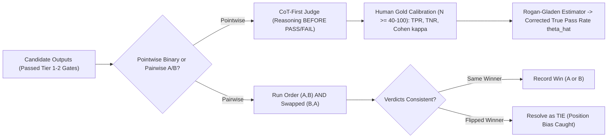
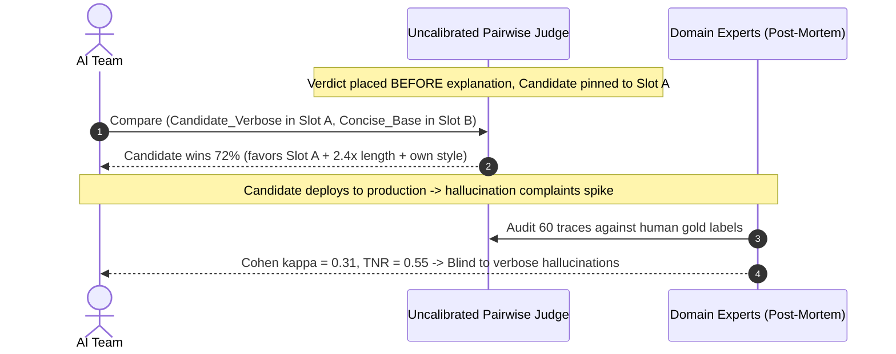

# Module 03: LLM-as-Judge

> **Prerequisites:** [Module 00: Why GenAI Evaluation Is Hard](../00-why-genai-evaluation-is-hard/README.md) and [Module 02: Deterministic Evals and Assertions](../02-deterministic-evals-and-assertions/README.md).  
> **Estimated Reading Time:** 32 minutes  
> **Target Audience:** AI Backend Engineers, Applied Scientists, ML Evaluation Engineers

> [!TIP]
> **The Golden Rule of LLM-as-Judge:** Never trust an uncalibrated LLM judge's raw score as truth—use **binary Pass/Fail criteria** (or **pairwise** comparisons with **mandatory position swapping**), force **Chain-of-Thought reasoning BEFORE the verdict**, and **calibrate against human ground truth** using **Cohen's $\kappa$**, **TPR/TNR**, and the **Rogan–Gladen prevalence correction**.

---

## Why This Matters

Once Tier-1 and Tier-2 deterministic assertions verify valid schemas, safe code, and proper tool ordering, you still face the hardest evaluation questions: *Does this answer accurately summarize the legal clause without subtle distortion? Is the tone empathetic without promising unauthorized credits? Did the RAG system ground every claim strictly in `<evidence>`?*

Human experts cannot review `5,000` nightly CI runs or `50,000` daily production traces. **LLM-as-Judge** (popularized in Zheng et al., *Judging LLM-as-a-Judge with MT-Bench and Chatbot Arena*, `arXiv:2306.05685`) bridges that gap by deploying a strong frontier judge model guided by an explicit domain rubric. Yet deploying an off-the-shelf `"Rate 1–5"` judge blindly is notoriously treacherous: judges suffer from systematic **position**, **verbosity**, and **self-enhancement biases**, agree poorly on vague Likert scales, and distort true pass rates whenever their False Positive and False Negative rates are ignored.

---

## 1. Judge Design, Systematic Biases & Statistical Calibration



### Pointwise Binary Pass/Fail vs. Likert 1–5 Scales vs. Pairwise A/B

| Pattern | Mechanism | Operational Strength | Critical Pitfall | When to Use |
| :--- | :--- | :--- | :--- | :--- |
| **Pointwise Binary (`PASS`/`FAIL`)** | Grades one trace against a single failure-mode rubric | Sharp decision boundary, highest human agreement ($\kappa$), directly yields TPR/TNR | Requires separate binary judges per failure mode rather than one aggregate number | **Default for CI/CD gates** and production monitoring |
| **Pointwise Likert (`1–5`)** | Assigns an ordinal integer score (`1` to `5`) | Expressive gradient for exploratory research | Central tendency clustering (`3` vs `4` undefined), invalid arithmetic means, low inter-rater $\kappa$ | **Avoid for release gates** unless anchors are rigorously operationalized |
| **Pairwise A/B Comparison** | Chooses winner between Response A and Response B (`A`, `B`, `TIE`) | Matches human preference closely when comparing two prompts/models | Vulnerable to **position bias**; doubles API cost with mandatory swap | Model selection, prompt A/B bake-offs, arena ranking |

### Systematic Judge Biases (Zheng et al., `arXiv:2306.05685`)

1. **Position Bias:** Judges systematically favor whichever response occupies Slot 1 (`A`) or Slot 2 (`B`) regardless of merit—especially on close pairs.
   - **Mandatory Fix (Position-Swap Debiasing):** Always run both `(A, B)` and `(B, A)`. Only award a win if the candidate wins in **both** slots (`A wins` in `(A, B)` AND `A wins` in `(B, A)`). Any cross-slot flip resolves deterministically to **`TIE`**.
2. **Verbosity Bias:** Judges consistently award higher scores to longer, bullet-heavy answers even when concise two-sentence responses are strictly more accurate.
   - **Fix:** Explicitly instruct the judge rubric to penalize padding, or measure correlation between response token length and judge pass rate during calibration.
3. **Self-Enhancement Bias:** Judges disproportionately prefer stylistic patterns produced by their own model family (`GPT` favoring `GPT`, `Claude` favoring `Claude`).
   - **Fix:** Prefer cross-family or ensemble judges when comparing competing vendors, and calibrate **TPR/TNR separately** whenever evaluating a new candidate family.

### Chain-of-Thought (CoT) Rubric Prompting BEFORE Verdict

Because autoregressive LLMs sample token-by-token left to right, JSON schemas structured as `{"verdict": "FAIL", "reasoning": "..."}` force the model to commit to a snap classification on token 1 and spend the remaining tokens generating post-hoc rationalization. Always order the structured output schema so **step-by-step rubric verification comes BEFORE the final verdict**:

```json
{
  "evidence_claims": ["Claim 1 verified in chunk#c2", "Claim 2 unsupported"],
  "reasoning": "Claim 2 introduces a 0% fee not present in chunk#c2.",
  "verdict": "FAIL"
}
```

Conditioning `verdict` on explicit chain-of-thought evidence checks dramatically improves both accuracy and debuggability.

### Judge Calibration Against Human Ground Truth & Prevalence Correction

Never deploy an LLM judge until you benchmark its verdicts against a human-labeled golden calibration set ($N \ge 40\text{–}100$, balanced across `PASS` and `FAIL` examples):

- **Confusion Matrix & Operating Characteristics:**
  - **TPR (Sensitivity):** $\frac{\text{TP}}{\text{TP} + \text{FN}}$ — probability the judge outputs `PASS` when human experts label `PASS`.
  - **TNR (Specificity):** $\frac{\text{TN}}{\text{TN} + \text{FP}}$ — probability the judge catches a human-labeled `FAIL`.
- **Cohen's $\kappa$ (Chance-Corrected Agreement):** Raw percent agreement $p_o$ looks artificially high on imbalanced datasets (`90%` pass rate yields `90%` agreement for a dumb judge that always predicts `PASS`!). **Cohen's $\kappa$** corrects for random chance $p_e$:

$$p_o = \frac{\text{TP} + \text{TN}}{N}, \qquad p_e = \frac{(\text{TP}+\text{FP})(\text{TP}+\text{FN}) + (\text{TN}+\text{FN})(\text{TN}+\text{FP})}{N^2}, \qquad \kappa = \frac{p_o - p_e}{1 - p_e}$$

Target **$\kappa \ge 0.70$** (substantial agreement, ideally `>= 0.80`) before automating CI decisions. When ordering multiple candidate systems by win-rate or judge score against human rankings, also verify **Spearman's rank correlation ($\rho$)**:

$$\rho = 1 - \frac{6 \sum_{i=1}^{M} d_i^2}{M(M^2 - 1)}$$

- **The Prevalence Trap & Rogan–Gladen Estimator (1978):**
  Suppose your calibrated judge has $\text{TPR} = 0.90$ and $\text{TNR} = 0.80$, and you evaluate a candidate system whose true pass rate is $\theta$. Every true pass registers `PASS` with probability $\text{TPR}$, and every true failure triggers a false positive with probability $1 - \text{TNR}$. Thus the judge's raw observed pass rate $q_{\text{obs}}$ is linearly warped:

$$q_{\text{obs}} = \theta \cdot \text{TPR} + (1 - \theta) \cdot (1 - \text{TNR})$$

Solving for the **Rogan–Gladen prevalence-corrected estimate** $\hat{\theta}$ (requires Youden's $J = \text{TPR} + \text{TNR} - 1 > 0$, clipped to $[0, 1]$):

$$\hat{\theta} = \operatorname{clip}_{[0, 1]}\!\left(\frac{q_{\text{obs}} + \text{TNR} - 1}{\text{TPR} + \text{TNR} - 1}\right)$$

Notice how dangerous unadjusted $q_{\text{obs}}$ is: on a strong system ($\theta = 95\%$), a judge with $\text{TPR}=0.90, \text{TNR}=0.80$ reports only $86.5\%$ (`-8.5 pp` bias); on a broken system ($\theta = 10\%$), the exact same judge reports $27.0\%$ (`+17.0 pp` illusion of quality!). Rogan–Gladen inversion recovers the true $\theta$ accurately.

---

## 2. Systematic Comparison Matrix: LLM Judge Paradigms

| Paradigm | Human Agreement ($\kappa$) | Dominant Biases | Compute Cost | Calibration Required | Ideal Use Case |
| :--- | :--- | :--- | :--- | :--- | :--- |
| **Raw Uncalibrated Likert `1–5`** | Low (`0.25–0.45`) | Central tendency, verbosity, self-enhancement | `1x` call | Hard (10+ threshold cutoffs) | Prototyping only; never CI gating |
| **CoT-First Binary Pass/Fail** | High (`0.75–0.88`) | Sensitivity/specificity imbalance | `1x` call | Exact (`TPR`, `TNR`, $\kappa$, Rogan–Gladen) | **Production CI gates** & slice drift |
| **Pairwise A/B (No Position Swap)** | Moderate (`0.45–0.65`) | Severe Slot-1 / Slot-2 position bias | `1x` call | Misleading without swaps | Unsafe—biased by prompt ordering |
| **Pairwise A/B + Position Swap** | High (`0.72–0.85`) | Verbosity & tie inflation on close pairs | `2x` calls | Flip-rate monitoring + human spot check | Model/prompt A/B tournaments |

---

## 3. Production War Story Post-Mortem: The Self-Enhancing Verbosity Trap

| Field | Incident Details |
| :--- | :--- |
| **Severity** | **SEV-2** (Production Accuracy Regression Shipped as "+18% Improvement") |
| **Detection / Resolution Time** | Detected 5 days post-release via enterprise customer hallucination complaints / Mitigated in 2 hours via model rollback |
| **Impact** | Factual precision dropped `14%` across live executive briefings while uncalibrated judge reported `+18%` win rate; `22` enterprise renewals delayed |

### What Happened

An enterprise research assistant team tested a verbose new fine-tuned candidate (`2.4x` longer outputs with multi-level Markdown bullet lists) against their concise production baseline. To decide, they used an unswapped pairwise GPT-family judge prompting `{"winner": "A"|"B", "explanation": "..."}`—placing the new candidate permanently in **Slot A** (`verdict` generated *before* `explanation`).

The judge declared the new candidate the winner on **`72%` of cases** (`+18 pp` over baseline). Five days after rollout, enterprise analysts reported subtle unsupported claims buried inside verbose bullet points. Post-mortem human labeling by two domain analysts revealed **Cohen's $\kappa = 0.31$** (`TNR = 0.55` on subtle hallucinations!)—three biases had stacked simultaneously: **Slot-A position bias**, **verbosity bias** (`2.4x` length rewarded), and **self-enhancement bias** (same model family grading itself).



### Root Cause Analysis

- **Verdict Before Reasoning:** Asking for `"winner"` on the first JSON key forced snap bias before checking individual claims.
- **No Position Swapping:** Pinning the candidate to Slot A conflated model superiority with Slot-1 ordering preference.
- **Zero Human Calibration (`TPR`/`TNR`/`kappa`):** Nobody verified whether the judge actually caught subtle unsupported extrapolations (`TNR = 0.55`).

### Architectural Hardening & Verified Fix

- **CoT-First Binary Factuality Judge:** Replaced vague pairwise winner prompts with a dedicated binary `PASS`/`FAIL` claim-entailment judge emitting `reasoning` *before* `verdict`.
- **Mandatory Position-Swap Protocol:** Enforced `(A, B)` and `(B, A)` dual evaluation for all pairwise comparisons, downgrading position flips to `TIE`.
- **Calibration Gate (`kappa >= 0.78`) + Rogan–Gladen:** Calibrated against `80` human-labeled traces before CI deployment (`TPR = 0.92`, `TNR = 0.88`, $\kappa = 0.79$) and tracked prevalence-adjusted $\hat{\theta}$ in release dashboards.

---

## 4. Multi-Language Production Implementation: Position-Swap Debiasing & Rogan–Gladen Calibrator

Below is a production-ready **LLM Judge Calibrator & Position-Swap Engine** across **Go**, **TypeScript**, **Python**, and **C#**. It validates CoT-first judge JSON payloads (rejecting responses where `reasoning` is empty or missing), reconciles swapped `(A, B)` / `(B, A)` pairwise verdicts into `A`, `B`, or `TIE`, computes `TPR`, `TNR`, and **Cohen's $\kappa$**, and calculates **Rogan–Gladen** adjusted true pass rates.

````carousel

```go
package llmjudge

import (
	"encoding/json"
	"errors"
	"math"
	"strings"
)

type CotJudgeOutput struct {
	Reasoning string `json:"reasoning"`
	Verdict   string `json:"verdict"` // "PASS" | "FAIL"
}

type CalibrationReport struct {
	TP         int
	FP         int
	TN         int
	FN         int
	TPR        float64
	TNR        float64
	Agreement  float64
	CohenKappa float64
}

// ParseCotFirstVerdict validates CoT reasoning appears non-empty ahead of PASS/FAIL verdict.
func ParseCotFirstVerdict(rawJSON string) (CotJudgeOutput, error) {
	rawOrderIdx := strings.Index(rawJSON, `"reasoning"`)
	verdictIdx := strings.Index(rawJSON, `"verdict"`)
	if rawOrderIdx == -1 || verdictIdx == -1 || rawOrderIdx > verdictIdx {
		return CotJudgeOutput{}, errors.New("schema must serialize reasoning before verdict")
	}
	var out CotJudgeOutput
	if err := json.Unmarshal([]byte(rawJSON), &out); err != nil {
		return CotJudgeOutput{}, err
	}
	if strings.TrimSpace(out.Reasoning) == "" {
		return CotJudgeOutput{}, errors.New("empty chain-of-thought reasoning")
	}
	if out.Verdict != "PASS" && out.Verdict != "FAIL" {
		return CotJudgeOutput{}, errors.New("verdict must be PASS or FAIL")
	}
	return out, nil
}

// ReconcilePositionSwap resolves (A,B) and (B,A) judge picks ("SLOT1" | "SLOT2" | "TIE").
func ReconcilePositionSwap(forwardAB, reverseBA string) string {
	mapFwd := map[string]string{"SLOT1": "A", "SLOT2": "B", "TIE": "TIE"}[forwardAB]
	mapRev := map[string]string{"SLOT1": "B", "SLOT2": "A", "TIE": "TIE"}[reverseBA]
	if mapFwd == "" || mapRev == "" || mapFwd != mapRev {
		return "TIE"
	}
	return mapFwd
}

func CalibrateAgainstHuman(humanPass, judgePass []bool) (CalibrationReport, error) {
	if len(humanPass) == 0 || len(humanPass) != len(judgePass) {
		return CalibrationReport{}, errors.New("label slices must be non-empty and equal length")
	}
	var tp, fp, tn, fn int
	for i := range humanPass {
		h, j := humanPass[i], judgePass[i]
		switch {
		case h && j:
			tp++
		case !h && j:
			fp++
		case !h && !j:
			tn++
		default:
			fn++
		}
	}
	n := float64(len(humanPass))
	tpr := float64(tp) / math.Max(1, float64(tp+fn))
	tnr := float64(tn) / math.Max(1, float64(tn+fp))
	po := float64(tp+tn) / n
	pe := (float64(tp+fp)/n)*(float64(tp+fn)/n) + (float64(tn+fn)/n)*(float64(tn+fp)/n)
	kappa := 0.0
	if 1.0-pe > 0 {
		kappa = (po - pe) / (1.0 - pe)
	}
	return CalibrationReport{TP: tp, FP: fp, TN: tn, FN: fn, TPR: tpr, TNR: tnr, Agreement: po, CohenKappa: kappa}, nil
}

func RoganGladen(qObs, tpr, tnr float64) (float64, error) {
	youdenJ := tpr + tnr - 1.0
	if youdenJ <= 0 {
		return 0, errors.New("non-informative judge: TPR + TNR <= 1")
	}
	theta := (qObs + tnr - 1.0) / youdenJ
	return math.Min(1.0, math.Max(0.0, theta)), nil
}
```

<!-- slide -->

```typescript
export interface CotJudgeOutput {
  readonly reasoning: string;
  readonly verdict: "PASS" | "FAIL";
}

export interface CalibrationReport {
  readonly tp: number;
  readonly fp: number;
  readonly tn: number;
  readonly fn: number;
  readonly tpr: number;
  readonly tnr: number;
  readonly agreement: number;
  readonly cohenKappa: number;
}

export function parseCotFirstVerdict(rawJson: string): CotJudgeOutput {
  const reasoningIdx = rawJson.indexOf('"reasoning"');
  const verdictIdx = rawJson.indexOf('"verdict"');
  if (reasoningIdx === -1 || verdictIdx === -1 || reasoningIdx > verdictIdx) {
    throw new Error("Judge payload must output reasoning before verdict");
  }
  const parsed = JSON.parse(rawJson) as Partial<CotJudgeOutput>;
  if (typeof parsed.reasoning !== "string" || parsed.reasoning.trim().length === 0) {
    throw new Error("Judge output missing non-empty CoT reasoning");
  }
  if (parsed.verdict !== "PASS" && parsed.verdict !== "FAIL") {
    throw new Error("Verdict must be PASS or FAIL");
  }
  return { reasoning: parsed.reasoning, verdict: parsed.verdict };
}

export function reconcilePositionSwap(
  forwardAB: "SLOT1" | "SLOT2" | "TIE",
  reverseBA: "SLOT1" | "SLOT2" | "TIE",
): "A" | "B" | "TIE" {
  const mapFwd = forwardAB === "SLOT1" ? "A" : forwardAB === "SLOT2" ? "B" : "TIE";
  const mapRev = reverseBA === "SLOT1" ? "B" : reverseBA === "SLOT2" ? "A" : "TIE";
  return mapFwd === mapRev ? mapFwd : "TIE";
}

export function calibrateAgainstHuman(
  humanPass: readonly boolean[],
  judgePass: readonly boolean[],
): CalibrationReport {
  if (humanPass.length === 0 || humanPass.length !== judgePass.length) {
    throw new RangeError("Human and judge label arrays must be non-empty and equal length");
  }
  let tp = 0, fp = 0, tn = 0, fn = 0;
  for (let i = 0; i < humanPass.length; i += 1) {
    const h = humanPass[i];
    const j = judgePass[i];
    if (h && j) tp += 1;
    else if (!h && j) fp += 1;
    else if (!h && !j) tn += 1;
    else fn += 1;
  }
  const n = humanPass.length;
  const tpr = tp / Math.max(1, tp + fn);
  const tnr = tn / Math.max(1, tn + fp);
  const po = (tp + tn) / n;
  const pe = ((tp + fp) / n) * ((tp + fn) / n) + ((tn + fn) / n) * ((tn + fp) / n);
  const cohenKappa = 1 - pe > 0 ? (po - pe) / (1 - pe) : 0;
  return { tp, fp, tn, fn, tpr, tnr, agreement: po, cohenKappa };
}

export function roganGladenEstimate(qObs: number, tpr: number, tnr: number): number {
  const youdenJ = tpr + tnr - 1;
  if (youdenJ <= 0) {
    throw new RangeError("Judge is non-informative (TPR + TNR <= 1)");
  }
  const raw = (qObs + tnr - 1) / youdenJ;
  return Math.min(1, Math.max(0, raw));
}
```

<!-- slide -->

```python
"""
llm_judge_calibrator.py
CoT-first judge parser, position-swap reconciler, Cohen's kappa calibrator, and Rogan-Gladen estimator.
"""
from dataclasses import dataclass
import json
from typing import Literal, Sequence

SlotChoice = Literal["SLOT1", "SLOT2", "TIE"]


@dataclass(frozen=True)
class CalibrationReport:
    tp: int
    fp: int
    tn: int
    fn: int
    tpr: float
    tnr: float
    agreement: float
    cohen_kappa: float


def parse_cot_first_verdict(raw_json: str) -> tuple[str, str]:
    r_idx = raw_json.find('"reasoning"')
    v_idx = raw_json.find('"verdict"')
    if r_idx == -1 or v_idx == -1 or r_idx > v_idx:
        raise ValueError("Judge JSON must serialize 'reasoning' prior to 'verdict'")
    obj = json.loads(raw_json)
    reasoning = str(obj.get("reasoning", "")).strip()
    verdict = obj.get("verdict")
    if not reasoning:
        raise ValueError("Judge reasoning cannot be empty")
    if verdict not in ("PASS", "FAIL"):
        raise ValueError(f"Invalid binary verdict: {verdict!r}")
    return reasoning, verdict


def reconcile_position_swap(forward_ab: SlotChoice, reverse_ba: SlotChoice) -> str:
    fwd_map = {"SLOT1": "A", "SLOT2": "B", "TIE": "TIE"}[forward_ab]
    rev_map = {"SLOT1": "B", "SLOT2": "A", "TIE": "TIE"}[reverse_ba]
    return fwd_map if fwd_map == rev_map else "TIE"


def calibrate_against_human(human_pass: Sequence[bool], judge_pass: Sequence[bool]) -> CalibrationReport:
    if not human_pass or len(human_pass) != len(judge_pass):
        raise ValueError("human_pass and judge_pass must be non-empty and equal length")
    tp = sum(1 for h, j in zip(human_pass, judge_pass) if h and j)
    fp = sum(1 for h, j in zip(human_pass, judge_pass) if not h and j)
    tn = sum(1 for h, j in zip(human_pass, judge_pass) if not h and not j)
    fn = sum(1 for h, j in zip(human_pass, judge_pass) if h and not j)
    n = len(human_pass)
    tpr = tp / max(1, tp + fn)
    tnr = tn / max(1, tn + fp)
    po = (tp + tn) / n
    pe = ((tp + fp) / n) * ((tp + fn) / n) + ((tn + fn) / n) * ((tn + fp) / n)
    kappa = (po - pe) / (1.0 - pe) if (1.0 - pe) > 0 else 0.0
    return CalibrationReport(tp=tp, fp=fp, tn=tn, fn=fn, tpr=tpr, tnr=tnr, agreement=po, cohen_kappa=kappa)


def rogan_gladen_estimate(q_obs: float, tpr: float, tnr: float) -> float:
    youden_j = tpr + tnr - 1.0
    if youden_j <= 0.0:
        raise ValueError("Judge is non-informative (TPR + TNR <= 1.0)")
    raw = (q_obs + tnr - 1.0) / youden_j
    return min(1.0, max(0.0, raw))
```

<!-- slide -->

```csharp
using System;
using System.Collections.Generic;
using System.Text.Json;

namespace GenAI.LlmJudge;

public sealed record CalibrationReport(
    int Tp, int Fp, int Tn, int Fn,
    double Tpr, double Tnr, double Agreement, double CohenKappa);

public static class JudgeCalibrator
{
    public static (string Reasoning, string Verdict) ParseCotFirstVerdict(string rawJson)
    {
        int rIdx = rawJson.IndexOf("\"reasoning\"", StringComparison.Ordinal);
        int vIdx = rawJson.IndexOf("\"verdict\"", StringComparison.Ordinal);
        if (rIdx < 0 || vIdx < 0 || rIdx > vIdx)
            throw new FormatException("Judge payload must emit 'reasoning' before 'verdict'.");

        using var doc = JsonDocument.Parse(rawJson);
        string reasoning = doc.RootElement.GetProperty("reasoning").GetString()?.Trim() ?? "";
        string verdict = doc.RootElement.GetProperty("verdict").GetString() ?? "";

        if (reasoning.Length == 0)
            throw new FormatException("Chain-of-thought reasoning cannot be empty.");
        if (verdict != "PASS" && verdict != "FAIL")
            throw new FormatException("Verdict must be PASS or FAIL.");

        return (reasoning, verdict);
    }

    public static string ReconcilePositionSwap(string forwardAb, string reverseBa)
    {
        string MapForward(string v) => v == "SLOT1" ? "A" : v == "SLOT2" ? "B" : "TIE";
        string MapReverse(string v) => v == "SLOT1" ? "B" : v == "SLOT2" ? "A" : "TIE";

        string f = MapForward(forwardAb);
        string r = MapReverse(reverseBa);
        return f == r ? f : "TIE";
    }

    public static CalibrationReport Calibrate(
        IReadOnlyList<bool> humanPass,
        IReadOnlyList<bool> judgePass)
    {
        if (humanPass.Count == 0 || humanPass.Count != judgePass.Count)
            throw new ArgumentException("Label lists must be non-empty and equal length.");

        int tp = 0, fp = 0, tn = 0, fn = 0;
        for (int i = 0; i < humanPass.Count; i++)
        {
            if (humanPass[i] && judgePass[i]) tp++;
            else if (!humanPass[i] && judgePass[i]) fp++;
            else if (!humanPass[i] && !judgePass[i]) tn++;
            else fn++;
        }

        double n = humanPass.Count;
        double tpr = (double)tp / Math.Max(1, tp + fn);
        double tnr = (double)tn / Math.Max(1, tn + fp);
        double po = (tp + tn) / n;
        double pe = ((tp + fp) / n) * ((tp + fn) / n) + ((tn + fn) / n) * ((tn + fp) / n);
        double kappa = (1.0 - pe) > 0 ? (po - pe) / (1.0 - pe) : 0.0;

        return new CalibrationReport(tp, fp, tn, fn, tpr, tnr, po, kappa);
    }

    public static double RoganGladen(double qObs, double tpr, double tnr)
    {
        double youdenJ = tpr + tnr - 1.0;
        if (youdenJ <= 0.0)
            throw new ArgumentException("Non-informative judge: TPR + TNR <= 1.");
        double raw = (qObs + tnr - 1.0) / youdenJ;
        return Math.Min(1.0, Math.Max(0.0, raw));
    }
}
```

````

---

## 5. Practical Hands-On Verification CLI Workflows

Run these offline Python 3.13 verification scripts locally—zero third-party libraries or API keys required.

### Workflow 1: Pairwise Position-Swap Debiasing Simulator

Simulate a judge with a `+0.15` Slot-1 position bias evaluating `10` pairs where Model `B` is genuinely stronger—proving how unswapped testing falsely crowns `A` while mandatory `(A,B)` + `(B,A)` swapping catches flips as `TIE` and recovers the true ranking:

```bash
python - << 'EOF'
pairs = [
    {"id": "p01", "q_a": 0.55, "q_b": 0.92},
    {"id": "p02", "q_a": 0.62, "q_b": 0.89},
    {"id": "p03", "q_a": 0.88, "q_b": 0.60},
    {"id": "p04", "q_a": 0.72, "q_b": 0.81},
    {"id": "p05", "q_a": 0.52, "q_b": 0.88},
    {"id": "p06", "q_a": 0.68, "q_b": 0.78},
    {"id": "p07", "q_a": 0.74, "q_b": 0.75},
    {"id": "p08", "q_a": 0.66, "q_b": 0.76},
    {"id": "p09", "q_a": 0.70, "q_b": 0.79},
    {"id": "p10", "q_a": 0.73, "q_b": 0.73},
]

def biased_judge(slot1_q, slot2_q, slot1_bias=0.15, margin=0.05):
    diff = (slot1_q + slot1_bias) - slot2_q
    if diff > margin:
        return "SLOT1"
    if diff < -margin:
        return "SLOT2"
    return "TIE"

unswapped = {"A": 0, "B": 0, "TIE": 0}
swapped = {"A": 0, "B": 0, "TIE": 0, "FLIP_TIE": 0}

for p in pairs:
    v1 = biased_judge(p["q_a"], p["q_b"])
    map_v1 = {"SLOT1": "A", "SLOT2": "B", "TIE": "TIE"}[v1]
    unswapped[map_v1] += 1

    v2 = biased_judge(p["q_b"], p["q_a"])
    map_v2 = {"SLOT1": "B", "SLOT2": "A", "TIE": "TIE"}[v2]
    if map_v1 == map_v2:
        swapped[map_v1] += 1
    else:
        swapped["TIE"] += 1
        swapped["FLIP_TIE"] += 1

print(f"Unswapped (A,B) only -> A wins={unswapped['A']}, B wins={unswapped['B']}, TIE={unswapped['TIE']} [FALSELY CROWNS A]")
print(f"Position-Swapped     -> A wins={swapped['A']}, B wins={swapped['B']}, TIE={swapped['TIE']} (flips caught={swapped['FLIP_TIE']}) [TRUE WINNER B]")
EOF
```

**Expected Output:**

```text
Unswapped (A,B) only -> A wins=7, B wins=3, TIE=0 [FALSELY CROWNS A]
Position-Swapped     -> A wins=1, B wins=3, TIE=6 (flips caught=6) [TRUE WINNER B]
```

### Workflow 2: Judge Calibration — Confusion Matrix, Cohen's $\kappa$, and Spearman $\rho$

Benchmark an uncalibrated judge vs. a CoT-first binary judge against `40` human ground-truth labels (`24 PASS`, `16 FAIL`) and compute system-level Spearman $\rho$ across `5` model candidates:

```bash
python - << 'EOF'
def judge_metrics(human, judge):
    tp = sum(1 for h, j in zip(human, judge) if h == 1 and j == 1)
    fp = sum(1 for h, j in zip(human, judge) if h == 0 and j == 1)
    tn = sum(1 for h, j in zip(human, judge) if h == 0 and j == 0)
    fn = sum(1 for h, j in zip(human, judge) if h == 1 and j == 0)
    n = len(human)
    tpr = tp / (tp + fn)
    tnr = tn / (tn + fp)
    po = (tp + tn) / n
    pe = ((tp + fp) / n) * ((tp + fn) / n) + ((tn + fn) / n) * ((tn + fp) / n)
    kappa = (po - pe) / (1.0 - pe)
    return tp, fp, tn, fn, tpr, tnr, po, kappa

def spearman_rho(x, y):
    n = len(x)
    rx = sorted(range(n), key=lambda i: x[i])
    ry = sorted(range(n), key=lambda i: y[i])
    rank_x, rank_y = [0] * n, [0] * n
    for r, idx in enumerate(rx, 1): rank_x[idx] = r
    for r, idx in enumerate(ry, 1): rank_y[idx] = r
    d2 = sum((rank_x[i] - rank_y[i]) ** 2 for i in range(n))
    return 1.0 - (6.0 * d2) / (n * (n * n - 1))

human_gold = [1]*24 + [0]*16
naive_judge = [1]*20 + [0]*4 + [1]*7 + [0]*9
cot_judge   = [1]*22 + [0]*2 + [1]*2 + [0]*14

for name, pred in [("Uncalibrated Judge", naive_judge), ("CoT-First Binary Judge", cot_judge)]:
    tp, fp, tn, fn, tpr, tnr, po, kappa = judge_metrics(human_gold, pred)
    print(f"{name:<23} | TP={tp} FP={fp} TN={tn} FN={fn} | TPR={tpr:.2f} TNR={tnr:.2f} | agree={po:.1%} | kappa={kappa:.3f}")

human_sys_scores = [0.62, 0.71, 0.78, 0.85, 0.91]
naive_sys_scores = [0.74, 0.69, 0.83, 0.80, 0.89]
cot_sys_scores   = [0.64, 0.73, 0.77, 0.86, 0.90]
print(f"System ranking Spearman rho (Naive vs Human)     = {spearman_rho(human_sys_scores, naive_sys_scores):.3f}")
print(f"System ranking Spearman rho (CoT-First vs Human) = {spearman_rho(human_sys_scores, cot_sys_scores):.3f}")
EOF
```

**Expected Output:**

```text
Uncalibrated Judge      | TP=20 FP=7 TN=9 FN=4 | TPR=0.83 TNR=0.56 | agree=72.5% | kappa=0.409
CoT-First Binary Judge  | TP=22 FP=2 TN=14 FN=2 | TPR=0.92 TNR=0.88 | agree=90.0% | kappa=0.792
System ranking Spearman rho (Naive vs Human)     = 0.800
System ranking Spearman rho (CoT-First vs Human) = 1.000
```

Notice how `72.5%` raw agreement on the uncalibrated judge hides a dismal `TNR = 0.56` (`44%` of real bugs pass!) and weak `kappa = 0.409`—whereas CoT-first binary prompting lifts `TNR` to `0.88` and `kappa` to `0.792`.

### Workflow 3: Rogan–Gladen Prevalence Bias Correction Sweep

Observe how an imperfect judge (`TPR = 0.90`, `TNR = 0.80`) overstates weak systems (`+17.0 pp`) and understates strong systems (`-8.5 pp`), and verify how Rogan–Gladen inversion recovers $\theta$:

```bash
python - << 'EOF'
def rogan_gladen(q_obs, tpr, tnr):
    youden_j = tpr + tnr - 1.0
    if youden_j <= 0.0:
        raise ValueError("Judge is non-informative (TPR + TNR <= 1.0)")
    raw = (q_obs + tnr - 1.0) / youden_j
    return min(1.0, max(0.0, raw)), raw

tpr, tnr = 0.90, 0.80
print(f"Calibrated Judge Profile: TPR={tpr:.2f}, TNR={tnr:.2f} (Youden J={tpr+tnr-1:.2f})")
for true_theta in [0.10, 0.30, 0.50, 0.80, 0.95]:
    q_obs = true_theta * tpr + (1.0 - true_theta) * (1.0 - tnr)
    theta_hat, raw_est = rogan_gladen(q_obs, tpr, tnr)
    bias_pp = (q_obs - true_theta) * 100.0
    print(f"  true_theta={true_theta:.1%} | raw_judge_obs={q_obs:.1%} (bias={bias_pp:+5.1f} pp) | rogan_gladen={theta_hat:.1%}")
clamped, raw_noisy = rogan_gladen(0.92, tpr, tnr)
print(f"Boundary check (q_obs=92.0% > TPR=90.0%): raw={raw_noisy:.3f} -> clamped={clamped:.1%}")
EOF
```

**Expected Output:**

```text
Calibrated Judge Profile: TPR=0.90, TNR=0.80 (Youden J=0.70)
  true_theta=10.0% | raw_judge_obs=27.0% (bias=+17.0 pp) | rogan_gladen=10.0%
  true_theta=30.0% | raw_judge_obs=41.0% (bias=+11.0 pp) | rogan_gladen=30.0%
  true_theta=50.0% | raw_judge_obs=55.0% (bias= +5.0 pp) | rogan_gladen=50.0%
  true_theta=80.0% | raw_judge_obs=76.0% (bias= -4.0 pp) | rogan_gladen=80.0%
  true_theta=95.0% | raw_judge_obs=86.5% (bias= -8.5 pp) | rogan_gladen=95.0%
Boundary check (q_obs=92.0% > TPR=90.0%): raw=1.029 -> clamped=100.0%
```

### Hands-On Exercises

1. **Imbalanced Dataset Accuracy Trap:** Modify Workflow 2 so `human_gold` has `36` passes and `4` fails (`90%` base rate), with a degenerate judge that always outputs `PASS` (`judge = [1]*40`). Verify that `agree = 90.0%` while `TNR = 0.00` and `kappa = 0.000`!
2. **Verbosity Bias Diagnostic:** Add a synthetic `"length_tokens"` field to Workflow 1 where `Model A` outputs `400` tokens (`+0.12` length bonus) and `Model B` outputs `120` tokens. Measure how length-normalization or explicit rubric penalties restore accuracy.
3. **Optional Live Judge Calibration Probe (Requires API Key):** Label `25` RAG outputs manually (`PASS`/`FAIL`), run two judge prompts (`verdict-first` vs `reasoning-first` JSON order), and compute exact Cohen's $\kappa$ and `TNR` differences.

### Independent Challenge

Your team built a faithfulness judge calibrated on `100` human-labeled summaries (`TPR = 0.88`, `TNR = 0.76`). When monitoring live production traffic (`50,000` queries/month), the raw judge reports `79.2%` pass rate in Week 1 and `84.4%` in Week 2 after a retrieval upgrade. Compute (a) Cohen's $\kappa$ if true prevalence during calibration was `70%`, (b) the Rogan–Gladen corrected true pass rates $\hat{\theta}_1$ and $\hat{\theta}_2$, and (c) explain why the raw `+5.2 pp` raw lift actually understates the real improvement!

<details><summary>Architectural Discussion</summary>

First, verify judge informativeness: Youden's $J = \text{TPR} + \text{TNR} - 1 = 0.88 + 0.76 - 1 = 0.64 > 0$. Next, invert both observed pass rates with **Rogan–Gladen**:
- Week 1 ($q_1 = 0.792$): $\hat{\theta}_1 = \frac{0.792 + 0.76 - 1}{0.64} = \frac{0.552}{0.64} = \mathbf{86.25\%}$.
- Week 2 ($q_2 = 0.844$): $\hat{\theta}_2 = \frac{0.844 + 0.76 - 1}{0.64} = \frac{0.604}{0.64} = \mathbf{94.38\%}$.

Notice that a noisy judge attenuates true improvements by factor $J = 0.64$: the observed `+5.2 pp` gain actually corresponds to a massive **`+8.13 pp` true faithfulness improvement** (`86.25% -> 94.38%`), because false negatives (`1 - TPR = 12%`) penalize high-performing systems increasingly harshly as true quality approaches `100%`! At `70%` calibration prevalence (`TP=61.6, FN=8.4, TN=22.8, FP=7.2` per 100), $p_o = 0.844$, $p_e = (0.688)(0.70) + (0.312)(0.30) = 0.5752$, yielding $\kappa = (0.844 - 0.5752)/(1 - 0.5752) \approx \mathbf{0.633}$ (borderline—indicating the judge prompt should be tightened with CoT examples before relying on it blindly).

</details>

---

## 6. Common Mistakes & Troubleshooting

- **Reporting raw `% agreement` on imbalanced evals:** At a `92%` true pass rate, a broken judge predicting `"PASS"` for everything achieves `92%` agreement (`TNR = 0.0`, $\kappa = 0.0$). Always report **Cohen's $\kappa$** alongside separate **TPR** and **TNR**.
- **Placing `"verdict"` or `"score"` first in JSON output schemas:** Generating the score token before reasoning forces the LLM to commit early and rationalize mistakes. Put `"reasoning"` first.
- **Averaging Likert `1–5` ratings across arbitrary judges:** Different judge prompts anchor `"3"` vs `"4"` inconsistently; ordinal numbers cannot simply be averaged across heterogeneous failure dimensions. Decompose into crisp binary `PASS`/`FAIL` failure criteria.
- **Assuming judge TPR/TNR stay invariant across model families or domains:** Self-enhancement bias shifts `TPR` when changing candidate generators, and domain shifts change `TNR`. Re-calibrate whenever switching candidate model families or product verticals.

---

## 7. Operational Validation Checkpoints & Checkpoint Quiz

### Operational Validation Checkpoints

<details><summary><strong>Checkpoint 1: Diagnosing why a pairwise judge flip-flopped 42% of verdicts</strong></summary>

During an A/B prompt test, running `(Prompt A, Prompt B)` crowned `A` (`64%` win rate), yet swapping order to `(Prompt B, Prompt A)` crowned `B` (`58%` win rate). What happened and what is the correct reconciled score?

**Validation:** The pairwise judge exhibited severe **position bias** (favoring Slot 1). Under **position-swap debiasing**, any pair whose winner changes when `(A, B)` is swapped to `(B, A)` is invalid and must be downgraded to **`TIE`**. Only items winning consistently across both orderings count as decisive wins.

</details>

<details><summary><strong>Checkpoint 2: Why a judge with 89% raw agreement failed production calibration</strong></summary>

A safety judge scored `89%` raw accuracy on a `100`-example audit set (`90` safe, `10` unsafe), yet let `9` of the `10` unsafe prompts pass in production. Compute its `TNR` and Cohen's $\kappa$, and diagnose why raw agreement misled the team.

**Validation:** With `TP=88, FN=2, FP=9, TN=1`: $p_o = 0.89$, **$\text{TPR} = 88/90 = 97.8\%$**, **$\text{TNR} = 1/10 = 10.0\%$**, and $p_e = (0.97)(0.90) + (0.03)(0.10) = 0.876$, yielding **$\kappa = (0.89 - 0.876)/(1 - 0.876) = \mathbf{0.113}$**! Heavy class imbalance hid a `90%` miss rate on unsafe inputs inside `"89% agreement"`. Always balance calibration splits and require `TNR >= 0.85` and `kappa >= 0.70`.

</details>

<details><summary><strong>Checkpoint 3: Correcting distorted judge scores via Rogan–Gladen</strong></summary>

Your calibrated judge has `TPR = 0.90` and `TNR = 0.85`. On a newly launched workflow, the judge reports `83.5%` observed pass rate. What is the Rogan–Gladen estimated true pass rate?

**Validation:** Youden's $J = 0.90 + 0.85 - 1 = 0.75$. Using $\hat{\theta} = \frac{q_{\text{obs}} + \text{TNR} - 1}{\text{TPR} + \text{TNR} - 1} = \frac{0.835 + 0.85 - 1}{0.75} = \frac{0.685}{0.75} = \mathbf{91.3\%}$. False negatives from the imperfect judge were masking nearly `8` percentage points of true system quality.

</details>

### Checkpoint Quiz

1. Name the **three canonical LLM-as-Judge biases** documented in Zheng et al. (`arXiv:2306.05685`) and how to mitigate each.
2. Why must Chain-of-Thought `"reasoning"` be serialized *before* `"verdict"` in judge prompts and JSON schemas?
3. Explain the rule for reconciling `(A, B)` and `(B, A)` runs under **position-swap debiasing**.
4. Why is **Cohen's $\kappa$** strictly preferable to raw `% agreement` when calibrating a judge against human labels?
5. State the **Rogan–Gladen estimator** equation and the condition on Youden's $J$ required for it to be valid.

<details><summary>Answers</summary>

1. (1) **Position bias** — mitigate via mandatory `(A, B)` + `(B, A)` position swapping; (2) **Verbosity bias** — mitigate via explicit anti-padding rubric criteria and length diagnostics; (3) **Self-enhancement bias** — mitigate via cross-family judge selection and separate per-family human calibration.
2. Autoregressive models decode sequentially; emitting `verdict` first locks in a snap decision and turns remaining tokens into post-hoc rationalization, whereas reasoning first forces rubric evidence checking before choosing `PASS`/`FAIL`.
3. Evaluate both `(A, B)` and `(B, A)`. Record `A` or `B` only when both runs select the identical underlying response; if the choice flips across positions, record **`TIE`**.
4. Cohen's $\kappa = (p_o - p_e)/(1 - p_e)$ subtracts expected random chance agreement $p_e$, exposing degenerate majority-class judges on imbalanced datasets that appear deceptively good under raw accuracy.
5. $\hat{\theta} = \operatorname{clip}_{[0,1]}\!\left(\frac{q_{\text{obs}} + \text{TNR} - 1}{\text{TPR} + \text{TNR} - 1}\right)$, valid only when Youden's $J = \text{TPR} + \text{TNR} - 1 > 0$ (judge outperforms random guessing).

</details>

---

## Further Reading & Sources

- [Judging LLM-as-a-Judge with MT-Bench and Chatbot Arena (Zheng et al., 2023)](https://arxiv.org/abs/2306.05685) — foundational empirical study quantifying position, verbosity, and self-enhancement biases plus CoT judging.
- [Hamel Husain: Using LLM-as-a-Judge For Evaluation — A Complete Guide](https://hamel.dev/blog/posts/llm-judge/) — binary Pass/Fail design, critique shadowing, human alignment, and Rogan–Gladen prevalence correction.
- [Evidently AI: LLM-as-a-Judge Complete Guide](https://www.evidentlyai.com/llm-guide/llm-as-a-judge) — reference-based vs. open-ended judge architectures, prompt templates, and calibration workflows.
- [Eugene Yan: Evaluating the Effectiveness of LLM-Evaluators](https://eugeneyan.com/writing/llm-evaluators/) — literature synthesis on Cohen's $\kappa$, Spearman $\rho$, position-swapping, and fine-tuned evaluators.
- [Rogan & Gladen (1978): Estimating Prevalence from the Results of a Screening Test](https://academic.oup.com/aje/article-abstract/107/1/71/134572) — original mathematical derivation correcting apparent test prevalence via sensitivity (`TPR`) and specificity (`TNR`).

## Next

[Module 04: Human Evaluation and Annotation](../04-human-evaluation-and-annotation/README.md)
