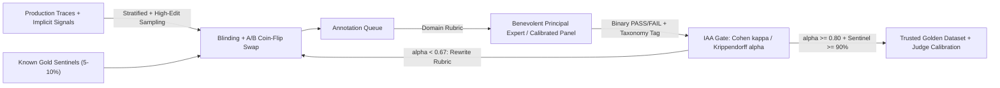
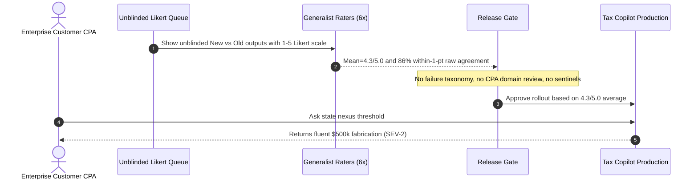

# Module 04: Human Evaluation and Annotation

> **Prerequisites:** [Module 01: Building an Eval Dataset](../01-building-an-eval-dataset/README.md) and [Module 03: LLM-as-Judge](../03-llm-as-judge/README.md).  
> **Estimated Reading Time:** 30 minutes  
> **Target Audience:** AI Backend Engineers, Applied ML Leads, Evaluation & Product Engineers

> [!TIP]
> **The Golden Rule of Human Evaluation:** Never ship `1–5` Likert averages or uncalibrated crowd majority votes as your ground truth. Anchor your evaluation flywheel on **binary `PASS / FAIL` judgments paired with a mutually exclusive failure taxonomy**, led by a **Benevolent Principal Domain Expert**, and continuously audited using **chance-corrected Inter-Annotator Agreement** ($\kappa$ / Krippendorff's $\alpha$), blinded A/B slot randomization, and injected gold-sentinel traps.

---

## Why This Matters

In early AI prototypes, teams collect `"quality ratings from 1 to 5"` across three contract reviewers, celebrate an average score of `4.2 / 5.0`, and ship to production. Two weeks later, enterprise support escalates: `14%` of outputs quietly hallucinated invalid tax clauses or broke downstream JSON schemas—mistakes that reviewers consistently rated `4/5` because the prose sounded polite and authoritative.

Human annotation is the **sole ground-truth anchor** for both your product metrics and your automated LLM-as-Judge evaluators ([Module 03](../03-llm-as-judge/README.md)). If your human labels suffer from central-tendency bias, rubric drift, position bias, or unmeasured rater noise, every downstream judge calibration and prompt regression test inherits garbage labels. Designing human evaluation as an **instrumented backend pipeline**—with crisp binary rubrics, domain-expert ownership, chance-corrected reliability gates, and behavioral trace triage—turns subjective text grading into an engineering discipline.

---

## 1. Architectural Mental Model & Core Mechanics

Production human evaluation is not a one-off spreadsheet review; it is a closed-loop **calibration and error-discovery pipeline** feeding both product fixes and automated judge alignment:



### Binary `PASS / FAIL` + Failure Taxonomy vs. `1–5` Likert Scales

Why do experienced AI engineering teams abandon `1–5` Likert scales (`1 = Poor, 5 = Excellent`) in favor of **binary `PASS / FAIL` plus mutually exclusive failure codes**?

1. **Likert Scales Hide Fatal Failures Inside Averages:** Scoring `4` responses as `5/5` (`polite, well-formatted`) and `1` response as `1/5` (`invented nonexistent refund policy`) produces an average of `4.2 / 5.0`. Stakeholders read `4.2` as healthy, masking a `20%` catastrophic failure rate.
2. **Ordinal Distances Are Non-Linear & Uncalibrated:** One rater's `"3"` (`acceptable with minor awkwardness`) is another rater's `"4"`. Annotators spend cognitive energy debating `3 vs 4` instead of identifying actionable defects.
3. **Binary Decisions Force Ship/No-Ship Accountability:** Every output either satisfies *all* critical acceptance criteria (`PASS`) or fails at least one (`FAIL`).
4. **Failure Taxonomy Turns Labels Into Jira Tickets:** When an item fails, attaching a single primary root-cause tag (e.g., `FAIL_INTRINSIC_HALLUCINATION`, `FAIL_OMISSION`, `FAIL_SCHEMA_VIOLATION`, `FAIL_TONE_REFUSAL`) immediately shows engineers *which subsystem* to fix (`Retriever` vs. `System Prompt` vs. `Output Parser`).

### Benevolent Principal Domain Expert vs. Multi-Rater Majority

A foundational mistake borrowed from classic academic NLP is hiring a crowd pool of `3–5` non-expert annotators per item and taking a majority vote. For specialized backend domains (medical triage, Kubernetes incident runbooks, tax compliance, SQL analytics), **three confused generalists voting together converge on plausible-sounding falsehoods**.

Practitioners (notably Hamel Husain's *Eval-Driven Development* workflow) favor the **Benevolent Principal Domain Expert ("Benevolent Dictator")** model early in the lifecycle:

- **Single Principal Owner:** One senior domain practitioner (staff engineer, licensed attorney, senior clinician, or lead PM) owns the rubric definition, grades the first `100–200` real production traces directly, and writes explicit boundary examples (`"Why Case #42 is FAIL_OMISSION"`).
- **Scaling via Calibration:** Once the Principal Expert stabilizes the taxonomy, secondary raters are onboarded *only* after matching the Principal Expert's golden calibration set at $\kappa \ge 0.80$. Disagreements are adjudicated by the Principal Expert rather than naive majority vote.
- **When Multi-Rater Panels Are Mandatory:** High-stakes compliance audits (FDA/SEC), genuinely subjective brand-voice preferences, and RLHF safety preference datasets require multi-rater overlap (`>= 2` raters per item) with formal chance-corrected agreement gates and third-party tie-breaking adjudication.

### Quantitative Inter-Rater Reliability (IAA): Why Percentage Agreement Traps You

Raw **percentage agreement** ($P_o$) is dangerously misleading whenever class distributions are skewed—which happens in virtually every mature AI system where `85–95%` of outputs `PASS`:

- Suppose Rater A marks `90% PASS, 10% FAIL`. Rater B ignores the outputs entirely and blindly clicks `PASS` at a `90%` base rate (`0%` skill). Their expected random agreement is:

$$P_e = (0.90 \times 0.90) + (0.10 \times 0.10) = 0.81 + 0.01 = 0.82$$

They achieve `82%` raw agreement purely by guessing!

To eliminate chance agreement, use **chance-corrected IAA coefficients**:

1. **Cohen's Kappa ($\kappa$) — Exactly 2 Raters, Complete Ratings:**

$$\kappa = \frac{P_o - P_e}{1 - P_e}, \qquad P_e = \sum_{k=1}^{K} \left(\frac{n_{k,A}}{N}\right)\left(\frac{n_{k,B}}{N}\right)$$

where $P_o$ is observed agreement, $K$ is the number of rubric classes, and $n_{k,A}, n_{k,B}$ are marginal counts for rater $A$ and rater $B$ over $N$ items. Note that on heavily skewed `95% PASS` slices, Cohen's $\kappa$ suffers from the **prevalence paradox** (a single disagreement drops $\kappa$ sharply), so always stratify your IAA audit sample toward `50% PASS / 50% FAIL` edge cases!

2. **Krippendorff's Alpha ($\alpha$) — $\ge 2$ Raters, Sparse/Missing Labels, Arbitrary Scales:**

In production annotation queues, not every annotator grades every item (`sparse assignment matrix`). Krippendorff's $\alpha$ handles arbitrary numbers of raters, missing ratings (`None`), and multiple measurement scales (nominal failure codes, ordinal severity, interval scores):

$$\alpha = 1 - \frac{D_o}{D_e}$$

For **nominal** labels (`PASS` or taxonomy tags where $\delta^2(c, k) = 0$ if $c=k$ else $1$), let unit $u$ have $m_u \ge 2$ valid ratings with category counts $n_{u,c}$ and total valid ratings across all pairable units $N_{\text{pair}} = \sum_u m_u$:

$$D_o = \frac{1}{N_{\text{pair}}} \sum_{u} \frac{1}{m_u - 1} \sum_{c \neq k} n_{u,c}\, n_{u,k}, \qquad D_e = \frac{1}{N_{\text{pair}}(N_{\text{pair}} - 1)} \sum_{c \neq k} n_c\, n_k$$

| Metric Value ($\kappa$ or $\alpha$) | Engineering Interpretation | Required Action |
| :--- | :--- | :--- |
| **$\ge 0.80$** | Reliable ground truth | Safe to train/calibrate LLM-as-Judge and gate releases |
| **$0.67 \le x < 0.80$** | Tentative agreement | Audit confusion matrix; merge ambiguous taxonomy tags |
| **$< 0.67$** | Unreliable rubric / noisy raters | **Block dataset use**; rewrite rubric examples and retrain raters |

### Bias Controls & Behavioral Signals

- **Blinding & A/B Position Randomization:** Humans (and LLM judges) exhibit **position bias** (favoring `Response A` on ties) and **brand/identity bias** (favoring `"GPT-5"` over `"Fine-tuned 8B"`). Strip model metadata, formatting timestamps, and token timings, then deterministically coin-flip slot assignment using `sha256(item_id) % 2` while logging `slot_a_model` silently in telemetry.
- **Gold-Sentinel Injection ("Honeypots"):** Mix `5–10%` known-answer items into every annotation batch without visual markers. Automatically quarantine any rater batch whose sentinel accuracy drops below `90%`.
- **Online Implicit Signals (Behavioral Telemetry):** Explicit thumbs up/down buttons suffer severe selection bias (`1–3%` click-through, heavily skewed toward angry users). Pair them with passive behavioral signals: **copy-without-edit rate**, **Levenshtein edit ratio** on drafted replies, **immediate regeneration clicks**, and **session abandonment within 10s**. Treat implicit signals as **queue-prioritization triggers** for expert review—never as direct ground-truth labels.

---

## 2. Systematic Comparison Matrix: Human Annotation Workflows

| Dimension | Benevolent Principal Expert | Multi-Rater Majority (`2-of-3`) | Stratified Expert Panel + Adjudicator | Crowdsourced / Implicit Signals |
| :--- | :--- | :--- | :--- | :--- |
| **Rubric Iteration Speed** | **Hours** (one owner updates rules) | Slow (re-briefing & re-voting) | Moderate (calibrated sync cycles) | Low / Uncontrolled |
| **Domain Nuance Fidelity** | **Very High** (deep technical context) | Low–Medium (median crowd skill) | **Highest** (expert consensus) | Low (noisy proxy behavior) |
| **Cost per 100 Labels** | Medium (senior engineer time) | `3x` rater fee | High (`2–3x` specialist rate) | Very Low (`\$0.00` implicit) |
| **Bias / Failure Risk** | Single-owner blind spots | Crowd converges on "pretty lies" | Reviewer fatigue without sentinels | Severe selection & position bias |
| **Chance-Corrected Gate** | Secondary spot-check ($\kappa \ge 0.80$) | Fleiss' $\kappa$ / Krippendorff's $\alpha$ | Krippendorff's $\alpha \ge 0.80$ + tie adjudication | Correlation vs. offline expert audit |
| **Primary Use Case** | Startup / domain v1–v3 rubrics & error discovery | Generic readability / UI preference | Regulated legal/medical/safety golden sets | Sampling candidate failures from prod logs |

---

## 3. Production War Story Post-Mortem: The `4.3 / 5.0` Likert Mirage

| Field | Incident Details |
| :--- | :--- |
| **Severity** | **SEV-2** (Silent Domain Accuracy Regression & Customer Audit Escalation) |
| **Detection / Resolution Time** | Detected 11 days post-launch via enterprise CPA audit / Mitigated in 48 hours (rebuilt rubric + Principal CPA calibration) |
| **Impact** | `14%` of US state nexus tax answers contained inverted exemption thresholds despite a `4.3 / 5.0` pre-release human eval score |

### What Happened

An accounting SaaS team upgraded their Tax Copilot prompt and RAG corpus, then contracted `6` general annotators to grade `300` outputs on a `1–5` Likert scale (`1 = Terrible, 5 = Excellent`) with unblinded `"New Copilot vs. Old Copilot"` labels. Raw exact-match agreement on Likert scores looked impressive (`86%` within $\pm 1$ point), and the mean rating rose from `4.1` to `4.3`.

Eleven days after rollout, three enterprise customers flagged invalid state sales-tax thresholds (`"Nexus threshold is \$500,000"` when the state statute was `\$100,000` or `200` transactions). Auditing the `300` graded items revealed that generalists had given `4/5` and `5/5` ratings to authoritative, markdown-formatted answers with fabricated statute figures—and consistently favored `"New Copilot"` due to unblinded label bias.



### Root Cause Analysis

- **Likert Scale Masking:** Averaging `1–5` scores let `86%` smooth prose mask `14%` fatal statutory hallucinations.
- **Unqualified Raters + Majority Vote:** Non-CPA contractors could not verify statutory thresholds and voted together for verbose, polite answers.
- **Raw Agreement Illusion & Lack of Blinding:** Measuring `"within ±1 point"` agreement hid poor chance-corrected reliability ($\alpha = 0.41$ when converted to binary `PASS/FAIL`), while unblinded labels anchored raters toward the `"New"` variant.

### The Fix & Architectural Hardening

- **Binary Rubric + Taxonomy:** Replaced `1–5` ratings with binary `PASS / FAIL` plus mutually exclusive root-cause codes (`FAIL_STATUTE_ERROR`, `FAIL_CITATION_MISSING`, `FAIL_CALCULATION`, `FAIL_REFUSAL`).
- **Principal CPA Owner + Calibration:** Designated one Senior Tax CPA as **Benevolent Principal Domain Expert** to author edge-case rules and audit `100%` of new failure modes; external CPAs required $\alpha \ge 0.82$ on a stratified `50`-case calibration exam.
- **Blinding & Gold Sentinels:** Enforced SHA-256 coin-flip blinding and `10%` known-statute sentinel traps before any batch entered the golden benchmark.

---

## 4. Multi-Language Production Implementation: Blinded Annotation Scheduler & IAA Gate

Below is a production-grade **Annotation Quality & IAA Pipeline** across **Go**, **TypeScript**, **Python**, and **C#**. It implements deterministic SHA-256 A/B blinding, gold-sentinel accuracy auditing, position-bias detection, and chance-corrected Cohen's $\kappa$ gating.

````carousel

```go
package humaneval

import (
	"crypto/sha256"
	"encoding/binary"
	"fmt"
)

type BinaryVerdict string

const (
	VerdictPass BinaryVerdict = "PASS"
	VerdictFail BinaryVerdict = "FAIL"
)

type BlindedPair struct {
	ItemID      string
	SlotA       string
	SlotB       string
	SlotAModel  string
	SlotBModel  string
	Swapped     bool
}

type SentinelItem struct {
	Expected BinaryVerdict
	Observed BinaryVerdict
}

// BlindABPair deterministically randomizes display order while preserving audit provenance.
func BlindABPair(itemID, baselineText, candidateText string) BlindedPair {
	sum := sha256.Sum256([]byte(itemID))
	swap := (binary.BigEndian.Uint64(sum[:8]) & 1) == 1
	if swap {
		return BlindedPair{
			ItemID: itemID, SlotA: candidateText, SlotB: baselineText,
			SlotAModel: "candidate", SlotBModel: "baseline", Swapped: true,
		}
	}
	return BlindedPair{
		ItemID: itemID, SlotA: baselineText, SlotB: candidateText,
		SlotAModel: "baseline", SlotBModel: "candidate", Swapped: false,
	}
}

// ComputeCohenKappa calculates observed agreement Po, expected chance Pe, and kappa.
func ComputeCohenKappa(raterA, raterB []BinaryVerdict) (po, pe, kappa float64, err error) {
	if len(raterA) == 0 || len(raterA) != len(raterB) {
		return 0, 0, 0, fmt.Errorf("rating slices must be non-empty and equal length")
	}
	n := float64(len(raterA))
	var agree, aPass, bPass float64
	for i := range raterA {
		if raterA[i] == raterB[i] {
			agree++
		}
		if raterA[i] == VerdictPass {
			aPass++
		}
		if raterB[i] == VerdictPass {
			bPass++
		}
	}
	po = agree / n
	pAPass := aPass / n
	pBPass := bPass / n
	pe = (pAPass * pBPass) + ((1 - pAPass) * (1 - pBPass))
	if pe >= 1.0 {
		return po, pe, 1.0, nil
	}
	return po, pe, (po - pe) / (1.0 - pe), nil
}

// AuditSentinelBatch blocks annotator batches whose sentinel accuracy falls below threshold.
func AuditSentinelBatch(sentinels []SentinelItem, minAcc float64) (accuracy float64, trusted bool) {
	if len(sentinels) == 0 {
		return 0, false
	}
	hits := 0
	for _, s := range sentinels {
		if s.Expected == s.Observed {
			hits++
		}
	}
	accuracy = float64(hits) / float64(len(sentinels))
	return accuracy, accuracy >= minAcc
}
```

<!-- slide -->

```typescript
import { createHash } from "node:crypto";

export type BinaryVerdict = "PASS" | "FAIL";

export interface BlindedABTask {
  readonly itemId: string;
  readonly slotA: string;
  readonly slotB: string;
  readonly slotAModel: "baseline" | "candidate";
  readonly slotBModel: "baseline" | "candidate";
  readonly swapped: boolean;
}

export interface KappaReport {
  readonly observedAgreement: number;
  readonly chanceAgreement: number;
  readonly kappa: number;
  readonly passedGate: boolean;
}

export function blindABPair(
  itemId: string,
  baselineText: string,
  candidateText: string,
): BlindedABTask {
  const digest = createHash("sha256").update(itemId).digest();
  const swap = (digest[0] & 1) === 1;
  return swap
    ? {
        itemId,
        slotA: candidateText,
        slotB: baselineText,
        slotAModel: "candidate",
        slotBModel: "baseline",
        swapped: true,
      }
    : {
        itemId,
        slotA: baselineText,
        slotB: candidateText,
        slotAModel: "baseline",
        slotBModel: "candidate",
        swapped: false,
      };
}

export function evaluateCohenKappa(
  raterA: readonly BinaryVerdict[],
  raterB: readonly BinaryVerdict[],
  minKappa = 0.8,
): KappaReport {
  if (raterA.length === 0 || raterA.length !== raterB.length) {
    throw new RangeError("Rater arrays must be non-empty and identical in length");
  }
  const n = raterA.length;
  let agree = 0;
  let aPass = 0;
  let bPass = 0;
  for (let i = 0; i < n; i += 1) {
    if (raterA[i] === raterB[i]) agree += 1;
    if (raterA[i] === "PASS") aPass += 1;
    if (raterB[i] === "PASS") bPass += 1;
  }
  const po = agree / n;
  const pe = (aPass / n) * (bPass / n) + ((n - aPass) / n) * ((n - bPass) / n);
  const kappa = pe >= 1 ? 1 : (po - pe) / (1 - pe);
  return {
    observedAgreement: po,
    chanceAgreement: pe,
    kappa,
    passedGate: kappa >= minKappa,
  };
}

export function auditSentinels(
  checks: ReadonlyArray<{ expected: BinaryVerdict; observed: BinaryVerdict }>,
  minAccuracy = 0.9,
): { accuracy: number; trusted: boolean } {
  if (checks.length === 0) return { accuracy: 0, trusted: false };
  const hits = checks.filter((c) => c.expected === c.observed).length;
  const accuracy = hits / checks.length;
  return { accuracy, trusted: accuracy >= minAccuracy };
}
```

<!-- slide -->

```python
"""
human_eval_gate.py
Blinded A/B scheduler, gold-sentinel batch auditor, and Krippendorff's alpha gate.
"""
from collections import Counter
from dataclasses import dataclass
import hashlib
from typing import Literal, Sequence

Verdict = Literal["PASS", "FAIL"]


@dataclass(frozen=True)
class BlindedABTask:
    item_id: str
    slot_a: str
    slot_b: str
    slot_a_model: str
    slot_b_model: str
    swapped: bool


def blind_ab_pair(item_id: str, baseline_text: str, candidate_text: str) -> BlindedABTask:
    digest = hashlib.sha256(item_id.encode("utf-8")).digest()
    swap = (digest[0] & 1) == 1
    if swap:
        return BlindedABTask(item_id, candidate_text, baseline_text, "candidate", "baseline", True)
    return BlindedABTask(item_id, baseline_text, candidate_text, "baseline", "candidate", False)


def krippendorff_alpha_nominal(units: Sequence[Sequence[str | None]]) -> float:
    """Compute nominal Krippendorff's alpha supporting >=2 raters and None missing values."""
    total_pairs = 0
    do_num = 0.0
    marginal = Counter()

    for unit in units:
        valid = [label for label in unit if label is not None]
        m = len(valid)
        if m < 2:
            continue
        counts = Counter(valid)
        marginal.update(counts)
        disagree = sum(c1 * c2 for k1, c1 in counts.items() for k2, c2 in counts.items() if k1 != k2)
        do_num += disagree / (m - 1)
        total_pairs += m

    if total_pairs <= 1:
        return 1.0
    do = do_num / total_pairs
    de = sum(c1 * c2 for k1, c1 in marginal.items() for k2, c2 in marginal.items() if k1 != k2) / (
        total_pairs * (total_pairs - 1)
    )
    return 1.0 - (do / de) if de > 0.0 else 1.0


def audit_sentinel_batch(
    sentinels: Sequence[tuple[Verdict, Verdict]],
    min_accuracy: float = 0.90,
) -> tuple[float, bool]:
    if not sentinels:
        return 0.0, False
    hits = sum(1 for expected, observed in sentinels if expected == observed)
    acc = hits / len(sentinels)
    return acc, acc >= min_accuracy
```

<!-- slide -->

```csharp
using System;
using System.Collections.Generic;
using System.Linq;
using System.Security.Cryptography;
using System.Text;

namespace GenAI.Evaluation.HumanEval;

public enum BinaryVerdict { Pass, Fail }

public sealed record BlindedPair(
    string ItemId,
    string SlotA,
    string SlotB,
    string SlotAModel,
    string SlotBModel,
    bool Swapped);

public sealed record KappaSummary(
    double ObservedAgreement,
    double ChanceAgreement,
    double Kappa,
    bool PassedGate);

public static class AnnotationGate
{
    public static BlindedPair BlindABPair(string itemId, string baselineText, string candidateText)
    {
        byte[] hash = SHA256.HashData(Encoding.UTF8.GetBytes(itemId));
        bool swap = (hash[0] & 1) == 1;
        return swap
            ? new BlindedPair(itemId, candidateText, baselineText, "candidate", "baseline", true)
            : new BlindedPair(itemId, baselineText, candidateText, "baseline", "candidate", false);
    }

    public static KappaSummary EvaluateCohenKappa(
        IReadOnlyList<BinaryVerdict> raterA,
        IReadOnlyList<BinaryVerdict> raterB,
        double minKappa = 0.80)
    {
        if (raterA.Count == 0 || raterA.Count != raterB.Count)
            throw new ArgumentException("Rater sequences must be non-empty and equal length.");

        double n = raterA.Count;
        double agree = 0, aPass = 0, bPass = 0;
        for (int i = 0; i < raterA.Count; i++)
        {
            if (raterA[i] == raterB[i]) agree++;
            if (raterA[i] == BinaryVerdict.Pass) aPass++;
            if (raterB[i] == BinaryVerdict.Pass) bPass++;
        }

        double po = agree / n;
        double pA = aPass / n;
        double pB = bPass / n;
        double pe = (pA * pB) + ((1.0 - pA) * (1.0 - pB));
        double kappa = pe >= 1.0 ? 1.0 : (po - pe) / (1.0 - pe);
        return new KappaSummary(po, pe, kappa, kappa >= minKappa);
    }

    public static (double Accuracy, bool Trusted) AuditSentinels(
        IReadOnlyCollection<(BinaryVerdict Expected, BinaryVerdict Observed)> sentinels,
        double minAccuracy = 0.90)
    {
        if (sentinels.Count == 0) return (0.0, false);
        int hits = sentinels.Count(s => s.Expected == s.Observed);
        double acc = (double)hits / sentinels.Count;
        return (acc, acc >= minAccuracy);
    }
}
```

````

---

## 5. Practical Hands-On Verification CLI Workflows

Run these offline Python 3.13 verification scripts directly in your terminal—zero API keys or third-party dependencies required.

### Workflow 1: Reproduce the Percentage Agreement Trap & Audit Position Bias

Compare raw agreement ($P_o$) against Cohen's $\kappa$ on a `90% PASS` imbalanced batch, and detect a position-biased rater favoring `Slot A`:

```bash
python -c '
import hashlib

def cohen_kappa(a, b):
    n = len(a)
    labels = sorted(set(a) | set(b))
    po = sum(x == y for x, y in zip(a, b)) / n
    pe = sum((a.count(k) / n) * (b.count(k) / n) for k in labels)
    kappa = (po - pe) / (1.0 - pe) if pe < 1.0 else 1.0
    return po, pe, kappa

rater_a = ["PASS"] * 18 + ["FAIL"] * 2
rater_b_trap = ["PASS"] * 16 + ["FAIL"] * 2 + ["PASS"] * 2
rater_b_good = ["PASS"] * 17 + ["FAIL"] + ["FAIL"] * 2

for name, rb in [("80% Raw Agreement Trap", rater_b_trap), ("Calibrated Expert Pair", rater_b_good)]:
    po, pe, k = cohen_kappa(rater_a, rb)
    print(f"{name:<24} | Po={po:.3f} | Pe={pe:.3f} | kappa={k:+.3f}")

slot_a_assignments = 0
picks_when_a = 0
picks_when_b = 0
n_pairs = 24
for i in range(n_pairs):
    swap = int(hashlib.sha256(f"item-{i:03d}".encode()).hexdigest(), 16) % 2 == 1
    m2_slot = "B" if swap else "A"
    if m2_slot == "A":
        slot_a_assignments += 1
        if i % 6 != 0:
            picks_when_a += 1
    else:
        if i % 4 == 0:
            picks_when_b += 1

rate_a = picks_when_a / slot_a_assignments
rate_b = picks_when_b / (n_pairs - slot_a_assignments)
delta = rate_a - rate_b
bias_flag = "POSITION_BIAS_DETECTED" if abs(delta) > 0.15 else "CLEAN"
print(f"Blinded A/B Slot Balance | M2 in Slot A={slot_a_assignments}/{n_pairs} | M2 in Slot B={n_pairs-slot_a_assignments}/{n_pairs}")
print(f"Position-Bias Diagnostic | WinInA={rate_a:.1%} vs WinInB={rate_b:.1%} | Delta={delta:+.1%} -> {bias_flag}")
'
```

**Expected Output:**

```text
80% Raw Agreement Trap   | Po=0.800 | Pe=0.820 | kappa=-0.111
Calibrated Expert Pair   | Po=0.950 | Pe=0.780 | kappa=+0.773
Blinded A/B Slot Balance | M2 in Slot A=15/24 | M2 in Slot B=9/24
Position-Bias Diagnostic | WinInA=73.3% vs WinInB=22.2% | Delta=+51.1% -> POSITION_BIAS_DETECTED
```

Notice how `80%` raw agreement hides $\kappa = -0.111$ (worse than coin-flip guessing!) because Rater B missed both genuine `FAIL` cases, while blinded slot tracking immediately exposes a `+51.1%` Slot-A bias.

### Workflow 2: Multi-Rater Sparse Krippendorff's $\alpha$ Gate & Taxonomy Repair

Compute Krippendorff's $\alpha$ across `4` annotators with missing ratings (`None`) on an overlapping 5-tag taxonomy (`FAIL_TONE` vs. `FAIL_STYLE`, `FAIL_HALLUC` vs. `FAIL_OMISSION`), then measure reliability recovery after merging overlapping codes:

```bash
python -c '
from collections import Counter

def krippendorff_alpha_nominal(units):
    n_total_pairs = 0.0
    do_num = 0.0
    value_counts = Counter()

    for unit in units:
        valid = [v for v in unit if v is not None]
        m = len(valid)
        if m < 2:
            continue
        counts = Counter(valid)
        for v, c in counts.items():
            value_counts[v] += c
        unit_disagree = sum(c1 * c2 for v1, c1 in counts.items() for v2, c2 in counts.items() if v1 != v2)
        do_num += unit_disagree / (m - 1)
        n_total_pairs += m

    if n_total_pairs <= 1:
        return 1.0
    do = do_num / n_total_pairs
    de_num = sum(c1 * c2 for v1, c1 in value_counts.items() for v2, c2 in value_counts.items() if v1 != v2)
    de = de_num / (n_total_pairs * (n_total_pairs - 1))
    return 1.0 - (do / de) if de > 0 else 1.0

ambiguous_taxonomy = [
    ["PASS", "PASS", None, "PASS"],
    ["FAIL_TONE", "FAIL_STYLE", "FAIL_TONE", None],
    ["FAIL_HALLUC", "FAIL_OMISSION", "FAIL_HALLUC", "FAIL_OMISSION"],
    ["PASS", "PASS", "PASS", None],
    ["FAIL_STYLE", "FAIL_TONE", None, "FAIL_STYLE"],
    ["PASS", None, "PASS", "PASS"],
    ["FAIL_HALLUC", "FAIL_HALLUC", "FAIL_OMISSION", None],
    ["FAIL_TONE", "FAIL_STYLE", "FAIL_STYLE", "FAIL_TONE"],
    ["PASS", "PASS", "PASS", "PASS"],
    ["FAIL_OMISSION", "FAIL_HALLUC", None, "FAIL_HALLUC"],
]

collapsed_rubric = [
    ["PASS" if x == "PASS" else ("FAIL_STYLE_TONE" if x in ("FAIL_TONE", "FAIL_STYLE") else ("FAIL_FACT_GAP" if x is not None else None)) for x in row]
    for row in ambiguous_taxonomy
]

a_raw = krippendorff_alpha_nominal(ambiguous_taxonomy)
a_clean = krippendorff_alpha_nominal(collapsed_rubric)
status_raw = "PASS (>=0.80)" if a_raw >= 0.80 else "REJECT_REVISE (<0.80)"
status_clean = "PASS (>=0.80)" if a_clean >= 0.80 else "REJECT_REVISE (<0.80)"
print(f"Ambiguous 5-tag taxonomy (sparse 4 raters): alpha={a_raw:.3f} -> {status_raw}")
print(f"Merged 3-tag rubric (sparse 4 raters):      alpha={a_clean:.3f} -> {status_clean}")
'
```

**Expected Output:**

```text
Ambiguous 5-tag taxonomy (sparse 4 raters): alpha=0.478 -> REJECT_REVISE (<0.80)
Merged 3-tag rubric (sparse 4 raters):      alpha=1.000 -> PASS (>=0.80)
```

### Workflow 3: Gold-Sentinel Quarantine & Implicit Behavioral Triage Queue

Audit rater reliability via gold sentinels and rank silent production traces using implicit behavioral friction (`edit_ratio`, `regenerated`, `abandoned`):

```bash
python -c '
batches = {
    "annotator_alex": [("s1", "FAIL", "FAIL"), ("s2", "PASS", "PASS"), ("s3", "FAIL", "FAIL"), ("s4", "PASS", "PASS")],
    "annotator_rush": [("s1", "FAIL", "PASS"), ("s2", "PASS", "PASS"), ("s3", "FAIL", "PASS"), ("s4", "PASS", "FAIL")],
}
for rater, sentinels in batches.items():
    acc = sum(truth == pred for _, truth, pred in sentinels) / len(sentinels)
    status = "TRUSTED" if acc >= 0.90 else "QUARANTINE_RETRAIN"
    print(f"{rater:<15} | sentinel_acc={acc:.2%} -> {status}")

traces = [
    {"id": "tr_101", "thumbs": "up",   "edit_ratio": 0.02, "regenerated": False, "abandoned": False},
    {"id": "tr_102", "thumbs": None,   "edit_ratio": 0.68, "regenerated": True,  "abandoned": False},
    {"id": "tr_103", "thumbs": None,   "edit_ratio": 0.00, "regenerated": False, "abandoned": True},
    {"id": "tr_104", "thumbs": "down", "edit_ratio": 0.45, "regenerated": True,  "abandoned": False},
]
print("\nImplicit Signal Triage Priority:")
for t in sorted(traces, key=lambda x: (x["thumbs"] == "down") * 3 + x["regenerated"] * 2 + x["abandoned"] * 2 + x["edit_ratio"] * 3, reverse=True):
    risk = (t["thumbs"] == "down") * 3 + t["regenerated"] * 2 + t["abandoned"] * 2 + t["edit_ratio"] * 3
    tid, thumbs, edit_r, regen, abandon = t["id"], str(t["thumbs"]), t["edit_ratio"], str(t["regenerated"]), t["abandoned"]
    print(f"  {tid} | risk={risk:.2f} | thumbs={thumbs:<4} | edit={edit_r:.2f} | regen={regen:<5} | abandon={abandon}")
'
```

**Expected Output:**

```text
annotator_alex  | sentinel_acc=100.00% -> TRUSTED
annotator_rush  | sentinel_acc=25.00% -> QUARANTINE_RETRAIN

Implicit Signal Triage Priority:
  tr_104 | risk=6.35 | thumbs=down | edit=0.45 | regen=True  | abandon=False
  tr_102 | risk=4.04 | thumbs=None | edit=0.68 | regen=True  | abandon=False
  tr_103 | risk=2.00 | thumbs=None | edit=0.00 | regen=False | abandon=True
  tr_101 | risk=0.06 | thumbs=up   | edit=0.02 | regen=False | abandon=False
```

### Hands-On Exercises

1. **Confusion-Matrix Taxonomy Split:** Modify Workflow 2 so that `FAIL_HALLUC` vs. `FAIL_OMISSION` disagree on only 1 unit while `FAIL_TONE` vs. `FAIL_STYLE` disagree on 3 units. Compute $\alpha$ before and after merging only `FAIL_TONE`/`FAIL_STYLE` to verify whether keeping `FAIL_HALLUC` separate still passes $\alpha \ge 0.80$.
2. **Prevalence-Paradox Audit:** In Workflow 1, test `N = 100` traces with `98 PASS / 2 FAIL` where two raters agree on `99/100` items (`1` disagreement on a `FAIL`). Compute $P_o$ and $\kappa$, and explain why auditing IAA requires a stratified `50/50` edge-case pool.
3. **Optional Judge-Alignment Calibration:** Grade `25` synthetic support replies using a binary rubric yourself (`human_labels`), then run an LLM-as-Judge ([Module 03](../03-llm-as-judge/README.md)) over the exact same `25` items and compute Cohen's $\kappa$ between you and the judge.

### Independent Challenge

Your B2B legal-ops startup needs a `400`-item golden evaluation set for NDA redlining. An engineering manager suggests hiring `5` low-cost crowd contractors to score `1–5` overall quality and shipping whenever average rating $\ge 4.0$. Write a short architectural counter-proposal specifying: (a) rubric design, (b) annotator staffing and adjudication model, (c) chance-corrected agreement gate, and (d) how online implicit redline-edit signals feed future annotation sprints.

<details><summary>Architectural Discussion</summary>

1. **Rubric:** Replace `1–5` Likert ratings with a **binary `PASS / FAIL`** verdict per NDA clause (`PASS` requires exact legal rule compliance + valid redline diff) paired with mutually exclusive failure codes (`FAIL_LIABILITY_CAP`, `FAIL_GOVERNING_LAW`, `FAIL_OMISSION`, `FAIL_DIFF_SYNTAX`).
2. **Staffing Model:** Appoint a **Senior Commercial Counsel as Benevolent Principal Expert** to grade the initial `100` traces and stabilize boundary examples; scale with `2` vetted contract attorneys who must score $\kappa \ge 0.80$ against the Principal's calibration set, with disagreements adjudicated by the Principal.
3. **Quality Gates:** Randomize blinded A/B slots via hash seed, inject `10%` known-bad statutory sentinels (quarantining batches `< 90%`), and block dataset publication if stratified **Krippendorff's $\alpha < 0.80$**.
4. **Online Feedback Loop:** Capture lawyer accept/reject clicks and `Levenshtein edit ratio` on suggested redlines; automatically route traces with `edit_ratio > 0.35` or immediate clause deletions into the next weekly Principal Expert annotation sprint.

</details>

---

## 6. Common Mistakes & Troubleshooting

- **Using `1–5` Likert averages as release gates:** Averages let polite formatting mask `10–20%` catastrophic factual or safety failures; always enforce binary `PASS / FAIL` with failure-code Pareto charts.
- **Trusting raw percentage agreement on skewed datasets:** With a `92% PASS` base rate, two random raters achieve `85%+` raw agreement; always verify Cohen's $\kappa$ or Krippendorff's $\alpha$ on stratified samples.
- **Outsourcing specialized rubrics to uncalibrated crowds:** Three non-expert raters voting majority on tax, medical, or SQL code converge on confident-sounding hallucinations. Start with one **Benevolent Principal Domain Expert** before scaling.
- **Using thumbs-up/down rates as accuracy KPIs:** Fewer than `3%` of users click explicit feedback widgets, and angry users over-index; use implicit edit/regeneration signals strictly to prioritize traces for human annotation.

---

## 7. Operational Validation Checkpoints & Checkpoint Quiz

### Operational Validation Checkpoints

<details><summary><strong>Checkpoint 1: Diagnosing high raw agreement paired with negative Cohen's kappa</strong></summary>

Two annotators review `50` production RAG answers (`45 PASS`, `5 FAIL`) and hit `86%` raw agreement ($P_o = 0.86$), yet their Cohen's $\kappa$ is `0.12`. Why did this happen, and should you calibrate an LLM-as-Judge on this batch?

**Validation:** At a `90% PASS` base rate, random chance agreement is $P_e \approx 0.82$–$0.84$, so `86%` raw agreement means the two raters largely agreed on obvious passes while disagreeing on almost all `5` actual failures. Do **not** train or calibrate an LLM-as-Judge on this batch; adjudicate the `5` failures with a Principal Domain Expert, clarify the failure definitions, and re-audit on a stratified (`50% PASS / 50% FAIL`) calibration set until $\kappa \ge 0.80$.

</details>

<details><summary><strong>Checkpoint 2: Handling sparse 4-rater queues with missing labels</strong></summary>

Your team assigns `300` evaluation traces across `4` domain experts where each trace receives between `2` and `3` labels (leaving `25–50%` missing cells). Why does standard Cohen's $\kappa$ fail here, and which metric handles this cleanly?

**Validation:** Standard Cohen's $\kappa$ requires exactly `2` raters grading `100%` of the items with zero missing values. Switch to **Krippendorff's $\alpha$** (nominal for categorical `PASS/FAIL` or failure taxonomy codes), which natively supports $\ge 2$ raters, arbitrary sparse assignments, and missing (`None`) cells while adjusting for chance disagreement across all pairable units ($m_u \ge 2$).

</details>

<details><summary><strong>Checkpoint 3: Detecting subtle position bias in a human A/B preference pipeline</strong></summary>

After deploying blinded A/B evaluation (`Model_New` vs. `Model_Old`), `Model_New` wins `68%` of matchups. When you slice telemetry by display slot (`Slot A` vs. `Slot B`), `Model_New` wins `88%` when placed in `Slot A` and `44%` when placed in `Slot B`. What went wrong?

**Validation:** First, verify that your hash-based coin-flip randomization is truly `50/50` balanced; second, your annotators exhibit severe **Slot-A position bias** (`+44%` swing toward whichever response appears first/left). Require equal slot exposure per model, flag raters with `|WinInA - WinInB| > 15%` on tie/near-tie gold sentinels, and enforce a dual-swap consistency check on contested ties.

</details>

### Checkpoint Quiz

1. Why do binary `PASS / FAIL` rubrics plus failure taxonomy codes outperform `1–5` Likert ratings in production LLM engineering?
2. Under what conditions does the **Benevolent Principal Domain Expert** model beat `3`-rater crowdsourced majority voting?
3. Two raters agree on `88%` of traces where `94%` of outputs pass. Why can $\kappa$ still fall below `0.20`?
4. Name two advantages **Krippendorff's $\alpha$** holds over **Cohen's $\kappa$** for production annotation queues.
5. How should backend teams combine **gold sentinels** and **implicit user signals** (`edit_ratio`, regenerations) without distorting ground-truth labels?

<details><summary>Answers</summary>

1. Likert averages conceal severe minority failures inside polite prose and introduce subjective anchor drift (`3` vs `4`). Binary `PASS / FAIL` forces unambiguous release thresholds, while mutually exclusive taxonomy codes route failures directly to the responsible subsystem (`retriever`, `prompt`, `schema`).
2. Whenever grading requires specialized technical, legal, financial, or domain judgment—because `3` uncalibrated generalists reliably vote together for fluent hallucinations, whereas one Principal Expert creates a high-fidelity rubric and fast error-analysis feedback loop.
3. Because at `94%` base pass rate, chance agreement $P_e \approx 0.887$. If raters agree on easy passes but disagree on the `6%` actual failures, $(P_o - P_e)/(1 - P_e)$ collapses near zero or negative.
4. Krippendorff's $\alpha$ scales to any number of raters ($\ge 2$), natively handles missing/sparse labels (`None`), and supports nominal, ordinal, and interval distance functions.
5. Mix `5–10%` known-answer **gold sentinels** invisibly into every rater batch to quarantine noisy annotators (`< 90%` sentinel accuracy). Use noisy **implicit behavioral signals** (`high edit_ratio`, `regenerations`, `abandonment`) strictly to prioritize suspicious production traces into expert annotation queues rather than treating clicks as ground-truth labels.

</details>

---

## Further Reading & Sources

- [A Coefficient of Agreement for Nominal Scales (Cohen, 1960)](https://doi.org/10.1177/001316446002000104) — foundational formulation of chance-corrected Cohen's $\kappa$.
- [Computing Krippendorff's Alpha-Reliability (Krippendorff, 2011)](https://repository.upenn.edu/asc_papers/43) — canonical coincidence-matrix derivation for $\ge 2$ raters and missing data.
- [OpenAI Docs: Evaluation Best Practices](https://platform.openai.com/docs/guides/evaluation-best-practices) — official guidance on binary rubrics, domain-expert alignment, and dataset iteration.
- [Anthropic Research: Demystifying Evals for AI Agents](https://www.anthropic.com/research/demystifying-evals-for-ai-agents) — practical workflows for combining human grading, automated checks, and failure taxonomy discovery.
- [Module 01: Building an Eval Dataset](../01-building-an-eval-dataset/README.md) — curating stratified golden slices seeded from annotated production failures.

## Next

[Module 05: Benchmark Suites and Their Limits](../05-benchmark-suites-and-their-limits/README.md)
