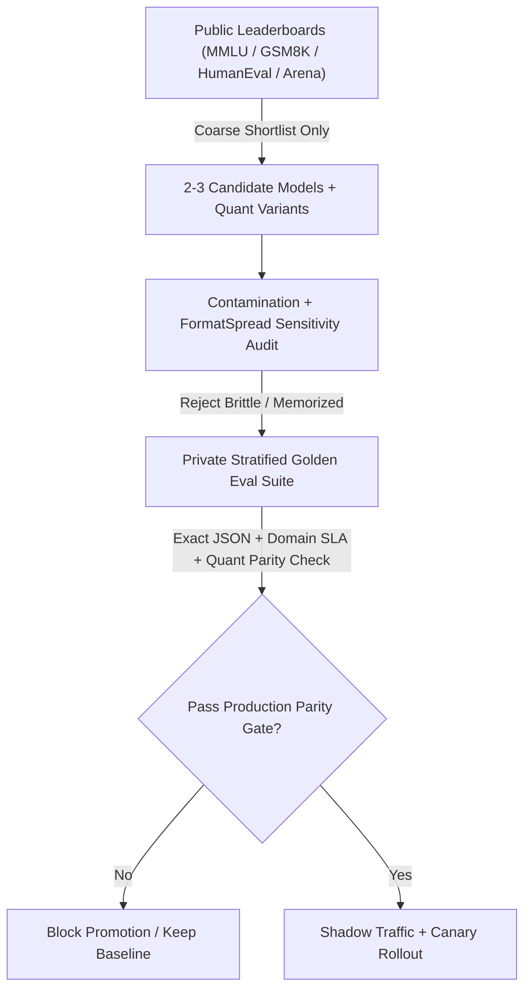
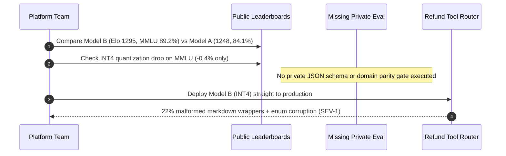

# Module 05: Benchmark Suites and Their Limits

> **Prerequisites:** [Module 00: Why GenAI Evaluation Is Hard](../00-why-genai-evaluation-is-hard/README.md) and [Module 04: Human Evaluation and Annotation](../04-human-evaluation-and-annotation/README.md).  
> **Estimated Reading Time:** 30 minutes  
> **Target Audience:** AI Backend Engineers, ML Platform Architects, Model Evaluation Leads

> [!TIP]
> **The Golden Rule of Benchmarks:** Public leaderboards (`MMLU`, `GSM8K`, `HumanEval`, `Chatbot Arena`) are **coarse shortlisting filters**, never deployment or quantization gates. A `5`-point public leaderboard lead routinely vanishes—or flips backward—under domain shift, strict JSON tool contracts, and training-data contamination; **your private, versioned task-specific evaluation suite always outranks public benchmarks.**

---

## Why This Matters

An engineering lead compares two candidate models on public leaderboards: **Model B** sits at `#1` on `Chatbot Arena` (`Elo 1295`) and scores `89.2%` on `MMLU`, while **Model A** sits lower (`Elo 1248`, `84.1% MMLU`). The team swaps Model A for Model B—or applies aggressive `INT4` quantization after observing only a `0.4%` drop on `MMLU`—and ships straight to production.

Within hours, structured tool-calling failure rates spike `18%`, verbose chatty preambles break downstream regex parsers, and specialized domain queries hallucinate confidently. Why did a "top-ranked" model regress on real workloads? Because public benchmarks measure broad academic trivia, memorized coding snippets, or crowdsourced chat aesthetics—not your schema constraints, latency ceiling, or proprietary failure taxonomy.

---

## 1. Architectural Mental Model & Core Mechanics

Treat public benchmarks strictly as **Stage 1 pre-filtering**, feeding an internal verification funnel that owns every final model-selection and quantization decision:



### Major Public Benchmarks and What They Actually Measure

| Benchmark | Canonical Paper | Task Format | What It Measures | Structural Production Blind Spot |
| :--- | :--- | :--- | :--- | :--- |
| **`MMLU`** | Hendrycks et al. (`arXiv:2009.03300`) | 57-subject 4-choice MCQ | Broad academic trivia & exam recall | Log-prob MCQ `A/B/C/D` scoring ignores multi-turn synthesis, JSON adherence, and abstention |
| **`GSM8K`** | Cobbe et al. (`arXiv:2110.14168`) | Grade-school math word problems | Multi-step arithmetic reasoning | Small static test set (`1,319` items) heavily contaminated & sensitive to number/name perturbations |
| **`HumanEval`** | Chen et al. (`arXiv:2107.03374`) | Standalone Python function synthesis | Single-file algorithmic coding (`pass@k`) | `164` isolated problems ignore multi-file repo context, API dependencies, and security hygiene |
| **`Chatbot Arena`** | Chiang et al. (`arXiv:2403.04132`) | Blind crowdsourced pairwise A/B Elo | General conversational appeal | Strongly favors verbosity, markdown polish, and sycophancy over terse factual or tool precision |

### 4 Structural Reasons Public Leaderboards Fail to Predict Production

#### 1. Data Contamination & Train-on-Test Leakage

Pretraining corpora scrape GitHub, Hugging Face, exam study sites, and synthetic Q&A mirrors indiscriminately. If `GSM8K`, `MMLU`, or `HumanEval` test strings appear verbatim—or paraphrased—in pretraining or post-training SFT mixtures, high scores reflect **lookup memorization rather than reasoning**.

Even subtle leakage inflates scores: as Golchin & Surdeanu (`arXiv:2308.08493`) showed, models prompted with partial dataset prefixes can complete held-out benchmark instances near-verbatim despite safety filters. When you replace entity names or numeric constants in `GSM8K` (`"Natalia sold 48 clips"` $\rightarrow$ `"Marcus distributed 64 stickers"`), memorized models suffer steep accuracy collapse (`Goodhart collapse`).

#### 2. Goodhart's Law in Model Post-Training

> *"When a measure becomes a target, it ceases to be a good measure."*

Model providers optimize SFT/RLHF data mixtures explicitly toward leaderboard benchmarks and synthetic benchmark clones. The resulting model becomes hyperspecialized on textbook multiple-choice phrasing while degrading on messy real-world inputs (typos, incomplete RAG chunks, conflicting customer logs, or explicit `"INSUFFICIENT_EVIDENCE"` abstention).

#### 3. Formatting & Multiple-Choice Sensitivity (`FormatSpread`)

Sclar et al. (`arXiv:2310.11324`) demonstrated that **meaning-preserving formatting changes**—switching `(A)/(B)/(C)/(D)` to `1./2./3./4.`, altering whitespace/colon delimiters, or reordering answer choices—can swing model accuracy by up to **`76` percentage points** on standard benchmarks. Furthermore, many `MMLU` harness runs evaluate **first-token log-probabilities** (`argmax P(token in {A,B,C,D})`) rather than free-form generation, completely masking instruction-following failures when a model writes conversational chatter instead of valid JSON in production.

#### 4. Crowdsourced ELO Style & Sycophancy Bias

`LMSYS Chatbot Arena` models pairwise human win probabilities using the **Bradley-Terry** logistic formulation underlying Elo ratings:

$$P(i \succ j) = \frac{1}{1 + 10^{-(R_i - R_j)/400}}$$

where $R_i$ and $R_j$ are latent skill ratings. While blind crowdsourcing prevents static test memorization, anonymous general users vote rapidly on surface impressions:
- **Verbosity & Markdown Formatting Bias:** Longer responses with bold bullet lists win disproportionately even when padded with redundant filler or subtle inaccuracies.
- **Sycophancy Bias:** Models that agree warmly with flawed user premises beat concise models that push back accurately.
- **Zero Ground-Truth Fact-Checking:** Crowd voters rarely verify obscure code flags, API schemas, or legal clauses in a 30-second chat window.

### Why Private Task-Specific Suites Always Gate Model Selection & Quantization

Public metrics are blind to **tail quantization damage**. Compressing weights from `BF16` to `INT4` (`AWQ` / `GPTQ`) or `FP8` typically reduces `MMLU` by only `0.3%–0.7%` because common factual trivia enjoys massive weight redundancy. Yet on **rare schema tokens, strict JSON escaping, long-context needle retrieval, or non-English domain entities**, quantization error accumulates sharply—frequently causing `8%–15%` production SLA regressions invisible on public leaderboards.

Always enforce a **Quantization Parity Gate** against your private domain dataset:

$$\Delta_{\text{priv}} = \text{Acc}_{\text{private}}(\text{Candidate}) - \text{Acc}_{\text{private}}(\text{Baseline}) \ge -\epsilon_{\text{parity}}$$

with typical strict backend tolerances $\epsilon_{\text{parity}} \le 1.0\%$ on core task slices and `0%` regression on schema/safety invariants.

---

## 2. Systematic Comparison Matrix: Public Benchmarks vs. Private Golden Suites

| Evaluation Method | Signal Type | Contamination Risk | Format / Style Bias | Cost per Run | Predictive Validity for Backend Production |
| :--- | :--- | :--- | :--- | :--- | :--- |
| **`MMLU` (MCQ Log-Prob)** | Static multiple choice | **High** (web-scraped exams) | **High** (delimiter/option-order sensitive) | Low | **Low** (measures trivia, not generation/tools) |
| **`GSM8K` / `HumanEval`** | Static math / standalone Python | **High** (memorized GitHub/math mirrors) | Medium (`pass@1` extraction quirks) | Low | **Low–Medium** (single-turn toy scope only) |
| **`Chatbot Arena` (Elo)** | Crowdsourced blind pairwise chat | Low (live prompts) | **High** (verbosity, markdown, sycophancy) | Free (public) | **Medium** (good chat tone proxy; poor strict-SLA proxy) |
| **Perturbed Dynamic Suite** | Programmatic numeric/entity mutations | **Very Low** (unseen variants) | Low (averaged across `FormatSpread`) | Medium | **High** for general reasoning robustness |
| **Private Golden Eval Suite** | Stratified production traces + strict contracts | **Zero** (held-out internal logs) | **Zero** (exact production prompt + parser) | Low–Medium | **Highest** (sole valid ship/quantization gate) |

---

## 3. Production War Story Post-Mortem: The `#1 Arena Elo` Model Swap

| Field | Incident Details |
| :--- | :--- |
| **Severity** | **SEV-1** (22% Production Tool-Calling Failure & Customer Backlog) |
| **Detection / Resolution Time** | Detected 90 minutes post-cutover via JSON parser error alerts / Rolled back in 20 minutes (restored baseline + built private parity gate) |
| **Impact** | `22%` of order-refund API tool calls emitted invalid conversational markdown or dropped required enum fields; **\$38,000** manual support cleanup |

### What Happened

An e-commerce platform ran a `BF16` domain-tuned `32B` model (`Domain-Workhorse-A`) for automated order-refund routing. When a newer open-weight `Model B` leaped `+47` points on `Chatbot Arena` (`Elo 1295` vs. `1248`) and gained `+5.1%` on `MMLU` (`89.2%` vs. `84.1%`), leadership approved an immediate model swap—and enabled `INT4` quantization after verifying `MMLU` dropped only `0.4%`.

Within 90 minutes of production cutover, downstream billing microservices threw thousands of `SchemaValidationError` exceptions. Model B ignored strict `"output ONLY raw JSON"` instructions `18%` of the time—wrapping JSON inside `"Sure! Here is the structured refund payload for your request: ```json ..."`—and `INT4` quantization mis-serialized nested SKU enum strings on another `4%` of calls.



### Root Cause Analysis

- **Style-Biased Arena Selection:** Model B's `#1` Elo advantage came from helpful conversational preambles—the exact behavior that broke strict zero-wrapper JSON tool routing.
- **MCQ Scoring Blindness:** `MMLU` evaluated `A/B/C/D` log-probabilities, completely blind to structured generation, JSON escaping, and abstention policies.
- **Quantization Tail Blindness:** Aggregate `MMLU` dropped `0.4%` under `INT4`, hiding an `11.5%` drop on long-tail structured tool arguments.

### The Fix & Architectural Hardening

- **Private 500-Case Golden Gate:** Built a versioned, zero-leakage internal test suite covering real customer tickets, multi-SKU refund edge cases, and strict JSON schema contracts (`pydantic`/`jsonschema`).
- **FormatSpread & Perturbation Checks:** Audited candidate models across `6` prompt delimiters and numeric perturbations to catch Goodhart memorization before adoption.
- **Mandatory Quantization Parity Gate:** Blocked any `FP8`/`INT4` artifact whose private domain SLA dropped $> 1.0\%$ or whose schema pass rate dropped $> 0.0\%$ relative to `BF16`.

---

## 4. Multi-Language Production Implementation: Contamination Scanner & Private Parity Gate

Below is a production-ready **Benchmark Contamination & Model-Promotion Gate** across **Go**, **TypeScript**, **Python**, and **C#**. It implements $n$-gram overlap leakage detection, prompt-format variance measurement (`FormatSpread`), and private-over-public quantization parity gating.

````carousel

```go
package benchgate

import (
	"math"
	"strings"
)

type ModelCandidate struct {
	Name            string
	ArenaElo        int
	PublicMMLU      float64
	PrivateDomain   float64
	JsonSchemaPass  float64
	P95LatencyMs    int
}

// FiveGramOverlap computes the fraction of eval 5-grams present in a training snippet.
func FiveGramOverlap(trainText, evalText string, n int) float64 {
	buildNgrams := func(s string) map[string]struct{} {
		words := strings.Fields(strings.ToLower(s))
		set := make(map[string]struct{})
		for i := 0; i+n <= len(words); i++ {
			set[strings.Join(words[i:i+n], " ")] = struct{}{}
		}
		return set
	}
	trainSet := buildNgrams(trainText)
	evalSet := buildNgrams(evalText)
	if len(evalSet) == 0 {
		return 0
	}
	hits := 0
	for gram := range evalSet {
		if _, ok := trainSet[gram]; ok {
			hits++
		}
	}
	return float64(hits) / float64(len(evalSet))
}

// FormatSpread returns min, max, and spread across meaning-preserving prompt variants.
func FormatSpread(formatScores []float64) (minVal, maxVal, spread float64) {
	if len(formatScores) == 0 {
		return 0, 0, 0
	}
	minVal, maxVal = formatScores[0], formatScores[0]
	for _, s := range formatScores[1:] {
		minVal = math.Min(minVal, s)
		maxVal = math.Max(maxVal, s)
	}
	return minVal, maxVal, maxVal - minVal
}

// ApprovePromotion ignores public Elo/MMLU and gates strictly on private parity and latency.
func ApprovePromotion(baseline, cand ModelCandidate, maxDrop, minSchema float64, maxP95Ms int) (bool, string) {
	if cand.JsonSchemaPass < minSchema {
		return false, "BLOCK: json_schema_pass below hard contract floor"
	}
	if baseline.PrivateDomain-cand.PrivateDomain > maxDrop {
		return false, "BLOCK: private_domain parity drop exceeds tolerance"
	}
	if cand.P95LatencyMs > maxP95Ms {
		return false, "BLOCK: p95 latency exceeds SLA"
	}
	return true, "PROMOTE"
}
```

<!-- slide -->

```typescript
export interface CandidateProfile {
  readonly name: string;
  readonly arenaElo: number;
  readonly publicMmlu: number;
  readonly privateDomainAcc: number;
  readonly jsonSchemaPass: number;
  readonly p95LatencyMs: number;
}

export function ngramOverlapRate(trainText: string, evalText: string, n = 5): number {
  const toNgrams = (text: string): Set<string> => {
    const tokens = text.toLowerCase().trim().split(/\s+/).filter(Boolean);
    const out = new Set<string>();
    for (let i = 0; i <= tokens.length - n; i += 1) {
      out.add(tokens.slice(i, i + n).join(" "));
    }
    return out;
  };
  const trainSet = toNgrams(trainText);
  const evalSet = toNgrams(evalText);
  if (evalSet.size === 0) return 0;
  let hits = 0;
  for (const g of evalSet) {
    if (trainSet.has(g)) hits += 1;
  }
  return hits / evalSet.size;
}

export function measureFormatSpread(scores: readonly number[]): {
  min: number;
  max: number;
  spread: number;
} {
  if (scores.length === 0) return { min: 0, max: 0, spread: 0 };
  const min = Math.min(...scores);
  const max = Math.max(...scores);
  return { min, max, spread: max - min };
}

export function evaluatePrivateParityGate(
  baseline: CandidateProfile,
  candidate: CandidateProfile,
  policy: { maxDomainDrop: number; minSchemaPass: number; maxP95Ms: number },
): { approved: boolean; reason: string } {
  if (candidate.jsonSchemaPass < policy.minSchemaPass) {
    return { approved: false, reason: "BLOCK: failed private JSON schema contract floor" };
  }
  const drop = baseline.privateDomainAcc - candidate.privateDomainAcc;
  if (drop > policy.maxDomainDrop) {
    return {
      approved: false,
      reason: `BLOCK: private domain dropped ${(drop * 100).toFixed(1)}% despite public Elo=${candidate.arenaElo}`,
    };
  }
  if (candidate.p95LatencyMs > policy.maxP95Ms) {
    return { approved: false, reason: "BLOCK: p95 latency SLA exceeded" };
  }
  return { approved: true, reason: "PROMOTE" };
}
```

<!-- slide -->

```python
"""
benchmark_gate.py
N-gram contamination detector, FormatSpread analyzer, and private parity promotion gate.
"""
from dataclasses import dataclass
from typing import Sequence


@dataclass(frozen=True)
class ModelCandidate:
    name: str
    arena_elo: int
    public_mmlu: float
    private_domain_acc: float
    json_schema_pass: float
    p95_latency_ms: int


def ngram_overlap_rate(train_text: str, eval_text: str, n: int = 5) -> float:
    def grams(text: str) -> set[tuple[str, ...]]:
        toks = text.lower().split()
        return {tuple(toks[i : i + n]) for i in range(max(0, len(toks) - n + 1))}

    train_grams = grams(train_text)
    eval_grams = grams(eval_text)
    if not eval_grams:
        return 0.0
    return len(train_grams & eval_grams) / len(eval_grams)


def format_spread(scores: Sequence[float]) -> tuple[float, float, float]:
    if not scores:
        return 0.0, 0.0, 0.0
    lo, hi = min(scores), max(scores)
    return lo, hi, hi - lo


def gate_model_promotion(
    baseline: ModelCandidate,
    candidate: ModelCandidate,
    max_private_drop: float = 0.01,
    min_schema_pass: float = 0.99,
    max_p95_ms: int = 800,
) -> tuple[bool, str]:
    if candidate.json_schema_pass < min_schema_pass:
        return False, f"BLOCK: schema pass {candidate.json_schema_pass:.1%} < {min_schema_pass:.1%}"
    drop = baseline.private_domain_acc - candidate.private_domain_acc
    if drop > max_private_drop:
        return False, f"BLOCK: private domain drop {drop:.1%} > {max_private_drop:.1%}"
    if candidate.p95_latency_ms > max_p95_ms:
        return False, f"BLOCK: p95 {candidate.p95_latency_ms}ms > {max_p95_ms}ms"
    return True, "PROMOTE"
```

<!-- slide -->

```csharp
using System;
using System.Collections.Generic;
using System.Linq;

namespace GenAI.Evaluation.Benchmarks;

public sealed record ModelCandidate(
    string Name,
    int ArenaElo,
    double PublicMmlu,
    double PrivateDomainAcc,
    double JsonSchemaPass,
    int P95LatencyMs);

public static class PrivateParityGate
{
    public static double NGramOverlap(string trainText, string evalText, int n = 5)
    {
        HashSet<string> Grams(string text)
        {
            var words = text.ToLowerInvariant().Split((char[]?)null, StringSplitOptions.RemoveEmptyEntries);
            var set = new HashSet<string>(StringComparer.Ordinal);
            for (int i = 0; i <= words.Length - n; i++)
                set.Add(string.Join(' ', words, i, n));
            return set;
        }

        var trainSet = Grams(trainText);
        var evalSet = Grams(evalText);
        if (evalSet.Count == 0) return 0.0;
        int overlap = evalSet.Count(trainSet.Contains);
        return (double)overlap / evalSet.Count;
    }

    public static (double Min, double Max, double Spread) MeasureFormatSpread(IReadOnlyCollection<double> scores)
    {
        if (scores.Count == 0) return (0.0, 0.0, 0.0);
        double min = scores.Min(), max = scores.Max();
        return (min, max, max - min);
    }

    public static (bool Approved, string Reason) EvaluatePromotion(
        ModelCandidate baseline,
        ModelCandidate candidate,
        double maxDomainDrop = 0.01,
        double minSchemaPass = 0.99,
        int maxP95Ms = 800)
    {
        if (candidate.JsonSchemaPass < minSchemaPass)
            return (false, $"BLOCK: JSON schema pass {candidate.JsonSchemaPass:P1} below {minSchemaPass:P1}");
        double drop = baseline.PrivateDomainAcc - candidate.PrivateDomainAcc;
        if (drop > maxDomainDrop)
            return (false, $"BLOCK: private domain dropped {drop:P1} (public Elo ignored)");
        if (candidate.P95LatencyMs > maxP95Ms)
            return (false, $"BLOCK: P95 latency {candidate.P95LatencyMs}ms exceeds {maxP95Ms}ms");
        return (true, "PROMOTE");
    }
}
```

````

---

## 5. Practical Hands-On Verification CLI Workflows

Run these offline Python 3.13 scripts locally—zero third-party libraries or API keys required.

### Workflow 1: $N$-Gram Contamination Scanner & Goodhart Perturbation Collapse

Detect verbatim benchmark leakage via 5-gram overlap and observe how memorizing canonical math wording collapses under numeric/entity perturbation:

```bash
python -c '
def ngrams(text, n=5):
    toks = text.lower().split()
    return set(tuple(toks[i:i+n]) for i in range(max(0, len(toks) - n + 1)))

def jaccard_overlap(a, b):
    na, nb = ngrams(a, 5), ngrams(b, 5)
    return len(na & nb) / len(nb) if nb else 0.0

corpus_train = (
    "Natalia sold clips to 48 of her friends in April, and then she sold half as many clips in May. "
    "How many clips did Natalia sell altogether in April and May?"
)
test_canonical = "Natalia sold clips to 48 of her friends in April, and then she sold half as many clips in May. How many clips did Natalia sell altogether in April and May?"
test_perturbed = "Marcus distributed stickers to 64 classmates in June, and handed out a quarter as many stickers in July. Total stickers?"

print(f"5-gram overlap (Canonical leaked test): {jaccard_overlap(corpus_train, test_canonical):.3f} -> CONTAMINATED")
print(f"5-gram overlap (Clean perturbed test):  {jaccard_overlap(corpus_train, test_perturbed):.3f} -> CLEAN")

eval_results = [("Public GSM8K Slice", 19, 20), ("Numeric-Perturbed GSM Slice", 8, 20)]
for name, passed, total in eval_results:
    print(f"{name:<28} | acc={passed/total:.1%} ({passed}/{total})")
'
```

**Expected Output:**

```text
5-gram overlap (Canonical leaked test): 1.000 -> CONTAMINATED
5-gram overlap (Clean perturbed test):  0.000 -> CLEAN
Public GSM8K Slice           | acc=95.0% (19/20)
Numeric-Perturbed GSM Slice  | acc=40.0% (8/20)
```

### Workflow 2: Quantify Formatting Sensitivity Spread (`FormatSpread`-Style)

Measure how harmless formatting variants (`(A/B/C/D)` vs `(1/2/3/4)` vs reversed option order vs strict JSON extraction) expose fragile single-format leaderboard scores:

```bash
python -c '
formats = {
    "Standard_ABCD":       0.84,
    "Paren_1234":          0.79,
    "Lower_abcd_colon":    0.68,
    "Reversed_Options":    0.61,
    "Extra_Newline_Sep":   0.74,
    "JSON_Extraction_Gen": 0.56,
}
scores = list(formats.values())
mean_acc = sum(scores) / len(scores)
spread = max(scores) - min(scores)
for fmt, acc in formats.items():
    print(f"  {fmt:<20} -> {acc:.1%}")
print(f"Mean={mean_acc:.1%} | Min={min(scores):.1%} | Max={max(scores):.1%} | FormatSpread={spread:.1%} (unreliable single-format leaderboard!)")
'
```

**Expected Output:**

```text
  Standard_ABCD        -> 84.0%
  Paren_1234           -> 79.0%
  Lower_abcd_colon     -> 68.0%
  Reversed_Options     -> 61.0%
  Extra_Newline_Sep    -> 74.0%
  JSON_Extraction_Gen  -> 56.0%
Mean=70.3% | Min=56.0% | Max=84.0% | FormatSpread=28.0% (unreliable single-format leaderboard!)
```

### Workflow 3: Bradley-Terry Elo vs. Private Quantization Parity Gate

Observe how an `Elo 1295` / `MMLU 89.2%` model and an `INT4` quantized model (`0.4%` MMLU drop) both fail the private JSON SLA gate:

```bash
python -c '
def bt_win_prob(ra, rb):
    return 1.0 / (1.0 + 10.0 ** (-(ra - rb) / 400.0))

print(f"Elo 1295 vs 1248 predicted win prob: {bt_win_prob(1295, 1248):.1%}")

candidates = [
    {"model": "Frontier-Chat-B (BF16)", "arena_elo": 1295, "mmlu": 0.892, "priv_json_sla": 0.780, "p95_ms": 1850},
    {"model": "Domain-Workhorse-A (BF16)", "arena_elo": 1248, "mmlu": 0.841, "priv_json_sla": 0.955, "p95_ms": 620},
    {"model": "Domain-Workhorse-A (INT4)", "arena_elo": 1244, "mmlu": 0.837, "priv_json_sla": 0.840, "p95_ms": 340},
]
baseline_priv = 0.955
for c in candidates:
    priv_drop = baseline_priv - c["priv_json_sla"]
    gate = "PROMOTE" if c["priv_json_sla"] >= 0.94 and c["p95_ms"] <= 800 else "BLOCK_PARITY_FAIL"
    m, elo, mmlu, priv = c["model"], c["arena_elo"], c["mmlu"], c["priv_json_sla"]
    print(f"{m:<26} | Elo={elo} MMLU={mmlu:.1%} | PrivSLA={priv:.1%} (drop={priv_drop:+.1%}) | {gate}")
'
```

**Expected Output:**

```text
Elo 1295 vs 1248 predicted win prob: 56.7%
Frontier-Chat-B (BF16)     | Elo=1295 MMLU=89.2% | PrivSLA=78.0% (drop=+17.5%) | BLOCK_PARITY_FAIL
Domain-Workhorse-A (BF16)  | Elo=1248 MMLU=84.1% | PrivSLA=95.5% (drop=+0.0%) | PROMOTE
Domain-Workhorse-A (INT4)  | Elo=1244 MMLU=83.7% | PrivSLA=84.0% (drop=+11.5%) | BLOCK_PARITY_FAIL
```

### Hands-On Exercises

1. **Paraphrase Contamination Resistance:** Modify Workflow 1 to strip stopwords and check 3-gram overlap alongside 5-gram overlap on paraphrased copies where `30%` of words were swapped with synonyms. Notice why pure exact $n$-gram overlap misses paraphrased leakage unless paired with dynamic numeric/entity perturbations.
2. **Option-Order Variance Audit:** Write a quick permutation loop that rotates MCQ answer positions (`A -> B -> C -> D`) across `10` synthetic test prompts and measures accuracy variance when a biased scorer over-predicts `"A"`.
3. **Optional Live Quantization Check (Local vLLM/Ollama or Cloud API):** Run your own `20`-case strict JSON extraction benchmark against a `BF16`/`FP8` baseline vs. a heavily quantized `Q4_K_M`/`INT4` variant and measure schema failure rates vs. generic chat fluency.

### Independent Challenge

Your VP of Engineering proposes adopting a newly released open-weight model solely because it ranks `#2` on `HumanEval` (`91.4% pass@1`) and loses only `0.5%` on `MMLU` when quantized to `INT4`. Your backend service generates multi-file TypeScript/Prisma migrations and strict internal REST payloads. Explain why neither `HumanEval` nor `MMLU` validates this deployment, and design the exact 3-gate internal benchmark pipeline required before cutover.

<details><summary>Architectural Discussion</summary>

1. **Why `HumanEval` & `MMLU` Fail:** `HumanEval` tests `164` isolated single-file Python puzzles that have been heavily leaked across GitHub pretraining scrapes and ignore multi-file TypeScript type imports, Prisma schema constraints, and internal repo conventions. `MMLU` evaluates MCQ academic recall via first-token probabilities and is largely insensitive to `INT4` degradation on rare syntax/JSON escaping tokens.
2. **Required 3-Gate Pipeline:**
   - *Gate 1 (Private Repo Compilation & Migration Suite):* `200` held-out internal TypeScript + Prisma tasks executed inside sandboxed `tsc --noEmit` + database migration dry-runs (`pass@1` must match or beat baseline within `1.0%`).
   - *Gate 2 (Format & Perturbation Robustness):* Mutate symbol names and prompt delimiters (`FormatSpread < 3%`) to rule out brittle pattern matching.
   - *Gate 3 (Quantization Parity & Latency SLA):* Compare `INT4` directly against `BF16` on long-context (`16K+` token) file edits, blocking promotion if schema/compiler errors increase or P95 latency exceeds budget.

</details>

---

## 6. Common Mistakes & Troubleshooting

- **Picking a model exclusively from `Chatbot Arena` Elo:** High Elo rewards friendly, verbose markdown responses—exactly the style that violates terse API/SQL/JSON tool-calling contracts.
- **Validating `FP8` / `INT4` quantization solely with `MMLU`:** Aggregate trivia benchmarks barely budge under `4`-bit quantization while subtle numerical precision, rare syntax tokens, and long-tail tool schemas degrade silently.
- **Evaluating MCQ benchmarks via log-probs while serving free-form generation:** First-token `P("A")` ignores whether a chat-tuned model actually obeys formatting instructions or wraps answers in conversational fluff.
- **Building a public-only regression suite:** Publishing your evaluation prompts into public GitHub repos or external evaluation platforms risks eventual scraper ingestion and contamination; keep your golden suite private and rotated.

---

## 7. Operational Validation Checkpoints & Checkpoint Quiz

### Operational Validation Checkpoints

<details><summary><strong>Checkpoint 1: Explaining why a +6% MMLU upgrade regressed production JSON routing</strong></summary>

A candidate model scores `90.1%` on `MMLU` (vs. your baseline's `84.0%`), yet in staging its tool-call JSON validation pass rate drops from `98.5%` to `82.0%`. Explain the mechanical mismatch.

**Validation:** Standard `MMLU` evaluates 4-choice academic trivia—commonly via single-token log-probabilities over `{A, B, C, D}`—which tells you nothing about multi-token structured schema adherence, JSON string escaping, enum precision, or abstention discipline under strict system prompts. Only a **private task-specific suite** testing your exact production tool schemas and parsing harness measures deployment readiness.

</details>

<details><summary><strong>Checkpoint 2: Auditing an INT4 quantization artifact for silent tail degradation</strong></summary>

Your inference team quantizes a `70B` model from `BF16` to `INT4` (`AWQ`), reporting only a `0.3%` drop on `GSM8K` and `MMLU`. What hidden failure modes must your **Quantization Parity Gate** test before production cutover?

**Validation:** Weight quantization disproportionately harms **low-frequency knowledge, multi-step constraint adherence, rare syntax/JSON characters, and long-context needle retrieval**. Your parity gate must run `BF16` vs. `INT4` side-by-side on your private stratified golden suite—specifically checking long-context (`16K+` tokens) retrieval faithfulness, structured tool contracts, and rare-entity accuracy, blocking promotion if private parity drops beyond `<= 1.0%` (or `0%` on hard schema/safety invariants).

</details>

<details><summary><strong>Checkpoint 3: Detecting Goodhart overfitting vs. genuine reasoning improvement</strong></summary>

A newly fine-tuned model jumps from `76%` to `96%` on `GSM8K`, yet fails simple internal invoice-math tickets. How do you verify computationally whether the gain came from memorization/contamination?

**Validation:** Run an **$n$-gram overlap audit** against known training mixtures where accessible, and execute **meaning-preserving perturbations** (swapping entity names, scaling invoice numbers, reordering clauses, and varying prompt delimiters via `FormatSpread`). Genuine reasoning models retain accuracy within `2–4%` across perturbed variants, whereas Goodhart-overfit or contaminated models suffer sharp `20–50%` collapse.

</details>

### Checkpoint Quiz

1. Define **data contamination** and explain why paraphrased test leakage defeats naive exact-string deduplication.
2. How does **Goodhart's Law** explain brittle performance jumps on public LLM leaderboards?
3. What did Sclar et al. demonstrate regarding prompt formatting sensitivity (`FormatSpread`), and why does it invalidate single-format leaderboard comparisons?
4. Why does **Bradley-Terry / Elo** crowdsourcing in `Chatbot Arena` systematically favor verbose, sycophantic chat models over terse backend models?
5. Why can a `0.4%` `MMLU` drop under `INT4` quantization still cause a `10%+` drop in production?

<details><summary>Answers</summary>

1. Data contamination occurs when evaluation test instances (or close paraphrases) enter pretraining or SFT training sets. Exact-string checks fail when paraphrasing, translation, or synthetic rewrites preserve the underlying answer while altering surface $n$-grams.
2. Once labs optimize training mixtures specifically to maximize public benchmark metrics (`MMLU`, `GSM8K`), models learn benchmark-specific surface shortcuts rather than robust out-of-distribution generalization.
3. Harmless formatting tweaks (delimiters, casing, option ordering) caused up to `76`-point accuracy swings on open-weight LLMs—proving that single-format evaluations rank arbitrary formatting luck rather than true capability.
4. Anonymous crowd raters judge rapidly on conversational appeal without checking deep domain correctness, creating strong preference bias toward longer markdown-formatted answers and agreeable (sycophantic) tone.
5. `MMLU` tests high-redundancy trivia via 4-choice log-probabilities; `INT4` weight compression preserves common facts while degrading precision on rare syntax tokens, JSON escaping, long-context attention, and strict domain edge cases.

</details>

---

## Further Reading & Sources

- [Measuring Massive Multitask Language Understanding / MMLU (Hendrycks et al., 2020)](https://arxiv.org/abs/2009.03300) — foundational 57-subject academic MCQ benchmark.
- [Training Verifiers to Solve Math Word Problems / GSM8K (Cobbe et al., 2021)](https://arxiv.org/abs/2110.14168) — multi-step grade-school arithmetic benchmark.
- [Evaluating Large Language Models Trained on Code / HumanEval (Chen et al., 2021)](https://arxiv.org/abs/2107.03374) — standalone Python function synthesis benchmark.
- [Chatbot Arena: An Open Platform for Evaluating LLMs by Human Preference (Chiang et al., 2024)](https://arxiv.org/abs/2403.04132) — crowdsourced blind pairwise evaluation and Bradley-Terry Elo modeling.
- [Time Travel in LLMs: Tracing Data Contamination in Large Language Models (Golchin & Surdeanu, 2023)](https://arxiv.org/abs/2308.08493) — methodology for black-box benchmark leakage auditing.
- [Quantifying Language Models' Sensitivity to Spurious Features in Prompt Design (Sclar et al., 2023)](https://arxiv.org/abs/2310.11324) — empirical demonstration of `FormatSpread` formatting swings up to `76` points.

## Next

[Module 06: Regression Testing Prompts](../06-regression-testing-prompts/README.md)
