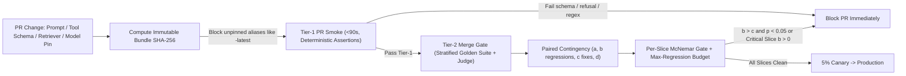
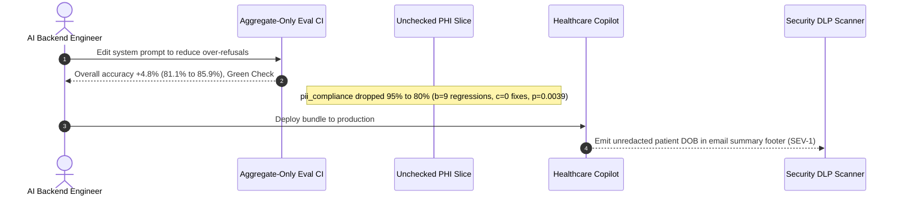

# Module 06: Regression Testing Prompts

> **Prerequisites:** [Module 02: Deterministic Evals and Assertions](../02-deterministic-evals-and-assertions/README.md), [Module 03: LLM-as-Judge](../03-llm-as-judge/README.md), and [Module 05: Benchmark Suites and Their Limits](../05-benchmark-suites-and-their-limits/README.md).  
> **Estimated Reading Time:** 30 minutes  
> **Target Audience:** AI Backend Engineers, Platform & DevOps Engineers, Release Reliability Teams

> [!TIP]
> **The Golden Rule of Prompt Regression Testing:** Never evaluate a prompt string in isolation or approve a rollout solely because an aggregate pass rate increased. Version the entire **`Prompt + Pinned Model Snapshot + Tool Schemas + Retriever Config` bundle** as an immutable CI/CD artifact, gate pull requests with tiered deterministic-to-judge runs, and enforce **paired McNemar slice testing** so high-volume easy gains can never mask catastrophic regressions on compliance or edge slices.

---

## Why This Matters

A backend engineer edits two sentences in a system prompt to stop a support bot from over-refusing harmless scheduling requests. Locally, `5` sample queries look cleaner. On the full golden suite, the aggregate pass rate rises from `81.1%` to `85.9%` (`+4.8%`), so CI flashes green and ships to production.

Eighteen hours later, security triggers a **SEV-1**: while easy scheduling queries improved by `+42` passes, `9` out of `60` patient-privacy (`PHI_Compliance`) cases silently started leaking birthdates in email summary footers (`95.0% -> 80.0%`). Because aggregate metrics suffer **Simpson's Paradox** across imbalanced slices—and because prompts interact non-linearly with model snapshots, tool JSON schemas, and chunking configs—shipping AI changes safely requires **bundle immutability, tiered CI execution, and paired per-slice statistical gating**.

---

## 1. Architectural Mental Model & Core Mechanics

In traditional software, code unit tests run in milliseconds with zero stochastic variance. In GenAI engineering, changing *any* component of the inference pipeline shifts downstream token distributions, making the **entire execution bundle** the atomic unit under test:



### The Immutable Inference Bundle

Testing `"system_prompt_v4.txt"` alone is meaningless if staging points at `"gpt-4o-latest"` while production pins `"gpt-4o-2024-08-06"`, or if the RAG index silently changed `chunk_size` from `512` to `384`. Version and hash a canonical **Inference Bundle Manifest** in Git:

1. **Prompt Templates:** SHA-256 of rendered system + few-shot + developer instructions.
2. **Pinned Model Snapshot & Decoding Config:** Exact immutable checkpoint (`gpt-4o-2024-08-06`, `claude-3-5-sonnet-20241022`, or local digest) with explicit `temperature`, `top_p`, and `seed`—never mutable `-latest` aliases.
3. **Tool & Output Schemas:** SHA-256 of JSON tool definitions and structured response Pydantic/Zod schemas.
4. **Retriever Config & Corpus Revision:** Vector index version, embedding model ID, `chunk_size`/`overlap`, and `top_k`/reranker thresholds (plus recorded **VCR/cassette context replay** when isolating prompt-only regressions from retriever drift).

### Tiered CI/CD Evaluation Gates

Running a `1,000`-item LLM-as-Judge suite on every single `git push` wastes `\$10+` per commit and blocks developers for `15` minutes. Split regression testing into three progressive CI tiers:

| CI Tier | Trigger | Typical Wall Time | Cost / Run | Checks Executed |
| :--- | :--- | :--- | :--- | :--- |
| **Tier 0: Static Lint** | Pre-commit / every push | `< 2 s` | `\$0.00` | Template variable linting, JSON schema syntax, token budget cap, banned `-latest` model alias check |
| **Tier 1: Fast Deterministic Smoke** | Every PR commit | `30–90 s` | `< \$0.25` | `50–100` critical edge cases verified via regex, Pydantic/JSON schema, exact tool arguments, and abstention checks |
| **Tier 2: Full Stratified Gate** | PR merge / nightly release | `5–15 min` | `\$2–\$15` | `500–2,000` stratified golden items with calibrated LLM-as-Judge, `k=3` vote on borderline cases, and paired McNemar slice gating |

### Paired McNemar's Test: Why Aggregate Accuracy Lies

When comparing **Baseline ($M_0$)** vs. **Candidate ($M_1$)** on the **exact same $N$ evaluation items**, unpaired two-sample $t$-tests waste statistical power because they ignore item-level correlation. Construct a **paired $2 \times 2$ contingency table** over every test item:

| | Candidate $M_1$ PASS | Candidate $M_1$ FAIL |
| :--- | :--- | :--- |
| **Baseline $M_0$ PASS** | **$a$** (Both pass) | **$b$** (**Regressions**: $M_0$ passed, $M_1$ broke) |
| **Baseline $M_0$ FAIL** | **$c$** (**Fixes**: $M_0$ failed, $M_1$ fixed) | **$d$** (Both fail) |

Notice that concordant pairs ($a$ and $d$) cancel out when testing whether $M_1$ changed behavior relative to $M_0$; statistical significance depends exclusively on **discordant pairs** ($b$ vs. $c$):

- **Large Discordant Count ($b + c \ge 25$):** Use **McNemar's Chi-Square with Edwards continuity correction** ($1$ degree of freedom):

$$\chi^2 = \frac{(|b - c| - 1)^2}{b + c}$$

- **Small Discordant Count ($b + c < 25$, standard in safety/compliance slices):** The asymptotic chi-square breaks down; compute the **two-sided Exact Binomial McNemar $p$-value** under the null $H_0: P(\text{regression}) = P(\text{fix}) = 0.5$:

$$p_{\text{exact}} = 2 \sum_{k=0}^{\min(b, c)} \binom{b + c}{k} (0.5)^{b+c}$$

Crucially, **run McNemar's test independently per critical slice** (`pii_compliance`, `tool_json`, `adversarial_refusal`, `faq_general`) and pair it with a **hard regression cap** (`max_regressions = 0` or `<= 1` on compliance/safety slices). Even if overall accuracy jumps `+4.8%`, `b = 9, c = 0` on `pii_compliance` ($p_{\text{exact}} = 0.0039$) immediately fails the release gate.

### Taming Non-Determinism & Flaky CI Failures

Even with `temperature = 0` and fixed `seed`, Mixture-of-Experts (`MoE`) routing and floating-point batching still cause `1–3%` run-to-run flip rates on borderline items. Two engineering fixes eliminate flaky CI noise:
1. **Context Cassette Replay:** Cache retrieved RAG chunks per test ID when testing prompt edits so retrieval variance does not pollute prompt regression signals.
2. **Selective `k = 3` Majority Re-Voting:** Only re-run items that flipped status (`b` or `c`) `3` times (`cost < 10%` of full suite); an item with true pass probability $p = 0.80$ stabilizes from `80.0%` single-run pass rate to $3 p^2 (1-p) + p^3 = 89.6\%$ under `2-of-3` voting.

---

## 2. Systematic Comparison Matrix: Prompt CI/CD Gating Strategies

| Strategy | Execution Latency | Token Cost / PR | Catches Simpson's Paradox? | Handles Flaky MoE Variance? | Best CI Stage |
| :--- | :--- | :--- | :--- | :--- | :--- |
| **Static Bundle + Schema Lint** | `< 2 s` | `\$0` | N/A (structural only) | Deterministic | Pre-commit / Tier-0 |
| **Aggregate Pass Rate Threshold** | Fast (`1–5 min`) | Low–Medium | **No** (hides slice drops) | Poor on borderline deltas | **Anti-pattern alone** |
| **Tier-1 Deterministic Smoke** | `30–90 s` | `< \$0.25` | Partial (covers core invariants) | High (`temp=0` + regex/JSON) | Every PR commit |
| **Unpaired Z-Test / Bootstrap** | Moderate | Medium | Only if stratified | Moderate | Legacy / unpaired logs only |
| **Paired McNemar Slice Gate + `k=3` Re-Vote** | `5–15 min` | `\$2–\$15` | **Yes** (blocks hidden slice drops) | **Yes** (separates real flips from noise) | PR merge / Release gate |

---

## 3. Production War Story Post-Mortem: The `+5.4%` Aggregate Win That Leaked PHI

| Field | Incident Details |
| :--- | :--- |
| **Severity** | **SEV-1** (18-Hour HIPAA PHI Redaction Regression in Production) |
| **Detection / Resolution Time** | Detected 18 hours post-deploy via DLP log scanner / Rolled back in 8 minutes via bundle digest pin |
| **Impact** | `15%` of appointment-summary emails (`9/60` test slice equivalents) printed patient dates of birth unredacted despite a `+5.4%` overall eval win |

### What Happened

A healthcare scheduling assistant suffered user complaints for refusing benign requests (`"What clinic parking options exist?"`). An engineer relaxed the system prompt's strict refusal paragraph and ran a `710`-case golden evaluation suite. Aggregate accuracy climbed from `81.1%` to `85.9%` (`+4.8%` net, driven by `+42` improvements on `faq_general`).

Nobody ran per-slice McNemar regression checks, and the deploy manifest used `"gpt-4o-latest"` instead of a pinned snapshot. Overnight, `9` out of `60` `pii_compliance` test cases that previously redacted patient DOBs began outputting raw dates in summary footers. DLP alerting caught the violation 18 hours later.



### Root Cause Analysis

- **Simpson's Paradox Over Skewed Slices:** `500` easy `faq_general` items drowned out `60` high-criticality `pii_compliance` cases inside a single unweighted pass-rate metric.
- **No Regression Ceiling (`max_b`):** The CI gate permitted `b = 9` regressions (`p_exact = 0.0039`) simply because `c = 50` easy items improved elsewhere.
- **Missing Bundle Pinning:** Unpinned model aliases made reproducing the exact prompt-vs-model regression harder until logs were audited.

### The Fix & Architectural Hardening

- **Immutable Bundle Manifest:** Every PR computes a canonical SHA-256 digest over prompt templates, pinned snapshot IDs, tool JSON schemas, and retriever revision; `-latest` aliases fail Tier-0 lint.
- **Per-Slice Paired McNemar Gate:** Every release slice runs paired `(a, b, c, d)` accounting. Any slice with statistically significant regressions (`b > c` and `p < 0.05`) or exceeding `max_regressions` (`0` for `pii_compliance`) blocks merge unconditionally.
- **Tiered PR vs. Merge Cadence:** `80`-item deterministic Tier-1 smoke runs on every commit in `~45s`; full `710`-item Tier-2 judge + McNemar slice suite gates branch merges.

---

## 4. Multi-Language Production Implementation: Versioned Bundle & McNemar Slice Gate

Below is a production-grade **Immutable Bundle Digester + Paired Exact McNemar Slice Regression Gate** across **Go**, **TypeScript**, **Python**, and **C#**. Notice how each implementation computes exact two-sided binomial $p$-values when discordant counts $b + c < 25$ and continuity-corrected $\chi^2$ survival otherwise.

````carousel

```go
package reggate

import (
	"crypto/sha256"
	"encoding/hex"
	"fmt"
	"math"
	"strings"
)

type BundleManifest struct {
	PromptSHA       string
	ModelSnapshot   string
	Temperature     float64
	ToolSchemaSHA   string
	RetrieverRev    string
}

type SliceCounts struct {
	SliceName      string
	A, B, C, D     int // B = regressions (base pass, cand fail), C = fixes
	MaxRegressions int
}

func ComputeBundleDigest(m BundleManifest) (string, error) {
	if strings.HasSuffix(m.ModelSnapshot, "latest") {
		return "", fmt.Errorf("unpinned model snapshot forbidden: %s", m.ModelSnapshot)
	}
	payload := fmt.Sprintf("%s|%s|%.3f|%s|%s", m.PromptSHA, m.ModelSnapshot, m.Temperature, m.ToolSchemaSHA, m.RetrieverRev)
	sum := sha256.Sum256([]byte(payload))
	return hex.EncodeToString(sum[:8]), nil
}

func binomPMF(n, k int) float64 {
	// Log-space binomial probability nCk * 0.5^n prevents float64 overflow.
	logC := math.Lgamma(float64(n+1)) - math.Lgamma(float64(k+1)) - math.Lgamma(float64(n-k+1))
	return math.Exp(logC - float64(n)*math.Ln2)
}

func McNemarPValue(b, c int) float64 {
	disc := b + c
	if disc == 0 {
		return 1.0
	}
	if disc < 25 {
		kMin := b
		if c < kMin {
			kMin = c
		}
		pOne := 0.0
		for k := 0; k <= kMin; k++ {
			pOne += binomPMF(disc, k)
		}
		return math.Min(1.0, 2.0*pOne)
	}
	diff := math.Abs(float64(b-c)) - 1.0
	if diff < 0 {
		diff = 0
	}
	chi2 := (diff * diff) / float64(disc)
	return math.Erfc(math.Sqrt(chi2 / 2.0))
}

func EvaluateSliceGate(s SliceCounts, alpha float64) (approved bool, pVal float64, reason string) {
	pVal = McNemarPValue(s.B, s.C)
	if s.B > s.MaxRegressions {
		return false, pVal, fmt.Sprintf("BLOCK %s: regressions b=%d exceed cap %d", s.SliceName, s.B, s.MaxRegressions)
	}
	if s.B > s.C && pVal < alpha {
		return false, pVal, fmt.Sprintf("BLOCK %s: significant regression (b=%d, c=%d, p=%.4f)", s.SliceName, s.B, s.C, pVal)
	}
	return true, pVal, "PASS"
}
```

<!-- slide -->

```typescript
import { createHash } from "node:crypto";

export interface BundleManifest {
  readonly promptSha: string;
  readonly modelSnapshot: string;
  readonly temperature: number;
  readonly toolSchemaSha: string;
  readonly retrieverRev: string;
}

export interface SliceContingency {
  readonly sliceName: string;
  readonly a: number; // both pass
  readonly b: number; // regressions: baseline pass, candidate fail
  readonly c: number; // fixes: baseline fail, candidate pass
  readonly d: number; // both fail
  readonly maxRegressions: number;
}

export function computeBundleDigest(manifest: BundleManifest): string {
  if (manifest.modelSnapshot.endsWith("latest")) {
    throw new Error(`Unpinned model alias forbidden in CI: ${manifest.modelSnapshot}`);
  }
  const canonical = JSON.stringify(manifest, Object.keys(manifest).sort());
  return createHash("sha256").update(canonical).digest("hex").slice(0, 16);
}

function erfc(x: number): number {
  const z = Math.abs(x);
  const t = 1 / (1 + 0.5 * z);
  const ans =
    t *
    Math.exp(
      -z * z -
        1.26551223 +
        t * (1.00002368 + t * (0.37409196 + t * (0.09678418 + t * (-0.18628806 + t * (0.27886807 + t * (-1.13520398 + t * (1.48851587 + t * (-0.82215223 + t * 0.17087277)))))))),
    );
  return x >= 0 ? ans : 2 - ans;
}

export function mcnemarPValue(b: number, c: number): number {
  const disc = b + c;
  if (disc === 0) return 1.0;
  if (disc < 25) {
    const kMin = Math.min(b, c);
    let comb = 1;
    let sumComb = 1;
    for (let k = 1; k <= kMin; k += 1) {
      comb = (comb * (disc - k + 1)) / k;
      sumComb += comb;
    }
    return Math.min(1.0, 2 * sumComb * Math.pow(0.5, disc));
  }
  const chi2 = Math.pow(Math.max(0, Math.abs(b - c) - 1), 2) / disc;
  return erfc(Math.sqrt(chi2 / 2));
}

export function evaluateSliceGate(
  slice: SliceContingency,
  alpha = 0.05,
): { approved: boolean; pValue: number; reason: string } {
  const pValue = mcnemarPValue(slice.b, slice.c);
  if (slice.b > slice.maxRegressions) {
    return {
      approved: false,
      pValue,
      reason: `BLOCK ${slice.sliceName}: regressions b=${slice.b} > cap ${slice.maxRegressions}`,
    };
  }
  if (slice.b > slice.c && pValue < alpha) {
    return {
      approved: false,
      pValue,
      reason: `BLOCK ${slice.sliceName}: significant drop (b=${slice.b}, c=${slice.c}, p=${pValue.toFixed(4)})`,
    };
  }
  return { approved: true, pValue, reason: "PASS" };
}
```

<!-- slide -->

```python
"""
regression_gate.py
Immutable Prompt+Model+Tool+Retriever bundle hashing and exact McNemar slice gating.
"""
from dataclasses import dataclass
import hashlib
import json
import math
from typing import Sequence


@dataclass(frozen=True)
class BundleManifest:
    prompt_sha: str
    model_snapshot: str
    temperature: float
    tool_schema_sha: str
    retriever_rev: str

    def digest(self) -> str:
        if self.model_snapshot.endswith("latest"):
            raise ValueError(f"Unpinned model alias forbidden: {self.model_snapshot}")
        payload = json.dumps(self.__dict__, sort_keys=True, separators=(",", ":"))
        return hashlib.sha256(payload.encode("utf-8")).hexdigest()[:16]


@dataclass(frozen=True)
class SliceResult:
    slice_name: str
    a: int  # both pass
    b: int  # baseline pass, candidate fail (regressions)
    c: int  # baseline fail, candidate pass (fixes)
    d: int  # both fail
    max_regressions: int


def mcnemar_p_value(b: int, c: int) -> float:
    disc = b + c
    if disc == 0:
        return 1.0
    if disc < 25:
        k_min = min(b, c)
        p_one = sum(math.comb(disc, k) * (0.5 ** disc) for k in range(k_min + 1))
        return min(1.0, 2.0 * p_one)
    chi2 = (max(0.0, abs(b - c) - 1.0) ** 2) / disc
    return math.erfc(math.sqrt(chi2 / 2.0))


def evaluate_release_gate(slices: Sequence[SliceResult], alpha: float = 0.05) -> tuple[bool, list[str]]:
    failures: list[str] = []
    for s in slices:
        p_val = mcnemar_p_value(s.b, s.c)
        if s.b > s.max_regressions:
            failures.append(f"BLOCK {s.slice_name}: regressions b={s.b} > cap {s.max_regressions}")
        elif s.b > s.c and p_val < alpha:
            failures.append(f"BLOCK {s.slice_name}: b={s.b} > c={s.c}, p={p_val:.4f} < {alpha}")
    return len(failures) == 0, failures
```

<!-- slide -->

```csharp
using System;
using System.Collections.Generic;
using System.Security.Cryptography;
using System.Text;
using System.Text.Json;

namespace GenAI.Evaluation.Regression;

public sealed record BundleManifest(
    string PromptSha,
    string ModelSnapshot,
    double Temperature,
    string ToolSchemaSha,
    string RetrieverRev)
{
    public string ComputeDigest()
    {
        if (ModelSnapshot.EndsWith("latest", StringComparison.OrdinalIgnoreCase))
            throw new InvalidOperationException($"Unpinned model alias forbidden: {ModelSnapshot}");
        string json = JsonSerializer.Serialize(this);
        byte[] hash = SHA256.HashData(Encoding.UTF8.GetBytes(json));
        return Convert.ToHexString(hash)[..16].ToLowerInvariant();
    }
}

public sealed record SliceContingency(
    string SliceName,
    int A,
    int B,
    int C,
    int D,
    int MaxRegressions);

public static class McNemarGate
{
    public static double ComputePValue(int b, int c)
    {
        int disc = b + c;
        if (disc == 0) return 1.0;
        if (disc < 25)
        {
            int kMin = Math.Min(b, c);
            double comb = 1.0, sumComb = 1.0;
            for (int k = 1; k <= kMin; k++)
            {
                comb = comb * (disc - k + 1) / k;
                sumComb += comb;
            }
            return Math.Min(1.0, 2.0 * sumComb * Math.Pow(0.5, disc));
        }
        double diff = Math.Max(0.0, Math.Abs(b - c) - 1.0);
        double chi2 = (diff * diff) / disc;
        return Erfc(Math.Sqrt(chi2 / 2.0));
    }

    public static (bool Approved, string Reason, double PValue) CheckSlice(SliceContingency s, double alpha = 0.05)
    {
        double p = ComputePValue(s.B, s.C);
        if (s.B > s.MaxRegressions)
            return (false, $"BLOCK {s.SliceName}: regressions b={s.B} > cap {s.MaxRegressions}", p);
        if (s.B > s.C && p < alpha)
            return (false, $"BLOCK {s.SliceName}: significant drop (b={s.B}, c={s.C}, p={p:F4})", p);
        return (true, "PASS", p);
    }

    private static double Erfc(double x)
    {
        double z = Math.Abs(x);
        double t = 1.0 / (1.0 + 0.5 * z);
        double ans = t * Math.Exp(-z * z - 1.26551223 + t * (1.00002368 + t * (0.37409196 +
            t * (0.09678418 + t * (-0.18628806 + t * (0.27886807 + t * (-1.13520398 +
            t * (1.48851587 + t * (-0.82215223 + t * 0.17087277)))))))));
        return x >= 0 ? ans : 2.0 - ans;
    }
}
```

````

---

## 5. Practical Hands-On Verification CLI Workflows

Run these offline Python 3.13 verification scripts locally—zero API keys or external libraries required.

### Workflow 1: Compute Immutable Bundle Digests & Reject Unpinned Model Aliases

Verify that prompt edits produce clean deterministic bundle IDs while `-latest` aliases fail Tier-0 lint:

```bash
python -c '
import hashlib, json

def bundle_digest(manifest):
    canonical = json.dumps(manifest, sort_keys=True, separators=(",", ":"))
    return hashlib.sha256(canonical.encode()).hexdigest()[:16]

prod_bundle = {
    "prompt_sha": "a91f0c32",
    "model_snapshot": "gpt-4o-2024-08-06",
    "temperature": 0.0,
    "tool_schema_sha": "77e1b902",
    "retriever_index_rev": "kb-v2026.10.01",
    "chunk_config": {"size": 512, "overlap": 64},
}
pr_candidate = dict(prod_bundle, prompt_sha="c448e190")
unpinned_candidate = dict(prod_bundle, model_snapshot="gpt-4o-latest")

for label, b in [("Prod Baseline", prod_bundle), ("PR Prompt Edit", pr_candidate), ("Unpinned Alias", unpinned_candidate)]:
    snap = b["model_snapshot"]
    pinned_ok = not snap.endswith("latest")
    print(f"{label:<16} | bundle={bundle_digest(b)} | snapshot={snap:<18} | pinned_ok={pinned_ok}")
'
```

**Expected Output:**

```text
Prod Baseline    | bundle=813915b5c4b68804 | snapshot=gpt-4o-2024-08-06  | pinned_ok=True
PR Prompt Edit   | bundle=5f32a3ca82abb164 | snapshot=gpt-4o-2024-08-06  | pinned_ok=True
Unpinned Alias   | bundle=25fc66f585406c98 | snapshot=gpt-4o-latest      | pinned_ok=False
```

### Workflow 2: Catch Simpson's Paradox Using Paired Exact McNemar Slice Gating

Run paired contingency analysis across `faq_general`, `tool_json`, and `pii_compliance` (`N=710`), demonstrating how an aggregate `+4.8%` gain still gets blocked due to `b=9, c=0` regressions on `pii_compliance`:

```bash
python -c '
import math

def mcnemar_exact_or_chi2(b, c):
    n_disc = b + c
    if n_disc == 0:
        return 1.0, "exact"
    if n_disc < 25:
        k_min = min(b, c)
        p_one = sum(math.comb(n_disc, k) * (0.5 ** n_disc) for k in range(k_min + 1))
        return min(1.0, 2.0 * p_one), "exact_binomial"
    chi2 = ((abs(b - c) - 1.0) ** 2) / n_disc
    p = math.erfc(math.sqrt(chi2 / 2.0))
    return p, "chi2_edwards"

slices = {
    "faq_general":    {"a": 380, "b": 4,  "c": 42, "d": 74, "max_b": 15},
    "tool_json":      {"a": 132, "b": 3,  "c": 8,  "d": 7,  "max_b": 5},
    "pii_compliance": {"a": 48,  "b": 9,  "c": 0,  "d": 3,  "max_b": 0},
}

tot_a = sum(s["a"] for s in slices.values())
tot_b = sum(s["b"] for s in slices.values())
tot_c = sum(s["c"] for s in slices.values())
tot_d = sum(s["d"] for s in slices.values())
n_tot = tot_a + tot_b + tot_c + tot_d

base_acc = (tot_a + tot_b) / n_tot
cand_acc = (tot_a + tot_c) / n_tot
p_agg, mode_agg = mcnemar_exact_or_chi2(tot_b, tot_c)
print(f"AGGREGATE (N={n_tot}) | base={base_acc:.1%} -> cand={cand_acc:.1%} ({cand_acc-base_acc:+.1%}) | b={tot_b} c={tot_c} | p={p_agg:.6f} ({mode_agg})")

blocked = False
for name, s in slices.items():
    a, b, c, d = s["a"], s["b"], s["c"], s["d"]
    n_s = a + b + c + d
    b_acc = (a + b) / n_s
    c_acc = (a + c) / n_s
    p_s, mode = mcnemar_exact_or_chi2(b, c)
    regress_sig = (b > c and p_s < 0.05) or (b > s["max_b"])
    status = "BLOCK_REGRESSION" if regress_sig else "PASS"
    if regress_sig:
        blocked = True
    print(f"  {name:<15} | base={b_acc:.1%} -> cand={c_acc:.1%} | a={a:<3} b={b:<2} c={c:<2} d={d:<2} | p={p_s:.4f} ({mode}) -> {status}")

gate_verdict = "REJECT_MERGE" if blocked else "APPROVE_CANARY"
print(f"\nCI DEPLOYMENT GATE: {gate_verdict}")
'
```

**Expected Output:**

```text
AGGREGATE (N=710) | base=81.1% -> cand=85.9% (+4.8%) | b=16 c=50 | p=0.000049 (chi2_edwards)
  faq_general     | base=76.8% -> cand=84.4% | a=380 b=4  c=42 d=74 | p=0.0000 (chi2_edwards) -> PASS
  tool_json       | base=90.0% -> cand=93.3% | a=132 b=3  c=8  d=7  | p=0.2266 (exact_binomial) -> PASS
  pii_compliance  | base=95.0% -> cand=80.0% | a=48  b=9  c=0  d=3  | p=0.0039 (exact_binomial) -> BLOCK_REGRESSION

CI DEPLOYMENT GATE: REJECT_MERGE
```

### Workflow 3: Tiered CI Budget & Borderline `k=3` Re-Vote Flakiness Reduction

Estimate PR wall-clock latency, dollar spend, and reliability improvement from selectively re-voting borderline discordant items:

```bash
python -c '
def ci_profile(n_cases, ms_per_case, usd_per_case, k_votes=1):
    total_usd = n_cases * usd_per_case * k_votes
    wall_s = (n_cases * k_votes * ms_per_case) / (1000.0 * 10)
    return wall_s, total_usd

tiers = [
    ("Tier-0 Static Lint", 1, 50, 0.0, 1),
    ("Tier-1 PR Smoke (Deterministic)", 80, 180, 0.0015, 1),
    ("Tier-2 Release Judge (k=1)", 600, 950, 0.0080, 1),
    ("Tier-2 Borderline Re-vote (k=3 on 10% flaky)", 60, 950, 0.0080, 3),
]
for label, n, ms, usd, k in tiers:
    w_s, cost = ci_profile(n, ms, usd, k)
    print(f"{label:<45} | wall={w_s:5.1f}s | cost=${cost:.2f}")

p = 0.80
p_maj3 = (3 * (p ** 2) * (1 - p)) + (p ** 3)
print(f"\nItem true pass prob p={p:.2f} | single-run pass={p:.1%} | k=3 majority pass={p_maj3:.1%}")
'
```

**Expected Output:**

```text
Tier-0 Static Lint                            | wall=  0.0s | cost=$0.00
Tier-1 PR Smoke (Deterministic)               | wall=  1.4s | cost=$0.12
Tier-2 Release Judge (k=1)                    | wall= 57.0s | cost=$4.80
Tier-2 Borderline Re-vote (k=3 on 10% flaky)  | wall= 17.1s | cost=$1.44

Item true pass prob p=0.80 | single-run pass=80.0% | k=3 majority pass=89.6%
```

### Hands-On Exercises

1. **Exact Binomial Threshold Exploration:** In Workflow 2, vary `b` and `c` inside `mcnemar_exact_or_chi2` while keeping `b + c = 10` (`b=10, c=0`; `b=9, c=1`; `b=8, c=2`). Find the exact minimum regression margin at `N_disc = 10` that clears `p < 0.05`.
2. **Isolate Retriever Drift From Prompt Edits:** Extend Workflow 1's `BundleManifest` to record a SHA-256 of cached `retrieved_chunk_ids`. Explain how replay cassettes stop a noisy vector DB re-index from falsely failing a prompt PR.
3. **Optional GitHub Actions CI Integration (Promptfoo / Custom Python):** Add a `.github/workflows/eval-gate.yml` step locally that runs Tier-1 smoke on `pull_request` and gates merges on non-zero exit code from `regression_gate.py`.

### Independent Challenge

Your fintech assistant has `1,200` golden tests split across `general_help (800)`, `wire_transfer_limits (250)`, `json_tool_args (100)`, and `ofac_sanctions_block (50)`. A candidate prompt edit changes `ofac_sanctions_block` from `50/50` to `46/50` (`b = 4, c = 0`) while improving `general_help` by `+60` cases (`+7.5%`). Your PM argues: *"Only 4 cases dropped out of 1,200 (`0.3%`), ship it tonight!"* Compute the exact McNemar $p$-value for `ofac_sanctions_block` and write the CI policy blocking this deploy.

<details><summary>Architectural Discussion</summary>

1. **Exact McNemar Calculation:** For `b = 4, c = 0`, discordant pairs $n_{\text{disc}} = 4 < 25$. Under $H_0$, $p_{\text{exact}} = 2 \cdot (0.5)^4 = 0.125$. Notice a critical insight: with small safety slices ($n = 50$), even `4` pure regressions (`b=4, c=0`) yields $p = 0.125 > 0.05$ purely due to low discordant sample size!
2. **Why Statistical Significance Alone Isn't Enough:** Relying solely on $p < 0.05$ on small critical slices lets `4` sanctions violations slip through (`8%` slice failure!). That is why production gates combine **McNemar $p < 0.05$** *with* an explicit **hard regression cap (`max_regressions = 0`)** on `ofac_sanctions_block` (`zero-tolerance` compliance slice), blocking the PR unconditionally despite `+7.5%` gains on `general_help`.

</details>

---

## 6. Common Mistakes & Troubleshooting

- **Gating on aggregate pass rate alone:** High-volume easy slices drown out small high-severity compliance/tool slices (**Simpson's Paradox**); always slice and check paired McNemar + hard regression caps.
- **Pinning mutable model aliases (`gpt-4o-latest`, `claude-3-5-sonnet-latest`):** Provider silent weight updates alter prompt behavior overnight, breaking reproducibility in Git history; pin dated checkpoint IDs (`gpt-4o-2024-08-06`).
- **Running full LLM-as-Judge suites on every PR commit:** Slow (`10+ min`) and expensive CI runs encourage engineers to skip tests with `[skip ci]`; split into `<90s` Tier-1 deterministic smoke on push and Tier-2 Judge on merge/release.
- **Conflating retriever drift with prompt regressions:** Re-running live vector queries during prompt PR tests introduces index churn; freeze retrieved context cassettes when isolating prompt edits.

---

## 7. Operational Validation Checkpoints & Checkpoint Quiz

### Operational Validation Checkpoints

<details><summary><strong>Checkpoint 1: Identifying Simpson's Paradox in a green aggregate CI report</strong></summary>

A prompt PR increases total pass rate across `1,000` tests from `80.0%` to `84.5%` (`+45` net passes). However, the `40`-case `sql_injection_guard` slice has `a=31, b=7, c=0, d=2`. Should this PR merge?

**Validation:** **No—block immediately.** The `45`-case aggregate improvement masks a severe regression on `sql_injection_guard` (`95.0% -> 77.5%`), with `b = 7` regressions and `c = 0` fixes yielding an exact binomial McNemar $p = 2 \times (0.5)^7 = 0.0156 < 0.05$ (and violating any reasonable `max_regressions = 0` safety cap).

</details>

<details><summary><strong>Checkpoint 2: Why paired McNemar outperforms unpaired two-sample z-tests on prompts</strong></summary>

You evaluate `Baseline Prompt` and `Candidate Prompt` on the identical `300`-item golden dataset. Why is McNemar's test over `(a, b, c, d)` mathematically preferred over comparing two independent binomial proportions?

**Validation:** Both prompts are evaluated on the **same paired questions**, creating strong positive covariance across items (`a` and `d` items stay identical). Unpaired $z$-tests ignore this pairing and overestimate variance, losing statistical power to detect real `5–10` case regressions (`b` vs. `c`). McNemar isolates discordant flips directly and yields exact $p$-values via binomial calculation when $b + c < 25$.

</details>

<details><summary><strong>Checkpoint 3: Preventing CI flakiness without blowing PR latency budgets</strong></summary>

Your Tier-2 Judge suite takes `12` minutes and occasionally flags `2–3` random borderline items as regressions due to MoE non-determinism even on whitespace-only PRs. How do you fix both speed and flakiness?

**Validation:** First, separate **Tier-1 fast deterministic smoke** (`< 90 s` schema/regex/tool checks) on every commit from **Tier-2 Judge** on merge/release. Second, pin `temperature = 0.0` + `seed`, replay frozen RAG context cassettes for prompt-only PRs, and apply **selective `k=3` majority re-voting** exclusively to borderline discordant items (`b` or `c`), eliminating flaky false-positives at `< 15%` extra cost.

</details>

### Checkpoint Quiz

1. Why must CI pipelines hash a **`Prompt + Model Snapshot + Tool Schemas + Retriever Config` bundle** instead of just the prompt template text?
2. Write out the four cells `(a, b, c, d)` of a **paired McNemar contingency matrix** and state which two cells drive the test statistic.
3. When should you use the **exact binomial McNemar calculation** instead of the Edwards continuity-corrected $\chi^2$ approximation?
4. Explain **Simpson's Paradox** in prompt regression testing with a concrete numeric example.
5. Why is a hard `max_regressions = 0` ceiling still required alongside McNemar $p < 0.05$ on tiny (`n = 30–50`) safety slices?

<details><summary>Answers</summary>

1. Prompts are tightly coupled to exact model weights, temperature/decoding settings, JSON tool definitions, and retrieval chunking/top-$k$ outputs; modifying any neighbor silently invalidates prompt assumptions unless all four are pinned in one immutable digest.
2. `a` = both pass, `b` = baseline pass / candidate fail (**regressions**), `c` = baseline fail / candidate pass (**fixes**), `d` = both fail. Only discordant pairs `b` and `c` determine McNemar's statistic.
3. Whenever total discordant pairs `b + c < 25`, where the asymptotic $\chi^2$ approximation becomes inaccurate.
4. An aggregate suite of `500` easy FAQ items gaining `+42` passes (`+8.4%`) elevates total suite accuracy `+4.8%`, hiding a `95% -> 80%` collapse (`b=9, c=0`) inside a `60`-case `pii_compliance` slice.
5. With small slice sizes, `b=4, c=0` yields exact $p = 0.125 > 0.05$ due to low statistical power, yet losing `4` critical compliance cases is unacceptable in production; `max_regressions = 0` enforces zero-tolerance safety.

</details>

---

## Further Reading & Sources

- [Approximate Statistical Tests for Comparing Supervised Classification Learning Algorithms (Dietterich, 1998)](https://doi.org/10.1162/089976698300017197) — seminal justification for paired McNemar testing over unpaired comparisons.
- [Promptfoo Docs: CI/CD Integration](https://www.promptfoo.dev/docs/integrations/ci-cd/) — practical CLI patterns for gating pull requests with tiered prompt evaluations.
- [Promptfoo Docs: GitHub Actions Integration](https://www.promptfoo.dev/docs/integrations/github-action/) — automated PR diff commenting and pass/fail exit gating.
- [Anthropic Support: Evaluate Prompts in the Developer Console](https://support.anthropic.com/en/articles/9554316-evaluate-prompts-in-the-developer-console) — versioning prompt variants side-by-side across pinned snapshots.
- [Module 02: Deterministic Evals and Assertions](../02-deterministic-evals-and-assertions/README.md) — designing `< 90 s` Tier-1 schema and regex CI gates.

## Next

[Module 07: Hallucination: Causes](../07-hallucination-causes/README.md)
