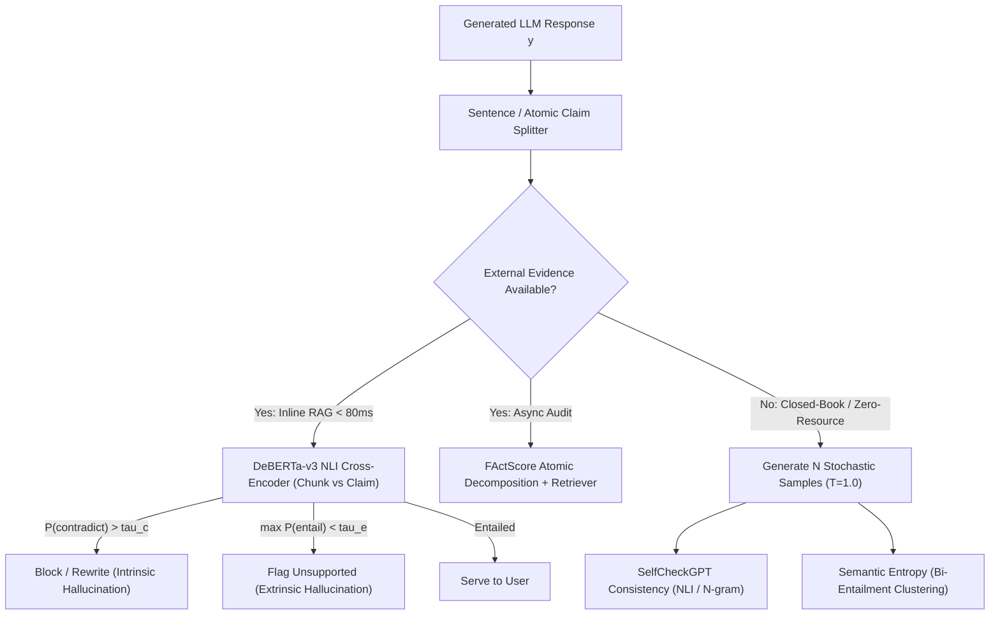
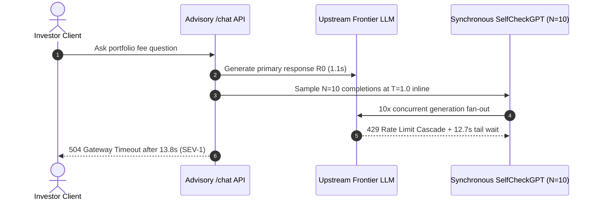

# Module 08: Hallucination: Detection Techniques

> **Prerequisites:** [Module 07: Hallucination: Causes](../07-hallucination-causes/README.md) and [Module 03: LLM-as-Judge](../03-llm-as-judge/README.md).  
> **Estimated Reading Time:** 35 minutes  
> **Target Audience:** AI Backend Engineers, Trust & Safety Architects, MLOps & Inference Engineers

> [!TIP]
> **The Golden Rule of Hallucination Detection:** Never run an $N$-sample LLM consistency check synchronously in the user's critical latency path, and never judge long-form paragraphs in a single coarse pass. **Route detection by grounding regime and latency budget:** run fast **DeBERTa-v3 NLI cross-encoders** inline (`15–60 ms`) when retrieved evidence exists, decompose long-form answers via **FActScore atomic claims** in async observability, and reserve **SelfCheckGPT / Semantic Entropy** for closed-book or high-stakes audits where $N\times$ generation compute is warranted.

---

## Why This Matters

Once you understand *why* models fabricate ([Module 07](../07-hallucination-causes/README.md)), the next engineering problem is catching hallucinations before—or immediately after—they reach users. Many teams naively attach a full `GPT-4` faithfulness judge synchronously to every response, spiking tail latency by `2.5–4.0s`, doubling token spend, and still missing **mixed-truth sentences** where two true clauses mask one fabricated date.

Production safety requires a **tiered hallucination detection architecture** matching the algorithm to whether external reference passages exist (`Grounded / RAG`) or do not (`Zero-Resource / Closed-Book`), and separating `< 80 ms` inline request guardrails from asynchronous batch observability.

---

## 1. Architectural Mental Model & Core Mechanics

Route candidate outputs cleanly between fast inline grounding checks and higher-compute asynchronous verification:



### Technique 1: DeBERTa-v3 NLI Cross-Encoders (Grounded Inline Guardrails)

Natural Language Inference (`NLI`) trains a bidirectional cross-encoder (typically `184M`-parameter `DeBERTa-v3-base` or `44M` `DeBERTa-v3-xsmall` fine-tuned on `MNLI + FEVER + ANLI`) to classify a pair `(Premise = retrieved chunk c_j, Hypothesis = claim a_i)` into three calibrated probabilities:

$$P_{\text{NLI}}(c_j, a_i) = \big[p_{\text{contradict}},\; p_{\text{neutral}},\; p_{\text{entail}}\big]$$

This maps directly onto Module 07's faithfulness taxonomy:
- **Intrinsic Hallucination:** $\max_j p_{\text{contradict}}(c_j, a_i) \ge \tau_c$ (e.g., `0.50`) — a chunk directly refutes the claim.
- **Extrinsic / Unsupported Hallucination:** $\max_j p_{\text{entail}}(c_j, a_i) < \tau_e$ (e.g., `0.70`) — no chunk supports the claim (`neutral` across all evidence).
- **Grounded:** At least one chunk entails the claim with low contradiction.

**Engineering Specs:** Batched on a single L4/T4 GPU (or ONNX `INT8` runtime), DeBERTa-v3 scores `10–20` `(chunk, claim)` pairs in `15–60 ms` at ~`\$0.00001` per request—`100x` faster and `1,000x` cheaper than an LLM judge. Watch out for the `512`-token cross-encoder window: split long evidence chunks cleanly before pairing!

### Technique 2: Atomic Claim Decomposition (`FActScore`, Min et al., `arXiv:2305.14251`)

Sentence-level checking breaks down on compound prose:
> *"Ada Lovelace was born in December 1815 in Vienna, wrote notes on Babbage's Analytical Engine, and won the 1848 Turing Medal."*

Scoring that paragraph holistically confuses evaluators (`50%` true, `50%` false). **FActScore** solves granularity in three steps:
1. **Atomize:** Prompt a fast model (`8B` or deterministic parser) to split response $y$ into $M$ single-fact **atomic claims** $\{a_1, \dots, a_M\}$.
2. **Retrieve & Verify:** Verify each atomic fact $a_i$ independently against the authoritative knowledge base $E$ (using DeBERTa NLI or a binary verifier).
3. **Compute Factual Precision:**

$$\text{FActScore}(y, E) = \frac{1}{M} \sum_{i=1}^{M} \mathbb{I}\big[\text{Supported}(a_i, E)\big]$$

Always track **absolute unsupported claim count** ($N_{\text{unsupported}}$) alongside precision—otherwise padding an answer with `10` trivial true facts hides `2` dangerous errors (`83%` precision).

### Technique 3: SelfCheckGPT (`arXiv:2303.08896`, Manakul et al.)

What if there is **no external database** (`closed-book generation`) and **no access to token log-probabilities** (`black-box API`)? **SelfCheckGPT** detects confabulation via **stochastic sample consistency**:

1. Generate the main greedy/low-temperature response $R_0$.
2. Sample $N$ additional completions $\{S_1, \dots, S_N\}$ from the exact same prompt at `temperature = 1.0`.
3. **Core Intuition:** Facts strongly anchored in model weights repeat consistently across $S_1 \dots S_N$. Fabricated tail claims diverge, mutate dates, or contradict across samples.
4. Score each sentence $r_i \in R_0$ against samples using `SelfCheck-NLI` (or `SelfCheck-Ngram` / `SelfCheck-Prompt`):

$$\mathcal{S}_{\text{SelfCheck}}(r_i) = \frac{1}{N} \sum_{n=1}^{N} P\big(\text{contradict or unsupported} \mid S_n, r_i\big)$$

**Cost Trade-Off:** Running `N = 5` samples consumes **$6\times$ total generation tokens** plus $M \cdot N$ NLI evaluations—making SelfCheckGPT ideal for **asynchronous offline audits**, never interactive user request paths.

### Technique 4: Semantic Entropy (`Nature 2024`, Farquhar et al.)

Naive predictive token entropy fails because **lexical variation $\neq$ factual uncertainty**. Compare two sets of `5` sampled completions:
- **Regime A (Factual Certainty):** `"Paris is the capital of France."`, `"The capital of France is Paris."`, `"It is Paris."` $\rightarrow$ High token-sequence entropy (`1.60 nats`), **zero epistemic uncertainty** (every sample means the exact same thing!).
- **Regime B (Confabulation):** `"Founded in 1984."`, `"Founded in 1987."`, `"Founded in 1991."` $\rightarrow$ Similar token entropy, **5 mutually contradictory meanings**.

Farquhar et al. (*Detecting hallucinations in large language models using semantic entropy*, *Nature* 2024) solve this in three steps:
1. Sample $N$ completions $\{s_1, \dots, s_N\}$ (tracking sequence likelihoods $p(s_j \mid x)$, or uniform empirical counts in **Discrete Semantic Entropy** when APIs hide logits).
2. Group completions into **semantic equivalence clusters** $\{C_1, \dots, C_K\}$ via **bi-directional NLI entailment** ($s_a \models s_b \land s_b \models s_a$).
3. Sum probabilities within each meaning cluster $P(C_k \mid x) = \sum_{s_j \in C_k} p(s_j \mid x)$ (normalized over sampled mass) and compute cluster Shannon entropy:

$$SE(x) = -\sum_{k=1}^{K} P(C_k \mid x) \log P(C_k \mid x)$$

- **Low $SE(x) \approx 0$:** All paraphrases collapse into $K = 1$ meaning cluster $\implies$ confident knowledge.
- **High $SE(x)$:** Samples fracture across $K \approx N$ competing clusters $\implies$ high confabulation risk!

*(Critical caveat for both SelfCheckGPT and Semantic Entropy: if a model absorbed a **consistent widespread misconception** during pretraining, all $N$ samples agree on the same falsehood—yielding low entropy on a systemic error!)*

---

## 2. Systematic Comparison Matrix: Hallucination Detection Techniques

| Technique | Requires External Context? | Requires Token Logits? | Compute / Token Multiplier | Typical Latency | Deployment Tier | Primary Blind Spot |
| :--- | :--- | :--- | :--- | :--- | :--- | :--- |
| **DeBERTa-v3 NLI Cross-Encoder** | **Yes** | No | `1x` gen + local GPU NLI (`~\$0.00001`) | **`15–60 ms`** | **Inline Guardrail** | `512`-token window; needs claim splitting for multi-clause text |
| **FActScore Atomic Decomposition** | **Yes** | No | `1x` gen + atomize + $M$ verifications | `400–1,500 ms` | **Async Audit / High-Stakes** | Atomizer drift; retrieval errors cause false negatives |
| **SelfCheckGPT (`N=5..20`)** | **No** | No | **`(1+N)x` gen** (`6x–21x`) + $M \cdot N$ NLI | `2,000–8,000 ms` | **Async Closed-Book Audit** | Fails on **consistently wrong** memorized myths; prohibitive inline latency |
| **Semantic Entropy (`Bi-Entail`)** | **No** | Optional (Discrete variant works without) | **`N x` gen** + $O(N^2)$ NLI clustering | `2,000–6,000 ms` | **Offline Calibration / Triage** | Fails on consistent training falsehoods; $O(N^2)$ clustering cost |
| **Single-Pass LLM Faithfulness Judge** | Yes | No | `1x` gen + `1x` large judge prompt | `600–2,000 ms` | **CI Gate / Async Telemetry** | Coarse paragraph blindness unless paired with atomic claims |

---

## 3. Production War Story Post-Mortem: The `12-Second` Synchronous SelfCheckGPT Meltdown

| Field | Incident Details |
| :--- | :--- |
| **Severity** | **SEV-1** (P99 Latency Spike to 13.8s, 11.4x Token Bill & API Rate-Limit Outage) |
| **Detection / Resolution Time** | Detected 22 minutes post-deploy via P99 latency & `429` alerts / Mitigated in 12 minutes (disabled inline SelfCheck, restored async sampling) |
| **Impact** | Daily LLM spend jumped from **\$4,200/day** to **\$47,900/day** pace; `31%` of checkout advisory requests timed out during market open |

### What Happened

A wealth-management advisory bot suffered sporadic hallucinated fee waivers. Wanting `"zero-hallucination guarantees"`, the team bypassed fast NLI cross-encoders and wired **SelfCheckGPT (`N = 10` samples at `T = 1.0`) + an LLM faithfulness judge** synchronously inside the live user `/chat` endpoint.

Under morning market traffic, every single user query triggered `11` sequential/fan-out LLM completions plus `50` consistency checks before streaming a single character back to the user. Token consumption exploded `11.4x`, upstream provider TPM rate limits returned cascading `429 Too Many Requests` errors, and P99 latency blew past the `10s` API Gateway timeout (`13.8s`).



### Root Cause Analysis

- **Wrong Tier Placement:** SelfCheckGPT's $(1 + N)\times$ generation overhead makes it structurally incompatible with sub-second interactive request paths.
- **Ignoring Available RAG Evidence:** The advisory bot already retrieved policy PDFs, meaning a `30 ms` **DeBERTa-v3 NLI cross-encoder** could verify claims inline at `1/1000th` the cost without sampling `N = 10` responses.
- **Missing Hard Deadline Fallbacks:** Synchronous guardrails lacked timeout budgets or graceful circuit breaking.

### The Fix & Architectural Hardening

- **Dual-Tier Detection Split:** Deployed **Tier-1 Inline DeBERTa-v3 NLI** (`< 60 ms` budget on ONNX/GPU batching) strictly over retrieved policy chunks to block intrinsic contradictions before emission.
- **Tier-2 Async Observability:** Moved **FActScore atomic precision + Semantic Entropy (`N=5`)** to an asynchronous `5%`-sampled background queue on Kafka/SQS feeding Grafana hallucination alerts and human annotation sprints.

---

## 4. Multi-Language Production Implementation: Dual-Tier Hallucination Detector

Below is a production-grade **Dual-Tier Hallucination Detector** across **Go**, **TypeScript**, **Python**, and **C#**. It implements Tier-1 inline atomic claim NLI classification (`INTRINSIC_CONTRADICTION`, `EXTRINSIC_UNSUPPORTED`, `SUPPORTED`) alongside Tier-2 FActScore precision and Semantic Entropy cluster entropy calculation.

````carousel

```go
package hallucheck

import (
	"math"
)

type NLIProbs struct {
	Entail     float64
	Neutral    float64
	Contradict float64
}

type ClaimVerdict string

const (
	VerdictSupported             ClaimVerdict = "SUPPORTED"
	VerdictIntrinsicContradict   ClaimVerdict = "INTRINSIC_CONTRADICTION"
	VerdictExtrinsicUnsupported  ClaimVerdict = "EXTRINSIC_UNSUPPORTED"
)

type SemanticSample struct {
	ClusterID string
	Prob      float64
}

// InlineNLIGate aggregates NLI probabilities across retrieved evidence chunks for one claim.
func InlineNLIGate(chunkScores []NLIProbs, tauEntail, tauContradict float64) ClaimVerdict {
	maxEntail, maxContradict := 0.0, 0.0
	for _, s := range chunkScores {
		if s.Contradict > maxContradict {
			maxContradict = s.Contradict
		}
		if s.Entail > maxEntail {
			maxEntail = s.Entail
		}
	}
	if maxContradict >= tauContradict {
		return VerdictIntrinsicContradict
	}
	if maxEntail >= tauEntail {
		return VerdictSupported
	}
	return VerdictExtrinsicUnsupported
}

// ComputeFActScore returns fraction of atomic claims supported by retrieved evidence.
func ComputeFActScore(verdicts []ClaimVerdict) float64 {
	if len(verdicts) == 0 {
		return 0
	}
	supported := 0
	for _, v := range verdicts {
		if v == VerdictSupported {
			supported++
		}
	}
	return float64(supported) / float64(len(verdicts))
}

// SemanticEntropy sums normalized cluster probabilities from bi-entailment classes.
func SemanticEntropy(samples []SemanticSample) float64 {
	clusters := make(map[string]float64)
	totalMass := 0.0
	for _, s := range samples {
		clusters[s.ClusterID] += s.Prob
		totalMass += s.Prob
	}
	if totalMass <= 0 {
		return 0
	}
	entropy := 0.0
	for _, mass := range clusters {
		p := mass / totalMass
		if p > 0 {
			entropy -= p * math.Log(p)
		}
	}
	return entropy
}
```

<!-- slide -->

```typescript
export interface NliScores {
  readonly entail: number;
  readonly neutral: number;
  readonly contradict: number;
}

export type ClaimVerdict =
  | "SUPPORTED"
  | "INTRINSIC_CONTRADICTION"
  | "EXTRINSIC_UNSUPPORTED";

export interface SemanticSample {
  readonly clusterId: string;
  readonly prob: number;
}

export function classifyClaimAcrossChunks(
  chunkScores: readonly NliScores[],
  tauEntail = 0.7,
  tauContradict = 0.5,
): ClaimVerdict {
  let maxEntail = 0;
  let maxContradict = 0;
  for (const score of chunkScores) {
    if (score.contradict > maxContradict) maxContradict = score.contradict;
    if (score.entail > maxEntail) maxEntail = score.entail;
  }
  if (maxContradict >= tauContradict) return "INTRINSIC_CONTRADICTION";
  if (maxEntail >= tauEntail) return "SUPPORTED";
  return "EXTRINSIC_UNSUPPORTED";
}

export function computeFActScore(verdicts: readonly ClaimVerdict[]): number {
  if (verdicts.length === 0) return 0;
  const hits = verdicts.filter((v) => v === "SUPPORTED").length;
  return hits / verdicts.length;
}

export function computeSemanticEntropy(samples: readonly SemanticSample[]): number {
  const clusterMass = new Map<string, number>();
  let total = 0;
  for (const smp of samples) {
    clusterMass.set(smp.clusterId, (clusterMass.get(smp.clusterId) ?? 0) + smp.prob);
    total += smp.prob;
  }
  if (total <= 0) return 0;
  let entropy = 0;
  for (const mass of clusterMass.values()) {
    const p = mass / total;
    if (p > 0) entropy -= p * Math.log(p);
  }
  return entropy;
}
```

<!-- slide -->

```python
"""
hallucination_detector.py
Tier-1 inline NLI claim verifier, FActScore aggregator, and Semantic Entropy scorer.
"""
from dataclasses import dataclass
import math
from typing import Literal, Sequence

ClaimVerdict = Literal["SUPPORTED", "INTRINSIC_CONTRADICTION", "EXTRINSIC_UNSUPPORTED"]


@dataclass(frozen=True)
class NLIScores:
    entail: float
    neutral: float
    contradict: float


def classify_claim_nli(
    chunk_scores: Sequence[NLIScores],
    tau_entail: float = 0.70,
    tau_contradict: float = 0.50,
) -> ClaimVerdict:
    if not chunk_scores:
        return "EXTRINSIC_UNSUPPORTED"
    max_contra = max(s.contradict for s in chunk_scores)
    max_entail = max(s.entail for s in chunk_scores)
    if max_contra >= tau_contradict:
        return "INTRINSIC_CONTRADICTION"
    if max_entail >= tau_entail:
        return "SUPPORTED"
    return "EXTRINSIC_UNSUPPORTED"


def factscore_precision(verdicts: Sequence[ClaimVerdict]) -> float:
    if not verdicts:
        return 0.0
    return sum(1 for v in verdicts if v == "SUPPORTED") / len(verdicts)


def semantic_entropy(cluster_probs: Sequence[tuple[str, float]]) -> float:
    """Compute cluster-level Shannon entropy (nats) over bi-entailment equivalence classes."""
    clusters: dict[str, float] = {}
    total = 0.0
    for cid, prob in cluster_probs:
        clusters[cid] = clusters.get(cid, 0.0) + prob
        total += prob
    if total <= 0.0:
        return 0.0
    return -sum((m / total) * math.log(m / total) for m in clusters.values() if m > 0.0)
```

<!-- slide -->

```csharp
using System;
using System.Collections.Generic;
using System.Linq;

namespace GenAI.Evaluation.Detection;

public sealed record NliScores(double Entail, double Neutral, double Contradict);

public enum ClaimVerdict { Supported, IntrinsicContradiction, ExtrinsicUnsupported }

public static class HallucinationDetector
{
    public static ClaimVerdict ClassifyClaimNli(
        IReadOnlyCollection<NliScores> chunkScores,
        double tauEntail = 0.70,
        double tauContradict = 0.50)
    {
        if (chunkScores.Count == 0) return ClaimVerdict.ExtrinsicUnsupported;
        double maxContra = chunkScores.Max(s => s.Contradict);
        double maxEntail = chunkScores.Max(s => s.Entail);
        if (maxContra >= tauContradict) return ClaimVerdict.IntrinsicContradiction;
        if (maxEntail >= tauEntail) return ClaimVerdict.Supported;
        return ClaimVerdict.ExtrinsicUnsupported;
    }

    public static double ComputeFActScore(IReadOnlyCollection<ClaimVerdict> verdicts)
    {
        if (verdicts.Count == 0) return 0.0;
        int supported = verdicts.Count(v => v == ClaimVerdict.Supported);
        return (double)supported / verdicts.Count;
    }

    public static double ComputeSemanticEntropy(IEnumerable<(string ClusterId, double Prob)> samples)
    {
        var clusters = new Dictionary<string, double>(StringComparer.Ordinal);
        double total = 0.0;
        foreach (var (cid, prob) in samples)
        {
            clusters[cid] = clusters.GetValueOrDefault(cid) + prob;
            total += prob;
        }
        if (total <= 0.0) return 0.0;
        double se = 0.0;
        foreach (double mass in clusters.Values)
        {
            double p = mass / total;
            if (p > 0.0) se -= p * Math.Log(p);
        }
        return se;
    }
}
```

````

---

## 5. Practical Hands-On Verification CLI Workflows

Run these deterministic Python 3.13 verification scripts offline—zero API keys or GPU downloads required.

### Workflow 1: `FActScore` Atomic Claim Decomposition + NLI Cross-Encoder Aggregation

Evaluate `4` atomic claims extracted from one compound biography sentence, separating supported facts from **intrinsic contradictions** (`Vienna`) and **extrinsic fabrications** (`1848 Turing Medal`):

```bash
python -c '
claims = [
    ("Ada Lovelace was born in December 1815.",   {"entail": 0.96, "neutral": 0.03, "contradict": 0.01}),
    ("Ada Lovelace was born in Vienna.",          {"entail": 0.02, "neutral": 0.04, "contradict": 0.94}),
    ("She authored notes on the Analytical Engine.", {"entail": 0.93, "neutral": 0.06, "contradict": 0.01}),
    ("She received the 1848 Turing Medal.",       {"entail": 0.03, "neutral": 0.91, "contradict": 0.06}),
]

supported = 0
for text, nli in claims:
    e, n, c = nli["entail"], nli["neutral"], nli["contradict"]
    if c >= 0.50:
        verdict = "INTRINSIC_CONTRADICTION"
    elif e >= 0.70:
        verdict = "SUPPORTED"
        supported += 1
    else:
        verdict = "EXTRINSIC_UNSUPPORTED"
    print(f"{verdict:<24} | E={e:.2f} N={n:.2f} C={c:.2f} | {text}")

factscore = supported / len(claims)
print(f"\nFActScore Precision = {supported}/{len(claims)} = {factscore:.2%}")
'
```

**Expected Output:**

```text
SUPPORTED                | E=0.96 N=0.03 C=0.01 | Ada Lovelace was born in December 1815.
INTRINSIC_CONTRADICTION  | E=0.02 N=0.04 C=0.94 | Ada Lovelace was born in Vienna.
SUPPORTED                | E=0.93 N=0.06 C=0.01 | She authored notes on the Analytical Engine.
EXTRINSIC_UNSUPPORTED    | E=0.03 N=0.91 C=0.06 | She received the 1848 Turing Medal.

FActScore Precision = 2/4 = 50.00%
```

### Workflow 2: SelfCheckGPT Consistency Scoring (`N=5` Stochastic Samples)

Score sentence-level consistency across `5` stochastic samples without external knowledge and print the generation + NLI compute multiplier:

```bash
python -c '
target_sentences = [
    "Lovelace collaborated with Charles Babbage on the Analytical Engine.",
    "Lovelace won the Royal Society Copley Medal in 1846.",
]
samples = [
    "Ada Lovelace worked closely with Charles Babbage on the Analytical Engine.",
    "She partnered with Charles Babbage to document algorithms for the Analytical Engine.",
    "Lovelace corresponded with Charles Babbage regarding the Analytical Engine.",
    "Lovelace collaborated with Babbage on Analytical Engine notes; she never won a Royal Society medal.",
    "Charles Babbage and Ada Lovelace worked on the Analytical Engine; she did not receive the Copley Medal.",
]

def nli_contradict_mock(sentence, sample):
    s_low, p_low = sentence.lower(), sample.lower()
    if "babbage" in s_low and "babbage" in p_low:
        return 0.02
    if "copley" in s_low and ("never won" in p_low or "did not receive" in p_low):
        return 0.95
    return 0.75

for sent in target_sentences:
    scores = [nli_contradict_mock(sent, smp) for smp in samples]
    mean_risk = sum(scores) / len(scores)
    flag = "HALLUCINATION_FLAG" if mean_risk >= 0.50 else "CONSISTENT"
    print(f"risk={mean_risk:.2f} [{flag}] | {sent}")

print(f"Token multiplier for N={len(samples)} stochastic samples: {1 + len(samples)}x generation + {len(target_sentences)*len(samples)} NLI pairs")
'
```

**Expected Output:**

```text
risk=0.02 [CONSISTENT] | Lovelace collaborated with Charles Babbage on the Analytical Engine.
risk=0.83 [HALLUCINATION_FLAG] | Lovelace won the Royal Society Copley Medal in 1846.
Token multiplier for N=5 stochastic samples: 6x generation + 10 NLI pairs
```

### Workflow 3: Lexical Token Entropy vs. Semantic Entropy (`Bi-Entailment Clustering`)

Demonstrate numerically why `5` diverse paraphrases of `"Paris"` trigger high lexical entropy (`1.599 nats`) yet `SE = 0.000 nats` after bi-directional entailment clustering, whereas `5` conflicting dates produce `SE = 1.607 nats`:

```bash
python -c '
import math

def shannon_entropy(probs):
    return -sum(p * math.log(p) for p in probs if p > 0.0)

paraphrases = [
    ("Paris is the capital of France.", 0.24, "C_PARIS"),
    ("The capital of France is Paris.", 0.22, "C_PARIS"),
    ("The capital city of France is Paris.", 0.20, "C_PARIS"),
    ("It is Paris.", 0.18, "C_PARIS"),
    ("Paris serves as capital of France.", 0.16, "C_PARIS"),
]

confabulations = [
    ("Founded in 1984.", 0.22, "C_1984"),
    ("Founded in 1987.", 0.21, "C_1987"),
    ("Founded in 1991.", 0.20, "C_1991"),
    ("Founded in 1979.", 0.19, "C_1979"),
    ("Founded in 1995.", 0.18, "C_1995"),
]

for label, items in [("Regime A (Paraphrases)", paraphrases), ("Regime B (Confabulation)", confabulations)]:
    lexical_h = shannon_entropy([p for _, p, _ in items])
    clusters = {}
    for _, p, cid in items:
        clusters[cid] = clusters.get(cid, 0.0) + p
    semantic_h = shannon_entropy(clusters.values())
    print(f"{label:<26} | clusters={len(clusters)} | lexical_H={lexical_h:.3f} nats | semantic_SE={semantic_h:.3f} nats")
'
```

**Expected Output:**

```text
Regime A (Paraphrases)     | clusters=1 | lexical_H=1.599 nats | semantic_SE=0.000 nats
Regime B (Confabulation)   | clusters=5 | lexical_H=1.607 nats | semantic_SE=1.607 nats
```

### Hands-On Exercises

1. **Chunk-Pair Aggregation Fix:** Extend Workflow 1 so each atomic claim is evaluated against `3` separate chunks (e.g., Chunk 1 supports claim #1, Chunk 2 contains unrelated text). Verify why taking `max(entail)` across chunks (instead of `mean(entail)`) is mandatory when only `1` of `3` retrieved chunks contains the answer!
2. **Discrete Semantic Entropy Without Logits:** Modify Workflow 3 so sequence probabilities are unavailable (`None`) and compute Discrete Semantic Entropy using empirical cluster frequency $c_k / N$ for `[C_1984, C_1984, C_1984, C_1991, C_1979]`.
3. **Optional Real DeBERTa NLI Probe (Requires `transformers` / `sentence-transformers`):** Load `cross-encoder/nli-deberta-v3-base` locally on CPU/GPU and score Workflow 1's `4` claims against a `3`-sentence Wikipedia bio of Ada Lovelace, measuring inference latency per claim.

### Independent Challenge

You operate a medical triage RAG portal handling `80` queries/sec (`P95` end-to-end SLA `< 1.2s`) plus a closed-book clinical research summarization batch job running overnight. An engineer recommends deploying `SelfCheckGPT (N=10)` globally on both workloads to unify tooling. Explain why this breaks the portal SLA, and design the optimal two-tier detection architecture covering latency, cost, and hallucination coverage.

<details><summary>Architectural Discussion</summary>

1. **Why Unified `SelfCheckGPT (N=10)` Fails:** At `80 QPS`, `11x` generation (`880` concurrent LLM calls/sec) saturates token quotas and pushes P95 latency well over `5–10s`, violating the `< 1.2s` portal SLA—and ignores the fact that the triage portal *already* has retrieved clinical guidelines ready for direct verification!
2. **Optimal Two-Tier Architecture:**
   - *Medical Triage Portal (Grounded Inline Tier):* Split generated guidance into sentences/claims and score against retrieved clinical chunks using batched ONNX/GPU **DeBERTa-v3 NLI** (`~35 ms` latency, `\$0.00001/req`). Block or trigger safe fallback whenever `max(contradict) >= 0.50` or `max(entail) < 0.70`. Add async `5%` **FActScore** auditing to spot subtle missing atomic qualifiers.
   - *Overnight Research Summarization (Async Tier):* Run **FActScore atomic decomposition** against cited abstracts, plus **Semantic Entropy (`N=5`)** on ungrounded synthesis sentences where external context is ambiguous, routing high-$SE$ summaries to clinician review.

</details>

---

## 6. Common Mistakes & Troubleshooting

- **Running `SelfCheckGPT` or `Semantic Entropy` inline on live chat requests:** Multiplying generation tokens by `6x–21x` blows latency SLAs and rate limits; keep consistency sampling strictly asynchronous or offline.
- **Averaging NLI `entailment` across all retrieved `top_k` chunks:** If Chunk `#1` entails a claim (`0.95`) and Chunks `#2–5` are unrelated (`neutral = 0.90, entail = 0.02`), taking the mean rejects valid answers; take **`max_j P_entail(chunk_j, claim)`** while checking **`max_j P_contradict(chunk_j, claim)`**.
- **Ignoring `512`-token NLI truncation limits:** Feeding a `1,200`-token RAG chunk + hypothesis straight into `DeBERTa-v3` silently truncates the second half of the evidence; split premises into overlapping `300`-token sentences before NLI inference.
- **Assuming low Semantic Entropy proves truth:** If a model confidently memorized a widespread misconception (`"Great Wall is visible from space"`), all `N` samples cluster together (`SE = 0.0`), requiring external RAG/NLI grounding to catch systemic false beliefs.

---

## 7. Operational Validation Checkpoints & Checkpoint Quiz

### Operational Validation Checkpoints

<details><summary><strong>Checkpoint 1: Why compound sentences break non-decomposed NLI checks</strong></summary>

A model writes: *"Project Apollo launched in 1969, landed on Mars, and returned lunar soil samples."* Retrieved context covers the 1969 Moon landing and samples, and a single full-sentence NLI check outputs `entailment = 0.58, contradiction = 0.25`. Why did coarse scoring soften the contradiction, and how does **FActScore** fix it?

**Validation:** Combining two true facts (`launched in 1969`, `returned lunar soil`) with one false claim (`landed on Mars`) dilutes the NLI classifier signal across tokens. **FActScore** decomposes the output into three independent atomic claims (`["launched in 1969", "landed on Mars", "returned lunar soil"]`) so the NLI verifier isolates `"landed on Mars"` with `contradiction > 0.90` and reports precise factual precision (`2/3 = 66.7%`).

</details>

<details><summary><strong>Checkpoint 2: Distinguishing lexical paraphrasing from epistemic uncertainty</strong></summary>

For Question X, `5` temperature-`1.0` samples show high token predictive entropy (`1.60 nats`) because the model swaps active/passive phrasing (`"A causes B"` vs. `"B is caused by A"`). Why does **Semantic Entropy** outperform token entropy here?

**Validation:** Token predictive entropy treats synonymous surface forms as distinct outcomes, creating false alarms on fluent paraphrasing. **Semantic Entropy** (`Nature 2024`) clusters samples via **bi-directional NLI entailment** (`s_a |= s_b` and `s_b |= s_a`), collapsing all valid paraphrases into `1` cluster so $SE(x) \approx 0.0$ while spiking only when samples express genuinely conflicting meanings.

</details>

<details><summary><strong>Checkpoint 3: Choosing the right detector when zero external context exists vs. RAG</strong></summary>

Compare deploying **DeBERTa-v3 NLI** vs. **SelfCheckGPT (`N=5`)** on (a) an interactive customer-policy RAG chatbot (`< 800 ms` budget) and (b) an offline closed-book trivia generator.

**Validation:** For **(a) RAG chatbot**, external context is present and latency is tight: run **DeBERTa-v3 NLI** inline (`15–60 ms`) over `(chunk, claim)` pairs because it requires zero extra LLM generation. For **(b) closed-book trivia**, no reference chunks exist for NLI grounding: run **SelfCheckGPT (`N=5`)** or **Semantic Entropy** asynchronously offline to measure self-consistency across stochastic samples.

</details>

### Checkpoint Quiz

1. How do DeBERTa NLI outputs `[contradiction, neutral, entailment]` map to **Intrinsic** vs. **Extrinsic** hallucinations?
2. What are the three pipeline stages of **FActScore** (`arXiv:2305.14251`), and why should you log `N_unsupported` alongside the FActScore ratio?
3. Explain why **SelfCheckGPT** requires zero external databases and zero token logits, and state its primary production cost bottleneck.
4. Define the **bi-directional entailment equivalence criterion** used to cluster samples in **Semantic Entropy**.
5. Describe one scenario where *both* SelfCheckGPT and Semantic Entropy falsely score a hallucinated claim as low-risk.

<details><summary>Answers</summary>

1. High `contradiction` against a retrieved chunk signals an **Intrinsic Hallucination** (direct conflict); high `neutral` across *all* retrieved chunks (`low max entailment`) signals an **Extrinsic Hallucination** (unsupported by context).
2. (1) Decompose generation into single-fact **atomic claims**, (2) retrieve & verify each atom against knowledge evidence, (3) compute fraction of supported atoms. Logging `N_unsupported` prevents verbose answers padded with trivial truths from masking serious errors inside a high ratio.
3. SelfCheckGPT compares a primary answer against $N$ sampled text completions from the same black-box LLM (`NLI/N-gram/QA`), requiring neither knowledge DBs nor log-probs. Its bottleneck is $(1 + N)\times$ generation token cost and seconds of added latency.
4. Two completions $s_a$ and $s_b$ belong to the same semantic cluster if and only if $s_a$ entails $s_b$ **and** $s_b$ entails $s_a$ (`mutual NLI entailment`).
5. When a model has memorized a **consistent false misconception** from pretraining data—causing all $N$ stochastic samples to confidently agree on the exact same falsehood (`SE ~ 0`).

</details>

---

## Further Reading & Sources

- [FActScore: Fine-grained Atomic Evaluation of Factual Precision in Long Form Text Generation (Min et al., 2023)](https://arxiv.org/abs/2305.14251) — atomic fact decomposition and knowledge-grounded factual precision.
- [SelfCheckGPT: Zero-Resource Black-Box Hallucination Detection for Generative Large Language Models (Manakul et al., 2023)](https://arxiv.org/abs/2303.08896) — black-box consistency verification via stochastic sampling.
- [Detecting Hallucinations in Large Language Models Using Semantic Entropy (Farquhar et al., Nature 2024)](https://www.nature.com/articles/s41586-024-07421-0) — bi-directional entailment clustering separating lexical phrasing variance from epistemic confabulation.
- [Hugging Face Transformers: Zero-Shot Classification & NLI Docs](https://huggingface.co/docs/transformers/tasks/zero_shot_classification) — running NLI cross-encoders in Python inference pipelines.
- [Sentence-Transformers Cross-Encoder Reference](https://sbert.net/docs/package_reference/cross_encoder/model.html) — batch scoring `(premise, hypothesis)` pairs for low-latency inline guardrails.

## Next

[Module 09: Grounding and Citation Verification](../09-grounding-and-citation-verification/README.md)
