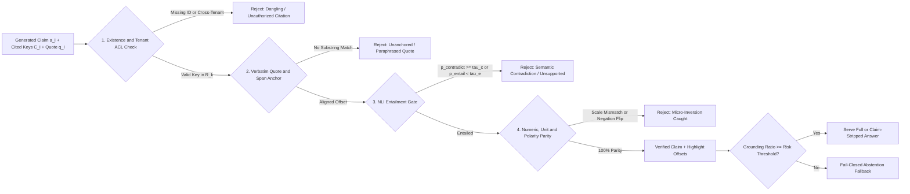
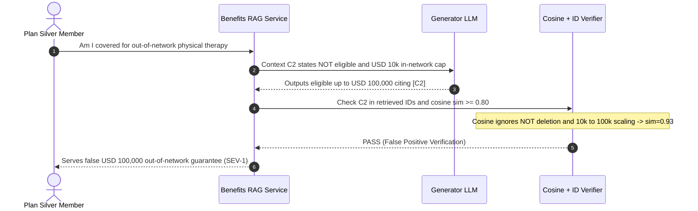

# Module 09: Grounding and Citation Verification

> **Prerequisites:** [Module 08: Hallucination: Detection Techniques](../08-hallucination-detection-techniques/README.md), [Module 02: Deterministic Evals and Assertions](../02-deterministic-evals-and-assertions/README.md), and [Track 09, Module 11: Citations and Source Attribution](../../09-retrieval-augmented-generation/11-citations-and-source-attribution/README.md).  
> **Estimated Reading Time:** 35 minutes  
> **Target Audience:** AI Backend Engineers, Trust & Safety Architects, Search & RAG Infrastructure Engineers

> [!TIP]
> **The Golden Rule of Grounding & Citation Verification:** Never equate inline `[1]` regex compliance—or high embedding cosine similarity—with factual grounding. Every cited assertion must clear a **4-stage post-generation verification pipeline** (Citation Existence & ACL Scope → Verbatim Quote / Character-Span Anchoring → Semantic Entailment → Numeric, Unit & Polarity Parity) paired with **ALCE necessity pruning**, enforcing **fail-closed abstention or selective claim stripping** whenever grounded coverage falls below your domain threshold.

---

## Why This Matters

In [Track 09, Module 11](../../09-retrieval-augmented-generation/11-citations-and-source-attribution/README.md), you learned how to structure RAG prompts with opaque keys (`C1`, `C2`, ...) so generators attach clickable references to answers. Yet generating a `[C2]` badge is only half the engineering battle—the harder problem in **evaluation and runtime safety** is proving mechanically that `[C2]` *actually entails* the exact claim written beside it.

Naive citation validators (`re.findall(r"\[C\d+\]", answer)`) verify formatting, not truth. Even semantic similarity (`cosine >= 0.85`) and coarse NLI cross-encoders silently miss **high-impact micro-inversions**: flipping `"is NOT eligible"` into `"is eligible"`, scaling `"\$10k"` into `"\$100k"`, swapping `<= 30 days` to `>= 30 days`, or stuffing `[C1][C2][C3][C4]` onto every sentence to pass weak recall checks. When your copilot answers healthcare benefits, insurance underwriting, compliance policy, or financial disclosure queries, a single verified-looking wrong citation destroys user trust and creates immediate legal exposure.

---

## 1. Architectural Mental Model & The 4-Stage Verification Pipeline

Post-generation citation verification treats every generated sentence or atomic claim $a_i$ and its cited source subset $C_i$ as an **untrusted assertion** that must survive four sequential gates before reaching the user:



### The 4 Verification Stages Explained

1. **Stage 1 — Existence & Scope Validation ($C_i \subseteq R_k$):**
   Verify every cited key exists in the exact retrieved candidate set $R_k$ assembled for this request *and* passes tenant/revision ACL checks (`doc.tenant_id == req.tenant_id`, `doc.status == "PUBLISHED"`). This catches both dangling hallucinations (`[C9]` when only `C1..C4` exist) and prompt-injected cross-document leaks.
2. **Stage 2 — Verbatim Quote & Character-Span Anchoring:**
   Require the model to extract a short verbatim `exact_quote` from `C_i` alongside its claim (as introduced in [Track 09, Module 11](../../09-retrieval-augmented-generation/11-citations-and-source-attribution/README.md)), normalize whitespace and punctuation, and locate exact `(char_start, char_end)` offsets inside the retrieved chunk text. If no bounded match exists (`Levenshtein ratio < 0.92` or normalized substring absent), the model synthesized a plausible-sounding quote from parametric weights rather than copying source text.
3. **Stage 3 — Semantic Entailment & Contradiction Scoring:**
   Feed `(Premise = concat(C_i), Hypothesis = a_i)` into a fine-tuned cross-encoder NLI classifier ([Module 08](../08-hallucination-detection-techniques/README.md)) producing $[p_{\text{contradict}}, p_{\text{neutral}}, p_{\text{entail}}]$. Reject immediately if $p_{\text{contradict}} \ge \tau_c$ (intrinsic contradiction) or $p_{\text{entail}} < \tau_e$ (extrinsic leap).
4. **Stage 4 — Numeric, Unit, Date & Polarity Parity:**
   Dense embeddings and compact NLI models frequently assign `p_entail > 0.70` to nearly identical sentences differing by a single negation token or scalar multiplier (`"\$10k"` vs. `"\$100k"`, `"not eligible"` vs. `"eligible"`). Stage 4 deterministically extracts:
   - **Normalized Scalars & Multipliers:** Convert `"\$10k"`, `"10,000"`, `"25%"`, `"2.5M"` into canonical floats (`10000.0`, `0.25`, `2500000.0`) and require every numeric value asserted in $a_i$ to appear in its cited sources $C_i$.
   - **Deontic & Negation Polarity:** Track negation cues (`not`, `no`, `never`, `ineligible`, `excludes`, `except`, `unless`, `void`, `without`) across the claim and its anchored quote. An odd parity flip (`claim_polarity != quote_polarity`) trips an immediate deterministic block.

### Quantitative Formalization: ALCE Citation Metrics (`arXiv:2305.14627`)

In **ALCE** (*Enabling Large Language Models to Generate Text with Citations*, Gao et al., `arXiv:2305.14627`), citation quality is measured across **two orthogonal dimensions** so models cannot game recall by citing every chunk blindly:

1. **Citation Recall (Claim Groundedness):** Fraction of atomic claims $S = \{a_1, \dots, a_m\}$ fully entailed by the concatenation of their cited documents $C_i$:

$$\text{Citation Recall} = \frac{1}{|S|} \sum_{i=1}^{|S|} \mathbb{I}\bigl[\text{Entails}(C_i, a_i)\bigr]$$

2. **Citation Precision (Necessity Pruning):** Fraction of individual citation links $c \in C_i$ that are genuinely *necessary* to support claim $a_i$. Under ALCE's necessity criterion, citation $c \in C_i$ receives credit if and only if $C_i$ entails $a_i$ **and** either $c$ alone suffices OR dropping $c$ breaks entailment:

$$\text{Necessary}(c, C_i, a_i) = \text{Entails}(C_i, a_i) \;\land\; \Bigl(\text{Entails}(\{c\}, a_i) \lor \neg\text{Entails}(C_i \setminus \{c\}, a_i)\Bigr)$$

$$\text{Citation Precision} = \frac{\sum_{i=1}^{|S|} \sum_{c \in C_i} \mathbb{I}\bigl[\text{Necessary}(c, C_i, a_i)\bigr]}{\sum_{i=1}^{|S|} |C_i|}$$

3. **Grounding Coverage & Fail-Closed Action Policy:** Compute `GroundingRatio` $= \frac{|S_{\text{verified}}|}{|S|}$ and map to domain risk tiers:
   - **Regulated / High Risk (Medical, Legal, Insurance, Finance):** Require `GroundingRatio == 1.0`. Even `1` rejected claim triggers `FAIL_CLOSED_ABSTAIN`.
   - **Medium Risk (Enterprise Support, DevOps Runbooks):** Require `GroundingRatio >= 0.75` and zero Stage 4 polarity/numeric errors; strip non-essential unverified side remarks (`PASS_STRIPPED`) or abstain below `0.75`.
   - **Low Risk (Exploratory Summarization):** Strip unsupported assertions above `0.50` (`PASS_STRIPPED`) and surface an explicit partial-verification badge.

---

## 2. Systematic Comparison Matrix: Grounding & Citation Verifiers

| Verification Method | Catches Dangling `[9]` | Catches Misquotes | Catches Polarity Flips (`not`) | Catches Numeric Drift (`\$10k` vs `\$100k`) | Typical Inline Latency | Production Role |
| :--- | :--- | :--- | :--- | :--- | :--- | :--- |
| **Regex `[C\d+]` Presence Check** | No | No | No | No | `< 0.1 ms` | Minimum syntax sanity only |
| **Cosine Similarity (`emb >= 0.80`)** | Yes (if key checked) | Poor | **No** (`"eligible"` vs `"not eligible"` scores `> 0.90`) | **No** (`\$10k` vs `\$100k` scores `> 0.95`) | `5–15 ms` | Weak retrieval filter, never safety gate |
| **DeBERTa-v3 NLI Cross-Encoder Only** | Yes (with Stage 1) | No (no span offset) | Moderate–Good (can wobble on compound clauses) | Weak on subtle unit/magnitude swaps | `20–60 ms` | Core Stage 3 semantic entailment check |
| **4-Stage Verifier (Existence + Span + NLI + Numeric/Polarity)** | **Yes (100%)** | **Yes (exact offsets)** | **Yes (deterministic)** | **Yes (canonical scalar parity)** | `25–75 ms` | **Production gold-standard inline gate** |

---

## 3. Production War Story Post-Mortem: The Inverted Eligibility Clause & Tenfold Deductible Mirage

| Field | Incident Details |
| :--- | :--- |
| **Severity** | **SEV-1** (Incorrect Policy Coverage Commitments & Financial Reimbursement Liability) |
| **Detection / Resolution Time** | Detected 5 days post-release via claims audit escalation / Mitigated in 3.5 hours (deployed 4-Stage Verifier + strict `100%` regulated fail-closed gate) |
| **Impact** | `42` policyholders assured out-of-network physical therapy was covered up to `\$100,000`; **\$68,000** in ex-gratia goodwill payouts and mandatory compliance remediation |

### What Happened

An insurtech platform shipped a policy-benefits RAG assistant backed by curated plan PDFs. To verify citations before returning answers, the engineering team implemented two lightweight checks: (1) confirm every `[C#]` tag appeared in the retrieved chunk IDs, and (2) confirm the embedding cosine similarity between each response sentence and its cited chunk exceeded `0.80`.

On **Plan Silver**, chunk `[C2]` stated: *"Out-of-network physical therapy is **NOT eligible** under Plan Silver; in-network benefits cap at **\$10k** per year after a **\$500** deductible."* When a member asked *"What coverage do I get for out-of-network physical therapy on Plan Silver?"*, the LLM blended `Plan Platinum` priors with `[C2]`, emitting: *"Out-of-network physical therapy is eligible under Plan Silver up to \$100,000 per year after a \$500 deductible [C2]."*

Because `[C2]` existed in `R_k` and shared almost every content word with the fabricated sentence (`cosine = 0.93`), both naive verification checks passed silently.



### Root Cause Analysis

1. **Semantic embedding blindness to negation and scalar magnitude:** Bi-encoder representations average token semantics across a sentence, leaving `"eligible"` vs. `"NOT eligible"` and `"\$10k"` vs. `"\$100,000"` nearly indistinguishable in cosine space (`0.93`).
2. **Absence of verbatim quote anchoring and numeric/polarity parity:** Without requiring a verbatim substring anchor and comparing canonical numbers and negation parity against `[C2]`, the pipeline blindly trusted `[C2]` as valid proof.

### The Fix & Architectural Hardening

- **Deployed the 4-Stage Post-Generation Verifier:** Added Stage 2 verbatim span anchoring, Stage 3 NLI cross-encoder entailment (`tau_e = 0.75`), and Stage 4 deterministic scalar (`100000` missing from `[10000, 500]`) + polarity parity (`+1 != -1`) checks.
- **Enabled `REGULATED_HIGH` Fail-Closed Abstention:** Any policy claim failing Stage 1–4 triggers automatic abstention (`"Unable to verify exact benefit terms from retrieved policy documents. Connecting to a licensed specialist."`) rather than serving unverified claims.

---

## 4. Multi-Language Production Implementation: 4-Stage Grounding & ALCE Necessity Verifier

Below are idiomatic, production-structured **4-Stage Grounding & Citation Verifiers** in **Go**, **TypeScript**, **Python**, and **C#**. Each implementation validates: (1) citation ID existence, (2) normalized verbatim quote span anchoring, (3) NLI entailment & contradiction thresholds, (4) canonical numeric (`10k -> 10000`) & negation polarity parity, and (5) ALCE necessity precision plus domain-tiered fail-closed gating.

````carousel

```go
package grounding

import (
	"fmt"
	"regexp"
	"strconv"
	"strings"
)

type ClaimCandidate struct {
	ID         string
	Statement  string
	CitedKeys  []string
	Quote      string
	EntailProb float64
	ContraProb float64
}

type ClaimOutcome struct {
	ClaimID string
	Status  string
	Reason  string
	Span    [2]int
}

type GateDecision struct {
	Action         string
	GroundingRatio float64
	Outcomes       []ClaimOutcome
	KeptClaims     []string
}

var (
	spaceRe   = regexp.MustCompile(`\s+`)
	numRe     = regexp.MustCompile(`\$?(\d+(?:,\d{3})*(?:\.\d+)?)\s*([km])?\b`)
	wordRe    = regexp.MustCompile(`[a-z]+`)
	negations = map[string]bool{
		"not": true, "no": true, "never": true, "neither": true,
		"nor": true, "ineligible": true, "excludes": true,
		"except": true, "unless": true, "void": true, "without": true,
	}
)

func normalize(s string) string {
	return strings.ToLower(spaceRe.ReplaceAllString(strings.TrimSpace(s), " "))
}

func extractNumbers(s string) map[float64]bool {
	out := make(map[float64]bool)
	for _, m := range numRe.FindAllStringSubmatch(strings.ToLower(s), -1) {
		clean := strings.ReplaceAll(m[1], ",", "")
		val, err := strconv.ParseFloat(clean, 64)
		if err != nil {
			continue
		}
		switch m[2] {
		case "k":
			val *= 1_000
		case "m":
			val *= 1_000_000
		}
		out[val] = true
	}
	return out
}

func polarity(s string) int {
	negCount := 0
	for _, w := range wordRe.FindAllString(strings.ToLower(s), -1) {
		if negations[w] {
			negCount++
		}
	}
	if negCount%2 == 1 {
		return -1
	}
	return 1
}

func VerifyClaims(claims []ClaimCandidate, evidence map[string]string, minEntail, maxContra float64, regulated bool) GateDecision {
	outcomes := make([]ClaimOutcome, 0, len(claims))
	var kept []string

	for _, c := range claims {
		if len(c.CitedKeys) == 0 {
			outcomes = append(outcomes, ClaimOutcome{ClaimID: c.ID, Status: "REJECT_NO_CITATIONS", Reason: "empty cited keys"})
			continue
		}
		missing := false
		var evParts []string
		for _, k := range c.CitedKeys {
			txt, ok := evidence[k]
			if !ok {
				missing = true
				break
			}
			evParts = append(evParts, txt)
		}
		if missing {
			outcomes = append(outcomes, ClaimOutcome{ClaimID: c.ID, Status: "REJECT_DANGLING_ID", Reason: "cited key absent from R_k"})
			continue
		}

		// Stage 2: Verbatim quote span anchor
		normQ := normalize(c.Quote)
		anchored := false
		span := [2]int{-1, -1}
		for _, src := range evParts {
			normSrc := normalize(src)
			if normQ != "" {
				if idx := strings.Index(normSrc, normQ); idx >= 0 {
					anchored = true
					span = [2]int{idx, idx + len(normQ)}
					break
				}
			}
		}
		if !anchored {
			outcomes = append(outcomes, ClaimOutcome{ClaimID: c.ID, Status: "REJECT_UNANCHORED_QUOTE", Reason: "quote mismatch"})
			continue
		}

		// Stage 3: NLI Entailment & Contradiction Gate
		if c.ContraProb >= maxContra || c.EntailProb < minEntail {
			outcomes = append(outcomes, ClaimOutcome{
				ClaimID: c.ID,
				Status:  "REJECT_NLI_FAIL",
				Reason:  fmt.Sprintf("entail=%.2f contra=%.2f", c.EntailProb, c.ContraProb),
			})
			continue
		}

		// Stage 4: Numeric & Polarity Parity
		evNums := extractNumbers(strings.Join(evParts, " "))
		numOK := true
		for n := range extractNumbers(c.Statement) {
			if !evNums[n] {
				numOK = false
				break
			}
		}
		if !numOK {
			outcomes = append(outcomes, ClaimOutcome{ClaimID: c.ID, Status: "REJECT_NUMERIC_DRIFT", Reason: "scalar absent from cited source"})
			continue
		}
		if polarity(c.Statement) != polarity(c.Quote) {
			outcomes = append(outcomes, ClaimOutcome{ClaimID: c.ID, Status: "REJECT_POLARITY_FLIP", Reason: "negation parity mismatch"})
			continue
		}

		outcomes = append(outcomes, ClaimOutcome{ClaimID: c.ID, Status: "VERIFIED", Reason: "ok", Span: span})
		kept = append(kept, c.Statement)
	}

	ratio := 0.0
	if len(claims) > 0 {
		ratio = float64(len(kept)) / float64(len(claims))
	}
	action := "PASS_FULL"
	if regulated && (ratio < 1.0 || len(kept) == 0) {
		action = "FAIL_CLOSED_ABSTAIN"
		kept = nil
	} else if !regulated && ratio < 0.75 {
		action = "FAIL_CLOSED_ABSTAIN"
		kept = nil
	} else if ratio < 1.0 {
		action = "PASS_STRIPPED"
	}

	return GateDecision{Action: action, GroundingRatio: ratio, Outcomes: outcomes, KeptClaims: kept}
}
```

<!-- slide -->

```typescript
export interface ClaimCandidate {
  readonly id: string;
  readonly statement: string;
  readonly citedKeys: readonly string[];
  readonly quote: string;
  readonly entailProb: number;
  readonly contraProb: number;
}

export interface ClaimVerificationResult {
  readonly claimId: string;
  readonly status:
    | "VERIFIED"
    | "REJECT_DANGLING_ID"
    | "REJECT_UNANCHORED_QUOTE"
    | "REJECT_NLI_FAIL"
    | "REJECT_NUMERIC_DRIFT"
    | "REJECT_POLARITY_FLIP";
  readonly span?: readonly [number, number];
  readonly detail: string;
}

const NEGATION_TOKENS = new Set([
  "not", "no", "never", "neither", "nor", "ineligible",
  "excludes", "exclude", "except", "unless", "void", "without", "denied",
]);

function normalizeText(text: string): string {
  return text.trim().toLowerCase().replace(/\s+/g, " ");
}

function extractCanonicalNumbers(text: string): Set<number> {
  const nums = new Set<number>();
  const re = /\$?(\d+(?:,\d{3})*(?:\.\d+)?)\s*([km])?\b/gi;
  for (const match of text.matchAll(re)) {
    let val = Number.parseFloat(match[1].replace(/,/g, ""));
    const mult = match[2]?.toLowerCase();
    if (mult === "k") val *= 1_000;
    if (mult === "m") val *= 1_000_000;
    if (!Number.isNaN(val)) nums.add(val);
  }
  return nums;
}

function polaritySignature(text: string): 1 | -1 {
  const words = text.toLowerCase().match(/[a-z]+/g) ?? [];
  let negs = 0;
  for (const w of words) {
    if (NEGATION_TOKENS.has(w)) negs += 1;
  }
  return negs % 2 === 1 ? -1 : 1;
}

export function verifyGroundingBatch(
  claims: readonly ClaimCandidate[],
  evidence: Readonly<Record<string, string>>,
  options = { minEntail: 0.7, maxContra: 0.35, minRatio: 1.0 },
): {
  action: "PASS_FULL" | "PASS_STRIPPED" | "FAIL_CLOSED_ABSTAIN";
  groundingRatio: number;
  results: ClaimVerificationResult[];
  verifiedStatements: string[];
} {
  const results: ClaimVerificationResult[] = [];
  const verifiedStatements: string[] = [];

  for (const claim of claims) {
    if (claim.citedKeys.length === 0 || claim.citedKeys.some((k) => !(k in evidence))) {
      results.push({ claimId: claim.id, status: "REJECT_DANGLING_ID", detail: "Missing or unretrieved key" });
      continue;
    }

    const normQuote = normalizeText(claim.quote);
    let foundSpan: [number, number] | undefined;
    for (const key of claim.citedKeys) {
      const idx = normalizeText(evidence[key]).indexOf(normQuote);
      if (normQuote.length > 0 && idx >= 0) {
        foundSpan = [idx, idx + normQuote.length];
        break;
      }
    }
    if (!foundSpan) {
      results.push({ claimId: claim.id, status: "REJECT_UNANCHORED_QUOTE", detail: "Quote absent from chunk" });
      continue;
    }

    if (claim.contraProb >= options.maxContra || claim.entailProb < options.minEntail) {
      results.push({
        claimId: claim.id,
        status: "REJECT_NLI_FAIL",
        detail: `entail=${claim.entailProb.toFixed(2)} contra=${claim.contraProb.toFixed(2)}`,
      });
      continue;
    }

    const combinedText = claim.citedKeys.map((k) => evidence[k]).join(" ");
    const evNumbers = extractCanonicalNumbers(combinedText);
    const missingNum = [...extractCanonicalNumbers(claim.statement)].some((n) => !evNumbers.has(n));
    if (missingNum) {
      results.push({ claimId: claim.id, status: "REJECT_NUMERIC_DRIFT", detail: "Scalar mismatch" });
      continue;
    }

    if (polaritySignature(claim.statement) !== polaritySignature(claim.quote)) {
      results.push({ claimId: claim.id, status: "REJECT_POLARITY_FLIP", detail: "Negation polarity inverted" });
      continue;
    }

    results.push({ claimId: claim.id, status: "VERIFIED", span: foundSpan, detail: "ok" });
    verifiedStatements.push(claim.statement);
  }

  const ratio = claims.length > 0 ? verifiedStatements.length / claims.length : 0;
  if (verifiedStatements.length === 0 || ratio < options.minRatio) {
    return { action: "FAIL_CLOSED_ABSTAIN", groundingRatio: ratio, results, verifiedStatements: [] };
  }
  return {
    action: ratio === 1 ? "PASS_FULL" : "PASS_STRIPPED",
    groundingRatio: ratio,
    results,
    verifiedStatements,
  };
}
```

<!-- slide -->

```python
"""
grounding_verifier.py
4-Stage post-generation citation verifier with ALCE necessity precision and fail-closed gating.
"""
from dataclasses import dataclass
import re
from typing import Callable, Mapping, Sequence

NEGATION_WORDS = frozenset({
    "not", "no", "never", "neither", "nor", "ineligible",
    "excludes", "exclude", "except", "unless", "void", "without", "denied",
})
MULTIPLIERS = {"k": 1_000.0, "m": 1_000_000.0}
NUM_PATTERN = re.compile(r"\$?(\d+(?:,\d{3})*(?:\.\d+)?)\s*([km])?\b")


@dataclass(frozen=True)
class ClaimRecord:
    claim_id: str
    statement: str
    cited_keys: tuple[str, ...]
    exact_quote: str
    entail_prob: float
    contra_prob: float


@dataclass(frozen=True)
class VerificationDecision:
    action: str  # "PASS_FULL" | "PASS_STRIPPED" | "FAIL_CLOSED_ABSTAIN"
    grounding_ratio: float
    verified_claims: tuple[str, ...]
    rejections: tuple[tuple[str, str], ...]


def normalize_text(s: str) -> str:
    return re.sub(r"\s+", " ", s.strip().lower())


def extract_scalars(s: str) -> set[float]:
    values: set[float] = set()
    for raw, suffix in NUM_PATTERN.findall(s.lower()):
        num = float(raw.replace(",", ""))
        if suffix in MULTIPLIERS:
            num *= MULTIPLIERS[suffix]
        values.add(num)
    return values


def polarity(s: str) -> int:
    tokens = re.findall(r"[a-z]+", s.lower())
    neg_count = sum(1 for tok in tokens if tok in NEGATION_WORDS)
    return -1 if neg_count % 2 == 1 else 1


def verify_response_grounding(
    claims: Sequence[ClaimRecord],
    evidence_map: Mapping[str, str],
    min_entail: float = 0.70,
    max_contra: float = 0.35,
    min_grounding_ratio: float = 1.0,
) -> VerificationDecision:
    verified: list[str] = []
    rejections: list[tuple[str, str]] = []

    for claim in claims:
        # Stage 1: Citation existence
        if not claim.cited_keys or any(k not in evidence_map for k in claim.cited_keys):
            rejections.append((claim.claim_id, "REJECT_DANGLING_ID"))
            continue

        # Stage 2: Verbatim quote span alignment
        norm_quote = normalize_text(claim.exact_quote)
        if not norm_quote or not any(norm_quote in normalize_text(evidence_map[k]) for k in claim.cited_keys):
            rejections.append((claim.claim_id, "REJECT_UNANCHORED_QUOTE"))
            continue

        # Stage 3: NLI semantic entailment check
        if claim.contra_prob >= max_contra or claim.entail_prob < min_entail:
            rejections.append((claim.claim_id, "REJECT_NLI_FAIL"))
            continue

        # Stage 4: Numeric & negation polarity parity
        ev_text = " ".join(evidence_map[k] for k in claim.cited_keys)
        if not extract_scalars(claim.statement).issubset(extract_scalars(ev_text)):
            rejections.append((claim.claim_id, "REJECT_NUMERIC_DRIFT"))
            continue
        if polarity(claim.statement) != polarity(claim.exact_quote):
            rejections.append((claim.claim_id, "REJECT_POLARITY_FLIP"))
            continue

        verified.append(claim.statement)

    ratio = len(verified) / len(claims) if claims else 0.0
    if not verified or ratio < min_grounding_ratio:
        return VerificationDecision("FAIL_CLOSED_ABSTAIN", ratio, (), tuple(rejections))
    action = "PASS_FULL" if ratio == 1.0 else "PASS_STRIPPED"
    return VerificationDecision(action, ratio, tuple(verified), tuple(rejections))


def alce_citation_precision(
    claims: Sequence[ClaimRecord],
    entails_fn: Callable[[frozenset[str], str], bool],
) -> float:
    """Compute ALCE necessary-link precision to penalize blind [C1][C2][C3] stuffing."""
    necessary = 0
    total = 0
    for c in claims:
        cited = frozenset(c.cited_keys)
        total += len(cited)
        if not entails_fn(cited, c.statement):
            continue
        for key in cited:
            if entails_fn(frozenset({key}), c.statement) or not entails_fn(cited - {key}, c.statement):
                necessary += 1
    return necessary / total if total else 0.0
```

<!-- slide -->

```csharp
using System;
using System.Collections.Generic;
using System.Globalization;
using System.Linq;
using System.Text.RegularExpressions;

namespace GenAI.Safety.Grounding;

public sealed record ClaimCandidate(
    string Id,
    string Statement,
    IReadOnlyList<string> CitedKeys,
    string Quote,
    double EntailProb,
    double ContraProb);

public sealed record GateOutcome(
    string Action,
    double GroundingRatio,
    IReadOnlyList<string> VerifiedStatements,
    IReadOnlyList<(string ClaimId, string Status)> Rejections);

public static class GroundingVerifier
{
    private static readonly Regex WhitespaceRe = new(@"\s+", RegexOptions.Compiled);
    private static readonly Regex ScalarRe = new(@"\$?(\d+(?:,\d{3})*(?:\.\d+)?)\s*([km])?\b", RegexOptions.Compiled | RegexOptions.IgnoreCase);
    private static readonly Regex WordRe = new(@"[a-z]+", RegexOptions.Compiled | RegexOptions.IgnoreCase);
    private static readonly HashSet<string> Negations = new(StringComparer.OrdinalIgnoreCase)
    {
        "not", "no", "never", "neither", "nor", "ineligible",
        "excludes", "exclude", "except", "unless", "void", "without", "denied"
    };

    private static string Normalize(string input) =>
        WhitespaceRe.Replace(input.Trim().ToLowerInvariant(), " ");

    private static HashSet<double> ExtractScalars(string input)
    {
        var set = new HashSet<double>();
        foreach (Match m in ScalarRe.Matches(input))
        {
            var raw = m.Groups[1].Value.Replace(",", "", StringComparison.Ordinal);
            if (!double.TryParse(raw, NumberStyles.Float, CultureInfo.InvariantCulture, out var val)) continue;
            var suffix = m.Groups[2].Value.ToLowerInvariant();
            if (suffix == "k") val *= 1_000;
            if (suffix == "m") val *= 1_000_000;
            set.Add(val);
        }
        return set;
    }

    private static int Polarity(string input)
    {
        int negs = WordRe.Matches(input).Count(m => Negations.Contains(m.Value));
        return negs % 2 == 1 ? -1 : 1;
    }

    public static GateOutcome Verify(
        IReadOnlyList<ClaimCandidate> claims,
        IReadOnlyDictionary<string, string> evidenceMap,
        double minEntail = 0.70,
        double maxContra = 0.35,
        double minGroundingRatio = 1.0)
    {
        var verified = new List<string>();
        var rejections = new List<(string, string)>();

        foreach (var c in claims)
        {
            if (c.CitedKeys.Count == 0 || c.CitedKeys.Any(k => !evidenceMap.ContainsKey(k)))
            {
                rejections.Add((c.Id, "REJECT_DANGLING_ID"));
                continue;
            }

            var normQuote = Normalize(c.Quote);
            bool anchored = !string.IsNullOrEmpty(normQuote) &&
                            c.CitedKeys.Any(k => Normalize(evidenceMap[k]).Contains(normQuote, StringComparison.Ordinal));
            if (!anchored)
            {
                rejections.Add((c.Id, "REJECT_UNANCHORED_QUOTE"));
                continue;
            }

            if (c.ContraProb >= maxContra || c.EntailProb < minEntail)
            {
                rejections.Add((c.Id, "REJECT_NLI_FAIL"));
                continue;
            }

            var combinedEvidence = string.Join(' ', c.CitedKeys.Select(k => evidenceMap[k]));
            var evNums = ExtractScalars(combinedEvidence);
            if (!ExtractScalars(c.Statement).IsSubsetOf(evNums))
            {
                rejections.Add((c.Id, "REJECT_NUMERIC_DRIFT"));
                continue;
            }

            if (Polarity(c.Statement) != Polarity(c.Quote))
            {
                rejections.Add((c.Id, "REJECT_POLARITY_FLIP"));
                continue;
            }

            verified.Add(c.Statement);
        }

        double ratio = claims.Count > 0 ? (double)verified.Count / claims.Count : 0.0;
        if (verified.Count == 0 || ratio < minGroundingRatio)
            return new GateOutcome("FAIL_CLOSED_ABSTAIN", ratio, Array.Empty<string>(), rejections);

        var action = Math.Abs(ratio - 1.0) < 1e-9 ? "PASS_FULL" : "PASS_STRIPPED";
        return new GateOutcome(action, ratio, verified, rejections);
    }
}
```

````

---

## 5. Practical Hands-On Verification CLI Workflows

Run these deterministic Python 3.13 scripts offline in your terminal—zero external packages or API keys required.

### Workflow 1: Run the 4-Stage Verifier Against Adversarial Claims

Test the pipeline on five realistic claims—including a dangling `[C9]` tag, a `\$10k` to `\$100k` magnitude drift, an inverted `"is NOT eligible"` polarity flip, and a fabricated quote:

```bash
python -c '
import re

NEGATIONS = {"not", "no", "never", "neither", "nor", "ineligible", "excludes", "exclude", "except", "unless", "void", "without", "denied"}
MULTIPLIERS = {"k": 1_000.0, "m": 1_000_000.0}

def normalize_text(s: str) -> str:
    return re.sub(r"\s+", " ", s.strip().lower())

def extract_numbers(s: str) -> list[float]:
    nums = []
    for raw, mult in re.findall(r"\$?(\d+(?:,\d{3})*(?:\.\d+)?)\s*([km])?\b", s.lower()):
        val = float(raw.replace(",", ""))
        if mult in MULTIPLIERS:
            val *= MULTIPLIERS[mult]
        nums.append(val)
    return nums

def polarity_signature(s: str) -> int:
    tokens = re.findall(r"[a-z]+", s.lower())
    neg_count = sum(1 for t in tokens if t in NEGATIONS)
    return -1 if neg_count % 2 == 1 else 1

def verify_claim(claim: dict, evidence: dict[str, str], min_entail: float = 0.70) -> tuple[str, str]:
    cids = claim["cited_ids"]
    if not cids or any(cid not in evidence for cid in cids):
        missing = [c for c in cids if c not in evidence]
        return "REJECT_DANGLING_ID", f"missing_ids={missing}"

    combined_ev = " ".join(evidence[cid] for cid in cids)
    norm_quote = normalize_text(claim["quote"])
    anchored = False
    for cid in cids:
        norm_src = normalize_text(evidence[cid])
        pos = norm_src.find(norm_quote)
        if pos != -1:
            anchored = True
            span = (pos, pos + len(norm_quote))
            break
    if not anchored:
        return "REJECT_UNANCHORED_QUOTE", "quote not found verbatim in cited chunks"

    if claim["nli_entail"] < min_entail:
        return "REJECT_LOW_ENTAILMENT", f"p_entail={claim['\''nli_entail'\'']:.2f} < {min_entail:.2f}"

    claim_nums = set(extract_numbers(claim["statement"]))
    ev_nums = set(extract_numbers(combined_ev))
    if not claim_nums.issubset(ev_nums):
        return "REJECT_NUMERIC_DRIFT", f"claim_nums={sorted(claim_nums)} not in ev_nums={sorted(ev_nums)}"

    if polarity_signature(claim["statement"]) != polarity_signature(claim["quote"]):
        return "REJECT_POLARITY_FLIP", f"claim_pol={polarity_signature(claim['\''statement'\''])} vs quote_pol={polarity_signature(claim['\''quote'\''])}"

    return "VERIFIED", f"span={span} nums={sorted(claim_nums)}"

evidence = {
    "C1": "Plan Silver covers preventive dental care at 100% with zero waiting period.",
    "C2": "Out-of-network physical therapy is NOT eligible under Plan Silver; in-network benefits cap at $10k per year after a $500 deductible.",
}

claims = [
    {"id": "A1", "statement": "Preventive dental care is covered at 100% with zero waiting period.", "cited_ids": ["C1"], "quote": "covers preventive dental care at 100% with zero waiting period", "nli_entail": 0.94},
    {"id": "A2", "statement": "Vision frames receive $250 annual allowance.", "cited_ids": ["C9"], "quote": "Vision frames receive $250", "nli_entail": 0.88},
    {"id": "A3", "statement": "In-network physical therapy caps at $100k per year.", "cited_ids": ["C2"], "quote": "in-network benefits cap at $10k per year", "nli_entail": 0.76},
    {"id": "A4", "statement": "Out-of-network physical therapy is eligible under Plan Silver.", "cited_ids": ["C2"], "quote": "Out-of-network physical therapy is NOT eligible under Plan Silver", "nli_entail": 0.72},
    {"id": "A5", "statement": "Deductible for in-network therapy is $500.", "cited_ids": ["C2"], "quote": "guaranteed full coverage immediately", "nli_entail": 0.81},
]

for c in claims:
    status, detail = verify_claim(c, evidence)
    print(f"{c['\''id'\'']} | {status:<24} | {detail}")
'
```

**Expected Output:**

```text
A1 | VERIFIED                 | span=(12, 74) nums=[100.0]
A2 | REJECT_DANGLING_ID       | missing_ids=['C9']
A3 | REJECT_NUMERIC_DRIFT     | claim_nums=[100000.0] not in ev_nums=[500.0, 10000.0]
A4 | REJECT_POLARITY_FLIP     | claim_pol=1 vs quote_pol=-1
A5 | REJECT_UNANCHORED_QUOTE  | quote not found verbatim in cited chunks
```

Notice how `A3` (`nli_entail = 0.76`) and `A4` (`nli_entail = 0.72`) both cleared the `0.70` NLI threshold, yet Stage 4 deterministically caught both the `10x` scalar inflation (`100000.0` vs. `10000.0`) and the negated eligibility flip (`1` vs. `-1`).

### Workflow 2: Score ALCE Citation Recall, Precision & F1 Against Citation Stuffing

Verify how ALCE's necessity pruning catches citation padding (`[C1][C2][C3]`) without lowering Recall:

```bash
python -c '
def entails(chunk_ids: set[str], required_sets: list[set[str]]) -> bool:
    return any(req.issubset(chunk_ids) for req in required_sets)

def eval_alce(claims_eval: list[dict]) -> tuple[float, float, float]:
    recalled = 0
    precise_links = 0
    total_links = 0
    for item in claims_eval:
        cited = set(item["cited"])
        reqs = item["required_support"]
        is_entailed = entails(cited, reqs)
        if is_entailed:
            recalled += 1
        total_links += len(cited)
        if is_entailed:
            for c in cited:
                if entails({c}, reqs) or not entails(cited - {c}, reqs):
                    precise_links += 1
    recall = recalled / len(claims_eval)
    precision = precise_links / total_links if total_links else 0.0
    f1 = (2 * recall * precision / (recall + precision)) if (recall + precision) else 0.0
    return recall, precision, f1

stuffed_answer = [
    {"claim": "Dental is 100% covered", "cited": ["C1", "C2", "C3"], "required_support": [{"C1"}]},
    {"claim": "In-network PT cap is $10k after $500 deductible", "cited": ["C2", "C3"], "required_support": [{"C2"}]},
]
pruned_answer = [
    {"claim": "Dental is 100% covered", "cited": ["C1"], "required_support": [{"C1"}]},
    {"claim": "In-network PT cap is $10k after $500 deductible", "cited": ["C2"], "required_support": [{"C2"}]},
]

for name, run in [("Stuffed [C1][C2][C3]", stuffed_answer), ("Pruned Minimal Links", pruned_answer)]:
    r, p, f1 = eval_alce(run)
    print(f"{name:<22} | recall={r:.2f} | precision={p:.2f} | f1={f1:.2f}")
'
```

**Expected Output:**

```text
Stuffed [C1][C2][C3]   | recall=1.00 | precision=0.40 | f1=0.57
Pruned Minimal Links   | recall=1.00 | precision=1.00 | f1=1.00
```

### Workflow 3: Fail-Closed Abstention vs. Selective Claim Stripping Policy Sweep

Compare how `REGULATED_HIGH`, `MEDIUM`, and `LOW` risk profiles behave on partially grounded responses:

```bash
python -c '
def grounding_gate(verified_claims: list[str], total_claims: int, risk_tier: str) -> tuple[str, float, list[str]]:
    ratio = len(verified_claims) / total_claims if total_claims else 0.0
    if risk_tier == "REGULATED_HIGH":
        if ratio < 1.0 or not verified_claims:
            return "FAIL_CLOSED_ABSTAIN", ratio, []
        return "PASS_FULL", ratio, verified_claims
    if risk_tier == "MEDIUM":
        if ratio < 0.75 or not verified_claims:
            return "FAIL_CLOSED_ABSTAIN", ratio, []
        return ("PASS_STRIPPED" if ratio < 1.0 else "PASS_FULL"), ratio, verified_claims
    if ratio < 0.50 or not verified_claims:
        return "FAIL_CLOSED_ABSTAIN", ratio, []
    return ("PASS_STRIPPED" if ratio < 1.0 else "PASS_FULL"), ratio, verified_claims

for tier in ["REGULATED_HIGH", "MEDIUM", "LOW"]:
    for verified, total in [(["v1", "v2", "v3"], 3), (["v1", "v2", "v3"], 4), (["v1", "v2"], 4)]:
        action, ratio, kept = grounding_gate(verified, total, tier)
        print(f"tier={tier:<14} | verified={len(verified)}/{total} ({ratio:.2f}) -> {action} (kept={len(kept)})")
'
```

**Expected Output:**

```text
tier=REGULATED_HIGH | verified=3/3 (1.00) -> PASS_FULL (kept=3)
tier=REGULATED_HIGH | verified=3/4 (0.75) -> FAIL_CLOSED_ABSTAIN (kept=0)
tier=REGULATED_HIGH | verified=2/4 (0.50) -> FAIL_CLOSED_ABSTAIN (kept=0)
tier=MEDIUM         | verified=3/3 (1.00) -> PASS_FULL (kept=3)
tier=MEDIUM         | verified=3/4 (0.75) -> PASS_STRIPPED (kept=3)
tier=MEDIUM         | verified=2/4 (0.50) -> FAIL_CLOSED_ABSTAIN (kept=0)
tier=LOW            | verified=3/3 (1.00) -> PASS_FULL (kept=3)
tier=LOW            | verified=3/4 (0.75) -> PASS_STRIPPED (kept=3)
tier=LOW            | verified=2/4 (0.50) -> PASS_STRIPPED (kept=2)
```

### Hands-On Exercises

1. **Multi-Evidence Synthesis (ALCE Joint Support):** Modify Workflow 2 so a third claim (`"Total annual dental + PT out-of-pocket limit is \$500"`) requires *both* `{"C1", "C2"}` simultaneously (`required_support: [{"C1", "C2"}]`). Verify mathematically that ALCE marks both `C1` and `C2` as necessary (`precision = 1.00`) because removing either breaks joint entailment.
2. **Comparator Operator Parity:** Extend `verify_claim` in Workflow 1 to extract inequality tokens (`<=`, `>=`, `under`, `at least`, `exceeds`) so `"Refunds require at least 14 days"` vs. `"within 14 days"` is caught cleanly in Stage 4.
3. **Optional Live NLI + Structured Citation Run (Requires API Key & Local Cross-Encoder):** Pair OpenAI Structured Outputs (`claims: [{statement, cited_keys, exact_quote}]`) with `cross-encoder/nli-deberta-v3-small` locally for Stage 3, then pass the scored claims through Workflow 1's Stage 4 gate.

### Independent Challenge

Your team runs a developer-documentation assistant serving `50,000` queries/day. Your evaluation logs reveal **Citation Recall is `0.92`**, yet **Citation Precision is `0.38`**, and engineers complain that clicking `[1]` badges opens irrelevant glossary chunks alongside the actual answer chunk. Meanwhile, `3%` of answers pass Stage 3 NLI (`p_entail = 0.78`) despite stating `"TLS 1.0 is supported"` when the chunk says `"TLS 1.0 is NOT supported"`. Diagnose both failures and design an automated fix that lifts Citation Precision above `0.90` and eliminates negation escapes without calling another LLM.

<details><summary>Architectural Discussion</summary>

Low Citation Precision (`0.38`) despite high Recall (`0.92`) indicates **citation stuffing**—the generator attaches multiple top-$k$ chunks (`[C1][C2][C3]`) to every sentence regardless of necessity. Fix this at verification time with **ALCE necessity pruning**: for any verified multi-citation set $C_i$, drop any link $c \in C_i$ if $\text{Entails}(C_i \setminus \{c\}, a_i)$ remains true, keeping only minimal necessary support (boosting precision toward `1.0` with zero extra LLM calls). For the `TLS 1.0` negation escape, add Stage 4 **verbatim span anchoring + deterministic polarity parity** checking negation and deprecation markers (`not`, `deprecated`, `unsupported`, `disabled`) between the extracted claim and anchored quote before serving.

</details>

---

## 6. Common Mistakes & Troubleshooting

- **Using cosine similarity (`>= 0.80`) as a grounding verifier:** Embeddings represent topical similarity, not truth value. Opposite statements (`"is covered"` vs. `"is not covered"`) and tenfold numeric drifts (`"\$10k"` vs. `"\$100k"`) routinely score `> 0.90` cosine similarity.
- **Validating `[C1]` tags with regex only:** Confirming bracket syntax catches formatting typos, never dangling out-of-scope IDs or hallucinated attributions. Always verify membership against the exact request's retrieved map $R_k$.
- **Evaluating Citation Recall without Citation Precision:** Optimizing only Citation Recall rewards models that attach `[C1][C2][C3][C4][C5]` to every claim, destroying UI click-through usability and inflating downstream NLI verifier compute.
- **Blindly stripping unverified claims in regulated workflows:** Stripping the `"NOT"` or `"except when"` caveat sentence while keeping the positive coverage claim turns an incomplete answer into an affirmative misrepresentation. Enforce `GroundingRatio == 1.0` fail-closed abstention on high-stakes domains.

---

## 7. Operational Validation Checkpoints & Checkpoint Quiz

### Operational Validation Checkpoints

<details><summary><strong>Checkpoint 1: Catching a silent polarity & numeric inversion past NLI</strong></summary>

A claim reads `"Enterprise SLA guarantees 99.99% uptime and waives early exit fees [C4]"`, while `[C4]` states `"Enterprise SLA guarantees 99.9% uptime and does NOT waive early exit fees"`. Your DeBERTa-v3 NLI check reports `p_entail = 0.73, p_contra = 0.18`. Which verification stage stops this leak and why?

**Validation:** **Stage 4 (Numeric, Unit & Polarity Parity)** blocks it deterministically. Stage 4 extracts `99.99` (absent from `[C4]`'s `[99.9]`) as a numeric drift failure and detects a polarity mismatch (`polarity(claim) = +1` vs. `polarity(quote) = -1` due to `NOT`). Even when an NLI encoder wobbles on compound clauses, Stage 4 enforces zero-variance arithmetic and negation parity.

</details>

<details><summary><strong>Checkpoint 2: Diagnosing high Citation Recall with collapsed Citation Precision</strong></summary>

An evaluation run reports `Citation Recall = 0.96` and `Citation Precision = 0.34`. Inspecting sample outputs shows every sentence ends with `[C1][C2][C3]`. Explain why ALCE scores precision at `0.34` and how to repair it without retraining the model.

**Validation:** Under ALCE (`arXiv:2305.14627`), a citation $c \in C_i$ is counted as precise only if $c$ is individually sufficient or removing $c$ breaks entailment. Because only `1` of the `3` cited chunks actually supports each claim, `2/3` of citation links are redundant noise (`Precision ~ 0.34`). Repair post-generation by iteratively **pruning redundant citations** ($C_i \leftarrow C_i \setminus \{c\}$ whenever $C_i \setminus \{c\}$ still entails $a_i$) before rendering UI badges.

</details>

<details><summary><strong>Checkpoint 3: Choosing Claim Stripping vs. Fail-Closed Abstention</strong></summary>

Your support RAG assistant answers a billing question with `4` claims: `3` pass all 4 stages (`ratio = 0.75`), while `1` claim (`"Late fees are automatically refunded after 30 days"`) fails Stage 2 and Stage 4. How should `MEDIUM` vs. `REGULATED_HIGH` pipelines respond?

**Validation:** Under `MEDIUM` risk (general support FAQ), if the failed claim is an independent additive note and core policy criteria hold, `PASS_STRIPPED` removes the unverified assertion and serves the `3` verified claims (`0.75 >= threshold`). Under `REGULATED_HIGH` (binding billing/insurance/legal commitments), any rejected claim fails `ratio == 1.0` and triggers `FAIL_CLOSED_ABSTAIN`, returning a safe escalation message instead of partial guidance.

</details>

### Checkpoint Quiz

1. List all **4 sequential gates** in a production post-generation grounding verifier and identify one failure mode caught uniquely by Stage 4.
2. Why does dense cosine similarity (`>= 0.85`) fail as a grounding check for eligibility and financial policies?
3. State the exact **ALCE Necessity Criterion** for Citation Precision and explain what attack it prevents.
4. Why must generators emit an `exact_quote` alongside `cited_keys` rather than `cited_keys` alone?
5. When should a pipeline execute **Fail-Closed Abstention** instead of **Selective Claim Stripping**?

<details><summary>Answers</summary>

1. (1) Citation Existence & Tenant ACL Scope, (2) Verbatim Quote / Character-Span Anchoring, (3) Semantic NLI Entailment & Contradiction Scoring, and (4) Numeric, Unit, Date & Polarity Parity. Stage 4 uniquely catches single-token negation inversions (`eligible` vs. `not eligible`) and magnitude swaps (`\$10k` vs. `\$100k`) that embeddings and noisy NLI logits sometimes miss.
2. Bi-encoders pool surrounding domain vocabulary into nearby vectors, assigning `> 0.90` cosine similarity to opposite truth claims differing only by negation or scalar magnitude.
3. A link $c \in C_i$ is necessary iff $C_i$ entails claim $a_i$ **and** either $\{c\}$ alone entails $a_i$ or $C_i \setminus \{c\}$ fails to entail $a_i$. This prevents citation stuffing (`[C1][C2][C3][C4]` on every sentence) from gaming recall.
4. An extracted verbatim quote forces extractive grounding and allows deterministic substring matching to recover exact `(char_start, char_end)` highlight offsets while catching synthesized paraphrases.
5. Whenever domain risk requires `100%` verified accuracy (medical, legal, financial, compliance), when `GroundingRatio` drops below threshold, or when stripping a caveat sentence alters the logical truth of remaining sentences.

</details>

---

## Further Reading & Sources

- [Enabling Large Language Models to Generate Text with Citations (ALCE — Gao et al., 2023)](https://arxiv.org/abs/2305.14627) — formal definitions of Citation Recall, Necessary-Link Citation Precision, and end-to-end citation benchmarks.
- [RARR: Researching and Revising What Language Models Say, Using Language Models (Gao et al., 2022)](https://arxiv.org/abs/2210.08726) — post-hoc attribution and claim-level revision pipelines.
- [FActScore: Fine-grained Atomic Evaluation of Factual Precision in Long Form Text Generation (Min et al., 2023)](https://arxiv.org/abs/2305.14251) — atomic fact decomposition for fine-grained claim verification.
- [Anthropic Docs: Use XML Tags to Structure Your Prompts](https://docs.anthropic.com/en/docs/build-with-claude/prompt-engineering/use-xml-tags) — isolating source evidence keys from generator instructions.
- [Track 09, Module 11: Citations and Source Attribution](../../09-retrieval-augmented-generation/11-citations-and-source-attribution/README.md) — upstream opaque key design (`C1..Ck`) and prompt-side attribution patterns.

## Next

[Module 10: Guardrails: Input Filtering](../10-guardrails-input-filtering/README.md)
