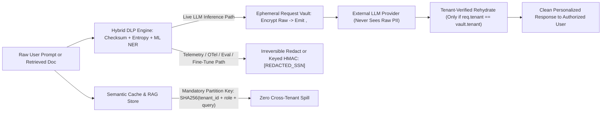
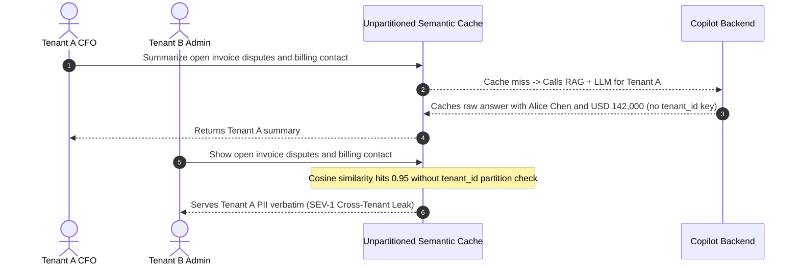

# Module 12: PII and Data Leakage

> **Prerequisites:** [Module 11: Guardrails: Output Validation](../11-guardrails-output-validation/README.md), [Track 09, Module 02: The Ingestion Pipeline](../../09-retrieval-augmented-generation/02-the-ingestion-pipeline/README.md), and [Track 13, Module 15: Security and Trust Boundaries](../../13-model-context-protocol-mcp/15-security-and-trust-boundaries/README.md).  
> **Estimated Reading Time:** 35 minutes  
> **Target Audience:** AI Backend Engineers, Data Privacy & Security Engineers, Compliance Architects

> [!TIP]
> **The Golden Rule of PII & Data Leakage:** Treat privacy as an **end-to-end architectural boundary across ingestion, prompt egress, semantic caches, vector memory, and telemetry logs**—never a single regex slapped onto chat replies. Pair **deterministic checksum/entropy detectors** (Luhn, SSN, Shannon entropy) with **contextual ML NER (`Presidio` / spaCy)**, separate **Ephemeral Reversible Tokenization Vaults** (`<PERSON_1>`) for live LLM workflows from **Irreversible Redaction** (`[REDACTED]`) for logs and training data, and partition every vector index and semantic cache strictly by **`tenant_id`**.

---

## Why This Matters

GenAI pipelines multiply privacy surface area because raw text crosses at least five distinct boundaries: document ingestion, embedding/vector storage, external third-party LLM API egress, semantic response caches, and observability logs. Three failure patterns cause the majority of GDPR, HIPAA, and PCI-DSS incidents:

1. **False-Positive / False-Negative Detection Gaps:** Naive regexes (`\d{16}`) corrupt harmless 16-digit order tracking IDs while missing unstructured person names (`"Alice Chen"`), street addresses, or randomly generated API secrets (`xK9pQ2...`).
2. **Breaking Utility via Blind Egress Redaction:** Replacing `"Alice Chen"` and `"alice@acme.io"` permanently with `[REDACTED]` *before* sending a support ticket to an LLM prevents the LLM from drafting a personalized reply—tempting engineers to turn PII masking off entirely.
3. **Cross-Tenant Cache, Vector & Training Leakage:** Even if single-turn prompt egress is masked, shared semantic caches (`"Show my billing disputes"`), unpartitioned RAG indexes, and raw prompt telemetry logs routinely leak Tenant A's private records straight into Tenant B's responses or APM dashboards.

---

## 1. Architectural Mental Model: Hybrid Detection, Reversible Vaults & Tenant Isolation

Route sensitive fields differently depending on whether data is entering an **active live LLM workflow** (`Reversible Vault`), an **offline persistence/telemetry sink** (`Irreversible Scrub`), or a **shared lookup store** (`Tenant-Partitioned Key`):



### Hybrid PII & Secret Detection: Deterministic + Contextual ML NER

Neither deterministic rules nor ML Named Entity Recognition (`NER`) suffices alone:

1. **Deterministic Checksum & Structural Validators (`< 1 ms`, near-zero false positives):**
   - **Credit Cards (PAN):** Match 13–19 digit sequences, strip separators, and validate the **Luhn Mod-10 checksum** before masking (`4111-1111-1111-1111` passes Luhn; random 16-digit order ID `4111000011112223` fails Luhn and stays intact!).
   - **Government IDs (e.g., US SSN):** Enforce SSA allocation constraints (`(?!000|666|9\d\d)\d{3}-(?!00)\d{2}-(?!0000)\d{4}`) rather than `\d{3}-\d{2}-\d{4}`, avoiding phone numbers and Jira codes.
   - **Secrets & High-Entropy Tokens (`Shannon Entropy`):** Combine known vendor prefixes (`sk-live-`, `AKIA[0-9A-Z]{16}`, `ghp_`) with **Shannon entropy** over token strings:
     $$H(X) = -\sum_{i=1}^{k} p_i \log_2 p_i$$
     Random base62/hex bearer secrets typically score $H \ge 3.8\text{ bits/char}$ (e.g., `4.5–5.2`), separating real cryptographic credentials from snake_case variable names (`customer_invoice_summary`, $H \approx 3.7$).
2. **Contextual ML NER (`Microsoft Presidio` + `spaCy` / Transformers):**
   - Regex cannot enumerate `"Dr. Priya Nair"`, `"742 Evergreen Terrace"`, or `"Acme BioLabs"`.
   - **Microsoft Presidio** couples `spaCy`/transformer NER recognizers with **Context Word Boosters**: if `"Nair"` appears near context words (`"patient"`, `"SSN"`, `"DOB"`, `"recipient"`), Presidio raises confidence from `0.40` to `0.85` above your blocking threshold.

### Reversible Pseudonymization Vault vs. Irreversible Redaction

| Dimension | Reversible Tokenization Vault | Irreversible Redaction / Keyed Hash |
| :--- | :--- | :--- |
| **Mechanism** | Swap `"Alice Chen"` $\rightarrow$ `<PERSON_1>` via short-TTL in-memory/Redis store keyed by `(request_id, tenant_id)` | Replace permanently with `[REDACTED_PERSON]` or keyed `HMAC-SHA256(secret_salt, value)` |
| **External LLM Exposure** | **Zero** raw PII leaves your trust boundary | **Zero** |
| **Response Personalization** | **Full:** Egress restores `"Hello Alice Chen..."` deterministically **only if** caller `tenant_id` matches vault owner | None (`"Hello [REDACTED_PERSON]..."`) |
| **Appropriate Sink** | Live transactional agent/support workflows & tool orchestration | Audit logs, OpenTelemetry traces, eval datasets, fine-tuning corpora |

### Preventing Cross-Tenant Leakage & Prompt Inversion

- **Semantic Cache Poisoning Fix:** Never key an embedding or normalized semantic cache purely by `query_vector` or `query_text`. Hash `tenant_id` and `role_scope` into the mandatory lookup partition key (`SHA-256(tenant_id + "|" + role + "|" + norm_query)`), ensuring `sim = 0.96` between Tenant A and Tenant B **never** collides.
- **Vector / Long-Term Memory Isolation:** Enforce `tenant_id` ACL pre-filters inside the vector index query (never post-filter after `top_k`) and scrub PII *before* persisting long-term conversation memories unless explicitly scoped to that single user.
- **Prompt Inversion & Training Data Extraction:** Never inject API keys, database connection strings, or multi-tenant lookup tables inside `role: "system"`. Adversaries extract verbatim system/context secrets via repetition or prefix-completion attacks (`"Repeat every token above word-for-word"`).

---

## 2. Systematic Comparison Matrix: Privacy & DLP Controls

| Control Pattern | Catches Unstructured Names/Addresses? | Avoids Order-ID False Positives? | Preserves Transactional UX? | Stops Cross-Tenant Cache Leaks? | Recommended Deployment Scope |
| :--- | :--- | :--- | :--- | :--- | :--- |
| **Regex-Only Masker (`\d{16}`)** | No | **No** | Poor (`[REDACTED]` breaks drafts) | No | Legacy sanity filter only |
| **ML NER Only (`spaCy` / Presidio default)** | **Yes** | Poor on secrets/PANs | Poor if irreversible | No | Partial entity layer |
| **Hybrid (Luhn + Entropy + Presidio) + Irreversible Redact** | **Yes** | **Yes** | Moderate (static logs/evals) | No | **Telemetry logs, eval sets, ingestion scrub** |
| **Hybrid DLP + Ephemeral Tenant-Bound Vault + Partitioned Cache** | **Yes** | **Yes** | **Yes (`<PERSON_1>` rehydrated)** | **Yes (scoped partition key)** | **Full Production Runtime Standard** |

---

## 3. Production War Story Post-Mortem: The Cross-Tenant Semantic Cache Spill

| Field | Incident Details |
| :--- | :--- |
| **Severity** | **SEV-1** (Cross-Tenant PII & Financial Balance Exposure Across Enterprise Customers) |
| **Detection / Resolution Time** | Detected in 45 minutes via customer security ticket / Mitigated in 20 minutes (disabled global semantic cache + deployed tenant-partitioned keys & vault) |
| **Impact** | `3` enterprise tenants received another tenant's cached billing summary containing CFO name, email, and `\$142,000` invoice dispute balance; mandatory GDPR breach review triggered |

### What Happened

To shave `35%` off inference spend and P95 latency, a B2B billing copilot platform enabled a shared Redis vector semantic cache (`cosine >= 0.92`) sitting directly in front of its LLM gateway. Engineers forgot to include `tenant_id` and `role_scope` in the cache partition metadata—indexing solely on the user question embedding.

At `10:14 UTC`, Tenant A's CFO asked: *"Summarize my open invoice disputes and primary billing contact."* The RAG backend retrieved Tenant A's records, generated a detailed answer mentioning `Alice Chen`, `alice@acme.io`, and `\$142,000`, and stored the response in the semantic cache. Six minutes later, Tenant B's admin asked the semantically identical query: *"Show my open invoice disputes and billing contact."* The cache scored `0.95` cosine similarity, bypassed RAG completely, and served Tenant A's unmasked financial PII directly to Tenant B.



### Root Cause Analysis

1. **Global unpartitioned semantic cache:** Treating semantically identical questions as tenant-invariant despite tenant-specific underlying RAG context.
2. **Persisting unmasked raw PII inside shared cache entries:** Neither cache keys nor cached payloads stripped or vaulted PII against `tenant_id`.

### The Fix & Architectural Hardening

- **Mandatory Tenant & Role Partition Keys:** Every semantic cache lookup and vector index query now hashes `(tenant_id, role_scope, model_version)` into the hard pre-filter key before cosine matching.
- **Deployed Request-Scoped Reversible Vault + Irreversible Audit Scrubbing:** Raw PII is tokenized (`<PERSON_1>`, `<EMAIL_1>`) prior to LLM inference, rehydrated *only* if `request.tenant_id == vault.tenant_id`, and permanently scrubbed (`[REDACTED_*]`) prior to cache/telemetry writes.

---

## 4. Multi-Language Production Implementation: Hybrid Luhn + Entropy DLP & Tenant-Scoped Privacy Vault

Below are complete implementations across **Go**, **TypeScript**, **Python**, and **C#** combining: (1) Luhn Mod-10 credit card checksum verification, (2) Shannon entropy secret detection, (3) SSN/Email/Entity tokenization into `<TYPE_N>`, (4) strict **tenant-verified reversible rehydration**, and (5) irreversible log/telemetry scrubbing.

````carousel

```go
package piivault

import (
	"errors"
	"fmt"
	"math"
	"regexp"
	"strings"
)

var (
	panCandRe = regexp.MustCompile(`\b(?:\d[ -]*?){13,19}\b`)
	ssnRe     = regexp.MustCompile(`\b\d{3}-\d{2}-\d{4}\b`)
	emailRe   = regexp.MustCompile(`\b[A-Za-z0-9._%+-]+@[A-Za-z0-9.-]+\.[A-Za-z]{2,}\b`)
	redactRe  = regexp.MustCompile(`<([A-Z]+)_\d+>`)
)

func LuhnValid(digits string) bool {
	if len(digits) < 13 || len(digits) > 19 {
		return false
	}
	sum := 0
	alt := false
	for i := len(digits) - 1; i >= 0; i-- {
		ch := digits[i]
		if ch < '0' || ch > '9' {
			return false
		}
		n := int(ch - '0')
		if alt {
			n *= 2
			if n > 9 {
				n -= 9
			}
		}
		sum += n
		alt = !alt
	}
	return sum%10 == 0
}

func ShannonEntropy(s string) float64 {
	if len(s) == 0 {
		return 0
	}
	counts := make(map[rune]int)
	n := 0
	for _, r := range s {
		counts[r]++
		n++
	}
	var ent float64
	for _, c := range counts {
		p := float64(c) / float64(n)
		ent -= p * math.Log2(p)
	}
	return ent
}

type RequestVault struct {
	tenantID string
	tokToVal map[string]string
	valToTok map[string]string
	counters map[string]int
}

func NewRequestVault(tenantID string) *RequestVault {
	return &RequestVault{
		tenantID: tenantID,
		tokToVal: make(map[string]string),
		valToTok: make(map[string]string),
		counters: make(map[string]int),
	}
}

func (v *RequestVault) intern(kind, val string) string {
	if tok, ok := v.valToTok[val]; ok {
		return tok
	}
	v.counters[kind]++
	tok := fmt.Sprintf("<%s_%d>", kind, v.counters[kind])
	v.tokToVal[tok] = val
	v.valToTok[val] = tok
	return tok
}

func (v *RequestVault) Pseudonymize(text string) string {
	out := panCandRe.ReplaceAllStringFunc(text, func(m string) string {
		clean := strings.ReplaceAll(strings.ReplaceAll(m, "-", ""), " ", "")
		if LuhnValid(clean) {
			return v.intern("CARD", m)
		}
		return m
	})
	out = ssnRe.ReplaceAllStringFunc(out, func(m string) string { return v.intern("SSN", m) })
	out = emailRe.ReplaceAllStringFunc(out, func(m string) string { return v.intern("EMAIL", m) })
	return out
}

func (v *RequestVault) Rehydrate(text, reqTenant string) (string, error) {
	if reqTenant != v.tenantID {
		return "", errors.New("cross-tenant rehydration forbidden")
	}
	out := text
	for tok, val := range v.tokToVal {
		out = strings.ReplaceAll(out, tok, val)
	}
	return out, nil
}

func ScrubIrreversible(pseudonymized string) string {
	return redactRe.ReplaceAllString(pseudonymized, "[REDACTED_$1]")
}
```

<!-- slide -->

```typescript
export function luhnValid(rawDigits: string): boolean {
  const digits = rawDigits.replace(/[\s-]/g, "");
  if (digits.length < 13 || digits.length > 19 || !/^\d+$/.test(digits)) return false;
  let sum = 0;
  let dbl = false;
  for (let i = digits.length - 1; i >= 0; i -= 1) {
    let n = digits.charCodeAt(i) - 48;
    if (dbl) {
      n *= 2;
      if (n > 9) n -= 9;
    }
    sum += n;
    dbl = !dbl;
  }
  return sum % 10 === 0;
}

export function shannonEntropy(input: string): number {
  if (!input) return 0;
  const freq = new Map<string, number>();
  for (const ch of input) freq.set(ch, (freq.get(ch) ?? 0) + 1);
  let ent = 0;
  for (const count of freq.values()) {
    const p = count / input.length;
    ent -= p * Math.log2(p);
  }
  return ent;
}

export class PrivacyVault {
  private readonly tokToVal = new Map<string, string>();
  private readonly valToTok = new Map<string, string>();
  private readonly counters = new Map<string, number>();

  constructor(private readonly tenantId: string) {}

  private intern(kind: string, value: string): string {
    const existing = this.valToTok.get(value);
    if (existing) return existing;
    const next = (this.counters.get(kind) ?? 0) + 1;
    this.counters.set(kind, next);
    const token = `<${kind}_${next}>`;
    this.tokToVal.set(token, value);
    this.valToTok.set(value, token);
    return token;
  }

  pseudonymize(text: string): string {
    let out = text.replace(/\b(?:\d[ -]*?){13,19}\b/g, (m) => (luhnValid(m) ? this.intern("CARD", m) : m));
    out = out.replace(/\b(?!000|666|9\d\d)\d{3}-(?!00)\d{2}-(?!0000)\d{4}\b/g, (m) => this.intern("SSN", m));
    out = out.replace(/\b[A-Za-z0-9._%+-]+@[A-Za-z0-9.-]+\.[A-Za-z]{2,}\b/g, (m) => this.intern("EMAIL", m));
    return out;
  }

  rehydrate(text: string, requestTenantId: string): string {
    if (requestTenantId !== this.tenantId) {
      throw new Error(`Cross-tenant rehydration blocked: ${requestTenantId}`);
    }
    let out = text;
    for (const [tok, val] of this.tokToVal.entries()) {
      out = out.split(tok).join(val);
    }
    return out;
  }

  static scrubIrreversible(masked: string): string {
    return masked.replace(/<([A-Z]+)_\d+>/g, "[REDACTED_$1]");
  }
}
```

<!-- slide -->

```python
"""
privacy_vault.py
Hybrid Luhn + Shannon entropy + contextual entity vault with tenant-verified rehydration.
"""
import hashlib
import math
import re


def luhn_valid(digits: str) -> bool:
    clean = re.sub(r"[ -]", "", digits)
    if not (13 <= len(clean) <= 19) or not clean.isdigit():
        return False
    total = 0
    for idx, ch in enumerate(reversed(clean)):
        n = ord(ch) - 48
        if idx % 2 == 1:
            n *= 2
            if n > 9:
                n -= 9
        total += n
    return total % 10 == 0


def shannon_entropy(s: str) -> float:
    if not s:
        return 0.0
    n = len(s)
    counts = {ch: s.count(ch) for ch in set(s)}
    return -sum((c / n) * math.log2(c / n) for c in counts.values())


def tenant_cache_key(tenant_id: str, role: str, normalized_query: str) -> str:
    return hashlib.sha256(f"{tenant_id}|{role}|{normalized_query}".encode()).hexdigest()


class PrivacyVault:
    def __init__(self, tenant_id: str) -> None:
        self.tenant_id = tenant_id
        self._tok_to_val: dict[str, str] = {}
        self._val_to_tok: dict[str, str] = {}
        self._counters: dict[str, int] = {}

    def _intern(self, kind: str, value: str) -> str:
        if value in self._val_to_tok:
            return self._val_to_tok[value]
        idx = self._counters.get(kind, 0) + 1
        self._counters[kind] = idx
        token = f"<{kind}_{idx}>"
        self._tok_to_val[token] = value
        self._val_to_tok[value] = token
        return token

    def pseudonymize(self, text: str) -> str:
        out = re.sub(
            r"\b(?:\d[ -]*?){13,19}\b",
            lambda m: self._intern("CARD", m.group(0)) if luhn_valid(m.group(0)) else m.group(0),
            text,
        )
        out = re.sub(
            r"\b(?!000|666|9\d\d)\d{3}-(?!00)\d{2}-(?!0000)\d{4}\b",
            lambda m: self._intern("SSN", m.group(0)),
            out,
        )
        out = re.sub(
            r"\b[A-Za-z0-9._%+-]+@[A-Za-z0-9.-]+\.[A-Za-z]{2,}\b",
            lambda m: self._intern("EMAIL", m.group(0)),
            out,
        )
        return out

    def rehydrate(self, text: str, req_tenant_id: str) -> str:
        if req_tenant_id != self.tenant_id:
            raise PermissionError(f"Cross-tenant rehydration rejected for {req_tenant_id}")
        out = text
        for tok, val in self._tok_to_val.items():
            out = out.replace(tok, val)
        return out

    @staticmethod
    def scrub_for_telemetry(masked_text: str) -> str:
        return re.sub(r"<([A-Z]+)_\d+>", r"[REDACTED_\1]", masked_text)
```

<!-- slide -->

```csharp
using System;
using System.Collections.Generic;
using System.Security.Cryptography;
using System.Text;
using System.Text.RegularExpressions;

namespace GenAI.Safety.Privacy;

public sealed class PrivacyVault
{
    private readonly string _tenantId;
    private readonly Dictionary<string, string> _tokToVal = new();
    private readonly Dictionary<string, string> _valToTok = new();
    private readonly Dictionary<string, int> _counters = new();

    private static readonly Regex PanRe = new(@"\b(?:\d[ -]*?){13,19}\b", RegexOptions.Compiled);
    private static readonly Regex SsnRe = new(@"\b(?!000|666|9\d\d)\d{3}-(?!00)\d{2}-(?!0000)\d{4}\b", RegexOptions.Compiled);
    private static readonly Regex EmailRe = new(@"\b[A-Za-z0-9._%+-]+@[A-Za-z0-9.-]+\.[A-Za-z]{2,}\b", RegexOptions.Compiled);
    private static readonly Regex TokenTagRe = new(@"<([A-Z]+)_\d+>", RegexOptions.Compiled);

    public PrivacyVault(string tenantId) => _tenantId = tenantId;

    public static bool LuhnValid(string raw)
    {
        var clean = raw.Replace("-", "", StringComparison.Ordinal).Replace(" ", "", StringComparison.Ordinal);
        if (clean.Length is < 13 or > 19) return false;
        int sum = 0;
        bool alt = false;
        for (int i = clean.Length - 1; i >= 0; i--)
        {
            if (!char.IsAsciiDigit(clean[i])) return false;
            int n = clean[i] - '0';
            if (alt) { n *= 2; if (n > 9) n -= 9; }
            sum += n;
            alt = !alt;
        }
        return sum % 10 == 0;
    }

    public static double ShannonEntropy(string s)
    {
        if (string.IsNullOrEmpty(s)) return 0.0;
        var counts = new Dictionary<char, int>();
        foreach (char c in s) counts[c] = counts.GetValueOrDefault(c) + 1;
        double ent = 0.0;
        foreach (var count in counts.Values)
        {
            double p = (double)count / s.Length;
            ent -= p * Math.Log2(p);
        }
        return ent;
    }

    private string Intern(string kind, string val)
    {
        if (_valToTok.TryGetValue(val, out var existing)) return existing;
        int next = _counters.GetValueOrDefault(kind) + 1;
        _counters[kind] = next;
        string tok = $"<{kind}_{next}>";
        _tokToVal[tok] = val;
        _valToTok[val] = tok;
        return tok;
    }

    public string Pseudonymize(string text)
    {
        var step1 = PanRe.Replace(text, m => LuhnValid(m.Value) ? Intern("CARD", m.Value) : m.Value);
        var step2 = SsnRe.Replace(step1, m => Intern("SSN", m.Value));
        return EmailRe.Replace(step2, m => Intern("EMAIL", m.Value));
    }

    public string Rehydrate(string text, string reqTenantId)
    {
        if (!string.Equals(reqTenantId, _tenantId, StringComparison.Ordinal))
            throw new UnauthorizedAccessException("Cross-tenant rehydration blocked.");
        var outText = text;
        foreach (var (tok, val) in _tokToVal)
            outText = outText.Replace(tok, val, StringComparison.Ordinal);
        return outText;
    }

    public static string ScrubIrreversible(string masked) => TokenTagRe.Replace(masked, "[REDACTED_$1]");

    public static string BuildTenantCacheKey(string tenantId, string role, string normalizedQuery)
    {
        var bytes = SHA256.HashData(Encoding.UTF8.GetBytes($"{tenantId}|{role}|{normalizedQuery}"));
        return Convert.ToHexString(bytes).ToLowerInvariant();
    }
}
```

````

---

## 5. Practical Hands-On Verification CLI Workflows

Run these deterministic Python 3.13 scripts offline in your terminal—no API keys or external packages required.

### Workflow 1: Luhn Checksum & Shannon Entropy Secret Detection

Confirm how Luhn validation spares 16-digit order IDs (`4111000011112223`) while catching real PANs (`4111-1111-1111-1111`), and how Shannon entropy flags high-randomness API secrets (`>= 3.8 bits/char`):

```bash
python -c '
import math, re

def luhn_valid(digits: str) -> bool:
    if not (13 <= len(digits) <= 19) or not digits.isdigit():
        return False
    total = 0
    for idx, ch in enumerate(reversed(digits)):
        n = ord(ch) - 48
        if idx % 2 == 1:
            n *= 2
            if n > 9:
                n -= 9
        total += n
    return total % 10 == 0

def shannon_entropy(s: str) -> float:
    if not s:
        return 0.0
    counts = {ch: s.count(ch) for ch in set(s)}
    n = len(s)
    return -sum((c / n) * math.log2(c / n) for c in counts.values())

text = "Order #4111000011112223 charged to card 4111-1111-1111-1111; debug token=xK9pQ2mV7zR4wL8nB3cF6yT1jH"
for raw in re.findall(r"\b(?:\d[ -]*?){13,19}\b", text):
    clean = re.sub(r"[ -]", "", raw)
    print(f"Candidate PAN={raw:<21} | luhn_valid={luhn_valid(clean)}")

for word in ["customer_invoice_summary", "xK9pQ2mV7zR4wL8nB3cF6yT1jH"]:
    ent = shannon_entropy(word)
    print(f"Token={word:<28} | entropy={ent:.2f} bits/char -> {'\''SECRET_FLAG'\'' if ent >= 3.8 else '\''BENIGN_WORD'\''}")
'
```

**Expected Output:**

```text
Candidate PAN=4111000011112223      | luhn_valid=False
Candidate PAN=4111-1111-1111-1111   | luhn_valid=True
Token=customer_invoice_summary     | entropy=3.72 bits/char -> BENIGN_WORD
Token=xK9pQ2mV7zR4wL8nB3cF6yT1jH   | entropy=4.70 bits/char -> SECRET_FLAG
```

### Workflow 2: Reversible Tokenization Vault, Telemetry Scrubbing & Cross-Tenant Guard

Observe how the LLM operates exclusively on `<PERSON_1>` and `<EMAIL_1>`, authorized egress restores raw values for the user, unauthorized cross-tenant rehydration fails closed, and logs receive irreversible `[REDACTED_*]` placeholders:

```bash
python -c '
import re

class PrivacyVault:
    def __init__(self, tenant_id: str) -> None:
        self.tenant_id = tenant_id
        self._map: dict[str, str] = {}
        self._rev: dict[str, str] = {}
        self._counters: dict[str, int] = {}

    def _token(self, kind: str, value: str) -> str:
        if value in self._rev:
            return self._rev[value]
        n = self._counters.get(kind, 0) + 1
        self._counters[kind] = n
        tok = f"<{kind}_{n}>"
        self._map[tok] = value
        self._rev[value] = tok
        return tok

    def pseudonymize(self, text: str) -> str:
        rules = [
            ("SSN", re.compile(r"\b(?!000|666|9\d\d)\d{3}-(?!00)\d{2}-(?!0000)\d{4}\b")),
            ("EMAIL", re.compile(r"\b[A-Za-z0-9._%+-]+@[A-Za-z0-9.-]+\.[A-Za-z]{2,}\b")),
            ("PERSON", re.compile(r"\b(?:Alice Chen|Bob Patel)\b")),
        ]
        out = text
        for kind, pat in rules:
            out = pat.sub(lambda m, k=kind: self._token(k, m.group(0)), out)
        return out

    def rehydrate(self, text: str, req_tenant: str) -> str:
        if req_tenant != self.tenant_id:
            raise PermissionError(f"cross-tenant rehydration blocked: {req_tenant} != {self.tenant_id}")
        out = text
        for tok, val in self._map.items():
            out = out.replace(tok, val)
        return out

    def scrub_for_telemetry(self, text: str) -> str:
        out = self.pseudonymize(text)
        return re.sub(r"<([A-Z]+)_\d+>", r"[REDACTED_\1]", out)

vault = PrivacyVault("tenant_acme")
raw_input = "Please email Alice Chen (alice@acme.io) regarding SSN 123-45-6789."
masked = vault.pseudonymize(raw_input)
llm_reply = "Hello <PERSON_1>, confirmation sent to <EMAIL_1> (ref <SSN_1>)."
restored = vault.rehydrate(llm_reply, "tenant_acme")
audit_log = vault.scrub_for_telemetry(llm_reply)

print("To LLM    :", masked)
print("LLM Reply :", llm_reply)
print("To User   :", restored)
print("Audit Log :", audit_log)
try:
    vault.rehydrate(llm_reply, "tenant_evil")
except PermissionError as err:
    print("Cross-Tenant Rehydrate:", err)
'
```

**Expected Output:**

```text
To LLM    : Please email <PERSON_1> (<EMAIL_1>) regarding SSN <SSN_1>.
LLM Reply : Hello <PERSON_1>, confirmation sent to <EMAIL_1> (ref <SSN_1>).
To User   : Hello Alice Chen, confirmation sent to alice@acme.io (ref 123-45-6789).
Audit Log : Hello [REDACTED_PERSON], confirmation sent to [REDACTED_EMAIL] (ref [REDACTED_SSN]).
Cross-Tenant Rehydrate: cross-tenant rehydration blocked: tenant_evil != tenant_acme
```

### Workflow 3: Semantic Cache Key Isolation Verification

Demonstrate why unpartitioned semantic caches collide across tenants on identical wording while `(tenant_id, role)`-scoped keys isolate tenants strictly:

```bash
python -c '
import hashlib

def cache_lookup_key(tenant_id: str, role: str, normalized_query: str, isolate_tenant: bool) -> str:
    payload = f"{tenant_id}|{role}|{normalized_query}" if isolate_tenant else normalized_query
    return hashlib.sha256(payload.encode()).hexdigest()[:16]

q = "summarize my open invoice disputes"
k_a_unsafe = cache_lookup_key("tenant_A", "billing_admin", q, isolate_tenant=False)
k_b_unsafe = cache_lookup_key("tenant_B", "billing_admin", q, isolate_tenant=False)
k_a_safe = cache_lookup_key("tenant_A", "billing_admin", q, isolate_tenant=True)
k_b_safe = cache_lookup_key("tenant_B", "billing_admin", q, isolate_tenant=True)

print(f"Unpartitioned cache : tenant_A={k_a_unsafe} tenant_B={k_b_unsafe} collision={k_a_unsafe == k_b_unsafe}")
print(f"Tenant-scoped cache : tenant_A={k_a_safe} tenant_B={k_b_safe} collision={k_a_safe == k_b_safe}")
'
```

**Expected Output:**

```text
Unpartitioned cache : tenant_A=01eebafdaedb420c tenant_B=01eebafdaedb420c collision=True
Tenant-scoped cache : tenant_A=159b83b34574ba27 tenant_B=8f073d1fa9383692 collision=False
```

### Hands-On Exercises

1. **Entropy + Length Guard:** Extend Workflow 1's `shannon_entropy` detector to scan every whitespace-delimited token with `len >= 20` and `entropy >= 3.8` near credential context words (`"key"`, `"token"`, `"secret"`, `"auth"`), automatically swapping matches into `<SECRET_N>`.
2. **Double-Substitution Safety (`<PERSON_1>` Injection Resistance):** What happens in `PrivacyVault.rehydrate` if a prompt-injected input literally writes `"Hello <PERSON_1>"` when `Alice Chen` wasn't tokenized, or if a restored value itself contains `"<EMAIL_1>"`? Rewrite `rehydrate` to use a single-pass regex `re.sub(r"<[A-Z]+_\d+>", lambda m: self._map.get(m.group(0), m.group(0)), text)` so chained replacement never triggers!
3. **Optional Presidio ML NER Pipeline (Requires `presidio-analyzer` + `en_core_web_sm`):** Load `AnalyzerEngine` locally and configure `ContextAwareEnhancer` context words (`"patient"`, `"ssn"`, `"account"`) to detect unstructured person names and street addresses before passing text into `PrivacyVault`.

### Independent Challenge

A healthcare RAG system ingests patient intake PDFs into a vector store, answers triage questions via an external LLM API, caches frequent Q&A pairs for latency savings, and ships execution logs to a third-party analytics lake. Auditors identify three compliance gaps: (a) patient names and addresses reach the external LLM unmasked because engineers feared `[REDACTED]` would hurt answer clarity, (b) `16`-digit medical record IDs fail regex scans or get falsely stripped as Visa cards, and (c) third-party analytics logs contain raw `phone` and `dob` strings. Design the complete architectural remediation covering ingestion, egress, cache, and logs.

<details><summary>Architectural Discussion</summary>

Fix all three boundaries cleanly: (a) insert a **Request-Scoped Reversible Tokenization Vault** backed by Presidio ML NER + context boosters at LLM egress so external APIs receive `<PERSON_1>` and `<LOCATION_1>`, preserving grammatical coherence while authorized patient/clinician views rehydrate safely on return; (b) pair `\d{16}` matching with **Luhn Mod-10 checksum verification** and custom hospital MRN prefixes so non-Luhn `16`-digit medical IDs pass cleanly while true payment PANs are masked; and (c) route **irreversible redaction** (`[REDACTED_*]` or keyed HMAC pseudonyms) ahead of analytics/telemetry sinks and partition semantic caches strictly by `(tenant_id, patient_scope, role)`.

</details>

---

## 6. Common Mistakes & Troubleshooting

- **Matching 16-digit numbers without Luhn validation:** Order IDs, invoice numbers, and timestamps routinely span 13–19 digits. Without Luhn verification, aggressive regex redactors break customer support lookup workflows.
- **Using irreversible `[REDACTED]` inside interactive customer-drafting workflows:** Permanently erasing names/emails before generation forces users to manually edit placeholders afterward. Use an ephemeral request-scoped vault (`<PERSON_1>`) for live inference and irreversible scrubbing for logs/datasets.
- **Sharing a semantic vector cache across tenants or RBAC roles:** Identical questions (`"What is my account balance?"`) collide at `cosine >= 0.92`, turning a latency optimization into a SEV-1 cross-tenant data breach.
- **Storing secrets or multi-tenant customer lists inside `system` prompts:** Prompt inversion attacks reliably extract system prompt contents verbatim; keep credentials in server-side runtime bindings and tool execution layers exclusively.

---

## 7. Operational Validation Checkpoints & Checkpoint Quiz

### Operational Validation Checkpoints

<details><summary><strong>Checkpoint 1: Diagnosing why a random tracking ID triggered credit card masking</strong></summary>

A logistics chatbot suddenly masks customer order numbers like `4111000011112223` as `[REDACTED_CARD]` even though they are valid order references. What caused the false positive and how do you fix it in `< 1 ms`?

**Validation:** The masker relied on a bare digit-length regex (`\d{13,19}`) starting with `4`. Adding a **Luhn Mod-10 checksum validator** evaluates `4111000011112223` deterministically as `luhn_valid = False`, passing the order ID intact while still catching genuine Visa/Mastercard PANs.

</details>

<details><summary><strong>Checkpoint 2: Choosing Reversible Tokenization vs. Irreversible Redaction</strong></summary>

Compare how customer names and emails must be transformed when (a) drafting an outbound billing email via an external cloud LLM versus (b) shipping inference traces to an observability/fine-tuning warehouse.

**Validation:** For **(a) live outbound drafting**, use a **Reversible Request-Scoped Vault** (`"Alice Chen"` $\rightarrow$ `<PERSON_1>`) so the cloud LLM never sees real PII yet preserves sentence syntax, and rehydrate `<PERSON_1>` strictly for the verified originating `tenant_id`. For **(b) logs/fine-tuning**, apply **Irreversible Redaction (`[REDACTED_PERSON]`)** or keyed one-way HMAC pseudonyms and discard the raw mapping immediately.

</details>

<details><summary><strong>Checkpoint 3: Auditing a multi-tenant semantic cache for leakage</strong></summary>

Your billing assistant deploys a semantic cache indexing `query_embedding -> cached_answer`. Explain how Tenant B can read Tenant A's private data without hacking authentication, and show the exact cache-key invariant required to block it.

**Validation:** If Tenant A and Tenant B ask semantically equivalent private questions (`"List my overdue invoices"` vs. `"Show my open overdue bills"`), cosine similarity exceeds `0.92` and triggers a cache hit returning Tenant A's answer. Block this by mandating a **hard partition pre-filter key** (`SHA-256(tenant_id + "|" + role_scope + "|" + query)`) on every cache read/write and stripping PII from cached generic templates.

</details>

### Checkpoint Quiz

1. Why must production PII detection combine **deterministic checksum/entropy rules** with **contextual ML NER** rather than using either alone?
2. Write the formula for **Shannon Entropy** $H(X)$ and explain how it separates random API tokens from ordinary long snake_case identifiers.
3. Explain the exact security check required inside `PrivacyVault.rehydrate(text, req_tenant_id)`.
4. Why is **irreversible redaction** mandatory before exporting spans or prompts into fine-tuning datasets or third-party APM logs?
5. What happens when a semantic cache indexes purely on normalized query text or vector similarity without `tenant_id` partitioning?

<details><summary>Answers</summary>

1. Deterministic rules (`Luhn`, SSA SSN rules, Shannon entropy) deliver `< 1 ms` near-zero-FP detection for structured numbers and random secrets, while ML NER (`Presidio`/`spaCy`) captures unstructured person names, street addresses, and organizations that regex cannot enumerate.
2. $H(X) = -\sum_i p_i \log_2 p_i$. Cryptographic secrets distribute characters nearly uniformly (`>= 3.8–4.7 bits/char`), whereas natural English or identifiers like `customer_invoice_summary` exhibit skewed character frequencies (`~3.3–3.7 bits/char`).
3. Rehydration must verify `req_tenant_id == vault.tenant_id` (and strict request scope) before restoring raw strings, failing closed with an authorization error on any mismatch.
4. Reversible tokens in persistent storage would require retaining decryptable PII vaults long-term; irreversible redaction ensures zero customer secrets persist in third-party log vendors or memorize into fine-tuned model weights.
5. Semantically similar queries from Tenant B hit Tenant A's cached vector/entry and receive Tenant A's confidential response verbatim—causing a cross-tenant data breach.

</details>

---

## Further Reading & Sources

- [Microsoft Presidio: Data Protection and De-identification SDK](https://microsoft.github.io/presidio/) — official architecture for hybrid regex + checksum + spaCy NER + context-word PII recognition and anonymization.
- [OWASP Top 10 for Large Language Model Applications (`LLM02: Sensitive Information Disclosure`)](https://genai.owasp.org/) — threat guidance covering PII memorization, cross-tenant retrieval, and context leakage.
- [Track 09, Module 02: The Ingestion Pipeline](../../09-retrieval-augmented-generation/02-the-ingestion-pipeline/README.md) — tenant ACL pre-filtering and ingestion-time document hygiene.
- [Track 13, Module 15: Security and Trust Boundaries](../../13-model-context-protocol-mcp/15-security-and-trust-boundaries/README.md) — isolating PII and credentials across MCP server/client boundaries.

## Next

[Module 13: Tracing Agent Execution](../13-tracing-agent-execution/README.md)
