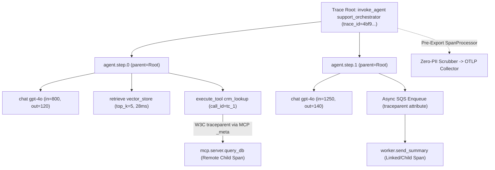
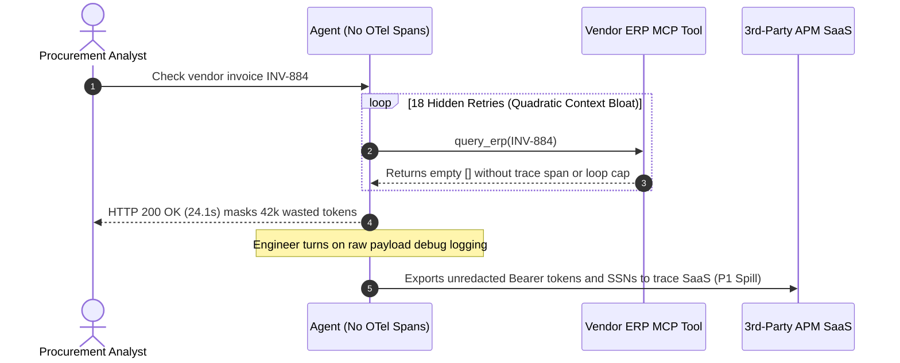

# Module 13: Tracing Agent Execution

> **Prerequisites:** [Module 12: PII and Data Leakage](../12-pii-and-data-leakage/README.md), [Track 10, Module 15: Agent Failure Modes and Debugging](../../10-ai-agents/15-agent-failure-modes-and-debugging/README.md), and [Track 13, Module 04: The Protocol — JSON-RPC Foundations](../../13-model-context-protocol-mcp/04-the-protocol-json-rpc-foundations/README.md).  
> **Estimated Reading Time:** 35 minutes  
> **Target Audience:** AI Backend Engineers, Distributed Systems & Observability Engineers, Agent Platform Architects

> [!TIP]
> **The Golden Rule of Agent Tracing:** Never debug multi-step AI agents using flat HTTP logs or isolated single-request latency numbers—agent trajectories are **non-linear DAGs and bounded retry loops** spanning LLM calls, retrievers, async worker queues, and MCP servers. Instrument every boundary with **OpenTelemetry GenAI Semantic Conventions (`gen_ai.*`)**, propagate **W3C `traceparent`** across every network, queue, and JSON-RPC hop, and **scrub PII/secrets inside a pre-export `SpanProcessor`** before telemetry leaves your trust boundary.

---

## Why This Matters

In single-turn RAG, one API request maps `1:1` to one retrieval query and one LLM inference call. In autonomous agents (ReAct loops, LangGraph workflows, multi-agent supervisors, or MCP tool orchestrators), a single user prompt routinely fans out into `6–15` reasoning turns, `4` parallel retriever queries, `8` tool calls (with retries), and asynchronous sub-agent tasks lasting `15+` seconds.

Without causal distributed tracing:
- Flat access logs show only `POST /agent/run -> 200 OK (18.4s)`—hiding whether latency exploded due to step-by-step **quadratic context bloat**, a hanging external tool, or an infinite retry loop calling the exact same tool parameters `5` times.
- Crossing an asynchronous worker queue (`SQS`/`Kafka`) or an **MCP JSON-RPC** server boundary breaks trace continuity unless **W3C `traceparent`** travels explicitly inside headers, message attributes, or JSON-RPC `_meta`.
- Turning on naive debug logging captures raw `Authorization: Bearer ...` headers, SSNs, and API keys inside APM trace attributes, turning observability itself into a `P1` data breach.

---

## 1. Architectural Mental Model: From Agent Loops to OpenTelemetry Span Trees

Every agent execution maps cleanly onto a causal **Trace → Agent Root Span → Step Spans → Child Operation Spans (`chat`, `retrieve`, `execute_tool`)**, bridged across process boundaries via W3C `traceparent`:



### Canonical OpenTelemetry GenAI Semantic Conventions (`gen_ai.*`)

Using vendor-neutral OpenTelemetry GenAI semantic conventions allows any OTLP-compatible backend (Jaeger, Honeycomb, Datadog, Arize Phoenix, Langfuse, Grafana Tempo) to compute latency, cost, and error breakdowns consistently:

| Attribute Key | Span Type | Example Value | Engineering Purpose |
| :--- | :--- | :--- | :--- |
| **`gen_ai.operation.name`** | All GenAI spans | `"invoke_agent"`, `"chat"`, `"embeddings"`, `"execute_tool"` | Standardized operation classification across providers |
| **`gen_ai.provider.name`** *(legacy: `gen_ai.system`)* | LLM / Agent | `"openai"`, `"anthropic"`, `"vllm"` | Vendor-neutral model backend attribution |
| **`gen_ai.request.model`** | LLM (`chat`) | `"gpt-4o"`, `"claude-sonnet-4"` | Tracks exact routing and model-version drift |
| **`gen_ai.usage.input_tokens`** | LLM (`chat`) | `1250` | Exposes step-level prompt prefill growth |
| **`gen_ai.usage.output_tokens`** | LLM (`chat`) | `140` | Measures decode verbosity and cost drivers |
| **`gen_ai.response.finish_reasons`** | LLM (`chat`) | `["tool_calls"]`, `["stop"]`, `["length"]` | Flags unexpected `length` truncation or tool stalls |
| **`gen_ai.tool.name` / `gen_ai.tool.call.id`** | Tool (`execute_tool`) | `"crm_lookup"` / `"call_91a"` | Links tool executions back to exact LLM decisions |
| **`gen_ai.agent.id` / `agent.step_index`** | Agent / Step | `"support_v2"` / `2` | Detects step explosion and duplicate-call loops |

### Propagating W3C `traceparent` Across Async Queues & MCP Boundaries

Under the **W3C Trace Context Specification**, every cross-process hop carries an immutable `traceparent` header formatted as:

`00-<32-hex-trace_id>-<16-hex-parent_span_id>-<2-hex-flags>`

Example: `00-4bf92f3577b34da6a3ce929d0e0e4736-33c344dd55ee66ff-01`

- **HTTP / gRPC Microservices:** Inject `traceparent` into outbound HTTP request headers.
- **Async Queues (`SQS`, `Kafka`, `RabbitMQ`):** Serialize `traceparent` into message metadata/headers when publishing; extract it in the consumer to create either a child span or an OTel **Span Link** (for batched multi-message workers).
- **Model Context Protocol (`MCP` JSON-RPC):** Inject `traceparent` inside JSON-RPC `params._meta.traceparent` ([Track 13, Module 04](../../13-model-context-protocol-mcp/04-the-protocol-json-rpc-foundations/README.md)), allowing remote `stdio` or Streamable HTTP MCP tool servers to attach their DB/API spans cleanly underneath the caller's `execute_tool` span!

### Quantitative Mechanics: The Quadratic Token Growth Trap Across Agent Steps

Why does a `6`-step agent burn far more tokens than `6` independent queries? Because at step $t \in \{0, \dots, T-1\}$, the prompt typically appends previous thoughts, tool invocations, and tool results ($\Delta_{\text{step}}$ tokens per turn) onto initial prompt size $P_0$:

$$\text{Tokens}_{\text{in}}(t) = P_0 + t \cdot \Delta_{\text{step}}, \qquad \text{Total Input Tokens} = \sum_{t=0}^{T-1} (P_0 + t \cdot \Delta_{\text{step}}) = T \cdot P_0 + \frac{T(T-1)}{2}\Delta_{\text{step}}$$

Notice the $\frac{T(T-1)}{2} \Delta_{\text{step}}$ **quadratic term**: when $P_0 = 800$ and $\Delta_{\text{step}} = 450$, `6` steps consume `11,550` input tokens (`2.4x` naive linear expectation!), and `12` looping steps burn `39,300` input tokens. Emitting `gen_ai.usage.input_tokens` on *every* step span pinpoints immediately which bloated tool output or retry loop blew your budget.

### Safe Flight-Recorder Capture (Zero-PII Telemetry Pipeline)

Never export raw `gen_ai.input.messages` or `gen_ai.tool.call.arguments` straight to external APM platforms unless strictly gated by a **pre-export PII-Scrubbing `SpanProcessor`** ([Module 12](../12-pii-and-data-leakage/README.md)):
1. **Default Safe Mode (Zero Raw Text):** Emit structural metrics (`input_tokens`, `output_tokens`, `char_len`, `prompt_sha256`, `tool_name`, `error.type`) unconditionally at zero privacy risk.
2. **Scrubbed Flight-Recorder Mode (`OTEL_GENAI_CAPTURE_SCRUBBED=true`):** Run deterministic secret/SSN/Luhn/Bearer scrubbing *inside* the in-process `SpanProcessor.on_end()` hook, increment `telemetry.pii_scrubbed_count`, and store cryptographic digests alongside redacted payloads (`[REDACTED_API_KEY]`).

---

## 2. Systematic Comparison Matrix: Agent Observability Approaches

| Approach | Causal Multi-Step Tree? | Tracks Per-Step Token Growth? | Bridges Async Queues & MCP? | Protects Raw PII/Secrets? | Production Verdict |
| :--- | :--- | :--- | :--- | :--- | :--- |
| **Unstructured `print()` / Flat JSON Logs** | **No** (interleaved async lines) | No | **No** | Frequently leaks raw dicts | Prototype only |
| **HTTP Gateway LLM Proxy Only** | Partial (sees flat LLM calls, misses tools) | Partial (missing tool retry cause) | **No** | Rarely scrubs tool args | Blind to tool/retriever bottlenecks |
| **OTel Spans Without Context Propagation** | Broken (orphaned root traces per hop) | Yes (single service only) | **No** | Depends on exporter | Fails in distributed/MCP agents |
| **Full OTel `gen_ai.*` + W3C `traceparent` + Scrubbing `SpanProcessor`** | **Yes (full causal DAG)** | **Yes (step + cumulative)** | **Yes (`HTTP`, queues, MCP `_meta`)** | **Yes (scrubbed pre-export)** | **Production Gold Standard** |

---

## 3. Production War Story Post-Mortem: The Phantom 18-Step Loop & Bearer Token APM Spill

| Field | Incident Details |
| :--- | :--- |
| **Severity** | **SEV-2** (Runaway Weekend Spend + P1 Observability Credential Exposure) |
| **Detection / Resolution Time** | Detected Monday morning via `\$14,200` cloud billing alert + security secret-scanner page / Mitigated in 3 hours (deployed OTel `gen_ai.*` spans, loop detector, and scrubbing `SpanProcessor`) |
| **Impact** | Procurement agent burned `\$14,200` in hidden 18-step tool loops (`P99 = 24.1s`); emergency debug logs leaked customer OAuth `Bearer` tokens into shared third-party APM traces, forcing `84` credential rotations |

### What Happened

A procurement automation agent used an HTTP gateway logger that recorded only root request latency (`POST /agent/run -> 200 OK, 24.1s`) and total billable tokens at month-end. Over a holiday weekend, a vendor ERP endpoint began returning intermittent empty JSON `[]` responses on valid queries. The agent's ReAct planner interpreted `[]` as *"try slightly rephrased search"* and spun `18` steps per run (`~42,000` input tokens/request due to quadratic history growth) before timing out gracefully with a `"Try again later"` reply (`200 OK`).

When engineers saw `24s` P99 spikes on Monday, an engineer enabled `"log_full_tool_payloads=true"` in production to inspect `tool.arguments`—dumping live `Authorization: Bearer ...` headers and customer SSNs straight into the third-party trace SaaS within minutes.



### Root Cause Analysis

1. **Zero step-level or tool-level causal tracing:** Aggregating only root `HTTP 200` duration hid `18` redundant tool retries and quadratic context inflation (`gen_ai.usage.input_tokens` climbing step-by-step).
2. **No `SpanProcessor` PII/Secret sanitization before telemetry export:** Toggling payload capture exported raw credentials straight outside the security boundary.

### The Fix & Architectural Hardening

- **Instrumented `invoke_agent` → `agent.step` → `chat` / `execute_tool` OTel Spans:** Propagated W3C `traceparent` into MCP `_meta` and alerted immediately whenever `step_index > 6` or duplicate `(tool_name, args_hash)` calls exceeded `2`.
- **Deployed Mandatory Pre-Export Scrubbing `SpanProcessor`:** Every span attribute passes deterministic secret/SSN/Bearer redaction (`[REDACTED_BEARER]`) plus SHA-256 digest tagging *before* entering any OTLP exporter.

---

## 4. Multi-Language Production Implementation: OTel `gen_ai.*` Flight Recorder, W3C `traceparent` & Scrubbing Processor

The following **Go**, **TypeScript**, **Python**, and **C#** implementations build a zero-dependency **OTel-Compliant Agent Flight Recorder** featuring: W3C `traceparent` formatting/parsing (for HTTP, queues, and MCP `_meta`), nested `invoke_agent` / `step` / `chat` / `execute_tool` span recording with `gen_ai.*` attributes, duplicate-loop detection, and an in-process **PII/secret scrubbing `SpanProcessor`**.

````carousel

```go
package agenttrace

import (
	"crypto/rand"
	"crypto/sha256"
	"encoding/hex"
	"fmt"
	"regexp"
	"strings"
	"time"
)

type Span struct {
	Name         string
	TraceID      string
	SpanID       string
	ParentSpanID string
	StartUnixNs  int64
	EndUnixNs    int64
	Attributes   map[string]any
}

var (
	apiKeyRe = regexp.MustCompile(`sk-(?:live|proj)-[A-Za-z0-9_-]{10,}`)
	bearerRe = regexp.MustCompile(`(?i)Bearer\s+[A-Za-z0-9._-]{12,}`)
	ssnRe    = regexp.MustCompile(`\b\d{3}-\d{2}-\d{4}\b`)
)

func NewHexID(numBytes int) string {
	b := make([]byte, numBytes)
	_, _ = rand.Read(b)
	return hex.EncodeToString(b)
}

func FormatTraceparent(traceID, spanID string) string {
	return fmt.Sprintf("00-%s-%s-01", traceID, spanID)
}

func ParseTraceparent(header string) (traceID, parentSpanID string, ok bool) {
	parts := strings.Split(strings.TrimSpace(header), "-")
	if len(parts) != 4 || len(parts[1]) != 32 || len(parts[2]) != 16 {
		return "", "", false
	}
	return parts[1], parts[2], true
}

// ScrubSpanAttributes strips secrets/PII in-process before OTLP export.
func ScrubSpanAttributes(attrs map[string]any) map[string]any {
	clean := make(map[string]any, len(attrs)+2)
	hits := 0
	for k, v := range attrs {
		s, isStr := v.(string)
		if isStr && (k == "gen_ai.input.messages" || k == "gen_ai.tool.call.arguments") {
			sum := sha256.Sum256([]byte(s))
			clean[k+".sha256"] = hex.EncodeToString(sum[:8])
			masked := apiKeyRe.ReplaceAllStringFunc(s, func(string) string { hits++; return "[REDACTED_API_KEY]" })
			masked = bearerRe.ReplaceAllStringFunc(masked, func(string) string { hits++; return "[REDACTED_BEARER]" })
			masked = ssnRe.ReplaceAllStringFunc(masked, func(string) string { hits++; return "[REDACTED_SSN]" })
			clean[k] = masked
			continue
		}
		clean[k] = v
	}
	clean["telemetry.pii_scrubbed_count"] = hits
	return clean
}

func StartChildSpan(name, traceID, parentID string, attrs map[string]any) Span {
	return Span{
		Name:         name,
		TraceID:      traceID,
		SpanID:       NewHexID(8),
		ParentSpanID: parentID,
		StartUnixNs:  time.Now().UnixNano(),
		Attributes:   attrs,
	}
}
```

<!-- slide -->

```typescript
import { createHash, randomBytes } from "node:crypto";

export interface OTelGenAISpan {
  readonly name: string;
  readonly traceId: string;
  readonly spanId: string;
  readonly parentSpanId?: string;
  readonly startTimeMs: number;
  endTimeMs?: number;
  attributes: Record<string, string | number | boolean>;
}

const SECRET_RULES: ReadonlyArray<readonly [string, RegExp]> = [
  ["API_KEY", /sk-(?:live|proj)-[A-Za-z0-9_-]{10,}/g],
  ["BEARER", /Bearer\s+[A-Za-z0-9._-]{12,}/gi],
  ["SSN", /\b\d{3}-\d{2}-\d{4}\b/g],
];

export function formatTraceparent(traceId: string, spanId: string): string {
  return `00-${traceId}-${spanId}-01`;
}

export function parseTraceparent(header: string): { traceId: string; parentSpanId: string } {
  const parts = header.trim().split("-");
  if (parts.length !== 4 || parts[1].length !== 32 || parts[2].length !== 16) {
    throw new Error(`Invalid W3C traceparent: ${header}`);
  }
  return { traceId: parts[1], parentSpanId: parts[2] };
}

export function scrubSpanForExport(span: OTelGenAISpan): OTelGenAISpan {
  const cleanAttrs: Record<string, string | number | boolean> = {};
  let scrubbed = 0;

  for (const [k, val] of Object.entries(span.attributes)) {
    if (typeof val === "string" && (k === "gen_ai.input.messages" || k === "gen_ai.tool.call.arguments")) {
      cleanAttrs[`${k}.sha256`] = createHash("sha256").update(val).digest("hex").slice(0, 16);
      let masked = val;
      for (const [label, re] of SECRET_RULES) {
        masked = masked.replace(new RegExp(re.source, re.flags), () => {
          scrubbed += 1;
          return `[REDACTED_${label}]`;
        });
      }
      cleanAttrs[k] = masked;
    } else {
      cleanAttrs[k] = val;
    }
  }
  cleanAttrs["telemetry.pii_scrubbed_count"] = scrubbed;
  return { ...span, attributes: cleanAttrs };
}

export function createSpan(
  name: string,
  traceId = randomBytes(16).toString("hex"),
  parentSpanId?: string,
  attributes: Record<string, string | number | boolean> = {},
): OTelGenAISpan {
  return {
    name,
    traceId,
    spanId: randomBytes(8).toString("hex"),
    parentSpanId,
    startTimeMs: Date.now(),
    attributes,
  };
}
```

<!-- slide -->

```python
"""
agent_tracer.py
OpenTelemetry GenAI semantic conventions span builder, W3C traceparent propagator, and PII scrubber.
"""
from dataclasses import dataclass, field
import hashlib
import re
import secrets
import time
from typing import Any

SECRET_RULES: tuple[tuple[str, re.Pattern[str]], ...] = (
    ("API_KEY", re.compile(r"sk-(?:live|proj)-[A-Za-z0-9_-]{10,}")),
    ("BEARER", re.compile(r"Bearer\s+[A-Za-z0-9._-]{12,}", re.IGNORECASE)),
    ("SSN", re.compile(r"\b\d{3}-\d{2}-\d{4}\b")),
)


def format_traceparent(trace_id: str, span_id: str, flags: str = "01") -> str:
    return f"00-{trace_id}-{span_id}-{flags}"


def parse_traceparent(header: str) -> tuple[str, str, str]:
    parts = header.strip().split("-")
    if len(parts) != 4 or len(parts[1]) != 32 or len(parts[2]) != 16:
        raise ValueError(f"Invalid traceparent header: {header!r}")
    return parts[1], parts[2], parts[3]


@dataclass
class AgentSpan:
    name: str
    trace_id: str
    span_id: str
    parent_span_id: str | None
    attributes: dict[str, Any] = field(default_factory=dict)
    start_ns: int = field(default_factory=time.time_ns)
    end_ns: int | None = None

    def inject_mcp_meta(self) -> dict[str, str]:
        return {"traceparent": format_traceparent(self.trace_id, self.span_id)}

    def finish(self) -> None:
        self.end_ns = time.time_ns()


def scrub_span_attributes(attrs: dict[str, Any]) -> dict[str, Any]:
    sanitized: dict[str, Any] = {}
    scrubbed_count = 0
    for k, v in attrs.items():
        if isinstance(v, str) and k in ("gen_ai.input.messages", "gen_ai.tool.call.arguments"):
            clean = v
            for label, pat in SECRET_RULES:
                clean, hits = pat.subn(f"[REDACTED_{label}]", clean)
                scrubbed_count += hits
            sanitized[k] = clean
            sanitized[f"{k}.sha256"] = hashlib.sha256(v.encode()).hexdigest()[:16]
        else:
            sanitized[k] = v
    sanitized["telemetry.pii_scrubbed_count"] = scrubbed_count
    return sanitized


class AgentFlightRecorder:
    def __init__(self, trace_id: str | None = None) -> None:
        self.trace_id = trace_id or secrets.token_hex(16)
        self.spans: list[AgentSpan] = []

    def start_span(self, name: str, parent: AgentSpan | None = None, **attrs: Any) -> AgentSpan:
        span = AgentSpan(
            name=name,
            trace_id=self.trace_id,
            span_id=secrets.token_hex(8),
            parent_span_id=parent.span_id if parent else None,
            attributes=attrs,
        )
        self.spans.append(span)
        return span

    def export_otlp_safe(self) -> list[dict[str, Any]]:
        return [
            {
                "name": s.name,
                "trace_id": s.trace_id,
                "span_id": s.span_id,
                "parent_span_id": s.parent_span_id,
                "attributes": scrub_span_attributes(s.attributes),
            }
            for s in self.spans
        ]
```

<!-- slide -->

```csharp
using System;
using System.Collections.Generic;
using System.Security.Cryptography;
using System.Text;
using System.Text.RegularExpressions;

namespace GenAI.Observability.AgentTracing;

public sealed record AgentSpan(
    string Name,
    string TraceId,
    string SpanId,
    string? ParentSpanId,
    Dictionary<string, object> Attributes);

public static class W3CTraceContext
{
    public static string NewTraceId() => Convert.ToHexString(RandomNumberGenerator.GetBytes(16)).ToLowerInvariant();
    public static string NewSpanId() => Convert.ToHexString(RandomNumberGenerator.GetBytes(8)).ToLowerInvariant();

    public static string FormatTraceparent(string traceId, string spanId) => $"00-{traceId}-{spanId}-01";

    public static (string TraceId, string ParentSpanId) ParseTraceparent(string header)
    {
        var parts = header.Trim().Split('-');
        if (parts.Length != 4 || parts[1].Length != 32 || parts[2].Length != 16)
            throw new FormatException($"Invalid traceparent: {header}");
        return (parts[1], parts[2]);
    }
}

public static class PiiScrubbingSpanProcessor
{
    private static readonly (string Label, Regex Pattern)[] Rules =
    {
        ("API_KEY", new Regex(@"sk-(?:live|proj)-[A-Za-z0-9_-]{10,}", RegexOptions.Compiled)),
        ("BEARER", new Regex(@"Bearer\s+[A-Za-z0-9._-]{12,}", RegexOptions.Compiled | RegexOptions.IgnoreCase)),
        ("SSN", new Regex(@"\b\d{3}-\d{2}-\d{4}\b", RegexOptions.Compiled)),
    };

    public static Dictionary<string, object> Scrub(IReadOnlyDictionary<string, object> attrs)
    {
        var sanitized = new Dictionary<string, object>();
        int hits = 0;

        foreach (var (k, v) in attrs)
        {
            if (v is string raw && (k == "gen_ai.input.messages" || k == "gen_ai.tool.call.arguments"))
            {
                var hash = SHA256.HashData(Encoding.UTF8.GetBytes(raw));
                sanitized[$"{k}.sha256"] = Convert.ToHexString(hash)[..16].ToLowerInvariant();
                string masked = raw;
                foreach (var (label, re) in Rules)
                {
                    masked = re.Replace(masked, _ => { hits++; return $"[REDACTED_{label}]"; });
                }
                sanitized[k] = masked;
            }
            else
            {
                sanitized[k] = v;
            }
        }
        sanitized["telemetry.pii_scrubbed_count"] = hits;
        return sanitized;
    }
}
```

````

---

## 5. Practical Hands-On Verification CLI Workflows

Run these deterministic Python 3.13 verification scripts offline—zero collector setup or API keys required.

### Workflow 1: W3C `traceparent` Span Tree & MCP `_meta` Cross-Process Propagation

Build a hierarchical `invoke_agent` → `agent.step.0` → `chat` + `execute_tool` span tree, serialize `traceparent` across an MCP JSON-RPC `_meta` hop, and verify causal linkage:

```bash
python -c '
def format_traceparent(trace_id: str, span_id: str, flags: str = "01") -> str:
    return f"00-{trace_id}-{span_id}-{flags}"

def parse_traceparent(header: str) -> tuple[str, str, str]:
    parts = header.strip().split("-")
    if len(parts) != 4 or len(parts[1]) != 32 or len(parts[2]) != 16:
        raise ValueError(f"invalid traceparent: {header}")
    return parts[1], parts[2], parts[3]

trace_id = "4bf92f3577b34da6a3ce929d0e0e4736"
root_span = "00f067aa0ba902b7"
step_span = "11a122bb33cc44dd"
llm_span  = "22b233cc44dd55ee"
tool_span = "33c344dd55ee66ff"

mcp_meta = {"traceparent": format_traceparent(trace_id, tool_span)}
rx_trace, rx_parent, _ = parse_traceparent(mcp_meta["traceparent"])
sub_span = "44d455ee66ff7700"

spans = [
    ("invoke_agent support_bot", trace_id, root_span, "None", {"gen_ai.operation.name": "invoke_agent"}),
    ("agent.step.0", trace_id, step_span, root_span, {"agent.step_index": 0}),
    ("chat gpt-4o", trace_id, llm_span, step_span, {"gen_ai.operation.name": "chat", "gen_ai.usage.input_tokens": 1120}),
    ("execute_tool crm_lookup", trace_id, tool_span, step_span, {"gen_ai.operation.name": "execute_tool", "gen_ai.tool.name": "crm_lookup"}),
    ("mcp.server.query_db", rx_trace, sub_span, rx_parent, {"rpc.system": "jsonrpc", "transport": "mcp_http"}),
]

for name, tid, sid, pid, attrs in spans:
    print(f"{name:<25} | trace={tid[:8]}.. | span={sid[:8]}.. | parent={pid[:8]}.. | attrs={attrs}")
print(f"MCP _meta wire header     : {mcp_meta['\''traceparent'\'']}")
'
```

**Expected Output:**

```text
invoke_agent support_bot  | trace=4bf92f35.. | span=00f067aa.. | parent=None.. | attrs={'gen_ai.operation.name': 'invoke_agent'}
agent.step.0              | trace=4bf92f35.. | span=11a122bb.. | parent=00f067aa.. | attrs={'agent.step_index': 0}
chat gpt-4o               | trace=4bf92f35.. | span=22b233cc.. | parent=11a122bb.. | attrs={'gen_ai.operation.name': 'chat', 'gen_ai.usage.input_tokens': 1120}
execute_tool crm_lookup   | trace=4bf92f35.. | span=33c344dd.. | parent=11a122bb.. | attrs={'gen_ai.operation.name': 'execute_tool', 'gen_ai.tool.name': 'crm_lookup'}
mcp.server.query_db       | trace=4bf92f35.. | span=44d455ee.. | parent=33c344dd.. | attrs={'rpc.system': 'jsonrpc', 'transport': 'mcp_http'}
MCP _meta wire header     : 00-4bf92f3577b34da6a3ce929d0e0e4736-33c344dd55ee66ff-01
```

### Workflow 2: Quadratic Context Token Rollup & Loop Anomaly Detector

Observe cumulative `gen_ai.usage.input_tokens` growing across `6` steps and verify how duplicate `(tool_name, args)` signatures trigger `loop_alert=True` at step `4`:

```bash
python -c '
def simulate_agent_trajectory(steps: int, p0: int = 800, delta_per_step: int = 450, out_per_step: int = 120) -> None:
    cum_in, cum_out = 0, 0
    seen_tools: dict[tuple[str, str], int] = {}
    for t in range(steps):
        in_tok = p0 + t * delta_per_step
        cum_in += in_tok
        cum_out += out_per_step
        call_sig = ("search_kb", '\''{"q":"refund sla"}'\'') if t >= 2 else ("get_order", f"{{\"id\":{t}}}")
        seen_tools[call_sig] = seen_tools.get(call_sig, 0) + 1
        loop_flag = seen_tools[call_sig] > 2
        print(f"step={t} | step_in={in_tok:4d} | cum_in={cum_in:5d} | cum_out={cum_out:4d} | tool={call_sig[0]} | loop_alert={loop_flag}")

simulate_agent_trajectory(steps=6)
'
```

**Expected Output:**

```text
step=0 | step_in= 800 | cum_in=  800 | cum_out= 120 | tool=get_order | loop_alert=False
step=1 | step_in=1250 | cum_in= 2050 | cum_out= 240 | tool=get_order | loop_alert=False
step=2 | step_in=1700 | cum_in= 3750 | cum_out= 360 | tool=search_kb | loop_alert=False
step=3 | step_in=2150 | cum_in= 5900 | cum_out= 480 | tool=search_kb | loop_alert=False
step=4 | step_in=2600 | cum_in= 8500 | cum_out= 600 | tool=search_kb | loop_alert=True
step=5 | step_in=3050 | cum_in=11550 | cum_out= 720 | tool=search_kb | loop_alert=True
```

### Workflow 3: Zero-PII Pre-Export `SpanProcessor` Sanitization Verification

Verify that raw Bearer tokens, SSNs, and API keys inside `gen_ai.tool.call.arguments` are scrubbed before OTLP JSON export while retaining a deterministic `sha256` fingerprint for debugging identity:

```bash
python -c '
import hashlib, json, re

SECRET_PATTERNS = [
    ("API_KEY", re.compile(r"sk-(?:live|proj)-[A-Za-z0-9_-]{10,}")),
    ("BEARER", re.compile(r"Bearer\s+[A-Za-z0-9._-]{12,}", re.IGNORECASE)),
    ("SSN", re.compile(r"\b\d{3}-\d{2}-\d{4}\b")),
]

def scrub_span_attributes(attrs: dict[str, str]) -> dict[str, object]:
    sanitized: dict[str, object] = {}
    scrubbed_hits = 0
    for k, v in attrs.items():
        if k in ("gen_ai.input.messages", "gen_ai.tool.call.arguments"):
            clean = v
            for label, pat in SECRET_PATTERNS:
                clean, count = pat.subn(f"[REDACTED_{label}]", clean)
                scrubbed_hits += count
            sanitized[k] = clean
            sanitized[f"{k}.sha256"] = hashlib.sha256(v.encode()).hexdigest()[:16]
        else:
            sanitized[k] = v
    sanitized["telemetry.pii_scrubbed_count"] = scrubbed_hits
    return sanitized

raw_span = {
    "gen_ai.operation.name": "execute_tool",
    "gen_ai.tool.name": "fetch_billing",
    "gen_ai.tool.call.arguments": '\''{"auth":"Bearer eyJhbGciOiJIUzI1NiJ9.xyz","ssn":"123-45-6789","key":"sk-live-AbCdEf123456"}'\'',
}
print(json.dumps(scrub_span_attributes(raw_span), indent=2))
'
```

**Expected Output:**

```text
{
  "gen_ai.operation.name": "execute_tool",
  "gen_ai.tool.name": "fetch_billing",
  "gen_ai.tool.call.arguments": "{\"auth\":\"[REDACTED_BEARER]\",\"ssn\":\"[REDACTED_SSN]\",\"key\":\"[REDACTED_API_KEY]\"}",
  "gen_ai.tool.call.arguments.sha256": "2a43f401568b7a08",
  "telemetry.pii_scrubbed_count": 3
}
```

### Hands-On Exercises

1. **Async Queue Span-Link Simulation:** Extend Workflow 1 so `execute_tool` publishes a background task onto an in-memory queue (`{"payload": ..., "traceparent": ...}`), and a delayed consumer parses `traceparent` to emit a span linked back to the originating `trace_id` while recording `messaging.queue.wait_ms`.
2. **Span-Level Circuit Breaker:** Extend Workflow 2 to abort the agent loop automatically (`raise RuntimeError("AGENT_LOOP_BUDGET_EXCEEDED")`) whenever `loop_alert == True` OR `cum_in > 10_000`.
3. **Optional Live OpenTelemetry OTLP Console Exporter (Requires `opentelemetry-sdk`):** Configure `TracerProvider` with `ConsoleSpanExporter` and a custom `SpanProcessor` subclass running `scrub_span_attributes`, then emit nested `invoke_agent -> chat -> execute_tool` spans locally.

### Independent Challenge

A multi-agent research pipeline consists of an orchestrator (`FastAPI`), an asynchronous planner queue (`RabbitMQ`), and three external `MCP` tool servers (`search`, `sql_query`, `pdf_reader`). Engineering notices two issues in Jaeger: (a) each MCP server creates a brand-new root trace instead of appearing beneath `execute_tool`, and (b) when `pdf_reader` hits a retry storm, total token spend triples without indicating which step triggered the context expansion. Diagnose both gaps and specify the exact OpenTelemetry instrumentation changes required.

<details><summary>Architectural Discussion</summary>

Issue (a) occurs because **W3C `traceparent` context is dropped across asynchronous queue and JSON-RPC/MCP boundaries**. Inject `format_traceparent(trace_id, current_span_id)` into RabbitMQ message headers and MCP JSON-RPC `params._meta.traceparent`, and extract them server-side to start remote spans with `parent_span_id = rx_parent` under the shared `trace_id`. Issue (b) occurs because token totals are only logged once at the root span. Emit `gen_ai.usage.input_tokens`, `gen_ai.usage.output_tokens`, `agent.step_index`, and `gen_ai.tool.name` on every per-step `chat` and `execute_tool` child span, plus `telemetry.pii_scrubbed_count` via an in-process `SpanProcessor` before export.

</details>

---

## 6. Common Mistakes & Troubleshooting

- **Using flat single-request metrics instead of parent-child OTel spans:** Aggregate latency hides which step, retriever, or retrying MCP tool caused a `20 s` P99 outlier.
- **Forgetting W3C `traceparent` over queues and MCP `_meta`:** Async workers and remote MCP servers break into disconnected orphan traces whenever `traceparent` is omitted from non-HTTP transports.
- **Enabling full prompt/tool payload capture without a scrubbing `SpanProcessor`:** Exporting unredacted `gen_ai.input.messages` or `gen_ai.tool.call.arguments` leaks user PII, JWT tokens, and API secrets straight into external APM dashboards.
- **Ignoring step-by-step `gen_ai.usage.input_tokens`:** Failing to track cumulative context growth misses quadratic token blowups ($\frac{T(T-1)}{2}\Delta_{\text{step}}$) until monthly API invoices arrive.

---

## 7. Operational Validation Checkpoints & Checkpoint Quiz

### Operational Validation Checkpoints

<details><summary><strong>Checkpoint 1: Reconnecting orphaned remote MCP tool spans</strong></summary>

In Jaeger, your agent's `invoke_agent` trace ends at `execute_tool query_warehouse`, while `mcp.server.sql` appears as a separate root trace `5 ms` later. Why did the trace split, and what exact wire field repairs it?

**Validation:** The MCP JSON-RPC transport did not carry W3C Trace Context across the process boundary. Inject `"traceparent": "00-<trace_id>-<execute_tool_span_id>-01"` inside the MCP request's `params._meta` (or HTTP headers for Streamable HTTP MCP), and configure the MCP server to extract it as the parent context for `mcp.server.sql`.

</details>

<details><summary><strong>Checkpoint 2: Explaining quadratic token spend in a 10-step agent</strong></summary>

An agent starts with `P_0 = 1,000` prompt tokens and appends `\Delta = 500` tokens per step. Why does a `10`-step execution cost `32,500` input tokens instead of `10,000`, and which OTel attributes flag this at runtime?

**Validation:** Appending prior tool arguments and outputs to message history causes input tokens at step $t$ to scale linearly ($1000 + 500t$), making total input tokens grow quadratically: $10 \cdot 1000 + \frac{10 \cdot 9}{2} \cdot 500 = 10,000 + 22,500 = 32,500$. Recording `agent.step_index`, `gen_ai.usage.input_tokens`, and `gen_ai.usage.output_tokens` on each per-step `chat` span exposes runaway history bloat immediately.

</details>

<details><summary><strong>Checkpoint 3: Preventing raw credentials from leaking into OTLP telemetry</strong></summary>

Developers want tool invocation telemetry in Honeycomb to debug failing ERP calls without risking Bearer token or SSN exposure. Design the pre-export telemetry rule.

**Validation:** Keep `gen_ai.tool.name`, `gen_ai.tool.call.id`, status, duration, and `arguments.sha256` always enabled (zero PII risk). Whenever `gen_ai.tool.call.arguments` capture is turned on, run an **in-process scrubbing `SpanProcessor`** ([Module 12](../12-pii-and-data-leakage/README.md) rules for Bearer headers, API keys, Luhn PANs, and SSNs) *before* spans leave application memory, recording `telemetry.pii_scrubbed_count` for audit verification.

</details>

### Checkpoint Quiz

1. Name the hierarchical span levels recommended for tracing a multi-step agent turn under OpenTelemetry GenAI conventions.
2. Parse the W3C header `00-4bf92f3577b34da6a3ce929d0e0e4736-33c344dd55ee66ff-01` into its four fields and explain how an MCP server uses them.
3. Why does total input token consumption across $T$ ReAct steps scale quadratically ($O(T^2)$) rather than linearly?
4. List five core `gen_ai.*` OpenTelemetry semantic attributes captured on LLM and tool execution spans.
5. Where in the OpenTelemetry SDK pipeline must PII/secret scrubbing execute so raw credentials never reach third-party SaaS collectors?

<details><summary>Answers</summary>

1. Root Trace → `invoke_agent` span → `agent.step.N` spans → child `chat` (LLM), `retrieve` (RAG), and `execute_tool` (tool/MCP) spans (plus propagated remote/queue worker child spans).
2. Version (`00`), 32-hex `trace_id` (`4bf9...4736`), 16-hex `parent_span_id` (`33c3...66ff`), and trace flags (`01` = sampled). The MCP server attaches its own spans under that `trace_id` and `parent_span_id` so remote calls render inside the caller's trace tree.
3. Each step $t$ re-sends the growing conversation prefix (`P_0 + t * Delta`), summing to $T \cdot P_0 + \frac{T(T-1)}{2}\Delta$.
4. `gen_ai.operation.name`, `gen_ai.provider.name` (or legacy `gen_ai.system`), `gen_ai.request.model`, `gen_ai.usage.input_tokens`, `gen_ai.usage.output_tokens` (as well as `gen_ai.tool.name`, `gen_ai.tool.call.id`, and `gen_ai.response.finish_reasons`).
5. Inside an **in-process `SpanProcessor` (`on_end` hook)** executing inside your application boundary *before* the OTLP Exporter serializes and transmits spans over the network.

</details>

---

## Further Reading & Sources

- [OpenTelemetry Semantic Conventions for Generative AI](https://github.com/open-telemetry/semantic-conventions-genai) — official `gen_ai.*` span names, token usage attributes, agent operations, and MCP conventions (also tracked at [opentelemetry.io/docs/specs/semconv/gen-ai/](https://opentelemetry.io/docs/specs/semconv/gen-ai/)).
- [W3C Trace Context Specification](https://www.w3.org/TR/trace-context/) — normative standard defining `traceparent` (`version-trace_id-parent_id-flags`) cross-process propagation.
- [Track 10, Module 15: Agent Failure Modes and Debugging](../../10-ai-agents/15-agent-failure-modes-and-debugging/README.md) — catalog of infinite loops, tool thrashing, and context exhaustion diagnosed via agent traces.
- [Track 13, Module 04: The Protocol — JSON-RPC Foundations](../../13-model-context-protocol-mcp/04-the-protocol-json-rpc-foundations/README.md) — `_meta` extension points for propagating `traceparent` over MCP calls.

## Next

[Module 14: Metrics, Dashboards and Alerting](../14-metrics-dashboards-and-alerting/README.md)
