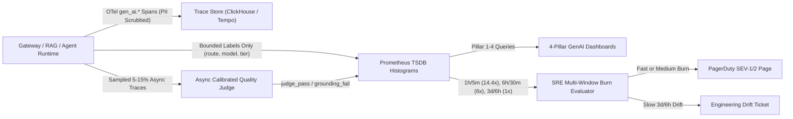
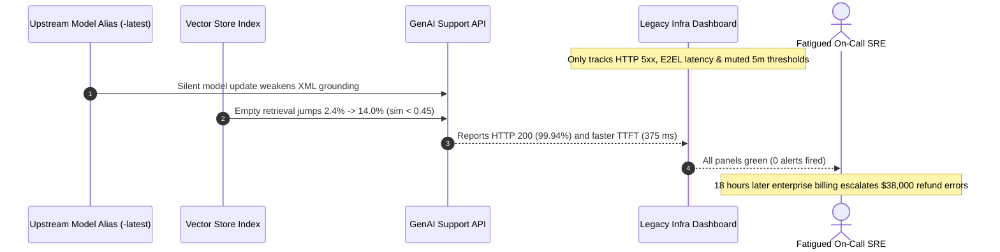

# Module 14: Metrics, Dashboards and Alerting

> **Prerequisites:** [Module 03: LLM-as-Judge](../03-llm-as-judge/README.md), [Module 08: Hallucination: Detection Techniques](../08-hallucination-detection-techniques/README.md), [Module 11: Guardrails: Output Validation](../11-guardrails-output-validation/README.md), and [Module 13: Tracing Agent Execution](../13-tracing-agent-execution/README.md).  
> **Estimated Reading Time:** 32 minutes  
> **Target Audience:** AI Backend Engineers, Site Reliability Engineers (SREs), Platform & Observability Engineers

> [!TIP]
> **The Golden Rule of GenAI Observability & Alerting:** Never alert on raw `HTTP 5xx` rates or instantaneous `5`-minute metric thresholds alone—instrument the **4-Pillar GenAI Golden Signals** (Infrastructure/Streaming, Retrieval Health, Quality/Safety, and Business ROI) with **bounded-cardinality Prometheus labels**, and page on-call engineers exclusively through **Google SRE Multi-Window Error-Budget Burn-Rate Alerts** so transient hiccups stay silent while silent model drift and sustained outages trigger before budgets exhaust.

---

## Why This Matters

In traditional microservice backends, `HTTP 200 OK` paired with `p99 latency < 250 ms` confirms the service is healthy. In GenAI backends, that dashboard greenlight hides catastrophic production failures:

- An upstream LLM provider pushes an unannounced quantization or snapshot update under a `-latest` alias, and **hallucinated citations jump from `1.8%` to `9.5%`** while every response still returns `HTTP 200` in `420 ms`.
- A silent vector-index CDC failure drops your RAG pipeline's **top-1 similarity score below $\tau_{\min}$**, causing empty retrieval to surge from `3%` to `34%` while the LLM smoothly improvises answers from parametric weights.
- Naive on-call alerts configured as `"p95 TTFT > 800 ms for 5m"` or `"judge failure rate > 5% for 5m"` fire `40+` false pages a month during normal traffic ripples—until exhausted engineers mute the Slack channel weeks before a real **SEV-1** hits.

Effective GenAI observability pairs domain-specific **4-Pillar Golden Signals** with **multi-window SLO burn-rate math** so you detect streaming stalls, RAG collapse, safety regressions, and unit-economics erosion accurately with near-zero alert fatigue.

---

## 1. The 4-Pillar GenAI Golden Signals & Multi-Window Burn-Rate Architecture

A production GenAI telemetry pipeline splits high-cardinality debugging details (trace spans, prompt hashes, `user_id`) from low-cardinality metric series exported to Prometheus/Alertmanager:



### The 4-Pillar GenAI Golden Signals Specification

| Pillar | Primary Metrics & OTel / Prometheus Signals | Healthy Target Example | What Silent Failure It Exposes |
| :--- | :--- | :--- | :--- |
| **1. Infrastructure & Streaming** | `gen_ai.server.time_to_first_token` (`TTFT`), `gen_ai.server.time_per_output_token` (`ITL`), `E2EL`, `HTTP 429` rate, upstream `5xx`, tokens/sec burn | `p95 TTFT <= 600 ms`, `p99 ITL <= 60 ms`, `429 < 0.5%` | Head-of-line prefill stalls, KV cache preemptions, upstream quota throttling |
| **2. Retrieval Health (RAG)** | `Hit@k` (canary/eval slice), **Empty-Retrieval Rate** (% queries with `0` chunks $\ge \tau_{\min}$), Top-1 similarity `p10/p50`, stale-doc filter hits | Empty retrieval `< 5%`, `p10 top_sim >= 0.48` | Broken ingestion sync, stale embeddings, tenant ACL filter dropping all hits |
| **3. Quality & Safety** | Async calibrated **Judge Failure / Refusal Rate**, Input/Output **Guardrail Trip Rate**, JSON Schema retry rate, **User Regeneration Ratio** ($R_{\text{regen}}$) | Judge fail `< 3%`, schema retry `< 1.5%`, $R_{\text{regen}} < 7\%$ | Unannounced upstream model drift, prompt-template regressions, jailbreak waves |
| **4. Business ROI & Unit Economics** | **Task Resolution / Deflection Rate**, **Cost per Resolved Task** (`\$/resolved`), SLA **Goodput** (passes latency + schema + safety simultaneously) | Cost/resolved falling QoQ, Goodput `>= 99.0%` | Expensive multi-step agent loops failing to solve user tickets (`high cost, zero ROI`) |

### Quantitative Mechanics: Cardinality Safety, Burn Rates, and Implicit Drift Signals

1. **Prometheus Label Cardinality Guard:**
   Every unique label tuple creates a separate time series in TSDB RAM:

   $$N_{\text{series}} = |L_{\text{route}}| \times |L_{\text{model}}| \times |L_{\text{tenant\_tier}}| \times |L_{\text{outcome}}| \times N_{\text{histogram\_buckets}}$$

   Putting unbounded identifiers (`user_id`, `trace_id`, `session_id`, raw `prompt_text`) into Prometheus metric labels explodes $N_{\text{series}}$ from `36` to `300,000+` series, triggering TSDB OOM kills. Keep high-cardinality attributes strictly inside OpenTelemetry span attributes (`TraceDB`), and expose only bounded categorical labels (`<= 10` values per label) to Prometheus.

2. **Error Budget & Burn-Rate Definition:**
   Given a rolling compliance window $W$ (typically `30 days = 720 hours`) and a composite Goodput SLO (e.g., `99.5%` of requests succeed without timeout, schema failure, or critical guardrail/judge breach):

   $$\text{Error Budget } B = 1 - \text{SLO}, \qquad \text{Burn Rate } r(w) = \frac{\text{Bad Request Fraction in Window } w}{B}$$

   - At $r = 1.0\times$, you consume `100%` of the monthly error budget in exactly `30` days (`720` hours).
   - At $r = 14.4\times$ (error rate `7.2%` against a `0.5%` budget), you burn **`2%` of the entire month's budget in `1` hour** ($\frac{1}{720} \cdot 14.4 = 0.02$) and exhaust `100%` in `50` hours.

3. **Google SRE Multi-Window Dual-Gate Alerting (SRE Workbook Ch. 5):**
   Alerting on a single long window (`1h`) suffers slow reset times after recovery; alerting on a single short window (`5m`) causes severe false-positive alert fatigue. Require **both** a long window $w_{\text{long}}$ and a short confirmation window $w_{\text{short}} \approx \frac{1}{12} w_{\text{long}}$ to breach simultaneously:

   | Alert Tier | Budget Consumed | Long Window | Short Confirmation Gate | Burn-Rate Threshold | Action |
   | :--- | :--- | :--- | :--- | :--- | :--- |
   | **Fast Burn (Critical)** | `2%` in `1h` | `1h` | `5m` (`AND`) | $r \ge 14.4\times$ | **Page On-Call Immediately (SEV-1/2)** |
   | **Medium Burn (High)** | `5%` in `6h` | `6h` | `30m` (`AND`) | $r \ge 6.0\times$ | **Page On-Call (SEV-2)** |
   | **Slow Drift (Low)** | `10%` in `3d` | `72h` (`3d`) | `6h` (`AND`) | $r \ge 1.0\times$ | **Create Ticket / Slack Warning** |

4. **Implicit User Regeneration & Drift Z-Score:**
   Async LLM judges typically run on `5%–15%` sampled traffic with `1–5 minute` lag. Users give you free `100%`-coverage quality telemetry through immediate re-asks and button clicks:

   $$R_{\text{regen}} = \frac{N_{\text{explicit\_regens}} + N_{\text{immediate\_reasks\_within\_30s}}}{N_{\text{completed\_responses}}}, \qquad Z_{\text{drift}} = \frac{R_{\text{obs}} - \mu_{\text{baseline}}}{\max(\sigma_{\text{baseline}}, \epsilon)}$$

   When $Z_{\text{drift}} \ge +3.0$ while `HTTP 200` and `TTFT` remain flat, you have high-confidence evidence of silent upstream model drift or retrieval degradation.

---

## 2. Systematic Comparison Matrix: GenAI Alerting Strategies

| Alerting Pattern | Detection Latency | False-Positive Noise | Catches Transient Bursts Safely? | Detects Silent Quality Drift? | Recommended Production Role |
| :--- | :--- | :--- | :--- | :--- | :--- |
| **Static 5m Threshold (`err > 5%`)** | Fast (`5 min`) | **Very High** (pages on `3m` hiccups) | No — causes severe alert fatigue | No — misses gradual `2% -> 4%` decay | **Retire** in favor of burn-rate gates |
| **Single Long-Window Burn (`1h >= 14.4x`)** | Moderate (`10–30 min`) | Low | Mostly, but stays firing `55 min` after fix | Partial | **Insufficient alone** (poor reset time) |
| **Multi-Window Dual-Gate Burn (`1h/5m`, `6h/30m`, `3d/6h`)** | Fast (`2–5 min` for outages) | **Very Low** (`< 5%` noise) | **Yes** — short spikes suppressed cleanly | **Yes** (`3d/6h >= 1.0x` ticket catches slow drift) | **Primary SLO Paging Engine** |
| **Implicit Regen Ratio + Async Judge Z-Score** | Moderate (`15–60 min`) | Low (with baseline seasonality) | Suppressed via rolling `30m–1h` windows | **Best-in-Class** (catches silent weight updates) | **Mandatory Quality Canary** alongside SRE SLOs |

---

## 3. Production War Story Post-Mortem: The Silent Snapshot Drift & Alert-Fatigue Blackout

| Field | Incident Details |
| :--- | :--- |
| **Severity** | **SEV-2** (Silent Grounding Collapse & 18-Hour Detection Blindness) |
| **Detection / Resolution Time** | Undetected for `18` hours until enterprise customer escalations / Mitigated in `25` minutes by pinning exact model snapshot + rolling back RAG filter |
| **Impact** | `11.4%` of support answers hallucinated unverified refund rules (`baseline 1.9%`), triggering `640` manual support escalations and **\$38,000** in erroneous goodwill credits |

### What Happened

An enterprise SaaS support copilot exported only `HTTP 5xx`, `p95 E2EL`, and raw `token_count` to Grafana, gated by noisy `"5xx > 1% for 5m"` and `"p95 latency > 1.5s for 5m"` alerts. Because nightly batch surges tripped the `5`-minute latency alert almost daily (`60+` pages/month), engineers had routed that alert channel to muted notifications.

On Tuesday at `02:00 UTC`, two minor shifts happened within `4` hours:
1. The gateway still targeted a mutable `-latest` provider alias whose subtle formatting update weakened strict XML `<evidence>` adherence.
2. An upstream knowledge-base re-index changed chunk formatting, bumping RAG empty-retrieval (`sim < 0.45`) from `2.4%` to `14.0%`.

`HTTP 200 OK` stayed at **`99.94%`** and `p95 TTFT` actually improved slightly (`410 ms -> 375 ms` due to shorter empty contexts!). Nobody noticed until `18` hours later when human support managers saw refund disputes skyrocket.



### Root Cause Analysis

- **Infrastructure-Only Blind Spot:** Monitoring `HTTP 200` and `TTFT` without Pillar 2 (`empty_retrieval_rate`, `p10 top_sim`) or Pillar 3 (`regen_ratio`, async `grounding_fail_rate`) made semantic collapse invisible.
- **No Slow-Burn Detection:** Even if composite Goodput (`grounded + valid schema + latency <= SLO`) had been tracked, single `5m` rules miss gradual `10%` error-budget leaks (`3d/6h` slow burn).
- **Mutable Model Alias & Unbounded Labels:** Running `-latest` without `model_snapshot` labels blocked instant correlation across prompt/model versions.

### Architectural Hardening & Verified Fix

- **4-Pillar Composite Goodput SLI:** Defined a request as `GOOD` only if `HTTP 2xx AND p95_TTFT <= 600ms AND schema_valid AND not empty_retrieval_fallthrough AND async_judge_grounded`.
- **SRE Multi-Window Burn Gates:** Replaced noisy `5m` threshold pages with `1h/5m @ 14.4x` (Page), `6h/30m @ 6.0x` (Page), and `72h/6h @ 1.0x` (Ticket).
- **Canary Drift Alarm:** Wired `user_regen_ratio` Z-score (`>= +3.0` over `1h`) + `empty_retrieval_rate > 8%` to fire an immediate Slack warning before customers ever complain.

---

## 4. Multi-Language Production Implementation: GenAI Golden Signals & SRE Burn-Rate Evaluator

Below is a production-ready **4-Pillar Telemetry Aggregator & Multi-Window SRE Burn-Rate Evaluator** in **Go**, **TypeScript**, **Python**, and **C#**. Each implementation enforces bounded Prometheus label allowlists (blocking `user_id`/`trace_id` cardinality explosions), tracks Pillar 1–4 Golden Signals, and runs Google SRE dual-window burn-rate evaluation (`1h/5m`, `6h/30m`, `72h/6h`).

````carousel

```go
package observability

import (
	"fmt"
	"math"
	"sort"
	"strings"
)

type BoundedLabels struct {
	Route      string
	Model      string
	TenantTier string
}

// SanitizeLabels strips unbounded keys and clamps unexpected cardinality.
func SanitizeLabels(route, model, tier string) BoundedLabels {
	allowedTiers := map[string]bool{"free": true, "pro": true, "enterprise": true}
	if !allowedTiers[tier] {
		tier = "other"
	}
	if strings.Contains(route, "/") && len(route) > 32 {
		route = "/other"
	}
	return BoundedLabels{Route: route, Model: model, TenantTier: tier}
}

type GoldenSignalSample struct {
	TTFTMs           float64
	ITLMs            float64
	TopRetrievalSim  float64
	GuardrailTripped bool
	Regenerated      bool
	ResolvedTask     bool
	CostUSD          float64
}

type BurnWindowRates struct {
	Err5m  float64
	Err30m float64
	Err1h  float64
	Err6h  float64
	Err72h float64
}

type BurnAlert struct {
	Severity string
	Rule     string
	Action   string
}

func EvaluateMultiWindowBurn(slo float64, w BurnWindowRates) []BurnAlert {
	budget := 1.0 - slo
	if budget <= 0 {
		return nil
	}
	burn := func(rate float64) float64 { return rate / budget }
	var alerts []BurnAlert

	if burn(w.Err1h) >= 14.4 && burn(w.Err5m) >= 14.4 {
		alerts = append(alerts, BurnAlert{"SEV-1", "1h/5m >= 14.4x", "PAGE_NOW"})
	}
	if burn(w.Err6h) >= 6.0 && burn(w.Err30m) >= 6.0 {
		alerts = append(alerts, BurnAlert{"SEV-2", "6h/30m >= 6.0x", "PAGE_NOW"})
	}
	if burn(w.Err72h) >= 1.0 && burn(w.Err6h) >= 1.0 {
		alerts = append(alerts, BurnAlert{"WARN", "72h/6h >= 1.0x", "OPEN_DRIFT_TICKET"})
	}
	return alerts
}

func SummarizePillars(samples []GoldenSignalSample, simFloor float64) string {
	if len(samples) == 0 {
		return "empty"
	}
	ttfts := make([]float64, len(samples))
	var emptyRag, guards, regens, resolved int
	var totalUSD float64
	for i, s := range samples {
		ttfts[i] = s.TTFTMs
		if s.TopRetrievalSim < simFloor {
			emptyRag++
		}
		if s.GuardrailTripped {
			guards++
		}
		if s.Regenerated {
			regens++
		}
		if s.ResolvedTask {
			resolved++
		}
		totalUSD += s.CostUSD
	}
	sort.Float64s(ttfts)
	p95Idx := int(math.Ceil(0.95*float64(len(ttfts)))) - 1
	costPerResolved := 0.0
	if resolved > 0 {
		costPerResolved = totalUSD / float64(resolved)
	}
	n := float64(len(samples))
	return fmt.Sprintf("p95_ttft=%.0fms empty_rag=%.1f%% guard=%.1f%% regen=%.1f%% $/resolved=%.4f",
		ttfts[p95Idx], float64(emptyRag)*100/n, float64(guards)*100/n, float64(regens)*100/n, costPerResolved)
}
```

<!-- slide -->

```typescript
export type TenantTier = "free" | "pro" | "enterprise" | "other";

export interface BoundedMetricLabels {
  readonly route: string;
  readonly model: string;
  readonly tenantTier: TenantTier;
}

export function sanitizeMetricLabels(route: string, model: string, rawTier: string): BoundedMetricLabels {
  const allowedRoutes = new Set(["/v1/chat", "/v1/rag", "/v1/agent"]);
  const allowedTiers = new Set<TenantTier>(["free", "pro", "enterprise"]);
  return {
    route: allowedRoutes.has(route) ? route : "/other",
    model: model.slice(0, 48),
    tenantTier: allowedTiers.has(rawTier as TenantTier) ? (rawTier as TenantTier) : "other",
  };
}

export interface BurnWindows {
  readonly err5m: number;
  readonly err30m: number;
  readonly err1h: number;
  readonly err6h: number;
  readonly err72h: number;
}

export interface BurnDecision {
  readonly severity: "PAGE_FAST" | "PAGE_MEDIUM" | "TICKET_DRIFT";
  readonly longBurn: number;
  readonly shortBurn: number;
}

export function evaluateSreBurnRate(slo: number, windows: BurnWindows): BurnDecision[] {
  const budget = 1 - slo;
  if (budget <= 0) throw new RangeError("SLO must be strictly below 1.0");
  const burn = (errRate: number): number => errRate / budget;

  const decisions: BurnDecision[] = [];
  const rules: Array<{ sev: BurnDecision["severity"]; longVal: number; shortVal: number; thresh: number }> = [
    { sev: "PAGE_FAST", longVal: burn(windows.err1h), shortVal: burn(windows.err5m), thresh: 14.4 },
    { sev: "PAGE_MEDIUM", longVal: burn(windows.err6h), shortVal: burn(windows.err30m), thresh: 6.0 },
    { sev: "TICKET_DRIFT", longVal: burn(windows.err72h), shortVal: burn(windows.err6h), thresh: 1.0 },
  ];

  for (const r of rules) {
    if (r.longVal >= r.thresh && r.shortVal >= r.thresh) {
      decisions.push({ severity: r.sev, longBurn: r.longVal, shortBurn: r.shortVal });
    }
  }
  return decisions;
}

export function detectRegenDriftZ(obsRegenRate: number, baseMean: number, baseStd: number): { zScore: number; drifted: boolean } {
  const zScore = (obsRegenRate - baseMean) / Math.max(baseStd, 1e-6);
  return { zScore, drifted: zScore >= 3.0 };
}
```

<!-- slide -->

```python
"""
genai_sre_alerter.py
4-Pillar GenAI Golden Signals aggregator, cardinality sanitizer, and Google SRE multi-window burn evaluator.
"""
from dataclasses import dataclass
import math
from typing import Sequence

ALLOWED_TIERS = frozenset({"free", "pro", "enterprise"})
ALLOWED_ROUTES = frozenset({"/v1/chat", "/v1/rag", "/v1/agent"})


def sanitize_prometheus_labels(route: str, model: str, tier: str) -> dict[str, str]:
    """Strip high-cardinality fields; never allow user_id or trace_id in Prometheus labels."""
    return {
        "route": route if route in ALLOWED_ROUTES else "/other",
        "model": model[:48],
        "tenant_tier": tier if tier in ALLOWED_TIERS else "other",
    }


@dataclass(frozen=True)
class BurnWindowSnapshot:
    err_5m: float
    err_30m: float
    err_1h: float
    err_6h: float
    err_72h: float


def evaluate_multiwindow_burn(slo: float, snap: BurnWindowSnapshot) -> list[str]:
    budget = 1.0 - slo
    if budget <= 0.0:
        raise ValueError("SLO must be < 1.0")
    rules = (
        ("PAGE_FAST_BURN",   snap.err_1h / budget,  snap.err_5m / budget,  14.4),
        ("PAGE_MEDIUM_BURN", snap.err_6h / budget,  snap.err_30m / budget,  6.0),
        ("TICKET_SLOW_DRIFT",snap.err_72h / budget, snap.err_6h / budget,   1.0),
    )
    return [
        f"{name}(long={long_b:.1f}x,short={short_b:.1f}x)"
        for name, long_b, short_b, limit in rules
        if long_b >= limit and short_b >= limit
    ]


def percentile(values: Sequence[float], pct: float) -> float:
    if not values:
        return 0.0
    ordered = sorted(values)
    idx = min(len(ordered) - 1, math.ceil((pct / 100.0) * len(ordered)) - 1)
    return ordered[idx]


def drift_z_score(observed: float, baseline_mean: float, baseline_std: float) -> float:
    return (observed - baseline_mean) / max(baseline_std, 1e-9)
```

<!-- slide -->

```csharp
using System;
using System.Collections.Generic;

namespace GenAI.Observability;

public sealed record BoundedLabels(string Route, string Model, string TenantTier);

public sealed record BurnWindows(
    double Err5m,
    double Err30m,
    double Err1h,
    double Err6h,
    double Err72h);

public sealed record BurnAlert(string Severity, string WindowPair, double LongBurn, double ShortBurn);

public static class SreGenAiMonitor
{
    private static readonly HashSet<string> AllowedTiers = new(StringComparer.Ordinal) { "free", "pro", "enterprise" };
    private static readonly HashSet<string> AllowedRoutes = new(StringComparer.Ordinal) { "/v1/chat", "/v1/rag", "/v1/agent" };

    public static BoundedLabels SanitizeLabels(string route, string model, string tier) =>
        new(
            Route: AllowedRoutes.Contains(route) ? route : "/other",
            Model: model.Length > 48 ? model[..48] : model,
            TenantTier: AllowedTiers.Contains(tier) ? tier : "other");

    public static IReadOnlyList<BurnAlert> EvaluateBurnRate(double slo, BurnWindows w)
    {
        double budget = 1.0 - slo;
        if (budget <= 0) throw new ArgumentOutOfRangeException(nameof(slo), "SLO must be strictly below 1.0.");

        var alerts = new List<BurnAlert>();
        void Check(string sev, string pair, double longErr, double shortErr, double threshold)
        {
            double longBurn = longErr / budget;
            double shortBurn = shortErr / budget;
            if (longBurn >= threshold && shortBurn >= threshold)
                alerts.Add(new BurnAlert(sev, pair, longBurn, shortBurn));
        }

        Check("PAGE_FAST_BURN", "1h/5m", w.Err1h, w.Err5m, 14.4);
        Check("PAGE_MEDIUM_BURN", "6h/30m", w.Err6h, w.Err30m, 6.0);
        Check("TICKET_SLOW_DRIFT", "72h/6h", w.Err72h, w.Err6h, 1.0);
        return alerts;
    }

    public static double DriftZScore(double observedRate, double baselineMean, double baselineStd) =>
        (observedRate - baselineMean) / Math.Max(baselineStd, 1e-9);
}
```

````

---

## 5. Practical Hands-On Verification CLI Workflows

Run these offline Python 3.13 verification scripts directly in your terminal—zero external packages or API keys required.

### Workflow 1: Multi-Window SRE Error-Budget Burn-Rate Simulator

Verify how `1h/5m @ 14.4x`, `6h/30m @ 6.0x`, and `72h/6h @ 1.0x` suppress noisy transient spikes while paging rapidly on real outages and ticketing silent `72`-hour quality drift:

```bash
python -c '
SLO = 0.995
BUDGET = 1.0 - SLO  # 0.005 error budget over 30 days (720h)

RULES = [
    ("PAGE_FAST_BURN",   "1h",  "5m",  14.4),
    ("PAGE_MEDIUM_BURN", "6h",  "30m",  6.0),
    ("TICKET_SLOW_DRIFT","72h", "6h",   1.0),
]

def evaluate_burn(scenario: str, err_rates: dict[str, float]) -> str:
    burns = {w: r / BUDGET for w, r in err_rates.items()}
    triggered = []
    for severity, long_w, short_w, thresh in RULES:
        if burns[long_w] >= thresh and burns[short_w] >= thresh:
            triggered.append(f"{severity}({long_w}={burns[long_w]:.1f}x,{short_w}={burns[short_w]:.1f}x>={thresh}x)")
    status = " | ".join(triggered) if triggered else "OK_NO_PAGE"
    return f"{scenario:<34} -> {status}"

scenarios = [
    ("Healthy baseline",               {"5m": 0.002, "30m": 0.002, "1h": 0.002, "6h": 0.002, "72h": 0.002}),
    ("Transient 4m hiccup (suppressed)", {"5m": 0.100, "30m": 0.020, "1h": 0.012, "6h": 0.004, "72h": 0.0025}),
    ("Sustained outage (fast burn)",   {"5m": 0.120, "30m": 0.100, "1h": 0.090, "6h": 0.035, "72h": 0.008}),
    ("Silent provider drift (72h)",    {"5m": 0.008, "30m": 0.008, "1h": 0.008, "6h": 0.008, "72h": 0.0075}),
]

for name, rates in scenarios:
    print(evaluate_burn(name, rates))
'
```

**Expected Output:**

```text
Healthy baseline                   -> OK_NO_PAGE
Transient 4m hiccup (suppressed)   -> OK_NO_PAGE
Sustained outage (fast burn)       -> PAGE_FAST_BURN(1h=18.0x,5m=24.0x>=14.4x) | PAGE_MEDIUM_BURN(6h=7.0x,30m=20.0x>=6.0x) | TICKET_SLOW_DRIFT(72h=1.6x,6h=7.0x>=1.0x)
Silent provider drift (72h)        -> TICKET_SLOW_DRIFT(72h=1.5x,6h=1.6x>=1.0x)
```

Notice that the `4`-minute burst (`5m = 10%` error = `20x` burn!) produced **`OK_NO_PAGE`** because the `1h` confirming window stayed at `2.4x < 14.4x`—eliminating false-alarm paging—while the `72`-hour silent drift (`0.75%–0.80%` error) automatically filed `TICKET_SLOW_DRIFT`.

### Workflow 2: 4-Pillar Golden Signals & Prometheus Cardinality Audit

Compute all four GenAI dashboard pillars from request telemetry and measure the TSDB cardinality explosion caused by leaking `user_id` into Prometheus labels:

```bash
python -c '
import math

def pct(vals: list[float], p: float) -> float:
    s = sorted(vals)
    idx = min(len(s) - 1, math.ceil((p / 100.0) * len(s)) - 1)
    return s[idx]

ttfts = [180, 210, 225, 240, 260, 285, 310, 340, 410, 560, 620, 690, 230, 250, 275, 290, 320, 355, 390, 480]
itls  = [18, 20, 21, 22, 24, 25, 23, 19, 26, 28, 31, 45, 22, 24, 21, 23, 27, 29, 34, 62]
top_sims = [0.78, 0.72, 0.31, 0.81, 0.65, 0.28, 0.74, 0.69, 0.35, 0.77, 0.68, 0.73, 0.29, 0.79, 0.71, 0.66, 0.33, 0.75, 0.70, 0.76]
guard_trips = 2
regens = 3
resolved = 16
total_usd = 0.448

empty_rate = sum(1 for s in top_sims if s < 0.45) / len(top_sims)
print(f"Infra   | p95_TTFT={pct(ttfts, 95):.0f}ms | p99_ITL={pct(itls, 99):.0f}ms")
print(f"RAG     | empty_retrieval_rate={empty_rate*100:.1f}% | p10_sim={pct(top_sims, 10):.2f}")
print(f"Safety  | guardrail_trip_rate={guard_trips/len(ttfts)*100:.1f}% | regen_ratio={regens/len(ttfts)*100:.1f}%")
print(f"ROI     | resolved_rate={resolved/len(ttfts)*100:.1f}% | cost_per_resolved=${total_usd/resolved:.4f}")

unbounded_series = 50000 * 3 * 2  # 50k active users * 3 routes * 2 outcomes
bounded_series = 3 * 3 * 2 * 2    # 3 tenant_tiers * 3 routes * 2 models * 2 outcomes
print(f"Cardinality | unbounded_labels={unbounded_series:,} series vs bounded_labels={bounded_series} series")
'
```

**Expected Output:**

```text
Infra   | p95_TTFT=620ms | p99_ITL=62ms
RAG     | empty_retrieval_rate=25.0% | p10_sim=0.29
Safety  | guardrail_trip_rate=10.0% | regen_ratio=15.0%
ROI     | resolved_rate=80.0% | cost_per_resolved=$0.0280
Cardinality | unbounded_labels=300,000 series vs bounded_labels=36 series
```

### Workflow 3: Silent Upstream Model Drift Canary (`Regen Ratio + Async Judge Z-Score`)

Demonstrate detecting a silent provider quality regression (`+3.8` to `+6.0` standard deviations) while `HTTP 200` remains `99.9%`:

```bash
python -c '
import math

def z_score(obs: float, mean: float, std: float) -> float:
    return (obs - mean) / max(std, 1e-9)

baseline_http200 = (0.999, 0.0005)
baseline_regen   = (0.060, 0.010)
baseline_judge   = (0.025, 0.006)

windows = [
    ("T-2h (Normal)",         0.999, 0.062, 0.024),
    ("T-1h (Silent Rollout)", 0.999, 0.098, 0.049),
    ("T-0h (Degraded)",       0.999, 0.115, 0.061),
]

for label, http200, regen, judge_fail in windows:
    z_reg = z_score(regen, *baseline_regen)
    z_jdg = z_score(judge_fail, *baseline_judge)
    alert = "SILENT_QUALITY_DRIFT_WARN" if (z_reg >= 3.0 or z_jdg >= 3.0) else "HEALTHY"
    print(f"{label:<22} | http200={http200*100:.1f}% | regen={regen*100:.1f}% (z={z_reg:+.1f}) | judge_fail={judge_fail*100:.1f}% (z={z_jdg:+.1f}) -> {alert}")
'
```

**Expected Output:**

```text
T-2h (Normal)          | http200=99.9% | regen=6.2% (z=+0.2) | judge_fail=2.4% (z=-0.2) -> HEALTHY
T-1h (Silent Rollout)  | http200=99.9% | regen=9.8% (z=+3.8) | judge_fail=4.9% (z=+4.0) -> SILENT_QUALITY_DRIFT_WARN
T-0h (Degraded)        | http200=99.9% | regen=11.5% (z=+5.5) | judge_fail=6.1% (z=+6.0) -> SILENT_QUALITY_DRIFT_WARN
```

### Hands-On Exercises

1. **Inhibit Noise on Low-Traffic Hours:** Add a minimum request-volume guard (`min_requests_1h >= 200`) to Workflow 1 so `2` failed requests at `03:00 UTC` out of `10` total requests (`20%` error rate) do not trigger a false `PAGE_FAST_BURN`.
2. **Prometheus PromQL Translation:** Translate Workflow 1's `1h/5m` dual-gate logic into PromQL over a counter `genai_goodput_total{status="bad"}` and `genai_goodput_total` (`rate(...[1h]) / rate(...[1h]) >= 14.4 * 0.005 and rate(...[5m]) / rate(...[5m]) >= 14.4 * 0.005`).
3. **Optional Live OTel Export Probe (Requires Local Collector):** Instrument a sample Python request with `opentelemetry-sdk`, emit `gen_ai.client.token.usage` and `gen_ai.server.time_to_first_token`, and confirm no `user_id` or raw prompt text enters Prometheus scrape output.

### Independent Challenge

Your team operates a low-traffic enterprise legal assistant (`~60` requests/hour overnight, `~1,800` requests/hour daytime) with a `99.5%` monthly Goodput SLO. Currently, a `3`-failure overnight hiccup between `02:00` and `02:05` triggers a `PAGE_FAST_BURN` alert because `3 / 5` overnight requests failed (`60%` error rate over `5m`). Meanwhile, an afternoon bug silently raises `empty_retrieval_rate` from `2%` to `18%` for `4` hours without tripping `HTTP 5xx`. Design the dual changes needed in your **SLI definition** and **low-traffic burn-rate gating** to stop overnight false pages while catching afternoon RAG collapse within `30` minutes.

<details><summary>Architectural Discussion</summary>

First, fix **low-traffic statistical noise** at `02:00 UTC` by combining Google SRE's low-traffic mitigations (Ch. 5): either pair burn-rate gates with a synthetic canary heartbeat (`~1 req/min` minimum floor) or add an `and sum(increase(genai_requests_total[1h])) >= 100` volume qualifier on immediate pages so `3` isolated errors cannot mimic a fleet outage. Second, promote **`empty_retrieval_rate`** (queries where `max_sim < tau_min` when retrieval was expected) into the **composite Goodput SLI** as a `bad` outcome alongside latency/schema/judge failures, and add a `6h/30m @ 6.0x` burn rule plus a Pillar-2 `empty_retrieval > 10% for 15m` warning so afternoon RAG index collapse fires inside `30` minutes.

</details>

---

## 6. Common Mistakes & Troubleshooting

- **Putting `user_id`, `tenant_id` (unbounded), or `trace_id` inside Prometheus labels:** High-cardinality labels multiply TSDB memory linearly and crash Prometheus scraping. Store unbounded IDs in OTel traces/logs; restrict Prometheus to bounded enums (`tenant_tier`, `route`, `model_snapshot`).
- **Averaging `TTFT` or `ITL` instead of recording histograms:** Averages conceal `p99` prefill freezes (`2.5 s`) behind fast cache hits (`80 ms`). Always emit OTel/Prometheus histograms (`gen_ai.server.time_to_first_token`, `gen_ai.server.time_per_output_token`).
- **Alerting on `5`-minute raw thresholds without confirmation:** Single-window short alerts fire constantly on transient upstream blips, conditioning engineers to ignore pages. Always use multi-window `AND` burn gates.
- **Measuring `\$ per 1M tokens` without `Cost per Resolved Task`:** Cutting per-token cost `40%` with a weaker model looks great on an infra dashboard while doubling user regeneration loops and pushing `Cost per Resolved Task` *up* `25%`.

---

## 7. Operational Validation Checkpoints & Checkpoint Quiz

### Operational Validation Checkpoints

<details><summary><strong>Checkpoint 1: Suppressing a 4-minute upstream provider hiccup without blinding real outages</strong></summary>

During a `3`-minute upstream rate-limit hiccup, your `5`-minute Goodput error rate jumps to `10.0%` (`20x` burn rate on a `99.5%` SLO) before recovering cleanly. Explain why Google SRE dual-window alerting keeps on-call asleep while still paging within minutes on a true sustained outage.

**Validation:** Under the `1h/5m @ 14.4x` dual-gate rule, the `5m` window exceeds `14.4x` (`20x`), **but** the `1h` confirming window averages only `1.2%` error (`2.4x < 14.4x`), so the `AND` condition evaluates to `false` and suppresses the page. On a true sustained outage (`>= 7.2%` errors persisting), the `1h` window crosses `14.4x` within ~`5` minutes (e.g., `100%` outage burns `1/12` of `1h` = `8.3% > 7.2%` in `5m`), firing immediately and resetting immediately once the `5m` window recovers.

</details>

<details><summary><strong>Checkpoint 2: Detecting silent upstream model drift when HTTP 200 and TTFT stay green</strong></summary>

Your provider updates a `-latest` alias silently. `HTTP 200` holds at `99.9%` and `p95 TTFT` drops `30 ms`, yet customers abandon sessions at triple the normal rate. Which Golden Signals expose this inside an hour?

**Validation:** **Pillar 3 (Quality & Safety)** signals expose it immediately: `user_regen_ratio` ($R_{\text{regen}}$) tracks `100%` of live turns and jumps `+3.8` standard deviations within minutes, while sampled async calibrated **LLM-as-Judge faithfulness/grounding failure rates** and **JSON schema retry rates** confirm the exact failure mode. Combine with `72h/6h @ 1.0x` slow-burn alerting and `model_snapshot` label pinning to block unpinned drift permanently.

</details>

<details><summary><strong>Checkpoint 3: Preventing a Prometheus TSDB OOM during a viral launch</strong></summary>

A team adds `tenant_id` and `session_id` to their `genai_ttft_ms` histogram across `40,000` new trial signups, crashing Prometheus with OOM errors. How do you refactor the telemetry schema while keeping per-tenant debugging intact?

**Validation:** Strip `tenant_id` and `session_id` from Prometheus metric labels immediately and replace them with a bounded enum (`tenant_tier` = `free | pro | enterprise | other`, `<= 4` values), shrinking TSDB series by `> 1,000x`. Keep exact `tenant_id` and `session_id` inside **OpenTelemetry trace spans** (exported to Tempo/ClickHouse) and use Prometheus **Exemplars** (`trace_id` attached to histogram buckets) to jump from a `p99` spike straight to the offending tenant trace.

</details>

### Checkpoint Quiz

1. Name the **4 Pillars of GenAI Golden Signals** and give two concrete metrics inside each pillar.
2. Under a `99.5%` monthly Goodput SLO (`30 days = 720h`), what exact error rate corresponds to a `14.4x` burn rate, and how much of the monthly budget does it consume in `1` hour?
3. Why does the Google SRE multi-window burn alert require **both** a long window (`1h`) **and** a short window (`5m`) connected by `AND`?
4. Why is `Cost per Resolved Task` superior to `Cost per 1M Tokens` as a Pillar-4 Business ROI metric?
5. What happens to Prometheus TSDB when `user_id` or `trace_id` is added as a histogram label, and where should high-cardinality IDs live instead?

<details><summary>Answers</summary>

1. **Infrastructure/Streaming** (`TTFT`, `ITL`, `429/5xx`), **Retrieval Health** (`Hit@k`, `empty_retrieval_rate`, `p10 top_sim`), **Quality/Safety** (`calibrated judge fail rate`, `guardrail trip rate`, `user_regen_ratio`), and **Business ROI** (`task resolution rate`, `cost per resolved task`, `SLA Goodput`).
2. Error budget is `1 - 0.995 = 0.005` (`0.5%`). A `14.4x` burn rate is `14.4 * 0.005 = 7.2%` error rate, which consumes `(1 / 720) * 14.4 = 2.0%` of the monthly budget in `1` hour.
3. The long window (`1h`) prevents noisy `2–4` minute transient spikes from paging on-call (`precision`), while the short window (`5m`) guarantees the alert resets immediately once the outage stops (`reset time`) rather than lingering for `55` minutes.
4. A cheap weak model lowers per-token rates while forcing multi-turn retries and escalations, increasing total spend per solved customer problem (`cost_per_resolved_task`).
5. Unbounded labels create combinatorial series multiplication (`users * routes * histogram_buckets`), exhausting TSDB RAM and causing OOMs. Store high-cardinality IDs in OpenTelemetry trace spans/logs and link via histogram Exemplars.

</details>

---

## Further Reading & Sources

- [Google SRE Workbook, Chapter 5: Alerting on SLOs](https://sre.google/workbook/alerting-on-slos/) — canonical mathematical derivation of multi-window, multi-burn-rate SLO alerts and low-traffic mitigations.
- [OpenTelemetry Semantic Conventions for Generative AI](https://opentelemetry.io/docs/specs/semconv/gen-ai/) — standard `gen_ai.*` span and metric schema definitions (`gen_ai.server.time_to_first_token`, `gen_ai.client.token.usage`).
- [OpenTelemetry GenAI Metrics Registry (`open-telemetry/semantic-conventions-genai`)](https://github.com/open-telemetry/semantic-conventions-genai/blob/main/docs/gen-ai/gen-ai-metrics.md) — bucket definitions and bounded attribute specifications for GenAI histograms.
- [Prometheus Best Practices: Histograms and Summaries](https://prometheus.io/docs/practices/histograms/) — guidance on quantile aggregation across replicas and avoiding high-cardinality label traps.
- [Module 13: Tracing Agent Execution](../13-tracing-agent-execution/README.md) — emitting correlated OTel spans alongside bounded metrics.

## Next

[Module 15: Cost Monitoring and Optimization](../15-cost-monitoring-and-optimization/README.md)
