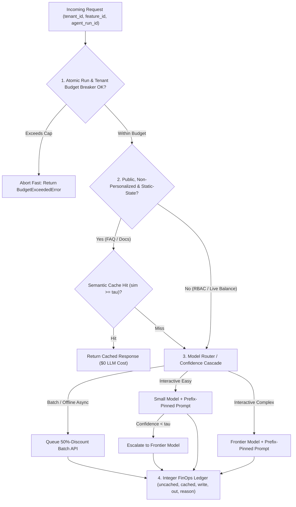
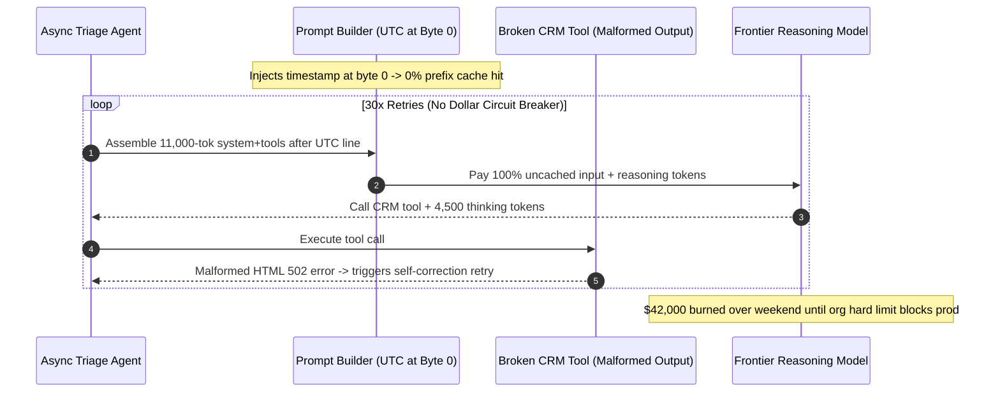

# Module 15: Cost Monitoring and Optimization

> **Prerequisites:** [Module 13: Tracing Agent Execution](../13-tracing-agent-execution/README.md), [Module 14: Metrics, Dashboards and Alerting](../14-metrics-dashboards-and-alerting/README.md), [Track 10, Module 16: Cost and Latency Control in Agents](../../10-ai-agents/16-cost-and-latency-control-in-agents/README.md), and [Track 14, Module 04: KV Cache Memory Math](../../14-inference-and-serving-vllm/04-kv-cache-memory-math/README.md).  
> **Estimated Reading Time:** 34 minutes  
> **Target Audience:** AI Backend Engineers, FinOps Platform Architects, Production ML Infrastructure Engineers

> [!TIP]
> **The Golden Rule of GenAI FinOps:** Never rely on delayed monthly cloud invoices or aggregate token counts with IEEE-754 floats—attribute every single inference step in **integer nanodollars rolled up to `microdollars` (`1 USD = 1,000,000 microdollars`)** across **`uncached_in`**, **`cached_in`**, **`cache_write`**, **`output`**, and **`reasoning_out`** tagged by `(tenant_id, feature_id, agent_run_id)`, stack the **4-Layer Cost-Reduction Waterfall** (Prefix Pinning $\rightarrow$ ACL-Safe Semantic Cache $\rightarrow$ Confidence Model Cascade $\rightarrow$ `50%` Batch APIs), and enforce **atomic dollar circuit breakers** so retry loops abort before burning margin.

---

## Why This Matters

In conventional SaaS backends, serving an extra API call adds fractions of a cent in CPU/RAM. In GenAI products, marginal COGS scales with token volume and model tier: an autonomous agent running `8` tool iterations with `12,000` input tokens and `3,500` hidden reasoning tokens per step easily costs **`\$0.40–\$1.50` per conversation**—erasing an entire **`\$29/month`** Pro subscription in a single afternoon power session.

Even worse, engineering teams routinely sabotage their own unit economics through three silent architectural mistakes:

1. **Prefix Cache Busting at Byte 0:** Prepending `Current UTC timestamp` or `request_id` at the top of a `10,000`-token system/tool prompt resets KV prefix matching on every call, turning `90%`-discounted cached reads (`\$0.30/1M`) back into full-price uncached prefill (`\$3.00/1M`).
2. **Unsafe Semantic Caching Across ACL Boundaries:** Enabling vector similarity caching on authenticated RAG or account queries allows Tenant B to receive Tenant A's confidential cached answer on a semantically equivalent prompt.
3. **Unbounded Reasoning & Retry Loops:** Leaving `max_completion_tokens` unguarded on a malformed tool-output loop lets an agent burn thousands of hidden chain-of-thought tokens (`\$15+/1M`) per retry until rate limits intervene.

---

## 1. FinOps Attribution Architecture & The 4-Layer Cost-Reduction Waterfall



### Integer Sub-Cent Cost Attribution (`Nanodollars -> Microdollars`)

Provider billing splits tokens into up to five distinct price schedules:

1. **Uncached Input ($T_{\text{in}}$):** Prompt tokens missing prefix KV cache (`1.0x` input rate).
2. **Cached Input Read ($T_{\text{cached}}$):** Longest contiguous shared prefix matched in KV cache (`0.10x–0.50x` input rate).
3. **Cache Write ($T_{\text{write}}$):** Explicit prefix registration tokens (e.g., `1.25x` write surcharge on providers using explicit cache breakpoints; `1.0x` on implicit prefix caching).
4. **Visible Output ($T_{\text{out}}$):** Generated assistant response tokens (`3x–5x` input rate).
5. **Reasoning / Thinking Output ($T_{\text{reason}}$):** Hidden chain-of-thought tokens billed at the output rate even when suppressed from the user UI!

Because multiplying small token counts by floating-point per-1M rates (`0.00000015`) introduces rounding drift across millions of spans, store model prices as **integer nanodollars per token** (`1 USD = 1,000,000,000 nUSD`, so `\$0.15/1M` = `150 nUSD/token`, `\$3.00/1M` = `3,000 nUSD/token`), accumulate in `int64`, and expose settled ledger entries in **integer `microdollars` (`1 microUSD = 1,000 nUSD`)**:

$$\text{Cost}_{\text{nUSD}} = T_{\text{in}} P_{\text{in}} + T_{\text{cached}} P_{\text{cached}} + T_{\text{write}} P_{\text{write}} + (T_{\text{out}} + T_{\text{reason}}) P_{\text{out}}, \qquad \text{Cost}_{\mu\$} = \left\lfloor \frac{\text{Cost}_{\text{nUSD}}}{10^3} \right\rfloor$$

### Quantitative Mechanics Across the 4 Cost-Optimization Layers

- **Layer 1 — Prompt Prefix Cache Break-Even ($K$ Turns):**
  When explicit prefix caching applies a write surcharge $\alpha_w$ (e.g., `1.25x`) on Turn `1` and read discount $\alpha_r$ (e.g., `0.10x`) on subsequent turns $2 \dots K$, the normalized prefix cost relative to uncached serving is:

  $$R_{\text{prefix}}(K) = \frac{\alpha_w + (K - 1)\alpha_r}{K}, \qquad \text{Savings}(K) = 1 - R_{\text{prefix}}(K)$$

  For $\alpha_w = 1.25, \alpha_r = 0.10$: at $K = 1$ (zero cache reuse), you actually **lose `-25.0%`**; at $K = 2$, you save **`32.5%`**; at $K = 8$, you save **`75.6%`**. Always order prompt segments strictly from **most static to most volatile**: `System Policy -> Tool JSON Schemas -> Stable Few-Shots -> [CACHE BREAKPOINT] -> Volatile Timestamp / RAG Chunks / User Query`.

- **Layer 2 — Confidence Cascading vs. Pre-Execution Routing (`FrugalGPT` / `RouteLLM`):**
  In a **Cascade** (`FrugalGPT`, `arXiv:2305.05176`), every query first runs on the cheap small model ($C_{\text{small}}$) and escalates fraction $(1 - p_{\text{small}})$ to the frontier model ($C_{\text{large}}$)—paying *twice* on escalated turns. In a **Pre-Execution Router** (`RouteLLM`, `arXiv:2406.18665`), a cheap classifier ($C_{\text{clf}} \ll C_{\text{small}}$) routes upfront without double inference:

  $$C_{\text{cascade}} = C_{\text{small}} + (1 - p_{\text{small}}) C_{\text{large}}, \qquad C_{\text{router}} = C_{\text{clf}} + p_{\text{small}} C_{\text{small}} + (1 - p_{\text{small}}) C_{\text{large}}$$

  Notice the cascade **break-even threshold**: $C_{\text{cascade}} < C_{\text{large}} \iff p_{\text{small}} > \frac{C_{\text{small}}}{C_{\text{large}}}$. If your small model costs `20%` of the frontier model and resolves fewer than `20%` of requests without escalation, cascading costs **more** than calling the frontier model directly!

---

## 2. Systematic Comparison Matrix: The 5 GenAI Cost Optimization Levers

| Optimization Lever | Mechanism | Typical Cost Reduction | Latency Effect | Hard Security / Correctness Constraint (**When NEVER to Use**) |
| :--- | :--- | :--- | :--- | :--- |
| **1. Prompt Prefix Cache Pinning** | Reuses server-side KV cache blocks across requests sharing identical byte prefixes (`>= 1,024` tokens) | `40%–85%` on input spend | **Faster TTFT** (`2x–5x` prefill speedup) | **Never** insert timestamps, `request_id`, or shuffled tool schemas before the static prefix boundary |
| **2. Semantic Caching** | Embeds incoming query; returns stored LLM completion when cosine `sim >= tau` (`0.93+`) | `100%` on hit (`15%–40%` total) | **Near-zero (`< 15 ms`)** | **NEVER** use on authenticated RBAC/tenant RAG, personalized history, or live mutable tool state (`balance`, `inventory`) |
| **3. Model Routing & Cascading** | Classifier routes easy prompts (`RouteLLM`) or escalates low-confidence small-model drafts | `45%–75%` blended spend | Faster on easy paths; `2x` latency on escalated cascade | **Never** cascade when small-model pass rate $p_{\text{small}} \le C_{\text{small}}/C_{\text{large}}$ or on zero-tolerance compliance calls |
| **4. Async Batch APIs** | Submits non-interactive JSONL workloads to provider spare-capacity queues (`24h` SLA) | Flat **`50%` discount** on input + output | Asynchronous (`minutes–hours`) | **Never** use for interactive user chats or blocking synchronous API responses |
| **5. Context Pruning & Output Caps** | Drops low-similarity RAG chunks, compacts tool payloads, caps `max_completion_tokens` | `20%–50%` token reduction | Faster TTFT + bounded decode tail | **Never** set `max_completion_tokens` below required reasoning + JSON closing braces (causes truncated invalid JSON) |

---

## 3. Production War Story Post-Mortem: The Byte-0 Timestamp Cache Buster & \$42,000 Retry Storm

| Field | Incident Details |
| :--- | :--- |
| **Severity** | **SEV-1** (Runaway Weekend API Bill: **\$42,000** burned in 38 hours) |
| **Detection / Resolution Time** | Detected Monday `08:15 UTC` on provider billing webhook / Mitigated in `12` minutes via emergency spend circuit breaker + prompt layout revert |
| **Impact** | `9x` baseline daily spend over the weekend; `1,400` hung background ticket-triage jobs looping silently until provider hard quota froze all customer traffic |

### What Happened

On Friday afternoon, an engineer added `Current date: 2026-11-08T14:22:19Z` to line `1` of a shared `11,000`-token system + tool-definition prompt so the triage agent knew the current UTC time. That night, an external CRM webhook began returning malformed non-JSON error pages inside an MCP tool.

Two bugs compounded into a **\$42,000** burn:
1. Because the UTC timestamp sat at **byte `0`** (ahead of the `11,000`-token system prompt and `40` tool schemas), prefix cache hit rate dropped from **`91%` to `0%`** on every single step (`10x` input prefill cost).
2. The agent retry loop caught `JSONDecodeError`, appended `"Tool output invalid, analyze carefully and retry"`, and had **no per-run dollar circuit breaker** and **`max_completion_tokens = 16,384`** with reasoning enabled—burning `~4,500` hidden reasoning tokens per failed attempt across `25–40` retries per ticket until hitting the organization's hard provider ceiling Monday morning.



### Root Cause Analysis

- **Volatile Prefix Layout:** Moving `UTC timestamp` ahead of static instructions invalidated `100%` of KV prefix sharing.
- **Missing Per-Run & Per-Tenant Spend Circuit Breakers:** Max iteration count (`40`) multiplied by uncached `11K` context and `4.5K` reasoning tokens created unbounded dollar exposure (`>\$3.00` per stuck run).
- **Delayed Invoice Alerting:** Cost dashboards polled hourly billing CSVs rather than streaming live `nanodollar/microdollar` telemetry into an atomic spend breaker.

### Architectural Hardening & Verified Fix

- **CI Prefix-Stability Lint:** Enforced static prompt layout (`System -> Tools -> [CACHE_PIN] -> Timestamp/Context/User`) and verified `longest_common_prefix >= 1,024 tokens` in CI tests.
- **Atomic Microdollar Circuit Breakers:** Enforced strict per-run (`\$0.25`), per-tenant hourly, and global daily sliding-window dollar caps in Redis/memory *before* every LLM hop (`HTTP 429` / graceful degrade when tripped).
- **Malformed Tool Quarantine:** Categorized `502/HTML` tool failures as non-retryable deterministic infrastructure errors rather than LLM reasoning retries, and moved async triage onto the **`50%` Batch API** where SLA allowed.

---

## 4. Multi-Language Production Implementation: Microdollar FinOps Attributor, ACL Cache Guard & Spend Breaker

Below is a production-grade FinOps core implemented across **Go**, **TypeScript**, **Python**, and **C#**. Each implementation provides exact integer nanodollar-to-microdollar billing across all `5` token categories, an **ACL-safe semantic cache eligibility guard**, a **cascade break-even / routing helper**, and an **atomic per-run dollar circuit breaker**.

````carousel

```go
package finops

import "errors"

type TokenRatesNUSD struct {
	UncachedInPerTok int64 // e.g. $3.00/1M = 3000 nUSD/tok
	CachedInPerTok   int64 // e.g. $0.30/1M = 300 nUSD/tok
	CacheWritePerTok int64 // e.g. $3.75/1M = 3750 nUSD/tok
	OutputPerTok     int64 // e.g. $15.00/1M = 15000 nUSD/tok
}

type TokenUsage struct {
	UncachedIn   int64
	CachedIn     int64
	CacheWrite   int64
	Output       int64
	ReasoningOut int64
}

// ComputeMicroUSD performs exact integer nanodollar math before truncating to microdollars.
func ComputeMicroUSD(u TokenUsage, r TokenRatesNUSD) int64 {
	nusd := u.UncachedIn*r.UncachedInPerTok +
		u.CachedIn*r.CachedInPerTok +
		u.CacheWrite*r.CacheWritePerTok +
		(u.Output+u.ReasoningOut)*r.OutputPerTok
	return nusd / 1000
}

type CachePolicyInput struct {
	ACLScope           string
	IsPersonalized     bool
	UsesMutableToolAPI bool
}

func AllowSemanticCache(in CachePolicyInput) (bool, string) {
	if in.ACLScope != "PUBLIC" || in.IsPersonalized || in.UsesMutableToolAPI {
		return false, "bypass_acl_or_volatile_state"
	}
	return true, "allow_semantic_cache"
}

type RunBudgetBreaker struct {
	CapMicroUSD   int64
	SpentMicroUSD int64
}

var ErrRunBudgetExceeded = errors.New("agent run microdollar budget exceeded")

func (b *RunBudgetBreaker) RecordOrTrip(u TokenUsage, r TokenRatesNUSD) (int64, error) {
	stepCost := ComputeMicroUSD(u, r)
	if b.SpentMicroUSD+stepCost > b.CapMicroUSD {
		return b.SpentMicroUSD, ErrRunBudgetExceeded
	}
	b.SpentMicroUSD += stepCost
	return b.SpentMicroUSD, nil
}
```

<!-- slide -->

```typescript
export interface TokenRatesNanoUsd {
  readonly uncachedInPerTok: bigint;
  readonly cachedInPerTok: bigint;
  readonly cacheWritePerTok: bigint;
  readonly outputPerTok: bigint;
}

export interface TokenUsage {
  readonly uncachedIn: number;
  readonly cachedIn: number;
  readonly cacheWrite: number;
  readonly output: number;
  readonly reasoningOut: number;
}

export function computeMicroUsd(usage: TokenUsage, rates: TokenRatesNanoUsd): bigint {
  const nusd =
    BigInt(usage.uncachedIn) * rates.uncachedInPerTok +
    BigInt(usage.cachedIn) * rates.cachedInPerTok +
    BigInt(usage.cacheWrite) * rates.cacheWritePerTok +
    BigInt(usage.output + usage.reasoningOut) * rates.outputPerTok;
  return nusd / 1000n;
}

export interface SemanticCacheEligibility {
  readonly aclScope: string;
  readonly isPersonalized: boolean;
  readonly usesLiveToolState: boolean;
}

export function isSemanticCacheSafe(ctx: SemanticCacheEligibility): boolean {
  return ctx.aclScope === "PUBLIC" && !ctx.isPersonalized && !ctx.usesLiveToolState;
}

export class RunBudgetCircuitBreaker {
  private spentMicroUsd = 0n;

  constructor(private readonly capMicroUsd: bigint) {}

  public chargeOrTrip(usage: TokenUsage, rates: TokenRatesNanoUsd): { allowed: boolean; spentMicroUsd: bigint } {
    const cost = computeMicroUsd(usage, rates);
    if (this.spentMicroUsd + cost > this.capMicroUsd) {
      return { allowed: false, spentMicroUsd: this.spentMicroUsd };
    }
    this.spentMicroUsd += cost;
    return { allowed: true, spentMicroUsd: this.spentMicroUsd };
  }
}
```

<!-- slide -->

```python
"""
finops_ledger.py
Integer nanodollar-to-microdollar FinOps accounting, ACL semantic cache guard, and spend circuit breaker.
"""
from dataclasses import dataclass


@dataclass(frozen=True)
class ModelTokenRatesNusd:
    uncached_in_nusd: int
    cached_in_nusd: int
    cache_write_nusd: int
    output_nusd: int


@dataclass(frozen=True)
class CallUsage:
    uncached_in: int
    cached_in: int
    cache_write: int
    output: int
    reasoning_out: int = 0


def compute_nanodollars(usage: CallUsage, rates: ModelTokenRatesNusd) -> int:
    return (
        usage.uncached_in * rates.uncached_in_nusd
        + usage.cached_in * rates.cached_in_nusd
        + usage.cache_write * rates.cache_write_nusd
        + (usage.output + usage.reasoning_out) * rates.output_nusd
    )


def can_use_semantic_cache(acl_scope: str, is_personalized: bool, uses_live_tool_state: bool) -> bool:
    """Strictly forbid semantic cache on tenant-scoped, personalized, or volatile tool requests."""
    return acl_scope == "PUBLIC" and not is_personalized and not uses_live_tool_state


class RunSpendCircuitBreaker:
    def __init__(self, cap_microusd: int) -> None:
        self.cap_nusd = cap_microusd * 1_000
        self.spent_nusd = 0

    def charge_or_trip(self, usage: CallUsage, rates: ModelTokenRatesNusd) -> tuple[bool, int]:
        step_nusd = compute_nanodollars(usage, rates)
        if self.spent_nusd + step_nusd > self.cap_nusd:
            return False, self.spent_nusd // 1_000
        self.spent_nusd += step_nusd
        return True, self.spent_nusd // 1_000
```

<!-- slide -->

```csharp
using System;

namespace GenAI.FinOps;

public readonly record struct TokenRatesNanoUsd(
    long UncachedInPerTok,
    long CachedInPerTok,
    long CacheWritePerTok,
    long OutputPerTok);

public readonly record struct TokenUsage(
    long UncachedIn,
    long CachedIn,
    long CacheWrite,
    long Output,
    long ReasoningOut);

public static class FinOpsBilling
{
    public static long ComputeNanoUsd(TokenUsage u, TokenRatesNanoUsd r) =>
        u.UncachedIn * r.UncachedInPerTok +
        u.CachedIn * r.CachedInPerTok +
        u.CacheWrite * r.CacheWritePerTok +
        (u.Output + u.ReasoningOut) * r.OutputPerTok;

    public static long ToMicroUsd(long nanoUsd) => nanoUsd / 1_000L;

    public static bool CanUseSemanticCache(string aclScope, bool isPersonalized, bool usesLiveToolState) =>
        string.Equals(aclScope, "PUBLIC", StringComparison.Ordinal) && !isPersonalized && !usesLiveToolState;
}

public sealed class RunBudgetCircuitBreaker
{
    private readonly long _capNanoUsd;
    private long _spentNanoUsd;

    public RunBudgetCircuitBreaker(long capMicroUsd)
    {
        if (capMicroUsd <= 0) throw new ArgumentOutOfRangeException(nameof(capMicroUsd));
        _capNanoUsd = capMicroUsd * 1_000L;
    }

    public (bool Allowed, long SpentMicroUsd) TryCharge(TokenUsage usage, TokenRatesNanoUsd rates)
    {
        long stepNano = FinOpsBilling.ComputeNanoUsd(usage, rates);
        if (_spentNanoUsd + stepNano > _capNanoUsd)
            return (false, FinOpsBilling.ToMicroUsd(_spentNanoUsd));

        _spentNanoUsd += stepNano;
        return (true, FinOpsBilling.ToMicroUsd(_spentNanoUsd));
    }
}
```

````

---

## 5. Practical Hands-On Verification CLI Workflows

Run these deterministic Python 3.13 scripts offline—zero third-party libraries or API keys required.

### Workflow 1: 4-Layer FinOps Cost-Reduction Waterfall (`100K` Requests/Day)

Quantify how stacking **Prefix Cache Pinning**, **ACL-Safe Semantic Caching**, **Confidence Model Cascading**, and **`50%` Async Batch APIs** slashes monthly spend from **\$63,000.00/mo** down to **\$11,807.86/mo** (`-81.3%`) using exact integer nanodollar rates:

```bash
python -c '
# Integer nanodollars per token (1 USD = 1,000,000,000 nUSD; 1 microdollar = 1,000 nUSD)
# Frontier: $3.00/1M in (3,000 nUSD/tok), $0.30/1M cached (300 nUSD/tok), $15.00/1M out (15,000 nUSD/tok)
# Small:    $0.15/1M in (150 nUSD/tok),   $0.03/1M cached (30 nUSD/tok),  $0.60/1M out  (600 nUSD/tok)
F_IN, F_CACHED, F_OUT = 3_000, 300, 15_000
S_IN, S_CACHED, S_OUT = 150, 30, 600

DAILY_REQS = 100_000
DAYS = 30
PREFIX_TOK = 4_000
QUERY_TOK = 1_000
OUT_TOK = 400

def usd_monthly(nusd_per_req: float) -> float:
    return (nusd_per_req * DAILY_REQS * DAYS) / 1_000_000_000.0

# Stage 0: Unoptimized Frontier (timestamp at byte 0 -> 0% cache hit)
s0_req = (PREFIX_TOK + QUERY_TOK) * F_IN + OUT_TOK * F_OUT
# Stage 1: Prefix Cache Pinning (90% hit on 4,000 prefix tokens)
s1_req = (0.10 * PREFIX_TOK + QUERY_TOK) * F_IN + (0.90 * PREFIX_TOK) * F_CACHED + OUT_TOK * F_OUT
# Stage 2: ACL-Safe Semantic Cache (25% total traffic is public non-RBAC FAQ with 80% cache hit -> 20% full bypass)
s2_req = 0.80 * s1_req
# Stage 3: Model Cascade on remaining 80% (55% solved directly by Small, 15% Small+Frontier escalate, 30% direct Frontier)
small_req = (0.10 * PREFIX_TOK + QUERY_TOK) * S_IN + (0.90 * PREFIX_TOK) * S_CACHED + OUT_TOK * S_OUT
s3_req = 0.80 * (0.55 * small_req + 0.15 * (small_req + s1_req) + 0.30 * s1_req)
# Stage 4: Async Batch API (20% of active LLM volume is async eval/enrichment at 50% discount)
s4_req = 0.80 * s3_req + 0.20 * (0.50 * s3_req)

stages = [
    ("0. Unoptimized Frontier Baseline", s0_req),
    ("1. + Prefix Cache Pinning",        s1_req),
    ("2. + ACL-Safe Semantic Cache",     s2_req),
    ("3. + Confidence Model Cascade",    s3_req),
    ("4. + 50% Async Batch API (20% vol)", s4_req),
]

base_m = usd_monthly(s0_req)
for label, rcost in stages:
    m = usd_monthly(rcost)
    drop = (1.0 - (m / base_m)) * 100.0
    print(f"{label:<36} | ${m:9,.2f}/mo | -{drop:5.1f}% vs baseline")
'
```

**Expected Output:**

```text
0. Unoptimized Frontier Baseline     | $63,000.00/mo | -  0.0% vs baseline
1. + Prefix Cache Pinning            | $33,840.00/mo | - 46.3% vs baseline
2. + ACL-Safe Semantic Cache         | $27,072.00/mo | - 57.0% vs baseline
3. + Confidence Model Cascade        | $13,119.84/mo | - 79.2% vs baseline
4. + 50% Async Batch API (20% vol)   | $11,807.86/mo | - 81.3% vs baseline
```

### Workflow 2: Prefix Cache Byte-Boundary Audit & Multi-Turn Break-Even Sweep

Verify how placing a `20`-character timestamp at byte `0` destroys longest-common-prefix KV sharing (`5` vs `3,005` tokens) and measure why `K=1` explicit cache writes lose `-25%` without multi-turn reuse:

```bash
python -c '
def prefix_lcp_tokens(p1: str, p2: str, tok_chars: int = 4) -> int:
    limit = min(len(p1), len(p2))
    diff_idx = next((i for i in range(limit) if p1[i] != p2[i]), limit)
    return diff_idx // tok_chars

static_body = "SYSTEM_INSTRUCTIONS_" * 600  # 12,000 chars ~ 3,000 tokens
bad_a = "UTC=2026-11-11T10:00:01Z\n" + static_body + "\nUser: Check SLA"
bad_b = "UTC=2026-11-11T10:00:05Z\n" + static_body + "\nUser: Check SLA"
good_a = static_body + "\nUTC=2026-11-11T10:00:01Z\nUser: Check SLA"
good_b = static_body + "\nUTC=2026-11-11T10:00:05Z\nUser: Check SLA"

print(f"Volatile header at byte 0 : shared_prefix_tokens={prefix_lcp_tokens(bad_a, bad_b)}")
print(f"Static prefix pinned first: shared_prefix_tokens={prefix_lcp_tokens(good_a, good_b)}")

for k_turns in (1, 2, 4, 8):
    # Write 1.25x on turn 1, read 0.10x on turns 2..K (explicit cache); implicit cache write 1.00x, read 0.50x
    explicit_ratio = (1.25 + (k_turns - 1) * 0.10) / k_turns
    implicit_ratio = (1.00 + (k_turns - 1) * 0.50) / k_turns
    print(f"Turns K={k_turns} | explicit_savings={(1-explicit_ratio)*100:5.1f}% | implicit_savings={(1-implicit_ratio)*100:5.1f}%")
'
```

**Expected Output:**

```text
Volatile header at byte 0 : shared_prefix_tokens=5
Static prefix pinned first: shared_prefix_tokens=3005
Turns K=1 | explicit_savings=-25.0% | implicit_savings=  0.0%
Turns K=2 | explicit_savings= 32.5% | implicit_savings= 25.0%
Turns K=4 | explicit_savings= 61.3% | implicit_savings= 37.5%
Turns K=8 | explicit_savings= 75.6% | implicit_savings= 43.8%
```

### Workflow 3: Runaway Agent Circuit Breaker & ACL Semantic Cache Isolation Test

Simulate an agent retry storm carrying `4,000` hidden reasoning tokens per step against a `\$0.50` (`500,000 microUSD`) run budget breaker, and confirm tenant-scoped/live-tool calls strictly bypass semantic caching:

```bash
python -c '
def bill_nanodollars(uncached_in: int, cached_in: int, cache_write: int, out_tok: int, reason_tok: int) -> int:
    # Rates in nUSD/tok ($3.00/1M in, $0.30/1M cached, $3.75/1M write, $15.00/1M out+reasoning)
    return (
        uncached_in * 3_000
        + cached_in * 300
        + cache_write * 3_750
        + (out_tok + reason_tok) * 15_000
    )

def semantic_cache_allowed(acl_scope: str, is_personalized: bool, uses_live_tool_state: bool) -> tuple[bool, str]:
    if acl_scope != "PUBLIC" or is_personalized or uses_live_tool_state:
        return False, "BYPASS_UNSAFE_FOR_CACHE"
    return True, "ALLOW_CACHE"

# Simulate runaway retry loop capped at $0.50 (500,000 microdollars) per agent_run_id
CAP_MICROUSD = 500_000
total_nusd = 0
for step in range(1, 10):
    step_nusd = bill_nanodollars(uncached_in=2_500, cached_in=8_000, cache_write=0, out_tok=600, reason_tok=4_000)
    if (total_nusd + step_nusd) // 1_000 > CAP_MICROUSD:
        print(f"Step {step}: CIRCUIT_BREAKER_TRIPPED (would reach ${(total_nusd+step_nusd)/1e9:.4f} > cap ${CAP_MICROUSD/1e6:.2f})")
        break
    total_nusd += step_nusd
    print(f"Step {step}: cumulative=${total_nusd/1e9:.4f} ({total_nusd//1_000:,} microUSD)")

print("Cache Check (Public FAQ)   :", semantic_cache_allowed("PUBLIC", False, False))
print("Cache Check (Tenant RBAC)  :", semantic_cache_allowed("TENANT_ACME", False, False))
print("Cache Check (User Balance) :", semantic_cache_allowed("PUBLIC", True, True))
'
```

**Expected Output:**

```text
Step 1: cumulative=$0.0789 (78,900 microUSD)
Step 2: cumulative=$0.1578 (157,800 microUSD)
Step 3: cumulative=$0.2367 (236,700 microUSD)
Step 4: cumulative=$0.3156 (315,600 microUSD)
Step 5: cumulative=$0.3945 (394,500 microUSD)
Step 6: cumulative=$0.4734 (473,400 microUSD)
Step 7: CIRCUIT_BREAKER_TRIPPED (would reach $0.5523 > cap $0.50)
Cache Check (Public FAQ)   : (True, 'ALLOW_CACHE')
Cache Check (Tenant RBAC)  : (False, 'BYPASS_UNSAFE_FOR_CACHE')
Cache Check (User Balance) : (False, 'BYPASS_UNSAFE_FOR_CACHE')
```

### Hands-On Exercises

1. **Cascade Break-Even Probe:** Modify Workflow 1 Stage 3 so the small model is `40%` of frontier cost and escalates `70%` of requests (`p_small = 0.30`). Verify mathematically and programmatically why cascading now **costs more** than calling the frontier model directly!
2. **Cache-Key Partition Test:** Extend Workflow 3's `semantic_cache_allowed` into a deterministic cache key builder that prefixes `tenant_id` + `acl_role` + `model_snapshot` for tenant-internal shared playbooks while still rejecting `uses_live_tool_state=True`.
3. **Optional Live API Usage Attribution (Requires API Key):** Inspect `response.usage.prompt_tokens_details.cached_tokens` (OpenAI) or `usage.cache_read_input_tokens` / `cache_creation_input_tokens` (Anthropic) alongside `completion_tokens_details.reasoning_tokens` and convert a real response into exact `microdollars`.

### Independent Challenge

A fintech SaaS product runs a `20,000`-token context compliance assistant (`\$3.00/1M` input, `\$0.30/1M` cached input, `\$15.00/1M` output) serving `50,000` interactive queries/day and `15,000` nightly contract audit jobs. Management asks for `60%+` monthly bill reduction with **zero** cross-tenant data leakage and **zero** silent accuracy loss. A junior engineer proposes putting a global Redis semantic cache (`cosine >= 0.90`) in front of all `65,000` daily calls. Reject the unsafe proposal and design a compliant **4-layer optimization plan** quantifying expected savings.

<details><summary>Architectural Discussion</summary>

A global semantic cache across authenticated fintech queries is a **SEV-1 cross-tenant data leak**: `"What is our Q3 credit risk limit?"` asked by Tenant A and Tenant B shares `0.98+` cosine similarity while requiring completely different RBAC-scoped documents. Instead: (1) bypass semantic caching strictly on all `TENANT_*` and live-tool queries (limiting semantic caching exclusively to public product/regulatory FAQ docs); (2) move dynamic timestamps/user IDs behind the static `16K`-token compliance rubric & tool schema to capture `75%–90%` **Prompt Prefix Caching** savings (`\$0.30/1M` vs `\$3.00/1M`); (3) add a calibrated **RouteLLM classifier** sending straightforward formatting/classification queries (`~45%`) to a small model while preserving frontier verification for risk judgments; and (4) shift all `15,000` nightly contract audits onto the **`50%` Async Batch API**.

</details>

---

## 6. Common Mistakes & Troubleshooting

- **Tracking GenAI spend with Python `float` USD (`0.00015`) instead of integer nanodollars/microdollars:** Floating-point accumulation drift corrupts tenant reconciliation invoices over millions of micro-transactions. Accumulate in `int64` nanodollars (`1 USD = 10^9 nUSD`) and settle in `microdollars`.
- **Forgetting `reasoning_tokens` in spend attribution and `max_completion_tokens`:** Reasoning models consume hidden CoT tokens billed at the **output** rate; capping `max_completion_tokens` too tightly (`512`) triggers empty responses after exhausting all tokens on hidden thinking.
- **Caching responses with a `2`-minute TTL or low similarity floor (`0.85`):** Too-low semantic similarity returns wrong answers (`"Cancel my account"` hitting `"Upgrade my account"`), destroying trust. Enforce `sim >= 0.94–0.96` plus normalized entity/intent checks, and only on `PUBLIC` static queries.
- **Sorting tool JSON schemas dynamically (`dict` iteration order or runtime feature flags) before the prefix cache boundary:** Any single reordered key at byte `800` invalidates the remaining `10,000` tokens of KV prefix cache! Always canonicalize (`sort_keys=True`) tool definitions at build time.

---

## 7. Operational Validation Checkpoints & Checkpoint Quiz

### Operational Validation Checkpoints

<details><summary><strong>Checkpoint 1: Diagnosing a sudden 8x input spend surge with identical request traffic</strong></summary>

Your daily request count and prompt word count stayed flat overnight, yet daily input token spend jumped `8x` while `p95 TTFT` doubled. Inspection of provider telemetry shows `cached_input_tokens` dropped from `88%` to `0%`. What likely happened and how do you fix it?

**Validation:** Someone inserted a per-request volatile field (timestamp, UUID, `trace_id`, non-deterministically serialized JSON tool map, or per-user profile snippet) **ahead** of the static system/tool prefix. Because prefix KV matching requires an identical byte/token prefix starting from token `0`, moving dynamic fields *after* the static block (and sorting tool schema keys deterministically) immediately restores `88%+` cache hits.

</details>

<details><summary><strong>Checkpoint 2: Preventing an ACL breach from Semantic Caching</strong></summary>

An engineer wants to enable Redis vector semantic caching (`sim >= 0.95`) on an internal HR assistant (`"How many PTO days do I have left?"`, `"Summarize Q4 executive compensation"`). Why must this be blocked in code review?

**Validation:** Both queries are **personalized** and **RBAC-restricted** (`acl_scope != "PUBLIC"`, `uses_live_tool_state=True`). If Alice asks `"How many PTO days do I have left?"` and Bob asks the exact same string 10 seconds later (`cosine = 1.00`), a global semantic cache returns Alice's private PTO balance to Bob (**OWASP LLM02 Sensitive Information Disclosure**). Enforce a compile-time/runtime policy gate denying semantic cache lookup unless `acl_scope == "PUBLIC" and not is_personalized and not uses_live_tool_state`.

</details>

<details><summary><strong>Checkpoint 3: Containing a reasoning-token retry storm before invoice shock</strong></summary>

During a downstream tool outage, an agent enters `25` consecutive self-correction retries with `4,000` thinking tokens (`\$15/1M` output rate) per loop, burning `\$1.80` on a single background task. How do you guarantee hard deterministic containment?

**Validation:** Implement two orthogonal controls: (1) an **atomic integer `microdollar` circuit breaker** checked *before* every model hop (`spent + max_step_worst_case_microusd > run_cap_microusd -> abort`), paired with hourly per-tenant velocity caps; and (2) **structured error taxonomy** distinguishing deterministic tool/network outages (`502/504`, circuit-open) from model syntax glitches so infrastructure failures fail fast rather than burning reasoning retries.

</details>

### Checkpoint Quiz

1. Why should GenAI FinOps ledgers calculate token costs in **integer nanodollars** (`1 USD = 10^9 nUSD`) rolled up to **`microdollars`** rather than IEEE-754 `float` USD?
2. Given an explicit prefix cache write rate of `1.25x` and read rate of `0.10x`, what happens to your total cost if a `10,000`-token prefix is only used `K = 1` time within the cache TTL?
3. State the exact **break-even condition** for a two-stage model cascade ($C_{\text{small}}, C_{\text{large}}, p_{\text{small}}$) before cascading starts losing money compared to calling $C_{\text{large}}$ directly.
4. List the **three hard preconditions** required before a request is eligible for **Semantic Caching**.
5. Which types of GenAI workloads qualify for the **`50%` Batch API** discount, and which should stay on real-time prefix-cached endpoints?

<details><summary>Answers</summary>

1. Sub-cent per-token rates (`\$0.15/1M` = `150 nUSD/tok`) suffer binary floating-point rounding drift when summed across millions of API spans; integer nanodollar arithmetic preserves `100%` exact billing precision down to single tokens before truncating/settling in `microdollars`.
2. At $K = 1$, you pay `1.25x` (`-25.0%` savings, i.e., a net surcharge) because you paid the cache write premium without ever getting a discounted cache read hit.
3. Cascading only saves money when $p_{\text{small}} > \frac{C_{\text{small}}}{C_{\text{large}}}$ (assuming zero classifier cost; otherwise $C_{\text{small}} + (1 - p_{\text{small}}) C_{\text{large}} < C_{\text{large}}$).
4. `acl_scope == "PUBLIC"`, `is_personalized == False`, and `uses_live_tool_state == False` (no RBAC documents, private user state, or mutable external data).
5. Offline async jobs (`24h` SLA tolerance)—nightly RAG evaluation suites, synthetic data labeling, bulk document enrichment/tagging, and periodic compliance audits—qualify for `50%` Batch APIs; interactive user chats and low-latency synchronous APIs belong on real-time prefix-cached endpoints.

</details>

---

## Further Reading & Sources

- [Anthropic Docs: Prompt Caching](https://docs.anthropic.com/en/docs/build-with-claude/prompt-caching) — official TTL rules, cache-write vs. cache-read multipliers, and deterministic prefix ordering guidelines.
- [OpenAI Docs: Prompt Caching](https://platform.openai.com/docs/guides/prompt-caching) — implicit longest-prefix KV cache matching mechanics (`>= 1,024` tokens) and cache-hit telemetry fields.
- [OpenAI Docs: Batch API](https://platform.openai.com/docs/guides/batch) — `50%` cost-reduction architecture for asynchronous `24`-hour JSONL evaluation and enrichment jobs.
- [RouteLLM: Learning to Route LLMs with Preference Data (Ong et al., 2024)](https://arxiv.org/abs/2406.18665) — empirical formulation of pre-execution query routers balancing cost vs. benchmark quality.
- [FrugalGPT: How to Use Large Language Models While Reducing Cost and Improving Performance (Chen et al., 2023)](https://arxiv.org/abs/2305.05176) — foundational cascade optimization math and cost-accuracy Pareto frontiers.

## Next

[Module 16: Red-Teaming and Adversarial Testing](../16-red-teaming-and-adversarial-testing/README.md)
