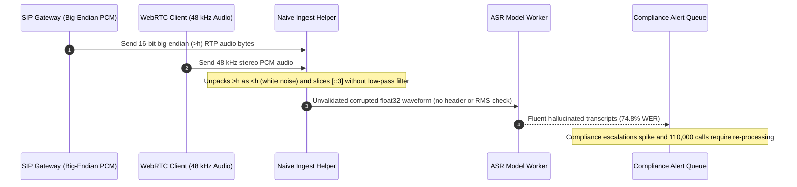

# Module 00: Audio as Data: Waveforms and Spectrograms

> **Prerequisites:** [Track 01, Module 01: Text Encoding — Bytes, Unicode, and UTF-8](../../01-tokens-and-language-modeling/01-text-encoding-bytes-unicode-and-utf-8/README.md), basic familiarity with binary buffers (`int16`/`float32`) and HTTP media uploads.  
> **Estimated Reading Time:** 30 minutes  
> **Target Audience:** AI Backend Engineers, Voice Infrastructure Developers, Multimodal Systems Architects

> [!TIP]
> **The Golden Rule of Audio Ingestion:** Never feed raw compressed audio containers (`.mp3`, `.ogg`, `.webm`) or blindly slice-decimated waveforms straight into a speech model. Always decode to explicit canonical PCM (`16 kHz`, mono, signed `int16` little-endian or normalized `float32` in `[-1.0, 1.0]`) through an anti-aliasing low-pass filter, and verify that your STFT framing (`25 ms` window, `10 ms` stride) produces exact integer-aligned Log-Mel frames (`100 frames/sec`).

---

## Why This Matters

When an LLM fails on text, you can open the HTTP payload and read the broken string immediately. When a speech pipeline fails on audio, the payload looks like opaque binary bytes—yet small preprocessing bugs quietly wreck downstream accuracy before a single neural network weight ever runs.

In production voice backends, three invisible bugs account for most early-stage ASR outages: decoding `8 kHz` telephony streams with the wrong byte order (`big-endian` RTP vs. `little-endian` WAV), downsampling `48 kHz` WebRTC browser captures to `16 kHz` by dropping samples without a low-pass filter (causing **Nyquist aliasing**), and feeding arbitrary audio amplitudes into STFT pipelines without validating peak clipping or RMS silence levels. Before studying speech recognition architectures or Whisper, you must treat waveforms and Log-Mel spectrograms as deterministic, mathematically bounded data structures.

---

## 1. From Air Pressure to Log-Mel Spectrograms

Sound begins as continuous acoustic air pressure variations. To turn those pressure waves into tensors a Transformer or CNN can consume, a speech backend executes a strict six-stage digital signal processing (DSP) pipeline:

1. **ADC Sampling & Quantization (PCM):** An analog-to-digital converter samples amplitude at sample rate $f_s$ (Hz) and quantizes each sample to $b$ bits (typically signed `int16` covering `[-32768, 32767]`), producing **Pulse-Code Modulation (PCM)** samples.
2. **Container Demux & Resampling:** Compressed formats (`Opus`, `MP3`, `AAC`, G.711 $\mu$-law) are decoded into linear PCM, mixed down to `1` mono channel, and resampled to the model's canonical sample rate (`16,000 Hz` for almost all modern ASR) via an anti-aliasing low-pass filter.
3. **Float Normalization & Framing:** `int16` samples are divided by `32768.0` into normalized `float32` in `[-1.0, 1.0]`, then sliced into overlapping windows of length $N_{\text{FFT}}$ (`25 ms` = `400` samples at `16 kHz`) advancing by hop stride $H$ (`10 ms` = `160` samples).
4. **Hann Windowing & STFT:** Multiplying each frame by a smooth Hann taper before taking the **Short-Time Fourier Transform (STFT)** suppresses hard-edge discontinuities (**spectral leakage**) and yields complex frequency bins over time.
5. **Mel Filterbank Projection:** Squared magnitudes $|X(m, k)|^2$ (power spectrum) are multiplied by $M$ overlapping triangular **Mel filters** (`80` or `128` bins) spaced logarithmically to mimic human ear pitch perception.
6. **Log-Amplitude Compression:** Applying $\log_{10}$ (with floor clamping around `max - 8.0`) mirrors human decibel loudness sensitivity and produces the `(n_mels, n_frames)` **Log-Mel Spectrogram**.


### Quantitative Mechanics: Nyquist, PCM Byte Rates, STFT, and Mel Scaling

Every backend engineer working with audio must keep four exact equations close at hand:

- **Nyquist-Shannon Sampling Theorem & Aliasing:** A digital stream sampled at $f_s$ can unambiguously capture frequencies strictly below the **Nyquist limit**:

$$f_{\text{Nyq}} = \frac{f_s}{2}, \qquad f_{\text{alias}} = \left| f_{\text{signal}} - k f_s \right| \quad (\text{folding into } [0, f_{\text{Nyq}}])$$

If a `48 kHz` browser microphone captures a `14,000 Hz` high-frequency hiss and you downsample to `16 kHz` ($f_{\text{Nyq}} = 8,000\text{ Hz}$) simply by taking every third sample (`samples[::3]`) without first applying an `8 kHz` low-pass filter, that `14,000 Hz` energy folds down to $|14000 - 16000| = 2,000\text{ Hz}$—right inside the critical speech vowel-formant band!

- **Uncompressed PCM Byte Rate & Dynamic Range (SQNR):** Given sample rate $f_s$, bit depth $b$, channel count $C$, and duration $T$ seconds:

$$B_{\text{PCM}} = f_s \cdot \frac{b}{8} \cdot C \quad (\text{bytes/sec}), \qquad S_{\text{bytes}} = B_{\text{PCM}} \cdot T, \qquad \text{SQNR}_{\text{dB}} \approx 6.02 b + 1.76\text{ dB}$$

At `16 kHz` `16`-bit mono, $B_{\text{PCM}} = 16000 \cdot 2 \cdot 1 = 32,000\text{ bytes/sec}$ (`109.86 MiB/hour`, `~98 dB` linear dynamic range). By contrast, PSTN telephony uses `8 kHz` `8`-bit **G.711 $\mu$-law** (`8,000 bytes/sec`, `27.47 MiB/hour`), applying logarithmic companding to pack `~13–14` bits of perceptual dynamic range into `8`-bit samples at the cost of a strict `4,000 Hz` Nyquist ceiling (muffling `s`/`f`/`th` fricatives above `4 kHz`).

- **STFT Frame Count & Time-Frequency Uncertainty:** Sliding a window of $N_{\text{FFT}}$ samples with hop $H$ over $L_{\text{samples}}$ samples (using center padding of $N_{\text{FFT}} / 2$ on both sides and dropping the trailing boundary frame, as Whisper does) produces:

$$N_{\text{frames}} = \frac{L_{\text{samples}}}{H} = T \cdot \frac{f_s}{H}, \qquad \Delta f = \frac{f_s}{N_{\text{FFT}}}, \qquad \Delta t = \frac{H}{f_s}$$

With Whisper's canonical constants ($f_s = 16,000\text{ Hz}$, $N_{\text{FFT}} = 400$, $H = 160$), each frame spans `25 ms` ($\Delta f = 40\text{ Hz}$ bin spacing) and steps every `10 ms` (`100 frames/sec`). A `30`-second chunk (`480,000` samples) maps to exactly `3,000` STFT frames. Note the **Gabor / Heisenberg time-frequency trade-off**: shrinking $N_{\text{FFT}}$ sharpens time localization for rapid plosives (`p`, `t`, `k`) but widens $\Delta f$ (smearing pitch harmonics), whereas enlarging $N_{\text{FFT}}$ sharpens $\Delta f$ at the expense of blurring fast consonant transitions.

- **Hertz-to-Mel Perception Warp:** Human hearing resolves pitch linearly below `~1,000 Hz` and logarithmically above `1,000 Hz`:

$$m(f) = 2595 \cdot \log_{10}\!\left(1 + \frac{f}{700}\right), \qquad f(m) = 700 \cdot \left(10^{m / 2595} - 1\right)$$

Spacing $M \in \{80, 128\}$ triangular filters uniformly in Mel space packs narrow bands across vowel formants (`200–3,000 Hz`) while compressing high-frequency noise bands (`4,000–8,000 Hz`) into fewer bins.

### Canonical Industry Audio Profiles

| Audio Profile | Sample Rate ($f_s$) | Nyquist Limit | Encoding / Bit Depth | Mono Byte Rate | Typical Origin & ASR Trade-off |
| :--- | :--- | :--- | :--- | :--- | :--- |
| **PSTN Telephony (Narrowband)** | `8,000 Hz` | `4,000 Hz` | `8`-bit G.711 $\mu$-law / A-law | `8,000 B/s` (`64 kbps`) | SIP trunks & IVR; drops `4–8 kHz` fricative detail (`s` vs. `f`), hurting unadapted ASR |
| **ASR Canonical Standard** | `16,000 Hz` | `8,000 Hz` | `16`-bit `pcm_s16le` or `float32` | `32,000 B/s` (`256 kbps`) | Whisper, Conformer, Silero VAD native rate; captures full speech intelligibility |
| **WebRTC Voice / Opus** | `48,000 Hz` internal | `24,000 Hz` | Variable bitrate Opus (`24–48 kbps`) | `3,000–6,000 B/s` | Browser/mobile live streams; tiny network bandwidth, must decode + low-pass to `16 kHz` |
| **Broadcast / Studio PCM** | `44.1 / 48 kHz` | `22.05 / 24 kHz` | `16`-bit or `24`-bit stereo PCM | `176.4–288 KB/s` (stereo) | Podcast/video files; `6x` larger than mono `16 kHz` ASR needs—must downmix & resample |

---

## 2. Systematic Comparison Matrix: Audio Formats & Spectral Representations

| Representation | Bandwidth / Size (`1 hr` Mono) | Retains Phase? | Noise / Aliasing Risk | Primary Production Role |
| :--- | :--- | :--- | :--- | :--- |
| **Raw `int16` PCM (`16 kHz`)** | `109.86 MiB` (`32 KB/s`) | Yes (exact waveform) | Hard clipping if peak exceeds `[-32768, 32767]`; endianness mismatch (`<h` vs `>h`) | Internal worker IPC, VAD buffers, canonical `.wav` storage |
| **Normalized `float32` PCM (`16 kHz`)** | `219.73 MiB` (`64 KB/s`) | Yes (exact waveform) | Silent scale bugs if divided by `32768` twice or unscaled (`[-32768, 32767]`) | Direct input array for `whisper`, `faster-whisper`, PyTorch/ONNX models |
| **G.711 $\mu$-law (`8 kHz`)** | `27.47 MiB` (`8 KB/s`) | Yes (companded) | Linear decoding yields static noise; `4 kHz` Nyquist loses sibilants | Legacy SIP/RTP telephony bridges (must decode $\mu$-law $\to$ `16 kHz` upsample) |
| **WebRTC Opus (`32 kbps`)** | `13.73 MiB` (`4 KB/s`) | Perceptual (lossy) | Packet loss concealment artifacts; naive `48k -> 16k` stride causes aliasing | Client-to-server streaming ingress over WAN/mobile networks |
| **STFT Power Spectrum (`201` bins)** | `276.03 MiB` (`201 * 100 * 4 B/s`) | No (`|X|^2` discards phase) | Spectral leakage without Hann windowing | Intermediate DSP step & speech enhancement / Wiener filtering |
| **Log-Mel (`80` or `128` bins)** | `109.86 MiB` (`80`) / `175.78 MiB` (`128`) | No (discarded) | Wrong `n_mels` (`80` vs `128`) or wrong `log` clamp distorts activations | Direct encoder input tensor for Whisper, Conformer, and neural acoustic models |

---

## 3. Production War Story Post-Mortem: The \$42,000 Telephony Aliasing & Byte-Order Mismatch

| Field | Incident Details |
| :--- | :--- |
| **Severity** | **SEV-1** (Silent Accuracy Collapse Across Voice Compliance Pipeline) |
| **Detection / Resolution Time** | Detected 36 hours post-rollout via human QA escalation / Mitigated in 4 hours (`ffmpeg` canonical normalizer + ingest endian guard) |
| **Impact** | Word Error Rate jumped from `6.2%` to `74.8%` across `110,000` recorded support calls; **\$42,000** in wasted GPU re-runs and emergency compliance audits |

### What Happened

A fintech call-center analytics team expanded its ASR backend from `48 kHz` WebRTC browser recordings to dual-channel `8 kHz` RTP telephony captures alongside user-uploaded browser audio. To avoid deploying `ffmpeg` inside lightweight Python worker containers, an engineer wrote a pure-Python `"fast resampler"`:

1. For `48 kHz` WebRTC streams, the helper downsampled to `16 kHz` via `samples[::3]` with **zero anti-aliasing low-pass filter**. High-frequency room noise and sibilants between `8–24 kHz` aliased straight back into `0–8 kHz`.
2. For `16`-bit linear PCM RTP streams arriving off the SIP media gateway in **network byte order (`big-endian`, `>h`)**, the ingest parser unpacked bytes as host **little-endian (`<h`)**, turning quiet speech into violent full-scale white-noise spikes.
3. Because the worker did not validate WAV headers, RMS levels, or peak clipping before calling Whisper, the model ingested garbage white noise and emitted fluent, confident hallucinations instead of raising an ingest error.



### Root Cause Analysis

- **Missing Endianness & Scale Contract:** Unpacking raw network `int16` PCM with `<h` instead of explicit endian verification scrambled the most-significant and least-significant bytes of every sample.
- **Unfiltered Decimation (`::3`):** Dropping `2` out of every `3` samples without a `<= 8 kHz` anti-aliasing low-pass filter violated the Nyquist-Shannon sampling criterion, folding upper-band frequencies into core vowel formants.
- **Zero Pre-Inference Telemetry:** No validation gate checked RIFF/WAV metadata, clipping fraction, or spectral flatness prior to GPU dispatch.

### The Fix & Architectural Hardening

- **Canonical Ingest Normalizer:** Replaced hand-rolled slicing with `ffmpeg -nostdin -y -i input -vn -ac 1 -ar 16000 -c:a pcm_s16le` (or windowed-sinc / `soxr` polyphase resampling), guaranteeing anti-aliased mono `16 kHz` `int16` output regardless of input container.
- **Explicit Header & Telemetry Validation:** Enforced strict `RIFF`/`WAVE` metadata parsing, endianness checks on raw PCM RTP feeds (`pcm_s16be` $\to$ `pcm_s16le`), clipping rate `< 0.5%`, and finite `[-1.0, 1.0]` range assertions before queuing GPU inference.

---

## 4. Multi-Language Production Implementation: Canonical WAV/PCM Validator & STFT Frame Budgeter

Below is a production-grade **WAV/PCM Ingest Validator & STFT Frame Calculator** across **Go**, **TypeScript**, **Python**, and **C#**. Each implementation validates `RIFF`/`WAVE` headers, rejects unscaled or clipped buffers, computes exact RMS dBFS, enforces Nyquist headroom, and returns exact Whisper-aligned `25 ms` / `10 ms` frame dimensions.

````carousel

```go
package audiopcm

import (
	"encoding/binary"
	"errors"
	"fmt"
	"math"
)

type AudioTelemetry struct {
	SampleRate    uint32
	Channels      uint16
	BitsPerSample uint16
	ByteRate      uint32
	NumSamples    int
	DurationSec   float64
	PeakNorm      float64
	RmsDBFS       float64
	ClippedCount  int
	MelFrames10ms int
}

// ValidateAndNormalizeWav verifies a canonical 16-bit PCM RIFF WAV header and returns normalized float32 samples.
func ValidateAndNormalizeWav(raw []byte, expectedSR uint32) ([]float32, AudioTelemetry, error) {
	if len(raw) < 44 {
		return nil, AudioTelemetry{}, errors.New("payload shorter than 44-byte WAV header")
	}
	if string(raw[0:4]) != "RIFF" || string(raw[8:12]) != "WAVE" {
		return nil, AudioTelemetry{}, errors.New("invalid RIFF/WAVE container magic bytes")
	}

	audioFmt := binary.LittleEndian.Uint16(raw[20:22])
	channels := binary.LittleEndian.Uint16(raw[22:24])
	sampleRate := binary.LittleEndian.Uint32(raw[24:28])
	byteRate := binary.LittleEndian.Uint32(raw[28:32])
	bitsPerSample := binary.LittleEndian.Uint16(raw[34:36])

	if audioFmt != 1 || bitsPerSample != 16 {
		return nil, AudioTelemetry{}, fmt.Errorf("unsupported PCM format=%d bits=%d (require fmt=1, 16-bit)", audioFmt, bitsPerSample)
	}
	if channels != 1 || sampleRate != expectedSR {
		return nil, AudioTelemetry{}, fmt.Errorf("require mono %d Hz PCM; got channels=%d sr=%d", expectedSR, channels, sampleRate)
	}

	// Scan subchunks safely for "data" rather than assuming fixed byte offset 44
	offset := 12
	var pcmBytes []byte
	for offset+8 <= len(raw) {
		chunkID := string(raw[offset : offset+4])
		chunkLen := int(binary.LittleEndian.Uint32(raw[offset+4 : offset+8]))
		if offset+8+chunkLen > len(raw) {
			return nil, AudioTelemetry{}, errors.New("truncated WAV subchunk")
		}
		if chunkID == "data" {
			pcmBytes = raw[offset+8 : offset+8+chunkLen]
			break
		}
		offset += 8 + chunkLen + (chunkLen & 1) // Word-aligned subchunks
	}
	if len(pcmBytes) == 0 || len(pcmBytes)%2 != 0 {
		return nil, AudioTelemetry{}, errors.New("missing or misaligned PCM data chunk")
	}

	n := len(pcmBytes) / 2
	out := make([]float32, n)
	var sumSq, peak float64
	clipped := 0
	for i := 0; i < n; i++ {
		s := int16(binary.LittleEndian.Uint16(pcmBytes[2*i : 2*i+2]))
		if s == 32767 || s == -32768 {
			clipped++
		}
		f := float64(s) / 32768.0
		out[i] = float32(f)
		sumSq += f * f
		if absF := math.Abs(f); absF > peak {
			peak = absF
		}
	}

	rms := math.Sqrt(sumSq / float64(n))
	dbfs := 20.0 * math.Log10(math.Max(rms, 1e-12))
	hop := int(sampleRate / 100) // 10 ms hop = 160 samples at 16 kHz

	return out, AudioTelemetry{
		SampleRate:    sampleRate,
		Channels:      channels,
		BitsPerSample: bitsPerSample,
		ByteRate:      byteRate,
		NumSamples:    n,
		DurationSec:   float64(n) / float64(sampleRate),
		PeakNorm:      peak,
		RmsDBFS:       dbfs,
		ClippedCount:  clipped,
		MelFrames10ms: n / hop,
	}, nil
}
```

<!-- slide -->

```typescript
export interface AudioIngestTelemetry {
  readonly sampleRate: number;
  readonly channels: number;
  readonly bitsPerSample: number;
  readonly byteRate: number;
  readonly durationSec: number;
  readonly peakNormalized: number;
  readonly rmsDbfs: number;
  readonly clippedRatio: number;
  readonly melFrames10ms: number;
}

export function validateAndNormalizeWav16(
  buffer: ArrayBuffer,
  expectedSampleRate = 16_000,
): { readonly pcm: Float32Array; readonly telemetry: AudioIngestTelemetry } {
  if (buffer.byteLength < 44) {
    throw new Error("Payload smaller than 44-byte RIFF WAV header");
  }
  const view = new DataView(buffer);
  const ascii = (start: number, len: number): string =>
    String.fromCharCode(...new Uint8Array(buffer, start, len));

  if (ascii(0, 4) !== "RIFF" || ascii(8, 4) !== "WAVE") {
    throw new Error("Invalid RIFF/WAVE header");
  }

  let offset = 12;
  let audioFormat = 0;
  let channels = 0;
  let sampleRate = 0;
  let byteRate = 0;
  let bitsPerSample = 0;
  let dataStart = -1;
  let dataLen = 0;

  while (offset + 8 <= buffer.byteLength) {
    const id = ascii(offset, 4);
    const size = view.getUint32(offset + 4, true);
    if (offset + 8 + size > buffer.byteLength) {
      throw new Error(`Truncated chunk '${id}'`);
    }
    if (id === "fmt ") {
      audioFormat = view.getUint16(offset + 8, true);
      channels = view.getUint16(offset + 10, true);
      sampleRate = view.getUint32(offset + 12, true);
      byteRate = view.getUint32(offset + 16, true);
      bitsPerSample = view.getUint16(offset + 22, true);
    } else if (id === "data") {
      dataStart = offset + 8;
      dataLen = size;
      break;
    }
    offset += 8 + size + (size & 1);
  }

  if (audioFormat !== 1 || bitsPerSample !== 16 || channels !== 1 || sampleRate !== expectedSampleRate) {
    throw new Error(
      `Expected mono ${expectedSampleRate} Hz 16-bit PCM; got fmt=${audioFormat} ch=${channels} sr=${sampleRate} bits=${bitsPerSample}`,
    );
  }
  if (dataStart < 0 || dataLen === 0 || dataLen % 2 !== 0) {
    throw new Error("Missing or unaligned PCM data subchunk");
  }

  const numSamples = dataLen / 2;
  const pcm = new Float32Array(numSamples);
  let sumSq = 0;
  let peak = 0;
  let clipped = 0;

  for (let i = 0; i < numSamples; i += 1) {
    const rawSample = view.getInt16(dataStart + i * 2, true);
    if (rawSample === 32767 || rawSample === -32768) clipped += 1;
    const norm = rawSample / 32768.0;
    pcm[i] = norm;
    sumSq += norm * norm;
    const absVal = Math.abs(norm);
    if (absVal > peak) peak = absVal;
  }

  const rms = Math.sqrt(sumSq / numSamples);
  const rmsDbfs = 20 * Math.log10(Math.max(rms, 1e-12));
  const hopSamples = Math.floor(sampleRate / 100); // 10 ms Whisper stride

  return {
    pcm,
    telemetry: {
      sampleRate,
      channels,
      bitsPerSample,
      byteRate,
      durationSec: numSamples / sampleRate,
      peakNormalized: peak,
      rmsDbfs,
      clippedRatio: clipped / numSamples,
      melFrames10ms: Math.floor(numSamples / hopSamples),
    },
  };
}
```

<!-- slide -->

```python
"""
wav_ingest_guard.py
Validates canonical 16 kHz mono 16-bit PCM WAV streams and computes STFT/Mel frame geometry.
"""
from dataclasses import dataclass
import math
import struct


@dataclass(frozen=True)
class PcmValidationReport:
    sample_rate: int
    channels: int
    bits_per_sample: int
    byte_rate: int
    num_samples: int
    duration_sec: float
    peak_norm: float
    rms_dbfs: float
    clipped_samples: int
    mel_frames_10ms: int


def validate_canonical_wav(raw_bytes: bytes, expected_sr: int = 16_000) -> tuple[list[float], PcmValidationReport]:
    if len(raw_bytes) < 44 or raw_bytes[:4] != b"RIFF" or raw_bytes[8:12] != b"WAVE":
        raise ValueError("Invalid or truncated RIFF/WAVE container")

    offset = 12
    fmt_info: tuple[int, int, int, int, int] | None = None
    data_payload: bytes | None = None

    while offset + 8 <= len(raw_bytes):
        chunk_id = raw_bytes[offset : offset + 4]
        chunk_len = struct.unpack_from("<I", raw_bytes, offset + 4)[0]
        body_start = offset + 8
        body_end = body_start + chunk_len
        if body_end > len(raw_bytes):
            raise ValueError(f"Truncated WAV chunk {chunk_id!r}")
        if chunk_id == b"fmt ":
            audio_fmt, channels, sr, byte_rate, _, bits = struct.unpack_from("<HHIIHH", raw_bytes, body_start)
            fmt_info = (audio_fmt, channels, sr, byte_rate, bits)
        elif chunk_id == b"data":
            data_payload = raw_bytes[body_start:body_end]
            break
        offset = body_end + (chunk_len & 1)

    if fmt_info is None or data_payload is None:
        raise ValueError("Missing fmt or data subchunk")

    audio_fmt, channels, sr, byte_rate, bits = fmt_info
    if audio_fmt != 1 or bits != 16 or channels != 1 or sr != expected_sr:
        raise ValueError(f"Require mono {expected_sr} Hz int16 PCM; got fmt={audio_fmt} ch={channels} sr={sr} bits={bits}")
    if len(data_payload) == 0 or len(data_payload) % 2 != 0:
        raise ValueError("Empty or unaligned PCM payload")

    n_samples = len(data_payload) // 2
    int_samples = struct.unpack(f"<{n_samples}h", data_payload)
    norm_samples = [s / 32768.0 for s in int_samples]
    clipped = sum(1 for s in int_samples if s in (32767, -32768))
    peak = max(abs(x) for x in norm_samples)
    rms = math.sqrt(sum(x * x for x in norm_samples) / n_samples)
    rms_dbfs = 20.0 * math.log10(max(rms, 1e-12))

    return norm_samples, PcmValidationReport(
        sample_rate=sr,
        channels=channels,
        bits_per_sample=bits,
        byte_rate=byte_rate,
        num_samples=n_samples,
        duration_sec=n_samples / sr,
        peak_norm=peak,
        rms_dbfs=rms_dbfs,
        clipped_samples=clipped,
        mel_frames_10ms=n_samples // (sr // 100),
    )
```

<!-- slide -->

```csharp
using System;
using System.Buffers.Binary;
using System.Text;

namespace GenAI.Speech.Audio;

public sealed record AudioIngestReport(
    int SampleRate,
    int Channels,
    int BitsPerSample,
    int ByteRate,
    int NumSamples,
    double DurationSec,
    double PeakNormalized,
    double RmsDbfs,
    int ClippedSamples,
    int MelFrames10ms);

public static class WavIngestGuard
{
    public static (float[] NormalizedPcm, AudioIngestReport Report) ValidateCanonicalWav(
        ReadOnlySpan<byte> raw,
        int expectedSampleRate = 16_000)
    {
        if (raw.Length < 44 ||
            Encoding.ASCII.GetString(raw[0..4]) != "RIFF" ||
            Encoding.ASCII.GetString(raw[8..12]) != "WAVE")
        {
            throw new InvalidOperationException("Invalid RIFF/WAVE container");
        }

        int offset = 12;
        ushort audioFmt = 0, channels = 0, bits = 0;
        int sr = 0, byteRate = 0;
        ReadOnlySpan<byte> dataChunk = default;

        while (offset + 8 <= raw.Length)
        {
            string chunkId = Encoding.ASCII.GetString(raw.Slice(offset, 4));
            int chunkLen = (int)BinaryPrimitives.ReadUInt32LittleEndian(raw.Slice(offset + 4, 4));
            int bodyStart = offset + 8;
            if (bodyStart + chunkLen > raw.Length)
                throw new InvalidOperationException($"Truncated chunk '{chunkId}'");

            if (chunkId == "fmt ")
            {
                audioFmt = BinaryPrimitives.ReadUInt16LittleEndian(raw.Slice(bodyStart, 2));
                channels = BinaryPrimitives.ReadUInt16LittleEndian(raw.Slice(bodyStart + 2, 2));
                sr = (int)BinaryPrimitives.ReadUInt32LittleEndian(raw.Slice(bodyStart + 4, 4));
                byteRate = (int)BinaryPrimitives.ReadUInt32LittleEndian(raw.Slice(bodyStart + 8, 4));
                bits = BinaryPrimitives.ReadUInt16LittleEndian(raw.Slice(bodyStart + 14, 2));
            }
            else if (chunkId == "data")
            {
                dataChunk = raw.Slice(bodyStart, chunkLen);
                break;
            }
            offset = bodyStart + chunkLen + (chunkLen & 1);
        }

        if (audioFmt != 1 || bits != 16 || channels != 1 || sr != expectedSampleRate)
            throw new InvalidOperationException($"Require mono {expectedSampleRate} Hz 16-bit PCM; got fmt={audioFmt} ch={channels} sr={sr} bits={bits}");
        if (dataChunk.IsEmpty || dataChunk.Length % 2 != 0)
            throw new InvalidOperationException("Missing or unaligned PCM data chunk");

        int n = dataChunk.Length / 2;
        var pcm = new float[n];
        double sumSq = 0, peak = 0;
        int clipped = 0;

        for (int i = 0; i < n; i++)
        {
            short sample = BinaryPrimitives.ReadInt16LittleEndian(dataChunk.Slice(i * 2, 2));
            if (sample == short.MaxValue || sample == short.MinValue) clipped++;
            double norm = sample / 32768.0;
            pcm[i] = (float)norm;
            sumSq += norm * norm;
            double absVal = Math.Abs(norm);
            if (absVal > peak) peak = absVal;
        }

        double rms = Math.Sqrt(sumSq / n);
        double dbfs = 20.0 * Math.Log10(Math.Max(rms, 1e-12));
        int hopSamples = sr / 100; // 10 ms hop

        return (pcm, new AudioIngestReport(sr, channels, bits, byteRate, n, (double)n / sr, peak, dbfs, clipped, n / hopSamples));
    }
}
```

````

---

## 5. Practical Hands-On Verification CLI Workflows

Run these deterministic Python 3.13 verification scripts offline—only the standard library (`io`, `math`, `struct`, `wave`) is needed.

### Workflow 1: Synthesize Canonical WAV Bytes & Reproduce Nyquist Aliasing Locally

Generate an in-memory `16 kHz` signed `16`-bit mono WAV buffer, inspect its RIFF header byte rate (`32,000 B/s`) and RMS dBFS, and demonstrate how naive `48 kHz -> 16 kHz` stride slicing folds a `14,000 Hz` tone into `2,000 Hz`:

```bash
python -c '
import io, math, struct, wave

def make_wav_bytes(freq_hz, sample_rate=16000, duration_s=1.0, amp=0.5):
    n = int(sample_rate * duration_s)
    samples = [int(max(-32768, min(32767, round(32767 * amp * math.sin(2 * math.pi * freq_hz * i / sample_rate))))) for i in range(n)]
    buf = io.BytesIO()
    with wave.open(buf, "wb") as wf:
        wf.setnchannels(1)
        wf.setsampwidth(2)
        wf.setframerate(sample_rate)
        wf.writeframes(struct.pack(f"<{n}h", *samples))
    return buf.getvalue()

def inspect_wav(blob):
    riff, size, fmt_id = struct.unpack("<4sI4s", blob[:12])
    with wave.open(io.BytesIO(blob), "rb") as wf:
        ch, sw, sr, nf = wf.getnchannels(), wf.getsampwidth(), wf.getframerate(), wf.getnframes()
        raw = wf.readframes(nf)
    pcm = struct.unpack(f"<{nf * ch}h", raw)
    peak = max(abs(x) for x in pcm) / 32768.0
    rms = math.sqrt(sum((x / 32768.0) ** 2 for x in pcm) / len(pcm))
    dbfs = 20 * math.log10(max(rms, 1e-12))
    byte_rate = sr * sw * ch
    return riff.decode(), fmt_id.decode(), sr, sw * 8, ch, byte_rate, round(peak, 4), round(dbfs, 2)

def dominant_freq_dft(samples, sr):
    n = len(samples)
    best_k, best_mag = 0, -1.0
    for k in range(1, n // 2):
        re = sum(samples[i] * math.cos(2 * math.pi * k * i / n) for i in range(n))
        im = sum(-samples[i] * math.sin(2 * math.pi * k * i / n) for i in range(n))
        mag = re * re + im * im
        if mag > best_mag:
            best_mag, best_k = mag, k
    return best_k * sr / n

wav16 = make_wav_bytes(1000, sample_rate=16000, duration_s=0.1, amp=0.5)
print("WAV Header/Telemetry:", inspect_wav(wav16))

sr48 = 48000
n48 = 480
clean_48 = [math.sin(2 * math.pi * 1000 * i / sr48) for i in range(n48)]
high_48 = [math.sin(2 * math.pi * 14000 * i / sr48) for i in range(n48)]
naive_clean_16 = clean_48[::3]
naive_high_16 = high_48[::3]
print(f"Naive 48k->16k (1,000 Hz < 8k Nyquist) detected freq: {dominant_freq_dft(naive_clean_16, 16000):.1f} Hz")
print(f"Naive 48k->16k (14,000 Hz > 8k Nyquist) aliased freq: {dominant_freq_dft(naive_high_16, 16000):.1f} Hz")
'
```

**Expected Output:**

```text
WAV Header/Telemetry: ('RIFF', 'WAVE', 16000, 16, 1, 32000, 0.5, -9.03)
Naive 48k->16k (1,000 Hz < 8k Nyquist) detected freq: 1000.0 Hz
Naive 48k->16k (14,000 Hz > 8k Nyquist) aliased freq: 2000.0 Hz
```

Notice how `14,000 Hz`—well above `16 kHz`'s `8,000 Hz` Nyquist ceiling—aliased directly into `2,000.0 Hz` (`|14000 - 16000| = 2000 Hz`), inside the human vowel-formant range.

### Workflow 2: Pure-Stdlib Hann-Windowed STFT & 80-Bin Log-Mel Filterbank

Compute Whisper-aligned STFT frames (`N_FFT=400`, `hop=160` -> `100 frames/sec`) and apply an `80`-bin triangular Mel filterbank over a synthetic dual-formant tone (`520 Hz` + `2,400 Hz`):

```bash
python -c '
import math

def hz_to_mel(f):
    return 2595.0 * math.log10(1.0 + f / 700.0)

def mel_to_hz(m):
    return 700.0 * (10.0 ** (m / 2595.0) - 1.0)

def mel_filterbank(n_mels=80, n_fft=400, sr=16000):
    m_min, m_max = hz_to_mel(0.0), hz_to_mel(sr / 2.0)
    mels = [m_min + i * (m_max - m_min) / (n_mels + 1) for i in range(n_mels + 2)]
    bins = [int(math.floor((n_fft + 1) * mel_to_hz(m) / sr)) for m in mels]
    fb = [[0.0] * (n_fft // 2 + 1) for _ in range(n_mels)]
    for m in range(1, n_mels + 1):
        left, center, right = bins[m - 1], bins[m], bins[m + 1]
        for k in range(left, center):
            if center > left:
                fb[m - 1][k] = (k - left) / (center - left)
        for k in range(center, right):
            if right > center:
                fb[m - 1][k] = (right - k) / (right - center)
    return fb, bins

sr, n_fft, hop, dur_s = 16000, 400, 160, 3.0
samples = [0.6 * math.sin(2 * math.pi * 520 * i / sr) + 0.4 * math.sin(2 * math.pi * 2400 * i / sr) for i in range(int(sr * dur_s))]
padded = [0.0] * (n_fft // 2) + samples + [0.0] * (n_fft // 2)
frames = [padded[i : i + n_fft] for i in range(0, len(samples) + 1, hop)][:-1]
hann = [0.5 * (1.0 - math.cos(2 * math.pi * n / n_fft)) for n in range(n_fft)]

frame10 = [frames[10][n] * hann[n] for n in range(n_fft)]
power = []
for k in range(n_fft // 2 + 1):
    re = sum(frame10[n] * math.cos(2 * math.pi * k * n / n_fft) for n in range(n_fft))
    im = sum(-frame10[n] * math.sin(2 * math.pi * k * n / n_fft) for n in range(n_fft))
    power.append(re * re + im * im)

fb, bins = mel_filterbank(n_mels=80, n_fft=n_fft, sr=sr)
mel_energies = [max(1e-10, sum(fb[m][k] * power[k] for k in range(len(power)))) for m in range(80)]
log_mel = [math.log10(e) for e in mel_energies]
top_bins = sorted(range(80), key=lambda m: log_mel[m], reverse=True)[:4]
print(f"Samples={len(samples)} | Frames={len(frames)} ({len(frames)/dur_s:.0f} frames/s) | MelBins={len(log_mel)}")
for m in top_bins:
    center_hz = bins[m + 1] * sr / n_fft
    print(f"  Mel bin #{m:02d} (~{center_hz:>6.0f} Hz) | log10_energy={log_mel[m]:.2f}")
'
```

**Expected Output:**

```text
Samples=48000 | Frames=300 (100 frames/s) | MelBins=80
  Mel bin #17 (~   520 Hz) | log10_energy=3.56
  Mel bin #47 (~  2400 Hz) | log10_energy=3.32
  Mel bin #18 (~   560 Hz) | log10_energy=2.95
  Mel bin #16 (~   480 Hz) | log10_energy=2.95
```

### Workflow 3: Byte-Rate, Storage & Spectrogram Expansion Sweep

Compare network ingress payloads (`8 kHz` $\mu$-law, `48 kHz` Opus) against uncompressed `16 kHz` PCM and Whisper `v3`'s `128`-bin `float32` Log-Mel feature tensor over 1 hour of audio:

```bash
python -c '
def report_audio_profile(label, sr, bits, ch, bitrate_kbps=None, mel_bins=None):
    if mel_bins:
        bytes_sec = mel_bins * 100 * 4
    elif bitrate_kbps:
        bytes_sec = bitrate_kbps * 1000 / 8
    else:
        bytes_sec = sr * (bits // 8) * ch
    mb_per_hr = (bytes_sec * 3600) / (1024 * 1024)
    nyq = (sr / 2) if sr else 8000
    print(f"{label:<30} | nyquist={nyq:>6.0f} Hz | rate={bytes_sec:>8.1f} B/s | 1hr={mb_per_hr:>6.2f} MiB")

report_audio_profile("8 kHz G.711 mu-law (mono)", 8000, 8, 1)
report_audio_profile("16 kHz PCM int16 (ASR std)", 16000, 16, 1)
report_audio_profile("48 kHz WebRTC Opus (32 kbps)", 48000, 0, 1, bitrate_kbps=32)
report_audio_profile("48 kHz Stereo PCM int16", 48000, 16, 2)
report_audio_profile("Whisper v3 Log-Mel (128 fp32)", 16000, 32, 1, mel_bins=128)
'
```

**Expected Output:**

```text
8 kHz G.711 mu-law (mono)      | nyquist=  4000 Hz | rate=  8000.0 B/s | 1hr= 27.47 MiB
16 kHz PCM int16 (ASR std)     | nyquist=  8000 Hz | rate= 32000.0 B/s | 1hr=109.86 MiB
48 kHz WebRTC Opus (32 kbps)   | nyquist= 24000 Hz | rate=  4000.0 B/s | 1hr= 13.73 MiB
48 kHz Stereo PCM int16        | nyquist= 24000 Hz | rate=192000.0 B/s | 1hr=659.18 MiB
Whisper v3 Log-Mel (128 fp32)  | nyquist=  8000 Hz | rate= 51200.0 B/s | 1hr=175.78 MiB
```

### Hands-On Exercises

1. **Rectangular vs. Hann Leakage Check:** Modify Workflow 2 so `frame10` skips multiplying by `hann` (rectangular window) on a non-bin-centered tone like `500 Hz` (`12.5 * 40 Hz`), and observe how energy leaks across neighboring Mel bins `#14`–`#20`.
2. **Endianness Corruption Test:** In Workflow 1, pack the `16`-bit PCM buffer using `struct.pack(f">{n}h", ...)` (big-endian) while unpacking as `<h` (little-endian), then verify how peak amplitude jumps and RMS noise saturates near full scale.
3. **Optional `ffmpeg` Normalization Check (Local CLI):** Run `ffmpeg -i input.webm -vn -ac 1 -ar 16000 -c:a pcm_s16le out.wav` on any `.mp3` or `.webm` clip and run the Python validator in Section 4 to verify exact `16,000 Hz` / `32,000 B/s` output.

### Independent Challenge

A video-conferencing platform captures `48 kHz` stereo WebRTC Opus streams (`48 kbps`) and archives raw `48 kHz` `24`-bit stereo PCM in S3 before sending files to an ASR GPU fleet. Costs spike: object storage bills climb rapidly, GPU workers take `12x` longer downloading audio over VPC NAT gateways, and a newly added `8 kHz` dial-in leg crashes `16 kHz` ASR inference when workers treat incoming `8 kHz` samples as `16 kHz` (causing `2x` chipmunk speedup). Redesign the ingestion pipeline to minimize storage and network bandwidth without degrading ASR accuracy.

<details><summary>Architectural Discussion</summary>

1. **Archive Opus, Not `24`-bit `48 kHz` Stereo PCM:** Uncompressed `48 kHz` `24`-bit stereo PCM consumes $48000 \cdot 3 \cdot 2 = 288,000\text{ B/s}$ (`~989 MiB/hr`), whereas `32 kbps` mono Opus (`4,000 B/s`, `13.73 MiB/hr`) cuts storage and S3 transfer by **72x** with negligible impact on `16 kHz` ASR accuracy.
2. **Decode & Resample at the ASR Worker (or Canonical Transcode Proxy):** Demux and resample both `48 kHz` Opus and `8 kHz` PSTN dial-in legs into `16 kHz` mono `pcm_s16le` using `ffmpeg` / `libsoxr` anti-aliasing filters (`-ac 1 -ar 16000`), preventing both `48k -> 16k` Nyquist aliasing and the `2x` playback-rate bug when `8 kHz` samples are played back at `16 kHz`.
3. **Pre-Flight Telemetry Gate:** Validate explicit sample rate metadata and RMS energy before GPU scheduling so corrupted or dead-air streams never enter inference queues.

</details>

---

## 6. Common Mistakes & Troubleshooting

- **Feeding raw `int16` values `[-32768, 32767]` into a model expecting `float32` `[-1.0, 1.0]`:** Passing unscaled `int16` values cast directly to `float32` saturates Log-Mel clamp thresholds (`max - 8.0`) and destroys acoustic representations. Always divide by `32768.0`.
- **Resampling by array slicing (`audio[::3]`) or naive interpolation:** Decimating `48 kHz` $\to$ `16 kHz` without a low-pass filter aliases high-frequency harmonics directly into vowel formants. Use polyphase/sinc resampling (`ffmpeg`/`soxr`/`torchaudio`).
- **Passing `8 kHz` telephony samples without resampling into a `16 kHz` array:** Interpreting `8,000` samples as `0.5 s` of `16 kHz` audio plays speech at `2x` speed and shifts pitch up by an octave, collapsing ASR accuracy.
- **Hardcoding WAV header size `44` bytes:** Many tools (`ffmpeg`, Audacity, broadcast encoders) insert `LIST`/`INFO` or `JUNK` metadata chunks between `fmt ` and `data`, shifting PCM start past byte `44`. Always parse subchunks dynamically until chunk ID `"data"`.

---

## 7. Operational Validation Checkpoints & Checkpoint Quiz

### Operational Validation Checkpoints

<details><summary><strong>Checkpoint 1: Diagnosing 2x "chipmunk" speed distortion in ASR transcripts</strong></summary>

An engineer integrates a `8 kHz` PSTN call recorder into a pipeline expecting `16 kHz` `float32` waveforms, reading `8,000` samples per second straight into a `16,000`-sample-per-second tensor buffer without resampling. Explain the exact acoustic corruption and fix.

**Validation:** Feeding `8,000` samples into a `16 kHz` consumer compresses `1.0` second of real speech into `0.5` seconds (`2x` speed) and doubles every frequency ($f_{\text{apparent}} = 2 f_{\text{true}}$), pushing formants outside the model's learned range. Fix by reading the stream's true `sample_rate` (`8,000 Hz`) and applying an interpolating low-pass/sinc resampler (`8 kHz -> 16 kHz`) before normalizing to `float32`.

</details>

<details><summary><strong>Checkpoint 2: Why a 10,000 Hz tone corrupts 16 kHz speech transcription</strong></summary>

A hardware sensor leaks a continuous `10,000 Hz` ultrasonic whine into a `48 kHz` microphone stream, which a Python microservice downsamples to `16 kHz` using `wav[::3]`. Where does that `10,000 Hz` tone appear in the `16 kHz` Log-Mel spectrogram?

**Validation:** At `16 kHz`, the Nyquist limit is `8,000 Hz`. Naive stride-3 decimation (`wav[::3]`) performs zero low-pass filtering, so the `10,000 Hz` component aliases via $|10000 - 16000| = 6,000\text{ Hz}$, injecting a permanent high-energy `6,000 Hz` artifact directly across upper Mel filterbank bins. Applying a `<= 8 kHz` anti-aliasing low-pass filter before decimation eliminates it cleanly.

</details>

<details><summary><strong>Checkpoint 3: Sizing network & tensor bandwidth for 10,000 audio hours/month</strong></summary>

Your backend ingests `10,000` hours of `48 kHz` stereo `16`-bit PCM WAV uploads per month and converts them to `16 kHz` mono `128`-bin `float32` Log-Mel tensors (`100 frames/sec`). Calculate the raw ingress byte volume vs. Log-Mel feature volume.

**Validation:** `48 kHz` stereo `16`-bit PCM runs at $48000 \cdot 2 \cdot 2 = 192,000\text{ B/s}$ (`659.18 MiB/hr`), totaling `~6.44 TiB/month` of raw ingress. After downmixing/resampling to `16 kHz` mono and computing `128`-bin `float32` Log-Mel (`128 * 100 * 4 = 51,200 B/s`, `175.78 MiB/hr`), feature tensors occupy `~1.72 TiB/month`. Terminating client uploads in `32 kbps` Opus (`13.73 MiB/hr`, `~134 GiB/month`) slashes WAN bandwidth by **48x**.

</details>

### Checkpoint Quiz

1. What is the minimum sample rate required by the Nyquist-Shannon theorem to faithfully represent frequencies up to `7,500 Hz`, and why do ASR models standardize on `16,000 Hz` rather than `8,000 Hz`?
2. Compute the uncompressed byte rate (bytes/sec) and `1`-hour size (MiB) of `16 kHz`, `16`-bit, single-channel PCM audio.
3. Why does Whisper's STFT use a `25 ms` (`400`-sample) window with a `10 ms` (`160`-sample) hop length, and how many Mel frames result from `30` seconds of `16 kHz` audio?
4. What two problems occur if you compute an STFT directly on raw rectangular slices without a Hann window and without converting linear frequency bins to the Mel scale?
5. Why should production audio validators scan WAV subchunks dynamically instead of slicing PCM starting at byte index `44`?

<details><summary>Answers</summary>

1. At least `15,000 Hz` ($f_s \ge 2 f_{\max}$). ASR models standardize on `16,000 Hz` (`8,000 Hz` Nyquist ceiling) because `8,000 Hz` PSTN telephony cuts off at `4,000 Hz`, erasing critical high-frequency fricative/sibilant energy (`s`, `f`, `th`, `sh`) that lives between `4,000` and `8,000 Hz`.
2. $B = 16000 \cdot 2 \cdot 1 = 32,000\text{ bytes/sec}$; over `3,600` seconds that is $115,200,000\text{ bytes} = 109.86\text{ MiB}$.
3. A `25 ms` window provides `40 Hz` frequency resolution ($\Delta f = 16000 / 400$) to resolve pitch harmonics and vowel formants while remaining short enough to capture syllable transitions; a `10 ms` stride (`100 frames/sec`) guarantees temporal continuity. Across `30` seconds (`480,000` samples), that yields `3,000` STFT/Mel frames.
4. Rectangular slices introduce sharp boundary discontinuities that cause **spectral leakage** across neighboring FFT bins; linear frequency bins over-allocate resolution to upper bands (`4–8 kHz`) where pitch differences matter less perceptually and under-resolve vowel formants below `1–2 kHz` compared to the logarithmic Mel scale.
5. Valid RIFF WAVE files frequently embed optional metadata subchunks (`LIST`, `INFO`, `JUNK`, `bext`) before the `data` chunk, shifting the start of PCM samples well past offset `44`.

</details>

---

## Further Reading & Sources

- [OpenAI Whisper `audio.py` Feature Extraction Reference](https://github.com/openai/whisper/blob/main/whisper/audio.py) — canonical constants (`SAMPLE_RATE=16000`, `N_FFT=400`, `HOP_LENGTH=160`) and Log-Mel normalization.
- [Robust Speech Recognition via Large-Scale Weak Supervision (Radford et al., 2022)](https://arxiv.org/abs/2212.04356) — acoustic preprocessing and spectrogram conventions behind modern foundation ASR.
- [PyTorch `torchaudio.transforms.MelSpectrogram` Documentation](https://pytorch.org/audio/stable/generated/torchaudio.transforms.MelSpectrogram.html) — production tensor implementation of STFT and triangular Mel filterbanks.
- [Track 01, Module 01: Text Encoding — Bytes, Unicode, and UTF-8](../../01-tokens-and-language-modeling/01-text-encoding-bytes-unicode-and-utf-8/README.md) — byte-level encoding foundations prior to tokenization.

## Next

[Module 01: Speech Recognition Fundamentals](../01-speech-recognition-fundamentals/README.md)
