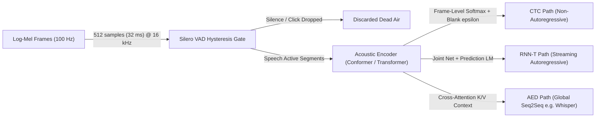
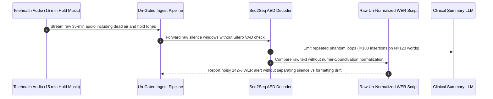

# Module 01: Speech Recognition Fundamentals

> **Prerequisites:** [Module 00: Audio as Data: Waveforms and Spectrograms](../00-audio-as-data-waveforms-and-spectrograms/README.md), [Track 02, Module 16: Encoder-Only vs. Decoder-Only vs. Encoder-Decoder](../../02-transformer-architecture/16-encoder-only-vs-decoder-only-vs-encoder-decoder/README.md).  
> **Estimated Reading Time:** 35 minutes  
> **Target Audience:** AI Backend Engineers, Speech Pipeline Developers, Evaluation & Quality Engineers

> [!TIP]
> **The Golden Rule of ASR Pipelines:** Never ship or benchmark a speech recognition system without **Voice Activity Detection (VAD) gating** at ingest and **identical text normalization** at evaluation. Feeding silence into sequence-to-sequence models manufactures fluent phantom hallucinations, while computing Word Error Rate on un-normalized punctuation and numerals swings reported accuracy by `5–15+` percentage points and hides true acoustic regressions.

---

## Why This Matters

Once audio becomes a `100 frames/sec` Log-Mel spectrogram, an ASR model faces a notoriously asymmetric sequence problem: **`30` seconds of speech spans `3,000` acoustic frames (`10 ms` each), yet produces only `~60–100` written text tokens**, with zero explicit boundaries telling the model where one phoneme ends and the next word begins.

Over two decades, Automatic Speech Recognition (ASR) evolved through four major paradigms—**HMM-GMM**, **CTC**, **RNN-T**, and **Attention-based Encoder-Decoder (AED)**—each making distinct trade-offs between streaming latency, internal language modeling, and silence stability. Choosing the wrong paradigm (or mismeasuring accuracy with naive WER scripts and un-gated silence) causes streaming voice bots to stall mid-turn or offline transcription services to emit phantom `"Subscribe and like"` loops during hold music.

---

## 1. The Acoustic-to-Text Alignment Problem & Modern ASR Paradigms

Every ASR system solves the **frame-to-token alignment problem** ($T_{\text{frames}} \gg U_{\text{tokens}}$) after an upstream VAD filter removes non-speech frames:

1. **HMM-GMM (Legacy Pipeline):** Separates acoustics (**Gaussian Mixture Models** over MFCC frames), alignment (**Hidden Markov Models** per phoneme state), pronunciation (**lexicon dictionary**), and word probabilities (**$n$-gram WFST decoding graph**). Fast on CPU, brittle on accents/noise, and hard to maintain across languages.
2. **CTC (Connectionist Temporal Classification, Graves et al. 2006):** Drops phoneme alignment labels entirely. An encoder outputs a distribution at every frame over the character/subword vocabulary **plus a special blank token $\varepsilon$**, then collapses repeated symbols between blanks (`h-h-e-ε-l-l-ε-l-o` $\to$ `hello`). **Non-autoregressive** and blazingly fast, yet assumes **conditional independence** across time steps—meaning bare CTC relies on an external beam-searched language model for homophones (`"recognize speech"` vs. `"wreck a nice beach"`).
3. **RNN-T / Neural Transducer (Graves, `arXiv:1211.3711`):** Fixes CTC's conditional independence limitation while keeping **true frame-by-frame streaming**. Combines an acoustic **Transcription Encoder**, an autoregressive **Prediction Network** (internal LM over prior emitted tokens), and a **Joint Network** that decides at each time step whether to emit a symbol or output blank $\varepsilon$ to advance to the next audio frame.
4. **AED / Listen, Attend and Spell (Chan et al., `arXiv:1508.01211`; Whisper):** Uses a bidirectional encoder over the entire audio window followed by an autoregressive cross-attention decoder. Maximizes global acoustic and semantic accuracy (no conditional independence assumption), at the cost of requiring complete audio chunks rather than native single-frame streaming—and risking silence hallucinations if run without VAD gating.



### Quantitative Mechanics: CTC Marginalization, WER/CER, and Silero VAD Framing

- **CTC Alignment Marginalization:** Because many frame-level paths $\pi = (\pi_1, \dots, \pi_T)$ collapse under the many-to-one CTC operator $\mathcal{B}(\pi)$ (remove adjacent duplicates, then strip $\varepsilon$) to yield target sequence $\mathbf{y}$, CTC sums over **all** valid alignments:

$$P(\mathbf{y} \mid \mathbf{x}) = \sum_{\pi \in \mathcal{B}^{-1}(\mathbf{y})} \prod_{t=1}^{T} P(\pi_t \mid \mathbf{x})$$

Evaluating greedy frame argmax (`argmax_t P(\pi_t | x)`) misses valid path sums: multiple slightly different blank placements for `"ab"` can outscore a single sharp peak for `"abb"` when summed over $\mathcal{B}^{-1}(\mathbf{y})$!

- **Word Error Rate (WER) & Character Error Rate (CER):** Given reference word count $N = S + D + C$ (Substitutions $S$, Deletions $D$, Hits $C$) and Insertions $I$ computed via Levenshtein minimum edit distance:

$$\text{WER} = \frac{S + D + I}{N} = \frac{S + D + I}{S + D + C}$$

Crucially, **WER is NOT bounded by `100%` (`1.0`)**: if a reference utterance is `"okay bye"` ($N=2$) and an un-gated ASR model hallucinates `9` extra words during background noise ($I=9$), $\text{WER} = 9/2 = 450\%$. **CER** applies the identical formula over characters instead of whitespace-delimited words—mandatory for unspaced languages (Chinese, Japanese, Thai) and alphanumeric IDs (`SKU-409`).

- **Text Normalization Bias:** Before computing WER, production eval harnesses apply deterministic normalization (lowercasing, stripping punctuation, expanding `"$100"` $\leftrightarrow$ `"one hundred dollars"`, `"Dr."` $\leftrightarrow$ `"doctor"`, `"10 mg"` $\leftrightarrow$ `"ten milligrams"`). Measuring un-normalized raw strings penalizes valid formatting variants as errors.
- **Silero VAD Framing & Hysteresis:** Silero VAD operates on exact `32 ms` chunks (**`512` samples at `16 kHz`**, or **`256` samples at `8 kHz`**). Production pipelines wrap frame probabilities with **dual-threshold hysteresis** (enter speech at $p \ge 0.50$, exit only after `min_silence_duration_ms` below $p < 0.35$), **`min_speech_duration_ms = 250`** to discard single-frame clicks, and **`speech_pad_ms = 30–100`** on both ends so unvoiced plosives (`p`, `t`, `k`) are never clipped.

---

## 2. Systematic Comparison Matrix: HMM-GMM vs. CTC vs. RNN-T vs. AED

| Paradigm | Alignment Mechanism | Streaming Native? | Conditional Independence? | Silence Hallucination Risk | Production Best Fit |
| :--- | :--- | :--- | :--- | :--- | :--- |
| **HMM-GMM** | Forced phoneme Viterbi + WFST | Yes (frame-level) | Strong Markov + lexicon | Very low (constrained vocab) | Ultra-low-power embedded wake-word / legacy IVR |
| **CTC** | Framewise labels + blank $\varepsilon$ collapse | Yes (chunked/causal encoder) | **Yes** (needs external KenLM/beam LM for best WER) | Very low (emits $\varepsilon$ on silence) | High-throughput batch ASR (`wav2vec2-CTC`, Conformer-CTC) |
| **RNN-T** | Encoder + Prediction LM + Joint Net | **Yes** (`<100 ms` partial tokens) | No (autoregressive Prediction Net) | Low (explicit blank emission) | Real-time voice agents, live captions, on-device dictation |
| **AED (LAS / Whisper)** | Cross-attention encoder-decoder | No (needs full window / sliding chunks) | **No** (full target token context) | **High** (emits text priors on dead air) | Zero-shot multilingual batch transcription, noisy media, translation |

---

## 3. Production War Story Post-Mortem: The Phantom 142% WER & Un-Gated Hold-Music Outage

| Field | Incident Details |
| :--- | :--- |
| **Severity** | **SEV-2** (Escalated to SEV-1 Clinical Intake Data Integrity Incident) |
| **Detection / Resolution Time** | Detected 18 hours post-launch via clinical QA review / Mitigated in 2 hours (Silero VAD pre-filter + Whisper-style normalizer deployed) |
| **Impact** | `18%` of long patient triage calls contained hallucinated `"Thank you for calling"` / `"Subscribe"` loops injected into EHR summaries; per-segment WER spiked to **`142%`** |

### What Happened

A telehealth startup replaced an older CTC transcription engine with a new multilingual Attention-based Encoder-Decoder (AED) model. During staging benchmarks, two mistakes masked a major failure mode:

1. **Un-Normalized Eval Mismatch:** The benchmark script compared reference transcripts (`"Dr. Patel prescribed 10 mg for $100."`) against the new AED output (`"doctor patel prescribed ten milligrams for one hundred dollars"`) without text normalization—falsely reporting `60%+` WER on clean audio and prompting engineers to loosen quality alerts.
2. **Missing VAD Pre-Filtering in Production:** Real patient calls averaged `35` minutes, including `15` minutes of muffled hold music and silent waiting rooms. Because the AED pipeline skipped Silero VAD gating, the decoder cross-attended to flat static spectra and fell back on YouTube/broadcast training priors, inserting phantom closing phrases (`I > N`) that pushed silent-window WER past **`142%`** and polluted downstream LLM clinical summaries.



### Root Cause Analysis

- **Decoder Hallucination Under Zero Signal:** Unlike CTC or RNN-T, which naturally emit blank $\varepsilon$ tokens over empty frames, an AED decoder without VAD gating still predicts tokens conditioned on weak acoustic noise and strong language priors.
- **Conflating Formatting Drift with Acoustic Errors:** Missing punctuation/currency/abbreviation normalization hid genuine insertion explosions behind false-alarm formatting mismatches.

### The Fix & Architectural Hardening

- **Mandatory Silero VAD Pre-Filter:** Sliced incoming `16 kHz` audio into `512`-sample (`32 ms`) frames with `threshold=0.5`, `min_speech_duration_ms=250`, `min_silence_duration_ms=300`, and `speech_pad_ms=60`, dropping dead air *before* AED encoding.
- **Deterministic Eval Normalizer & Dual Metrics:** Standardized offline evaluation on normalized **WER + CER** alongside separate Insertion-Rate (`I/N`) alarms so silence hallucinations trigger immediate alerts.

---

## 4. Multi-Language Production Implementation: Levenshtein WER/CER, Normalizer & Hysteresis VAD Gate

Below is a production-ready **ASR Evaluation & VAD Gate Suite** in **Go**, **TypeScript**, **Python**, and **C#**. Each slide computes exact `(S, D, I, WER, CER)` edit operations via dynamic programming, normalizes currency/titles/punctuation deterministically, and segments `32 ms` VAD probabilities using dual-threshold hysteresis and speech padding.

````carousel

```go
package asreval

import (
	"regexp"
	"strings"
)

type EditMetrics struct {
	Substitutions int
	Deletions     int
	Insertions    int
	RefLength     int
	ErrorRate     float64
}

type SpeechSegment struct {
	StartFrame int
	EndFrame   int
	StartMs    int
	EndMs      int
}

var nonWordRe = regexp.MustCompile(`[^\p{L}\p{N}\s]+`)
var multiSpaceRe = regexp.MustCompile(`\s+`)

func NormalizeAsrText(s string) string {
	s = strings.ToLower(s)
	replacer := strings.NewReplacer("$100", "one hundred dollars", "dr.", "doctor", "10 mg", "ten milligrams")
	s = replacer.Replace(s)
	s = nonWordRe.ReplaceAllString(s, " ")
	return strings.TrimSpace(multiSpaceRe.ReplaceAllString(s, " "))
}

func ComputeEditMetrics(ref, hyp []string) EditMetrics {
	m, n := len(ref), len(hyp)
	type cell struct{ dist, s, d, i int }
	dp := make([][]cell, m+1)
	for r := range dp {
		dp[r] = make([]cell, n+1)
	}
	for r := 1; r <= m; r++ {
		dp[r][0] = cell{r, 0, r, 0}
	}
	for c := 1; c <= n; c++ {
		dp[0][c] = cell{c, 0, 0, c}
	}
	for r := 1; r <= m; r++ {
		for c := 1; c <= n; c++ {
			if ref[r-1] == hyp[c-1] {
				dp[r][c] = dp[r-1][c-1]
				continue
			}
			best := cell{dp[r-1][c-1].dist + 1, dp[r-1][c-1].s + 1, dp[r-1][c-1].d, dp[r-1][c-1].i}
			del := cell{dp[r-1][c].dist + 1, dp[r-1][c].s, dp[r-1][c].d + 1, dp[r-1][c].i}
			ins := cell{dp[r][c-1].dist + 1, dp[r][c-1].s, dp[r][c-1].d, dp[r][c-1].i + 1}
			if del.dist < best.dist {
				best = del
			}
			if ins.dist < best.dist {
				best = ins
			}
			dp[r][c] = best
		}
	}
	res := dp[m][n]
	denom := m
	if denom == 0 {
		denom = 1
	}
	return EditMetrics{
		Substitutions: res.s,
		Deletions:     res.d,
		Insertions:    res.i,
		RefLength:     m,
		ErrorRate:     float64(res.dist) / float64(denom),
	}
}

// SegmentHysteresisVAD gates 32 ms frame probabilities with dual thresholds and edge padding.
func SegmentHysteresisVAD(probs []float64, enter, exit float64, minSpeechFrames, minSilenceFrames, padFrames int) []SpeechSegment {
	var out []SpeechSegment
	inSpeech, start, silRun := false, 0, 0
	for i, p := range probs {
		if !inSpeech && p >= enter {
			inSpeech, start, silRun = true, i, 0
		} else if inSpeech {
			if p < exit {
				silRun++
				if silRun >= minSilenceFrames {
					end := i - silRun
					if end-start+1 >= minSpeechFrames {
						s := max(0, start-padFrames)
						e := min(len(probs)-1, end+padFrames)
						out = append(out, SpeechSegment{s, e, s * 32, (e + 1) * 32})
					}
					inSpeech = false
				}
			} else {
				silRun = 0
			}
		}
	}
	if inSpeech {
		end := len(probs) - 1
		if end-start+1 >= minSpeechFrames {
			s := max(0, start-padFrames)
			out = append(out, SpeechSegment{s, end, s * 32, (end + 1) * 32})
		}
	}
	return out
}
```

<!-- slide -->

```typescript
export interface EditMetrics {
  readonly substitutions: number;
  readonly deletions: number;
  readonly insertions: number;
  readonly refLength: number;
  readonly errorRate: number;
}

export interface VadSegment {
  readonly startFrame: number;
  readonly endFrame: number;
  readonly startMs: number;
  readonly endMs: number;
}

export function normalizeAsrText(input: string): string {
  return input
    .toLowerCase()
    .replace(/\$100\b/g, "one hundred dollars")
    .replace(/\bdr\./g, "doctor")
    .replace(/\b10 mg\b/g, "ten milligrams")
    .replace(/[^\p{L}\p{N}\s]/gu, " ")
    .replace(/\s+/g, " ")
    .trim();
}

export function computeEditMetrics(ref: readonly string[], hyp: readonly string[]): EditMetrics {
  const m = ref.length;
  const n = hyp.length;
  const dp = Array.from({ length: m + 1 }, () =>
    Array.from({ length: n + 1 }, () => ({ dist: 0, s: 0, d: 0, i: 0 })),
  );

  for (let r = 1; r <= m; r += 1) dp[r][0] = { dist: r, s: 0, d: r, i: 0 };
  for (let c = 1; c <= n; c += 1) dp[0][c] = { dist: c, s: 0, d: 0, i: c };

  for (let r = 1; r <= m; r += 1) {
    for (let c = 1; c <= n; c += 1) {
      if (ref[r - 1] === hyp[c - 1]) {
        dp[r][c] = dp[r - 1][c - 1];
        continue;
      }
      const sub = dp[r - 1][c - 1];
      const del = dp[r - 1][c];
      const ins = dp[r][c - 1];
      const opts = [
        { dist: sub.dist + 1, s: sub.s + 1, d: sub.d, i: sub.i },
        { dist: del.dist + 1, s: del.s, d: del.d + 1, i: del.i },
        { dist: ins.dist + 1, s: ins.s, d: ins.d, i: ins.i + 1 },
      ];
      opts.sort((a, b) => a.dist - b.dist);
      dp[r][c] = opts[0];
    }
  }

  const best = dp[m][n];
  return {
    substitutions: best.s,
    deletions: best.d,
    insertions: best.i,
    refLength: m,
    errorRate: best.dist / Math.max(1, m),
  };
}

export function segmentHysteresisVad(
  frameProbs: readonly number[],
  enterThreshold = 0.5,
  exitThreshold = 0.35,
  minSpeechFrames = 3,
  minSilenceFrames = 3,
  padFrames = 1,
  frameMs = 32,
): VadSegment[] {
  const segments: VadSegment[] = [];
  let inSpeech = false;
  let start = 0;
  let silRun = 0;

  for (let i = 0; i < frameProbs.length; i += 1) {
    const p = frameProbs[i];
    if (!inSpeech && p >= enterThreshold) {
      inSpeech = true;
      start = i;
      silRun = 0;
    } else if (inSpeech) {
      if (p < exitThreshold) {
        silRun += 1;
        if (silRun >= minSilenceFrames) {
          const end = i - silRun;
          if (end - start + 1 >= minSpeechFrames) {
            const s = Math.max(0, start - padFrames);
            const e = Math.min(frameProbs.length - 1, end + padFrames);
            segments.push({ startFrame: s, endFrame: e, startMs: s * frameMs, endMs: (e + 1) * frameMs });
          }
          inSpeech = false;
        }
      } else {
        silRun = 0;
      }
    }
  }
  if (inSpeech) {
    const end = frameProbs.length - 1;
    if (end - start + 1 >= minSpeechFrames) {
      const s = Math.max(0, start - padFrames);
      segments.push({ startFrame: s, endFrame: end, startMs: s * frameMs, endMs: (end + 1) * frameMs });
    }
  }
  return segments;
}
```

<!-- slide -->

```python
"""
asr_eval_and_vad.py
Deterministic WER/CER edit distance, ASR text normalizer, and dual-threshold hysteresis VAD gate.
"""
from dataclasses import dataclass
import re
from typing import Sequence


@dataclass(frozen=True)
class EditScore:
    substitutions: int
    deletions: int
    insertions: int
    ref_len: int
    error_rate: float


@dataclass(frozen=True)
class VadSpan:
    start_frame: int
    end_frame: int
    start_ms: int
    end_ms: int


def normalize_asr_text(text: str) -> str:
    t = text.lower()
    t = t.replace("$100", "one hundred dollars").replace("dr.", "doctor").replace("10 mg", "ten milligrams")
    t = re.sub(r"[^\w\s]", "", t)
    return re.sub(r"\s+", " ", t).strip()


def edit_distance_metrics(ref: Sequence[str], hyp: Sequence[str]) -> EditScore:
    m, n = len(ref), len(hyp)
    dp = [[(0, 0, 0, 0) for _ in range(n + 1)] for _ in range(m + 1)]
    for i in range(1, m + 1):
        dp[i][0] = (i, 0, i, 0)
    for j in range(1, n + 1):
        dp[0][j] = (j, 0, 0, j)

    for i in range(1, m + 1):
        for j in range(1, n + 1):
            if ref[i - 1] == hyp[j - 1]:
                dp[i][j] = dp[i - 1][j - 1]
            else:
                sub = dp[i - 1][j - 1]
                dele = dp[i - 1][j]
                ins = dp[i][j - 1]
                dp[i][j] = min(
                    (sub[0] + 1, sub[1] + 1, sub[2], sub[3]),
                    (dele[0] + 1, dele[1], dele[2] + 1, dele[3]),
                    (ins[0] + 1, ins[1], ins[2], ins[3] + 1),
                    key=lambda cell: cell[0],
                )
    dist, s, d, ins = dp[m][n]
    return EditScore(s, d, ins, m, dist / max(1, m))


def hysteresis_vad(
    probs: Sequence[float],
    enter: float = 0.50,
    exit_th: float = 0.35,
    min_speech_frames: int = 3,
    min_silence_frames: int = 3,
    pad_frames: int = 1,
    frame_ms: int = 32,
) -> list[VadSpan]:
    spans: list[VadSpan] = []
    in_speech, start, sil_run = False, 0, 0
    for i, p in enumerate(probs):
        if not in_speech and p >= enter:
            in_speech, start, sil_run = True, i, 0
        elif in_speech:
            if p < exit_th:
                sil_run += 1
                if sil_run >= min_silence_frames:
                    end = i - sil_run
                    if end - start + 1 >= min_speech_frames:
                        s = max(0, start - pad_frames)
                        e = min(len(probs) - 1, end + pad_frames)
                        spans.append(VadSpan(s, e, s * frame_ms, (e + 1) * frame_ms))
                    in_speech = False
            else:
                sil_run = 0
    if in_speech:
        end = len(probs) - 1
        if end - start + 1 >= min_speech_frames:
            s = max(0, start - pad_frames)
            spans.append(VadSpan(s, end, s * frame_ms, (end + 1) * frame_ms))
    return spans
```

<!-- slide -->

```csharp
using System;
using System.Collections.Generic;
using System.Text.RegularExpressions;

namespace GenAI.Speech.Eval;

public sealed record EditMetrics(int Substitutions, int Deletions, int Insertions, int RefLength, double ErrorRate);
public sealed record VadSegment(int StartFrame, int EndFrame, int StartMs, int EndMs);

public static class AsrEvalAndVad
{
    public static string NormalizeAsrText(string input)
    {
        string t = input.ToLowerInvariant()
            .Replace("$100", "one hundred dollars", StringComparison.Ordinal)
            .Replace("dr.", "doctor", StringComparison.Ordinal)
            .Replace("10 mg", "ten milligrams", StringComparison.Ordinal);
        t = Regex.Replace(t, @"[^\p{L}\p{N}\s]", "");
        return Regex.Replace(t, @"\s+", " ").Trim();
    }

    public static EditMetrics ComputeEditMetrics(IReadOnlyList<string> reference, IReadOnlyList<string> hypothesis)
    {
        int m = reference.Count, n = hypothesis.Count;
        var dp = new (int Dist, int S, int D, int I)[m + 1, n + 1];
        for (int r = 1; r <= m; r++) dp[r, 0] = (r, 0, r, 0);
        for (int c = 1; c <= n; c++) dp[0, c] = (c, 0, 0, c);

        for (int r = 1; r <= m; r++)
        {
            for (int c = 1; c <= n; c++)
            {
                if (string.Equals(reference[r - 1], hypothesis[c - 1], StringComparison.Ordinal))
                {
                    dp[r, c] = dp[r - 1, c - 1];
                    continue;
                }
                var sub = dp[r - 1, c - 1];
                var del = dp[r - 1, c];
                var ins = dp[r, c - 1];
                var best = (sub.Dist + 1, sub.S + 1, sub.D, sub.I);
                var delOpt = (del.Dist + 1, del.S, del.D + 1, del.I);
                var insOpt = (ins.Dist + 1, ins.S, ins.D, ins.I + 1);
                if (delOpt.Item1 < best.Item1) best = delOpt;
                if (insOpt.Item1 < best.Item1) best = insOpt;
                dp[r, c] = best;
            }
        }
        var final = dp[m, n];
        return new EditMetrics(final.S, final.D, final.I, m, (double)final.Dist / Math.Max(1, m));
    }

    public static IReadOnlyList<VadSegment> SegmentHysteresisVad(
        IReadOnlyList<double> probs,
        double enter = 0.50,
        double exit = 0.35,
        int minSpeechFrames = 3,
        int minSilenceFrames = 3,
        int padFrames = 1,
        int frameMs = 32)
    {
        var list = new List<VadSegment>();
        bool inSpeech = false;
        int start = 0, silRun = 0;

        for (int i = 0; i < probs.Count; i++)
        {
            double p = probs[i];
            if (!inSpeech && p >= enter)
            {
                inSpeech = true;
                start = i;
                silRun = 0;
            }
            else if (inSpeech)
            {
                if (p < exit)
                {
                    silRun++;
                    if (silRun >= minSilenceFrames)
                    {
                        int end = i - silRun;
                        if (end - start + 1 >= minSpeechFrames)
                        {
                            int s = Math.Max(0, start - padFrames);
                            int e = Math.Min(probs.Count - 1, end + padFrames);
                            list.Add(new VadSegment(s, e, s * frameMs, (e + 1) * frameMs));
                        }
                        inSpeech = false;
                    }
                }
                else silRun = 0;
            }
        }
        if (inSpeech)
        {
            int end = probs.Count - 1;
            if (end - start + 1 >= minSpeechFrames)
            {
                int s = Math.Max(0, start - padFrames);
                list.Add(new VadSegment(s, end, s * frameMs, (end + 1) * frameMs));
            }
        }
        return list;
    }
}
```

````

---

## 5. Practical Hands-On Verification CLI Workflows

Run these deterministic Python 3.13 verification scripts offline—zero third-party libraries required.

### Workflow 1: Measure Exact `S / D / I` WER, CER, Normalization Drift, and `>100%` Blowups

Evaluate clinical formatting drift, homophone errors, and un-gated silence insertion bursts:

```bash
python -c '
import re

def edit_counts(ref, hyp):
    m, n = len(ref), len(hyp)
    dp = [[(0, 0, 0, 0) for _ in range(n + 1)] for _ in range(m + 1)]
    for i in range(1, m + 1):
        dp[i][0] = (i, 0, i, 0)
    for j in range(1, n + 1):
        dp[0][j] = (j, 0, 0, j)
    for i in range(1, m + 1):
        for j in range(1, n + 1):
            if ref[i - 1] == hyp[j - 1]:
                dp[i][j] = dp[i - 1][j - 1]
            else:
                sub = dp[i - 1][j - 1]
                dele = dp[i - 1][j]
                ins = dp[i][j - 1]
                best = min(
                    (sub[0] + 1, sub[1] + 1, sub[2], sub[3]),
                    (dele[0] + 1, dele[1], dele[2] + 1, dele[3]),
                    (ins[0] + 1, ins[1], ins[2], ins[3] + 1),
                    key=lambda x: x[0],
                )
                dp[i][j] = best
    dist, s, d, ins = dp[m][n]
    rate = dist / max(1, m)
    return rate, s, d, ins, m

def normalize_asr_text(text):
    t = text.lower()
    t = t.replace("$100", "one hundred dollars").replace("dr.", "doctor").replace("10 mg", "ten milligrams")
    t = re.sub(r"[^\w\s]", "", t)
    return re.sub(r"\s+", " ", t).strip()

cases = [
    ("Normalized clinical", "Dr. Smith prescribed 10 mg for $100.", "doctor smith prescribed ten milligrams for one hundred dollars"),
    ("Acoustic mishear", "recognize speech clearly", "wreck a nice beach clearly"),
    ("Silence hallucination", "okay bye", "okay thank you for watching please subscribe and hit like bye"),
]

for label, ref, hyp in cases:
    raw_wer, rs, rd, ri, rn = edit_counts(ref.split(), hyp.split())
    norm_r, norm_h = normalize_asr_text(ref), normalize_asr_text(hyp)
    norm_wer, ns, nd, ni, nn = edit_counts(norm_r.split(), norm_h.split())
    cer, cs, cd, ci, cn = edit_counts(list(norm_r), list(norm_h))
    print(f"[{label}]")
    print(f"  Raw WER : {raw_wer*100:5.1f}% (S={rs}, D={rd}, I={ri}, N={rn})")
    print(f"  Norm WER: {norm_wer*100:5.1f}% (S={ns}, D={nd}, I={ni}, N={nn}) | Norm CER: {cer*100:5.1f}%")
'
```

**Expected Output:**

```text
[Normalized clinical]
  Raw WER : 100.0% (S=5, D=0, I=2, N=7)
  Norm WER:   0.0% (S=0, D=0, I=0, N=9) | Norm CER:   0.0%
[Acoustic mishear]
  Raw WER : 133.3% (S=2, D=0, I=2, N=3)
  Norm WER: 133.3% (S=2, D=0, I=2, N=3) | Norm CER:  37.5%
[Silence hallucination]
  Raw WER : 450.0% (S=0, D=0, I=9, N=2)
  Norm WER: 450.0% (S=0, D=0, I=9, N=2) | Norm CER: 662.5%
```

### Workflow 2: CTC Collapse & Full Alignment Marginalization

Prove mathematically how CTC's blank token $\varepsilon$ (`"-"`) enables repeated symbols (`"abb"` via `b-b`), and why summing across all valid paths $\pi \in \mathcal{B}^{-1}(y)$ can reverse a greedy frame-argmax prediction:

```bash
python -c '
import itertools, math

def ctc_collapse(path, blank="-"):
    out = []
    prev = None
    for ch in path:
        if ch != blank and ch != prev:
            out.append(ch)
        prev = ch
    return "".join(out)

probs = [
    {"a": 0.70, "b": 0.10, "-": 0.20},
    {"a": 0.15, "b": 0.65, "-": 0.20},
    {"a": 0.05, "b": 0.35, "-": 0.60},
    {"a": 0.05, "b": 0.75, "-": 0.20},
    {"a": 0.05, "b": 0.30, "-": 0.65},
]

greedy = [max(frame, key=frame.get) for frame in probs]
print("Greedy frame argmax:", "".join(greedy), "-> collapsed:", ctc_collapse(greedy))

totals = {}
for path in itertools.product(["a", "b", "-"], repeat=len(probs)):
    p = math.prod(probs[t][ch] for t, ch in enumerate(path))
    label = ctc_collapse(path)
    totals[label] = totals.get(label, 0.0) + p

empty_tag = "<empty>"
for label, p in sorted(totals.items(), key=lambda x: x[1], reverse=True)[:5]:
    tag = label or empty_tag
    print(f"  Marginal P({tag:<4} | x) = {p:.4f}")
'
```

**Expected Output:**

```text
Greedy frame argmax: ab-b- -> collapsed: abb
  Marginal P(ab   | x) = 0.3855
  Marginal P(abb  | x) = 0.2262
  Marginal P(bb   | x) = 0.1105
  Marginal P(b    | x) = 0.1046
  Marginal P(aba  | x) = 0.0436
```

Observe that although the single highest-probability path collapsed to `abb` (`ab-b-`), marginalizing across all alignments (`ab---`, `a-b--`, `abb--`, etc.) yielded `P("ab" | x) = 0.3855` vs. `P("abb" | x) = 0.2262`.

### Workflow 3: Dual-Threshold Hysteresis VAD vs. Naive Threshold Clipping

Simulate `30` Silero-sized `32 ms` frames (`512` samples @ `16 kHz`) across speech containing a brief consonant dip and a `32 ms` background click:

```bash
python -c '
speech_probs = [
    0.05, 0.04, 0.08, 0.12, 0.18, 0.32,
    0.72, 0.88, 0.91, 0.85, 0.36, 0.39,
    0.82, 0.79, 0.55, 0.38, 0.21, 0.09,
    0.06, 0.04, 0.03, 0.05, 0.04, 0.02,
    0.61, 0.12, 0.05, 0.04, 0.03, 0.02,
]

frame_ms = 32
naive_active = [i for i, p in enumerate(speech_probs) if p >= 0.50]

def hysteresis_vad(probs, enter=0.50, exit_th=0.35, min_speech_frames=3, min_silence_frames=3, pad_frames=1):
    segments, in_speech, sil_run = [], False, 0
    start = 0
    for i, p in enumerate(probs):
        if not in_speech and p >= enter:
            in_speech, start, sil_run = True, i, 0
        elif in_speech:
            if p < exit_th:
                sil_run += 1
                if sil_run >= min_silence_frames:
                    end = i - sil_run
                    if (end - start + 1) >= min_speech_frames:
                        segments.append((max(0, start - pad_frames), min(len(probs) - 1, end + pad_frames)))
                    in_speech = False
            else:
                sil_run = 0
    if in_speech:
        end = len(probs) - 1
        if (end - start + 1) >= min_speech_frames:
            segments.append((max(0, start - pad_frames), end))
    return segments

segs = hysteresis_vad(speech_probs)
kept_frames = sum(e - s + 1 for s, e in segs)
ms_ranges = [(s, e, str(s * frame_ms) + "-" + str((e + 1) * frame_ms) + "ms") for s, e in segs]
print(f"Total frames: {len(speech_probs)} ({len(speech_probs)*frame_ms} ms)")
print(f"Naive p>=0.50 active frame indices (splits plosive & keeps 32ms click): {naive_active}")
print(f"Hysteresis VAD segments (frame range & ms): {ms_ranges}")
print(f"Frames forwarded to ASR: {kept_frames}/{len(speech_probs)} ({100 - kept_frames/len(speech_probs)*100:.1f}% silence/click dropped)")
'
```

**Expected Output:**

```text
Total frames: 30 (960 ms)
Naive p>=0.50 active frame indices (splits plosive & keeps 32ms click): [6, 7, 8, 9, 12, 13, 14, 24]
Hysteresis VAD segments (frame range & ms): [(5, 16, '160-544ms')]
Frames forwarded to ASR: 12/30 (60.0% silence/click dropped)
```

### Hands-On Exercises

1. **Backtrack Alignment Diffs:** Extend `edit_counts` in Workflow 1 to print the exact aligned pairs (`SUB: recognize->wreck`, `INS: a`) alongside numeric `S/D/I` counts so QA engineers can inspect error patterns directly.
2. **CTC Double-Letter Construction:** Modify Workflow 2 so frame `2` has `"b": 0.10, "-": 0.85` and frame `4` has `"b": 0.75, "-": 0.15`, then verify how marginal probability shifts between `"ab"` and `"abb"`.
3. **Optional Silero VAD Verification (`torch`/`silero-vad`):** If running in a local Python virtualenv with `silero-vad` installed, pass an audio WAV with `5` seconds of silence before speech through `get_speech_timestamps()` with `window_size_samples=512` at `16 kHz` and confirm exact sample offsets match the speech boundary.

### Independent Challenge

A live medical dictation app must display partial words inside `<250 ms` as doctors speak while also achieving minimal WER on complex Latin drug names (`"atorvastatin"`, `"levothyroxine"`) inside noisy hospital corridors. Should you build around **CTC**, **RNN-T**, or **AED**—or a hybrid cascade—and how should your evaluation pipeline prevent silent WER regressions when doctors dictate numbers like `"20 mg BID"`?

<details><summary>Architectural Discussion</summary>

1. **Streaming Model Choice (RNN-T or Streaming Conformer-CTC + LM):** Pure AED models (like standard Whisper) require large context windows and cannot emit `<250 ms` stable partial tokens natively. Use **RNN-T** (or causal chunked Conformer-CTC fused with a medical domain KenLM/trie bias) for instant streaming partials, optionally running a second-pass AED rescorer at utterance end-of-speech (`endpointing`) for rare multi-word medical accuracy.
2. **VAD & Endpointing Gate:** Place **Silero VAD** (`512`-sample frames @ `16 kHz`) with `min_silence_duration_ms=400` in front so corridor static never fires false endpoint events or decoder hallucinations.
3. **Canonical Evaluation Normalizer:** Maintain an explicit clinical text normalizer (`"mg"` $\leftrightarrow$ `"milligrams"`, `"20"` $\leftrightarrow$ `"twenty"`) alongside **CER** tracking specifically on drug-entity spans (`SKU`/medication names), because a 1-character drug typo (`"amlodipine"` $\to$ `"amiloride"`) counts as only `1` word substitution in WER yet represents a dangerous clinical error.

</details>

---

## 6. Common Mistakes & Troubleshooting

- **Benchmarking WER without text normalization:** Comparing raw ground truth (`"I'll pay $50."`) against ASR (`"i will pay fifty dollars"`) yields `66–100%` fake WER due to contractions, currency symbols, and punctuation. Apply identical normalization (e.g., Whisper's `EnglishTextNormalizer`) to both reference and hypothesis.
- **Confusing `WER` with `1 - Accuracy`:** Because Insertions $I$ are unbounded, `WER` regularly exceeds `100%` during hallucination storms or heavy background chatter. Alert separately on Insertion Rate ($I/N$).
- **Running Silero VAD on arbitrary window lengths (`1000` samples or `48 kHz`):** Silero VAD expects `512` samples (`32 ms`) at `16 kHz` or `256` samples (`32 ms`) at `8 kHz`. Arbitrary chunk lengths or sample rates break stateful LSTM hidden buffers or trigger runtime errors.
- **Zero `speech_pad_ms` in VAD:** Cutting directly at `p >= 0.5` shears off quiet initial plosives (`p`, `t`, `k`) and soft word-final `s` sounds, systematically turning `"stops"` into `"top"`. Always pad `30–100 ms` around speech boundaries.

---

## 7. Operational Validation Checkpoints & Checkpoint Quiz

### Operational Validation Checkpoints

<details><summary><strong>Checkpoint 1: Diagnosing why a CTC model without a language model fails homophones</strong></summary>

A bare CTC acoustic model transcribes `"wreck a nice beach"` instead of `"recognize speech"` with high acoustic confidence, even though `"wreck a nice beach"` makes zero semantic sense in a support call. Explain the architectural root cause and two fixes.

**Validation:** Standard CTC makes a **conditional independence** assumption across output steps: $P(\pi_t \mid \pi_{<t}, \mathbf{x}) = P(\pi_t \mid \mathbf{x})$. Because `"recognize speech"` and `"wreck a nice beach"` have nearly identical phoneme acoustics, CTC has no internal token-to-token language model to prefer the probable English phrase. Fix by attaching a beam-search external LM ($n$-gram / KenLM) during CTC decoding or switching to an autoregressive **RNN-T** / **AED** architecture.

</details>

<details><summary><strong>Checkpoint 2: Explaining a 185% WER spike on quiet hold-music segments</strong></summary>

After deploying an AED model without VAD, an evaluation dashboard flags `185%` WER on a `60`-second call slice whose human ground truth contains only `"thank you"` (`N = 2` words). How can WER mathematically exceed `100%`?

**Validation:** $\text{WER} = (S + D + I) / N$. Here $N = 2$, and the un-gated AED decoder hallucinated extra phantom words during silence/hold music (e.g., $I = 3$ or $4$ extra words with $S=0, D=0$, or $I=3, S=1 \implies 4/2 = 200\%$). Adding Silero VAD gating removes the empty segments before decoding, eliminating the insertions.

</details>

<details><summary><strong>Checkpoint 3: Preventing chopped consonants in VAD pre-processing</strong></summary>

Users report that words starting with `"p"`, `"t"`, or `"s"` keep losing their first letter (`"take"` transcribed as `"ake"`) right after an engineer lowers `speech_pad_ms` to `0` and raises the Silero VAD threshold to `0.8`. Why did this happen and what parameters restore accuracy?

**Validation:** Unvoiced consonants (`p`, `t`, `s`, `f`) have low vocal-fold energy compared to vowels, so frame speech probability climbs from `0.25` to `0.55` during onset before peaking above `0.8` on the vowel. Setting threshold `0.8` with `speech_pad_ms = 0` clips those onset frames. Restore `threshold = 0.50` (with hysteresis exit `< 0.35`) and `speech_pad_ms = 60` (`~2` frames) to preserve consonant boundaries cleanly.

</details>

### Checkpoint Quiz

1. Why does CTC introduce a special blank symbol $\varepsilon$, and how does $\mathcal{B}(\cdot)$ collapse `"h-h-ε-l-l-ε-l-o"` vs. `"h-h-l-l-o"`?
2. Compare **CTC**, **RNN-T**, and **AED** on two axes: (a) native frame-level streaming capability, and (b) dependence on an external language model.
3. Given reference `"book the flight"` (`N = 3`) and hypothesis `"book a nice flight today"`, calculate `S`, `D`, `I`, and exact **WER**.
4. When should an engineering team prioritize **CER** alongside or above **WER**?
5. What exact sample counts per chunk does Silero VAD accept at `16 kHz` and `8 kHz`, and why does production VAD pair those chunks with hysteresis + `speech_pad_ms`?

<details><summary>Answers</summary>

1. The blank token $\varepsilon$ represents `"no emission"` and separates consecutive identical characters. $\mathcal{B}(\text{"h-h-}\varepsilon\text{-l-l-}\varepsilon\text{-l-o"}) = \text{"hello"}$ because $\varepsilon$ prevents collapsing the two `l` runs into one, whereas $\mathcal{B}(\text{"h-h-l-l-o"}) = \text{"hlo"}$.
2. (a) **RNN-T** is natively streaming with an internal Prediction LM; **CTC** streams naturally over causal encoders; **AED** requires full chunk/window encoding before cross-attention decoding. (b) **CTC** assumes conditional independence and gains strongly from an external LM during beam search, whereas **RNN-T** and **AED** learn token dependencies internally.
3. Align `"book" == "book"`, `"the" -> "a"` (`S = 1`), insert `"nice"` (`I = 1`), `"flight" == "flight"`, insert `"today"` (`I = 1`). With $S=1, D=0, I=2, N=3$: $\text{WER} = (1 + 0 + 2) / 3 = 1.0 = \mathbf{100.0\%}$.
4. For unspaced scripts (Chinese, Japanese, Thai), morphologically rich languages, and proper-noun/alphanumeric entity verification (e.g., drug names, SKUs, license plates) where single-character typos corrupt critical data even when word count looks clean.
5. `512` samples (`32 ms`) at `16 kHz` and `256` samples (`32 ms`) at `8 kHz`. Dual-threshold hysteresis bridges momentary consonant energy dips without chopping mid-word, while `speech_pad_ms` protects soft unvoiced word onsets and tails from clipping.

</details>

---

## Further Reading & Sources

- [Connectionist Temporal Classification: Labelling Unsegmented Sequence Data with RNNs (Graves et al., ICML 2006)](https://dl.acm.org/doi/10.1145/1143844.1143891) — foundational formulation of CTC blank alignment and forward-backward marginalization.
- [Sequence Transduction with Recurrent Neural Networks (Graves, 2012)](https://arxiv.org/abs/1211.3711) — introduces the RNN-T (Neural Transducer) streaming architecture.
- [Listen, Attend and Spell (Chan et al., 2015)](https://arxiv.org/abs/1508.01211) — seminal Attention-based Encoder-Decoder (AED) formulation for end-to-end ASR.
- [PyTorch `torch.nn.CTCLoss` Official Reference](https://pytorch.org/docs/stable/generated/torch.nn.CTCLoss.html) — production implementation details for blank indexing and log-probability alignment.
- [Silero VAD Official Repository](https://github.com/snakers4/silero-vad) — pre-trained enterprise VAD supporting `8 kHz`/`16 kHz` `32 ms` framing and hysteresis parameters.

## Next

[Module 02: Whisper Architecture](../02-whisper-architecture/README.md)
