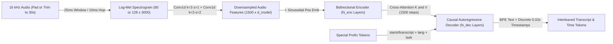
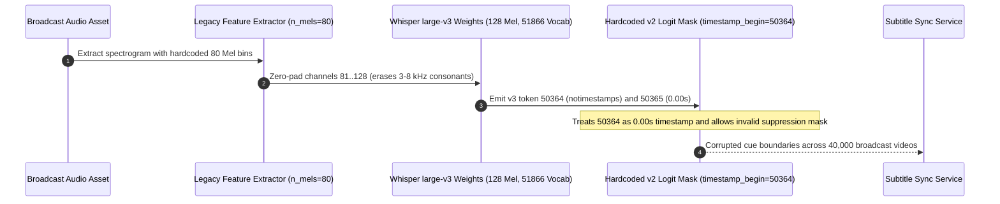

# Module 02: Whisper Architecture

> **Prerequisites:** [Module 01: Speech Recognition Fundamentals](../01-speech-recognition-fundamentals/README.md), [Track 01, Module 09: Special Tokens](../../01-tokens-and-language-modeling/09-special-tokens/README.md), and [Track 02, Module 16: Encoder-Only vs. Decoder-Only vs. Encoder-Decoder](../../02-transformer-architecture/16-encoder-only-vs-decoder-only-vs-encoder-decoder/README.md).  
> **Estimated Reading Time:** 35 minutes  
> **Target Audience:** AI Backend Engineers, ML Systems Engineers, Speech Model Architects

> [!TIP]
> **The Golden Rule of Whisper Architecture:** Whisper is **not** a variable-length streaming model—it is a **fixed `30`-second (`3,000`-frame) encoder-decoder Transformer** whose entire multilingual, multitask, and timestamp behavior is steered by a short prefix of special tokens (`<|startoftranscript|>`, `<|lang|>`, `<|transcribe|>`, `<|translate|>`, `<|notimestamps|>`). Hardcoding `80` Mel bins or `v2` special-token IDs when upgrading to `large-v3` or `large-v3-turbo` (`128` Mel bins and a `+1` vocab shift) silently breaks language routing and timestamp alignment.

---

## Why This Matters

Prior to OpenAI's Whisper (Radford et al., 2022, `arXiv:2212.04356`), production speech pipelines required distinct brittle subsystems: a VAD detector, an acoustic model fine-tuned per domain, a pronunciation lexicon, an external language model, and a separate punctuation/casing restorer. Trained on **`680,000` hours** of weakly supervised multilingual and multitask web audio, Whisper collapsed that entire stack into a single **encoder-decoder Transformer** capable of zero-shot speech recognition, speech translation, voice activity detection, and timestamp alignment.

Yet treating Whisper as a black box causes severe backend mistakes: feeding `2`-second clips unbatched wastes `93%` of fixed encoder compute, choosing `large-v3` over `large-v3-turbo` burns `8x` more decoder KV-cache and autoregressive latency than necessary, and overlooking the `+1` token index shift introduced in `large-v3` (`<|yue|>`) corrupts custom token suppressors and subtitle parsers.

---

## 1. End-to-End Multitask Transformer Architecture

Whisper pairs a standard pre-norm Transformer encoder-decoder with a tiny two-layer convolutional audio stem and a unified byte-level BPE + control + timestamp token vocabulary:

1. **Fixed `30`-Second Audio Normalization:** Every audio window is padded with silence or trimmed to exactly **`30` seconds (`480,000` samples at `16 kHz`)**, then converted into a Log-Mel spectrogram of shape `(n_mels, 3000)`—where `n_mels = 80` (`tiny` through `large-v2`) or **`n_mels = 128` (`large-v3` and `large-v3-turbo`)**.
2. **2-Layer Convolutional Stem (`stride=2` Downsampling):**
   - `Conv1d(n_mels -> d_model, kernel_size=3, stride=1, padding=1)` + `GELU` keeps `3,000` time steps.
   - `Conv1d(d_model -> d_model, kernel_size=3, stride=2, padding=1)` + `GELU` halves the sequence length to **`1,500` embeddings** of dimension $d_{\text{model}}$.
3. **Bidirectional Transformer Encoder:** Adds deterministic sinusoidal positional embeddings over those `1,500` frames and runs $N_{\text{enc}}$ bidirectional self-attention blocks **once** per `30`-second window.
4. **Autoregressive Transformer Decoder:** Uses learned positional embeddings (maximum target length `448` tokens per `30 s` chunk), causal masked self-attention, and cross-attention over the `1,500` encoder hidden states, conditioned on a structured sequence of special task tokens.



### Quantitative Mechanics: `0.02 s` Time Ticks, Vocab Arithmetic, and `large-v3-turbo`

- **Exact Encoder & Timestamp Resolution:** Dividing `30.0` seconds across `1,500` encoder frames fixes Whisper's acoustic resolution:

$$\Delta t_{\text{enc}} = \frac{30.0\text{ s}}{1500} = 0.02\text{ s} = 20\text{ ms per encoder position}$$

Accordingly, Whisper quantizes all predicted speech timestamps into **`1,501` discrete timestamp tokens** (`<|0.00|>`, `<|0.02|>`, `<|0.04|>`, $\dots$, `<|30.00|>`), matching the `0.02 s` resolution of its `1,500` encoder frames!

- **Multitask Special-Token Grammar & Exact `+1` Vocabulary Shift:** The decoder always starts with `<|startoftranscript|>` (`50258` in multilingual models) and branches deterministically:
  - **No speech detected:** `<|startoftranscript|>` $\to$ `<|nospeech|>`
  - **Transcribe with timestamps:** `<|startoftranscript|>` `<|en|>` `<|transcribe|>` `<|0.00|>` *Hello world.* `<|1.84|>` `<|1.84|>` *Next line.* `<|4.30|>` `<|endoftext|>`
  - **Speech translation (Any language $\to$ English):** Replace `<|transcribe|>` with `<|translate|>`.
  - **Suppress timestamps:** Append `<|notimestamps|>` right after the task token.
  - **Cross-window context:** Prepend `<|startofprev|>` + prior window tokens before `<|startoftranscript|>`.

Notice the exact vocabulary arithmetic across model generations:

$$V_{\text{vocab}} = \underbrace{50257}_{\text{base BPE}} + \underbrace{1}_{\text{endoftext}} + \underbrace{1}_{\text{sot}} + N_{\text{lang}} + \underbrace{6}_{\text{control}} + \underbrace{1501}_{\text{timestamps}}$$

Wait—let's check the exact integer index layout in Whisper's multilingual tokenizer (`0`-indexed):
- `0..50256`: `50,257` multilingual byte-level BPE tokens (`0..50256` inclusive; wait: `50257` is `<|endoftext|>`, so `0..50256` = `50,257` BPE tokens!).
- `50257`: `<|endoftext|>`
- `50258`: `<|startoftranscript|>`
- `50259..50357`: `99` language tokens in `v1`/`v2` (`50259..50358` = `100` language tokens in `v3`/`v3-turbo` after adding Cantonese `<|yue|>`).
- Next `6` control tokens: `<|translate|>`, `<|transcribe|>`, `<|startoflm|>`, `<|startofprev|>`, `<|nospeech|>`, `<|notimestamps|>`.
- Final `1,501` timestamp tokens: `timestamp_begin = 50364` (`v1`/`v2`, total vocab = **`51,865`**) vs. **`timestamp_begin = 50365`** (`v3`/`v3-turbo`, total vocab = **`51,866`**). (English-only `.en` models omit the `99` language tokens, yielding vocab size **`51,864`**.)

- **Why `large-v3-turbo` (`32` Encoder / `4` Decoder) Slashes Latency:** In Whisper, the encoder runs **once** per `30`-second chunk, whereas the autoregressive decoder runs **once per generated token** ($U \approx 100\text{–}300$ steps). Pruning `large-v3`'s decoder from `32` layers down to `4` layers (and fine-tuning on `large-v3` pseudo-labels) cuts parameters from `1,550M` to `809M`, shrinks decoder KV-cache footprint by **`8.0x`**, and cuts per-token decode compute by **`~8x`** while preserving the full `32`-layer `128`-bin encoder!

### Official Whisper Model Family Specification

| Model Variant | Total Params | Encoder / Decoder Layers | Width ($d_{\text{model}}$) | Heads | Mel Bins | Vocab Size | Approx. VRAM (FP16) |
| :--- | :--- | :--- | :--- | :--- | :--- | :--- | :--- |
| **`tiny` / `tiny.en`** | `39M` | `4` / `4` | `384` | `6` | `80` | `51,865` / `51,864` | `~1 GB` |
| **`base` / `base.en`** | `74M` | `6` / `6` | `512` | `8` | `80` | `51,865` / `51,864` | `~1 GB` |
| **`small` / `small.en`** | `244M` | `12` / `12` | `768` | `12` | `80` | `51,865` / `51,864` | `~2 GB` |
| **`medium` / `medium.en`** | `769M` | `24` / `24` | `1024` | `16` | `80` | `51,865` / `51,864` | `~5 GB` |
| **`large-v2`** | `1,550M` | `32` / `32` | `1280` | `20` | `80` | `51,865` | `~10 GB` |
| **`large-v3`** | `1,550M` | `32` / `32` | `1280` | `20` | **`128`** | **`51,866`** | `~10 GB` |
| **`large-v3-turbo`** | **`809M`** | **`32` / `4`** | `1280` | `20` | **`128`** | **`51,866`** | `~6 GB` |

---

## 2. Systematic Comparison Matrix: Whisper Variants & Encoder-Decoder vs. CTC

| Architecture / Variant | Acoustic Encoder Strength | Autoregressive Decode Cost | Speech Translation? | Key Operational Strength & Trade-off |
| :--- | :--- | :--- | :--- | :--- |
| **`tiny` / `base`** | Low (`4–6` layers) | Ultra-fast | Weak (`base` decent EN) | Edge CPU prototyping; noticeably higher WER on accents and noisy rooms |
| **`small` / `medium`** | Moderate (`12–24` layers) | Moderate | Good (`medium`) | Solid `.en` English accuracy; `medium` is heavy relative to `large-v3-turbo` |
| **`large-v2` (`80` mel)** | Full (`32` layers) | Slow (`32` dec layers) | Strong | Legacy stability; sometimes resists hallucination slightly better than `v3` on noisy music |
| **`large-v3` (`128` mel)** | Full (`32` layers, finer high-freq) | Slow (`32` dec layers) | **Best** (`+10–20%` error cut vs `v2` across many langs) | Maximum multilingual + translation quality; slow sequential decode |
| **`large-v3-turbo` (`128` mel)** | **Full (`32` layers)** | **Fast (`4` dec layers, `8x` smaller KV)** | **No** (trained primarily for transcription; degrades on translation) | **Default 2025–2026 production choice** for fast high-accuracy transcription |
| **Conformer-CTC (`wav2vec2`)** | High (streaming capable) | **None** (non-autoregressive) | No | Lowest latency & zero silence hallucinations, lacks zero-shot multitask generality |

---

## 3. Production War Story Post-Mortem: The `+1` Token Shift & `80`-Mel Regression in `large-v3` Migration

| Field | Incident Details |
| :--- | :--- |
| **Severity** | **SEV-1** (Broken Subtitle Synchronization Across `40,000` Broadcast Media Assets) |
| **Detection / Resolution Time** | Detected 9 hours after weekend model upgrade / Mitigated in 3 hours (`n_mels=128` + dynamic `tokenizer.json` offsets) |
| **Impact** | Subtitle tracks across `40,000` videos shifted or lost timestamp cues (`<|30.00|>` clipped, `<|notimestamps|>` misread as `<|nospeech|>`) |

### What Happened

A media localization company ran a custom high-throughput C++/ONNX Whisper pipeline tuned originally for `large-v2`. Over a weekend, engineers swapped the ONNX weights to `large-v3` to capture better multilingual accuracy without updating two hardcoded constants in their feature extractor and logits processor:

1. **Hardcoded `n_mels = 80`:** Fallback workers zero-padded `80` Mel channels out to `128` to match `Conv1`'s input dimension, wiping out the top `48` high-frequency Mel bands (`3–8 kHz`) and tanking fricative recognition (`s`/`f`/`th`).
2. **Hardcoded `v2` Special Token IDs:** Their custom timestamp logits processor assumed `timestamp_begin = 50364` and `notimestamps = 50363`. Because `large-v3` added `<|yue|>` (Cantonese) at language slot `100`, every downstream control and timestamp token shifted up by **`+1`** (`timestamp_begin = 50365`, `notimestamps = 50364`). The custom timestamp mask accidentally left `<|notimestamps|>` unmasked as a valid `0.00 s` boundary token, while treating `<|0.00|>` as `<|notimestamps|>`!



### Root Cause Analysis

- **Hardcoded Feature Geometry:** `large-v3` and `large-v3-turbo` expanded the Mel filterbank from `80` to `128` channels (`preprocessor_config.json`: `feature_size: 128`).
- **Hardcoded Special Token Offsets:** Adding `<|yue|>` broke brittle integer constants (`50364`) instead of loading `added_tokens.json` / `tokenizer.json` dynamically from model artifacts.

### The Fix & Architectural Hardening

- **Config-Driven Preprocessing:** Read `feature_size` (`n_mels`) directly from the model's `preprocessor_config.json` at container boot and assert tensor shape `(B, n_mels, 3000)` before inference.
- **Dynamic Tokenizer Introspection:** Resolve `<|startoftranscript|>`, `<|transcribe|>`, `<|notimestamps|>`, and `<|0.00|>` (`timestamp_begin`) dynamically by string lookup at startup, failing fast if `vocab_size` mismatches weight metadata.

---

## 4. Multi-Language Production Implementation: Whisper Token Grammar, Timestamp Parser & KV-Cache Estimator

Below is a production-ready **Whisper Architecture Control & Telemetry Module** across **Go**, **TypeScript**, **Python**, and **C#**. It resolves version-accurate special token IDs (`v2` vs. `v3`/`v3-turbo`), validates and parses discrete `0.02 s` timestamp token spans, and estimates encoder padding waste plus decoder FP16 KV-cache sizing.

````carousel

```go
package whisperarch

import (
	"fmt"
	"math"
)

type ModelSpec struct {
	Name      string
	EncLayers int
	DecLayers int
	DModel    int
	NMels     int
	IsV3      bool
}

type SpecialTokens struct {
	EndOfText         int
	StartOfTranscript int
	Transcribe        int
	Translate         int
	NoSpeech          int
	NoTimestamps      int
	TimestampBegin    int
	VocabSize         int
}

type TimestampSpan struct {
	StartSec float64
	EndSec   float64
	Text     string
}

func ResolveSpecialTokens(isV3 bool) SpecialTokens {
	baseBPE := 50257
	eot := baseBPE        // 50257
	sot := baseBPE + 1    // 50258
	numLangs := 99
	if isV3 {
		numLangs = 100 // Adds <|yue|>
	}
	ctrl := sot + 1 + numLangs
	return SpecialTokens{
		EndOfText:         eot,
		StartOfTranscript: sot,
		Translate:         ctrl,
		Transcribe:        ctrl + 1,
		NoSpeech:          ctrl + 4,
		NoTimestamps:      ctrl + 5,
		TimestampBegin:    ctrl + 6,
		VocabSize:         ctrl + 6 + 1501,
	}
}

// ParseTimestampSegments decodes Whisper 0.02s discrete timestamp tokens and validates monotonicity.
func ParseTimestampSegments(tokens []int, textByID map[int]string, tok SpecialTokens) ([]TimestampSpan, error) {
	var spans []TimestampSpan
	var curStart *float64
	var textBuf string

	for _, id := range tokens {
		if id == tok.EndOfText {
			break
		}
		if id >= tok.TimestampBegin && id < tok.VocabSize {
			sec := math.Round(float64(id-tok.TimestampBegin)*0.02*100) / 100
			if curStart == nil {
				curStart = &sec
			} else {
				if sec < *curStart {
					return nil, fmt.Errorf("non-monotonic timestamp: %.2fs < %.2fs", sec, *curStart)
				}
				if textBuf != "" {
					spans = append(spans, TimestampSpan{StartSec: *curStart, EndSec: sec, Text: textBuf})
					textBuf = ""
					curStart = nil
				} else {
					curStart = &sec
				}
			}
		} else if txt, ok := textByID[id]; ok {
			textBuf += txt
		}
	}
	return spans, nil
}

// EstimateDecoderKVCacheBytes returns FP16 self+cross attention KV cache bytes for a 30s chunk.
func EstimateDecoderKVCacheBytes(spec ModelSpec, decodedTokens int) int64 {
	const encFrames = 1500
	return int64(spec.DecLayers) * 2 * 2 * int64(spec.DModel) * int64(decodedTokens+encFrames)
}
```

<!-- slide -->

```typescript
export interface WhisperModelSpec {
  readonly name: string;
  readonly encLayers: number;
  readonly decLayers: number;
  readonly dModel: number;
  readonly nMels: 80 | 128;
  readonly isV3: boolean;
}

export interface WhisperSpecialTokens {
  readonly endOfText: number;
  readonly startOfTranscript: number;
  readonly translate: number;
  readonly transcribe: number;
  readonly noSpeech: number;
  readonly noTimestamps: number;
  readonly timestampBegin: number;
  readonly vocabSize: number;
}

export interface TimestampSegment {
  readonly startSec: number;
  readonly endSec: number;
  readonly text: string;
}

export function resolveWhisperTokens(isV3: boolean): WhisperSpecialTokens {
  const endOfText = 50_257;
  const startOfTranscript = 50_258;
  const numLanguages = isV3 ? 100 : 99; // v3/turbo adds <|yue|>
  const ctrl = startOfTranscript + 1 + numLanguages;
  const timestampBegin = ctrl + 6;
  return {
    endOfText,
    startOfTranscript,
    translate: ctrl,
    transcribe: ctrl + 1,
    noSpeech: ctrl + 4,
    noTimestamps: ctrl + 5,
    timestampBegin,
    vocabSize: timestampBegin + 1501,
  };
}

export function decodeTimestampSegments(
  tokenIds: readonly number[],
  textLookup: ReadonlyMap<number, string>,
  tok: WhisperSpecialTokens,
): TimestampSegment[] {
  const segments: TimestampSegment[] = [];
  let activeStart: number | null = null;
  let textAcc = "";

  for (const id of tokenIds) {
    if (id === tok.endOfText) break;
    if (id >= tok.timestampBegin && id < tok.vocabSize) {
      const sec = Math.round((id - tok.timestampBegin) * 0.02 * 100) / 100;
      if (activeStart === null) {
        activeStart = sec;
      } else {
        if (sec < activeStart) {
          throw new Error(`Non-monotonic timestamp ${sec}s preceded by ${activeStart}s`);
        }
        if (textAcc.length > 0) {
          segments.push({ startSec: activeStart, endSec: sec, text: textAcc });
          textAcc = "";
          activeStart = null;
        } else {
          activeStart = sec;
        }
      }
    } else if (textLookup.has(id)) {
      textAcc += textLookup.get(id) ?? "";
    }
  }
  return segments;
}

export function estimateDecoderKvCacheBytes(spec: WhisperModelSpec, decodedSteps: number): number {
  const encLength = 1500; // 30s * 100Hz / stride-2 conv
  return spec.decLayers * 2 * 2 * spec.dModel * (decodedSteps + encLength);
}
```

<!-- slide -->

```python
"""
whisper_arch_tools.py
Resolves v2 vs v3/turbo token shifts, parses 0.02s timestamp tokens, and computes decoder KV-cache footprints.
"""
from dataclasses import dataclass
from typing import Mapping, Sequence


@dataclass(frozen=True)
class WhisperTokens:
    end_of_text: int
    start_of_transcript: int
    translate: int
    transcribe: int
    no_speech: int
    no_timestamps: int
    timestamp_begin: int
    vocab_size: int


@dataclass(frozen=True)
class TimestampSegment:
    start_sec: float
    end_sec: float
    text: str


def resolve_special_tokens(is_v3: bool = True) -> WhisperTokens:
    eot = 50_257
    sot = 50_258
    num_langs = 100 if is_v3 else 99  # v3 / v3-turbo adds <|yue|>
    ctrl = sot + 1 + num_langs
    ts_begin = ctrl + 6
    return WhisperTokens(
        end_of_text=eot,
        start_of_transcript=sot,
        translate=ctrl,
        transcribe=ctrl + 1,
        no_speech=ctrl + 4,
        no_timestamps=ctrl + 5,
        timestamp_begin=ts_begin,
        vocab_size=ts_begin + 1501,
    )


def parse_timestamp_tokens(
    token_ids: Sequence[int],
    text_vocab: Mapping[int, str],
    tok: WhisperTokens,
) -> list[TimestampSegment]:
    segments: list[TimestampSegment] = []
    cur_start: float | None = None
    buf: list[str] = []

    for tid in token_ids:
        if tid == tok.end_of_text:
            break
        if tok.timestamp_begin <= tid < tok.vocab_size:
            sec = round((tid - tok.timestamp_begin) * 0.02, 2)
            if cur_start is None:
                cur_start = sec
            else:
                if sec < cur_start:
                    raise ValueError(f"Non-monotonic Whisper timestamp: {sec} < {cur_start}")
                if buf:
                    segments.append(TimestampSegment(cur_start, sec, "".join(buf)))
                    buf.clear()
                    cur_start = None
                else:
                    cur_start = sec
        elif tid in text_vocab:
            buf.append(text_vocab[tid])
    return segments


def decoder_kv_cache_bytes(dec_layers: int, d_model: int, decoded_tokens: int = 120) -> int:
    # FP16 (2 bytes) * 2 (K & V) across self-attention (decoded_tokens) + cross-attention (1500 encoder frames)
    return dec_layers * 2 * 2 * d_model * (decoded_tokens + 1500)
```

<!-- slide -->

```csharp
using System;
using System.Collections.Generic;
using System.Text;

namespace GenAI.Speech.Whisper;

public sealed record WhisperSpecialTokens(
    int EndOfText,
    int StartOfTranscript,
    int Translate,
    int Transcribe,
    int NoSpeech,
    int NoTimestamps,
    int TimestampBegin,
    int VocabSize);

public sealed record TimestampSpan(double StartSec, double EndSec, string Text);

public static class WhisperArchTools
{
    public static WhisperSpecialTokens ResolveTokens(bool isV3)
    {
        const int eot = 50_257;
        const int sot = 50_258;
        int numLangs = isV3 ? 100 : 99; // v3 / v3-turbo adds <|yue|>
        int ctrl = sot + 1 + numLangs;
        int tsBegin = ctrl + 6;
        return new WhisperSpecialTokens(
            EndOfText: eot,
            StartOfTranscript: sot,
            Translate: ctrl,
            Transcribe: ctrl + 1,
            NoSpeech: ctrl + 4,
            NoTimestamps: ctrl + 5,
            TimestampBegin: tsBegin,
            VocabSize: tsBegin + 1501);
    }

    public static IReadOnlyList<TimestampSpan> ParseTimestamps(
        IReadOnlyList<int> tokenIds,
        IReadOnlyDictionary<int, string> textVocab,
        WhisperSpecialTokens tok)
    {
        var spans = new List<TimestampSpan>();
        double? curStart = null;
        var sb = new StringBuilder();

        foreach (int id in tokenIds)
        {
            if (id == tok.EndOfText) break;
            if (id >= tok.TimestampBegin && id < tok.VocabSize)
            {
                double sec = Math.Round((id - tok.TimestampBegin) * 0.02, 2);
                if (curStart is null)
                {
                    curStart = sec;
                }
                else
                {
                    if (sec < curStart.Value)
                        throw new InvalidOperationException($"Non-monotonic timestamp {sec:F2}s < {curStart.Value:F2}s");
                    if (sb.Length > 0)
                    {
                        spans.Add(new TimestampSpan(curStart.Value, sec, sb.ToString()));
                        sb.Clear();
                        curStart = null;
                    }
                    else
                    {
                        curStart = sec;
                    }
                }
            }
            else if (textVocab.TryGetValue(id, out var piece))
            {
                sb.Append(piece);
            }
        }
        return spans;
    }

    public static long EstimateDecoderKvCacheBytes(int decLayers, int dModel, int decodedTokens = 120)
        => (long)decLayers * 2 * 2 * dModel * (decodedTokens + 1500);
}
```

````

---

## 5. Practical Hands-On Verification CLI Workflows

Run these deterministic Python 3.13 verification scripts offline—only Python's standard library is needed.

### Workflow 1: Measure Whisper `30`-Second Padding Waste & Fixed `1,500`-Token Encoder Geometry

Calculate how many fixed `30 s` (`3,000` Mel frame $\to$ `1,500` encoder embedding) windows Whisper consumes across short, exact, and multi-minute clips:

```bash
python -c '
import math

SAMPLE_RATE = 16000
CHUNK_SEC = 30
N_SAMPLES = SAMPLE_RATE * CHUNK_SEC
HOP_LENGTH = 160
N_MEL_FRAMES = N_SAMPLES // HOP_LENGTH
ENC_FRAMES = N_MEL_FRAMES // 2

for clip_sec in [1.8, 12.0, 30.0, 65.0]:
    windows = math.ceil(clip_sec / CHUNK_SEC)
    total_padded_sec = windows * CHUNK_SEC
    mel_frames = windows * N_MEL_FRAMES
    enc_tokens = windows * ENC_FRAMES
    waste_pct = (1.0 - clip_sec / total_padded_sec) * 100.0
    print(f"clip={clip_sec:>4.1f}s -> windows={windows} | mel_frames={mel_frames:>5} | enc_tokens={enc_tokens:>4} | padding_waste={waste_pct:5.1f}%")
'
```

**Expected Output:**

```text
clip= 1.8s -> windows=1 | mel_frames= 3000 | enc_tokens=1500 | padding_waste= 94.0%
clip=12.0s -> windows=1 | mel_frames= 3000 | enc_tokens=1500 | padding_waste= 60.0%
clip=30.0s -> windows=1 | mel_frames= 3000 | enc_tokens=1500 | padding_waste=  0.0%
clip=65.0s -> windows=3 | mel_frames= 9000 | enc_tokens=4500 | padding_waste= 27.8%
```

Look at that `94.0%` waste on a `1.8`-second VAD clip: Whisper's encoder runs `1,500 x 1,500` self-attention over `28.2` seconds of silence padding unless you pack shorter utterances together (covered in Module 03).

### Workflow 2: Verify the `+1` `large-v3` Token Shift & Decode `0.02 s` Timestamp Streams

Inspect the exact index shift between `v2` (`51,865`) and `v3` (`51,866`), then parse a simulated decoder stream into `[start -> end]` text segments:

```bash
python -c '
def build_special_tokens(version="v3"):
    base_bpe = 50257
    endoftext = base_bpe
    sot = base_bpe + 1
    n_langs = 99 if version == "v2" else 100
    lang_en = sot + 1
    ctrl_start = sot + 1 + n_langs
    return {
        "endoftext": endoftext,
        "startoftranscript": sot,
        "en": lang_en,
        "translate": ctrl_start,
        "transcribe": ctrl_start + 1,
        "startoflm": ctrl_start + 2,
        "startofprev": ctrl_start + 3,
        "nospeech": ctrl_start + 4,
        "notimestamps": ctrl_start + 5,
        "timestamp_begin": ctrl_start + 6,
        "vocab_size": ctrl_start + 6 + 1501,
    }

v2, v3 = build_special_tokens("v2"), build_special_tokens("v3")
nt2, tb2, vs2 = v2["notimestamps"], v2["timestamp_begin"], v2["vocab_size"]
nt3, tb3, vs3 = v3["notimestamps"], v3["timestamp_begin"], v3["vocab_size"]
print(f"v2: notimestamps={nt2}, timestamp_begin={tb2}, vocab={vs2}")
print(f"v3: notimestamps={nt3}, timestamp_begin={tb3}, vocab={vs3}")

stream = [
    v3["startoftranscript"], v3["en"], v3["transcribe"],
    v3["timestamp_begin"] + 0,
    ("text", "Hello world."),
    v3["timestamp_begin"] + 92,
    v3["timestamp_begin"] + 92,
    ("text", " Whisper tracks 20ms ticks."),
    v3["timestamp_begin"] + 215,
    v3["endoftext"],
]

segments, cur_start, buf = [], None, []
for item in stream:
    if isinstance(item, int):
        if item >= v3["timestamp_begin"]:
            sec = round((item - v3["timestamp_begin"]) * 0.02, 2)
            if cur_start is None:
                cur_start = sec
            else:
                if buf:
                    segments.append((cur_start, sec, "".join(buf).strip()))
                    buf, cur_start = [], None
                else:
                    cur_start = sec
    else:
        buf.append(item[1])

for s, e, txt in segments:
    print(f"  [{s:5.2f}s -> {e:5.2f}s] {txt}")
'
```

**Expected Output:**

```text
v2: notimestamps=50363, timestamp_begin=50364, vocab=51865
v3: notimestamps=50364, timestamp_begin=50365, vocab=51866
  [ 0.00s ->  1.84s] Hello world.
  [ 1.84s ->  4.30s] Whisper tracks 20ms ticks.
```

### Workflow 3: Quantify `large-v3-turbo` Decoder Pruning (`32 -> 4` Layers) & KV-Cache Savings

Compare decoder FP16 KV-cache footprints (self-attention + `1,500`-step encoder cross-attention) and per-token decode compute proxies across the entire Whisper family:

```bash
python -c '
SPECS = [
    ("tiny",           39,   4,  4,  384,  6,  80),
    ("base",           74,   6,  6,  512,  8,  80),
    ("small",          244, 12, 12,  768, 12,  80),
    ("medium",         769, 24, 24, 1024, 16,  80),
    ("large-v3",      1550, 32, 32, 1280, 20, 128),
    ("large-v3-turbo", 809, 32,  4, 1280, 20, 128),
]

U_SELF = 120
ENC_LEN = 1500

for name, params, n_enc, n_dec, d_model, heads, mels in SPECS:
    kv_bytes = n_dec * 2 * 2 * d_model * (U_SELF + ENC_LEN)
    kv_mb = kv_bytes / (1024 * 1024)
    dec_step_proxy = (n_dec * (d_model ** 2)) / 1e6
    print(f"{name:<15} | {params:>4}M | enc={n_enc:>2} dec={n_dec:>2} | mel={mels:>3} | dec_KV={kv_mb:5.2f} MiB | dec_step_proxy={dec_step_proxy:6.2f}")
'
```

**Expected Output:**

```text
tiny            |   39M | enc= 4 dec= 4 | mel= 80 | dec_KV= 9.49 MiB | dec_step_proxy=  0.59
base            |   74M | enc= 6 dec= 6 | mel= 80 | dec_KV=18.98 MiB | dec_step_proxy=  1.57
small           |  244M | enc=12 dec=12 | mel= 80 | dec_KV=56.95 MiB | dec_step_proxy=  7.08
medium          |  769M | enc=24 dec=24 | mel= 80 | dec_KV=151.88 MiB | dec_step_proxy= 25.17
large-v3        | 1550M | enc=32 dec=32 | mel=128 | dec_KV=253.12 MiB | dec_step_proxy= 52.43
large-v3-turbo  |  809M | enc=32 dec= 4 | mel=128 | dec_KV=31.64 MiB | dec_step_proxy=  6.55
```

Look at that last line: `large-v3-turbo` retains all `32` `128`-Mel encoder layers while slashing decoder KV-cache from `253.12 MiB` down to `31.64 MiB` (`8.0x` reduction) and achieving a lower per-token decode cost (`6.55`) than `small` (`7.08`).

### Hands-On Exercises

1. **Monotonic Timestamp Guard:** Inject `v3["timestamp_begin"] + 50` (`1.00 s`) right after `v3["timestamp_begin"] + 92` (`1.84 s`) in Workflow 2 and update the Python loop to raise a `ValueError` whenever backward timestamps occur.
2. **Beam Search KV Scaling:** Multiply `dec_KV` in Workflow 3 by `beam_size = 5` at `batch_size = 16` (`80` parallel sequences) and compare total KV-cache RAM required for `large-v3` (`~19.78 GiB`) vs. `large-v3-turbo` (`~2.47 GiB`).
3. **Optional Official Hugging Face Inspection:** Run `AutoConfig.from_pretrained("openai/whisper-large-v3-turbo")` in a local Python environment and inspect `num_mel_bins=128`, `encoder_layers=32`, `decoder_layers=4`, and `vocab_size=51866`.

### Independent Challenge

A multinational support backend needs high-accuracy transcription in **98 languages** *and* automatic **Spanish/Japanese $\to$ English speech translation** using Whisper. One engineer proposes deploying `large-v3-turbo` for *both* endpoints (`task="transcribe"` and `task="translate"`) to save GPU instances. Identify the subtle architectural trap in `large-v3-turbo` for translation, and design a dual-model routing layout that preserves fast transcription without degrading translation quality.

<details><summary>Architectural Discussion</summary>

1. **Why `large-v3-turbo` Degrades on Speech Translation:** When OpenAI pruned `large-v3`'s decoder from `32` layers down to `4` layers and distilled it primarily on transcription behavior (`<|transcribe|>`), the thin `4`-layer decoder lost much of the cross-lingual syntactic reordering capacity needed for `<|translate|>`. On translation tasks, `large-v3-turbo` often echoes the source language or drops phrases compared to full `large-v3` (`32` decoder layers) or `large-v2`.
2. **Dual-Model Routing Pattern:** Route the majority **`task="transcribe"`** workload (`90%+` of traffic) to `large-v3-turbo` (`8x` faster decoder, `31.64 MiB` KV-cache per sequence), and route **`task="translate"`** (or post-transcript text translation via an LLM) to dedicated `large-v3` workers or a two-stage `large-v3-turbo` ASR $\to$ text LLM translation cascade.

</details>

---

## 6. Common Mistakes & Troubleshooting

- **Feeding `80`-bin spectrograms into `large-v3` / `large-v3-turbo`:** `v3` weights expect `Conv1d` input shape `(B, 128, 3000)`. Always check `model.dims.n_mels` (`128` vs. `80`) in preprocessing.
- **Assuming encoder runtime scales linearly with a `2`-second clip:** Whisper pads every window to `30` seconds (`3,000` frames $\to$ `1,500` embeddings), so a `2`-second clip pays `100%` of the encoder's `1,500`-token attention FLOPs. Coalesce short VAD bursts before batching.
- **Using `large-v3-turbo` blindly for `<|translate|>`:** Pruning the decoder to `4` layers preserves transcription accuracy while sacrificing cross-lingual translation depth. Use `large-v3` or ASR + LLM translation when translation quality is mission-critical.
- **Hardcoding special token integers across Whisper versions:** `large-v3` added `<|yue|>` (`100`th language), shifting `<|translate|>`, `<|transcribe|>`, `<|notimestamps|>`, and `timestamp_begin` up by `+1`. Always resolve special tokens by name from `tokenizer.json`.

---

## 7. Operational Validation Checkpoints & Checkpoint Quiz

### Operational Validation Checkpoints

<details><summary><strong>Checkpoint 1: Explaining why Whisper timestamp tokens step by 0.02 seconds</strong></summary>

Why are Whisper's `1,501` timestamp tokens (`<|0.00|>` through `<|30.00|>`) quantized to exact `0.02 s` (`20 ms`) increments rather than `0.01 s` (`10 ms`) or arbitrary floats?

**Validation:** Whisper's Log-Mel spectrogram uses a `10 ms` hop (`3,000` frames per `30` seconds), and the second `Conv1d` layer in the encoder stem applies **`stride=2`**, compressing `3,000` frames down to **`1,500` encoder time steps**. Because `30.0 s / 1,500 = 0.02 s`, each discrete encoder representation spans exactly `20 ms`, making `0.02 s` the native temporal resolution of encoder cross-attention.

</details>

<details><summary><strong>Checkpoint 2: Diagnosing a decoder latency bottleneck on GPU</strong></summary>

A team benchmarks `large-v3` (`1.55B`) against `large-v3-turbo` (`809M`) on `30`-second dense lecture audio (`~200` output tokens per chunk) and observes `large-v3-turbo` completes nearly `4–6x` faster end-to-end even though both share the exact same `32`-layer encoder. Explain why.

**Validation:** During inference on a `30`-second chunk, the `32`-layer **encoder executes only once** in parallel across `1,500` frames, whereas the **decoder executes sequentially `200` times** (once per autoregressive token, bottlenecked by memory-bandwidth weight reads and KV-cache fetches). Cutting decoder depth from `32` layers (`large-v3`) to `4` layers (`large-v3-turbo`) reduces sequential decoder passes and decoder KV-cache footprint by **`8x`**, dominating end-to-end latency.

</details>

<details><summary><strong>Checkpoint 3: Debugging missing timestamps after upgrading from large-v2 to large-v3</strong></summary>

After swapping weights from `large-v2` to `large-v3`, a custom Rust/C++ Whisper runner begins omitting timestamps or throwing out-of-range token assertions whenever `id == 50364` appears. Pinpoint the exact cause.

**Validation:** In `large-v2` (`99` languages, vocab `51,865`), token `50364` is `<|0.00|>` (`timestamp_begin`). In `large-v3` (`100` languages with `<|yue|>`, vocab `51,866`), token `50364` shifted to **`<|notimestamps|>`** and `timestamp_begin` shifted to **`50365`**. Reading `timestamp_begin` dynamically from the model's tokenizer config fixes the offset.

</details>

### Checkpoint Quiz

1. How many raw audio samples, STFT Mel frames, and post-conv encoder frames represent a single Whisper input window?
2. What exact prefix sequence of special tokens instructs Whisper to **transcribe French audio without timestamps**?
3. Why did `large-v3` increase `n_mels` from `80` to `128`, and why did `vocab_size` shift from `51,865` to `51,866`?
4. Compare the encoder/decoder layer counts of `large-v3` vs. `large-v3-turbo`, and state the primary task limitation of `large-v3-turbo`.
5. How many total discrete timestamp tokens exist in Whisper's vocabulary, and what is the byte size of `large-v3`'s FP16 decoder KV-cache for `1` chunk at `120` decoded tokens vs. `large-v3-turbo`?

<details><summary>Answers</summary>

1. `480,000` audio samples (`30 s * 16,000 Hz`), `3,000` STFT Mel frames (`10 ms` hop), and `1,500` encoder frames (`stride=2` convolutional downsampling).
2. `<|startoftranscript|> <|fr|> <|transcribe|> <|notimestamps|>`.
3. `128` Mel bins provide finer frequency resolution across high-band sibilants and harmonics than `80` bins; `vocab_size` grew by `+1` (`51,865 -> 51,866`) because OpenAI added the Cantonese language token `<|yue|>` (`100`th language).
4. `large-v3` has `32` encoder / `32` decoder layers (`1,550M`), while `large-v3-turbo` keeps `32` encoder layers and prunes the decoder to `4` layers (`809M`). `large-v3-turbo` excels at transcription (`<|transcribe|>`) but loses translation accuracy (`<|translate|>`) due to its shallow `4`-layer decoder.
5. `1,501` timestamp tokens (`0.00` to `30.00` inclusive in `0.02 s` increments). At `U = 120` decoded tokens (`120 + 1500 = 1620` total attention positions), FP16 KV-cache is `253.12 MiB` for `large-v3` (`32` layers) vs. `31.64 MiB` for `large-v3-turbo` (`4` layers)—an `8.0x` reduction.

</details>

---

## Further Reading & Sources

- [Robust Speech Recognition via Large-Scale Weak Supervision (Radford et al., 2022)](https://arxiv.org/abs/2212.04356) — original Whisper paper covering weak supervision scaling, multitask token conditioning, and model family ablations.
- [OpenAI Whisper Official Repository (`openai/whisper`)](https://github.com/openai/whisper) — canonical reference implementation (`model.py`, `tokenizer.py`, `transcribe.py`, and `large-v3-turbo` release notes).
- [Hugging Face Transformers Whisper Documentation](https://huggingface.co/docs/transformers/model_doc/whisper) — `WhisperConfig`, `WhisperFeatureExtractor`, and `forced_decoder_ids` API reference.
- [Track 01, Module 09: Special Tokens](../../01-tokens-and-language-modeling/09-special-tokens/README.md) — mechanics of control tokens and vocabulary indexing.

## Next

[Module 03: Running Whisper in Practice](../03-running-whisper-in-practice/README.md)
