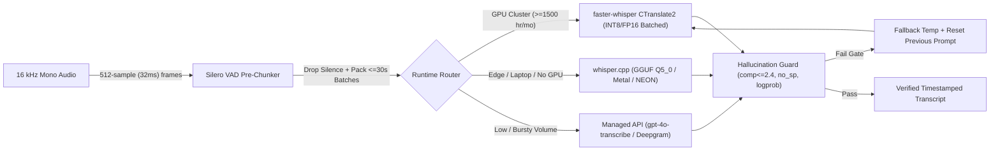
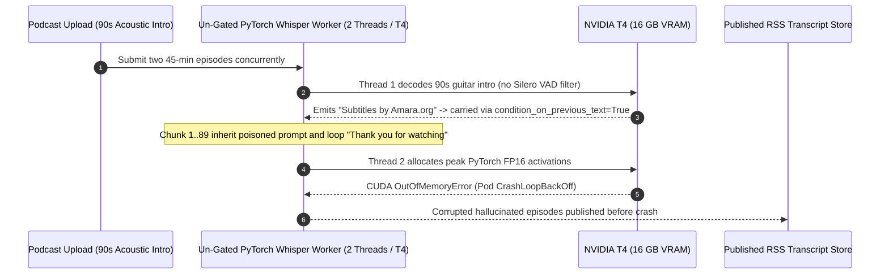

# Module 03: Running Whisper in Practice

> **Prerequisites:** [Module 02: Whisper Architecture](../02-whisper-architecture/README.md), [Track 05, Module 13: Cloud GPU Economics](../../05-gpus-and-genai-hardware/13-cloud-gpu-economics/README.md), and [Track 14, Module 13: Benchmarking Throughput and Latency](../../14-inference-and-serving-vllm/13-benchmarking-throughput-and-latency/README.md).  
> **Estimated Reading Time:** 35 minutes  
> **Target Audience:** AI Infrastructure Engineers, MLOps / Serving Engineers, Voice Backend Architects

> [!TIP]
> **The Golden Rule of Production Whisper:** Never run naive PyTorch `openai/whisper` in production. Use **`faster-whisper` (`CTranslate2`)** (`int8` / `fp16` + **Silero VAD chunking** + batching) for GPU servers, **`whisper.cpp` (GGUF)** for CPU/Apple Silicon edge workloads, or **managed ASR APIs** (`gpt-4o-transcribe` / Deepgram Nova) below your GPU break-even volume—and **always** disarm Whisper's classic `"Thank you for watching"` hallucination cascades with `vad_filter=True`, `condition_on_previous_text=False`, `no_speech_threshold`, and `compression_ratio_threshold`.

---

## Why This Matters

Downloading `openai/whisper` (`pip install openai-whisper`) takes thirty seconds, yet running that reference PyTorch implementation in production burns **`~2.4x–9x` more GPU wall-clock time and `~1.6x` more VRAM** than an optimized C++ runtime, chokes on sparse dead air, and routinely injects `"Subtitles by Amara.org"` or infinite `"Thank you. Thank you."` repetition loops whenever audio hits background music or silence.

Running Whisper reliably in production comes down to four concrete engineering decisions: (1) picking the right inference engine (`faster-whisper`, `whisper.cpp`, or managed API), (2) packing speech cleanly via Silero VAD + batching so you don't waste `90%` of fixed `30 s` encoder windows on silence, (3) tuning decoding safety gates (`compression_ratio_threshold`, `no_speech_threshold`, `logprob_threshold`, `condition_on_previous_text=False`) to halt hallucinations before they contaminate transcripts, and (4) modeling GPU utilization vs. per-minute API break-even volume accurately.

---

## 1. Production Whisper Runtimes, Hallucination Guards & Cost Economics

A production Whisper service separates **VAD coalescing**, **quantized inference**, and **post-decode hallucination checks** into an explicit defensive pipeline:



### Official Runtime Benchmarks & Real-Time Factor (RTF)

Throughput in speech serving is measured by **Real-Time Factor (RTF)**—compute seconds required per second of audio:

$$\text{RTF} = \frac{T_{\text{compute}}}{T_{\text{audio}}}, \qquad \text{Audio Hours per GPU-Hour} = \frac{1}{\text{RTF}} \cdot \eta_{\text{util}}$$

An $\text{RTF} = 0.021$ means `1` second of GPU compute transcribes `~47.6` seconds of audio! In the official `SYSTRAN/faster-whisper` GPU benchmark transcribing `13` minutes (`780 s`) of audio using `large-v2` (`beam_size=5`):

| Runtime Implementation | Compute Precision | Execution Time (`13 min`) | Real-Time Factor (RTF) | Peak VRAM | Relative Speedup vs. Naive PyTorch |
| :--- | :--- | :--- | :--- | :--- | :--- |
| **`openai/whisper` (PyTorch)** | `fp16` | `2m 23s` (`143 s`) | `0.183` | `4,708 MB` | `1.0x` (baseline) |
| **`whisper.cpp` (CUDA/C++)** | `fp16` | `1m 05s` (`65 s`) | `0.083` | `4,127 MB` | `2.2x` |
| **`faster-whisper` (`CTranslate2`)** | `fp16` | `1m 03s` (`63 s`) | `0.081` | `4,525 MB` | `2.3x` |
| **`faster-whisper` (`CTranslate2`)** | **`int8`** | `59s` (`59 s`) | `0.076` | **`2,926 MB`** | `2.4x` (and **`38%` less VRAM**) |
| **`faster-whisper` (Batched + VAD)** | **`int8`** | **`16s`** | **`0.021`** | `~4,500 MB` | **`8.9x` throughput** |

Notice how combining **`CTranslate2` INT8 quantization** with **VAD-coalesced batching** (`BatchedInferencePipeline`) drops processing time for `13` minutes of speech from `143` seconds down to **`16` seconds** while packing `large-v2`/`large-v3` safely onto budget `8–16 GB` GPUs!

### Hallucination Mechanics & The Four Exact Guardrails

Why does Whisper hallucinate `"Thank you for watching"`, `"Subtitles by Amara.org"`, or infinite word loops? Because Whisper was trained on scraped web videos containing quiet outro music and caption credits—and its autoregressive decoder defaults to **`condition_on_previous_text=True`**, passing every decoded chunk back into the next chunk via `<|startofprev|>`. Once one non-speech window emits a repetitive phrase, the poisoned prompt reinforces itself endlessly!

Four decoding controls eliminate these loops:

1. **Zlib Compression Ratio (`compression_ratio_threshold = 2.4`):**

$$R_{\text{comp}} = \frac{\text{len}(\text{text}_{\text{UTF-8}})}{\text{len}(\text{zlib.compress}(\text{text}_{\text{UTF-8}}))}$$

Normal English speech compresses modestly ($R_{\text{comp}} \approx 0.8\text{–}1.8$). A repeated hallucination like `"Thank you. " * 14` collapses under `zlib` ($R_{\text{comp}} > 5.0$), immediately crossing `2.4` and triggering temperature fallback `(0.0, 0.2, 0.4, 0.6, 0.8, 1.0)`.
2. **Combined Silence Gate (`no_speech_threshold = 0.6` AND `logprob_threshold = -1.0`):** In `openai/whisper`'s `transcribe.py`, a chunk is dropped as silence when **both** `no_speech_prob > 0.6` **and** `avg_logprob < -1.0` hold—preventing false drops on quiet, clearly recognized whispers (`avg_logprob > -1.0`) while discarding confident non-speech static.
3. **`condition_on_previous_text = False`:** Disabling cross-window prompt carry-over (or resetting `<|startofprev|>` whenever a segment triggers fallback) breaks repetition contagion across `30`-second boundaries.
4. **Silero VAD Pre-Chunking (`vad_filter=True`):** Removes non-speech spans *before* Whisper's encoder runs, preventing Whisper from ever seeing hold music or dead air while cutting compute time proportionally to silence ratio.

### Self-Hosted GPU vs. Managed API Break-Even Math

Compare pay-as-you-go managed APIs—OpenAI **`gpt-4o-transcribe`** (**\$0.006/min** = **\$0.36/audio-hr**), **`gpt-4o-mini-transcribe`** (**\$0.003/min** = **\$0.18/audio-hr**), and Deepgram **Nova Batch** (**\$0.0043/min** = **\$0.258/audio-hr**)—against renting an always-on L4/T4 GPU node at **\$0.75/hr** (**\$547.50/month**):

$$H_{\text{break-even}} = \frac{P_{\text{GPU / month}}}{P_{\text{API / audio-hr}}}, \qquad C_{\text{self / audio-hr}} = \frac{P_{\text{GPU / hr}}}{N_{\text{audio-hr per GPU-hr}}}$$

At `70%` sustained GPU utilization, `1` L4/T4 running batched `faster-whisper` (`RTF = 0.021`) processes **`~34.1` audio hours per GPU-hour** (`~24,900` audio hours/month on ONE GPU!). Its marginal compute cost is \$0.75 / 34.1 = **\$0.022/audio-hr** (`11x–16x` cheaper than managed APIs)—**if** you actually have `>1,521` to `2,122` monthly audio hours to cover the always-on **\$547.50/mo** baseline (or scale to zero via serverless GPU workers).

---

## 2. Systematic Comparison Matrix: `openai/whisper` vs. `faster-whisper` vs. `whisper.cpp` vs. Managed APIs

| Runtime Option | Engine / Format | VRAM (`large` model) | Throughput (`RTF`) | Best Deployment Fit | Primary Operational Risk |
| :--- | :--- | :--- | :--- | :--- | :--- |
| **`openai/whisper` / HF Naive** | PyTorch Eager | `~4.7–10 GB` (`fp16`) | Slow (`~0.18`) | Research notebooks & quick local validation | OOM under concurrency, `9x` higher GPU bill than batched CTranslate2 |
| **`faster-whisper`** | `CTranslate2` (`int8`/`fp16`) | **`~2.9–4.5 GB`** (`int8`) | **Fastest (`~0.021` batched)** | **Production GPU serving**, high-volume batch & VPC/HIPAA pipelines | Requires CUDA/cuDNN alignment & GPU worker orchestration |
| **`whisper.cpp`** | Pure C++ (`GGUF` `Q5_0`/`Q8_0`) | `~1–4 GB` RAM/Unified | Fast on Apple Metal; moderate on CPU | **Edge devices, macOS laptops, air-gapped CPU nodes** | Lower max batch throughput than GPU `CTranslate2` at scale |
| **Managed APIs (`gpt-4o-transcribe`, Deepgram)** | Cloud REST / WebSocket | `0` (serverless) | Sub-second / elastic | **Low/bursty volume (`<1,500 hr/mo`)**, zero-ops startups | Variable OpEx (\$0.18–\$0.36/hr), external data egress, rate limits |

---

## 3. Production War Story Post-Mortem: The `"Subtitles by Amara.org"` Contagion Loop & T4 OOM Cascade

| Field | Incident Details |
| :--- | :--- |
| **Severity** | **SEV-1** (Fleet-Wide GPU Worker OOM Crashes & Corrupted Podcast RSS Transcripts) |
| **Detection / Resolution Time** | Detected 4 hours post-cutover via PagerDuty pod crash alerts / Mitigated in 3 hours (`faster-whisper` INT8 + VAD + `condition_on_previous_text=False`) |
| **Impact** | `100%` of GPU worker pods crash-looped under 2-thread concurrency; `3,200` published podcast transcripts contained 20-minute `"Subtitles by Amara.org"` / `"Thank you"` loops |

### What Happened

A podcast hosting startup migrated from a managed transcription API to `4` self-hosted AWS `g4dn.xlarge` (`NVIDIA T4`, `16 GB` VRAM) instances running `openai/whisper` (`large-v2`, `fp16`) to cut API bills. Two configuration errors collided immediately under live traffic:

1. **Unbounded Concurrency OOM:** Workers spawned `2` concurrent Python threads sharing one T4 GPU (`2 * 4.7 GB` model weights + dynamic PyTorch KV/activation peaks exceeded `16 GB`, crashing pods with `CUDA out of memory`).
2. **Hallucination Contagion Loop:** Pods ran without `vad_filter` and kept `condition_on_previous_text=True`. When podcasts started with a `90`-second acoustic guitar intro, Whisper emitted `"Subtitles by Amara.org"` on chunk `0`, fed that string as `<|startofprev|>` into chunk `1`, and repeated `"Thank you for watching"` across the entire 45-minute episode.



### Root Cause Analysis

- **PyTorch Memory Fragmentation & Weight Duplication:** Loading separate FP16 PyTorch models per worker thread wasted VRAM (`4.7 GB` each) with zero CTranslate2 INT8 quantization.
- **Unchecked Silence + Prompt Poisoning:** Passing `90` seconds of music without Silero VAD while keeping `condition_on_previous_text=True` guaranteed cross-chunk hallucination contagion.

### The Fix & Architectural Hardening

- **Migrated to `faster-whisper` (`int8_float16`) + `BatchedInferencePipeline`:** Slashed single-model VRAM to `~2.9–4.5 GB`, capped GPU worker concurrency (`1` model instance per T4 with batched chunks), and boosted throughput `~8.9x` (`1` GPU replaced all `4` T4 pods).
- **Mandatory VAD + Anti-Contagion Flags:** Enabled `vad_filter=True` (Silero VAD), set `condition_on_previous_text=False`, and enforced `compression_ratio_threshold=2.4` + `no_speech_threshold=0.6` retry/drop guards.

---

## 4. Multi-Language Production Implementation: Hallucination Guard, VAD Worker & Resilient Client

Below is a production-hardened **Whisper Runtime Guard & Serving Client** across **Go**, **TypeScript**, **Python**, and **C#**. Every implementation enforces `zlib`/`gzip` compression-ratio loop checks (`> 2.4`), `no_speech_prob` + `avg_logprob` silence filtering, `condition_on_previous_text` contagion resets, and bounded HTTP timeouts/retries for Whisper inference endpoints.

````carousel

```go
package whisperprod

import (
	"bytes"
	"compress/zlib"
	"context"
	"errors"
	"fmt"
	"math"
	"net/http"
	"time"
)

type Segment struct {
	StartSec     float64
	EndSec       float64
	Text         string
	NoSpeechProb float64
	AvgLogProb   float64
}

type GuardDecision string

const (
	DecisionAccept       GuardDecision = "ACCEPT"
	DecisionDropSilence  GuardDecision = "DROP_SILENCE"
	DecisionTempFallback GuardDecision = "FALLBACK_RESET_PREV"
)

func CompressionRatio(text string) float64 {
	raw := []byte(text)
	if len(raw) == 0 {
		return 1.0
	}
	var buf bytes.Buffer
	zw := zlib.NewWriter(&buf)
	_, _ = zw.Write(raw)
	_ = zw.Close()
	if buf.Len() == 0 {
		return 1.0
	}
	return float64(len(raw)) / float64(buf.Len())
}

// EvaluateHallucination enforces Whisper's compression, silence, and logprob thresholds.
func EvaluateHallucination(seg Segment, compThresh, noSpeechThresh, logProbThresh float64) (GuardDecision, float64, bool) {
	ratio := CompressionRatio(seg.Text)
	if seg.NoSpeechProb > noSpeechThresh && seg.AvgLogProb < logProbThresh {
		return DecisionDropSilence, ratio, false // Drop dead-air hallucination
	}
	if ratio > compThresh || seg.AvgLogProb < logProbThresh {
		return DecisionTempFallback, ratio, false // Break <|startofprev|> contagion
	}
	return DecisionAccept, ratio, true
}

// SubmitWithBackoff executes a bounded HTTP request against a Whisper worker or managed STT API.
func SubmitWithBackoff(ctx context.Context, client *http.Client, buildReq func() (*http.Request, error), maxRetries int) (*http.Response, error) {
	for attempt := 0; attempt <= maxRetries; attempt++ {
		req, err := buildReq()
		if err != nil {
			return nil, err
		}
		resp, err := client.Do(req.WithContext(ctx))
		if err == nil && resp.StatusCode < 500 && resp.StatusCode != http.StatusTooManyRequests {
			return resp, nil
		}
		if resp != nil {
			_ = resp.Body.Close()
		}
		if attempt == maxRetries {
			return nil, fmt.Errorf("whisper endpoint failed after %d attempts: %w", maxRetries+1, err)
		}
		backoff := time.Duration(250*math.Pow(2, float64(attempt))) * time.Millisecond
		select {
		case <-ctx.Done():
			return nil, ctx.Err()
		case <-time.After(backoff):
		}
	}
	return nil, errors.New("unreachable retry loop")
}
```

<!-- slide -->

```typescript
import { deflateSync } from "node:zlib";

export interface WhisperSegment {
  readonly startSec: number;
  readonly endSec: number;
  readonly text: string;
  readonly noSpeechProb: number;
  readonly avgLogProb: number;
}

export type SegmentAction = "ACCEPT" | "DROP_SILENCE" | "FALLBACK_TEMP_RESET_PREV";

export interface GuardOutcome {
  readonly action: SegmentAction;
  readonly compressionRatio: number;
  readonly carryPreviousPrompt: boolean;
}

export function computeCompressionRatio(text: string): number {
  const raw = Buffer.from(text, "utf8");
  if (raw.length === 0) return 1.0;
  const compressed = deflateSync(raw);
  return raw.length / Math.max(1, compressed.length);
}

export function evaluateWhisperSegment(
  seg: WhisperSegment,
  thresholds = { compressionRatio: 2.4, noSpeechProb: 0.6, avgLogProb: -1.0 },
): GuardOutcome {
  const ratio = computeCompressionRatio(seg.text);
  if (seg.noSpeechProb > thresholds.noSpeechProb && seg.avgLogProb < thresholds.avgLogProb) {
    return { action: "DROP_SILENCE", compressionRatio: ratio, carryPreviousPrompt: false };
  }
  if (ratio > thresholds.compressionRatio || seg.avgLogProb < thresholds.avgLogProb) {
    return { action: "FALLBACK_TEMP_RESET_PREV", compressionRatio: ratio, carryPreviousPrompt: false };
  }
  return { action: "ACCEPT", compressionRatio: ratio, carryPreviousPrompt: true };
}

export async function transcribeWithBoundedRetry(
  endpointUrl: string,
  audioBlob: Blob,
  apiKey: string,
  timeoutMs = 30_000,
  maxRetries = 2,
): Promise<unknown> {
  for (let attempt = 0; attempt <= maxRetries; attempt += 1) {
    const form = new FormData();
    form.append("file", audioBlob, "chunk.wav");
    form.append("model", "gpt-4o-transcribe");

    const resp = await fetch(endpointUrl, {
      method: "POST",
      headers: { Authorization: `Bearer ${apiKey}` },
      body: form,
      signal: AbortSignal.timeout(timeoutMs),
    });

    if (resp.ok) return resp.json();
    if (resp.status !== 429 && resp.status < 500) {
      throw new Error(`Non-retryable STT error HTTP ${resp.status}`);
    }
    if (attempt === maxRetries) {
      throw new Error(`STT request exhausted ${maxRetries + 1} attempts (HTTP ${resp.status})`);
    }
    await new Promise((resolve) => setTimeout(resolve, 300 * 2 ** attempt));
  }
  throw new Error("Unreachable");
}
```

<!-- slide -->

```python
"""
whisper_production_guard.py
Production faster-whisper worker wrapper with Silero VAD chunking, anti-hallucination settings, and zlib verifier.
"""
from dataclasses import dataclass
import zlib


@dataclass(frozen=True)
class GuardedSegment:
    start_sec: float
    end_sec: float
    text: str
    compression_ratio: float
    action: str  # "ACCEPT" | "DROP_SILENCE" | "FALLBACK_RESET_PREV"


def zlib_compression_ratio(text: str) -> float:
    raw = text.encode("utf-8")
    if not raw:
        return 1.0
    return len(raw) / max(1, len(zlib.compress(raw)))


def validate_segment(
    start_sec: float,
    end_sec: float,
    text: str,
    no_speech_prob: float,
    avg_logprob: float,
    comp_thresh: float = 2.4,
    no_speech_thresh: float = 0.6,
    logprob_thresh: float = -1.0,
) -> GuardedSegment:
    ratio = zlib_compression_ratio(text)
    if no_speech_prob > no_speech_thresh and avg_logprob < logprob_thresh:
        return GuardedSegment(start_sec, end_sec, "", ratio, "DROP_SILENCE")
    if ratio > comp_thresh or avg_logprob < logprob_thresh:
        return GuardedSegment(start_sec, end_sec, text, ratio, "FALLBACK_RESET_PREV")
    return GuardedSegment(start_sec, end_sec, text.strip(), ratio, "ACCEPT")


def transcribe_production_faster_whisper(audio_path: str, model_size: str = "large-v3-turbo") -> list[GuardedSegment]:
    """Example runtime configuration using SYSTRAN/faster-whisper + BatchedInferencePipeline."""
    from faster_whisper import BatchedInferencePipeline, WhisperModel  # optional runtime dependency

    model = WhisperModel(model_size, device="cuda", compute_type="int8_float16")
    batched = BatchedInferencePipeline(model=model)
    raw_segments, _ = batched.transcribe(
        audio_path,
        batch_size=8,
        vad_filter=True,
        vad_parameters={"min_silence_duration_ms": 500, "speech_pad_ms": 60},
        condition_on_previous_text=False,
        compression_ratio_threshold=2.4,
        no_speech_threshold=0.6,
        log_prob_threshold=-1.0,
    )
    return [
        validate_segment(s.start, s.end, s.text, s.no_speech_prob, s.avg_logprob)
        for s in raw_segments
    ]
```

<!-- slide -->

```csharp
using System;
using System.IO;
using System.IO.Compression;
using System.Text;

namespace GenAI.Speech.Production;

public sealed record WhisperSegment(double StartSec, double EndSec, string Text, double NoSpeechProb, double AvgLogProb);
public sealed record GuardOutcome(string Action, double CompressionRatio, bool CarryPreviousPrompt);

public static class WhisperProductionGuard
{
    public static double ComputeZlibRatio(string text)
    {
        byte[] raw = Encoding.UTF8.GetBytes(text);
        if (raw.Length == 0) return 1.0;

        using var ms = new MemoryStream();
        using (var zs = new ZLibStream(ms, CompressionLevel.Optimal, leaveOpen: true))
        {
            zs.Write(raw, 0, raw.Length);
        }
        return (double)raw.Length / Math.Max(1, ms.Length);
    }

    public static GuardOutcome EvaluateSegment(
        WhisperSegment seg,
        double compressionThreshold = 2.4,
        double noSpeechThreshold = 0.6,
        double logProbThreshold = -1.0)
    {
        double ratio = ComputeZlibRatio(seg.Text);
        if (seg.NoSpeechProb > noSpeechThreshold && seg.AvgLogProb < logProbThreshold)
        {
            return new GuardOutcome("DROP_SILENCE", ratio, CarryPreviousPrompt: false);
        }
        if (ratio > compressionThreshold || seg.AvgLogProb < logProbThreshold)
        {
            return new GuardOutcome("FALLBACK_RESET_PREV", ratio, CarryPreviousPrompt: false);
        }
        return new GuardOutcome("ACCEPT", ratio, CarryPreviousPrompt: true);
    }
}
```

````

---

## 5. Practical Hands-On Verification CLI Workflows

Run these deterministic Python 3.13 verification scripts offline—only Python's standard library (`zlib`, `math`) is required.

### Workflow 1: Hallucination Detection (`zlib` Compression Ratio + Silence Gate + Contagion Breaker)

Test Whisper's exact hallucination rules across clean speech, repeated phrase loops, dead-air hallucination (`"Subtitles by Amara.org"`), and low-confidence audio:

```bash
python -c '
import zlib

def compression_ratio(text):
    raw = text.encode("utf-8")
    if not raw:
        return 1.0
    return len(raw) / len(zlib.compress(raw))

def evaluate_segment(text, no_speech_prob, avg_logprob, prev_prompt_enabled=True,
                     comp_thresh=2.4, no_speech_thresh=0.6, logprob_thresh=-1.0):
    ratio = compression_ratio(text)
    if no_speech_prob > no_speech_thresh and avg_logprob < logprob_thresh:
        return "DROP_SILENCE", ratio, False
    if ratio > comp_thresh:
        return "FALLBACK_TEMP_RESET_PREV", ratio, False
    if avg_logprob < logprob_thresh:
        return "FALLBACK_TEMP_RETRY", ratio, False
    return "ACCEPT", ratio, prev_prompt_enabled

segments = [
    ("Clean speech", "Please confirm order number four eight two nine.", 0.04, -0.22),
    ("Loop hallucination", "Thank you for watching. " * 14, 0.41, -0.78),
    ("Silent dead air", "Subtitles by Amara.org", 0.91, -1.45),
    ("Muffled low-conf", "uh mumble static check", 0.35, -1.38),
]

for label, txt, nsp, alp in segments:
    action, ratio, keep_prev = evaluate_segment(txt, nsp, alp, prev_prompt_enabled=True)
    print(f"{label:<20} | comp={ratio:4.2f} | no_sp={nsp:.2f} | logp={alp:5.2f} -> {action:<24} | carry_prev={keep_prev}")
'
```

**Expected Output:**

```text
Clean speech         | comp=0.89 | no_sp=0.04 | logp=-0.22 -> ACCEPT                   | carry_prev=True
Loop hallucination   | comp=9.08 | no_sp=0.41 | logp=-0.78 -> FALLBACK_TEMP_RESET_PREV | carry_prev=False
Silent dead air      | comp=0.73 | no_sp=0.91 | logp=-1.45 -> DROP_SILENCE             | carry_prev=False
Muffled low-conf     | comp=0.73 | no_sp=0.35 | logp=-1.38 -> FALLBACK_TEMP_RETRY      | carry_prev=False
```

### Workflow 2: VAD Coalescing & `<=30 s` Whisper Batch Planner

Simulate packing sparse speech spans from a `180`-second call recording into `<=30`-second Whisper batch windows instead of scanning dead air:

```bash
python -c '
speech_spans = [
    (2.1, 6.4), (8.0, 14.2), (18.5, 22.0), (52.0, 58.3),
    (61.0, 74.5), (108.2, 112.9), (140.0, 155.8), (168.4, 174.0),
]
total_audio_s = 180.0
max_chunk_s = 30.0

batches, cur_duration, cur_spans = [], 0.0, []
for s, e in speech_spans:
    dur = e - s
    if cur_duration + dur > max_chunk_s and cur_spans:
        batches.append((cur_duration, cur_spans))
        cur_duration, cur_spans = 0.0, []
    cur_duration += dur
    cur_spans.append((s, e))
if cur_spans:
    batches.append((cur_duration, cur_spans))

naive_windows = int(total_audio_s // 30)
total_speech_s = sum(e - s for s, e in speech_spans)
print(f"Total audio: {total_audio_s:.1f}s | Actual speech: {total_speech_s:.1f}s ({total_speech_s/total_audio_s*100:.1f}%)")
print(f"Naive fixed 30s slicing: {naive_windows} Whisper windows (processes {total_audio_s - total_speech_s:.1f}s dead air)")
print(f"VAD-coalesced batching : {len(batches)} Whisper windows (drops {100 - total_speech_s/total_audio_s*100:.1f}% non-speech)")
for idx, (dur, spans) in enumerate(batches, 1):
    print(f"  Batch #{idx}: {dur:4.1f}s packed speech from {len(spans)} VAD spans")
'
```

**Expected Output:**

```text
Total audio: 180.0s | Actual speech: 59.9s (33.3%)
Naive fixed 30s slicing: 6 Whisper windows (processes 120.1s dead air)
VAD-coalesced batching : 3 Whisper windows (drops 66.7% non-speech)
  Batch #1: 20.3s packed speech from 4 VAD spans
  Batch #2: 18.2s packed speech from 2 VAD spans
  Batch #3: 21.4s packed speech from 2 VAD spans
```

### Workflow 3: Self-Hosted GPU vs. Managed API Cost & Break-Even Sweep

Evaluate monthly infrastructure bills across `200` to `20,000` audio-hours/month comparing Deepgram Nova (**\$0.258/hr**), `gpt-4o-transcribe` (**\$0.36/hr**), unbatched PyTorch `openai/whisper`, and batched `faster-whisper` (`int8`) on **\$0.75/hr** L4/T4 GPUs at `70%` utilization:

```bash
python -c '
import math

gpu_hr_price = 0.75
gpu_month_fixed = gpu_hr_price * 730
openai_hr = 0.006 * 60
deepgram_hr = 0.0043 * 60

cap_pytorch = (1.0 / (143 / 780)) * 0.70
cap_fw_batch = (1.0 / (16 / 780)) * 0.70

print(f"Always-on 1x GPU fixed cost: ${gpu_month_fixed:.2f}/mo | Capacities (@70% util): PyTorch={cap_pytorch:.1f} hr/hr, FW-Batch={cap_fw_batch:.1f} hr/hr")
print(f"Break-even vs Deepgram (${deepgram_hr:.3f}/hr): {gpu_month_fixed / deepgram_hr:,.0f} audio-hr/mo | vs gpt-4o (${openai_hr:.2f}/hr): {gpu_month_fixed / openai_hr:,.0f} audio-hr/mo\n")

for vol in [200, 1500, 5000, 20000]:
    cost_dg = vol * deepgram_hr
    cost_oai = vol * openai_hr
    gpus_pt = max(1, math.ceil(vol / (cap_pytorch * 730)))
    gpus_fw = max(1, math.ceil(vol / (cap_fw_batch * 730)))
    cost_pt = gpus_pt * gpu_month_fixed
    cost_fw = gpus_fw * gpu_month_fixed
    print(f"vol={vol:>5,} hr/mo | Deepgram=${cost_dg:>8,.2f} | gpt-4o=${cost_oai:>8,.2f} | PyTorch({gpus_pt}GPU)=${cost_pt:>7,.2f} | FW-Batch({gpus_fw}GPU)=${cost_fw:>6,.2f}")
'
```

**Expected Output:**

```text
Always-on 1x GPU fixed cost: $547.50/mo | Capacities (@70% util): PyTorch=3.8 hr/hr, FW-Batch=34.1 hr/hr
Break-even vs Deepgram ($0.258/hr): 2,122 audio-hr/mo | vs gpt-4o ($0.36/hr): 1,521 audio-hr/mo

vol=  200 hr/mo | Deepgram=$   51.60 | gpt-4o=$   72.00 | PyTorch(1GPU)=$ 547.50 | FW-Batch(1GPU)=$547.50
vol=1,500 hr/mo | Deepgram=$  387.00 | gpt-4o=$  540.00 | PyTorch(1GPU)=$ 547.50 | FW-Batch(1GPU)=$547.50
vol=5,000 hr/mo | Deepgram=$1,290.00 | gpt-4o=$1,800.00 | PyTorch(2GPU)=$1,095.00 | FW-Batch(1GPU)=$547.50
vol=20,000 hr/mo | Deepgram=$5,160.00 | gpt-4o=$7,200.00 | PyTorch(8GPU)=$4,380.00 | FW-Batch(1GPU)=$547.50
```

### Hands-On Exercises

1. **Short-Text Compression Anomaly:** Pass a short `1`-word phrase `"OK"` through `compression_ratio` in Workflow 1. Explain why very short strings score `< 1.0` (`zlib` header overhead) and never trigger `> 2.4` false positives.
2. **Pause-Boundary Split Penalty:** Modify Workflow 2 so packed spans insert a `200 ms` silence buffer (`0.2 s` per join) so Whisper doesn't merge two unrelated sentences tightly together, and recompute the batch count.
3. **Optional `faster-whisper` vs. `whisper.cpp` Local Benchmark:** If running locally on a laptop or GPU workstation, transcribe a `5`-minute WAV clip using `faster-whisper` (`compute_type="int8"`, `vad_filter=True`) vs. `whisper.cpp` (`Q5_0`), logging exact wall-clock RTF and peak RSS/VRAM.

### Independent Challenge

A Series-A legal-tech startup processes `800` audio hours per month of client depositions, rising to `12,000` audio hours per month next quarter during peak litigation discovery, with strict requirements that **zero PII leaves their AWS VPC**. Management asks whether they should buy managed SaaS APIs (`gpt-4o-transcribe`) today, keep always-on `4x A10G` PyTorch nodes running `24/7`, or deploy an autoscaled `faster-whisper` (`large-v3-turbo`, `int8_float16`) worker queue. Justify the optimal architecture financially and operationally.

<details><summary>Architectural Discussion</summary>

1. **Disqualifying Public APIs on VPC Compliance:** Zero-egress VPC requirements rule out standard multi-tenant public endpoints unless a dedicated private VPC/BAA endpoint is contracted—and even then, `12,000 hr/mo` at **\$0.36/hr** costs **\$4,320/month**.
2. **Why `4x` Always-On PyTorch Fails at `800 hr/mo`:** Keeping `4` always-on A10G instances burns **~\$2,900–\$3,500/month** even when processing only `800` hours (`< 5%` utilization).
3. **Autoscaled Queue + `faster-whisper` `large-v3-turbo` (`int8_float16`) + Silero VAD:** Deploy containerized `faster-whisper` workers behind SQS/Celery that scale from `0` to `1–2` L4/T4 GPUs on demand. At `800 hr/mo` (`~23` GPU-hours total compute at `RTF=0.021`), spot/on-demand compute costs under **\$30/month**, and even scaling up to `12,000 hr/mo` fits cleanly inside `1` sustained L4/T4 worker (**~\$547/month**)—with `vad_filter=True` and `condition_on_previous_text=False` preventing long deposition silences from generating false testimony hallucinations.

</details>

---

## 6. Common Mistakes & Troubleshooting

- **Sharing one GPU across unbounded FastAPI/Python worker threads:** Concurrent Whisper forward passes duplicate activation graphs and trigger random `CUDA OutOfMemoryError` crashes. Bind `1` `WhisperModel` instance per GPU worker process and use a bounded queue + `BatchedInferencePipeline`.
- **Leaving `condition_on_previous_text=True` on music-heavy or multi-speaker audio:** One hallucinated segment poisons `<|startofprev|>` for every subsequent `30`-second chunk. Set `condition_on_previous_text=False` (or reset on high `compression_ratio` / low `avg_logprob`).
- **Disabling VAD on batch audio with long silences:** Not only do you waste GPU FLOPs encoding silence (`30 s` at a time), you invite `"Thank you for watching"` / `"Amara.org"` phantom outputs whenever `no_speech_prob` slips under `0.6`.
- **Forgetting `compute_type="int8_float16"` or `"int8"` in `faster-whisper`:** Running default `fp32` or unquantized PyTorch `fp16` nearly doubles VRAM usage (`~4.7 GB` vs `~2.9 GB` on `large-v2`) and leaves `~2x` tensor-core throughput on the table.

---

## 7. Operational Validation Checkpoints & Checkpoint Quiz

### Operational Validation Checkpoints

<details><summary><strong>Checkpoint 1: Diagnosing why a whisper transcript repeats "Thanks for watching" for 8 minutes</strong></summary>

A transcription job over a recorded `25`-minute Zoom call containing an `8`-minute break emits `"Thanks for watching. "` forty-five times sequentially, even though `compression_ratio_threshold=2.4` was configured. Why did the repetition survive across multiple windows, and how do you eliminate it completely?

**Validation:** First, no VAD pre-filter stripped the `8`-minute break, so Whisper processed empty `30 s` chunks directly. Second, **`condition_on_previous_text=True`** remained enabled: once a quiet chunk emitted a single `"Thanks for watching."` below the per-chunk `2.4` compression cutoff, it carried into `<|startofprev|>` for the next window, repeating across chunks. Enable **`vad_filter=True`** (Silero VAD) and set **`condition_on_previous_text=False`**.

</details>

<details><summary><strong>Checkpoint 2: Sizing a GPU cluster vs. managed STT API on unit economics</strong></summary>

A startup processes `600` audio hours per month evenly across business hours. An engineer proposes provisioning `1` dedicated **\$0.75/hr** L4 GPU (**\$547.50/mo**) running `faster-whisper` `int8` rather than calling Deepgram Nova (**\$0.0043/min** = **\$0.258/hr**) to "save money." Audit the financial claim.

**Validation:** At `600 hr/mo`, Deepgram Nova costs 600 × \$0.258 = **\$154.80/mo**, whereas an always-on L4 GPU costs **\$547.50/mo** (`3.5x` *more* expensive!). Self-hosting an always-on L4 only breaks even above `2,122 audio-hr/mo` vs. Deepgram (unless the GPU scales to zero when idle or VPC data-residency forbids external APIs).

</details>

<details><summary><strong>Checkpoint 3: Preventing timestamp loss when using Silero VAD chunk coalescing</strong></summary>

When coalescing sparse VAD speech segments (`[2.1-6.4 s]`, `[52.0-58.3 s]`) into one packed `30 s` audio buffer for `faster-whisper` batching, timestamps returned by Whisper read `0.00-4.30 s` and `4.30-10.60 s` instead of `2.10-6.40 s` and `52.00-58.30 s`. What step is missing?

**Validation:** Packing non-contiguous VAD segments into a compact tensor removes the intermediate silence durations from Whisper's internal `0.00–30.00 s` clock. Your batch wrapper must retain the **`(packed_offset_s -> original_audio_offset_s)` mapping table** per VAD span and remap every decoded Whisper timestamp back to original wall-clock coordinates before emitting subtitles or speaker turns (this is handled automatically by `faster-whisper`'s `restore_speech_timestamps` when using built-in `vad_filter=True`).

</details>

### Checkpoint Quiz

1. Why does `faster-whisper` (`CTranslate2` `int8`) reduce VRAM from `4,708 MB` down to `2,926 MB` and achieve up to `~8.9x` higher throughput when batched compared to `openai/whisper`?
2. How does Whisper's `compression_ratio_threshold = 2.4` catch hallucination loops mathematically, and what happens when `no_speech_prob > 0.6` **and** `avg_logprob < -1.0`?
3. When should you pick **`whisper.cpp`** (`GGUF`) over **`faster-whisper`** (`CTranslate2`)?
4. At **\$0.006/min** (`gpt-4o-transcribe`) vs. a **\$547.50/mo** always-on GPU, what is the monthly audio-hour break-even point?
5. Why is disabling `condition_on_previous_text` especially critical on podcasts, call-center hold queues, or sparse audio?

<details><summary>Answers</summary>

1. `CTranslate2` uses fused C++ Transformer kernels and `INT8` weight/activation quantization (`~38%` VRAM drop), freeing memory and compute; adding VAD filtering + `BatchedInferencePipeline` saturates GPU tensor cores across multiple `30`-second chunks in parallel instead of executing one clip serially.
2. Repetition loops compress tightly under `zlib`, pushing `len(raw_utf8) / len(zlib.compress(raw_utf8))` well above `2.4`, triggering temperature fallback retries. When `no_speech_prob > 0.6` **and** `avg_logprob < -1.0`, Whisper treats the segment as dead air / non-speech and skips outputting hallucinated text.
3. Choose **`whisper.cpp`** (`GGUF`) for local CPU-only nodes, air-gapped CLI utilities, iOS/Android mobile apps, or Apple Silicon Macs via Metal acceleration where installing CUDA/PyTorch is impossible or undesirable.
4. `gpt-4o-transcribe` costs \$0.006 × 60 = **\$0.36/audio-hr**, so break-even is \$547.50 / \$0.36 = **1,521 audio-hours/month**.
5. With `condition_on_previous_text=True`, any single hallucination emitted over intro music or silence is injected into the next window's `<|startofprev|>` prompt, causing a self-reinforcing repetition cascade across the entire recording.

</details>

---

## Further Reading & Sources

- [SYSTRAN `faster-whisper` Official Repository & Benchmarks](https://github.com/SYSTRAN/faster-whisper) — `CTranslate2` `fp16`/`int8`/batched benchmarks, `BatchedInferencePipeline`, and `vad_filter` parameters.
- [`whisper.cpp` Official Repository (`ggml-org/whisper.cpp`)](https://github.com/ggml-org/whisper.cpp) — C/C++ zero-dependency GGUF inference for CPU, ARM NEON, and Apple Metal.
- [Silero VAD Official Repository](https://github.com/snakers4/silero-vad) — enterprise `32 ms` voice-activity gate used inside `faster-whisper`.
- [OpenAI Speech-to-Text API Documentation](https://platform.openai.com/docs/guides/speech-to-text) — managed `gpt-4o-transcribe` / `whisper-1` endpoints, formats, and prompting options.
- [Deepgram Developer Documentation](https://developers.deepgram.com/docs) — managed Nova batch and streaming ASR APIs.

## Next

[Module 04: Streaming and Realtime Transcription](../04-streaming-and-realtime-transcription/README.md)
