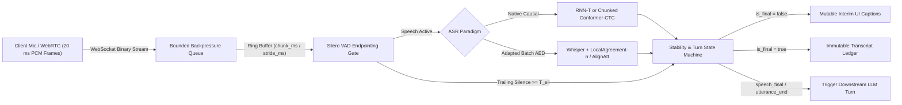
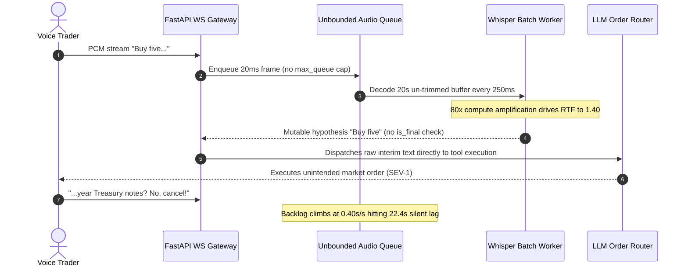

# Module 04: Streaming and Realtime Transcription

> **Prerequisites:** [Module 01: Speech Recognition Fundamentals](../01-speech-recognition-fundamentals/README.md), [Module 02: Whisper Architecture](../02-whisper-architecture/README.md), and [Module 03: Running Whisper in Practice](../03-running-whisper-in-practice/README.md).  
> **Estimated Reading Time:** 35 minutes  
> **Target Audience:** AI Backend Engineers, Voice Infrastructure Developers, Real-Time Media Systems Architects

> [!TIP]
> **The Golden Rule of Streaming ASR:** Never stream raw unbuffered audio blindly into a batch Encoder-Decoder model or persist mutable `interim` hypotheses as committed system state. Always pair a bounded **PCM ring buffer** (`chunk_ms` / `stride_ms`) and **Silero VAD endpointing** with an explicit **stability commit policy** (`LocalAgreement-n` or `AlignAtt` for Whisper, or causal emissions for `RNN-T` / `Conformer-CTC`), enforce WebSocket backpressure caps, and strictly separate mutable `interim` UI drafts from `is_final` segments and `utterance_end` turn triggers.

---

## Why This Matters

In offline batch transcription, latency tolerance is measured in seconds or minutes: a worker receives an entire `.wav` file, runs Voice Activity Detection (VAD), pads `30`-second windows through Whisper's encoder, and returns a static transcript. In live voice agents, simultaneous captioning, and dual-channel contact centers, waiting until a caller finishes speaking destroys conversational ergonomics—human turn gaps average `200–400 ms`.

The moment you open a bidirectional WebSocket (`16 kHz` mono PCM streaming in every `20 ms`), naive batch tricks break violently:

1. **Boundary Phoneme Slicing:** Cutting a stream every `1,000 ms` with zero overlap slices words mid-phoneme (`"acknowledge"` $\to$ `"ack"` + `"ledge"`), spiking Word Error Rate (`WER`) by `12–25` percentage points.
2. **Hypothesis Flicker & Premature Action:** Streaming models revise recent words as right-context arrives (`"transfer fifty"` $\to$ `"transfer fifteen"`). Treating mutable `interim` frames as committed state causes voice agents to interrupt users, corrupt search queries, or execute wrong database mutations.
3. **Compute Amplification & Backpressure Collapse:** Re-decoding an un-trimmed rolling buffer every `250 ms` multiplies GPU work `20–40x`. Once server `RTF > 1.0`, un-bounded WebSocket queues accumulate silent `15–30 s` audio lag while appearing "healthy" on HTTP `200` checks.
4. **Microphone Clock Drift:** Consumer hardware oscillators skewed by `100–200 ppm` accumulate `360–720 ms` of timestamp divergence over a 1-hour call, breaking downstream diarization and endpointing alignment.

---

## 1. Native Streaming Architectures vs. Adapted Batch AED

Modern production streaming ASR splits into two architectural families: **natively causal frame-synchronous models** trained specifically for left-to-right emission, and **batch Attention-based Encoder-Decoder (AED) models** adapted via sliding-window agreement policies.



### Native Causal Streaming: RNN-T and Chunked Conformer-CTC

1. **RNN-T (Recurrent Neural Network Transducer, Graves 2012):** Combines a **causal encoder** (streaming Conformer/LSTM with zero or tightly bounded right lookahead), an autoregressive **prediction network** over previously emitted non-blank tokens, and a **joint network** combining both representations at each frame $t$. Unlike CTC, RNN-T models token dependencies internally without conditional independence, committing labels monotonically with `40–120 ms` algorithmic latency.
2. **Chunked / Causal Conformer-CTC (Gulati et al. 2020):** Replaces full-sequence self-attention with **chunk-restricted causal attention** where frames in chunk $m$ attend only to past chunks $[0 \dots m-1]$ plus a small lookahead $C_{\text{look}}$ (`80–320 ms`). Non-autoregressive frame emission yields ultra-fast GPU batching and shallow-fusion LM biasing, with zero prediction-network serial bottleneck.

### Adapting Batch Whisper (AED) to Real-Time Streams

Whisper's encoder computes bidirectional self-attention across a fixed `30`-second (`3,000`-frame) Log-Mel canvas, meaning raw Whisper cannot emit causal token-by-token hypotheses without re-encoding context. Two production algorithms bridge this gap:

- **`LocalAgreement-n` (`whisper_streaming`, Macháček et al. 2023):** Every `stride_ms` (`500–1000 ms`), the worker runs Whisper over the active audio ring buffer. It compares the last $n$ consecutive hypothesis token sequences (typically $n = 2$) and **commits their Longest Common Prefix (LCP)** as immutable `is_final` text. Once an entire clause stabilizes and Silero VAD marks a pause boundary, the ring buffer slides forward (`trim_at_timestamp`) so Whisper never repeatedly re-encodes 28 seconds of old audio.
- **`AlignAtt` (Papi et al. 2023):** Inspects decoder-to-encoder cross-attention matrices during autoregressive decoding. Because Whisper's cross-attention heads localize each generated token to specific encoder time frames, `AlignAtt` halts emission whenever the attention peak falls inside the trailing $K$ frames (the unstable right acoustic boundary), eliminating the extra stride wait of `LocalAgreement-2`.

### The Three Transcript Lifecycle Events (`interim` vs `is_final` vs `utterance_end`)

Production WebSocket ASR protocols (such as Deepgram-style streaming schemas and custom voice gateways) separate transcript stability from conversational turn completion:

| Event Field | Mutability | Meaning | Safe Engineering Action |
| :--- | :--- | :--- | :--- |
| **`interim` (`is_final: false`)** | **Mutable** (will be overwritten) | Speculative hypothesis over active un-committed audio | Render live captions in UI with gray/italic styling; **never** persist to DB or call LLM tools |
| **`is_final: true`** | **Immutable** prefix/segment | Stabilized segment committed via `LocalAgreement-n` or causal endpoint | Append cleanly to authoritative session transcript ledger and search index |
| **`speech_final: true`** | **Turn boundary** (VAD-driven) | Endpointing timer observed `endpointing_ms` (`300–500 ms`) of trailing silence after speech | Fast-path trigger for conversational agent LLM generation |
| **`UtteranceEnd`** | **Turn fallback** (word-gap driven) | Server observed `utterance_end_ms` (`800–1200 ms`) gap since last finalized word even amidst background noise | Mandatory safety fallback trigger when HVAC/cafe noise prevents `speech_final` from firing |

---

## 2. Quantitative Ring-Buffer, Backpressure, and Clock-Drift Math

Designing a low-latency streaming gateway requires verifying four exact invariants before writing socket handlers:

1. **Canonical PCM Frame Budget:** For sample rate $f_s$, channel count $C_{\text{ch}}$, and bit depth $b$:

$$R_{\text{bytes}} = f_s \cdot C_{\text{ch}} \cdot \frac{b}{8}$$

At `16,000 Hz`, mono (`1`), signed `int16` (`2 bytes`), $R_{\text{bytes}} = 32,000\text{ B/s}$ (`32 B/ms`). Standard `20 ms` WebRTC/Opus decoded frames occupy exact `640`-byte chunks (`320` samples).

2. **Sliding-Buffer Compute Amplification (`LocalAgreement-n`):** When an adapted AED engine decodes an un-trimmed active audio window of expected duration $\mathbb{E}[W_{\text{active}}]$ every $\Delta_{\text{stride}}$ seconds:

$$A_{\text{compute}} \approx \frac{\mathbb{E}[W_{\text{active}}]}{\Delta_{\text{stride}}}$$

Without VAD-driven buffer trimming, $\mathbb{E}[W_{\text{active}}] \to 15\text{ s}$ across a `30 s` utterance; decoded at `stride = 0.25 s`, GPU compute inflates **`60x`** compared to offline batch transcription! Aggressive silence/prefix trimming keeps $\mathbb{E}[W_{\text{active}}] \le 4\text{–}6\text{ s}$.

3. **End-to-End Partial Caption Latency ($L_{\text{partial}}$) and Final Commit Latency ($L_{\text{commit}}$):**

$$L_{\text{partial}} = L_{\text{frame}} + L_{\text{net}} + L_{\text{lookahead}} + L_{\text{infer}}$$

$$L_{\text{commit}}^{\text{LA-}n} = L_{\text{partial}} + (n - 1) \cdot \Delta_{\text{stride}}$$

Notice the fundamental UX trade-off: setting `LocalAgreement-2` with $\Delta_{\text{stride}} = 500\text{ ms}$ adds a full `500 ms` floor to immutable word commits (`is_final`) unless `AlignAtt` or native `RNN-T` is used, whereas `interim` partials reflect $L_{\text{partial}}$ immediately.

4. **WebSocket Backpressure Queue Growth Under Overload:** If audio streams in at real-time (`1.0 s/s`) and worker decoding stalls to $\text{RTF} > 1.0$, pending audio depth grows linearly:

$$\frac{dQ}{dt} = \max(0, \text{RTF} - 1.0), \qquad t_{\text{shed}} = \frac{Q_{\max}}{\text{RTF} - 1.0}$$

At `RTF = 1.25` and a `3.0 s` backpressure limit $Q_{\max}$, the session hits critical lag inside `12.0 s` unless the gateway skips intermediate `stride` decodes (decoding only the latest window) or sheds non-critical streams.

5. **Microphone Sample-Clock Drift:** A capture oscillator with frequency error $\delta_{\text{ppm}}$ (`50–200` parts per million) causes sample-counted audio timestamps to diverge from wall-clock UTC over call duration $T_{\text{call}}$:

$$\Delta t_{\text{drift}} = T_{\text{call}} \cdot \frac{\delta_{\text{ppm}}}{10^6}$$

At $\delta_{\text{ppm}} = 150\text{ ppm}$ over a `3,600 s` (1-hour) call, sample-derived timestamps drift by **`540 ms`**—enough to invert speaker attribution boundaries unless periodically re-anchored to monotonic RTP/server arrival timestamps.

---

## 3. Systematic Comparison Matrix: Streaming ASR Architectures

| Architecture | Algorithmic Lookahead | Compute Cost / Scaling | `interim` Flicker Rate | Long-Form Drift & Hallucination Risk | Best Production Fit |
| :--- | :--- | :--- | :--- | :--- | :--- |
| **Native RNN-T** | `40–120 ms` (causal frames) | Low (`O(T)` linear per frame) | Minimal (monotonic commits) | Very low (causal state resets cleanly on VAD) | Ultra-low-latency voice agents (`< 250 ms` turn response), telephony bots |
| **Chunked Conformer-CTC** | `80–320 ms` (bounded right chunk) | Lowest (parallel chunk matrix ops, no AR decoder) | Low–Moderate (greedy/beam frame updates) | Very low (pairs well with WFST custom vocab biasing) | High-concurrency contact centers, custom product/entity biasing |
| **Whisper + `LocalAgreement-2`** | `500–1000 ms` (`stride_ms` $\times 2$) | High ($A_{\text{compute}} \approx W / \Delta_{\text{stride}}$) | High in `interim`, very clean `is_final` | High without Silero VAD silence trimming | Multilingual live captions where Whisper zero-shot breadth outweighs GPU cost |
| **Whisper + `AlignAtt`** | `200–400 ms` (trailing cross-attn trim) | Moderate–High (single pass per stride, no $n$-stride wait) | Low (halts before unstable right edge) | Moderate (requires careful cross-attn head selection) | Simultaneous speech translation and lower-latency Whisper streaming |

---

## 4. Production SEV-1 War Story Post-Mortem: The Phantom Trade Execution & 22-Second Lag Spiral

| Field | Incident Details |
| :--- | :--- |
| **Severity** | **SEV-1** (Unauthorized Live Financial Action + Cascading Streaming Backlog Across 300 Sessions) |
| **Detection / Resolution Time** | Detected 18 minutes after peak market open via order anomaly alert / Mitigated in 55 minutes via feature flag rollback + emergency state-machine hotfix |
| **Impact** | `3` erroneous equity orders triggered mid-sentence (subsequently voided in clearing, **\$45,000** market-movement exposure); P99 caption lag degraded from `420 ms` to **`22.4 seconds`** |

### What Happened

A fintech voice assistant shipped a Python FastAPI WebSocket gateway running `Whisper large-v3` with `LocalAgreement` disabled: every `250 ms`, the worker ran Whisper on up to `30` seconds of rolling PCM audio and streamed the raw string straight to both the UI and an LLM intent router. Neither Silero VAD buffer trimming nor a bounded WebSocket backpressure queue existed.

At `09:32 ET`, a user spoke: *"Buy five—actually hold on, buy five-year Treasury notes? No, cancel."* Two bugs collided simultaneously:

1. **Interim Mutation Leak:** At `t = 0.75 s`, the un-gated hypothesis emitted `"Buy five"`, which the intent router immediately matched to an active watchlist ticker and dispatched a live order before `"year Treasury notes? No, cancel"` arrived `900 ms` later.
2. **Un-bounded Re-Decode Saturation:** Simultaneously, `300` callers kept continuous rolling buffers near `20 s` decoded every `250 ms` ($A_{\text{compute}} = 80\times$). GPU `RTF` jumped to `1.40`. Because the WebSocket handler appended frames to an unbounded `asyncio.Queue`, lag grew at `0.40 s` per wall-clock second—hitting **`22.4 s`** within a minute and stalling all barge-in interrupts.



### Root Cause Analysis

- **Protocol Defect:** Downstream LLM tool invocation consumed mutable `interim` decoder hypotheses without waiting for `is_final` + `speech_final` / `UtteranceEnd` confirmation.
- **Buffer & Compute Amplification:** Rolling Whisper buffers were never trimmed at Silero VAD pause boundaries, forcing repeated re-encoding of already committed audio.
- **Missing Backpressure Guard:** Unbounded async queues hid GPU saturation (`RTF > 1.0`), turning short load spikes into `22`-second delayed transcripts.

### Architectural Hardening & Verified Fix

- **Strict Transcript State Machine:** Separated `interim` (UI-only) from `is_final` (`LocalAgreement-2` ledger commit) and required explicit `speech_final` (`endpointing = 400 ms`) or `UtteranceEnd` (`1,000 ms`) plus explicit voice confirmation before executing state-changing tools.
- **Silero VAD Prefix Trimming:** Once VAD detected pause closure and `LocalAgreement-2` stabilized the segment, trimmed committed audio from the active ring buffer, capping $\mathbb{E}[W_{\text{active}}] \le 5\text{ s}$ (`4x` GPU headroom).
- **Bounded Queue & Coalescing Backpressure:** Capped pending audio queue depth at `3.0 s` (`96 KB` at `16 kHz` `int16`); when `queue_depth > 1.5 s`, skipped intermediate inference strides (`coalesce`) and emitted `backpressure_warning` telemetry instead of falling behind real time.

---

## 5. Multi-Language Production Implementation: Bounded Ring Buffer, `LocalAgreement-n` Commit & Backpressure Gate

Below is a production-hardened **Streaming ASR Session State Machine** across **Go**, **TypeScript**, **Python**, and **C#**. Every implementation maintains a fixed-capacity PCM ring buffer (`16 kHz` mono `int16`), drops/sheds excess backlog cleanly under backpressure, computes `LocalAgreement-2` longest-common-prefix commits (`is_final` vs `interim`), and cleanly flushes trailing tokens on VAD `utterance_end`.

````carousel

```go
package streamingasr

import (
	"errors"
	"strings"
)

var ErrBackpressureShed = errors.New("audio queue exceeded max backpressure budget")

type TranscriptEvent struct {
	IsFinal      bool
	UtteranceEnd bool
	DeltaFinal   []string
	InterimTail  []string
	DroppedBytes int
}

// StreamingSession manages a bounded PCM ring buffer and LocalAgreement-n prefix commits.
type StreamingSession struct {
	maxBufBytes int
	agreeN      int
	ring        []byte
	history     [][]string
	committed   []string
}

func NewStreamingSession(sampleRateHz, maxBufMs, agreeN int) *StreamingSession {
	bytesPerMs := (sampleRateHz * 2) / 1000
	if agreeN < 2 {
		agreeN = 2
	}
	return &StreamingSession{
		maxBufBytes: maxBufMs * bytesPerMs,
		agreeN:      agreeN,
	}
}

// PushPCM appends incoming PCM bytes, enforcing bounded backpressure shedding.
func (s *StreamingSession) PushPCM(chunk []byte, queuedFrames, maxQueuedFrames int) (int, error) {
	if queuedFrames > maxQueuedFrames {
		return len(chunk), ErrBackpressureShed
	}
	s.ring = append(s.ring, chunk...)
	dropped := 0
	if len(s.ring) > s.maxBufBytes {
		dropped = len(s.ring) - s.maxBufBytes
		s.ring = append([]byte(nil), s.ring[dropped:]...)
	}
	return dropped, nil
}

// EvaluateHypothesis commits the longest common token prefix across the last agreeN strides.
func (s *StreamingSession) EvaluateHypothesis(tokens []string) TranscriptEvent {
	snap := append([]string(nil), tokens...)
	s.history = append(s.history, snap)

	var newFinals []string
	if len(s.history) >= s.agreeN {
		window := s.history[len(s.history)-s.agreeN:]
		lcpLen := len(window[0])
		for _, h := range window[1:] {
			if len(h) < lcpLen {
				lcpLen = len(h)
			}
		}
		prefixEnd := 0
		for i := 0; i < lcpLen; i++ {
			tok := window[0][i]
			match := true
			for _, h := range window[1:] {
				if h[i] != tok {
					match = false
					break
				}
			}
			if !match {
				break
			}
			prefixEnd = i + 1
		}
		if prefixEnd > len(s.committed) {
			newFinals = append([]string(nil), window[0][len(s.committed):prefixEnd]...)
			s.committed = append([]string(nil), window[0][:prefixEnd]...)
		}
	}

	var interim []string
	if len(snap) > len(s.committed) {
		interim = append([]string(nil), snap[len(s.committed):]...)
	}

	return TranscriptEvent{
		IsFinal:     len(newFinals) > 0,
		DeltaFinal:  newFinals,
		InterimTail: interim,
	}
}

// OnUtteranceEnd flushes remaining tokens when VAD confirms silence and resets active buffers.
func (s *StreamingSession) OnUtteranceEnd() (TranscriptEvent, string) {
	var tail []string
	if len(s.history) > 0 {
		last := s.history[len(s.history)-1]
		if len(last) > len(s.committed) {
			tail = append([]string(nil), last[len(s.committed):]...)
			s.committed = append([]string(nil), last...)
		}
	}
	full := strings.Join(s.committed, " ")
	s.ring = nil
	s.history = nil
	s.committed = nil
	return TranscriptEvent{IsFinal: true, UtteranceEnd: true, DeltaFinal: tail}, full
}
```

<!-- slide -->

```typescript
export interface TranscriptUpdate {
  readonly isFinal: boolean;
  readonly utteranceEnd: boolean;
  readonly deltaFinal: readonly string[];
  readonly interimTail: readonly string[];
  readonly droppedOldBytes: number;
}

export class StreamingAsrSession {
  private readonly maxBufBytes: number;
  private readonly agreeN: number;
  private ringChunks: Uint8Array[] = [];
  private ringBytes = 0;
  private history: string[][] = [];
  private committed: string[] = [];

  constructor(sampleRateHz = 16_000, maxBufMs = 6_000, agreeN = 2) {
    const bytesPerMs = (sampleRateHz * 2) / 1000;
    this.maxBufBytes = maxBufMs * bytesPerMs;
    this.agreeN = Math.max(2, agreeN);
  }

  public pushPcm(frame: Uint8Array, pendingQueueFrames: number, maxQueueFrames: number): number {
    if (pendingQueueFrames > maxQueueFrames) {
      throw new Error(`Backpressure limit exceeded: ${pendingQueueFrames} > ${maxQueueFrames}`);
    }
    this.ringChunks.push(frame);
    this.ringBytes += frame.byteLength;

    let dropped = 0;
    while (this.ringBytes > this.maxBufBytes && this.ringChunks.length > 0) {
      const oldest = this.ringChunks[0];
      if (this.ringBytes - oldest.byteLength >= this.maxBufBytes) {
        this.ringChunks.shift();
        this.ringBytes -= oldest.byteLength;
        dropped += oldest.byteLength;
      } else {
        const excess = this.ringBytes - this.maxBufBytes;
        this.ringChunks[0] = oldest.subarray(excess);
        this.ringBytes -= excess;
        dropped += excess;
      }
    }
    return dropped;
  }

  public evaluateHypothesis(tokens: readonly string[]): TranscriptUpdate {
    const snap = [...tokens];
    this.history.push(snap);

    let deltaFinal: string[] = [];
    if (this.history.length >= this.agreeN) {
      const window = this.history.slice(-this.agreeN);
      const minLen = Math.min(...window.map((w) => w.length));
      let lcpEnd = 0;
      for (let i = 0; i < minLen; i += 1) {
        if (window.every((w) => w[i] === window[0][i])) {
          lcpEnd = i + 1;
        } else {
          break;
        }
      }
      if (lcpEnd > this.committed.length) {
        deltaFinal = window[0].slice(this.committed.length, lcpEnd);
        this.committed = window[0].slice(0, lcpEnd);
      }
    }

    const interimTail = snap.length > this.committed.length ? snap.slice(this.committed.length) : [];
    return {
      isFinal: deltaFinal.length > 0,
      utteranceEnd: false,
      deltaFinal,
      interimTail,
      droppedOldBytes: 0,
    };
  }

  public onUtteranceEnd(): { event: TranscriptUpdate; fullTurn: string } {
    const last = this.history.at(-1) ?? [];
    const tail = last.length > this.committed.length ? last.slice(this.committed.length) : [];
    const fullTurn = [...this.committed, ...tail].join(" ");
    this.ringChunks = [];
    this.ringBytes = 0;
    this.history = [];
    this.committed = [];

    return {
      event: {
        isFinal: true,
        utteranceEnd: true,
        deltaFinal: tail,
        interimTail: [],
        droppedOldBytes: 0,
      },
      fullTurn,
    };
  }
}
```

<!-- slide -->

```python
"""
streaming_asr_session.py
Bounded PCM ring buffer + LocalAgreement-n committer + WebSocket backpressure guard.
"""
from collections import deque
from dataclasses import dataclass
from typing import Sequence


class BackpressureError(RuntimeError):
    """Raised when downstream ASR decoding lags past safe WebSocket queue limits."""


@dataclass(frozen=True)
class TranscriptEvent:
    is_final: bool
    utterance_end: bool
    delta_final: tuple[str, ...]
    interim_tail: tuple[str, ...]


class StreamingAsrSession:
    def __init__(self, sample_rate_hz: int = 16_000, max_buf_ms: int = 6_000, agree_n: int = 2) -> None:
        bytes_per_ms = (sample_rate_hz * 2) // 1000
        self._max_buf_bytes = max_buf_ms * bytes_per_ms
        self._agree_n = max(2, agree_n)
        self._ring: deque[int] = deque(maxlen=self._max_buf_bytes)
        self._history: list[list[str]] = []
        self._committed: list[str] = []

    @property
    def buffered_bytes(self) -> int:
        return len(self._ring)

    def push_pcm(self, pcm_bytes: bytes, queued_frames: int, max_queued_frames: int = 150) -> int:
        if queued_frames > max_queued_frames:
            raise BackpressureError(f"Queued audio frames {queued_frames} exceeded cap {max_queued_frames}")
        before = len(self._ring)
        self._ring.extend(pcm_bytes)
        overflow = max(0, (before + len(pcm_bytes)) - self._max_buf_bytes)
        return overflow

    def evaluate_hypothesis(self, tokens: Sequence[str]) -> TranscriptEvent:
        snap = list(tokens)
        self._history.append(snap)
        delta_final: list[str] = []

        if len(self._history) >= self._agree_n:
            window = self._history[-self._agree_n :]
            lcp: list[str] = []
            for cols in zip(*window):
                if len(set(cols)) == 1:
                    lcp.append(cols[0])
                else:
                    break
            if len(lcp) > len(self._committed):
                delta_final = lcp[len(self._committed) :]
                self._committed = lcp

        interim = snap[len(self._committed) :]
        return TranscriptEvent(
            is_final=bool(delta_final),
            utterance_end=False,
            delta_final=tuple(delta_final),
            interim_tail=tuple(interim),
        )

    def on_utterance_end(self) -> tuple[TranscriptEvent, str]:
        tail: list[str] = []
        if self._history:
            last = self._history[-1]
            if len(last) > len(self._committed):
                tail = last[len(self._committed) :]
                self._committed = list(last)
        full_turn = " ".join(self._committed)
        self._ring.clear()
        self._history.clear()
        self._committed.clear()
        return (
            TranscriptEvent(
                is_final=True,
                utterance_end=True,
                delta_final=tuple(tail),
                interim_tail=(),
            ),
            full_turn,
        )
```

<!-- slide -->

```csharp
using System;
using System.Collections.Generic;
using System.Linq;

namespace GenAI.Speech.Streaming;

public sealed record TranscriptUpdate(
    bool IsFinal,
    bool UtteranceEnd,
    IReadOnlyList<string> DeltaFinal,
    IReadOnlyList<string> InterimTail);

public sealed class StreamingAsrSession
{
    private readonly int _maxBufBytes;
    private readonly int _agreeN;
    private readonly Queue<byte> _ring = new();
    private readonly List<string[]> _history = new();
    private List<string> _committed = new();

    public StreamingAsrSession(int sampleRateHz = 16000, int maxBufMs = 6000, int agreeN = 2)
    {
        int bytesPerMs = (sampleRateHz * 2) / 1000;
        _maxBufBytes = maxBufMs * bytesPerMs;
        _agreeN = Math.Max(2, agreeN);
    }

    public int BufferedBytes => _ring.Count;

    public int PushPcm(ReadOnlySpan<byte> pcmChunk, int pendingFrames, int maxPendingFrames = 150)
    {
        if (pendingFrames > maxPendingFrames)
            throw new InvalidOperationException($"Backpressure shed: {pendingFrames} > {maxPendingFrames}");

        foreach (byte b in pcmChunk)
            _ring.Enqueue(b);

        int dropped = 0;
        while (_ring.Count > _maxBufBytes)
        {
            _ring.Dequeue();
            dropped++;
        }
        return dropped;
    }

    public TranscriptUpdate EvaluateHypothesis(IReadOnlyList<string> tokens)
    {
        var snap = tokens.ToArray();
        _history.Add(snap);
        var deltaFinal = new List<string>();

        if (_history.Count >= _agreeN)
        {
            var window = _history.Skip(_history.Count - _agreeN).ToArray();
            int minLen = window.Min(w => w.Length);
            int lcpEnd = 0;
            for (int i = 0; i < minLen; i++)
            {
                string target = window[0][i];
                if (window.All(w => string.Equals(w[i], target, StringComparison.Ordinal)))
                    lcpEnd = i + 1;
                else
                    break;
            }
            if (lcpEnd > _committed.Count)
            {
                deltaFinal.AddRange(window[0].Skip(_committed.Count).Take(lcpEnd - _committed.Count));
                _committed = window[0].Take(lcpEnd).ToList();
            }
        }

        var interim = snap.Length > _committed.Count
            ? snap.Skip(_committed.Count).ToArray()
            : Array.Empty<string>();

        return new TranscriptUpdate(deltaFinal.Count > 0, false, deltaFinal, interim);
    }

    public (TranscriptUpdate Event, string FullTurn) OnUtteranceEnd()
    {
        var tail = new List<string>();
        if (_history.Count > 0)
        {
            var last = _history[^1];
            if (last.Length > _committed.Count)
            {
                tail.AddRange(last.Skip(_committed.Count));
                _committed = last.ToList();
            }
        }
        string full = string.Join(" ", _committed);
        _ring.Clear();
        _history.Clear();
        _committed.Clear();

        return (new TranscriptUpdate(true, true, tail, Array.Empty<string>()), full);
    }
}
```

````

---

## 6. Practical Hands-On CLI Verification Workflows

Run these deterministic Python 3.13 verification scripts offline—zero third-party libraries or external API keys needed.

### Workflow 1: `LocalAgreement-2` Ring Buffer & VAD Turn Flushing

Observe how `LocalAgreement-2` protects committed text from the unstable `"austin"` $\to$ `"boston"` hypothesis revision while flushing `"tomorrow"` cleanly once Silero VAD detects `utterance_end`:

```bash
python -c '
import collections

SAMPLE_RATE = 16000
BYTES_PER_MS = SAMPLE_RATE * 2 // 1000  # 32 B/ms

class StreamingSession:
    def __init__(self, max_buf_ms=6000, agree_n=2):
        self.ring = collections.deque(maxlen=max_buf_ms * BYTES_PER_MS)
        self.agree_n = agree_n
        self.history = []
        self.committed = []

    def push_pcm_ms(self, ms):
        self.ring.extend(b"\x01" * (ms * BYTES_PER_MS))

    def on_hypothesis(self, tokens):
        self.history.append(tokens)
        new_finals = []
        if len(self.history) >= self.agree_n:
            window = self.history[-self.agree_n:]
            lcp = []
            for cols in zip(*window):
                if len(set(cols)) == 1:
                    lcp.append(cols[0])
                else:
                    break
            if len(lcp) > len(self.committed):
                new_finals = lcp[len(self.committed):]
                self.committed = lcp
        interim = tokens[len(self.committed):]
        return new_finals, interim

    def on_vad_utterance_end(self):
        tail = []
        if self.history:
            last = self.history[-1]
            if len(last) > len(self.committed):
                tail = last[len(self.committed):]
                self.committed = list(last)
        self.ring.clear()
        self.history.clear()
        return tail

sess = StreamingSession()
steps = [
    (500, ["book", "a", "flight"]),
    (500, ["book", "a", "flight", "to", "austin"]),
    (500, ["book", "a", "flight", "to", "boston"]),
    (500, ["book", "a", "flight", "to", "boston", "tomorrow"]),
]
for idx, (ms, hyp) in enumerate(steps, 1):
    sess.push_pcm_ms(ms)
    finals, interim = sess.on_hypothesis(hyp)
    print(f"stride#{idx} buf_bytes={len(sess.ring):,} | is_final={finals} | interim={interim}")
tail = sess.on_vad_utterance_end()
text = " ".join(sess.committed)
print(f"utterance_end | flushed_tail={tail} | committed_transcript={text!r} | buf_bytes={len(sess.ring)}")
'
```

**Expected Output:**

```text
stride#1 buf_bytes=16,000 | is_final=[] | interim=['book', 'a', 'flight']
stride#2 buf_bytes=32,000 | is_final=['book', 'a', 'flight'] | interim=['to', 'austin']
stride#3 buf_bytes=48,000 | is_final=['to'] | interim=['boston']
stride#4 buf_bytes=64,000 | is_final=['boston'] | interim=['tomorrow']
utterance_end | flushed_tail=['tomorrow'] | committed_transcript='book a flight to boston tomorrow' | buf_bytes=0
```

### Workflow 2: Quantify Compute Amplification, Backpressure Queue Lag & Clock Drift

Compute how un-trimmed buffer duration $W_{\text{active}}$, inference stride $\Delta_{\text{stride}}$, GPU `RTF`, and `150 ppm` clock drift combine across live voice configurations:

```bash
python -c '
def audit_streaming(buf_sec, stride_ms, rtf, max_queue_sec=3.0, ppm=150, call_sec=3600):
    stride_sec = stride_ms / 1000.0
    amp = buf_sec / stride_sec
    growth_per_sec = max(0.0, rtf - 1.0)
    shed_after = f"{max_queue_sec / growth_per_sec:.1f}s" if growth_per_sec > 0 else "never (stable)"
    drift_ms = call_sec * (ppm / 1_000_000.0) * 1000.0
    print(f"buf={buf_sec:.1f}s stride={stride_ms}ms RTF={rtf:.2f} -> compute_amp={amp:.1f}x | queue_growth={growth_per_sec:.2f}s/s | shed_at={shed_after} | 1h_drift={drift_ms:.0f}ms")

for b, st, r in [(4.0, 1000, 0.65), (6.0, 500, 0.95), (6.0, 250, 1.25), (12.0, 250, 1.40)]:
    audit_streaming(b, st, r)
'
```

**Expected Output:**

```text
buf=4.0s stride=1000ms RTF=0.65 -> compute_amp=4.0x | queue_growth=0.00s/s | shed_at=never (stable) | 1h_drift=540ms
buf=6.0s stride=500ms RTF=0.95 -> compute_amp=12.0x | queue_growth=0.00s/s | shed_at=never (stable) | 1h_drift=540ms
buf=6.0s stride=250ms RTF=1.25 -> compute_amp=24.0x | queue_growth=0.25s/s | shed_at=12.0s | 1h_drift=540ms
buf=12.0s stride=250ms RTF=1.40 -> compute_amp=48.0x | queue_growth=0.40s/s | shed_at=7.5s | 1h_drift=540ms
```

### Workflow 3: WebSocket `is_final` vs `speech_final` vs `UtteranceEnd` Turn Router

Validate the exact JSON consumer state machine used against live streaming APIs (Deepgram-compatible schema) offline—confirming `"transfer fifty"` never pollutes the LLM turn and `UtteranceEnd` cleanly flushes orphaned tail segments when background noise prevents `speech_final`:

```bash
python -c '
import json

events = [
    {"type": "Results", "is_final": False, "speech_final": False, "transcript": "transfer fifty"},
    {"type": "Results", "is_final": True,  "speech_final": False, "transcript": "transfer fifteen"},
    {"type": "Results", "is_final": False, "speech_final": False, "transcript": "dollars to"},
    {"type": "Results", "is_final": True,  "speech_final": True,  "transcript": "dollars to savings"},
    {"type": "Results", "is_final": False, "speech_final": False, "transcript": "please"},
    {"type": "Results", "is_final": True,  "speech_final": False, "transcript": "please"},
    {"type": "UtteranceEnd", "last_word_end": 4.82},
]

ledger = []
for raw in events:
    ev = json.loads(json.dumps(raw))
    etype = ev["type"]
    if etype == "Results":
        txt = ev["transcript"]
        if not ev["is_final"]:
            print(f"[UI_INTERIM]   draft={txt!r} (mutable - do not persist)")
        else:
            ledger.append(txt)
            sf = ev["speech_final"]
            print(f"[COMMIT_FINAL]  segment={txt!r} | speech_final={sf}")
            if sf:
                turn = " ".join(ledger)
                print(f"[DISPATCH_LLM]  turn={turn!r} (trigger=speech_final)")
                ledger.clear()
    elif etype == "UtteranceEnd" and ledger:
        turn = " ".join(ledger)
        print(f"[DISPATCH_LLM]  turn={turn!r} (trigger=UtteranceEnd fallback)")
        ledger.clear()
'
```

**Expected Output:**

```text
[UI_INTERIM]   draft='transfer fifty' (mutable - do not persist)
[COMMIT_FINAL]  segment='transfer fifteen' | speech_final=False
[UI_INTERIM]   draft='dollars to' (mutable - do not persist)
[COMMIT_FINAL]  segment='dollars to savings' | speech_final=True
[DISPATCH_LLM]  turn='transfer fifteen dollars to savings' (trigger=speech_final)
[UI_INTERIM]   draft='please' (mutable - do not persist)
[COMMIT_FINAL]  segment='please' | speech_final=False
[DISPATCH_LLM]  turn='please' (trigger=UtteranceEnd fallback)
```

> [!NOTE]
> **Optional Cloud Live Probe (Requires `DEEPGRAM_API_KEY`):** In production testing against a live WebSocket endpoint (`wss://api.deepgram.com/v1/listen?encoding=linear16&sample_rate=16000&interim_results=true&endpointing=400&utterance_end_ms=1000`), pipe the incoming `json.loads(msg)` frames straight into the exact `Results` / `UtteranceEnd` router verified in Workflow 3.

---

### Hands-On Exercises

1. **Test `LocalAgreement-3` Trade-off:** Change `agree_n=2` to `agree_n=3` in Workflow 1 and add a 5th stride containing `["book", "a", "flight", "to", "boston", "tomorrow", "morning"]`. Observe how `boston` stays `interim` one extra stride (`+500 ms` commit latency).
2. **Implement Stride Coalescing:** Extend `StreamingSession.push_pcm_ms` to maintain a `pending_infer_bytes` counter and skip calling `on_hypothesis` on intermediate steps whenever `pending_infer_bytes > 48_000` (`1.5 s`), ensuring inference jumps cleanly to the freshest buffer edge.
3. **Anchor Drift Compensation:** Given incoming `20 ms` frames arriving with wall-clock `recv_monotonic_ms`, compute drift ratio `(recv_ms - sample_ms)` every `60 s` and emit a clock-skew correction metric whenever divergence exceeds `100 ms`.

### Independent Challenge

Your product team wants live captions (`< 400 ms` partial display latency) and conversational agent turn triggers (`< 650 ms` silence-to-LLM dispatch) across `500` concurrent `16 kHz` calls in English, Japanese, and Spanish. One architect proposes deploying `Whisper large-v3` with `stride_ms = 200 ms`, `LocalAgreement-3`, and `endpointing = 150 ms` on a fixed GPU pool. Diagnose the three production bottlenecks in that proposal and specify an architecture that satisfies all latency and concurrency targets.

<details><summary>Architectural Discussion</summary>

First, `Whisper large-v3` with `LocalAgreement-3` at `stride_ms = 200 ms` creates severe compute amplification ($A_{\text{compute}} \approx 20\times$–$30\times$ per active stream) across `500` concurrent calls while adding `(3 - 1) * 200 ms = 400 ms` of mandatory commit delay on top of model inference time—pushing `is_final` commitments well past the latency budget. Second, `endpointing = 150 ms` is shorter than normal inter-syllable stop closures (`/p/`, `/t/`, `/k/` occlusions last `80–160 ms`) and natural breath pauses, causing the bot to interrupt callers mid-sentence! Third, cure the architecture by either (a) switching English/Spanish/Japanese streaming to a **native causal Conformer-CTC or RNN-T model** (`40–160 ms` lookahead, `O(T)` compute), OR (b) using distilled/small Whisper with **Silero VAD active-buffer trimming** (`max_active <= 5 s`), `LocalAgreement-2` / `AlignAtt`, and `endpointing = 350–450 ms` paired with a `1,000 ms` `UtteranceEnd` fallback.

</details>

---

## 7. Common Mistakes & Troubleshooting

- **Persisting or routing on `interim` hypotheses:** Downstream databases accumulate duplicate/mutated rows and voice agents trigger spurious tool calls on transient phonemic guesses (`"fifty"` $\to$ `"fifteen"`). Only `is_final: true` belongs in durable ledgers.
- **Setting VAD `endpointing` too short (`< 200 ms`):** Triggers premature `speech_final` cutoffs during normal plosive consonants or mid-thought hesitations (`"My order number is..." [200ms pause]`). Calibrate `350–500 ms` for general speech, or use semantic End-of-Turn detection.
- **Omitting `UtteranceEnd` fallback in noisy environments:** Continuous cafe chatter or line hiss keeps VAD active long after the speaker stops talking, preventing `speech_final` from firing and hanging the conversation indefinitely unless a word-timestamp gap (`UtteranceEnd`) closes the turn.
- **Never trimming Whisper's rolling PCM buffer:** Letting `chunk_ms` climb monotonically to `30 s` on every `stride_ms` saturates GPU tensor cores via $O(W / \Delta)$ redundant encoder passes, starving concurrent sessions.

---

## 8. Operational Validation Checkpoints & Checkpoint Quiz

### Operational Validation Checkpoints

<details><summary><strong>Checkpoint 1: Calculating streaming PCM ring buffer and compute amplification</strong></summary>

A live transcription worker consumes `16 kHz` mono signed `int16` PCM audio via `20 ms` WebSocket frames and runs `Whisper` every `stride_ms = 500 ms` over an average active VAD-trimmed window of `5.0 s`. What is the exact byte size of each `20 ms` frame, and what is the Whisper compute amplification factor compared to single-pass offline decoding?

**Validation:** At `16,000 Hz`, mono (`1` channel), `int16` (`2 bytes`), byte rate is $32,000\text{ B/s} = 32\text{ B/ms}$, so each `20 ms` frame is exactly `640 bytes`. Running inference every `0.5 s` over a `5.0 s` active buffer yields $A_{\text{compute}} = 5.0 / 0.5 = 10.0\times$ the encoder/decoder work of single-pass offline batch transcription.

</details>

<details><summary><strong>Checkpoint 2: Diagnosing silent 18-second caption lag despite 200 OK WebSocket health</strong></summary>

During a traffic burst, live captions appear `18 seconds` behind real time on a streaming ASR service whose GPU `RTF` measured `1.18` over the past `100` seconds, while pod CPU and WebSocket connection health checks show green. Explain the exact mechanism and immediate fix.

**Validation:** Because $\text{RTF} = 1.18 > 1.0$, audio arrives faster than the worker decodes it, causing pending queue depth to grow at $1.18 - 1.0 = 0.18\text{ s/s}$ (`18 seconds` accumulated over `100 s`) inside an unbounded WebSocket queue. Fix by capping queue capacity (`Q_max <= 3.0 s`), coalescing skipped intermediate strides so workers always decode the freshest edge, and auto-scaling or shedding sessions before `RTF >= 0.90`.

</details>

<details><summary><strong>Checkpoint 3: Preventing premature LLM turns and background-noise turn hangs</strong></summary>

A voice agent suffers two opposing bugs: in quiet rooms, it cuts callers off when they pause briefly after `"My zip code is..."`, whereas in coffee shops, the agent sits silently forever after the caller finishes speaking. Which exact streaming parameters address both bugs?

**Validation:** Premature cutoffs in quiet rooms happen when `endpointing` silence duration is too aggressive (e.g., `150 ms`); raising VAD `endpointing` to `400–500 ms` protects natural pauses. Infinite hangs in noisy environments happen when ambient noise keeps VAD active so `speech_final` never fires; enabling a word-gap **`UtteranceEnd`** fallback (`800–1,000 ms` since the last finalized word timestamp) guarantees turn closure even over background noise.

</details>

### Checkpoint Quiz

1. Why can a native `RNN-T` or chunked `Conformer-CTC` model stream with `40–160 ms` algorithmic latency while vanilla `Whisper` cannot?
2. How does `LocalAgreement-2` prevent mutable hypotheses like `"austin"` from corrupting committed transcripts, and what latency cost does it introduce?
3. What is the precise difference between `is_final`, `speech_final`, and `UtteranceEnd` in streaming ASR protocols?
4. Over a `2-hour` (`7,200 s`) call recorded by a microphone with `120 ppm` clock skew, how far do sample-derived timestamps drift from wall-clock UTC?
5. Why is VAD-based buffer trimming critical when streaming Whisper via a sliding ring buffer?

<details><summary>Answers</summary>

1. `RNN-T` and chunked `Conformer-CTC` use causal/chunk-masked encoders trained for monotonic left-to-right frame emission, whereas `Whisper`'s encoder applies bidirectional self-attention across a full `30 s` Log-Mel window requiring sliding re-evaluation (`LocalAgreement-n` / `AlignAtt`).
2. `LocalAgreement-2` only promotes the longest common token prefix shared across two consecutive hypothesis strides into `is_final`. Unstable tail words (`"austin"`) remain in mutable `interim` until confirmed across two passes, at the cost of $(2 - 1) \cdot \Delta_{\text{stride}}$ extra commit latency.
3. `is_final: true` means the acoustic text of a segment is immutable; `speech_final: true` means VAD detected post-speech silence (`endpointing`) closing the user's turn; `UtteranceEnd` is a word-timestamp-gap fallback closing the turn when noise prevents VAD `speech_final`.
4. $\Delta t_{\text{drift}} = 7200 \times (120 / 10^6) = 0.864\text{ s}$ (`864 ms`).
5. Without trimming closed clauses on VAD pauses, the active buffer expands toward `30 s`, inflating GPU compute per stride by $A_{\text{compute}} \approx W_{\text{active}} / \Delta_{\text{stride}}$ (`20–60x`) and pushing `RTF > 1.0`.

</details>

---

## Further Reading & Sources

- [Sequence Transduction with Recurrent Neural Networks (Graves, 2012)](https://arxiv.org/abs/1211.3711) — foundational formulation of the causal RNN-T streaming architecture.
- [Conformer: Convolution-augmented Transformer for Speech Recognition (Gulati et al., 2020)](https://arxiv.org/abs/2005.08100) — backbone behind modern chunked Conformer-CTC and Conformer-Transducer streaming engines.
- [Turning Whisper into Real-Time Transcription System (Macháček et al., 2023)](https://arxiv.org/abs/2307.14743) — introduces `LocalAgreement-n` and adaptive latency trimming in [`ufal/whisper_streaming`](https://github.com/ufal/whisper_streaming).
- [AlignAtt: Using Attention-based Audio-Translation Alignments as a Guide for Simultaneous Speech Translation (Papi et al., 2023)](https://arxiv.org/abs/2305.11408) — cross-attention boundary halting policy for low-latency AED streaming.
- [Silero VAD Repository (`snakers4/silero-vad`)](https://github.com/snakers4/silero-vad) — lightweight production neural Voice Activity Detector for chunk gating and endpointing.
- [Deepgram Streaming API Docs](https://developers.deepgram.com/docs) — canonical reference for `interim_results`, `is_final`, `speech_final`, and `UtteranceEnd` protocol semantics.

## Next

[Module 05: Speaker Diarization](../05-speaker-diarization/README.md)
