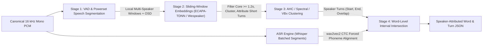
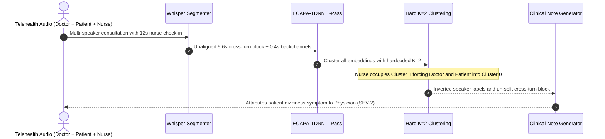

# Module 05: Speaker Diarization

> **Prerequisites:** [Module 00: Audio as Data: Waveforms and Spectrograms](../00-audio-as-data-waveforms-and-spectrograms/README.md), [Module 03: Running Whisper in Practice](../03-running-whisper-in-practice/README.md), and [Module 04: Streaming and Realtime Transcription](../04-streaming-and-realtime-transcription/README.md).  
> **Estimated Reading Time:** 35 minutes  
> **Target Audience:** AI Backend Engineers, Meeting & Telehealth Transcript Architects, Speech ML Pipeline Engineers

> [!TIP]
> **The Golden Rule of Speaker Diarization:** Never cluster short `< 1.0 s` backchannel embeddings alongside multi-second turns, and never assign speaker tags to coarse `Whisper` sentence blocks without forced word-level alignment. Always isolate core speech segments (`>= 1.2 s`) before clustering (`ECAPA-TDNN` / `Wespeaker` or powerset `EEND`), explicitly score overlapped cross-talk rather than forcing single-speaker frames, and intersect diarized speaker turns against forced word timestamps (`WhisperX` / `wav2vec2`) while monitoring **DER decomposition** (`Missed`, `FalseAlarm`, `Confusion`).

---

## Why This Matters

Automatic Speech Recognition answers *"What was said?"*; **Speaker Diarization** answers *"Who spoke when?"*. In clinical scribing, enterprise sales coaching, legal depositions, and multi-party meeting copilots, diarization errors destroy utility even when ASR Word Error Rate is under `3%`:

- **Speaker Confusion:** Attributing *"I'm allergic to penicillin"* to the physician instead of the patient corrupts downstream EHR summaries and triggers compliance failures.
- **Overlapped Speech Loss:** Real human conversations contain `10–20%` simultaneous cross-talk (interruptions, `"yeah"`, `"go ahead"`). Hard single-label (`1-of-K`) clustering drops one speaker completely, causing silent `Missed` speech gaps.
- **Short-Turn Fragmentation:** Brief utterances (`< 1.0 s` like `"Right"`, `"Okay"`, `"Wait"`) lack enough phonetic diversity to stabilize speaker identity vectors, splitting a two-person call into phantom `Speaker 3` and `Speaker 4` clusters.
- **Coarse Timestamp Drift:** Whisper's native segment timestamps frequently drift `0.5–1.5 s` across pauses, shifting boundary words onto the wrong speaker unless anchored by forced phoneme/word alignment.

---

## 1. The Multi-Stage Diarization & Alignment Pipeline

Modern production diarization runs a five-stage pipeline separating acoustic segmentation, identity representation, clustering, overlap resolution, and word-level ASR alignment (`pyannote.audio`, `Wespeaker`, `WhisperX`):



### Stage-by-Stage Mechanics

1. **Stage 1 — Voice Activity Detection (VAD) & Local Powerset Segmentation:** Separates speech from silence, music, and coughs. Traditional pipelines run binary VAD; modern neural segmenters (`pyannote.audio` powerset segmentation, Plaquet & Bredin `arXiv:2310.13025`) classify short `5–10 s` windows directly into powerset speaker combinations (`{none}`, `{spk1}`, `{spk2}`, `{spk1, spk2}`), detecting **Overlapped Speech Detection (OSD)** natively without fragile frame-level thresholds.
2. **Stage 2 — Sliding-Window Speaker Embedding Extraction (`ECAPA-TDNN` / `Wespeaker`):** Extracts fixed-dimensional, $L_2$-normalized speaker vectors (`192–512` dims, e.g., `ECAPA-TDNN` `arXiv:2005.07143`, `Wespeaker` ResNet `arXiv:2210.17016`) over sliding windows (`1.5–2.0 s` window, `0.5–0.75 s` step). Channel attention and attentive statistics pooling emphasize vocal tract timbre over spoken words.
3. **Stage 3 — Constrained Clustering (`AHC`, `Spectral`, `VBx`):** Computes pairwise cosine affinities $S_{ij} = e_i^\top e_j$ across core embeddings and merges segments using **Agglomerative Hierarchical Clustering (AHC)** with calibrated stop threshold $\tau_{\text{cluster}}$, **Spectral Clustering** (using eigenvalue gaps to estimate unknown speaker count $K$), or **Variational Bayes (`VBx`)** HMM refinement. Crucially, short turns (`< 1.0 s`) are **excluded from centroid discovery** and assigned to nearest core centroids afterward.
4. **Stage 4 — Overlapped Speech Attribution:** When powerset segmentation or OSD flags two simultaneous speakers in window $[t_a, t_b]$, both speaker IDs remain active on the timeline (`multi-label` intervals) rather than suppressing the softer speaker.
5. **Stage 5 — Word-Level Alignment (`WhisperX` Pattern, Bain et al. `arXiv:2303.00747`):** Runs a phoneme-level CTC model (`wav2vec2`) over Whisper's transcript to pin every word $[a_w, b_w]$ within `< 50 ms`, then intersects word intervals with diarized turns via maximum temporal overlap.

---

## 2. Quantitative Mechanics: Diarization Error Rate (DER) & Alignment Math

### Diarization Error Rate (`DER`) Decomposition

The industry benchmark for speaker diarization accuracy is **Diarization Error Rate (`DER`)**, defined over total ground-truth speaker-seconds $T_{\text{scored}}$ (summed across *all* active reference speakers—so 2 seconds of 2-speaker cross-talk adds `4.0 s` to $T_{\text{scored}}$):

$$\text{DER} = \frac{T_{\text{missed}} + T_{\text{FA}} + T_{\text{confusion}}}{T_{\text{scored}}}$$

- **$T_{\text{missed}}$ (Missed Speech):** Reference speech frames where the hypothesis predicted too few active speakers (caused by aggressive VAD clipping or ignoring cross-talk overlaps).
- **$T_{\text{FA}}$ (False Alarm):** Hypothesis speaker frames emitted during silence, laughter, hold music, or over-counting active speakers.
- **$T_{\text{confusion}}$ (Speaker Confusion):** Frames where both reference and hypothesis have active speakers, yet the hypothesis speaker ID mismatches the optimal ground-truth speaker mapping.

Because diarization clusters produce anonymous labels (`SPK_00`, `SPK_01`), evaluation first solves a **minimum-cost bipartite matching** (Hungarian / linear sum assignment across all speaker permutations $\pi$) maximizing overlap between reference speakers and hypothesis clusters before computing $T_{\text{confusion}}$. Note that a standard `250 ms` forgiveness collar around reference segment edges is common in academic benchmarks, whereas strict enterprise QA audits also track **`0 ms` collar `DER`** so overlap misses stay visible.

### Word-to-Speaker Interval Intersection

Given forced-aligned word $w$ spanning $[a_w, b_w]$ and candidate speaker intervals $\{(s_k, e_k)\}$ belonging to speaker cluster $c$:

$$\text{Overlap}(w, c) = \sum_{(s_k, e_k) \in c} \max\big(0, \min(b_w, e_k) - \max(a_w, s_k)\big)$$

$$\hat{y}_w = \arg\max_{c} \text{Overlap}(w, c)$$

If $\max_c \text{Overlap}(w, c) = 0$ (minor inter-word alignment gap), fall back to the nearest turn boundary $\min(|a_w - e_k|, |s_k - b_w|)$ within a bounded tolerance (e.g., `0.25 s`). Flag `overlap = true` whenever a runner-up speaker overlaps $\ge 30\%$ of word duration $[a_w, b_w]$.

### Short-Turn Cosine Variance Guard

For unit-normalized embeddings $e \in \mathbb{R}^d$ ($\|e\|_2 = 1$), intra-speaker similarity stays stable (`0.65–0.90`) once acoustic duration $d_{\text{seg}} \ge 1.2\text{ s}$, but degrades sharply below `0.8 s`. Using a **two-pass length-guarded strategy** prevents short turns from forming spurious extra speaker clusters:

$$\text{Pass 1: Cluster } \{i : d_i \ge 1.2\text{ s}\} \to \{\mu_1, \dots, \mu_K\}, \qquad \text{Pass 2: } \hat{c}_j = \arg\max_{k} (e_j^\top \mu_k) \text{ for } d_j < 1.2\text{ s}$$

---

## 3. Systematic Comparison Matrix: Production Diarization Architectures

| Approach | Overlap (`OSD`) Handling | Unknown $K$ Speaker Estimation | Short-Turn (`< 1s`) Stability | Streaming / Real-Time Fit | Compute Profile & Failure Mode |
| :--- | :--- | :--- | :--- | :--- | :--- |
| **VAD + Fixed $K$-Means (`ECAPA-TDNN`)** | None (`1-of-K` hard assignment) | Requires hardcoding $K$ up front | Poor (short outliers distort centroids) | Moderate (rolling clustering) | Fast CPU/GPU; fails catastrophically whenever a 3rd speaker enters |
| **VAD + Length-Guarded AHC / Spectral (`Wespeaker`)** | None unless separate OSD model added | Strong (cosine cutoff $\tau$ or spectral eigengap) | Good when `< 1.2 s` turns are deferred to Pass 2 | Batch / sliding-chunk (`5–30 s` lag) | Low GPU; misses simultaneous cross-talk (`T_missed` spikes in heated calls) |
| **Powerset Neural Segmentation + Global `VBx` (`pyannote.audio`)** | **Native** multi-speaker local windows | **Strong** (local slots stitched globally) | Strong (joint segmentation + embedding quality filter) | Pseudo-streaming (`5–10 s` chunks) | Higher GPU footprint; SOTA `DER` on meetings and multi-party calls |
| **Dual-Channel / Stereo Split + Mono Fallback** | **100% deterministic** across channels | Known per telephony leg | **Immune** to acoustic short-turn variance | **Zero-lag** real time (`0 ms`) | Fails on acoustic crosstalk bleed (speakerphone echo) unless echo-cancelled |

---

## 4. Production SEV-2 War Story Post-Mortem: The Inverted Clinical Consultation & Cross-Talk Audit

| Field | Incident Details |
| :--- | :--- |
| **Severity** | **SEV-2** (Incorrect Medical Speaker Attribution Across Telehealth Encounters) |
| **Detection / Resolution Time** | Detected 3 days post-release via clinician QA audit / Mitigated in 6 hours via pipeline overhaul |
| **Impact** | `22%` of clinic encounters swapped physician and patient questions/answers (`DER = 44%`); automated SOAP note generation suspended temporarily |

### What Happened

A telehealth platform transcribed recorded visits using Whisper and attributed speakers via a custom Python script that ran **1-pass `k-means(n_clusters=2)`** on `ECAPA-TDNN` embeddings extracted per Whisper segment—including `0.4 s` `"Mm-hmm"` interjections—without `wav2vec2` forced word alignment or unknown-speaker estimation.

During a routine checkup, three conditions combined to break diarization:

1. **Surprise 3rd Speaker:** A triage nurse entered for `12` seconds to read blood pressure (`"120 over 80"`). Because `k-means` forced `K = 2`, the nurse's crisp voice became Cluster 1 while the doctor and patient merged into Cluster 0 for half the visit!
2. **Whisper Segment Boundary Drift:** Whisper emitted a single segment spanning `14.2 s–19.8 s`: `"Do you get dizzy? Yes especially standing up."` Native timestamps blurred across the turn transition, attributing the patient's symptom `"Yes especially standing up"` entirely to the clinician.
3. **Unweighted Short Turns:** Dozens of `0.3–0.6 s` backchannels skewed centroid updates, inflating **Speaker Confusion** to `38%`.



### Root Cause Analysis

- **Hardcoded Speaker Count (`K=2`):** Real clinical calls frequently include nurses, translators, or family members.
- **Unfiltered Short Embeddings:** Sub-second utterances injected severe cosine variance into clustering centroids.
- **Sentence-Level Attribution Without Word Alignment:** Attaching speaker tags to multi-second Whisper blocks ignored mid-segment speaker transitions.

### Architectural Hardening & Verified Fix

- **Powerset Segmentation + Unknown-$K$ Clustering:** Replaced `k-means(K=2)` with `pyannote` powerset segmentation (detecting cross-talk natively) and length-guarded AHC/Spectral clustering estimating $K \in [1, 8]$ dynamically.
- **Two-Pass Short-Turn Guard:** Excluded segments `< 1.2 s` from initial cluster formation, attributing brief backchannels only after core centroids stabilized.
- **`WhisperX` Word-Level Intersection:** Added `wav2vec2` forced alignment so every word received exact $[a_w, b_w]$ boundaries before intersecting speaker turns, dropping `DER` from `44%` to **`8.2%`** on clinical QA eval sets.

---

## 5. Multi-Language Production Implementation: DER Calculator & Word-Level Speaker Alignment

Below is a self-contained **Word-Level Diarization Alignment & Exact DER Evaluator** across **Go**, **TypeScript**, **Python**, and **C#**. It implements exact `WhisperX`-style word-to-turn interval intersection (with overlap flagging and nearest-turn fallback) alongside exact timeline-partitioned `DER` computation (`Missed`, `FalseAlarm`, `Confusion`) via optimal speaker permutation matching.

````carousel

```go
package diarization

import (
	"math"
	"sort"
)

type Turn struct {
	Speaker string
	Start   float64
	End     float64
}

type WordSpan struct {
	Text  string
	Start float64
	End   float64
}

type AttributedWord struct {
	Word        WordSpan
	Speaker     string
	HasOverlap  bool
}

type DerMetrics struct {
	ScoredSec     float64
	MissedSec     float64
	FalseAlarmSec float64
	ConfusionSec  float64
	DER           float64
}

// AssignWordSpeakers maps each aligned word to the speaker turn with maximum temporal overlap.
func AssignWordSpeakers(words []WordSpan, turns []Turn, maxGapSec float64) []AttributedWord {
	out := make([]AttributedWord, 0, len(words))
	for _, w := range words {
		dur := math.Max(1e-6, w.End-w.Start)
		scores := make(map[string]float64)
		for _, t := range turns {
			ov := math.Min(w.End, t.End) - math.Max(w.Start, t.Start)
			if ov > 0 {
				scores[t.Speaker] += ov
			}
		}

		bestSpk, secondOv := "UNKNOWN", 0.0
		bestOv := 0.0
		for spk, ov := range scores {
			if ov > bestOv {
				secondOv = bestOv
				bestOv = ov
				bestSpk = spk
			} else if ov > secondOv {
				secondOv = ov
			}
		}

		if bestOv == 0 && len(turns) > 0 {
			minGap := math.Inf(1)
			for _, t := range turns {
				gap := math.Min(math.Abs(w.Start-t.End), math.Abs(t.Start-w.End))
				if gap < minGap && gap <= maxGapSec {
					minGap = gap
					bestSpk = t.Speaker
				}
			}
		}

		out = append(out, AttributedWord{
			Word:       w,
			Speaker:    bestSpk,
			HasOverlap: secondOv/dur >= 0.30,
		})
	}
	return out
}

// ComputeDER evaluates Missed, FalseAlarm, and Confusion over elementary time slices for a given speaker map.
func ComputeDER(ref, hyp []Turn, hypToRef map[string]string) DerMetrics {
	ptSet := make(map[float64]struct{})
	for _, t := range append(append([]Turn(nil), ref...), hyp...) {
		ptSet[t.Start] = struct{}{}
		ptSet[t.End] = struct{}{}
	}
	pts := make([]float64, 0, len(ptSet))
	for p := range ptSet {
		pts = append(pts, p)
	}
	sort.Float64s(pts)

	var m DerMetrics
	for i := 0; i+1 < len(pts); i++ {
		a, b := pts[i], pts[i+1]
		dt := b - a
		if dt <= 1e-9 {
			continue
		}
		rAct := make(map[string]bool)
		for _, t := range ref {
			if t.Start <= a && t.End >= b {
				rAct[t.Speaker] = true
			}
		}
		hAct := make(map[string]bool)
		for _, t := range hyp {
			if t.Start <= a && t.End >= b {
				hAct[t.Speaker] = true
			}
		}

		m.ScoredSec += float64(len(rAct)) * dt
		if len(rAct) > len(hAct) {
			m.MissedSec += float64(len(rAct)-len(hAct)) * dt
		} else if len(hAct) > len(rAct) {
			m.FalseAlarmSec += float64(len(hAct)-len(rAct)) * dt
		}

		correct := 0
		for h := range hAct {
			if mapped, ok := hypToRef[h]; ok && rAct[mapped] {
				correct++
			}
		}
		activeMin := len(rAct)
		if len(hAct) < activeMin {
			activeMin = len(hAct)
		}
		if activeMin > correct {
			m.ConfusionSec += float64(activeMin-correct) * dt
		}
	}
	if m.ScoredSec > 0 {
		m.DER = (m.MissedSec + m.FalseAlarmSec + m.ConfusionSec) / m.ScoredSec
	}
	return m
}
```

<!-- slide -->

```typescript
export interface TurnInterval {
  readonly speaker: string;
  readonly start: number;
  readonly end: number;
}

export interface AlignedWord {
  readonly text: string;
  readonly start: number;
  readonly end: number;
}

export interface WordAttribution {
  readonly word: AlignedWord;
  readonly speaker: string;
  readonly overlapFlag: boolean;
}

export interface DerReport {
  readonly scoredSec: number;
  readonly missedSec: number;
  readonly falseAlarmSec: number;
  readonly confusionSec: number;
  readonly der: number;
}

export function assignWordsToSpeakers(
  words: readonly AlignedWord[],
  turns: readonly TurnInterval[],
  maxFallbackGapSec = 0.25,
): WordAttribution[] {
  return words.map((word) => {
    const dur = Math.max(1e-6, word.end - word.start);
    const overlapBySpk = new Map<string, number>();

    for (const t of turns) {
      const ov = Math.min(word.end, t.end) - Math.max(word.start, t.start);
      if (ov > 0) {
        overlapBySpk.set(t.speaker, (overlapBySpk.get(t.speaker) ?? 0) + ov);
      }
    }

    const ranked = [...overlapBySpk.entries()].sort((a, b) => b[1] - a[1]);
    if (ranked.length > 0) {
      const winner = ranked[0][0];
      const overlapFlag = ranked.length > 1 && ranked[1][1] / dur >= 0.30;
      return { word, speaker: winner, overlapFlag };
    }

    let nearestSpk = "UNKNOWN";
    let bestGap = Number.POSITIVE_INFINITY;
    for (const t of turns) {
      const gap = Math.min(Math.abs(word.start - t.end), Math.abs(t.start - word.end));
      if (gap < bestGap && gap <= maxFallbackGapSec) {
        bestGap = gap;
        nearestSpk = t.speaker;
      }
    }
    return { word, speaker: nearestSpk, overlapFlag: false };
  });
}

export function evaluateDer(
  ref: readonly TurnInterval[],
  hyp: readonly TurnInterval[],
  hypToRef: Readonly<Record<string, string>>,
): DerReport {
  const pts = [...new Set([...ref, ...hyp].flatMap((t) => [t.start, t.end]))].sort((a, b) => a - b);
  let scoredSec = 0;
  let missedSec = 0;
  let falseAlarmSec = 0;
  let confusionSec = 0;

  for (let i = 0; i + 1 < pts.length; i += 1) {
    const [a, b] = [pts[i], pts[i + 1]];
    const dt = b - a;
    if (dt <= 1e-9) continue;

    const rAct = new Set(ref.filter((t) => t.start <= a && t.end >= b).map((t) => t.speaker));
    const hAct = new Set(hyp.filter((t) => t.start <= a && t.end >= b).map((t) => t.speaker));

    scoredSec += rAct.size * dt;
    if (rAct.size > hAct.size) missedSec += (rAct.size - hAct.size) * dt;
    if (hAct.size > rAct.size) falseAlarmSec += (hAct.size - rAct.size) * dt;

    let correct = 0;
    for (const h of hAct) {
      const mapped = hypToRef[h];
      if (mapped && rAct.has(mapped)) correct += 1;
    }
    confusionSec += Math.max(0, Math.min(rAct.size, hAct.size) - correct) * dt;
  }

  const der = scoredSec > 0 ? (missedSec + falseAlarmSec + confusionSec) / scoredSec : 0;
  return { scoredSec, missedSec, falseAlarmSec, confusionSec, der };
}
```

<!-- slide -->

```python
"""
diarization_align_eval.py
Word-level speaker attribution (WhisperX intersection pattern) and exact DER evaluation.
"""
from dataclasses import dataclass
import itertools
from typing import Sequence


@dataclass(frozen=True)
class Turn:
    speaker: str
    start: float
    end: float


@dataclass(frozen=True)
class WordSpan:
    text: str
    start: float
    end: float


@dataclass(frozen=True)
class WordAttribution:
    text: str
    start: float
    end: float
    speaker: str
    overlap_flag: bool


@dataclass(frozen=True)
class DerMetrics:
    optimal_mapping: dict[str, str]
    scored_sec: float
    missed_sec: float
    false_alarm_sec: float
    confusion_sec: float
    der: float


def assign_word_speakers(
    words: Sequence[WordSpan], turns: Sequence[Turn], max_gap_sec: float = 0.25
) -> list[WordAttribution]:
    results: list[WordAttribution] = []
    for w in words:
        dur = max(1e-6, w.end - w.start)
        overlaps: dict[str, float] = {}
        for t in turns:
            ov = max(0.0, min(w.end, t.end) - max(w.start, t.start))
            if ov > 0.0:
                overlaps[t.speaker] = overlaps.get(t.speaker, 0.0) + ov

        if overlaps:
            ranked = sorted(overlaps.items(), key=lambda kv: kv[1], reverse=True)
            winner = ranked[0][0]
            overlap_flag = len(ranked) > 1 and (ranked[1][1] / dur) >= 0.30
        else:
            nearest = min(
                turns,
                key=lambda t: min(abs(w.start - t.end), abs(t.start - w.end)),
                default=None,
            )
            if nearest and min(abs(w.start - nearest.end), abs(nearest.start - w.end)) <= max_gap_sec:
                winner = nearest.speaker
            else:
                winner = "UNKNOWN"
            overlap_flag = False

        results.append(WordAttribution(w.text, w.start, w.end, winner, overlap_flag))
    return results


def compute_optimal_der(ref: Sequence[Turn], hyp: Sequence[Turn]) -> DerMetrics:
    pts = sorted({t for seg in (*ref, *hyp) for t in (seg.start, seg.end)})
    ref_spks = sorted({t.speaker for t in ref})
    hyp_spks = sorted({t.speaker for t in hyp})
    pad_len = max(len(ref_spks), len(hyp_spks))
    padded_hyp: list[str | None] = list(hyp_spks) + [None] * (pad_len - len(hyp_spks))

    best: DerMetrics | None = None
    for perm in itertools.permutations(padded_hyp, len(ref_spks)):
        h_to_r = {h: r for r, h in zip(ref_spks, perm) if h is not None}
        missed = fa = conf = scored = 0.0
        for a, b in zip(pts, pts[1:]):
            dt = b - a
            if dt <= 1e-9:
                continue
            r_act = {t.speaker for t in ref if t.start <= a and t.end >= b}
            h_act = {t.speaker for t in hyp if t.start <= a and t.end >= b}
            scored += len(r_act) * dt
            if len(r_act) > len(h_act):
                missed += (len(r_act) - len(h_act)) * dt
            elif len(h_act) > len(r_act):
                fa += (len(h_act) - len(r_act)) * dt
            mapped_h = {h_to_r.get(h, f"_unmapped_{h}") for h in h_act}
            conf += max(0, min(len(r_act), len(h_act)) - len(r_act & mapped_h)) * dt

        der = (missed + fa + conf) / scored if scored > 0 else 0.0
        if best is None or der < best.der:
            best = DerMetrics(h_to_r, scored, missed, fa, conf, der)
    assert best is not None
    return best
```

<!-- slide -->

```csharp
using System;
using System.Collections.Generic;
using System.Linq;

namespace GenAI.Speech.Diarization;

public sealed record Turn(string Speaker, double Start, double End);
public sealed record WordSpan(string Text, double Start, double End);
public sealed record AttributedWord(WordSpan Word, string Speaker, bool OverlapFlag);
public sealed record DerReport(double ScoredSec, double MissedSec, double FalseAlarmSec, double ConfusionSec, double Der);

public static class DiarizationEvaluator
{
    public static IReadOnlyList<AttributedWord> AssignWordSpeakers(
        IReadOnlyList<WordSpan> words,
        IReadOnlyList<Turn> turns,
        double maxGapSec = 0.25)
    {
        var output = new List<AttributedWord>(words.Count);
        foreach (var w in words)
        {
            double dur = Math.Max(1e-6, w.End - w.Start);
            var scores = new Dictionary<string, double>();
            foreach (var t in turns)
            {
                double ov = Math.Min(w.End, t.End) - Math.Max(w.Start, t.Start);
                if (ov > 0)
                    scores[t.Speaker] = scores.GetValueOrDefault(t.Speaker) + ov;
            }

            if (scores.Count > 0)
            {
                var ranked = scores.OrderByDescending(kv => kv.Value).ToList();
                bool overlap = ranked.Count > 1 && (ranked[1].Value / dur) >= 0.30;
                output.Add(new AttributedWord(w, ranked[0].Key, overlap));
            }
            else
            {
                string winner = "UNKNOWN";
                double minGap = double.PositiveInfinity;
                foreach (var t in turns)
                {
                    double gap = Math.Min(Math.Abs(w.Start - t.End), Math.Abs(t.Start - w.End));
                    if (gap < minGap && gap <= maxGapSec)
                    {
                        minGap = gap;
                        winner = t.Speaker;
                    }
                }
                output.Add(new AttributedWord(w, winner, false));
            }
        }
        return output;
    }

    public static DerReport ComputeDer(
        IReadOnlyList<Turn> reference,
        IReadOnlyList<Turn> hypothesis,
        IReadOnlyDictionary<string, string> hypToRefMap)
    {
        var pts = reference.Concat(hypothesis)
            .SelectMany(t => new[] { t.Start, t.End })
            .Distinct()
            .OrderBy(x => x)
            .ToArray();

        double scored = 0, missed = 0, fa = 0, confusion = 0;
        for (int i = 0; i + 1 < pts.Length; i++)
        {
            double a = pts[i], b = pts[i + 1];
            double dt = b - a;
            if (dt <= 1e-9) continue;

            var rAct = reference.Where(t => t.Start <= a && t.End >= b).Select(t => t.Speaker).ToHashSet();
            var hAct = hypothesis.Where(t => t.Start <= a && t.End >= b).Select(t => t.Speaker).ToHashSet();

            scored += rAct.Count * dt;
            if (rAct.Count > hAct.Count) missed += (rAct.Count - hAct.Count) * dt;
            else if (hAct.Count > rAct.Count) fa += (hAct.Count - rAct.Count) * dt;

            int correct = hAct.Count(h => hypToRefMap.TryGetValue(h, out var mapped) && rAct.Contains(mapped));
            confusion += Math.Max(0, Math.Min(rAct.Count, hAct.Count) - correct) * dt;
        }

        double der = scored > 0 ? (missed + fa + confusion) / scored : 0;
        return new DerReport(scored, missed, fa, confusion, der);
    }
}
```

````

---

## 6. Practical Hands-On CLI Verification Workflows

Run these deterministic Python 3.13 scripts completely offline using only the Python standard library.

### Workflow 1: Exact `DER` Decomposition with Bipartite Permutation Matching

Evaluate a ground-truth timeline containing overlapped cross-talk (`S0` and `S1` speaking together on `[2.0 s, 3.0 s]`) against a single-label diarization hypothesis containing missed overlap, a `1.0 s` non-speech false alarm (`[6.0 s, 7.0 s]`), and a `0.5 s` speaker confusion swap (`[5.0 s, 5.5 s]`):

```bash
python -c '
import itertools

ref = [("S0", 0.0, 3.0), ("S1", 2.0, 6.0), ("S0", 7.0, 9.0)]
hyp = [("A",  0.0, 2.5), ("B",  2.5, 5.0), ("A",  5.0, 5.5), ("B",  6.0, 7.0), ("A", 7.0, 9.0)]

pts = sorted({t for _, s, e in ref + hyp for t in (s, e)})
ref_spks = sorted({s for s, _, _ in ref})
hyp_spks = sorted({s for s, _, _ in hyp})

size = max(len(ref_spks), len(hyp_spks))
best = None
for perm in itertools.permutations(list(hyp_spks) + [None] * (size - len(hyp_spks)), len(ref_spks)):
    h_to_r = {h: r for r, h in zip(ref_spks, perm) if h is not None}
    missed = fa = conf = scored = 0.0
    for a, b in zip(pts, pts[1:]):
        dt = b - a
        r_act = {s for s, st, en in ref if st <= a and en >= b}
        h_act = {s for s, st, en in hyp if st <= a and en >= b}
        scored += len(r_act) * dt
        n_r, n_h = len(r_act), len(h_act)
        if n_r > n_h:
            missed += (n_r - n_h) * dt
        elif n_h > n_r:
            fa += (n_h - n_r) * dt
        mapped_h = {h_to_r.get(h, f"_unmapped_{h}") for h in h_act}
        correct = len(r_act & mapped_h)
        conf += max(0, min(n_r, n_h) - correct) * dt
    der = (missed + fa + conf) / scored
    if best is None or der < best[0]:
        best = (der, h_to_r, missed, fa, conf, scored)

der, mapping, missed, fa, conf, scored = best
print(f"optimal_map={mapping}")
print(f"scored={scored:.2f}s | missed={missed:.2f}s | false_alarm={fa:.2f}s | confusion={conf:.2f}s | DER={der*100:.2f}%")
'
```

**Expected Output:**

```text
optimal_map={'A': 'S0', 'B': 'S1'}
scored=9.00s | missed=1.50s | false_alarm=1.00s | confusion=0.50s | DER=33.33%
```

### Workflow 2: Preventing Short-Turn (`< 1.0 s`) Cluster Fragmentation

Verify why excluding brief utterances (`< 1.2 s`) during initial clustering prevents noisy backchannels from fracturing into phantom 3rd/4th speaker clusters:

```bash
python -c '
import math

def norm(v):
    m = math.sqrt(sum(x * x for x in v))
    return [x / m for x in v]

def cos(a, b):
    return sum(x * y for x, y in zip(a, b))

def mean_vec(vecs):
    return norm([sum(col) / len(vecs) for col in zip(*vecs)])

def agglom(items, tau=0.80):
    clusters = [[it] for it in items]
    while len(clusters) > 1:
        best_sim, pair = -1.0, None
        cents = [mean_vec([x[2] for x in c]) for c in clusters]
        for i in range(len(clusters)):
            for j in range(i + 1, len(clusters)):
                s = cos(cents[i], cents[j])
                if s > best_sim:
                    best_sim, pair = s, (i, j)
        if best_sim < tau:
            break
        i, j = pair
        clusters[i].extend(clusters[j])
        clusters.pop(j)
    return clusters

segments = [
    ("seg0", 2.4, norm([0.92, 0.35, 0.12, 0.08])),
    ("seg1", 2.1, norm([0.90, 0.38, 0.14, 0.05])),
    ("seg2", 0.5, norm([0.38, 0.80, 0.45, 0.10])),
    ("seg3", 2.6, norm([-0.85, 0.42, 0.28, 0.10])),
    ("seg4", 1.9, norm([-0.82, 0.45, 0.31, 0.12])),
]

naive_clusters = agglom(segments, tau=0.80)
core = [s for s in segments if s[1] >= 1.2]
short = [s for s in segments if s[1] < 1.2]
guarded = agglom(core, tau=0.80)
centroids = [mean_vec([x[2] for x in c]) for c in guarded]
for s in short:
    best_idx = max(range(len(centroids)), key=lambda idx: cos(s[2], centroids[idx]))
    guarded[best_idx].append(s)

print(f"naive_1pass_clusters={len(naive_clusters)} -> {[[x[0] for x in c] for c in naive_clusters]}")
print(f"guarded_2pass_clusters={len(guarded)} -> {[[x[0] for x in c] for c in guarded]}")
'
```

**Expected Output:**

```text
naive_1pass_clusters=3 -> [['seg0', 'seg1'], ['seg2'], ['seg3', 'seg4']]
guarded_2pass_clusters=2 -> [['seg0', 'seg1', 'seg2'], ['seg3', 'seg4']]
```

### Workflow 3: `WhisperX` Word-Level Intersection & Overlap Flagging

Intersect forced-aligned word timestamps against overlapping diarization turns to assign speakers and automatically flag words uttered during cross-talk:

```bash
python -c '
turns = [
    ("SPK_00", 0.00, 1.85),
    ("SPK_01", 1.55, 3.60),
]
words = [
    ("Please",   0.10, 0.55),
    ("confirm",  0.60, 1.48),
    ("now",      1.52, 1.84),
    ("received", 1.90, 2.50),
    ("!",        2.52, 2.58),
]

for word, ws, we in words:
    dur = max(1e-6, we - ws)
    scores = {}
    for spk, ts, te in turns:
        ov = max(0.0, min(we, te) - max(ws, ts))
        if ov > 0:
            scores[spk] = scores.get(spk, 0.0) + ov
    if scores:
        ranked = sorted(scores.items(), key=lambda kv: kv[1], reverse=True)
        winner = ranked[0][0]
        overlap_flag = len(ranked) > 1 and (ranked[1][1] / dur) >= 0.30
    else:
        winner = min(turns, key=lambda t: min(abs(ws - t[2]), abs(t[1] - we)))[0]
        overlap_flag = False
    print(f"{word:<10} [{ws:.2f}s-{we:.2f}s] -> {winner} | overlap_flag={overlap_flag}")
'
```

**Expected Output:**

```text
Please     [0.10s-0.55s] -> SPK_00 | overlap_flag=False
confirm    [0.60s-1.48s] -> SPK_00 | overlap_flag=False
now        [1.52s-1.84s] -> SPK_00 | overlap_flag=True
received   [1.90s-2.50s] -> SPK_01 | overlap_flag=False
!          [2.52s-2.58s] -> SPK_01 | overlap_flag=False
```

> [!NOTE]
> **Optional GPU End-to-End Run (Requires `whisperx` / `pyannote.audio` + HF Token):** In production Python workers, `whisperx.load_align_model(...)` runs `wav2vec2` CTC alignment on Whisper output, `pyannote.audio.Pipeline.from_pretrained("pyannote/speaker-diarization-3.1")` computes powerset segmentation + `Wespeaker` clustering, and `whisperx.assign_word_speakers(...)` executes the exact temporal overlap join verified above.

---

### Hands-On Exercises

1. **Test Zero-Overlap Penalty:** In Workflow 1, remove the `("S1", 2.0, 6.0)` segment overlap (`("S1", 3.0, 6.0)`) and re-run to observe `missed` drop from `1.50 s` to `0.50 s`.
2. **Add Forgiveness Collar:** Modify Workflow 1's interval loop to skip sub-intervals lying within `±0.125 s` of any reference turn boundary (`250 ms` collar), and quantify how much `DER` drops when boundary jitter is forgiven.
3. **Nearest-Boundary Fallback Test:** Add an un-covered word `("uh", 1.86, 1.89)` inside a `0.05 s` micro-gap in Workflow 3 where `turns` stops at `1.85` and resumes at `1.90`, verifying that nearest-boundary fallback resolves `"SPK_00"` instead of `"UNKNOWN"`.

### Independent Challenge

A B2B legal-deposition pipeline outputs a combined transcript with `DER = 19%`, decomposed into `Missed = 11%`, `FalseAlarm = 1%`, and `Confusion = 7%`. Meanwhile, ASR WER is an impressive `3.2%`, yet attorneys complain that hostile cross-examination objections (`"Objection, leading!"`) regularly vanish from the opposing counsel's speaker stream and mid-sentence pauses cause entire clauses to shift speaker labels. Diagnose why each metric points to a distinct architectural defect and propose exact remedies.

<details><summary>Architectural Discussion</summary>

First, `Missed = 11%` combined with disappearing cross-examination objections points directly to **single-label (`1-of-K`) diarization failing on overlapped speech**: when counsel interrupts the witness, the clustering pipeline drops the overlapping voice (`Missed`), whereas switching to **powerset neural segmentation / explicit OSD** preserves simultaneous multi-speaker turns. Second, `Confusion = 7%` and shifting clause labels indicate **coarse Whisper segment attribution without forced word alignment** (plus likely noisy short-turn clustering on `"Objection"`): adding **`wav2vec2` forced word-level alignment (`WhisperX`)** before interval intersection and **two-pass length-guarded clustering** (`core >= 1.2 s`) locks short objections to their true speaker cleanly.

</details>

---

## 7. Common Mistakes & Troubleshooting

- **Reporting only aggregate `DER` without `Missed / FA / Confusion` breakdown:** A `15%` aggregate `DER` caused by `FalseAlarm` (sensitive VAD picking up background TV) requires raising VAD threshold $\tau_{\text{VAD}}$, whereas `15%` driven by `Missed` requires powerset overlap handling, and `15%` driven by `Confusion` requires better speaker embeddings (`Wespeaker` / `ECAPA-TDNN`) or tuned clustering threshold $\tau_{\text{cluster}}$.
- **Hardcoding speaker count `K = 2` on phone/meeting recordings:** Adding a conference call operator, IVR prompt, or unexpected third room participant forces the algorithm to merge two primary speakers into one centroid (`Confusion -> 40%+`). Estimate $K$ automatically with bounded `[min_speakers, max_speakers]`.
- **Attributing Whisper segments directly without `wav2vec2` word alignment:** Whisper's segment borders routinely span inter-turn silences or bleed `0.5–1.5 s` across speaker switches, assigning trailing phrases to the incoming speaker.
- **Clustering raw `< 0.8 s` backchannels alongside long turns:** Short segments produce noisy cosine vectors that spin off fake extra speaker IDs (`SPK_04`, `SPK_05`). Exclude them during centroid clustering and assign them in a second pass.

---

## 8. Operational Validation Checkpoints & Checkpoint Quiz

### Operational Validation Checkpoints

<details><summary><strong>Checkpoint 1: Computing DER when two speakers talk simultaneously</strong></summary>

In a `10.0 s` audio clip, Speaker A talks from `0.0–6.0 s` and Speaker B talks from `4.0–10.0 s` (overlapping on `4.0–6.0 s`). A naive single-label diarization system labels `0.0–5.0 s` as Speaker A and `5.0–10.0 s` as Speaker B (`0` confusion on assigned intervals, `0` false alarms). What are $T_{\text{scored}}$, $T_{\text{missed}}$, and exact `DER`?

**Validation:** Speaker A speaks `6.0 s` and Speaker B speaks `6.0 s`, so $T_{\text{scored}} = 6.0 + 6.0 = 12.0\text{ s}$. During the `2.0 s` overlap (`4.0–6.0 s`), the single-label output emits only 1 speaker instead of 2 (`1.0 s` missed for B on `4.0–5.0 s`, `1.0 s` missed for A on `5.0–6.0 s`), so $T_{\text{missed}} = 2.0\text{ s}$. Therefore $\text{DER} = 2.0 / 12.0 = 16.67\%$.

</details>

<details><summary><strong>Checkpoint 2: Fixing phantom speaker explosion on fast-paced meetings</strong></summary>

A 4-person standup meeting produces `9` distinct speaker clusters in `pyannote`/AHC output, with clusters `SPK_04` through `SPK_08` containing only brief utterances like `"yep"`, `"cool"`, and `"uh-huh"`. Identify the root cause and fix.

**Validation:** Sub-second utterances (`< 1.0 s`) lack sufficient acoustic frames to form stable `ECAPA-TDNN` / `Wespeaker` embeddings, falling below the agglomerative cosine merge cutoff $\tau_{\text{cluster}}$ and spawning singleton clusters. Fix by running **two-pass length-guarded clustering**: cluster only segments `>= 1.2 s` to establish true speaker centroids, then map `< 1.2 s` segments via nearest centroid (or contextual turn continuity).

</details>

<details><summary><strong>Checkpoint 3: Resolving speaker label bleed at turn transitions</strong></summary>

In a 2-speaker interview, ASR outputs `"Okay let's check that. When did you ship?"` as a single `Whisper` block spanning `[12.0 s, 16.0 s]`, while diarization cleanly switches from `SPK_00` (`[10.0 s, 13.8 s]`) to `SPK_01` (`[13.8 s, 18.0 s]`). Whole-segment attribution assigns the entire block to `SPK_01`. How do you fix this deterministically?

**Validation:** Insert **`wav2vec2` forced word-level alignment** (`WhisperX` pattern) to obtain exact timestamps for every word (`"Okay"`–`"that."` ending around `13.6 s`, `"When"`–`"ship?"` spanning `13.9–16.0 s`), then intersect each word interval against the diarized turns so `"Okay let's check that."` attributes to `SPK_00` and `"When did you ship?"` attributes to `SPK_01`.

</details>

### Checkpoint Quiz

1. What are the three error components in the `DER` numerator, and why can `DER` exceed `100%`?
2. Why does evaluating diarization with a `0 ms` collar and overlap enabled reveal failures hidden by single-speaker `250 ms` collar benchmarks?
3. How do `ECAPA-TDNN` / `Wespeaker` embeddings work inside a multi-stage diarizer, and why must short turns (`< 1.0 s`) be handled separately?
4. What architectural advantage does powerset segmentation (`pyannote.audio`) hold over binary VAD + `AHC`?
5. Describe how `WhisperX` resolves the timestamp mismatch between Whisper segment blocks and speaker diarization turns.

<details><summary>Answers</summary>

1. The three components are **$T_{\text{missed}}$** (missed reference speech), **$T_{\text{FA}}$** (false-alarm speech predicted during silence/noise), and **$T_{\text{confusion}}$** (wrong speaker ID). `DER` can exceed `100%` if $T_{\text{FA}}$ exceeds $T_{\text{scored}}$ (e.g., classifying continuous background noise as 2–3 active speakers across a sparse clip).
2. A `250 ms` collar ignores boundary jitter, and single-speaker evaluation ignores missed secondary speakers during cross-talk; `0 ms` collar with overlap forces `T_missed` to expose dropped interruptions and imprecise turn cuts.
3. `ECAPA-TDNN` / `Wespeaker` extract unit-normalized speaker identity vectors over `1.5–2.0 s` windows for cosine clustering. Turns `< 1.0 s` carry sparse phonetic coverage and high embedding variance, which splits single speakers into extra clusters unless deferred until core centroids stabilize.
4. Powerset segmentation classifies local windows directly into single- and multi-speaker combinations (`{spk1, spk2}`), capturing overlapped cross-talk natively without fragile threshold tuning.
5. `WhisperX` runs `wav2vec2` CTC forced phoneme alignment on ASR text to derive `< 50 ms`-accurate word intervals, then intersects each word's interval with diarized turns by maximum temporal overlap.

</details>

---

## Further Reading & Sources

- [ECAPA-TDNN: Emphasized Channel Attention, Propagation and Aggregation in TDNN Based Speaker Verification (Desplanques et al., 2020)](https://arxiv.org/abs/2005.07143) — foundational speaker embedding extractor for diarization and verification.
- [Wespeaker: A Research and Production oriented Speaker Embedding Learning Toolkit (Wang et al., 2022)](https://arxiv.org/abs/2210.17016) — production embedding architectures in [`wenet-e2e/wespeaker`](https://github.com/wenet-e2e/wespeaker).
- [Powerset multi-class cross entropy loss for neural speaker diarization (Plaquet & Bredin, 2023)](https://arxiv.org/abs/2310.13025) — overlap-native neural segmentation powering [`pyannote/pyannote-audio`](https://github.com/pyannote/pyannote-audio).
- [WhisperX: Time-Accurate Speech Transcription of Long-Form Audio (Bain et al., 2023)](https://arxiv.org/abs/2303.00747) — batched Whisper + `wav2vec2` forced word alignment + `pyannote` speaker attribution in [`m-bain/whisperX`](https://github.com/m-bain/whisperX).

## Next

[Module 06: Text-to-Speech Fundamentals](../06-text-to-speech-fundamentals/README.md)
