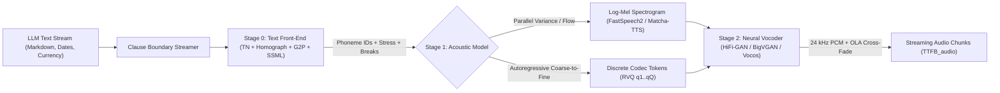
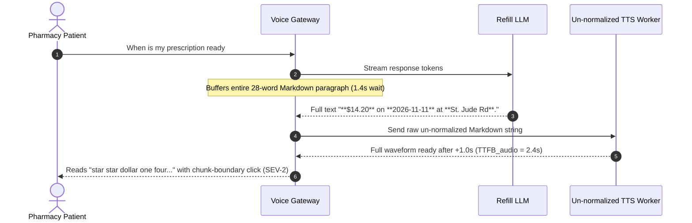

# Module 06: Text-to-Speech Fundamentals

> **Prerequisites:** [Module 00: Audio as Data: Waveforms and Spectrograms](../00-audio-as-data-waveforms-and-spectrograms/README.md), [Module 01: Speech Recognition Fundamentals](../01-speech-recognition-fundamentals/README.md), and [Track 02, Module 16: Encoder-Only vs. Decoder-Only vs. Encoder-Decoder](../../02-transformer-architecture/16-encoder-only-vs-decoder-only-vs-encoder-decoder/README.md).  
> **Estimated Reading Time:** 35 minutes  
> **Target Audience:** AI Backend Engineers, Voice UX & Telephony Architects, Speech Synthesis Developers

> [!TIP]
> **The Golden Rule of Neural TTS:** Never send raw LLM output (`$42.50`, `2026-11-11`, `Dr. St. Claire`, Markdown `**asterisks**`) straight into an acoustic model, and never wait for a complete paragraph waveform to render before streaming audio. Always enforce a deterministic **Text Front-End Normalization (`TN` + homograph disambiguation + `G2P`/SSML)** pass, pair the right **Acoustic Model** (`Matcha-TTS` flow-matching vs. `VITS` vs. `RVQ` Codec-LM) and **Neural Vocoder** (`HiFi-GAN`, `BigVGAN`, `Vocos`) to your latency-vs-expressiveness SLA, and flush **clause-bounded chunks** with overlap-add cross-fading to keep **Time-to-First-Audio-Byte (`TTFB_audio`)** under `350 ms`.

---

## Why This Matters

In Automatic Speech Recognition, a sloppy pipeline produces readable typos. In Text-to-Speech (TTS), a sloppy pipeline breaks conversational trust on the very first syllable:

1. **Un-normalized Semiotics:** Feeding `"Total is **$42.50** on 2026-11-11 at 142 Elm St."` straight to an acoustic model makes your voice agent read `"star star dollar four two dot five zero on two zero two six dash one one"` or mispronounce `"St."` as `"Saint"` instead of `"Street"`.
2. **The One-to-Many Prosody Problem:** Unlike ASR (`many waveforms -> 1 transcript`), TTS is fundamentally **one-to-many** (`1 text string -> infinite valid pitch contours, speaking rates, pauses, and emotions`). Regression models trained purely with L1/L2 Mel loss collapse toward flat, robotic average prosody.
3. **Paragraph-Buffering `TTFB_audio` Spikes:** Waiting for an LLM to emit 30 words and synthesizing the full audio buffer before sending byte 1 adds `1,500–3,000 ms` of dead air—causing phone callers to assume the line dropped and say `"Hello?"` right as the bot starts talking.
4. **Chunk-Boundary Phase Clicks:** Streaming sentence or clause chunks straight out of a vocoder without receptive-field overlap or **Overlap-Add (`OLA`)** cross-fading introduces sharp waveform discontinuities heard as mechanical clicks.

---

## 1. The Two-Stage (+ Front-End) Neural TTS Architecture

Production neural speech synthesis separates **linguistic normalization**, **acoustic prosody modeling**, and **waveform reconstruction** into cleanly testable stages:



### Stage 0: Text Front-End Normalization (`TN`, Homographs, `G2P`, SSML)

Before neural weights ever run, a deterministic (or hybrid rule + lightweight classifier) text front-end converts arbitrary backend strings into speakable linguistic sequences:

- **Markdown & Control Stripping:** Removes `**bold**`, `` `code` ``, bullet hyphens, and URLs (or summarizes links as `"link omitted"`).
- **Semiotic Text Normalization (`TN`):** Expands currency (`\$42.50` $\to$ `"forty-two dollars and fifty cents"`), ISO dates (`2026-11-11` $\to$ `"November eleventh, twenty twenty-six"`), percentages, phone numbers (grouped digits), and contextual abbreviations (`"Dr."` $\to$ `"Doctor"`, `"St. Claire"` $\to$ `"Saint Claire"`, `"142 Elm St."` $\to$ `"142 Elm Street"`).
- **Homograph Disambiguation:** Resolves identically spelled words whose pronunciation depends on syntax (`"I will read it"` `/riːd/` vs. `"I read it yesterday"` `/rɛd/`, `"live broadcast"` `/laɪv/` vs. `"live here"` `/lɪv/`).
- **Grapheme-to-Phoneme (`G2P`) & SSML Parsing:** Maps orthography + out-of-vocabulary proper nouns (`"Kubernetes"`, brand names) to ARPAbet/IPA phoneme tokens with lexical stress (`0/1/2`), while honoring explicit `<break time="300ms"/>` and `<phoneme>` SSML directives.

### Stage 1: Acoustic / Prosody Models (Three Core Paradigms)

1. **Non-Autoregressive Spectrogram & Flow-Matching Models (`FastSpeech2`, `Matcha-TTS`):**
   - **`FastSpeech2` (Ren et al., 2020):** Predicts explicit phoneme **duration**, **pitch ($F_0$)**, and **energy** via parallel variance adaptors, then decodes a Mel-spectrogram in a single forward pass—ultra-fast with zero autoregressive word-skipping, though L1 Mel loss slightly softens high-frequency harmonics.
   - **`Matcha-TTS` (Mehta et al., 2023):** Replaces deterministic Mel regression with **Optimal-Transport Conditional Flow Matching (`OT-CFM`)**. An encoder predicts duration and an initial trajectory, and a compact decoder integrates an ODE vector field in just `4–10` Euler steps—capturing rich natural prosody variance at low memory cost.
2. **End-to-End Variational / Adversarial Models (`VITS`, Kim et al., 2021):**
   - Fuses a **Conditional Variational Autoencoder (`CVAE`)**, **normalizing flows**, a **stochastic duration predictor**, and a **HiFi-GAN** waveform generator into one end-to-end network—eliminating spectrogram train-inference mismatch, though harder to stream mid-phrase without careful hidden-state overlap.
3. **Codec-LM Discrete Audio Token Models (`VALL-E`, `Bark`, `XTTS`, `CosyVoice`):**
   - Uses a neural audio codec (`EnCodec` / `SoundStream`) with **Residual Vector Quantization (`RVQ`)** to compress speech at `50–75 Hz` into $Q$ hierarchical discrete codebooks: codebook $q_1$ captures coarse linguistic content and prosody, while $q_2 \dots q_Q$ refine acoustic timbre and phase residuals.
   - An autoregressive LLM predicts coarse tokens $q_1$ (yielding highly expressive, context-aware intonation, sighs, and emphasis), and a non-autoregressive or delay-patterned Transformer fills $q_2 \dots q_Q$ (Wang et al., `arXiv:2301.02111`). Trade-off: autoregressive sampling introduces **word-skipping / repetition risk** and higher compute than `FastSpeech2`/`Matcha-TTS`.

### Stage 2: Neural Vocoders (`HiFi-GAN`, `BigVGAN`, `Vocos`)

- **Time-Domain Upsampling GANs (`HiFi-GAN`, Kong et al., 2020; `BigVGAN`, Lee et al., 2022):** Progressively upsample `10 ms` Mel frames (`100 Hz`) up to `24,000 Hz` waveforms via stacks of transposed convolutions and multi-receptive-field residual blocks (`BigVGAN` adds anti-aliased periodic **Snake activations** for zero-shot music, non-speech, and multilingual harmonics).
- **Fourier-Domain ISTFT Vocoders (`Vocos`, Siuzdak 2023):** Instead of operating directly on 24,000 time-domain samples per second, `Vocos` predicts **complex STFT spectral magnitude and phase coefficients** at frame rate (`100 Hz`) using ConvNeXt blocks, then executes one ultra-fast **Inverse STFT (`ISTFT`)**—achieving **`5–10x` faster synthesis** with comparable perceptual fidelity.

---

## 2. Quantitative Streaming Math: `TTFB_audio`, `RTF`, RVQ Bitrate & Vocoder Alignment

### Time-to-First-Audio-Byte (`TTFB_audio`)

When an LLM streams tokens into a TTS service, user-perceived audio latency is governed by the first-chunk critical path:

$$\text{TTFB}_{\text{audio}} = T_{\text{clause\_wait}} + T_{\text{TN/G2P}} + T_{\text{acoustic}}(N_{\text{first}}) + T_{\text{vocoder}}(M_{\text{first}}) + T_{\text{net}} + B_{\text{init}}$$

Buffering an entire 25-word response inflates $T_{\text{clause\_wait}}$ and $T_{\text{acoustic}}$ by `1,000–2,500 ms`. Flushing at the **first clause boundary** (`,`, `;`, `.`, `?`, `!`, once `min_words >= 5`) slashes `TTFB_audio` below `300–450 ms`.

### Real-Time Factor (`RTF`) & Playback Underrun Guarantee

Given compute wall time $T_{\text{compute}}$ to synthesize audio of duration $T_{\text{audio}}$:

$$\text{RTF} = \frac{T_{\text{compute}}}{T_{\text{audio}}}$$

Once audio chunk $k=0$ begins playing at `TTFB_audio`, every subsequent chunk $k \ge 1$ must arrive before the prior chunk's audio finishes playing (`RTF < 1.0` continuously). Including jitter headroom $B_{\text{init}}$:

$$B_{\text{init}} \ge \max_{k \ge 1}\big(T_{\text{synth}, k} - T_{\text{audio}, k-1}\big)$$

In multi-tenant production fleets, keep P95 $\text{RTF} \le 0.25$ so burst queuing never triggers audible playback stalls (`underruns`).

### RVQ Codec Token Rate & Bandwidth

For a neural codec running at frame rate $f_{\text{codec}}$ (Hz) with $Q$ RVQ codebooks of vocabulary size $V$ (each index requiring $\log_2 V$ bits):

$$\text{Token Rate} = f_{\text{codec}} \cdot Q\text{ tokens/s}, \qquad \text{Bitrate} = f_{\text{codec}} \cdot Q \cdot \log_2 V\text{ bps}$$

At `75 Hz`, `Q = 8` codebooks, and `V = 1024` (`10 bits`), a Codec-LM generates `600 tokens/s` (`6.0 kbps`).

### Vocoder Upsample Stride Alignment & Overlap-Add (`OLA`)

At output sample rate $f_{\text{out}} = 24,000\text{ Hz}$ and Mel frame hop $h = 10\text{ ms}$ ($H = 240\text{ samples/frame}$), transposed-conv upsampling factors $[u_1, u_2, \dots, u_m]$ must multiply cleanly to $H$:

$$\prod_{i=1}^{m} u_i = H = f_{\text{out}} \cdot h$$

For example, `[8, 5, 3, 2]` multiplies to exact `240` samples. Furthermore, streaming consecutive audio chunks across boundaries requires a `5–15 ms` **Hann-windowed Overlap-Add (`OLA`)** fade so phase jumps never emit audible clicks.

---

## 3. Systematic Comparison Matrix: Acoustic & Vocoder Stacks

| Pipeline Stack | `TTFB_audio` Potential | Prosody Expressiveness | Synthesis Speed (`RTF`) | Word-Skip / Hallucination Risk | Best Production Fit |
| :--- | :--- | :--- | :--- | :--- | :--- |
| **`FastSpeech2` + `HiFi-GAN`** | **Lowest** (`< 120 ms`, parallel NAR) | Moderate (smoothed deterministic Mel) | Extremely fast (`RTF < 0.05`) | **Zero** (hard phoneme-duration alignment) | High-volume IVR prompts, notifications, ultra-low-cost edge deployments |
| **`VITS` (End-to-End CVAE/GAN)** | Moderate (`200–350 ms` sentence chunked) | High (stochastic durations + flow) | Fast (`RTF ~0.08–0.15`) | Very low | Multilingual voice apps when sentence-level chunking satisfies latency |
| **`Matcha-TTS` (`OT-CFM`) + `Vocos`** | **Very Low** (`150–240 ms` with `4–6` ODE steps) | High (natural flow-matched variance) | **Fast** (`Vocos` ISTFT `5–10x` faster than conv GANs) | **Zero** (monotonic alignment search + duration predictor) | Real-time conversational voice agents needing crisp prosody on modest GPUs |
| **`Codec-LM` (`RVQ`) + `BigVGAN` / Codec Decoder** | Moderate–High (`250–500 ms` token streaming) | **Highest** (contextual emotion, emphasis, breaths) | Heavy (`RTF ~0.25–0.65`, AR KV-cache) | **Moderate** (AR attention drift, skips/repeats on dirty `TN`) | Audiobooks, expressive dubbing, zero-shot voice cloning (Module 07) |

---

## 4. Production SEV-2 War Story Post-Mortem: The Un-normalized Co-Pay & Phase-Click Stutter

| Field | Incident Details |
| :--- | :--- |
| **Severity** | **SEV-2** (Broken Patient Billing Disclosures & 38% Caller Hang-Up Spike) |
| **Detection / Resolution Time** | Detected 2 hours after release via Telephony Drop-Rate alert / Mitigated in 3.5 hours |
| **Impact** | Pharmacy refill bot misread co-pays and prescription dates verbatim (`"star star dollar one four..."`); `38%` of callers hung up during `2.4 s` initial silence and audible chunk clicks |

### What Happened

A digital pharmacy integrated an LLM refill assistant directly with a self-hosted `HiFi-GAN` TTS worker. The LLM returned formatted Markdown (`"Your co-pay is **$14.20**, ready on **2026-11-11** at **St. Jude Rd**."`), which the backend forwarded straight to `G2P` without text normalization (`TN`), buffered until the full LLM response completed (`paragraph_full`), and stitched sentence audio buffers by raw byte concatenation.

Callers experienced three cascading audio defects:

1. **Silent `2.4 s` Hang-Up Window:** Because TTS waited for the complete paragraph before synthesizing, `TTFB_audio` hit `2,400 ms`; elderly callers thought the call disconnected and hung up.
2. **Literal Markdown & Semiotic Readout:** The bot read `"star star dollar one four point two zero ready on two zero two six dash one one"` and expanded `"St. Jude Rd"` inconsistently.
3. **Mechanical Waveform Clicks:** Splitting a follow-up test by raw periods without a `10 ms` Hann Overlap-Add fade created sharp amplitude steps at chunk boundaries.



### Root Cause Analysis

- **Missing Text Front-End (`TN`):** No regex/FST semiotic normalizer or Markdown stripper ran before `G2P` phonemization.
- **No Clause-Level Streaming:** Waiting for end-of-LLM-stream pushed `TTFB_audio` past caller hang-up tolerance (`~1.5 s`).
- **Naive PCM Concatenation:** Splicing decoded PCM chunks without `OLA` cross-fading produced DC-step acoustic clicks.

### Architectural Hardening & Verified Fix

- **Deterministic `TN` + SSML Guard:** Added a pre-`G2P` sanitizer stripping Markdown, expanding `$XX.YY`, ISO dates, and contextual `"St."` (`"Saint"` vs `"Street"`), while preserving valid `<break>` SSML tags.
- **Clause-Boundary Streaming + `OLA`:** Flushed TTS chunks at first comma/period (`min_words >= 5`) using `Matcha-TTS + Vocos` (`RTF = 0.16`), cutting `TTFB_audio` from `2,400 ms` to **`380 ms`**, and applied a `10 ms` Hann Overlap-Add fade between chunks.

---

## 5. Multi-Language Production Implementation: TTS Text Normalizer (`TN`), Clause Streamer & `TTFB_audio` Guard

Below is a production-ready **TTS Front-End Normalizer (`TN`) + Clause Chunker + Streaming `TTFB_audio` / Underrun Simulator** in **Go**, **TypeScript**, **Python**, and **C#**. It safely strips Markdown, preserves `<break .../>` SSML tags, expands currency (`\$1,240.50`) and ISO dates (`2026-11-11`), disambiguates contextual `"Dr."` / `"St."`, chunks clauses for fast `TTFB_audio`, and predicts playback underruns.

````carousel

```go
package ttsfrontend

import (
	"fmt"
	"regexp"
	"strconv"
	"strings"
)

var (
	reSSML     = regexp.MustCompile(`<break\s+time="[^"]+"\s*/>`)
	reMarkdown = regexp.MustCompile(`\*\*([^*]+)\*\*|` + "`([^`]+)`")
	reCurrency = regexp.MustCompile(`\$(\d[\d,]*)\.(\d{2})`)
	reIsoDate  = regexp.MustCompile(`\b(\d{4})-(\d{2})-(\d{2})\b`)
	reDr       = regexp.MustCompile(`\bDr\.\s+`)
	reStStreet = regexp.MustCompile(`\b(\d+\s+[A-Z][a-z]+\s+)St\.(?:\s|$)`)
	reStSaint  = regexp.MustCompile(`\bSt\.\s+([A-Z][a-z]+)`)
	reClause   = regexp.MustCompile(`([,;:.!?])\s+`)
	reSpaces   = regexp.MustCompile(`\s+`)
)

var months = map[string]string{
	"01": "January", "02": "February", "03": "March", "04": "April",
	"05": "May", "06": "June", "07": "July", "08": "August",
	"09": "September", "10": "October", "11": "November", "12": "December",
}

func NormalizeForTTS(raw string) string {
	var tags []string
	t := reSSML.ReplaceAllStringFunc(raw, func(m string) string {
		placeholder := fmt.Sprintf(" __SSML_%d__ ", len(tags))
		tags = append(tags, m)
		return placeholder
	})
	t = reMarkdown.ReplaceAllString(t, "$1$2")
	t = reCurrency.ReplaceAllStringFunc(t, func(m string) string {
		sub := reCurrency.FindStringSubmatch(m)
		dollars := strings.ReplaceAll(sub[1], ",", "")
		return fmt.Sprintf("%s dollars and %s cents", dollars, strings.TrimLeft(sub[2], "0"))
	})
	t = reIsoDate.ReplaceAllStringFunc(t, func(m string) string {
		sub := reIsoDate.FindStringSubmatch(m)
		day, _ := strconv.Atoi(sub[3])
		mon := months[sub[2]]
		return fmt.Sprintf("%s %d, %s", mon, day, sub[1])
	})
	t = reDr.ReplaceAllString(t, "Doctor ")
	t = reStStreet.ReplaceAllString(t, "${1}Street ")
	t = reStSaint.ReplaceAllString(t, "Saint $1")
	for i, tag := range tags {
		t = strings.ReplaceAll(t, fmt.Sprintf("__SSML_%d__", i), tag)
	}
	return strings.TrimSpace(reSpaces.ReplaceAllString(t, " "))
}

func SplitStreamingClauses(text string, minWords int) []string {
	marked := reClause.ReplaceAllString(strings.TrimSpace(text), "$1\n")
	parts := strings.Split(marked, "\n")
	var out, buf []string
	for _, p := range parts {
		words := strings.Fields(p)
		buf = append(buf, words...)
		endsSentence := strings.HasSuffix(p, ".") || strings.HasSuffix(p, "!") || strings.HasSuffix(p, "?")
		if len(buf) >= minWords || endsSentence {
			if len(buf) > 0 {
				out = append(out, strings.Join(buf, " "))
				buf = nil
			}
		}
	}
	if len(buf) > 0 {
		out = append(out, strings.Join(buf, " "))
	}
	return out
}
```

<!-- slide -->

```typescript
const MONTHS: Readonly<Record<string, string>> = {
  "01": "January", "02": "February", "03": "March", "04": "April",
  "05": "May", "06": "June", "07": "July", "08": "August",
  "09": "September", "10": "October", "11": "November", "12": "December",
};

export function normalizeTextForTts(raw: string): string {
  const ssmlTags: string[] = [];
  let text = raw.replace(/<break\s+time="[^"]+"\s*\/>/g, (tag) => {
    const idx = ssmlTags.push(tag) - 1;
    return ` __SSML_${idx}__ `;
  });

  text = text
    .replace(/\*\*([^*]+)\*\*|`([^`]+)`/g, "$1$2")
    .replace(/\$(\d[\d,]*)\.(\d{2})/g, (_, d: string, c: string) => {
      const whole = d.replace(/,/g, "");
      const cents = Number.parseInt(c, 10);
      return `${whole} dollars and ${cents} cents`;
    })
    .replace(/\b(\d{4})-(\d{2})-(\d{2})\b/g, (_, y: string, m: string, d: string) => {
      return `${MONTHS[m] ?? m} ${Number.parseInt(d, 10)}, ${y}`;
    })
    .replace(/\bDr\.\s+/g, "Doctor ")
    .replace(/\bSt\.\s+(?=[A-Z][a-z]+)/g, "Saint ")
    .replace(/\bSt\.(?!\w)/g, "Street");

  ssmlTags.forEach((tag, i) => {
    text = text.replace(`__SSML_${i}__`, tag);
  });
  return text.replace(/\s+/g, " ").trim();
}

export function splitClausesForStreaming(text: string, minWords = 5): string[] {
  const segments = text.trim().split(/(?<=[,;:.!?])\s+/);
  const clauses: string[] = [];
  let buffer: string[] = [];

  for (const seg of segments) {
    buffer.push(...seg.split(/\s+/).filter(Boolean));
    if (buffer.length >= minWords || /[.!?]$/.test(seg)) {
      clauses.push(buffer.join(" "));
      buffer = [];
    }
  }
  if (buffer.length > 0) {
    clauses.push(buffer.join(" "));
  }
  return clauses;
}

export function estimateTtfbAndUnderruns(
  clauses: readonly string[],
  rtf: number,
  wordsPerSec = 2.8,
  netMs = 35,
  initBufferMs = 60,
): { ttfbAudioMs: number; underruns: number; finishMs: number } {
  let tNow = 0;
  let playCursor = 0;
  let ttfbAudioMs = 0;
  let underruns = 0;

  clauses.forEach((clause, idx) => {
    const audioMs = (clause.split(/\s+/).length / wordsPerSec) * 1000;
    const synthMs = audioMs * rtf;
    const readyAt = tNow + synthMs + netMs;

    if (idx === 0) {
      ttfbAudioMs = readyAt + initBufferMs;
      playCursor = ttfbAudioMs;
    } else if (readyAt > playCursor) {
      underruns += 1;
      playCursor = readyAt;
    }
    tNow += synthMs;
    playCursor += audioMs;
  });

  return { ttfbAudioMs, underruns, finishMs: playCursor };
}
```

<!-- slide -->

```python
"""
tts_frontend_streamer.py
Deterministic TTS Text Normalization (TN), SSML preservation, clause streaming, and TTFB/underrun check.
"""
from dataclasses import dataclass
import re
from typing import Sequence

MONTHS = {
    "01": "January", "02": "February", "03": "March", "04": "April",
    "05": "May", "06": "June", "07": "July", "08": "August",
    "09": "September", "10": "October", "11": "November", "12": "December",
}


@dataclass(frozen=True)
class StreamMetrics:
    ttfb_audio_ms: float
    underruns: int
    total_finish_ms: float


def normalize_for_tts(raw_text: str) -> str:
    ssml_tags: list[str] = []

    def stash_ssml(match: re.Match[str]) -> str:
        ssml_tags.append(match.group(0))
        return f" __SSML_{len(ssml_tags) - 1}__ "

    text = re.sub(r'<break\s+time="[^"]+"\s*/>', stash_ssml, raw_text)
    text = re.sub(r"\*\*([^*]+)\*\*|`([^`]+)`", r"\1\2", text)
    text = re.sub(
        r"\$(\d[\d,]*)\.(\d{2})",
        lambda m: f"{m.group(1).replace(',', '')} dollars and {int(m.group(2))} cents",
        text,
    )
    text = re.sub(
        r"\b(\d{4})-(\d{2})-(\d{2})\b",
        lambda m: f"{MONTHS.get(m.group(2), m.group(2))} {int(m.group(3))}, {m.group(1)}",
        text,
    )
    text = re.sub(r"\bDr\.\s+", "Doctor ", text)
    text = re.sub(r"\bSt\.\s+(?=[A-Z][a-z]+)", "Saint ", text)
    text = re.sub(r"\bSt\.(?!\w)", "Street", text)

    for idx, tag in enumerate(ssml_tags):
        text = text.replace(f"__SSML_{idx}__", tag)
    return re.sub(r"\s+", " ", text).strip()


def split_clauses(text: str, min_words: int = 5) -> list[str]:
    segments = re.split(r"(?<=[,;:.!?])\s+", text.strip())
    clauses: list[str] = []
    buf: list[str] = []
    for seg in segments:
        buf.extend(seg.split())
        if len(buf) >= min_words or seg.endswith((".", "!", "?")):
            if buf:
                clauses.append(" ".join(buf))
                buf.clear()
    if buf:
        clauses.append(" ".join(buf))
    return clauses


def simulate_streaming(
    clauses: Sequence[str],
    rtf: float,
    words_per_sec: float = 2.8,
    net_ms: float = 35.0,
    init_buf_ms: float = 60.0,
) -> StreamMetrics:
    t_now = 0.0
    play_cursor = 0.0
    ttfb = 0.0
    underruns = 0
    for idx, chunk in enumerate(clauses):
        audio_ms = (len(chunk.split()) / words_per_sec) * 1000.0
        synth_ms = audio_ms * rtf
        ready_at = t_now + synth_ms + net_ms
        if idx == 0:
            ttfb = ready_at + init_buf_ms
            play_cursor = ttfb
        elif ready_at > play_cursor:
            underruns += 1
            play_cursor = ready_at
        t_now += synth_ms
        play_cursor += audio_ms
    return StreamMetrics(ttfb_audio_ms=ttfb, underruns=underruns, total_finish_ms=play_cursor)
```

<!-- slide -->

```csharp
using System;
using System.Collections.Generic;
using System.Text.RegularExpressions;

namespace GenAI.Speech.Tts;

public sealed record StreamMetrics(double TtfbAudioMs, int Underruns, double TotalFinishMs);

public static class TtsFrontend
{
    private static readonly Dictionary<string, string> Months = new()
    {
        ["01"] = "January", ["02"] = "February", ["03"] = "March", ["04"] = "April",
        ["05"] = "May", ["06"] = "June", ["07"] = "July", ["08"] = "August",
        ["09"] = "September", ["10"] = "October", ["11"] = "November", ["12"] = "December",
    };

    public static string NormalizeForTts(string rawText)
    {
        var ssml = new List<string>();
        string text = Regex.Replace(rawText, @"<break\s+time=""[^""]+""\s*/>", m =>
        {
            ssml.Add(m.Value);
            return $" __SSML_{ssml.Count - 1}__ ";
        });

        text = Regex.Replace(text, @"\*\*([^*]+)\*\*|`([^`]+)`", "$1$2");
        text = Regex.Replace(text, @"\$(\d[\d,]*)\.(\d{2})", m =>
            $"{m.Groups[1].Value.Replace(",", "")} dollars and {int.Parse(m.Groups[2].Value)} cents");
        text = Regex.Replace(text, @"\b(\d{4})-(\d{2})-(\d{2})\b", m =>
        {
            string mon = Months.GetValueOrDefault(m.Groups[2].Value, m.Groups[2].Value);
            return $"{mon} {int.Parse(m.Groups[3].Value)}, {m.Groups[1].Value}";
        });
        text = Regex.Replace(text, @"\bDr\.\s+", "Doctor ");
        text = Regex.Replace(text, @"\bSt\.\s+(?=[A-Z][a-z]+)", "Saint ");
        text = Regex.Replace(text, @"\bSt\.(?!\w)", "Street");

        for (int i = 0; i < ssml.Count; i++)
            text = text.Replace($"__SSML_{i}__", ssml[i]);

        return Regex.Replace(text, @"\s+", " ").Trim();
    }

    public static IReadOnlyList<string> SplitClauses(string text, int minWords = 5)
    {
        var segments = Regex.Split(text.Trim(), @"(?<=[,;:.!?])\s+");
        var clauses = new List<string>();
        var buf = new List<string>();

        foreach (string seg in segments)
        {
            buf.AddRange(seg.Split(' ', StringSplitOptions.RemoveEmptyEntries));
            if (buf.Count >= minWords || seg.EndsWith('.') || seg.EndsWith('!') || seg.EndsWith('?'))
            {
                if (buf.Count > 0)
                {
                    clauses.Add(string.Join(" ", buf));
                    buf.Clear();
                }
            }
        }
        if (buf.Count > 0)
            clauses.Add(string.Join(" ", buf));

        return clauses;
    }

    public static StreamMetrics SimulateStreaming(
        IReadOnlyList<string> clauses,
        double rtf,
        double wordsPerSec = 2.8,
        double netMs = 35.0,
        double initBufMs = 60.0)
    {
        double tNow = 0, playCursor = 0, ttfb = 0;
        int underruns = 0;
        for (int i = 0; i < clauses.Count; i++)
        {
            double audioMs = (clauses[i].Split(' ', StringSplitOptions.RemoveEmptyEntries).Length / wordsPerSec) * 1000.0;
            double synthMs = audioMs * rtf;
            double readyAt = tNow + synthMs + netMs;
            if (i == 0)
            {
                ttfb = readyAt + initBufMs;
                playCursor = ttfb;
            }
            else if (readyAt > playCursor)
            {
                underruns++;
                playCursor = readyAt;
            }
            tNow += synthMs;
            playCursor += audioMs;
        }
        return new StreamMetrics(ttfb, underruns, playCursor);
    }
}
```

````

---

## 6. Practical Hands-On CLI Verification Workflows

Run these deterministic Python 3.13 verification scripts offline—zero third-party libraries or API keys required.

### Workflow 1: Deterministic Text Front-End Normalization (`TN`) & SSML Preservation

Verify how an engineered Text Front-End expands currency, ISO dates, titles, and contextual `"St."` (`Saint` vs `Street`) while stripping Markdown and preserving `<break>` SSML directives:

```bash
python -c '
import re

ONES = ["zero","one","two","three","four","five","six","seven","eight","nine",
        "ten","eleven","twelve","thirteen","fourteen","fifteen","sixteen","seventeen","eighteen","nineteen"]
TENS = ["","","twenty","thirty","forty","fifty","sixty","seventy","eighty","ninety"]
ORD_ONES = {1:"first",2:"second",3:"third",4:"fourth",5:"fifth",6:"sixth",7:"seventh",8:"eighth",9:"ninth",
            10:"tenth",11:"eleventh",12:"twelfth",13:"thirteenth",14:"fourteenth",15:"fifteenth",
            16:"sixteenth",17:"seventeenth",18:"eighteenth",19:"nineteenth",20:"twentieth",30:"thirtieth"}
MONTHS = {"01":"January","02":"February","03":"March","04":"April","05":"May","06":"June",
          "07":"July","08":"August","09":"September","10":"October","11":"November","12":"December"}

def int_to_words(n):
    if n < 20: return ONES[n]
    if n < 100: return TENS[n//10] + ("" if n%10 == 0 else "-" + ONES[n%10])
    if n < 1000: return ONES[n//100] + " hundred" + ("" if n%100 == 0 else " " + int_to_words(n%100))
    if n < 1_000_000: return int_to_words(n//1000) + " thousand" + ("" if n%1000 == 0 else " " + int_to_words(n%1000))
    return str(n)

def day_ordinal(d):
    if d in ORD_ONES: return ORD_ONES[d]
    return TENS[d//10] + "-" + ORD_ONES[d%10]

def parse_usd(m):
    dollars = int(m.group(1).replace(",", ""))
    cents = int(m.group(2))
    return f"{int_to_words(dollars)} dollars and {int_to_words(cents)} cents"

def normalize_tts(text):
    ssml = []
    def keep(m):
        ssml.append(m.group(0))
        return f" __SSML_{len(ssml)-1}__ "
    t = re.sub(r"<break\s+time=\"[^\"]+\"\s*/>", keep, text)
    t = re.sub(r"\*\*([^*]+)\*\*|`([^`]+)`", r"\1\2", t)
    t = re.sub(r"\$(\d[\d,]*)\.(\d{2})", parse_usd, t)
    t = re.sub(r"\b(\d{4})-(\d{2})-(\d{2})\b", lambda m: f"{MONTHS.get(m.group(2), m.group(2))} {day_ordinal(int(m.group(3)))}, {int_to_words(int(m.group(1)[:2]))} {int_to_words(int(m.group(1)[2:]))}", t)
    t = re.sub(r"\bDr\.\s+", "Doctor ", t)
    t = re.sub(r"\bSt\.\s+(?=[A-Z][a-z]+)", "Saint ", t)
    t = re.sub(r"\bSt\.(?!\w)", "Street", t)
    for idx, tag in enumerate(ssml):
        t = t.replace(f"__SSML_{idx}__", tag)
    return re.sub(r"\s+", " ", t).strip()

samples = [
    "Your co-pay is **$1,240.50** due on 2026-11-11.",
    "Meet Dr. St. Claire at 142 Elm St. <break time=\"300ms\"/> Bring `ID`.",
]
for s in samples:
    print(f"IN : {s}")
    print(f"OUT: {normalize_tts(s)}")
'
```

**Expected Output:**

```text
IN : Your co-pay is **$1,240.50** due on 2026-11-11.
OUT: Your co-pay is one thousand two hundred forty dollars and fifty cents due on November eleventh, twenty twenty-six.
IN : Meet Dr. St. Claire at 142 Elm St. <break time="300ms"/> Bring `ID`.
OUT: Meet Doctor Saint Claire at 142 Elm Street <break time="300ms"/> Bring ID.
```

### Workflow 2: Clause Chunking `TTFB_audio` & Playback Underrun Sweep

Compare paragraph-buffered vs. clause-streamed TTS across fast (`RTF=0.20`), borderline (`RTF=0.55`), and overloaded (`RTF=1.15`) synthesis workers:

```bash
python -c '
import re

def split_clauses(text, min_words=5):
    parts = re.split(r"(?<=[,;:.!?])\s+", text.strip())
    clauses, buf = [], []
    for p in parts:
        buf.extend(p.split())
        if len(buf) >= min_words or p.endswith((".", "!", "?")):
            clauses.append(" ".join(buf))
            buf = []
    if buf:
        clauses.append(" ".join(buf))
    return clauses

def simulate(chunks, rtf, words_per_sec=2.8, net_ms=35.0, init_buf_ms=60.0):
    t_now = 0.0
    play_cursor = 0.0
    ttfb_ms = None
    underruns = 0
    for idx, ch in enumerate(chunks):
        audio_ms = (len(ch.split()) / words_per_sec) * 1000.0
        synth_ms = audio_ms * rtf
        ready_at = t_now + synth_ms + net_ms
        if idx == 0:
            ttfb_ms = ready_at + init_buf_ms
            play_cursor = ttfb_ms
        if ready_at > play_cursor:
            if idx > 0:
                underruns += 1
            play_cursor = ready_at
        t_now += synth_ms
        play_cursor += audio_ms
    return ttfb_ms, underruns, play_cursor

reply = "Your enterprise renewal is ready, including dedicated GPU capacity, automated failover across three regions, and priority support starting November eleventh."
for mode, chunks in [("paragraph_full", [reply]), ("clause_streamed", split_clauses(reply))]:
    for rtf in (0.20, 0.55, 1.15):
        ttfb, underruns, total_ms = simulate(chunks, rtf)
        print(f"mode={mode:<15} chunks={len(chunks)} RTF={rtf:.2f} -> TTFB_audio={ttfb:6.1f}ms | underruns={underruns} | finish={total_ms:6.1f}ms")
'
```

**Expected Output:**

```text
mode=paragraph_full  chunks=1 RTF=0.20 -> TTFB_audio=1523.6ms | underruns=0 | finish=8666.4ms
mode=paragraph_full  chunks=1 RTF=0.55 -> TTFB_audio=4023.6ms | underruns=0 | finish=11166.4ms
mode=paragraph_full  chunks=1 RTF=1.15 -> TTFB_audio=8309.3ms | underruns=0 | finish=15452.1ms
mode=clause_streamed chunks=3 RTF=0.20 -> TTFB_audio= 452.1ms | underruns=0 | finish=7595.0ms
mode=clause_streamed chunks=3 RTF=0.55 -> TTFB_audio=1077.1ms | underruns=0 | finish=8220.0ms
mode=clause_streamed chunks=3 RTF=1.15 -> TTFB_audio=2148.6ms | underruns=1 | finish=11142.1ms
```

### Workflow 3: RVQ Codec Bitrate & Vocoder Upsample Stride Alignment Audit

Verify vocoder upsample-factor multiplication against Mel hop length (`240` samples = `10 ms` at `24 kHz`) and inspect RVQ discrete codec token bandwidth:

```bash
python -c '
import math

def audit_vocoder(name, sample_rate, hop_samples, upsample_factors):
    prod = math.prod(upsample_factors)
    aligned = (prod == hop_samples)
    frame_ms = (hop_samples / sample_rate) * 1000.0
    print(f"{name:<22} | sr={sample_rate}Hz hop={hop_samples} ({frame_ms:.1f}ms) | prod={prod} | aligned={aligned}")

audit_vocoder("HiFi-GAN 24kHz OK",   24000, 240, [8, 5, 3, 2])
audit_vocoder("HiFi-GAN Mismatched", 24000, 240, [8, 5, 4, 2])
audit_vocoder("Vocos ISTFT 24kHz",   24000, 240, [240])

for hz, q, v in [(50, 8, 1024), (75, 8, 1024), (75, 12, 2048)]:
    tok_s = hz * q
    kbps = (tok_s * int(math.log2(v))) / 1000.0
    print(f"RVQ {hz}Hz Q={q:<2} V={v:<4} -> token_rate={tok_s:>3} tok/s | bitrate={kbps:.2f} kbps")
'
```

**Expected Output:**

```text
HiFi-GAN 24kHz OK      | sr=24000Hz hop=240 (10.0ms) | prod=240 | aligned=True
HiFi-GAN Mismatched    | sr=24000Hz hop=240 (10.0ms) | prod=320 | aligned=False
Vocos ISTFT 24kHz      | sr=24000Hz hop=240 (10.0ms) | prod=240 | aligned=True
RVQ 50Hz Q=8  V=1024 -> token_rate=400 tok/s | bitrate=4.00 kbps
RVQ 75Hz Q=8  V=1024 -> token_rate=600 tok/s | bitrate=6.00 kbps
RVQ 75Hz Q=12 V=2048 -> token_rate=900 tok/s | bitrate=9.90 kbps
```

---

### Hands-On Exercises

1. **Extend Homograph Disambiguation in `TN`:** Add a rule-based context check in Workflow 1 distinguishing `"read"` after `"will"` / `"to"` (outputting phoneme/hint `REED`) from `"read"` after `"have"` / `"yesterday"` (`RED`).
2. **Jitter Buffer Sizing:** In Workflow 2 (`RTF = 1.15`, `clause_streamed`), compute the exact `init_buf_ms` required so that `underruns == 0` across all 3 chunks, and verify why keeping `RTF <= 0.25` is vastly superior to masking slow synthesis with massive initial buffering.
3. **Hann Window Overlap-Add (`OLA`) Function:** Write a 10-line Python function taking two `24 kHz` float PCM chunks (`a`, `b`) and blending the last `240` samples (`10 ms`) of `a` with the first `240` samples of `b` using squared-sine / Hann fade weights $\sin^2(\frac{\pi k}{2N})$ and $\cos^2(\frac{\pi k}{2N})$.

### Independent Challenge

A live customer-support voice agent connects GPT-4o text streaming to an in-house `VITS` synthesis endpoint. Engineering observes three symptoms: (a) `TTFB_audio` spikes to `1,850 ms` on long answers, (b) callers hear `"twenty twenty-five slash eleven slash eleven"` instead of `"November eleventh"`, and (c) swapping to a `Vocos` vocoder without updating the acoustic Mel extractor's hop length (`256` samples vs `240` samples at `24 kHz`) pitches every voice down and stretches durations. Diagnose each root cause and outline the exact architectural fix.

<details><summary>Architectural Discussion</summary>

Symptom (a) stems from buffering full LLM paragraphs before synthesis; fix by streaming at **clause boundaries** (`min_words >= 5`, comma/sentence delimiters) with bounded initial jitter buffer (`60–100 ms`), bringing `TTFB_audio` below `400 ms`. Symptom (b) occurs because raw `YYYY/MM/DD` strings lack a **Text Front-End Normalization (`TN`)** layer converting dates, currency, and abbreviations into spoken words prior to `G2P`. Symptom (c) is a **sample-rate / hop-size alignment mismatch** (`256 / 24000 = 10.67 ms` vs `240 / 24000 = 10.0 ms`, slowing speech by `256/240 = 1.067x` and shifting pitch); fix by aligning `Vocos` STFT `hop_length` identically to the acoustic model's Mel hop (`240` samples) and asserting `prod(upsample) == hop_samples` in startup validation.

</details>

---

## 7. Common Mistakes & Troubleshooting

- **Letting raw Markdown, JSON keys, or emojis hit `G2P`:** Models read `"asterisk"`, `"backtick"`, or stall on unmapped Unicode glyphs (`🚀`). Always run deterministic sanitation and `TN` before phonemization.
- **Splitting streaming chunks at arbitrary character counts (e.g., every 40 chars):** Cuts words in half and strips sentence-level intonation contours; always split on syntactic clause punctuation (`,`, `;`, `.`, `?`, `!`) with a minimum token floor (`5–8` words).
- **Concatenating PCM chunks without Overlap-Add (`OLA`):** Raw splicing creates instantaneous waveform step discontinuities heard as harsh clicks. Always cross-fade `5–15 ms` at chunk seams.
- **Ignoring `Vocos` / `HiFi-GAN` Mel-bin or hop-length mismatches:** Using `80`-band Mel specs trained at `22.05 kHz` (`hop=256`) with a `24 kHz` (`hop=240`) vocoder introduces robotic metallic artifacts and pitch/tempo distortion.

---

## 8. Operational Validation Checkpoints & Checkpoint Quiz

### Operational Validation Checkpoints

<details><summary><strong>Checkpoint 1: Diagnosing why clause-streamed TTS stutters mid-sentence</strong></summary>

A voice gateway lowers `TTFB_audio` from `1,600 ms` to `420 ms` by flushing clauses to TTS, yet every response pauses audibly (`300–500 ms` gaps) between Clause 1 and Clause 2 during peak traffic. Checking telemetry shows `RTF = 1.15` on GPU TTS pods. Explain why `paragraph_full` had zero mid-sentence underruns while `clause_streamed` stalled.

**Validation:** Under `paragraph_full`, the client waited for `100%` of synthesis (`TTFB_audio = 8,309 ms`) before playing a single sample, hiding `RTF > 1.0`. Under `clause_streamed`, playback begins after Clause 1 (`2.1 s`), so Clause 2 (`synth_ms = 1.15 * audio_ms`) cannot finish synthesizing before Clause 1 finishes playing—causing an **underrun stall**. Cure by scaling GPUs or switching to a faster stack (`Matcha-TTS + Vocos`) to guarantee P95 `RTF <= 0.25`.

</details>

<details><summary><strong>Checkpoint 2: Auditing a Vocoder upsample stride mismatch</strong></summary>

An engineer configures a `24 kHz` `HiFi-GAN` vocoder with Mel frames computed at `10 ms` stride (`hop_samples = 240`), yet sets transposed convolution strides to `[8, 5, 4, 2]`. What symptom occurs during playback and what is the mathematical cause?

**Validation:** Multiplying `[8, 5, 4, 2]` gives `320` output samples per `10 ms` Mel frame instead of `240` (`320 / 24000 = 13.33 ms/frame`), stretching audio duration by `1.333x` and shifting pitch down noticeably. Stride factors must satisfy $\prod u_i = f_{\text{out}} \cdot h = 240$ (e.g., `[8, 5, 3, 2]`).

</details>

<details><summary><strong>Checkpoint 3: Calculating Codec-LM RVQ bandwidth and token pressure</strong></summary>

A neural audio codec runs at `75 Hz` using `Q = 8` Residual Vector Quantization (`RVQ`) codebooks with `V = 1,024` entries each. How many discrete audio tokens must the acoustic pipeline generate per second of `10 s` speech, and what is the encoded bitrate?

**Validation:** At `75 Hz` and `Q = 8`, token rate is $75 \times 8 = 600\text{ tokens/s}$ (`6,000` tokens for `10 s` of audio!). With $\log_2(1024) = 10\text{ bits/token}$, bitrate is $600 \times 10 = 6,000\text{ bps} = 6.00\text{ kbps}$.

</details>

### Checkpoint Quiz

1. Why is Text Normalization (`TN`) paired with Homograph Disambiguation required before `G2P` even when using frontier neural TTS?
2. Contrast `FastSpeech2`, `Matcha-TTS`, `VITS`, and `RVQ Codec-LM` on prosody modeling and word-skipping stability.
3. Why is `Vocos` (`ISTFT`-based) typically `5–10x` faster than transposed-conv vocoders (`HiFi-GAN` / `BigVGAN`)?
4. Write the inequality relating jitter buffer $B_{\text{init}}$, chunk synthesis time $T_{\text{synth}, k}$, and prior chunk audio duration $T_{\text{audio}, k-1}$ for glitch-free streaming.
5. Why must consecutive streaming TTS audio chunks pass through a `5–15 ms` Hann Overlap-Add (`OLA`) window?

<details><summary>Answers</summary>

1. Acoustic models operate reliably on spoken-word pronunciations and phoneme sequences, not raw semiotic tokens (`\$42.50`, `2026-11-11`, `St.`, Markdown `**`) or ambiguous homographs (`read` `/riːd/` vs `/rɛd/`). Without deterministic `TN` + disambiguation, the model misreads symbols literally or guesses wrong pronunciations.
2. `FastSpeech2` uses deterministic variance adaptors (fast, zero word-skip, slightly flat prosody); `Matcha-TTS` uses `OT-CFM` flow matching (richer variance, fast `4–10` steps, monotonic duration alignment); `VITS` unifies CVAE + flows + GAN decoder end-to-end; `RVQ Codec-LM` predicts coarse-to-fine discrete codes autoregressively (highest emotional expressiveness, highest latency and AR skip/repeat risk).
3. `Vocos` predicts complex STFT spectral coefficients at Mel frame rate (`~100 Hz`) and runs a single FFT-accelerated `ISTFT`, avoiding expensive sample-rate (`24,000 Hz`) transposed 1D convolutions across residual blocks.
4. $B_{\text{init}} \ge \max_{k \ge 1}(T_{\text{synth}, k} - T_{\text{audio}, k-1})$ (and sustainably $\text{RTF} < 1.0$).
5. Independently synthesized chunks start/end with unaligned waveform phase and boundary convolution padding; raw concatenation creates an abrupt amplitude step heard as an audible click, whereas `OLA` cross-fades the transition smoothly.

</details>

---

## Further Reading & Sources

- [FastSpeech 2: Fast and High-Quality End-to-End Text to Speech (Ren et al., 2020)](https://arxiv.org/abs/2006.04558) — non-autoregressive duration/pitch/energy variance modeling.
- [Conditional Variational Autoencoder with Adversarial Learning for End-to-End Text-to-Speech (VITS, Kim et al., 2021)](https://arxiv.org/abs/2106.06103) — end-to-end VAE + flow + GAN waveform architecture.
- [Matcha-TTS: A fast TTS architecture with conditional flow matching (Mehta et al., 2023)](https://arxiv.org/abs/2309.03199) — OT-CFM acoustic model in [`shivammehta25/Matcha-TTS`](https://github.com/shivammehta25/Matcha-TTS).
- [Neural Codec Language Models are Zero-Shot Text to Speech Synthesizers (VALL-E, Wang et al., 2023)](https://arxiv.org/abs/2301.02111) — coarse-to-fine `RVQ` codec-LM paradigm.
- [HiFi-GAN (Kong et al., 2020)](https://arxiv.org/abs/2010.05646), [BigVGAN (Lee et al., 2022)](https://arxiv.org/abs/2206.04658), and [Vocos (Siuzdak, 2023)](https://arxiv.org/abs/2306.00814) — canonical neural vocoder architectures ([`gemelo-ai/vocos`](https://github.com/gemelo-ai/vocos), [`jik876/hifi-gan`](https://github.com/jik876/hifi-gan)).

## Next

[Module 07: Neural TTS and Voice Cloning](../07-neural-tts-and-voice-cloning/README.md)
