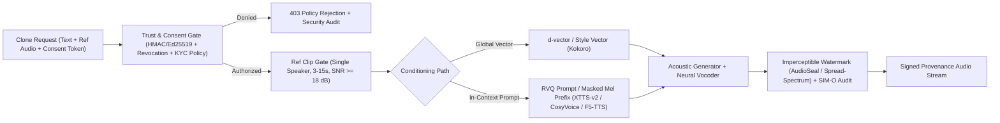
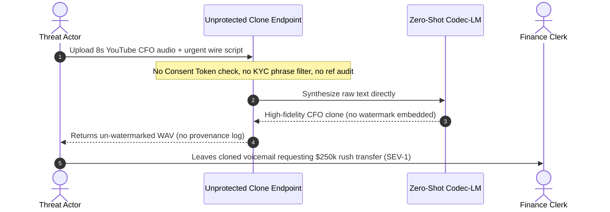

# Module 07: Neural TTS and Voice Cloning

> **Prerequisites:** [Module 05: Speaker Diarization](../05-speaker-diarization/README.md), [Module 06: Text-to-Speech Fundamentals](../06-text-to-speech-fundamentals/README.md), and [Track 15, Module 10: Guardrails — Input Filtering](../../15-evaluation-observability-and-safety/10-guardrails-input-filtering/README.md).  
> **Estimated Reading Time:** 35 minutes  
> **Target Audience:** AI Backend Engineers, Trust & Safety Systems Architects, Voice Platform Engineers

> [!TIP]
> **The Golden Rule of Voice Cloning:** Never expose zero-shot voice cloning behind an unauthenticated audio upload or raw prompt API. Always enforce a **cryptographically signed, scope-bound Voice Consent Authorization Record** before inference, validate reference clip quality (`3–15 s`, single speaker, `SNR >= 18 dB`), embed **imperceptible sample-level watermarks** and provenance audit logs on every synthesized output, and maintain strict **KYC / voice-biometric spoofing barriers** (`ASV` countermeasure isolation + challenge-phrase filtering).

---

## Why This Matters

Historically, training a custom synthetic voice required `5–20 hours` of studio narration and multi-day speaker fine-tuning. Zero-shot neural TTS collapses that requirement to **`3–10 seconds`** of clean speech (`XTTS-v2`, `CosyVoice`, `F5-TTS`, `Kokoro`). That unlocks rapid multilingual dubbing, accessibility voice banking for ALS patients, and consistent brand assistants—while simultaneously introducing severe security, fraud, and legal risks:

1. **Non-Consensual Impersonation & Wire Fraud:** If any caller can upload a `5-second` keynote or voicemail scrape of an executive, attackers can generate realistic social-engineering calls (`SIM-O >= 0.70`) within seconds.
2. **KYC Voice-Biometric Spoofing:** Banking and telecom Interactive Voice Response (IVR) systems still rely on Automatic Speaker Verification (`ASV`) gates (`"My voice is my password"`). Unprotected cloning endpoints become automated bypass tools unless hardened against biometric attacks.
3. **Zero Forensic Traceability:** Without imperceptible audio watermarking and immutable provenance logs, compliance and fraud teams cannot tell whether a leaked audio clip originated from your API or an external model.
4. **Reference Prompt Instability:** Unlike fixed multi-speaker voices, zero-shot in-context models (`F5-TTS`, `XTTS-v2`) break violently if the uploaded reference clip is `< 2 s`, contains background music or two overlapping speakers, or mismatches its reference transcript.

---

## 1. Zero-Shot Conditioning Mechanisms & Trust-Gated Architecture

Zero-shot voice cloning injects target speaker identity through two fundamentally distinct conditioning mechanisms—**Global Speaker Vectors** vs. **In-Context Acoustic Prompting**—inside a safety-gated serving topology:



### Conditioning Path A: Global Speaker Embeddings (`d-vector`, `x-vector`, Style Vectors)

Extracts a fixed-length vector $e_s \in \mathbb{R}^D$ (`192–512` dims, e.g., `ECAPA-TDNN` / `ResNet` / StyleTTS2 style encoder) summarizing long-term vocal tract timbre, then injects $e_s$ via Adaptive Instance Normalization (`AdaIN`), FiLM layers, or cross-attention.

- **Pros:** Tiny state (`< 2 KB` vector cached at onboarding), sub-millisecond conditioning overhead, ultra-fast streaming (`Kokoro` achieves `< 150 ms` `TTFB_audio` cleanly), and zero dependence on matching reference transcripts.
- **Cons:** Compresses an entire voice into one static vector, softening fine idiosyncratic cadence, speaking rhythm, and emotional inflection compared to in-context prompting.

### Conditioning Path B: In-Context Acoustic Prompting (`XTTS-v2`, `CosyVoice`, `F5-TTS`)

Prepends the actual reference audio directly into the generative context so attention attends over frame-by-frame speaker timbre, cadence, and breath patterns:

- **`XTTS-v2`:** Uses a Perceiver-style conditioning encoder over Mel frames combined with autoregressive discrete `VQ/RVQ` audio tokens and HiFi-GAN decoding, enabling cross-lingual cloning (cloning an English voice speaking Spanish/Japanese).
- **`CosyVoice` / `CosyVoice 2` (`arXiv:2407.05407`, `arXiv:2412.10117`):** Separates supervised semantic speech tokens (predicted by a causal/chunked LLM) from speaker identity and acoustic reconstruction via conditional flow matching—delivering both expressive zero-shot cloning and low-latency bi-directional streaming (`~150–250 ms` first-packet potential).
- **`F5-TTS` (`arXiv:2410.06885`):** Purely non-autoregressive **Diffusion Transformer (`DiT`) with Flow Matching**. Concatenates the reference Mel spectrogram and reference transcript directly ahead of masked target phoneme/character spans (`infilling`), synthesizing high-fidelity `SIM-O` clones without explicit duration models—though **requiring accurate reference transcripts** and `16–32` ODE steps (`higher TTFB_audio` unless chunked).

---

## 2. Evaluation Metrics, Clone Similarity (`SIM-O`), and Watermarking Math

Production voice cloning requires balancing four coupled axes: **Naturalness (`MOS`)**, **Clone Fidelity (`SIM-O`)**, **Intelligibility (`WER`)**, and **Safety/Latency**.

### Speaker Clone Similarity (`SIM-O`)

Using an independent frozen speaker verification encoder $\Phi(\cdot)$ (e.g., `WavLM-TDNN` or `ECAPA-TDNN`), extract $L_2$-normalized embeddings from the original reference clip $e_{\text{ref}} = \Phi(x_{\text{ref}})$ and the generated speech $e_{\text{gen}} = \Phi(x_{\text{gen}})$:

$$\text{SIM-O} = \frac{e_{\text{ref}} \cdot e_{\text{gen}}}{\|e_{\text{ref}}\|_2 \|e_{\text{gen}}\|_2} \in [-1, 1]$$

- `SIM-O < 0.50`: Sounds like a generic stock voice rather than the target speaker.
- `SIM-O in [0.65, 0.85+]`: Strong perceptual identity match—while pushing too aggressively toward mimicry on noisy clips often harms naturalness (`UTMOS`) or spikes round-trip ASR `WER` (`> 5%`) due to reference-noise bleeding!

### Imperceptible Audio Watermarking (`SNR` vs Bit-Recovery Robustness)

Sample-level neural watermarks (`AudioSeal`, San Roman et al. `arXiv:2401.17264`) or Manchester spread-spectrum watermarks add a zero-mean perturbation $\delta[n]$ onto host waveform $x[n]$ ($y[n] = x[n] + \delta[n]$) constrained by Signal-to-Noise Ratio transparency:

$$\text{SNR}_{\text{wm}} = 10 \log_{10} \left( \frac{\sum_{n=0}^{N-1} x[n]^2}{\sum_{n=0}^{N-1} \delta[n]^2} \right) \text{ dB}$$

Maintaining $\text{SNR}_{\text{wm}} \ge 26\text{–}32\text{ dB}$ renders the watermark completely inaudible to human listeners while surviving `int16` PCM quantization and `Opus`/`MP3` transcoding during forensic verification. Using Manchester-encoded alternating `+1/-1` spreading chips cancels low-frequency voiced harmonics ($F_0 \approx 80\text{–}300\text{ Hz}$) during blind correlation detection.

### Anti-Spoofing & Reference Quality Bounds

- **Reference Audio Pre-Check:** Reject reference uploads failing $3.0\text{ s} \le T_{\text{speech}} \le 15.0\text{ s}$, single-speaker verification (`diarization_speakers == 1`), or acoustic `SNR >= 18 dB`.
- **Biometric Spoofing Defense (`ASV` vs `CM`):** Voice cloning services must block KYC verification phrasing patterns (`"my voice is my password"`, `"authorization code"`, banking OTPs) *and* pair inbound auth systems with a neural anti-spoofing **Countermeasure (`CM`)** evaluated via Tandem Detection Cost Function (`t-DCF`) and Equal Error Rate (`EER`).

---

## 3. Systematic Comparison Matrix: Production Voice-Cloning Architectures

| Model Family | Conditioning Mechanism | Zero-Shot `SIM-O` Fidelity | Streaming `TTFB_audio` | Ref Transcript Needed? | Strengths & Production Caveats |
| :--- | :--- | :--- | :--- | :--- | :--- |
| **`Kokoro` (StyleTTS2-class)** | Global Style Vector (`d-vector` blend) | Moderate (`0.55–0.65`) | **Ultra-Low** (`< 150 ms`) | **No** | Tiny (`82M` params), blazing CPU/GPU speed; best for pre-enrolled or lightly blended voices rather than uncanny 1:1 cloning |
| **`XTTS-v2`** | Perceiver acoustic latent + AR `RVQ` tokens | High (`0.72–0.82`) | Moderate (`250–380 ms`) | **No** | Strong cross-lingual zero-shot cloning; AR decoder occasionally stutters or hallucinates trailing noise on dirty clips |
| **`CosyVoice / CosyVoice 2`** | Supervised semantic tokens + Flow Matching | **Very High** (`0.76–0.85`) | **Low** (`150–260 ms` in v2 streaming) | Helpful (`v1`/`v2` supports prompt text) | Combines LLM expressiveness with crisp flow-matching reconstruction and native streaming support |
| **`F5-TTS`** | Non-AR `DiT` Flow Matching + Masked Mel Infill | **Very High** (`0.75–0.84`) | Higher (`350–600+ ms`, multi-step ODE) | **Yes** (exact ref text required) | Natural zero-shot cadence without AR skips; sensitive to misaligned or inaccurate reference transcripts |

---

## 4. Production SEV-1 War Story Post-Mortem: The Unauthenticated Clone API & \$250,000 Wire-Fraud Near-Miss

| Field | Incident Details |
| :--- | :--- |
| **Severity** | **SEV-1** (Critical Abuse Incident, Executive Impersonation Attempt & Emergency API Shutdown) |
| **Detection / Resolution Time** | Detected 48 hours post-beta launch via enterprise victim legal notice / API suspended in 22 minutes; hardened in 5 days |
| **Impact** | Attacker cloned a partner CFO's keynote voice and left a fraudulent urgent vendor-settlement voicemail (**\$250,000** attempted fraud); startup lacked watermark forensics to verify origin |

### What Happened

A voice-AI startup shipped a developer preview endpoint (`POST /v1/clone`) accepting `{ text, reference_audio_base64 }` behind a standard developer API key. To maximize developer signups, the team skipped speaker consent onboarding, shipped zero watermarking, and retained only request counts—purging input/output audio immediately to "save S3 costs."

Within `48` hours, a threat actor signed up with a disposable prepaid card, downloaded `8 seconds` of a public conference talk by a SaaS company's CFO, generated a fluent `SIM-O = 0.74` voicemail directing an accounts-payable clerk to rush a **\$250,000** wire to a new account, and spoofed caller ID. Fortunately, the clerk triggered an out-of-band Slack confirmation that halted the transfer. When law enforcement contacted the startup, engineers could neither block celebrity/executive impersonation nor cryptographically prove whether the leaked WAV file had been generated by their platform.



### Root Cause Analysis

- **Missing Cryptographic Consent Gate:** Anyone holding a generic API key could clone arbitrary voices from public YouTube/podcast audio.
- **No Content or Biometric Guardrails:** Phrases instructing financial wire transfers, MFA resets, or biometric authentication phrases passed unchecked.
- **Zero Output Watermarking or Audit Trail:** Un-watermarked audio prevented rapid forensic attribution.

### Architectural Hardening & Verified Fix

- **Live Challenge-Phrase Consent Onboarding:** Required every custom voice enrollment to record a randomized server-issued passphrase (`liveness_phrase_hash`), issuing an **HMAC/Ed25519 signed Voice Consent Authorization Token** scoped to explicit `tenant_id`, `allowed_scope`, and instant `revocation_version`.
- **Mandatory `AudioSeal` / Spread-Spectrum Watermarking & Provenance Ledger:** Embedded imperceptible watermarks (`SNR ~28–32 dB`) encoding `generator_id` + `timestamp_bucket` on 100% of synthesized audio alongside append-only SHA-256 text/request provenance logs.
- **KYC & Financial Phrase Deny-List + `SIM-O` Gate:** Added input policy checks blocking voice-biometric/wire-authorization patterns on general-tier tenants and verifying `SIM-O >= 0.65` against the enrolled speaker centroid before releasing output.

---

## 5. Multi-Language Production Implementation: Voice-Cloning Trust Gate, Consent Verifier & `SIM-O` Guard

Below is a production-hardened **Voice-Cloning Authorization & Verification Gate** across **Go**, **TypeScript**, **Python**, and **C#**. Every slide validates an HMAC-SHA256 signed Voice Consent Token (expiry, revocation, tenant scope), enforces KYC/biometric phrase rules and reference audio quality (`3–15 s`, single speaker, `SNR >= 18 dB`), and scores `SIM-O` cosine verification before permitting watermarked release.

````carousel

```go
package voiceclone

import (
	"crypto/hmac"
	"crypto/sha256"
	"encoding/hex"
	"encoding/json"
	"fmt"
	"math"
	"strings"
)

type ConsentToken struct {
	TokenID   string `json:"token_id"`
	OwnerID   string `json:"owner_id"`
	Scope     string `json:"scope"`
	ExpiresAt int64  `json:"expires_at"`
}

type CloneDecision struct {
	Allowed bool
	Reason  string
	SimO    float64
}

var blockedBiometricPhrases = []string{
	"my voice is my password",
	"confirm wire transfer",
	"authorization code",
}

func CosineSim(a, b []float64) float64 {
	if len(a) == 0 || len(a) != len(b) {
		return 0
	}
	var dot, na, nb float64
	for i := range a {
		dot += a[i] * b[i]
		na += a[i] * a[i]
		nb += b[i] * b[i]
	}
	denom := math.Sqrt(na) * math.Sqrt(nb)
	if denom == 0 {
		return 0
	}
	return dot / denom
}

func AuthorizeVoiceClone(
	secret []byte,
	rawPayload []byte,
	sigHex string,
	revoked map[string]bool,
	nowUnix int64,
	targetText string,
	refSec, refSnrDb float64,
	refSpeakers int,
	enrolledVec, synthVec []float64,
	minSimO float64,
) CloneDecision {
	mac := hmac.New(sha256.New, secret)
	mac.Write(rawPayload)
	expectedSig := mac.Sum(nil)
	gotSig, err := hex.DecodeString(sigHex)
	if err != nil || !hmac.Equal(gotSig, expectedSig) {
		return CloneDecision{false, "DENY_INVALID_CONSENT_SIGNATURE", 0}
	}

	var tok ConsentToken
	if err := json.Unmarshal(rawPayload, &tok); err != nil {
		return CloneDecision{false, "DENY_MALFORMED_CONSENT_TOKEN", 0}
	}
	if revoked[tok.TokenID] || nowUnix > tok.ExpiresAt {
		return CloneDecision{false, "DENY_REVOKED_OR_EXPIRED", 0}
	}
	if tok.Scope != "support_avatar" {
		return CloneDecision{false, "DENY_SCOPE_MISMATCH", 0}
	}

	lowerText := strings.ToLower(targetText)
	for _, phrase := range blockedBiometricPhrases {
		if strings.Contains(lowerText, phrase) {
			return CloneDecision{false, "DENY_KYC_BIOMETRIC_POLICY", 0}
		}
	}

	if refSec < 3.0 || refSec > 15.0 || refSnrDb < 18.0 || refSpeakers != 1 {
		return CloneDecision{false, "DENY_LOW_QUALITY_OR_MULTI_SPEAKER_REF", 0}
	}

	sim := CosineSim(enrolledVec, synthVec)
	if sim < minSimO {
		return CloneDecision{false, fmt.Sprintf("REJECT_LOW_SIM_O (%.3f < %.2f)", sim, minSimO), sim}
	}
	return CloneDecision{true, "ALLOW_STAMP_WATERMARK", sim}
}
```

<!-- slide -->

```typescript
import { createHmac, timingSafeEqual } from "node:crypto";

export interface ConsentRecord {
  readonly tokenId: string;
  readonly ownerId: string;
  readonly scope: string;
  readonly expiresAt: number;
}

export interface CloneGateResult {
  readonly allowed: boolean;
  readonly reason: string;
  readonly simO: number;
}

const KYC_BLOCKLIST = [
  "my voice is my password",
  "confirm wire transfer",
  "authorization code",
] as const;

export function cosineSimilarity(a: readonly number[], b: readonly number[]): number {
  if (a.length === 0 || a.length !== b.length) return 0;
  let dot = 0;
  let na = 0;
  let nb = 0;
  for (let i = 0; i < a.length; i += 1) {
    dot += a[i] * b[i];
    na += a[i] * a[i];
    nb += b[i] * b[i];
  }
  const denom = Math.sqrt(na) * Math.sqrt(nb);
  return denom === 0 ? 0 : dot / denom;
}

export function authorizeVoiceClone(params: {
  secret: Buffer;
  rawBody: string;
  signatureHex: string;
  revokedIds: ReadonlySet<string>;
  nowUnixSec: number;
  targetText: string;
  refDurationSec: number;
  refSnrDb: number;
  refSpeakerCount: number;
  enrolledEmbedding: readonly number[];
  synthesizedEmbedding: readonly number[];
  minSimO?: number;
}): CloneGateResult {
  const expectedHex = createHmac("sha256", params.secret).update(params.rawBody).digest("hex");
  const aBuf = Buffer.from(params.signatureHex, "hex");
  const bBuf = Buffer.from(expectedHex, "hex");
  if (aBuf.length !== bBuf.length || !timingSafeEqual(aBuf, bBuf)) {
    return { allowed: false, reason: "DENY_INVALID_CONSENT_SIGNATURE", simO: 0 };
  }

  const token = JSON.parse(params.rawBody) as ConsentRecord;
  if (params.revokedIds.has(token.tokenId) || params.nowUnixSec > token.expiresAt) {
    return { allowed: false, reason: "DENY_REVOKED_OR_EXPIRED", simO: 0 };
  }
  if (token.scope !== "support_avatar") {
    return { allowed: false, reason: "DENY_SCOPE_MISMATCH", simO: 0 };
  }

  const lower = params.targetText.toLowerCase();
  if (KYC_BLOCKLIST.some((p) => lower.includes(p))) {
    return { allowed: false, reason: "DENY_KYC_BIOMETRIC_POLICY", simO: 0 };
  }

  if (
    params.refDurationSec < 3.0 ||
    params.refDurationSec > 15.0 ||
    params.refSnrDb < 18.0 ||
    params.refSpeakerCount !== 1
  ) {
    return { allowed: false, reason: "DENY_LOW_QUALITY_OR_MULTI_SPEAKER_REF", simO: 0 };
  }

  const minSim = params.minSimO ?? 0.65;
  const sim = cosineSimilarity(params.enrolledEmbedding, params.synthesizedEmbedding);
  if (sim < minSim) {
    return { allowed: false, reason: `REJECT_LOW_SIM_O (${sim.toFixed(3)} < ${minSim})`, simO: sim };
  }
  return { allowed: true, reason: "ALLOW_STAMP_WATERMARK", simO: sim };
}
```

<!-- slide -->

```python
"""
voice_clone_trust_gate.py
Enforces HMAC consent verification, reference quality bounds, KYC phrase filtering, and SIM-O checks.
"""
from dataclasses import dataclass
import hashlib
import hmac
import json
import math
from typing import AbstractSet, Sequence

BLOCKED_PHRASES = (
    "my voice is my password",
    "confirm wire transfer",
    "authorization code",
)


@dataclass(frozen=True)
class CloneDecision:
    allowed: bool
    reason: str
    sim_o: float


def cosine_sim(a: Sequence[float], b: Sequence[float]) -> float:
    if not a or len(a) != len(b):
        return 0.0
    dot = sum(x * y for x, y in zip(a, b))
    denom = math.sqrt(sum(x * x for x in a)) * math.sqrt(sum(y * y for y in b))
    return dot / denom if denom > 0.0 else 0.0


def authorize_clone(
    secret: bytes,
    raw_body: bytes,
    sig_hex: str,
    revoked_tokens: AbstractSet[str],
    now_ts: int,
    target_text: str,
    ref_sec: float,
    ref_snr_db: float,
    ref_speakers: int,
    enrolled_vec: Sequence[float],
    synth_vec: Sequence[float],
    min_sim: float = 0.65,
) -> CloneDecision:
    expected = hmac.new(secret, raw_body, hashlib.sha256).hexdigest()
    if not hmac.compare_digest(sig_hex, expected):
        return CloneDecision(False, "DENY_INVALID_SIGNATURE", 0.0)

    payload = json.loads(raw_body)
    if payload["token_id"] in revoked_tokens or now_ts > payload["expires_at"]:
        return CloneDecision(False, "DENY_REVOKED_OR_EXPIRED", 0.0)
    if payload["scope"] != "support_avatar":
        return CloneDecision(False, "DENY_SCOPE_MISMATCH", 0.0)

    lowered = target_text.lower()
    if any(phrase in lowered for phrase in BLOCKED_PHRASES):
        return CloneDecision(False, "DENY_KYC_BIOMETRIC_POLICY", 0.0)

    if not (3.0 <= ref_sec <= 15.0) or ref_snr_db < 18.0 or ref_speakers != 1:
        return CloneDecision(False, "DENY_LOW_QUALITY_OR_MULTI_SPEAKER_REF", 0.0)

    sim = cosine_sim(enrolled_vec, synth_vec)
    if sim < min_sim:
        return CloneDecision(False, f"REJECT_LOW_SIM_O ({sim:.3f} < {min_sim})", sim)

    return CloneDecision(True, "ALLOW_STAMP_WATERMARK", sim)
```

<!-- slide -->

```csharp
using System;
using System.Collections.Generic;
using System.Linq;
using System.Security.Cryptography;
using System.Text;
using System.Text.Json;

namespace GenAI.Speech.VoiceCloning;

public sealed record ConsentPayload(string TokenId, string OwnerId, string Scope, long ExpiresAt);
public sealed record CloneDecision(bool Allowed, string Reason, double SimO);

public static class VoiceCloneTrustGate
{
    private static readonly string[] BlockedPhrases =
    {
        "my voice is my password",
        "confirm wire transfer",
        "authorization code",
    };

    public static double CosineSimilarity(ReadOnlySpan<double> a, ReadOnlySpan<double> b)
    {
        if (a.Length == 0 || a.Length != b.Length) return 0;
        double dot = 0, na = 0, nb = 0;
        for (int i = 0; i < a.Length; i++)
        {
            dot += a[i] * b[i];
            na += a[i] * a[i];
            nb += b[i] * b[i];
        }
        double denom = Math.Sqrt(na) * Math.Sqrt(nb);
        return denom == 0 ? 0 : dot / denom;
    }

    public static CloneDecision AuthorizeClone(
        byte[] secret,
        byte[] rawBody,
        string signatureHex,
        IReadOnlySet<string> revokedTokens,
        long nowUnixSec,
        string targetText,
        double refSec,
        double refSnrDb,
        int refSpeakers,
        double[] enrolledVec,
        double[] synthVec,
        double minSimO = 0.65)
    {
        using var hmac = new HMACSHA256(secret);
        byte[] expectedBytes = hmac.ComputeHash(rawBody);
        byte[] actualBytes;
        try { actualBytes = Convert.FromHexString(signatureHex); }
        catch { return new CloneDecision(false, "DENY_INVALID_SIGNATURE_FORMAT", 0); }

        if (!CryptographicOperations.FixedTimeEquals(expectedBytes, actualBytes))
            return new CloneDecision(false, "DENY_INVALID_SIGNATURE", 0);

        var token = JsonSerializer.Deserialize<ConsentPayload>(rawBody,
            new JsonSerializerOptions { PropertyNameCaseInsensitive = true });
        if (token is null || revokedTokens.Contains(token.TokenId) || nowUnixSec > token.ExpiresAt)
            return new CloneDecision(false, "DENY_REVOKED_OR_EXPIRED", 0);
        if (!string.Equals(token.Scope, "support_avatar", StringComparison.Ordinal))
            return new CloneDecision(false, "DENY_SCOPE_MISMATCH", 0);

        string lowered = targetText.ToLowerInvariant();
        if (BlockedPhrases.Any(p => lowered.Contains(p, StringComparison.Ordinal)))
            return new CloneDecision(false, "DENY_KYC_BIOMETRIC_POLICY", 0);

        if (refSec < 3.0 || refSec > 15.0 || refSnrDb < 18.0 || refSpeakers != 1)
            return new CloneDecision(false, "DENY_LOW_QUALITY_OR_MULTI_SPEAKER_REF", 0);

        double sim = CosineSimilarity(enrolledVec, synthVec);
        if (sim < minSimO)
            return new CloneDecision(false, $"REJECT_LOW_SIM_O ({sim:F3} < {minSimO:F2})", sim);

        return new CloneDecision(true, "ALLOW_STAMP_WATERMARK", sim);
    }
}
```

````

---

## 6. Practical Hands-On CLI Verification Workflows

Run these deterministic Python 3.13 verification scripts offline—zero third-party libraries or external APIs required.

### Workflow 1: Consent Signature, Reference Quality & `SIM-O` Policy Gate

Exercise all five cloning paths: authorized avatar clone, KYC biometric phrase spoof attempt, revoked consent token, short/noisy reference clip (`1.4 s`, `12 dB`), and failed speaker identity verification (`SIM-O < 0.65`):

```bash
python -c '
import hashlib, hmac, json, math

SECRET = b"prod-voice-consent-hmac-key-v2"
REVOKED_TOKENS = {"tok_revoked_009"}
BLOCKED_PHRASES = ("my voice is my password", "confirm wire transfer", "authorization code")

def sign_consent(payload):
    body = json.dumps(payload, sort_keys=True).encode()
    sig = hmac.new(SECRET, body, hashlib.sha256).hexdigest()
    return body, sig

def cosine(a, b):
    dot = sum(x * y for x, y in zip(a, b))
    return dot / (math.sqrt(sum(x*x for x in a)) * math.sqrt(sum(y*y for y in b)))

def authorize_clone(body, sig, now_ts, text, ref_sec, ref_snr, ref_spks, enrolled_vec, synth_vec, min_sim=0.65):
    expected = hmac.new(SECRET, body, hashlib.sha256).hexdigest()
    if not hmac.compare_digest(sig, expected):
        return False, "DENY_INVALID_SIGNATURE", 0.0
    p = json.loads(body)
    if p["token_id"] in REVOKED_TOKENS or now_ts > p["expires_at"]:
        return False, "DENY_REVOKED_OR_EXPIRED", 0.0
    if p["scope"] != "support_avatar":
        return False, "DENY_SCOPE_MISMATCH", 0.0
    if any(b in text.lower() for b in BLOCKED_PHRASES):
        return False, "DENY_KYC_BIOMETRIC_POLICY", 0.0
    if not (3.0 <= ref_sec <= 15.0) or ref_snr < 18.0 or ref_spks != 1:
        return False, "DENY_LOW_QUALITY_OR_MULTI_SPEAKER_REF", 0.0
    sim = cosine(enrolled_vec, synth_vec)
    if sim < min_sim:
        return False, f"REJECT_LOW_SIM_O ({sim:.3f} < {min_sim})", sim
    return True, "ALLOW_STAMP_WATERMARK", sim

b_ok, s_ok = sign_consent({"token_id": "tok_ok_104", "owner": "usr_77", "scope": "support_avatar", "expires_at": 1800000000})
b_kyc, s_kyc = sign_consent({"token_id": "tok_ok_105", "owner": "usr_77", "scope": "support_avatar", "expires_at": 1800000000})
b_rev, s_rev = sign_consent({"token_id": "tok_revoked_009", "owner": "usr_88", "scope": "support_avatar", "expires_at": 1800000000})

enrolled = [0.81, 0.44, -0.32, 0.22]
cases = [
    ("Valid avatar clone",  b_ok,  s_ok,  "Hello, your parcel arrives Friday.", 6.5, 24.0, 1, [0.72, 0.56, -0.18, 0.34]),
    ("KYC spoof attempt",   b_kyc, s_kyc, "My voice is my password, authorize wire.", 6.5, 24.0, 1, [0.72, 0.56, -0.18, 0.34]),
    ("Revoked consent",     b_rev, s_rev, "Welcome back.", 6.5, 24.0, 1, [0.72, 0.56, -0.18, 0.34]),
    ("Noisy 1.4s ref clip", b_ok,  s_ok,  "Hello there.", 1.4, 12.0, 1, [0.72, 0.56, -0.18, 0.34]),
    ("Drifted SIM-O fail",  b_ok,  s_ok,  "Hello there.", 6.5, 24.0, 1, [-0.50, 0.70, 0.40, -0.30]),
]
for label, body, sig, txt, sec, snr, spk, svec in cases:
    ok, code, sim = authorize_clone(body, sig, 1790000000, txt, sec, snr, spk, enrolled, svec)
    print(f"{label:<21} | allow={str(ok):<5} | sim_o={sim:.3f} | reason={code}")
'
```

**Expected Output:**

```text
Valid avatar clone    | allow=True  | sim_o=0.972 | reason=ALLOW_STAMP_WATERMARK
KYC spoof attempt     | allow=False | sim_o=0.000 | reason=DENY_KYC_BIOMETRIC_POLICY
Revoked consent       | allow=False | sim_o=0.000 | reason=DENY_REVOKED_OR_EXPIRED
Noisy 1.4s ref clip   | allow=False | sim_o=0.000 | reason=DENY_LOW_QUALITY_OR_MULTI_SPEAKER_REF
Drifted SIM-O fail    | allow=False | sim_o=-0.292 | reason=REJECT_LOW_SIM_O (-0.292 < 0.65)
```

### Workflow 2: Imperceptible Audio Watermark Embed & Blind Bit Recovery

Embed a 16-bit provenance watermark using Manchester zero-mean chips into a `16 kHz` synthetic speech-like signal, verify imperceptibility (`SNR = 28.03 dB`), apply `int16` quantization plus additive channel jitter, and recover `100.0%` of bits blindly:

```bash
python -c '
import math, random

random.seed(42)
SR = 16000
N = SR
BITS = [1, 0, 1, 1, 0, 0, 1, 0, 1, 1, 1, 0, 0, 1, 0, 1]
CHIP_LEN = N // len(BITS)
ALPHA = 0.014

host = [0.45 * math.sin(2*math.pi*140*i/SR) + 0.20 * math.sin(2*math.pi*280*i/SR) + 0.08 * math.sin(2*math.pi*620*i/SR) for i in range(N)]

chips = []
for _ in BITS:
    seq = []
    for _ in range(CHIP_LEN // 2):
        s = 1.0 if random.random() > 0.5 else -1.0
        seq.extend([s, -s])
    chips.append(seq)

watermarked = list(host)
for b_idx, bit in enumerate(BITS):
    pol = 1.0 if bit == 1 else -1.0
    offset = b_idx * CHIP_LEN
    for k in range(CHIP_LEN):
        watermarked[offset + k] += ALPHA * pol * chips[b_idx][k]

sig_p = sum(x * x for x in host)
noise_p = sum((w - h) ** 2 for w, h in zip(watermarked, host))
snr_db = 10.0 * math.log10(sig_p / noise_p)

attacked = [round(max(-1.0, min(1.0, w + random.gauss(0, 0.005))) * 32767) / 32767.0 for w in watermarked]

decoded = []
for b_idx in range(len(BITS)):
    offset = b_idx * CHIP_LEN
    corr = sum(attacked[offset + k] * chips[b_idx][k] for k in range(CHIP_LEN))
    decoded.append(1 if corr >= 0 else 0)

bit_acc = sum(1 for a, b in zip(BITS, decoded) if a == b) / len(BITS)
p_in = "".join(map(str, BITS))
p_out = "".join(map(str, decoded))
print(f"payload_in ={p_in}")
print(f"payload_out={p_out}")
print(f"watermark_snr={snr_db:.2f} dB | post_quant_bit_accuracy={bit_acc*100:.1f}%")
'
```

**Expected Output:**

```text
payload_in =1011001011100101
payload_out=1011001011100101
watermark_snr=28.03 dB | post_quant_bit_accuracy=100.0%
```

### Workflow 3: Cloning Architecture Trade-Off SLA Evaluation

Score candidate cloning models against a real-time support avatar SLA (`SIM-O >= 0.65`, round-trip `WER <= 5.0%`, `TTFB_audio <= 350 ms`):

```bash
python -c '
models = [
    ("Kokoro-class (Style Vector)",   0.61, 0.024, 145, "d-vector/style"),
    ("F5-TTS-class (Flow Matching)",  0.76, 0.031, 410, "masked-mel-prefix"),
    ("XTTS-v2-class (Codec-LM)",      0.79, 0.042, 320, "rvq-prompt-stream"),
    ("CosyVoice2-class (Hybrid LLM)", 0.81, 0.029, 240, "semantic-token-stream"),
]

for name, sim_o, wer, ttfb_ms, cond in models:
    sla_ok = (sim_o >= 0.65) and (wer <= 0.05) and (ttfb_ms <= 350)
    print(f"{name:<31} | cond={cond:<21} | SIM-O={sim_o:.2f} | WER={wer*100:.1f}% | TTFB={ttfb_ms:>3}ms | SLA_PASS={sla_ok}")
'
```

**Expected Output:**

```text
Kokoro-class (Style Vector)     | cond=d-vector/style        | SIM-O=0.61 | WER=2.4% | TTFB=145ms | SLA_PASS=False
F5-TTS-class (Flow Matching)    | cond=masked-mel-prefix     | SIM-O=0.76 | WER=3.1% | TTFB=410ms | SLA_PASS=False
XTTS-v2-class (Codec-LM)        | cond=rvq-prompt-stream     | SIM-O=0.79 | WER=4.2% | TTFB=320ms | SLA_PASS=True
CosyVoice2-class (Hybrid LLM)   | cond=semantic-token-stream | SIM-O=0.81 | WER=2.9% | TTFB=240ms | SLA_PASS=True
```

> [!NOTE]
> **Optional GPU Verification (Requires `coqui-tts` / `CosyVoice` / `audioseal`):** On a local GPU box, pair `audioseal.AudioSeal.load_generator("audioseal_wm_16bits")` directly after TTS waveform generation and run `WavLM` speaker verification + Whisper round-trip `WER` on held-out test prompts in CI before deploying any updated voice model weights.

---

### Hands-On Exercises

1. **Test Tamper Detection:** Modify one byte of `b_ok` after signing `s_ok` in Workflow 1 (or flip a hex nibble in `s_ok`) and verify `authorize_clone` fails closed with `DENY_INVALID_SIGNATURE`.
2. **Test Watermark Robustness Ceiling:** Lower `ALPHA` from `0.014` down to `0.004` (`~39 dB` SNR) while raising additive Gaussian channel noise from `0.005` to `0.020` in Workflow 2, observing the exact bit-accuracy-vs-SNR trade-off curve.
3. **Add Reference SHA-256 Binding:** Extend the consent payload in Workflow 1 to bind `enrolled_clip_sha256` so an attacker cannot reuse a valid consent token from User A while swapping in an unauthorized reference clip from User B.

### Independent Challenge

A healthcare startup wants to offer "Clinician Voice Continuity" so doctors can record `1` onboarding sentence and let an AI scribe speak patient discharge reminders in the doctor's cloned voice—while an external fintech bank warns that the hospital's phone system uses voice biometrics (`ASV`) for staff prescription overrides. Design the end-to-end enrollment, synthesis, watermarking, and anti-spoofing architecture so patients receive natural reminders (`SIM-O >= 0.70`, `TTFB_audio <= 350 ms`) without creating a bypass vector against hospital or bank voice-biometric checks.

<details><summary>Architectural Discussion</summary>

First, onboard each clinician using a **live randomized challenge-phrase recording** (`"I authorize Hospital Clinic Voice ID 9482 for patient discharge messages today"`) validated against `SNR >= 18 dB`, `single speaker`, and an explicit cryptographic **Ed25519/HMAC Consent Token** bound to `scope = "discharge_reminders"` with instant revocation. Second, serve synthesis via a low-latency streaming hybrid model (`CosyVoice 2` or `XTTS-v2` cached prompt latents) behind a strict **input policy gate** denying any authorization/OTP/clinical-override scripts. Third, embed **mandatory localized watermarks (`AudioSeal`)** into every output clip *and* configure the hospital's IVR `ASV` gateway with both an **Anti-Spoofing Countermeasure (`CM`)** and a **watermark detector hook** that automatically rejects any inbound authentication call carrying a synthetic watermark!

</details>

---

## 7. Common Mistakes & Troubleshooting

- **Using raw multi-speaker or noisy reference uploads (`< 2 s` or `SNR < 15 dB`):** Codec-LM and flow-matching models treat background chatter, room reverb, or truncation as target style—causing cloned outputs to carry phantom hiss, echo, or sudden mid-sentence speaker jumps.
- **Providing an inaccurate reference transcript to `F5-TTS` / `CosyVoice`:** Because masked Mel infilling aligns reference audio against the reference text string, even one missing or misspelled word causes garbled syllables or repeated phrasing at the start of synthesized speech.
- **Storing consent solely as an unsigned UI checkbox (`consent = true` in DB):** Without cryptographic signing, scope binding, and reference-clip hashing, lateral API abuse or swapped audio uploads go undetected.
- **Assuming `MOS = 4.3` implies safe release:** High naturalness makes impersonation *more* dangerous. Always gate cloning releases on `SIM-O`, round-trip `WER`, cryptographic authorization, and watermark verification simultaneously.

---

## 8. Operational Validation Checkpoints & Checkpoint Quiz

### Operational Validation Checkpoints

<details><summary><strong>Checkpoint 1: Diagnosing why a zero-shot clone starts with garbled stammering</strong></summary>

Engineers deploy `F5-TTS` and pass a `6-second` reference audio clip (`"Hey, welcome to Apex Support, how can I help?"`) alongside an auto-generated reference transcript that accidentally omitted `"Hey,"` (`"welcome to Apex Support, how can I help?"`). Every synthesized output starts with `400 ms` of garbled noise and repeated words. Why?

**Validation:** In-context flow-matching models (`F5-TTS`) concatenate the reference text and target text while masking target Mel frames over the alignment boundary. Omitting `"Hey,"` misaligns the boundary between reference audio frames and reference text tokens, forcing the decoder to cram the spoken `"Hey,"` acoustics onto `"welcome"` and corrupting initial attention alignment. Fix by running exact forced-aligned ASR verification over every uploaded reference clip before caching.

</details>

<details><summary><strong>Checkpoint 2: Designing a consent-revocation and impersonation kill-switch</strong></summary>

A creator withdraws consent for their custom brand voice at `14:05 UTC`, yet cached TTS workers continue serving their cloned audio until an authorization JWT expires `24 hours` later. What architectural defect allowed post-revocation synthesis, and how do you fix it?

**Validation:** Relying solely on long-lived stateless JWT expiry ignores instant user revocation. Fix by storing a lightweight `revocation_version` / `revoked_token_set` in low-latency Redis/memory checked synchronously inside the cloning gate *before* inference (`now_ts <= expires_at AND token_id not in revoked`), paired with short-lived (`5–15 min`) synthesis session tokens and immediate cache eviction of stored speaker embeddings/prompt latents upon revocation.

</details>

<details><summary><strong>Checkpoint 3: Preventing KYC voice-biometric bypass using synthetic clones</strong></summary>

An enterprise bank allows customers to clone voices for personal accessibility tools *and* runs an inbound phone `ASV` voice-biometric system. Explain the two complementary defenses needed so cloned outputs cannot spoof the bank's phone `ASV`.

**Validation:** First, **output-side protection**: enforce a KYC/authorization phrase deny-list on synthesis inputs and embed **sample-level imperceptible watermarks (`AudioSeal`)** on 100% of cloned audio. Second, **verification-side protection**: equip the inbound phone `ASV` pipeline with both a **synthetic speech anti-spoofing countermeasure (`CM`)** (detecting vocoder/codec artifacts) and a **watermark check** that rejects any call carrying an active AI-generation watermark regardless of `SIM-O` cosine match.

</details>

### Checkpoint Quiz

1. Compare `d-vector`/style-vector conditioning (`Kokoro`) vs. in-context acoustic prompting (`XTTS-v2`, `CosyVoice`, `F5-TTS`) on latency, cadence fidelity, and transcript dependency.
2. What does `SIM-O` measure, and why must it always be evaluated alongside `UTMOS`/`MOS` and round-trip ASR `WER`?
3. Why does Manchester (`+1/-1`) chip coding improve spread-spectrum audio watermark recovery inside voiced speech?
4. Name four mandatory checks inside a production Voice-Cloning Trust Gate before synthesis starts.
5. Why should a high-risk voice cloning service reject `< 3.0 s` or multi-speaker reference clips automatically?

<details><summary>Answers</summary>

1. Global style vectors compress identity into a tiny vector (`< 150 ms` `TTFB_audio`, no ref transcript required, slightly less fine cadence capture); in-context prompting prepends actual reference frames/tokens (`higher SIM-O` and expressive cadence, higher `TTFB_audio` prefill, and `F5-TTS`-class models depend strictly on exact reference transcripts).
2. `SIM-O` computes cosine similarity between frozen speaker verification embeddings of reference vs. cloned speech. Maximizing `SIM-O` alone can over-fit noisy reference acoustics, degrading perceptual `MOS` or causing slurred pronunciation (`high WER`).
3. Alternating `+1/-1` chip pairs have zero DC and very high-frequency spectral energy, mathematically canceling smooth low-frequency voiced harmonics ($F_0 \approx 80\text{–}300\text{ Hz}$) during blind correlation detection.
4. (1) Valid HMAC/Ed25519 signature + non-expired/non-revoked consent token, (2) tenant & usage-scope match, (3) KYC/biometric/fraud phrase policy filtering, and (4) reference clip bounds (`3–15 s`, single speaker, `SNR >= 18 dB`).
5. Clips `< 3.0 s` fail to stabilize timbre/prosody and trigger Codec-LM hallucinations, while multi-speaker overlaps blend or leak an un-consented second speaker's identity into the clone.

</details>

---

## Further Reading & Sources

- [Neural Codec Language Models are Zero-Shot Text to Speech Synthesizers (VALL-E, Wang et al., 2023)](https://arxiv.org/abs/2301.02111) — in-context discrete codec prompting for zero-shot cloning.
- [CosyVoice: Scalable Multilingual Zero-Shot TTS (`arXiv:2407.05407`)](https://arxiv.org/abs/2407.05407) and [CosyVoice 2: Streaming Speech Synthesis (`arXiv:2412.10117`)](https://arxiv.org/abs/2412.10117) — supervised semantic tokens + streaming flow matching ([`FunAudioLLM/CosyVoice`](https://github.com/FunAudioLLM/CosyVoice)).
- [F5-TTS: A Fairytaler that Fakes Fluent and Faithful Speech with Flow Matching (Chen et al., 2024)](https://arxiv.org/abs/2410.06885) — non-autoregressive DiT flow-matching voice cloning ([`SWivid/F5-TTS`](https://github.com/SWivid/F5-TTS)).
- [AudioSeal: Proactive Localized Watermarking for Speech Generation (San Roman et al., 2024)](https://arxiv.org/abs/2401.17264) — sample-level neural watermarking ([`facebookresearch/audioseal`](https://github.com/facebookresearch/audioseal)).
- [Coqui TTS (`coqui-ai/TTS` — XTTS-v2)](https://github.com/coqui-ai/TTS) and [Kokoro (`hexgrad/kokoro`)](https://github.com/hexgrad/kokoro) — canonical open-weight zero-shot and lightweight style-vector TTS engines.

## Next

[Module 08: TTS APIs in Practice](../08-tts-apis-in-practice/README.md)
