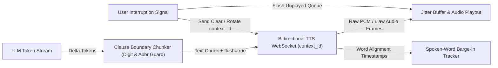
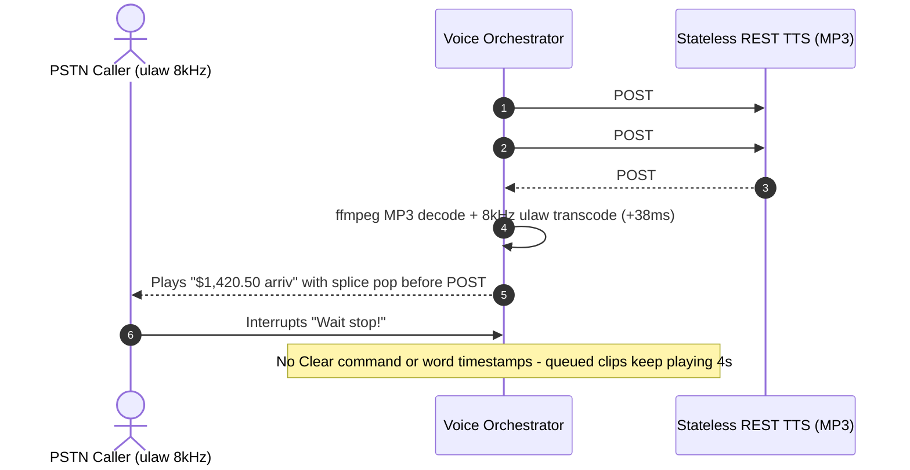

# Module 08: TTS APIs in Practice

> **Prerequisites:** [Module 06: Text-to-Speech Fundamentals](../06-text-to-speech-fundamentals/README.md), [Module 07: Neural TTS and Voice Cloning](../07-neural-tts-and-voice-cloning/README.md), [Module 00: Audio as Data: Waveforms and Spectrograms](../00-audio-as-data-waveforms-and-spectrograms/README.md), and [Track 06, Module 03: Streaming Responses](../../06-openai-and-the-model-landscape/03-streaming-responses/README.md).  
> **Estimated Reading Time:** 35 minutes  
> **Target Audience:** AI Backend Engineers, Voice Infrastructure Developers, Conversational Platform Architects

> [!TIP]
> **The Golden Rule of Production TTS APIs:** Never feed unbuffered single-character LLM tokens into a TTS engine or wait for an entire paragraph to finish generating before calling synthesis. Always decouple LLM streaming from speech synthesis through a **bidirectional WebSocket** with **clause-boundary hysteresis chunking**, explicit `flush` / `context_id` lifecycle controls, raw PCM or telephony $\mu$-law output (`pcm_16000` / `pcm_24000` / `ulaw_8000`) instead of frame-buffered MP3s, and word-level alignment timestamps to track what the user actually heard.

---

## Why This Matters

In quickstart tutorials, integrating Text-to-Speech looks like a five-line `POST /v1/audio/speech` request that writes `output.mp3` to disk. In a live conversational voice backend, that tutorial pattern collapses immediately.

Waiting for an LLM to complete a 40-word answer before firing a stateless REST TTS call adds `900–2,000 ms` of dead silence before the user hears the first syllable. Conversely, flushing every `15` characters to chase speed breaks numbers (`5:30 PM` split into `"5:30"` and `"PM"`), creates robotic intonation resets across fragments, and spawns overlapping HTTP streams that race out of order. Worse still, requesting `mp3` over a telephony trunk forces unnecessary transcoding and encoder lookahead lag (`25–45 ms+`), while failing to track word timestamps prevents clean barge-in truncation and unmonitored character billing at `780` characters/minute can turn `500,000` monthly voice minutes into an unexpected **\$70,200/month** invoice.

---

## 1. Production TTS API Architecture & Protocol Mechanics

Modern conversational TTS backends fall into two fundamentally different wire architectures:

1. **HTTP Chunked Streaming (Stateless Input, Streamed Audio Output):** You submit a complete text string (`input`) over HTTP POST and receive chunked audio bytes (`Transfer-Encoding: chunked`). This powers **OpenAI Audio / TTS** (`/v1/audio/speech` with `tts-1`, `tts-1-hd`, or `gpt-4o-mini-tts` tone `instructions`) as well as single-shot REST endpoints on **ElevenLabs**, **Cartesia**, and **Deepgram Aura**. Because the server cannot start until you submit the text payload, conversational streaming requires your orchestrator to buffer complete sentences or clauses and fire sequential HTTP calls—losing cross-sentence prosody unless the API supports request stitching.
2. **Bidirectional Streaming WebSockets (Token-In, Audio-Out):** You open a persistent WebSocket (`wss://`) at call start and push incremental text chunks as the LLM generates tokens while simultaneously receiving raw audio frames and timing metadata. This eliminates per-sentence TLS handshakes and preserves prosodic pitch contours across clauses via persistent context IDs.



### Provider Mechanics in Production

- **ElevenLabs (`stream-input` & `multi-stream-input`):**
  - **Models:** `eleven_flash_v2_5` (~`75 ms` model inference latency for realtime agents), `eleven_turbo_v2_5` (balanced latency/quality), and `eleven_multilingual_v2` (richer prosody at higher latency and character cost).
  - **Input Streaming & Contexts:** Connect to `wss://api.elevenlabs.io/v1/text-to-speech/{voice_id}/stream-input` (or `/multi-stream-input` to multiplex independent `context_id` streams on one socket so barge-in starts a fresh `context_id` immediately without tearing down TLS).
  - **Buffering & Flushing:** ElevenLabs buffers incoming tokens according to `chunk_length_schedule` (default `[120, 160, 250, 290]` characters) or `auto_mode=true`. Sending `{"text": "Your gate is B12. ", "flush": true}` forces immediate synthesis of the buffered clause without closing the stream.
  - **Alignment:** Passing `sync_alignment=true` emits `alignment` / `normalizedAlignment` JSON frames (`chars`, `charStartTimesMs`, `charDurationsMs`) alongside `audio` base64 chunks.
- **Cartesia Sonic (`SSM` Architecture):**
  - **Architecture:** Built on a **State-Space Model (SSM)** rather than quadratic-attention Transformers, yielding constant-time per-step generation and ultra-low Time-to-First-Byte (`~40–90 ms`).
  - **WebSocket Protocol (`wss://api.cartesia.ai/tts/websocket`):** Groups continuous turns under a UUID `context_id` with `continue: true` on intermediate clauses and `continue: false` on final completion. Sending `continue: true` with `flush: true` increments a deterministic `flush_id` echoed back in `flush_done` payloads so downstream mixers correlate audio segments to exact clauses.
  - **Timestamps & Codecs:** Passing `add_timestamps: true` returns `word_timestamps` (`words`, `start`, `end` seconds), and `output_format` supports raw headerless `pcm_s16le`, `pcm_f32le`, or telephony `ulaw` (`8,000 Hz`).
- **Deepgram Aura (`aura-2-*`):**
  - **WebSocket Protocol (`wss://api.deepgram.com/v1/speak`):** Configured via query parameters (`model=aura-2-thalia-en`, `encoding=linear16` or `mulaw`, `sample_rate=24000` or `8000`).
  - **Explicit Control Frames:** Client sends JSON text payloads `{"type": "Speak", "text": "..."}` alongside explicit lifecycle primitives: `{"type": "Flush"}` (returns `Flushed`), `{"type": "Clear"}` (returns `Cleared` after wiping all buffered text and queued audio on barge-in), and `{"type": "Close"}`.
- **OpenAI Audio / TTS (`/v1/audio/speech`):**
  - Supports HTTP chunked audio transfer (`response_format="pcm"` at `24 kHz` signed 16-bit LE, `opus`, `mp3`, `wav`) and prompt-steered prosody (`instructions` on `gpt-4o-mini-tts`). However, `/v1/audio/speech` accepts only a single static `input` string per request rather than bidirectional token streaming; for bidirectional native speech without sentence-level HTTP calls, OpenAI routes developers to the Realtime API (covered in [Module 11](../11-realtime-speech-to-speech-apis/README.md)).

### Quantitative Mechanics: Chunking Latency, Codec Framing, and Character FinOps

1. **Time-to-First-Audio (TTFA) Under Clause Chunking:**
   Given LLM token emission rate $R_{\text{LLM}}$ (chars/sec), first-clause buffer threshold $C_{\text{first}}$ (chars), network round-trip $L_{\text{net}}$, provider inference TTFB $L_{\text{TTS-TTFB}}$, and container decode lag $L_{\text{decode}}$:

   $$L_{\text{TTFA}} = \frac{C_{\text{first}}}{R_{\text{LLM}}} + L_{\text{net}} + L_{\text{TTS-TTFB}} + L_{\text{decode}}$$

   Flushing too early (`C_first < 15`) minimizes $\frac{C_{\text{first}}}{R_{\text{LLM}}}$ but destroys co-articulation (how the voice pitches upward on questions or blends adjacent phonemes) and fractures timestamps like `5:30 PM`. Flushing at **clause boundaries** (`.?!` at $\ge 8$ chars, or `,;:` after `min_chars = 28–45`, strictly verified to be followed by whitespace rather than a digit) hits the sweet spot (`~250–400 ms` TTFA) with natural intonation.

2. **Raw Audio Bandwidth & 20 ms Packet Framing:**
   At sample rate $f_s$ (Hz) and bit depth $b$ bits/sample, wire bitrate $R_{\text{bps}} = f_s \cdot b$ and byte footprint for duration $T_{\text{sec}}$ is:

   $$B_{\text{bytes}} = \frac{f_s \cdot b}{8} \cdot T_{\text{sec}}$$

   - `pcm_24000` (`24 kHz`, `16-bit`): `384 kbps` $\rightarrow$ `960 bytes` per `20 ms` frame (`0 ms` decode lag).
   - `pcm_16000` (`16 kHz`, `16-bit`): `256 kbps` $\rightarrow$ `640 bytes` per `20 ms` frame (`0 ms` decode lag).
   - `ulaw_8000` (`8 kHz`, `8-bit` G.711 $\mu$-law): `64 kbps` $\rightarrow$ `160 bytes` per `20 ms` RTP packet (`0 ms` transcode on SIP/PSTN).
   - `mp3_44100_128` (`128 kbps` CBR): `320 bytes` per `20 ms`, **but** introduces `25–45 ms` MP3 encoder/decoder frame-padding lookahead plus buffering jitter before playback can start, and breaks mid-frame byte slicing over RTP!

3. **Character-Based FinOps Calculation:**
   Most commercial TTS APIs bill per **1,000 characters** (with model tiers ranging roughly from **\$0.04** to **\$0.18+** per 1,000 characters, or bundled credit equivalents). At average conversational speech cadence (~`150` words/min $\times$ `5.2` chars/word = `780` output chars/min):

   $$\text{Cost}_{\text{month}} = \frac{N_{\text{min}} \cdot 780}{1{,}000} \cdot P_{1\text{k}}$$

   At `500,000` agent-speaking minutes/month (`390M` characters), choosing a **\$0.18/1k** studio model over a **\$0.04/1k** low-latency streaming model costs **\$70,200/mo** instead of **\$15,600/mo**—and failing to cancel TTS streams on barge-in wastes `20–35%` of synthesis characters on audio the user never hears!

---

## 2. Systematic Comparison Matrix: Production TTS APIs

| Dimension | ElevenLabs (`Flash v2.5` / `Turbo v2.5`) | Cartesia Sonic (`sonic-latest`) | Deepgram Aura (`aura-2-*`) | OpenAI Audio TTS (`tts-1` / `gpt-4o-mini-tts`) |
| :--- | :--- | :--- | :--- | :--- |
| **Core Model Family** | Neural autoregressive / flow hybrid | State-Space Model (**SSM**) | Streaming neural acoustic-vocoder | Neural TTS (`gpt-4o-mini-tts` steerable) |
| **Input Streaming** | Bidirectional WS (`/stream-input`, `/multi-stream-input`) | Bidirectional WS (`wss://api.cartesia.ai/tts/websocket`) | Bidirectional WS (`wss://api.deepgram.com/v1/speak`) | Stateless REST POST (`/v1/audio/speech` chunked audio out only) |
| **Prosody Continuation** | `chunk_length_schedule` + `context_id` + `flush: true` | `context_id` + `continue: true/false` + `flush_id` | Persistent WS text buffer + `{"type": "Flush"}` | Single static `input` string per HTTP request (no cross-call state) |
| **Barge-In Cancellation** | Switch/close `context_id` on `/multi-stream-input` | Drop `context_id` / send cancel frame | Explicit `{"type": "Clear"}` wipes server queue | Abort HTTP socket (already-synthesized chunks discarded) |
| **Preferred Realtime Codecs** | `pcm_16000`, `pcm_24000`, `ulaw_8000` | `pcm_s16le` (`raw`), `pcm_f32le`, `ulaw` (`8 kHz`) | `linear16` (`16/24 kHz`), `mulaw`, `alaw` | `pcm` (`24 kHz` 16-bit LE), `opus`, `wav` |
| **Timing Metadata** | `sync_alignment=true` (char start & duration ms) | `add_timestamps=true` (`word_timestamps` start/end) | Audio metadata & `Flushed` / `Cleared` acks | None on standard `/v1/audio/speech` stream |
| **Primary Production Fit** | Multilingual expressiveness & voice cloning | Ultra-low TTFA (`<90 ms`) duplex voice agents | Telephony SIP/IVR pipelines & unified STT+TTS stack | Async narration, tone-steered batch clips (`instructions`) |

---

## 3. Production War Story Post-Mortem: The \$62,000 Choppy-MP3 Telephony Hangup

| Field | Incident Details |
| :--- | :--- |
| **Severity** | **SEV-1** (38% Call Abandonment & Telephony Carrier SLA Breach) |
| **Detection / Resolution Time** | Detected 48 hours after enterprise IVR rollout / Mitigated in 5 hours via codec + WebSocket refactor |
| **Impact** | `38%` callers hung up during account-balance readouts; **\$62,000** in SLA credits and wasted TTS synthesis spend on unplayed audio |

### What Happened

An insurtech engineering team built an automated claims status phone line bridging Twilio Media Streams (`8 kHz` $\mu$-law RTP) to a streaming LLM and OpenAI's REST `/v1/audio/speech` (`response_format="mp3"`). To minimize Time-to-First-Audio, an engineer wrote a naive `15`-character flush loop: every time the LLM accumulated `15` characters, the backend fired a new async HTTP POST request requesting an MP3 clip, decoded each MP3 fragment with `ffmpeg`, resampled to `8 kHz` $\mu$-law, and pushed packets onto the telephony socket.

Under live caller load, four bugs compounded simultaneously:

1. **Prosody & Number Mangling:** A sentence like `"Your payout of $1,420.50 arrives Tuesday"` split into `"Your payout of "`, `"$1,420.50 arriv"`, and `"es Tuesday"`, causing TTS models to mispronounce `"arriv"` and reset pitch violently between clips.
2. **HTTP Out-of-Order Race:** Chunk #2 (`15` chars) returned faster than Chunk #1, causing `"arrives Tuesday"` to play *before* `"Your payout of"`.
3. **MP3 Frame-Boundary Clicks:** Decoding tiny standalone MP3 streams produced `35 ms` encoder padding silence + popping artifacts at every stitch boundary.
4. **Ghost Audio & Missing Barge-In Clear:** Because no word timestamps or `Clear` control frames existed, callers saying *"Stop, repeat that"* continued hearing `4` seconds of queued MP3 audio while billing accrued for the full unplayed buffer.



### Root Cause Analysis

- Using stateless per-fragment REST HTTP requests violated ordering invariants and severed cross-clause prosody.
- Requesting `mp3` for a `ulaw_8000` telephony pipe added double transcoding, encoder lookahead gaps, and splice clicks.
- Naive fixed character splitting lacked punctuation + digit-protection lookahead.

### The Fix & Architectural Hardening

- Migrated from stateless REST MP3 calls to a single **bidirectional WebSocket** (`ulaw_8000` raw output directly matching Twilio RTP `160 B / 20 ms`, eliminating `ffmpeg` transcoding completely).
- Replaced `15`-character splitting with a **Clause-Boundary Chunker** (flushing on `.?!` or post-threshold `,;:` followed by whitespace, protecting `\$1,420.50` and `5:30`).
- Enabled `word_timestamps` / `sync_alignment` and wired immediate `Clear` / `context_id` rotation on caller barge-in.

---

## 4. Multi-Language Production Implementation: Clause-Boundary TTS Stream Chunker & Alignment Tracker

Below is a production-grade **Clause-Boundary TTS Chunker + Spoken-Word Alignment Cursor** across **Go**, **TypeScript**, **Python**, and **C#**. It safely buffers LLM token deltas, protects timestamps (`5:30`), decimals (`\$19.95`), and abbreviations (`Dr.`, `U.S.`), emits ordered `flush` frames with a shared `context_id`, and resolves the exact spoken prefix from word alignment timestamps during barge-in.

````carousel

```go
package ttsstream

import (
	"regexp"
	"strings"
)

type FlushFrame struct {
	ContextID string
	Text      string
	Flush     bool
	Continue  bool
}

type WordTiming struct {
	Word    string
	StartMs int
	EndMs   int
}

var (
	abbrPattern    = regexp.MustCompile(`(?i)\b(dr|mr|mrs|ms|prof|inc|ltd|vs|etc|u\.s)\.$`)
	decimalPattern = regexp.MustCompile(`\d[.:]$`)
)

// ClauseChunker accumulates LLM tokens and flushes on safe prosodic boundaries.
type ClauseChunker struct {
	contextID string
	minSoft   int
	buf       strings.Builder
}

func NewClauseChunker(contextID string, minSoftChars int) *ClauseChunker {
	return &ClauseChunker{contextID: contextID, minSoft: minSoftChars}
}

// PushToken appends a token delta and returns a FlushFrame when a boundary is safe.
func (c *ClauseChunker) PushToken(delta string) *FlushFrame {
	c.buf.WriteString(delta)
	raw := c.buf.String()
	// Require trailing whitespace so lookahead confirms punctuation is not mid-number (e.g., 5:30 or 19.95).
	if len(raw) == 0 || !strings.ContainsRune(" \t\n", rune(raw[len(raw)-1])) {
		return nil
	}
	trimmed := strings.TrimSpace(raw)
	if len(trimmed) < 8 {
		return nil
	}
	last := trimmed[len(trimmed)-1]
	isHard := last == '.' || last == '?' || last == '!'
	isSoft := (last == ',' || last == ';' || last == ':') && len(trimmed) >= c.minSoft

	if isHard && (abbrPattern.MatchString(trimmed) || decimalPattern.MatchString(trimmed)) {
		return nil
	}
	if isSoft && decimalPattern.MatchString(trimmed) {
		return nil
	}
	if !isHard && !isSoft {
		return nil
	}

	c.buf.Reset()
	return &FlushFrame{ContextID: c.contextID, Text: trimmed, Flush: true, Continue: true}
}

// Finalize flushes any remaining buffered tail at LLM end-of-stream.
func (c *ClauseChunker) Finalize() *FlushFrame {
	rem := strings.TrimSpace(c.buf.String())
	c.buf.Reset()
	return &FlushFrame{ContextID: c.contextID, Text: rem, Flush: true, Continue: false}
}

// SpokenPrefixAt resolves the exact words already played up to playoutMs.
func SpokenPrefixAt(timings []WordTiming, playoutMs int) string {
	var spoken []string
	for _, w := range timings {
		if w.StartMs < playoutMs {
			spoken = append(spoken, w.Word)
		}
	}
	return strings.Join(spoken, " ")
}
```

<!-- slide -->

```typescript
export interface TtsFlushFrame {
  readonly contextId: string;
  readonly text: string;
  readonly flush: boolean;
  readonly continueStream: boolean;
}

export interface WordTiming {
  readonly word: string;
  readonly startMs: number;
  readonly endMs: number;
}

const ABBR_RE = /\b(?:dr|mr|mrs|ms|prof|inc|ltd|vs|etc|u\.s)\.$/i;
const NUMERIC_PUNCT_RE = /\d[.:]$/;

export class ClauseBoundaryChunker {
  private buffer = "";

  constructor(
    private readonly contextId: string,
    private readonly minSoftChars = 28,
  ) {}

  public pushToken(delta: string): TtsFlushFrame | null {
    this.buffer += delta;
    // Wait for whitespace lookahead after punctuation to protect "5:30" and "$19.95"
    if (!/\s$/.test(this.buffer)) {
      return null;
    }

    const trimmed = this.buffer.trim();
    if (trimmed.length < 8) {
      return null;
    }

    const lastChar = trimmed[trimmed.length - 1];
    const isHard = lastChar === "." || lastChar === "?" || lastChar === "!";
    const isSoft =
      (lastChar === "," || lastChar === ";" || lastChar === ":") &&
      trimmed.length >= this.minSoftChars;

    if (isHard && (ABBR_RE.test(trimmed) || NUMERIC_PUNCT_RE.test(trimmed))) {
      return null;
    }
    if (isSoft && NUMERIC_PUNCT_RE.test(trimmed)) {
      return null;
    }
    if (!isHard && !isSoft) {
      return null;
    }

    this.buffer = "";
    return {
      contextId: this.contextId,
      text: trimmed,
      flush: true,
      continueStream: true,
    };
  }

  public finalize(): TtsFlushFrame {
    const remaining = this.buffer.trim();
    this.buffer = "";
    return {
      contextId: this.contextId,
      text: remaining,
      flush: true,
      continueStream: false,
    };
  }
}

export function resolveSpokenPrefix(
  timings: readonly WordTiming[],
  playoutMs: number,
): string {
  return timings
    .filter((w) => w.startMs < playoutMs)
    .map((w) => w.word)
    .join(" ");
}
```

<!-- slide -->

```python
"""
tts_clause_chunker.py
Clause-boundary streaming TTS chunker with lookahead protection and spoken-word cursor tracking.
"""
from dataclasses import dataclass
import re
from typing import Sequence

ABBR_RE = re.compile(r"\b(?:dr|mr|mrs|ms|prof|inc|ltd|vs|etc|u\.s)\.$", re.IGNORECASE)
NUMERIC_PUNCT_RE = re.compile(r"\d[.:]$")


@dataclass(frozen=True)
class TtsFlushFrame:
    context_id: str
    text: str
    flush: bool
    continue_stream: bool


@dataclass(frozen=True)
class WordTiming:
    word: str
    start_ms: int
    end_ms: int


class ClauseBoundaryChunker:
    def __init__(self, context_id: str, min_soft_chars: int = 28) -> None:
        self.context_id = context_id
        self.min_soft_chars = min_soft_chars
        self._buf = ""

    def push_token(self, delta: str) -> TtsFlushFrame | None:
        self._buf += delta
        if not self._buf or not self._buf[-1].isspace():
            return None

        trimmed = self._buf.strip()
        if len(trimmed) < 8:
            return None

        last_ch = trimmed[-1]
        is_hard = last_ch in ".?!"
        is_soft = last_ch in ",;:" and len(trimmed) >= self.min_soft_chars

        if is_hard and (ABBR_RE.search(trimmed) or NUMERIC_PUNCT_RE.search(trimmed)):
            return None
        if is_soft and NUMERIC_PUNCT_RE.search(trimmed):
            return None
        if not (is_hard or is_soft):
            return None

        self._buf = ""
        return TtsFlushFrame(
            context_id=self.context_id,
            text=trimmed,
            flush=True,
            continue_stream=True,
        )

    def finalize(self) -> TtsFlushFrame:
        rem = self._buf.strip()
        self._buf = ""
        return TtsFlushFrame(
            context_id=self.context_id,
            text=rem,
            flush=True,
            continue_stream=False,
        )


def resolve_spoken_prefix(timings: Sequence[WordTiming], playout_ms: int) -> str:
    return " ".join(item.word for item in timings if item.start_ms < playout_ms)
```

<!-- slide -->

```csharp
using System;
using System.Collections.Generic;
using System.Linq;
using System.Text;
using System.Text.RegularExpressions;

namespace GenAI.Voice.Tts;

public sealed record TtsFlushFrame(
    string ContextId,
    string Text,
    bool Flush,
    bool ContinueStream);

public sealed record WordTiming(string Word, int StartMs, int EndMs);

public sealed class ClauseBoundaryChunker
{
    private static readonly Regex AbbrRegex = new(
        @"\b(?:dr|mr|mrs|ms|prof|inc|ltd|vs|etc|u\.s)\.$",
        RegexOptions.IgnoreCase | RegexOptions.Compiled);

    private static readonly Regex NumericPunctRegex = new(
        @"\d[.:]$",
        RegexOptions.Compiled);

    private readonly string _contextId;
    private readonly int _minSoftChars;
    private readonly StringBuilder _buffer = new();

    public ClauseBoundaryChunker(string contextId, int minSoftChars = 28)
    {
        _contextId = contextId;
        _minSoftChars = minSoftChars;
    }

    public TtsFlushFrame? PushToken(string delta)
    {
        _buffer.Append(delta);
        if (_buffer.Length == 0 || !char.IsWhiteSpace(_buffer[_buffer.Length - 1]))
            return null;

        var trimmed = _buffer.ToString().Trim();
        if (trimmed.Length < 8)
            return null;

        char lastChar = trimmed[^1];
        bool isHard = lastChar is '.' or '?' or '!';
        bool isSoft = lastChar is ',' or ';' or ':' && trimmed.Length >= _minSoftChars;

        if (isHard && (AbbrRegex.IsMatch(trimmed) || NumericPunctRegex.IsMatch(trimmed)))
            return null;
        if (isSoft && NumericPunctRegex.IsMatch(trimmed))
            return null;
        if (!isHard && !isSoft)
            return null;

        _buffer.Clear();
        return new TtsFlushFrame(_contextId, trimmed, Flush: true, ContinueStream: true);
    }

    public TtsFlushFrame FinalizeTurn()
    {
        var remaining = _buffer.ToString().Trim();
        _buffer.Clear();
        return new TtsFlushFrame(_contextId, remaining, Flush: true, ContinueStream: false);
    }

    public static string ResolveSpokenPrefix(IEnumerable<WordTiming> timings, int playoutMs) =>
        string.Join(" ", timings.Where(w => w.StartMs < playoutMs).Select(w => w.Word));
}
```

````

---

## 5. Practical Hands-On Verification CLI Workflows

Run these deterministic Python 3.13 verification scripts offline—no third-party packages or API keys required.

### Workflow 1: Measure Clause-Boundary Chunking vs. Naive Fixed Flushing & Full-Wait

Compare Time-to-First-Audio (TTFA) and prosodic chunk boundaries when an LLM emits tokens every `18 ms` and TTS TTFB is `75 ms`:

```bash
python -c '
import re

tokens = [
    "I ", "checked ", "your ", "booking", ",", " ", "and ", "flight ", "UA", "419 ",
    "departs ", "at ", "5:", "30 ", "PM", ".", " ", "Would ", "you ", "like ",
    "a ", "window ", "seat", "?"
]
tok_ms = 18
tts_ttfb = 75

def sim_full_wait(toks):
    return len(toks) * tok_ms + tts_ttfb, ["".join(toks)]

def sim_fixed_chars(toks, n=16):
    buf, chunks, ttfa = "", [], None
    for idx, t in enumerate(toks, 1):
        buf += t
        if len(buf) >= n:
            if ttfa is None:
                ttfa = idx * tok_ms + tts_ttfb
            chunks.append(buf)
            buf = ""
    if buf:
        chunks.append(buf)
    return ttfa, chunks

def sim_clause_chunker(toks, min_chars=28):
    buf, chunks, ttfa = "", [], None
    for idx, t in enumerate(toks, 1):
        buf += t
        m = re.search(r"([.?!]|[,;:])\s+$", buf)
        if m:
            is_hard = m.group(1) in ".?!"
            if (is_hard and len(buf.strip()) >= 8) or (not is_hard and len(buf.strip()) >= min_chars):
                if ttfa is None:
                    ttfa = idx * tok_ms + tts_ttfb
                chunks.append(buf.strip())
                buf = ""
    if buf.strip():
        chunks.append(buf.strip())
    return ttfa, chunks

for name, (ttfa, chunks) in [
    ("Full-Turn Wait", sim_full_wait(tokens)),
    ("Naive Fixed-16 Chars", sim_fixed_chars(tokens)),
    ("Clause Boundary Chunker", sim_clause_chunker(tokens)),
]:
    print(f"{name:<24} | TTFA={ttfa:>3} ms | flushes={len(chunks)} | chunks={chunks}")
'
```

**Expected Output:**

```text
Full-Turn Wait           | TTFA=507 ms | flushes=1 | chunks=['I checked your booking, and flight UA419 departs at 5:30 PM. Would you like a window seat?']
Naive Fixed-16 Chars     | TTFA=147 ms | flushes=5 | chunks=['I checked your booking', ', and flight UA419 ', 'departs at 5:30 ', 'PM. Would you like ', 'a window seat?']
Clause Boundary Chunker  | TTFA=381 ms | flushes=2 | chunks=['I checked your booking, and flight UA419 departs at 5:30 PM.', 'Would you like a window seat?']
```

Observe how `Naive Fixed-16 Chars` severed `"5:30 "` from `"PM."` and created `5` disjointed fragments (`', and flight UA419 '`), whereas `Clause Boundary Chunker` protected `5:30 PM.` via trailing-whitespace lookahead and delivered natural `2`-sentence synthesis `126 ms` faster than waiting for the full turn.

### Workflow 2: Audio Codec Framing, 20 ms Packet Sizing, and 10,000-Hour Bandwidth Budget

Calculate exact `20 ms` frame byte counts, bitrates, and egress storage/bandwidth across `pcm_24000`, `pcm_16000`, `ulaw_8000`, and `mp3_44100_128`:

```bash
python -c '
codecs = [
    ("pcm_24000 (16-bit LE)", 24000, 16, 0.0, "Zero decode overhead; browser/WebRTC native"),
    ("pcm_16000 (16-bit LE)", 16000, 16, 0.0, "Zero decode overhead; wideband standard"),
    ("ulaw_8000 (G.711 8-bit)", 8000, 8, 0.0, "PSTN/SIP telephony native; zero transcode"),
    ("mp3_44100_128 (CBR)", 44100, 128000, 35.0, "Frame padding + decoder lookahead trap"),
]
hours = 10_000
for name, sr, b_or_bps, dec_ms, note in codecs:
    bps = b_or_bps if name.startswith("mp3") else sr * b_or_bps
    bytes_20ms = int((bps / 8) * 0.020)
    gb_10kh = (bps / 8) * (hours * 3600) / (1024 ** 3)
    print(f"{name:<24} | {bps/1000:>6.1f} kbps | 20ms={bytes_20ms:>4} B | 10k-hr={gb_10kh:>6.1f} GiB | dec_lag={dec_ms:>4.1f} ms | {note}")
'
```

**Expected Output:**

```text
pcm_24000 (16-bit LE)    |  384.0 kbps | 20ms= 960 B | 10k-hr=1609.3 GiB | dec_lag= 0.0 ms | Zero decode overhead; browser/WebRTC native
pcm_16000 (16-bit LE)    |  256.0 kbps | 20ms= 640 B | 10k-hr=1072.9 GiB | dec_lag= 0.0 ms | Zero decode overhead; wideband standard
ulaw_8000 (G.711 8-bit)  |   64.0 kbps | 20ms= 160 B | 10k-hr= 268.2 GiB | dec_lag= 0.0 ms | PSTN/SIP telephony native; zero transcode
mp3_44100_128 (CBR)      |  128.0 kbps | 20ms= 320 B | 10k-hr= 536.4 GiB | dec_lag=35.0 ms | Frame padding + decoder lookahead trap
```

### Workflow 3: Word-Alignment Spoken Prefix Mapping & Character FinOps Tiers

Trace an interruption occurring at `1,950 ms` of playback against `word_timestamps`, and model monthly character spend across `500,000` active TTS minutes/month:

```bash
python -c '
words = [
    ("Your", 0, 190), ("flight", 190, 480), ("United", 480, 810),
    ("419", 810, 1180), ("from", 1180, 1360), ("Chicago", 1360, 1790),
    ("departs", 1790, 2180), ("at", 2180, 2310), ("five", 2310, 2600),
    ("thirty", 2600, 2940), ("PM.", 2940, 3260),
]
barge_in_ms = 1950
spoken = [w for w, s, e in words if s < barge_in_ms]
joined = " ".join(spoken)
print(f"Barge-in at {barge_in_ms} ms -> Spoken prefix ({len(spoken)}/{len(words)} words): {joined}")

chars_per_min = 780
monthly_mins = 500_000
monthly_chars = chars_per_min * monthly_mins
tiers = [
    ("Ultra-Low-Latency Streaming Tier", 0.040),
    ("Standard Neural Flash Tier", 0.090),
    ("Flagship Studio Multilingual Tier", 0.180),
]
for tier, usd_per_1k in tiers:
    cost = (monthly_chars / 1000.0) * usd_per_1k
    print(f"{tier:<34} | ${usd_per_1k:.3f}/1k chars | 500k min ({monthly_chars/1e6:.0f}M chars) = ${cost:,.2f}/mo")
'
```

**Expected Output:**

```text
Barge-in at 1950 ms -> Spoken prefix (7/11 words): Your flight United 419 from Chicago departs
Ultra-Low-Latency Streaming Tier   | $0.040/1k chars | 500k min (390M chars) = $15,600.00/mo
Standard Neural Flash Tier         | $0.090/1k chars | 500k min (390M chars) = $35,100.00/mo
Flagship Studio Multilingual Tier  | $0.180/1k chars | 500k min (390M chars) = $70,200.00/mo
```

### Hands-On Exercises

1. **Lower Soft-Pause Threshold:** Modify `min_chars=28` to `min_chars=20` in Workflow 1 and inspect how `"I checked your booking,"` flushes separately from `"and flight UA419 departs at 5:30 PM."`—reducing TTFA to `~183 ms` without breaking `"5:30"`.
2. **Pre-Synthesized Greeting Cache Calculator:** Extend Workflow 3 assuming `22%` of all `390M` monthly characters are identical boilerplate (`"Welcome to Acme Support..."`, `"Hold while I check your account..."`). Calculate the exact monthly dollar savings from serving pre-cached `pcm_16000` / `ulaw_8000` WAVs from Redis/S3.
3. **Optional Live API Probe (Requires API Key):** Open a single bidirectional WebSocket to ElevenLabs (`stream-input?output_format=pcm_16000&sync_alignment=true`), Cartesia (`add_timestamps=true`), or Deepgram Aura (`encoding=linear16`), stream two sequential clauses under one `context_id` with `flush`, and measure actual wall-clock TTFA vs. total audio duration.

### Independent Challenge

Your voice support agent serves both web browsers (WebRTC Opus `48 kHz` audio pipeline) and legacy PSTN phone lines (SIP `8 kHz` G.711 $\mu$-law trunks). Today, a single backend worker requests `mp3_44100_128` from a TTS API for both channels, decodes it on CPU with `ffmpeg`, and resamples dynamically per caller. CPU usage spikes at `180` concurrent calls and callers report `150 ms` extra lag plus subtle clicks between clauses. Redesign the TTS output-format negotiation, chunking strategy, and pre-cached greeting store to eliminate `ffmpeg` completely while cutting TTS character spend by `25%`.

<details><summary>Architectural Discussion</summary>

1. **Channel-Specific Native Codec Negotiation:** Request `pcm_24000` (or `pcm_16000`) from the WebSocket TTS endpoint for WebRTC rooms (consumed directly by the WebRTC Opus encoder with zero MP3 decode lag) and `ulaw_8000` directly for SIP/Twilio media streams (`160` bytes per `20 ms` frame, zero CPU transcoding).
2. **Single Persistent WebSocket with Clause Chunking:** Replace per-clip decoding with a bidirectional WebSocket (`context_id` + clause boundary flush) so all audio frames belong to one continuous waveform without splice clicks.
3. **Deterministic Greeting & Hold Audio Cache:** Pre-synthesize high-frequency greetings, disclosures, and hold fillers once into both `pcm_24000` and `ulaw_8000` raw byte blobs in object storage/Redis, cutting live character synthesis spend by ~`20–30%`.

</details>

---

## 6. Common Mistakes & Troubleshooting

- **Sending single tokens without buffering or `flush` control:** Pushing `"5"`, `":"`, `"30"` individually forces the TTS buffer schedule to stall or mispronounce numbers (`"five"` + `"thirty"` instead of `"five thirty"`). Use a clause-boundary chunker with trailing whitespace lookahead and explicit `flush`.
- **Using `mp3` over live telephony or WebRTC pipelines:** MP3 requires variable-frame lookahead decoding, adds `25–45 ms` latency, cannot be arbitrarily sliced into `20 ms` RTP frames, and burns CPU transcoding. Always request raw `pcm_16000`/`pcm_24000` or `ulaw_8000`.
- **Closing the entire WebSocket on barge-in:** Reconnecting TLS + WebSocket per interruption adds `150–300 ms` handshake latency to the very next turn. Keep one persistent socket open and send `{"type": "Clear"}` (Deepgram) or rotate `context_id` (ElevenLabs `/multi-stream-input` / Cartesia).
- **Forgetting to stream-cancel unplayed turns:** Allowing TTS to finish synthesizing a `30`-second explanation after the user hangs up or interrupts burns real character-billing dollars (`\$0.04–\$0.18/1k chars`) on dead air.

---

## 7. Operational Validation Checkpoints & Checkpoint Quiz

### Operational Validation Checkpoints

<details><summary><strong>Checkpoint 1: Diagnosing why numeric prices read aloud as broken digits</strong></summary>

A financial voice agent streams LLM tokens into a naive chunker that flushes immediately on any `.` or `:` character. Callers report hearing `"Your total is nineteen"` pause `"nine five"` instead of `"nineteen dollars and ninety-five cents"` (from `"$19.95"`). Diagnose the bug and exact fix.

**Validation:** Flushing immediately upon seeing `.` or `:` without checking the following character treats decimals (`19.95`), times (`5:30`), and URLs as sentence endings. Require at least one trailing whitespace character (or EOS) after `.?!,:;` *and* exclude common abbreviations (`Dr.`, `U.S.`) before triggering a TTS `flush`.

</details>

<details><summary><strong>Checkpoint 2: Eliminating 40 ms audio splice clicks and CPU spikes on SIP calls</strong></summary>

A telephony backend requests `mp3_44100_128` from a TTS REST endpoint per sentence and shells out to `ffmpeg` to convert to `8 kHz` $\mu$-law. At `200` concurrent calls, CPU hits `95%` and callers hear clicks between sentences. How do you eliminate both symptoms?

**Validation:** Switch the TTS WebSocket `output_format` directly to `ulaw_8000` (`encoding="mulaw"`, `sample_rate=8000`) and keep one `context_id` open across clauses instead of separate REST MP3 calls. That removes `100%` of `ffmpeg` CPU transcoding, eliminates MP3 encoder padding clicks, and delivers ready-to-send `160`-byte `20 ms` RTP frames.

</details>

<details><summary><strong>Checkpoint 3: Preventing wasted TTS spend and stale audio during barge-in</strong></summary>

When a user interrupts after `1.8` seconds of a `12`-second spoken answer, the caller keeps hearing audio for `2` more seconds and monthly TTS character consumption is `30%` higher than played minutes explain. Identify the missing protocol mechanics.

**Validation:** First, the client/media mixer failed to flush its local audio playout buffer immediately on speech detection. Second, the backend never sent a WebSocket `Clear` command (or rotated `context_id` to cancel the active stream), so the TTS engine synthesized and billed the remaining `10` seconds of text while streaming unwanted audio into a dead buffer.

</details>

### Checkpoint Quiz

1. Why does OpenAI's standard `/v1/audio/speech` REST endpoint differ structurally from ElevenLabs `/stream-input`, Cartesia WebSockets, and Deepgram Aura WebSockets in a streaming LLM pipeline?
2. What is the exact byte size of a `20 ms` audio frame in `pcm_24000` (`16-bit` mono), `pcm_16000` (`16-bit` mono), and `ulaw_8000` (`8-bit` mono)?
3. Why does ElevenLabs `/multi-stream-input` or Cartesia use `context_id` alongside `flush`?
4. How do `sync_alignment` / `word_timestamps` solve the barge-in memory problem?
5. Why can naive MP3 output hurt latency even at a lower bitrate (`128 kbps`) than raw `pcm_16000` (`256 kbps`)?

<details><summary>Answers</summary>

1. `/v1/audio/speech` accepts only a single complete `input` string per HTTP POST request (chunked audio *out*, not streaming tokens *in*), forcing sentence-level HTTP calls. Bidirectional WebSockets stream partial LLM tokens *in* incrementally while streaming audio *out* over a single persistent socket.
2. `pcm_24000`: `24,000 * 2 * 0.020 = 960` bytes; `pcm_16000`: `16,000 * 2 * 0.020 = 640` bytes; `ulaw_8000`: `8,000 * 1 * 0.020 = 160` bytes.
3. `context_id` binds sequential text flushes into one continuous prosodic intonation curve, while `flush` forces immediate synthesis of the current buffered clause without waiting for large internal thresholds (`chunk_length_schedule`) or tearing down the WebSocket—and rotating `context_id` cancels interrupted turns instantaneously.
4. They map exact word/character intervals (`start_ms`, `end_ms`) to emitted audio bytes so the orchestrator knows precisely which words played through the speaker at `t_barge_in_ms` and truncates unplayed words from conversation history.
5. MP3 requires frame-aligned encoder/decoder lookahead buffering (`~25–45 ms`), variable frame padding, and CPU decoding/resampling into raw PCM or $\mu$-law before audio mixing or RTP packetization.

</details>

---

## Further Reading & Sources

- [ElevenLabs Documentation: Text-to-Speech WebSockets & Multi-Context Streaming](https://elevenlabs.io/docs) — official protocol reference for `stream-input`, `multi-stream-input`, `chunk_length_schedule`, `flush`, and `sync_alignment`.
- [Cartesia Documentation: Sonic WebSocket TTS Streaming](https://docs.cartesia.ai/) — official reference for `context_id`, `continue`, `flush_id`, raw PCM/`ulaw` formats, and `word_timestamps`.
- [Deepgram Documentation: Aura Text-to-Speech WebSocket API](https://developers.deepgram.com/docs/text-to-speech) — official protocol guide for `Speak`, `Flush`, `Clear`, `Close`, and `linear16`/`mulaw` streaming.
- [OpenAI Platform Docs: Text-to-Speech & Audio Guide](https://platform.openai.com/docs/guides/text-to-speech) — official reference for `/v1/audio/speech`, `response_format` codecs, and streaming audio migration guidance.

## Next

[Module 09: The Voice Agent Pipeline (STT → LLM → TTS)](../09-the-voice-agent-pipeline/README.md)
