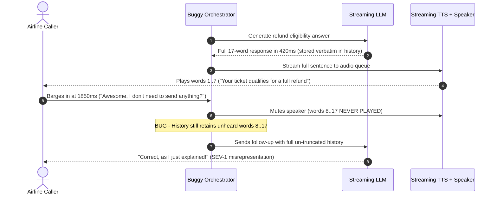

# Module 09: The Voice Agent Pipeline (STT → LLM → TTS)

> **Prerequisites:** [Module 04: Streaming and Realtime Transcription](../04-streaming-and-realtime-transcription/README.md), [Module 08: TTS APIs in Practice](../08-tts-apis-in-practice/README.md), and [Track 06, Module 06: Function Calling Basics](../../06-openai-and-the-model-landscape/06-function-calling-basics/README.md).  
> **Estimated Reading Time:** 35 minutes  
> **Target Audience:** AI Backend Engineers, Conversational AI Architects, Realtime Media Systems Engineers

> [!TIP]
> **The Golden Rule of the Cascading Voice Pipeline:** A production voice agent is not three serial HTTP calls chained in a `while` loop—it is a **full-duplex, interruptible state machine**. Never commit turns using static silence timeouts alone, never let speaker echo trigger self-interruptions inside AEC warmup windows, and always truncate assistant memory at the **exact spoken word timestamp** upon barge-in rather than saving the unplayed LLM generation buffer.

---

## Why This Matters

Glueing Streaming STT, an LLM, and Streaming TTS together in a naive loop works for a silent-room demo where you wait politely until the robot stops talking. Hand that prototype to real callers in a kitchen, car, or busy office and it collapses within thirty seconds.

Three failure modes destroy naive voice pipelines immediately: **premature turn cutoffs** (a `700 ms` silence timer cuts off callers pausing to recall a credit card number or trailing off on `"because..."`), **broken barge-in** (the caller says *"Wait, stop"* yet the speaker keeps talking for `3` seconds while the LLM falsely records unheard sentences into conversation history), and **acoustic echo loops** (the agent hears its own speaker output bleed back into the microphone and interrupts itself mid-greeting). Mastering full-duplex turn detection, Acoustic Echo Cancellation (AEC), and atomic cancellation is what separates toy voice bots from enterprise conversational systems.

---

## 1. Full-Duplex Cascading Voice Architecture

A production cascaded voice agent (`STT → LLM → TTS`) runs **two concurrent, asynchronous data planes** bridged by a central **Turn Orchestrator**:

1. **Upstream Comprehension Plane (`Mic -> EOU -> LLM`):** Captures `20 ms` frames over WebRTC or SIP, strips echo via AEC, classifies voice activity (`Silero VAD`), streams continuous audio to Streaming STT, and combines acoustic silence with a **Semantic Turn Endpointing (EOU)** model to decide *when* the user genuinely yielded the floor.
2. **Downstream Synthesis Plane (`LLM -> Chunker -> TTS -> Speaker`):** Streams LLM deltas through a clause-boundary chunker ([Module 08](../08-tts-apis-in-practice/README.md)) into a persistent TTS WebSocket (`context_id`), pushes raw PCM/$\mu$-law frames to the jitter buffer, and continuously advances a `playout_cursor_ms` clock.
3. **Duplex Control Plane (Barge-In & State Machine):** Continuously monitors `VAD` even while `state == SPEAKING`, filtering echo inside `aec_warmup_duration` and ignoring brief backchannels (`"uh-huh"`, `"yeah"`), then firing an atomic 4-step abort if true user interruption occurs.

```mermaid
flowchart LR
    Mic["User Mic (WebRTC / SIP)"] --> AEC["AEC + Noise Suppression"]
    AEC --> VAD["Streaming VAD (20ms Frames)"]
    VAD -->|"Speech Active"| STT["Streaming STT (Partial + Final)"]
    STT -->|"Partial Transcript + Prosody"| EOU["Semantic Turn Detector (EOU)"]
    EOU -->|"Turn Committed"| Orch["Duplex Turn Orchestrator"]
    Orch -->|"Messages + Tools"| LLM["Streaming LLM"]
    LLM -->|"Tokens"| Chunk["Clause Boundary Chunker"]
    Chunk -->|"Flush Frames"| TTS["Streaming TTS (context_id + Timestamps)"]
    TTS -->|"Raw PCM / ulaw"| Play["Jitter Buffer & Playout Clock"]
    Play -->|"Audio Out"| Spk["User Speaker"]
    VAD -.->|"Speech > Threshold & Post-AEC Warmup"| Barge["4-Step Barge-In Canceller"]
    Barge -.->|"1. Flush Queue"| Play
    Barge -.->|"2. Send Clear"| TTS
    Barge -.->|"3. Abort Stream"| LLM
    Barge -.->|"4. Truncate at Spoken Word"| Orch
```



### Turn Detection: Naive Silence Timeouts vs. Semantic Endpointing

Early voice pipelines triggered turns solely when VAD detected $T_{\text{silence}} \ge 700\text{ ms}$. That creates an unsolvable dilemma:

- **Too short (`300–500 ms`):** Cuts off human cognitive pauses mid-sentence (`"My reservation code is... [650 ms pause] X94B"`).
- **Too long (`900–1,200 ms`):** Adds sluggish dead air after crisp completed replies (`"Yes."`, `"Thursday at three."`).

**Semantic / Multimodal Turn Detection** (pioneered by systems like **LiveKit Turn Detector**) runs a compact transformer/classifier over the streaming partial transcript *plus* acoustic pause cues to predict End-of-Utterance probability $P(\text{EOU} \mid \text{transcript}, \text{audio})$. The orchestrator then applies dynamic endpointing bounds:

$$\Delta t_{\text{commit}} = \begin{cases} \Delta t_{\min} \ (\approx 200\text{–}300\text{ ms}) & \text{if } P(\text{EOU}) \ge \tau_{\text{EOU}} \\ \Delta t_{\max} \ (\approx 1{,}200\text{–}1{,}800\text{ ms}) & \text{if } P(\text{EOU}) < \tau_{\text{EOU}} \end{cases}$$

When the user finishes `"What time do you close?"` ($P(\text{EOU}) = 0.94$), the agent commits within `~250 ms`; when the user pauses after `"I want to cancel because"` ($P(\text{EOU}) = 0.18$), the orchestrator automatically stretches the patience window to `1,500 ms` so the user finishes without interruption.

### The 4-Step Barge-In Cancellation Protocol

When a user interrupts while `state == SPEAKING`, all four operations must execute in tight causal order within `< 50 ms`:

1. **Clear Downstream Playout Queue:** Immediately drain unplayed `20 ms` frames in the WebRTC/SIP output jitter buffer so the caller stops hearing the bot instantly.
2. **Cancel Active TTS Generation:** Send `{"type": "Clear"}` (Deepgram Aura) or drop/rotate `context_id` (Cartesia / ElevenLabs `/multi-stream-input`) so the cloud synthesizer halts buffered text immediately.
3. **Abort In-Flight LLM Stream:** Cancel the upstream LLM `AbortController` / async task so wasted tokens stop generating (and guard any non-idempotent tool calls).
4. **Truncate Assistant Memory at Spoken Offset:** Use the `playout_cursor_ms` clock and TTS `word_timestamps` / `alignment` to keep **only** the words actually emitted out of the speaker:

   $$W_{\text{committed}} = \left[ w_i \;\middle|\; t_{\text{start}}(w_i) < t_{\text{playout}} \right]$$

   Append an explicit `[interrupted]` marker after $W_{\text{committed}}$ so the LLM knows seamlessly where the caller cut it off.

### Acoustic Echo Cancellation (AEC) & Backchannel Discrimination

If the user is on speakerphone, the agent's own audio loops back into the microphone `40–120 ms` later. Without AEC, the agent's VAD classifies its own voice as a caller interruption, killing its own greeting in an endless loop (`"Hi, how can I—" -> [self-interrupt] -> "Hi, how can I—"`).

- **Browser / Mobile WebRTC AEC:** Always request `echoCancellation: true, noiseSuppression: true, autoGainControl: true` in `getUserMedia`.
- **Telephony / Server-Side AEC + `aec_warmup_duration`:** PSTN/SIP trunks often lack reliable handset AEC. Run server-side DSP echo cancellation *and* enforce an **`aec_warmup_duration`** (`~200–300 ms` at the exact onset of agent speech) during which adaptive echo filters converge and minor acoustic spikes do not trigger barge-in.
- **Backchannel Filtering:** Short listener acknowledgments (`"uh-huh"`, `"okay"`, `"right"`, typically `120–250 ms` duration without sustained continuation) should **not** abort a multi-sentence explanation. Production adaptive interruption gates require either sustained speech (`>= 300 ms`) or semantic interruption intent before triggering full 4-step cancellation.

---

## 2. Systematic Comparison Matrix: Naive Loop vs. Production Duplex Pipeline

| Subsystem | Naive Turn Loop (`while True`) | Production Duplex Pipeline | Primary Outage Prevented |
| :--- | :--- | :--- | :--- |
| **Turn Endpointing** | Fixed `700 ms` VAD silence timeout | Acoustic VAD + Semantic EOU probability (`min`/`max` delay) | Mid-sentence false cutoffs & sluggish replies |
| **Echo Protection** | None or raw volume threshold | Client/Server AEC + `aec_warmup_duration` (`~250 ms`) | Self-interruption echo feedback loops |
| **Backchannel Handling** | Any VAD spike aborts agent speech | Adaptive duration/intent filter (`>= 300 ms` or intent) | Aborting explanations on `"uh-huh"` / `"yeah"` |
| **Barge-In Teardown** | Stops reading next loop iteration | Atomic 4-step: drain playout + TTS `Clear` + abort LLM + truncate | `3 s` ghost audio after user interrupts |
| **Assistant Memory** | Appends full generated LLM text string | Truncates at exact spoken word offset via `word_timestamps` | LLM claiming it stated exclusions caller never heard |
| **Tool Execution** | Synchronous blocking wait inside turn | Async execution + deterministic pre-tool filler + cancellation guard | `1.5 s` dead silence stalls or double tool execution |

---

## 3. Production War Story Post-Mortem: The Phantom Refund Ghost-Context Incident

| Field | Incident Details |
| :--- | :--- |
| **Severity** | **SEV-1** (Regulatory/Financial Misrepresentation & **\$85,000** Disputed Refund Exposure) |
| **Detection / Resolution Time** | Detected via QA call transcript audit 6 days post-launch / Patched in 4 hours |
| **Impact** | `19%` of interrupted billing calls left callers uninformed of mandatory cancellation conditions while the bot insisted disclosures had been read aloud |

### What Happened

An airline support voice agent handled ticket refund inquiries via a cascaded `Deepgram STT → LLM → Cartesia TTS` pipeline. When a caller asked about refund eligibility, the LLM streamed `24` tokens in `420 ms`:

> *"Your ticket qualifies for a full refund, provided you submit supporting medical documentation within forty-eight hours."*

Because the LLM generated tokens `4x` faster than human speech cadence, the entire sentence was buffered in the TTS stream and appended verbatim to `conversation_history` as soon as the LLM stream closed. Meanwhile, at `1,850 ms` of speaker playback—right after *"Your ticket qualifies for a full refund"*—the caller enthusiastically interrupted: *"Awesome, thank you so much! So I don't need to send anything else?"*

The naive barge-in handler muted the speaker and cleared TTS, **but never truncated `conversation_history`**. On the next turn, the LLM read its own un-truncated assistant message, assumed the caller had heard the `"within forty-eight hours"` clause, and replied: *"Correct, as I just explained, just make sure you submit what I mentioned!"* Callers hung up believing their refund was unconditional, creating **\$85,000** in disputed chargebacks and regulatory complaints.



### Root Cause Analysis

- Assistant conversation state was committed on **LLM stream completion** instead of **speaker playout confirmation**.
- Barge-in cleared local audio playback without querying TTS `word_timestamps` against the monotonic `playout_cursor_ms`.

### The Fix & Architectural Hardening

- Implemented continuous **Spoken-Word Cursor Tracking**: every assistant turn tracks `spoken_words` mapped from TTS `word_timestamps` against real-time playout bytes delivered.
- Upon barge-in, the orchestrator slices `conversation_history[-1]` down to `[w for w in words if w.start_ms < playout_ms] + " [interrupted]"` before invoking the LLM for the user's follow-up turn.

---

## 4. Multi-Language Production Implementation: Full-Duplex Turn & Barge-In Coordinator

Below is a production-ready **Duplex Voice Turn & Barge-In State Machine** across **Go**, **TypeScript**, **Python**, and **C#** covering `aec_warmup_duration`, backchannel duration filtering, semantic EOU commit delays, and atomic 4-step cancellation with spoken-word truncation.

````carousel

```go
package voicepipeline

import (
	"context"
	"strings"
	"sync"
)

type AgentState string

const (
	StateListening AgentState = "LISTENING"
	StateSpeaking  AgentState = "SPEAKING"
)

type WordTiming struct {
	Word    string
	StartMs int
	EndMs   int
}

type TurnMessage struct {
	Role    string
	Content string
}

type DuplexCoordinator struct {
	mu               sync.Mutex
	state            AgentState
	aecWarmupMs      int
	minInterruptMs   int
	semanticThresh   float64
	activeCancel     context.CancelFunc
	activeTimings    []WordTiming
	history          []TurnMessage
	ttsClearedCount  int
	queueFlushedCount int
}

func NewDuplexCoordinator(aecWarmupMs, minInterruptMs int, semanticThresh float64) *DuplexCoordinator {
	return &DuplexCoordinator{
		state:          StateListening,
		aecWarmupMs:    aecWarmupMs,
		minInterruptMs: minInterruptMs,
		semanticThresh: semanticThresh,
	}
}

// ComputeCommitDelayMs returns short delay on complete semantic EOU or longer hold mid-thought.
func (d *DuplexCoordinator) ComputeCommitDelayMs(eouProb float64) int {
	if eouProb >= d.semanticThresh {
		return 250
	}
	return 1500
}

func (d *DuplexCoordinator) StartSpeaking(timings []WordTiming, cancel context.CancelFunc) {
	d.mu.Lock()
	defer d.mu.Unlock()
	d.state = StateSpeaking
	d.activeTimings = timings
	d.activeCancel = cancel
}

// HandleVadActivity decides whether inbound speech triggers 4-step barge-in cancellation.
func (d *DuplexCoordinator) HandleVadActivity(elapsedSpeechMs, speechDurMs, playoutMs int) string {
	d.mu.Lock()
	defer d.mu.Unlock()

	if d.state != StateSpeaking {
		return "PASS_TO_STT"
	}
	if elapsedSpeechMs < d.aecWarmupMs {
		return "IGNORE_AEC_WARMUP"
	}
	if speechDurMs < d.minInterruptMs {
		return "KEEP_TALKING_BACKCHANNEL"
	}

	// Step 1 & 2: Flush local jitter buffer & signal TTS Clear
	d.queueFlushedCount++
	d.ttsClearedCount++

	// Step 3: Abort in-flight LLM generation
	if d.activeCancel != nil {
		d.activeCancel()
		d.activeCancel = nil
	}

	// Step 4: Truncate assistant context strictly to words actually played out
	var spoken []string
	for _, w := range d.activeTimings {
		if w.StartMs < playoutMs {
			spoken = append(spoken, w.Word)
		}
	}
	d.history = append(d.history, TurnMessage{
		Role:    "assistant",
		Content: strings.Join(spoken, " ") + " [interrupted]",
	})
	d.state = StateListening
	return "ABORT_AND_TRUNCATE"
}
```

<!-- slide -->

```typescript
export type AgentState = "LISTENING" | "SPEAKING";

export interface WordTiming {
  readonly word: string;
  readonly startMs: number;
  readonly endMs: number;
}

export interface TurnMessage {
  readonly role: "user" | "assistant";
  readonly content: string;
}

export type VadDecision =
  | "PASS_TO_STT"
  | "IGNORE_AEC_WARMUP"
  | "KEEP_TALKING_BACKCHANNEL"
  | "ABORT_AND_TRUNCATE";

export class DuplexVoiceCoordinator {
  private state: AgentState = "LISTENING";
  private activeAbort: AbortController | null = null;
  private activeTimings: readonly WordTiming[] = [];
  public readonly history: TurnMessage[] = [];
  public ttsClearedCount = 0;
  public playoutFlushedCount = 0;

  constructor(
    private readonly aecWarmupMs = 250,
    private readonly minInterruptSpeechMs = 300,
    private readonly semanticEouThreshold = 0.75,
  ) {}

  public computeCommitDelayMs(eouProbability: number): number {
    return eouProbability >= this.semanticEouThreshold ? 250 : 1500;
  }

  public beginAssistantTurn(
    timings: readonly WordTiming[],
    abortController: AbortController,
  ): void {
    this.state = "SPEAKING";
    this.activeTimings = timings;
    this.activeAbort = abortController;
  }

  public onVadSpeech(
    agentElapsedMs: number,
    userSpeechDurationMs: number,
    playoutCursorMs: number,
  ): VadDecision {
    if (this.state !== "SPEAKING") {
      return "PASS_TO_STT";
    }
    if (agentElapsedMs < this.aecWarmupMs) {
      return "IGNORE_AEC_WARMUP";
    }
    if (userSpeechDurationMs < this.minInterruptSpeechMs) {
      return "KEEP_TALKING_BACKCHANNEL";
    }

    // 1. Drain downstream audio queue & 2. Clear TTS server stream
    this.playoutFlushedCount += 1;
    this.ttsClearedCount += 1;

    // 3. Abort upstream LLM stream
    this.activeAbort?.abort("barge_in");
    this.activeAbort = null;

    // 4. Truncate assistant context strictly at spoken word offset
    const spoken = this.activeTimings
      .filter((w) => w.startMs < playoutCursorMs)
      .map((w) => w.word)
      .join(" ");

    this.history.push({ role: "assistant", content: `${spoken} [interrupted]` });
    this.state = "LISTENING";
    return "ABORT_AND_TRUNCATE";
  }
}
```

<!-- slide -->

```python
"""
duplex_coordinator.py
Full-duplex voice turn detector & 4-step barge-in state machine with spoken-word truncation.
"""
from dataclasses import dataclass, field
from typing import Callable, Sequence


@dataclass(frozen=True)
class WordTiming:
    word: str
    start_ms: int
    end_ms: int


@dataclass
class DuplexVoiceCoordinator:
    aec_warmup_ms: int = 250
    min_interrupt_speech_ms: int = 300
    semantic_eou_threshold: float = 0.75
    state: str = "LISTENING"
    history: list[dict[str, str]] = field(default_factory=list)
    active_timings: Sequence[WordTiming] = ()
    _abort_llm: Callable[[], None] | None = None
    _clear_tts: Callable[[], None] | None = None
    _flush_playout: Callable[[], None] | None = None

    def commit_delay_ms(self, eou_probability: float) -> int:
        return 250 if eou_probability >= self.semantic_eou_threshold else 1500

    def begin_speaking(
        self,
        timings: Sequence[WordTiming],
        abort_llm: Callable[[], None],
        clear_tts: Callable[[], None],
        flush_playout: Callable[[], None],
    ) -> None:
        self.state = "SPEAKING"
        self.active_timings = timings
        self._abort_llm = abort_llm
        self._clear_tts = clear_tts
        self._flush_playout = flush_playout

    def handle_vad_activity(
        self, agent_elapsed_ms: int, speech_dur_ms: int, playout_cursor_ms: int
    ) -> str:
        if self.state != "SPEAKING":
            return "PASS_TO_STT"
        if agent_elapsed_ms < self.aec_warmup_ms:
            return "IGNORE_AEC_WARMUP"
        if speech_dur_ms < self.min_interrupt_speech_ms:
            return "KEEP_TALKING_BACKCHANNEL"

        # 1. Drain playout queue, 2. Clear TTS context, 3. Cancel LLM stream
        if self._flush_playout:
            self._flush_playout()
        if self._clear_tts:
            self._clear_tts()
        if self._abort_llm:
            self._abort_llm()

        # 4. Truncate assistant context at exact spoken boundary
        spoken = " ".join(w.word for w in self.active_timings if w.start_ms < playout_cursor_ms)
        self.history.append({"role": "assistant", "content": f"{spoken} [interrupted]"})
        self.state = "LISTENING"
        return "ABORT_AND_TRUNCATE"
```

<!-- slide -->

```csharp
using System;
using System.Collections.Generic;
using System.Linq;
using System.Threading;

namespace GenAI.Voice.Pipeline;

public sealed record WordTiming(string Word, int StartMs, int EndMs);
public sealed record TurnMessage(string Role, string Content);

public sealed class DuplexVoiceCoordinator
{
    private readonly object _gate = new();
    private readonly int _aecWarmupMs;
    private readonly int _minInterruptSpeechMs;
    private readonly double _semanticThreshold;

    private string _state = "LISTENING";
    private IReadOnlyList<WordTiming> _activeTimings = Array.Empty<WordTiming>();
    private CancellationTokenSource? _llmCts;

    public List<TurnMessage> History { get; } = new();
    public int TtsClearedCount { get; private set; }
    public int PlayoutFlushedCount { get; private set; }

    public DuplexVoiceCoordinator(
        int aecWarmupMs = 250,
        int minInterruptSpeechMs = 300,
        double semanticThreshold = 0.75)
    {
        _aecWarmupMs = aecWarmupMs;
        _minInterruptSpeechMs = minInterruptSpeechMs;
        _semanticThreshold = semanticThreshold;
    }

    public int ComputeCommitDelayMs(double eouProbability) =>
        eouProbability >= _semanticThreshold ? 250 : 1500;

    public void BeginSpeaking(IReadOnlyList<WordTiming> timings, CancellationTokenSource llmCts)
    {
        lock (_gate)
        {
            _state = "SPEAKING";
            _activeTimings = timings;
            _llmCts = llmCts;
        }
    }

    public string HandleVadActivity(int agentElapsedMs, int speechDurationMs, int playoutCursorMs)
    {
        lock (_gate)
        {
            if (_state != "SPEAKING")
                return "PASS_TO_STT";
            if (agentElapsedMs < _aecWarmupMs)
                return "IGNORE_AEC_WARMUP";
            if (speechDurationMs < _minInterruptSpeechMs)
                return "KEEP_TALKING_BACKCHANNEL";

            // 1. Drain playout & 2. Clear TTS stream
            PlayoutFlushedCount++;
            TtsClearedCount++;

            // 3. Abort in-flight LLM generation
            _llmCts?.Cancel();
            _llmCts = null;

            // 4. Truncate assistant context strictly to words actually spoken
            var spoken = string.Join(" ",
                _activeTimings.Where(w => w.StartMs < playoutCursorMs).Select(w => w.Word));

            History.Add(new TurnMessage("assistant", $"{spoken} [interrupted]"));
            _state = "LISTENING";
            return "ABORT_AND_TRUNCATE";
        }
    }
}
```

````

---

## 5. Practical Hands-On Verification CLI Workflows

Run these deterministic Python 3.13 verification scripts offline—no external SDKs or API keys required.

### Workflow 1: Compare Naive `700 ms` Silence Timeout vs. Semantic EOU Endpointing

Simulate four real conversational utterances (short confirmation, mid-sentence digit recall pause, trailing conjunction, and complete question) across both endpointing designs:

```bash
python -c '
cases = [
    ("Short crisp confirm", "Yes, confirm it.", True, 2000, 0.96),
    ("Mid-sentence digit pause", "My account number is", False, 850, 0.14),
    ("Trailing conjunction hold", "I want to reschedule because", False, 920, 0.18),
    ("Clean complete question", "What time does support open?", True, 2000, 0.94),
]
for label, txt, is_done, silence_before_resume_ms, eou_prob in cases:
    naive_commit_ms = 700 if silence_before_resume_ms >= 700 else None
    naive_res = f"FALSE_CUTOFF@700ms" if (not is_done and naive_commit_ms) else f"COMMIT@{naive_commit_ms}ms"
    sem_delay = 250 if eou_prob >= 0.75 else 1500
    if is_done:
        sem_res = f"COMMIT@{sem_delay}ms"
    elif silence_before_resume_ms < sem_delay:
        sem_res = f"HELD_OK(resumed@{silence_before_resume_ms}ms)"
    else:
        sem_res = f"FALSE_CUTOFF@{sem_delay}ms"
    print(f"{label:<26} | EOU_p={eou_prob:.2f} | Naive700={naive_res:<18} | Semantic={sem_res}")
'
```

**Expected Output:**

```text
Short crisp confirm        | EOU_p=0.96 | Naive700=COMMIT@700ms       | Semantic=COMMIT@250ms
Mid-sentence digit pause   | EOU_p=0.14 | Naive700=FALSE_CUTOFF@700ms | Semantic=HELD_OK(resumed@850ms)
Trailing conjunction hold  | EOU_p=0.18 | Naive700=FALSE_CUTOFF@700ms | Semantic=HELD_OK(resumed@920ms)
Clean complete question    | EOU_p=0.94 | Naive700=COMMIT@700ms       | Semantic=COMMIT@250ms
```

Observe the dual win: Semantic EOU saves `450 ms` on complete turns (`250 ms` vs `700 ms`) *and* eliminates both false cutoffs when callers pause `850–920 ms` mid-thought!

### Workflow 2: Verify Spoken-Word Context Truncation During Mid-Sentence Barge-In

Simulate a `15`-word LLM answer where only `9` words (`2,350 ms`) have reached the speaker when the caller interrupts:

```bash
python -c '
llm_full_words = [
    "Sure,", "I", "checked", "your", "order", "from", "Tuesday.",
    "Your", "package", "left", "Chicago", "and", "arrives", "Friday", "morning."
]
word_alignments = [
    ("Sure,", 0, 260), ("I", 260, 380), ("checked", 380, 740), ("your", 740, 920),
    ("order", 920, 1210), ("from", 1210, 1450), ("Tuesday.", 1450, 1980),
    ("Your", 1980, 2240), ("package", 2240, 2690), ("left", 2690, 2980),
    ("Chicago", 2980, 3490), ("and", 3490, 3680), ("arrives", 3680, 4120),
    ("Friday", 4120, 4560), ("morning.", 4560, 5020),
]

playout_ms = 2350
tts_queue_cleared = True
llm_aborted = True
spoken_words = [w for w, start_ms, _ in word_alignments if start_ms < playout_ms]
unheard_words = [w for w, start_ms, _ in word_alignments if start_ms >= playout_ms]

full_txt = " ".join(llm_full_words)
spoken_txt = " ".join(spoken_words)
unheard_txt = " ".join(unheard_words)
print(f"Generated LLM buffer ({len(llm_full_words)} words): {full_txt}")
print(f"Barge-in at playout={playout_ms} ms | tts_cleared={tts_queue_cleared} | llm_aborted={llm_aborted}")
print(f"Truncated assistant context ({len(spoken_words)} words): {spoken_txt}")
print(f"Dropped unheard tail ({len(unheard_words)} words): {unheard_txt}")
'
```

**Expected Output:**

```text
Generated LLM buffer (15 words): Sure, I checked your order from Tuesday. Your package left Chicago and arrives Friday morning.
Barge-in at playout=2350 ms | tts_cleared=True | llm_aborted=True
Truncated assistant context (9 words): Sure, I checked your order from Tuesday. Your package
Dropped unheard tail (6 words): left Chicago and arrives Friday morning.
```

### Workflow 3: Stress-Test AEC Warmup Guard & Backchannel Filtering

Verify how `aec_warmup_ms = 250` and `min_interrupt_speech_ms = 300` separate speaker echo bleed, short `"uh-huh"` backchannels, and genuine user interruptions:

```bash
python -c '
events = [
    (90, 140, 0.72, "Speaker echo bleed (0-250ms AEC warmup)"),
    (1100, 180, 0.85, "User backchannel: uh-huh (short duration)"),
    (2450, 460, 0.91, "User barge-in: Wait stop, check Friday instead"),
]
aec_warmup_ms = 250
min_interrupt_speech_ms = 300

for t_ms, speech_dur_ms, vad_prob, desc in events:
    if t_ms < aec_warmup_ms:
        action = "IGNORE_AEC_WARMUP"
    elif vad_prob >= 0.65 and speech_dur_ms < min_interrupt_speech_ms:
        action = "KEEP_TALKING_BACKCHANNEL"
    elif vad_prob >= 0.65 and speech_dur_ms >= min_interrupt_speech_ms:
        action = "ABORT_AND_TRUNCATE"
    else:
        action = "IGNORE_NOISE"
    print(f"t={t_ms:>4}ms | dur={speech_dur_ms:>3}ms | vad={vad_prob:.2f} -> {action:<25} | {desc}")
'
```

**Expected Output:**

```text
t=  90ms | dur=140ms | vad=0.72 -> IGNORE_AEC_WARMUP         | Speaker echo bleed (0-250ms AEC warmup)
t=1100ms | dur=180ms | vad=0.85 -> KEEP_TALKING_BACKCHANNEL  | User backchannel: uh-huh (short duration)
t=2450ms | dur=460ms | vad=0.91 -> ABORT_AND_TRUNCATE        | User barge-in: Wait stop, check Friday instead
```

### Hands-On Exercises

1. **Tune Hybrid `EOU` Margin:** Extend Workflow 1 to add a fifth case: `"Wait—let me check my wallet"` followed by a `1,650 ms` pause. Experiment with raising `max_delay` from `1,500 ms` to `2,000 ms` only when the trailing phrase matches explicit stall markers (`"let me check"`, `"hold on"`, `"one second"`).
2. **Jitter Buffer Offset Math:** In Workflow 2, suppose your TTS engine generated `4,200 ms` of audio (`14` words) while only `2,350 ms` played out the speaker. Compute how many milliseconds of unplayed PCM bytes (`pcm_16000`) sat in the local audio buffer and verify that draining the queue saved `1,850 ms` of phantom chatter.
3. **Optional Live Framework Test (Requires API Keys):** Build a minimal `LiveKit Agents` or `Pipecat` pipeline locally over WebRTC (`SmallWebRTCTransport` or LiveKit room), disable `aec_warmup_duration` and echo cancellation on speakerphone to observe self-interruption, then re-enable both to confirm clean barge-in.

### Independent Challenge

A healthcare triage voice assistant must read out a legally mandated `12`-second consent disclaimer before scheduling an appointment. Product asks to enable natural barge-in everywhere, **except** callers cannot skip the legal consent block, and if they interrupt during normal Q&A while speaking over a noisy car Bluetooth headset, the bot must never falsely cut itself off. Design the exact turn-detection, AEC, and state-machine policy changes needed in the orchestrator.

<details><summary>Architectural Discussion</summary>

1. **Per-Turn Interruption Lock (`allow_interruptions=False`):** Expose a turn-level state flag on the Duplex Coordinator (`allowInterruptions`). Keep `allowInterruptions = false` exclusively for the deterministic `12`-second pre-synthesized legal consent turn (analogous to `NO_INTERRUPTION` modes), while defaulting `allowInterruptions = true` across conversational Q&A turns.
2. **Bluetooth HFP Echo & Road-Noise Hardening:** Car Bluetooth hands-free (`HFP`) profiles run half-duplex narrowband (`8–16 kHz`) with variable `80–160 ms` echo delay. Increase `aec_warmup_duration` to `350 ms`, raise VAD activation threshold slightly under high noise floor, and require `>= 320 ms` sustained speech (or STT non-empty transcript words beyond backchannels like `"yeah"` / `"mm-hmm"`) before firing 4-step barge-in cancellation.

</details>

---

## 6. Common Mistakes & Troubleshooting

- **Committing assistant history from LLM tokens rather than speaker playout:** Writing the full LLM output into `messages[]` immediately when the stream finishes guarantees "phantom memory" whenever the user interrupts early. Always reconcile `messages[]` against `playout_cursor_ms` + TTS alignments.
- **Triggering barge-in on raw VAD energy spikes (`50 ms` coughs or `"uh-huh"`):** Microphone clicks, door slams, and polite `"uh-huh"` acknowledgments are `100–220 ms` long. Require either `>= 300 ms` continuous speech or confirmed non-backchannel transcript tokens before aborting an active turn.
- **Skipping `aec_warmup_duration` on PSTN/speakerphone calls:** Adaptive echo cancellers need `~150–300 ms` of reference signal at the start of agent speech to converge. Ignoring VAD triggers during that initial window prevents infinite self-interruption loops.
- **Executing side-effectful tools before EOU confirmation:** Speculatively calling `charge_card()` or `cancel_booking()` on a partial STT transcript before Semantic EOU commits leads to irreversible mutations if the user says *"Wait, actually don't cancel!"*. Keep speculative prefetch strictly read-only (`GET` lookups) and gate mutations behind committed turns.

---

## 7. Operational Validation Checkpoints & Checkpoint Quiz

### Operational Validation Checkpoints

<details><summary><strong>Checkpoint 1: Diagnosing why callers get cut off while reading IDs aloud</strong></summary>

Callers reading `10`-digit policy numbers pause for `800 ms` between digit groups (`"4829... [800ms] ...1034"`). Your voice agent uses Silero VAD with a fixed `700 ms` silence threshold and constantly interrupts them halfway through. How do you fix this without hurting turnaround time on `"Yes"`?

**Validation:** Replace the static `700 ms` silence timeout with a **Semantic End-of-Utterance (EOU)** detector combining acoustic silence with partial transcript syntax. Incomplete numeric sequences (`"4829"`) score low EOU probability, dynamically stretching the patience window to `1,500–2,000 ms`, while complete utterances (`"Yes"`, `"Book Tuesday"`) score high EOU probability and commit quickly at `~250 ms`.

</details>

<details><summary><strong>Checkpoint 2: Tracing why the agent restarts its own greeting every 400 ms</strong></summary>

On speakerphone testing, your agent says `"Hello, welcome—"`, abruptly stops, says `"Hello, welcome—"` again, and loops indefinitely. No human spoke in the room. Identify the root cause and fix.

**Validation:** Speaker bleed fed the agent's own greeting back into the microphone and tripped VAD as a "user interruption" (self-barge-in). Enable WebRTC/DSP **Acoustic Echo Cancellation (AEC)** on the audio track and configure an **`aec_warmup_duration`** (`200–300 ms` at assistant speech onset) so initial echo transients are ignored while the adaptive echo filter locks on.

</details>

<details><summary><strong>Checkpoint 3: Auditing "the bot lied about reading the fine print" complaints</strong></summary>

After an interrupted support call, a transcript review shows the caller asked *"So no penalty applies?"* and the bot replied *"Correct, as I just told you, no penalty applies if filed within 7 days"*—yet audio recordings confirm the caller interrupted *before* `"if filed within 7 days"` ever played. What failed?

**Validation:** The orchestrator appended the entire generated LLM buffer to `messages[]` instead of reconciling against the speaker playout clock. Fix by tracking real-time `playout_cursor_ms` against TTS word-alignment timestamps (`word_timestamps` / `sync_alignment`) and truncating `messages[]` strictly to words whose `start_ms < playout_cursor_ms` plus an `[interrupted]` marker.

</details>

### Checkpoint Quiz

1. What are the **two asynchronous data planes** and **one control plane** inside a production cascading voice pipeline?
2. Why does a static `700 ms` VAD silence timeout simultaneously hurt fast turns AND incomplete cognitive pauses?
3. List all **4 sequential actions** required during a clean barge-in cancellation.
4. Why do production voice orchestrators enforce `aec_warmup_duration` and filter out `150 ms` `"uh-huh"` speech bursts?
5. Why should speculative tool calls triggered before EOU confirmation be strictly read-only?

<details><summary>Answers</summary>

1. The **Upstream Comprehension Plane** (`Mic -> AEC -> VAD -> Streaming STT -> Semantic EOU`), the **Downstream Synthesis Plane** (`LLM Stream -> Clause Chunker -> Streaming TTS -> Jitter Buffer -> Speaker`), and the **Duplex Control Plane** (barge-in orchestration, cancellation, and spoken-offset context reconciliation).
2. `700 ms` is too slow for crisp completed turns like `"Yes."` (adding `450 ms` avoidable dead air vs `250 ms` semantic commit) yet too impatient for natural mid-sentence pauses (`800–1,000 ms`) while recalling numbers or choosing words.
3. (1) Flush the local/edge audio playout queue, (2) send TTS `Clear` / rotate `context_id` to stop cloud synthesis, (3) abort the in-flight LLM stream, and (4) truncate assistant conversation history to the exact words played before `playout_cursor_ms`.
4. `aec_warmup_duration` (`~200–300 ms`) prevents early speaker-to-mic echo bleed from triggering self-interruption before AEC filters converge; duration/adaptive filters prevent brief listener backchannels (`"uh-huh"`, `"right"`) from prematurely aborting useful explanations.
5. Because an incomplete partial transcript may be revised or negated moments later (`"Cancel my order... wait, no, keep it"`), so firing mutating writes before turn commit causes irreversible side effects.

</details>

---

## Further Reading & Sources

- [LiveKit Agents Documentation: Turn Detection, Interruption & Voice Pipeline](https://docs.livekit.io/agents/) — official guide covering LiveKit's Semantic Turn Detector, adaptive backchannel filtering, and `aec_warmup_duration`.
- [Pipecat Documentation: Real-Time Voice Agent Pipelines & Interruptions](https://docs.pipecat.ai/) — open-source architecture reference for frame-based duplex audio pipelines, VAD, and task cancellation.
- [Deepgram Documentation: Aura WebSocket Clear & Interruption Lifecycle](https://developers.deepgram.com/docs/text-to-speech) — official control message spec (`Flush`, `Clear`, `Close`) for server-side TTS queue cancellation.
- [Cartesia Documentation: Multi-Context WebSockets & Timestamps](https://docs.cartesia.ai/) — reference for `context_id` cancellation and word-level timing extraction.

## Next

[Module 10: Latency Budgets for Voice](../10-latency-budgets-for-voice/README.md)
