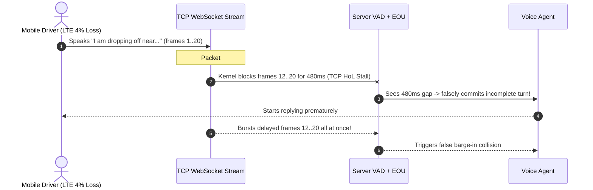

# Module 10: Latency Budgets for Voice

> **Prerequisites:** [Module 09: The Voice Agent Pipeline (STT → LLM → TTS)](../09-the-voice-agent-pipeline/README.md), [Module 04: Streaming and Realtime Transcription](../04-streaming-and-realtime-transcription/README.md), and [Module 08: TTS APIs in Practice](../08-tts-apis-in-practice/README.md).  
> **Estimated Reading Time:** 35 minutes  
> **Target Audience:** Voice Infrastructure Engineers, Realtime Networking Architects, SRE & Performance Engineers

> [!TIP]
> **The Golden Rule of Voice Latency Budgets:** Human turn-taking breaks above `800–1,000 ms` mouth-to-ear latency, and sequential stage tails compound brutally—optimizing the LLM alone will never rescue a slow voice pipeline. You must run **pipelined streaming overlap across every hop**, transport edge audio over **WebRTC/UDP rather than TCP/WebSockets**, co-locate media/STT/LLM/TTS services in the same cloud region, and mask unavoidable `>1 s` tool/RAG calls with deterministic sub-`250 ms` audio fillers.

---

## Why This Matters

In text chat, a `1,400 ms` Time-to-First-Token (`TTFT`) looks responsive because users expect to read a typing indicator. In spoken conversation, `1,400 ms` feels broken. Cross-linguistic empirical studies (Stivers et al., *PNAS* 2009) established that across human languages, natural conversational turn gaps cluster tightly around a **`~200 ms` modal offset** (`~200–350 ms` perceived as snappy, attentive dialogue). Once mouth-to-ear latency crosses **`800–1,000 ms`**, callers assume the connection dropped, say *"Hello? Are you still there?"*, and collide directly with the agent's delayed response—triggering a barge-in cascade that wrecks the entire call.

Even experienced backend teams miscalculate voice latency because they benchmark each API in isolation (`"Our LLM TTFT p50 is 210 ms!"`) and ignore two production realities: **7-hop stage accumulation** and **TCP Head-of-Line (HoL) stalls** on mobile Wi-Fi/LTE.

---

## 1. Conversational Physics & End-to-End Stage Budgeting

**Mouth-to-Ear (`M2E`) Latency** is the exact wall-clock interval from the final phoneme spoken by the human caller to the first audible phoneme emitted from the caller's speaker.


### Additive (Batch) vs. Pipelined (Streaming) Math

If any stage waits for the previous stage to finish completely before forwarding output (**Additive / Batch Execution**), latencies add linearly across full generation durations:

$$L_{\text{M2E}}^{\text{batch}} = L_{\text{net-up}} + L_{\text{VAD/EOU}} + L_{\text{STT}} + L_{\text{LLM-full}} + L_{\text{TTS-full}} + L_{\text{net-down}} + L_{\text{jitter}}$$

With a `1,150 ms` full LLM reply and `680 ms` full TTS synthesis, $L_{\text{M2E}}^{\text{batch}} = 2{,}310\text{ ms}$—nearly **3x worse** than the `800 ms` conversational ceiling.

When every hop streams **incrementally** (**Pipelined Execution**), full decode durations collapse down to *Time-to-First-Boundary* (`TTFT`, first clause accumulation, `TTFB`):

$$L_{\text{M2E}}^{\text{pipe}} = L_{\text{net-up}} + L_{\text{VAD/EOU}} + L_{\text{STT-final}} + L_{\text{LLM-TTFT}} + L_{\text{chunk}} + L_{\text{TTS-TTFB}} + L_{\text{net-down}} + L_{\text{jitter}}$$

Notice the critical trap: **even pipelined streaming fails** (`905 ms` median, `>800 ms` SLA breach!) unless every individual stage is tuned! Optimizing from `905 ms` to `585 ms` requires shaving `20–85 ms` simultaneously across **all seven stages**:
- **Co-Located Regional Topology (`net-up + net-down`):** Moving orchestrator, STT, and TTS into the same cloud region (`us-east` or `eu-central`) via edge WebRTC SFUs (`LiveKit`, `Daily`, `Pipecat`) trims `40–120 ms` of cross-ocean TLS/TCP RTT.
- **Speculative / Fast Semantic EOU (`VAD/EOU`):** Cutting naive `700 ms` silence wait to `160–230 ms` semantic EOU saves `~500 ms` immediately.
- **Streaming Partial Stabilization (`STT`):** Using incremental finals / speculative pre-warm trims STT finalization wait to `< 100 ms`.
- **Compact System Prompts & Prefix Caching (`LLM-TTFT`):** Keeping prompt prefixes cached and concise (`< 1,000` tokens) drops TTFT from `~220 ms` to `~135 ms`.
- **Short First-Clause Bias (`chunk` + `TTS-TTFB`):** Flushing the first short clause (e.g., `"Sure, let me check."` in `65 ms`) into an SSM/Flash TTS engine (`65 ms`) delivers audio `100+ ms` sooner than waiting for a long complex clause.

### Why Sequential Tail Latencies (`p95` / `p99`) Compound Brutally

Even if each of $K = 7$ independent stages meets its per-stage SLA `95%` of the time, the probability that *zero* stages hit a tail spike on a single turn is:

$$P(\text{all } K \text{ stages fast}) = 0.95^7 \approx 0.698 \quad (30.2\% \text{ of turns experience at least one tail spike!})$$

In real voice pipelines, stage variance $\sigma$ causes `p95` total latency to jump `25–40%` above `p50`—meaning a system with `p50 = 760 ms` quietly blows past `1,050 ms` on its worst `10–20%` of turns!

### WebRTC (UDP/SRTP + Opus + PLC) vs. WebSockets (TCP) Over Lossy Networks

Why do production voice SDKs (**LiveKit**, **Daily**, **Pipecat**) mandate **WebRTC (UDP)** between user devices and edge servers instead of **TCP WebSockets**?

| Property | TCP / WebSocket (`wss://`) | WebRTC / UDP (`SRTP + Opus`) |
| :--- | :--- | :--- |
| **On `2–5%` Mobile Packet Loss** | **Head-of-Line (HoL) Blocking:** Kernel halts delivery of *all* newer frames until lost packet retransmits (`RTO` stalls of `200–1,000 ms+`), followed by fast burst playback | **Zero HoL Freeze:** Lost `20 ms` frame is skipped immediately; Opus **Packet Loss Concealment (PLC)** smoothly interpolates the `20 ms` gap while frame `N+1` plays on time |
| **Jitter Handling** | OS TCP receive buffer grows unpredictably during congestion (`bufferbloat`) | Fixed/adaptive **jitter buffer** (`20–60 ms`) absorbs micro-jitter and drops late stale frames |
| **Echo & Hardware DSP** | Raw PCM capture lacks browser acoustic pipeline unless manually wired | Built-in WebRTC `AEC`, `NS`, `AGC` and Opus `DTX` (Discontinuous Transmission) |

*Rule of thumb:* Use **WebRTC/UDP** on the unpredictable **client $\leftrightarrow$ edge** last mile; reserve **TCP WebSockets** strictly for datacenter-to-datacenter hops (`Edge Media Worker ↔ STT / TTS`) over clean backbone fiber.

### Filler & Backchannel Latency Masking for Async Tools

When an agent must execute a `1,200 ms` CRM lookup or RAG query, *no* pipeline tuning can push $L_{\text{M2E}}$ below `1,200 ms`. Instead, inject a deterministic sub-`250 ms` **masked verbal filler**:
1. Either instruct the LLM to emit a short pre-tool conversational phrase *before* the `tool_call` delta (`"Let me pull up your itinerary right now."`), OR play a pre-synthesized cached PCM clip (`"Checking that for you..."`) immediately when `tool_call` begins.
2. Execute the external API asynchronously while the filler plays (`~1,000 ms` of audio), masking `100%` of the tool wait behind natural conversational pacing!

---

## 2. Systematic Comparison Matrix: Latency Optimization Levers

| Optimization Lever | Latency Reduction (`p50` / `p95`) | Engineering Complexity | Risk / Trade-Off |
| :--- | :--- | :--- | :--- |
| **Batch $\rightarrow$ Full Streaming Overlap** | **`-1,400 ms` (`~2.5x–3.9x` speedup)** | Medium (async queues & chunkers) | Requires stream cancellation on barge-in |
| **Naive `700 ms` VAD $\rightarrow$ Semantic EOU** | **`-450 ms` on complete turns** | Medium (ONNX / turn detector model) | Needs tuned `tau_EOU` to avoid false cutoffs |
| **TCP WebSocket $\rightarrow$ WebRTC Edge** | **`-250 to -950 ms` tail freezes on LTE** | Medium (LiveKit / Daily / Pipecat SFU) | Requires ICE/TURN firewall traversal |
| **Cross-Region $\rightarrow$ Single-VPC Co-Location** | **`-80 to -180 ms` fixed network RTT** | Low–Medium (regional deployment) | Higher multi-region infra orchestration |
| **Filler Masking for `>800 ms` Tools** | **Masks `1,000+ ms` perceived silence** | Low (pre-cached PCM or pre-tool text) | Overuse sounds repetitive; limit to slow calls |

---

## 3. Production War Story Post-Mortem: The Commuter Train TCP Head-of-Line Freeze

| Field | Incident Details |
| :--- | :--- |
| **Severity** | **SEV-2** (`42%` Mobile Call Abandonment on Commuter Cellular Networks) |
| **Detection / Resolution Time** | Detected via mobile telemetry cohorts 5 days post-beta / Resolved in 3 days by migrating client leg to WebRTC |
| **Impact** | `42%` of mobile users experienced `1–2 s` speech freezes and false VAD interruptions despite datacenter LLM `TTFT = 180 ms` |

### What Happened

A rideshare driver support app streamed raw `pcm_16000` audio (`256 kbps`) directly from iOS/Android clients to its backend orchestrator over a standard `wss://` TCP WebSocket. In office Wi-Fi tests, the pipeline felt crisp (`590 ms` M2E). Once drivers used the app on moving cellular LTE connections (`2–5%` packet loss and tower handoffs), calls collapsed:

1. **TCP HoL Stalls Tripped VAD:** Whenever a single TCP segment dropped on LTE, the client socket stopped delivering audio frames for `240–720 ms` waiting for retransmission. Server VAD saw `500 ms` of missing audio, interpreted it as silence/EOU, and cut off drivers mid-sentence!
2. **Compressed Burst Replay:** Moments later, TCP delivered `15` buffered packets simultaneously in a `10 ms` burst, causing STT to receive overlapping garbled fragments alongside the bot's premature reply.
3. **High Bitrate Saturation:** Uncompressed `256 kbps` PCM over TCP consumed `4x–8x` more cellular uplink bandwidth than `32 kbps` Opus over WebRTC.



### Root Cause Analysis

- Using reliable ordered byte-stream TCP (`WebSocket`) for real-time audio across lossy last-mile cellular links introduced mandatory retransmit freezes (`HoL blocking`).
- Sending uncompressed `256 kbps` PCM without Opus Packet Loss Concealment (PLC) amplified bandwidth loss on weak LTE uplinks.

### The Fix & Architectural Hardening

- Migrated the mobile client $\leftrightarrow$ edge media leg to **WebRTC (UDP/SRTP + Opus at `32 kbps`)** via an edge SFU (`LiveKit` / `Daily`), keeping TCP WebSockets strictly inside the low-loss datacenter VPC (`SFU Worker ↔ STT/TTS`).
- Enabled Opus FEC (`inbandfec=1`) and PLC with a `20–40 ms` adaptive jitter buffer, dropping mobile tail freezes to `0 ms` and cutting abandonment from `42%` to `< 3%`.

---

## 4. Multi-Language Production Implementation: Voice M2E Telemetry & SLA Budget Auditor

Below is a production **Mouth-to-Ear (`M2E`) Per-Stage Telemetry Tracker & Bottleneck Auditor** across **Go**, **TypeScript**, **Python**, and **C#**. It timestamps each monotonic stage boundary (`speech_end`, `stt_final`, `llm_ttft`, `first_clause`, `tts_ttfb`, `first_audio_playout`), enforces an `800 ms` SLA budget, and automatically flags which exact stage caused any latency regression.

````carousel

```go
package voicetelemetry

import "fmt"

type TurnTimestampsMs struct {
	TurnID           string
	UserSpeechEnd    int64
	UplinkArrived    int64
	EouCommitted     int64
	SttFinalized     int64
	LlmFirstToken    int64
	FirstClauseReady int64
	TtsFirstByte     int64
	AudioPlayout     int64
}

type BudgetAudit struct {
	TurnID        string
	StageDurations map[string]int64
	TotalM2EMs    int64
	SlaBreached   bool
	SlowestStage  string
	SlowestMs     int64
}

func AuditTurnBudget(ts TurnTimestampsMs, slaBudgetMs int64) BudgetAudit {
	stages := map[string]int64{
		"net_up":        ts.UplinkArrived - ts.UserSpeechEnd,
		"vad_eou":       ts.EouCommitted - ts.UplinkArrived,
		"stt_final":     ts.SttFinalized - ts.EouCommitted,
		"llm_ttft":      ts.LlmFirstToken - ts.SttFinalized,
		"clause_chunk":  ts.FirstClauseReady - ts.LlmFirstToken,
		"tts_ttfb":      ts.TtsFirstByte - ts.FirstClauseReady,
		"down_jitter":   ts.AudioPlayout - ts.TtsFirstByte,
	}

	var slowestName string
	var slowestVal int64 = -1
	for name, dur := range stages {
		if dur > slowestVal {
			slowestVal = dur
			slowestName = name
		}
	}

	total := ts.AudioPlayout - ts.UserSpeechEnd
	return BudgetAudit{
		TurnID:         ts.TurnID,
		StageDurations: stages,
		TotalM2EMs:     total,
		SlaBreached:    total > slaBudgetMs,
		SlowestStage:   slowestName,
		SlowestMs:      slowestVal,
	}
}

func FormatBreachAlert(a BudgetAudit, slaBudgetMs int64) string {
	return fmt.Sprintf("turn=%s m2e=%dms sla=%dms breached=%t bottleneck=%s(%dms)",
		a.TurnID, a.TotalM2EMs, slaBudgetMs, a.SlaBreached, a.SlowestStage, a.SlowestMs)
}
```

<!-- slide -->

```typescript
export interface TurnTimestampsMs {
  readonly turnId: string;
  readonly userSpeechEnd: number;
  readonly uplinkArrived: number;
  readonly eouCommitted: number;
  readonly sttFinalized: number;
  readonly llmFirstToken: number;
  readonly firstClauseReady: number;
  readonly ttsFirstByte: number;
  readonly audioPlayout: number;
}

export interface BudgetAudit {
  readonly turnId: string;
  readonly stagesMs: Readonly<Record<string, number>>;
  readonly totalM2EMs: number;
  readonly slaBreached: boolean;
  readonly bottleneckStage: string;
  readonly bottleneckMs: number;
}

export function auditVoiceTurnBudget(
  ts: TurnTimestampsMs,
  slaBudgetMs = 800,
): BudgetAudit {
  const stagesMs: Record<string, number> = {
    net_up: ts.uplinkArrived - ts.userSpeechEnd,
    vad_eou: ts.eouCommitted - ts.uplinkArrived,
    stt_final: ts.sttFinalized - ts.eouCommitted,
    llm_ttft: ts.llmFirstToken - ts.sttFinalized,
    clause_chunk: ts.firstClauseReady - ts.llmFirstToken,
    tts_ttfb: ts.ttsFirstByte - ts.firstClauseReady,
    down_jitter: ts.audioPlayout - ts.ttsFirstByte,
  };

  let bottleneckStage = "";
  let bottleneckMs = -1;
  for (const [stage, ms] of Object.entries(stagesMs)) {
    if (ms > bottleneckMs) {
      bottleneckMs = ms;
      bottleneckStage = stage;
    }
  }

  const totalM2EMs = ts.audioPlayout - ts.userSpeechEnd;
  return {
    turnId: ts.turnId,
    stagesMs,
    totalM2EMs,
    slaBreached: totalM2EMs > slaBudgetMs,
    bottleneckStage,
    bottleneckMs,
  };
}
```

<!-- slide -->

```python
"""
m2e_budget_auditor.py
Monotonic stage-by-stage Mouth-to-Ear voice latency auditor with bottleneck isolation.
"""
from dataclasses import dataclass


@dataclass(frozen=True)
class TurnTimestampsMs:
    turn_id: str
    user_speech_end: int
    uplink_arrived: int
    eou_committed: int
    stt_finalized: int
    llm_first_token: int
    first_clause_ready: int
    tts_first_byte: int
    audio_playout: int


@dataclass(frozen=True)
class BudgetAudit:
    turn_id: str
    stages_ms: dict[str, int]
    total_m2e_ms: int
    sla_breached: bool
    bottleneck_stage: str
    bottleneck_ms: int


def audit_voice_turn(ts: TurnTimestampsMs, sla_budget_ms: int = 800) -> BudgetAudit:
    stages = {
        "net_up": ts.uplink_arrived - ts.user_speech_end,
        "vad_eou": ts.eou_committed - ts.uplink_arrived,
        "stt_final": ts.stt_finalized - ts.eou_committed,
        "llm_ttft": ts.llm_first_token - ts.stt_finalized,
        "clause_chunk": ts.first_clause_ready - ts.llm_first_token,
        "tts_ttfb": ts.tts_first_byte - ts.first_clause_ready,
        "down_jitter": ts.audio_playout - ts.tts_first_byte,
    }
    bottleneck_stage, bottleneck_ms = max(stages.items(), key=lambda kv: kv[1])
    total_m2e = ts.audio_playout - ts.user_speech_end
    return BudgetAudit(
        turn_id=ts.turn_id,
        stages_ms=stages,
        total_m2e_ms=total_m2e,
        sla_breached=total_m2e > sla_budget_ms,
        bottleneck_stage=bottleneck_stage,
        bottleneck_ms=bottleneck_ms,
    )
```

<!-- slide -->

```csharp
using System;
using System.Collections.Generic;
using System.Linq;

namespace GenAI.Voice.Telemetry;

public sealed record TurnTimestampsMs(
    string TurnId,
    long UserSpeechEnd,
    long UplinkArrived,
    long EouCommitted,
    long SttFinalized,
    long LlmFirstToken,
    long FirstClauseReady,
    long TtsFirstByte,
    long AudioPlayout);

public sealed record BudgetAudit(
    string TurnId,
    IReadOnlyDictionary<string, long> StagesMs,
    long TotalM2EMs,
    bool SlaBreached,
    string BottleneckStage,
    long BottleneckMs);

public static class M2EBudgetAuditor
{
    public static BudgetAudit Audit(TurnTimestampsMs ts, long slaBudgetMs = 800)
    {
        var stages = new Dictionary<string, long>
        {
            ["net_up"] = ts.UplinkArrived - ts.UserSpeechEnd,
            ["vad_eou"] = ts.EouCommitted - ts.UplinkArrived,
            ["stt_final"] = ts.SttFinalized - ts.EouCommitted,
            ["llm_ttft"] = ts.LlmFirstToken - ts.SttFinalized,
            ["clause_chunk"] = ts.FirstClauseReady - ts.LlmFirstToken,
            ["tts_ttfb"] = ts.TtsFirstByte - ts.FirstClauseReady,
            ["down_jitter"] = ts.AudioPlayout - ts.TtsFirstByte,
        };

        var slowest = stages.OrderByDescending(kv => kv.Value).First();
        long totalM2E = ts.AudioPlayout - ts.UserSpeechEnd;

        return new BudgetAudit(
            TurnId: ts.TurnId,
            StagesMs: stages,
            TotalM2EMs: totalM2E,
            SlaBreached: totalM2E > slaBudgetMs,
            BottleneckStage: slowest.Key,
            BottleneckMs: slowest.Value);
    }
}
```

````

---

## 5. Practical Hands-On Verification CLI Workflows

Run these deterministic Python 3.13 verification scripts offline—no third-party packages or API keys required.

### Workflow 1: Additive (Batch) vs. Naive Streaming vs. Co-Located Fast Pipelining

Compute exact `M2E` budgets across three architectural iterations against the `800 ms` human conversational threshold:

```bash
python -c '
configs = [
    ("Additive (Non-Streaming)", 40, 230, 130, 1150, 0, 680, 40, 40),
    ("Naive Streaming Pipeline", 40, 230, 130, 220, 120, 85, 40, 40),
    ("Co-Located Fast Pipeline", 20, 160, 95, 135, 65, 65, 20, 25),
]
for name, nup, vad, stt, llm, chunk, tts, ndn, jit in configs:
    m2e = nup + vad + stt + llm + chunk + tts + ndn + jit
    status = "PASS (<=800ms)" if m2e <= 800 else f"BREACH (+{m2e - 800} ms)"
    print(f"{name:<26} | M2E={m2e:>4} ms | {status}")
'
```

**Expected Output:**

```text
Additive (Non-Streaming)   | M2E=2310 ms | BREACH (+1510 ms)
Naive Streaming Pipeline   | M2E= 905 ms | BREACH (+105 ms)
Co-Located Fast Pipeline   | M2E= 585 ms | PASS (<=800ms)
```

Notice the critical engineering takeaway: simply "turning on streaming" (`905 ms`) still breaches `800 ms`! Only co-located low-jitter transport + tight EOU + fast clause flushing + fast TTFB TTS crosses comfortably under `600 ms`.

### Workflow 2: Monte Carlo `p50` / `p95` / `p99` Stage Tail Compounding (`N = 10,000` Turns)

Run a seeded (`seed=42`) 10,000-turn simulation across lognormal stage distributions to measure how per-stage variance explodes joint `p95` SLA breach rates:

```bash
python -c '
import math, random

def simulate_pipeline(label, stage_specs, n_turns=10_000, seed=42):
    rng = random.Random(seed)
    totals = []
    for _ in range(n_turns):
        totals.append(sum(med * math.exp(rng.gauss(0.0, sig)) for _, med, sig in stage_specs))
    totals.sort()
    pct = lambda p: totals[min(len(totals) - 1, int(round((p / 100.0) * (len(totals) - 1))))]
    breaches = sum(1 for t in totals if t > 800.0)
    print(f"{label:<25} | p50={pct(50):>5.1f} ms | p95={pct(95):>6.1f} ms | p99={pct(99):>6.1f} ms | >800ms={100*breaches/n_turns:>4.1f}%")

naive_stages = [
    ("net_up", 40.0, 0.25), ("vad_eou", 230.0, 0.22), ("stt_final", 130.0, 0.28),
    ("llm_ttft", 220.0, 0.35), ("clause_chunk", 120.0, 0.30), ("tts_ttfb", 85.0, 0.26), ("net_down_jit", 80.0, 0.24),
]
fast_stages = [
    ("net_up", 20.0, 0.18), ("vad_eou", 160.0, 0.18), ("stt_final", 95.0, 0.22),
    ("llm_ttft", 135.0, 0.28), ("clause_chunk", 65.0, 0.22), ("tts_ttfb", 65.0, 0.20), ("net_down_jit", 45.0, 0.18),
]
simulate_pipeline("Naive Streaming", naive_stages)
simulate_pipeline("Co-Located Fast", fast_stages)
'
```

**Expected Output:**

```text
Naive Streaming           | p50=934.1 ms | p95=1155.4 ms | p99=1267.6 ms | >800ms=90.2%
Co-Located Fast           | p50=596.5 ms | p95= 703.6 ms | p99= 758.0 ms | >800ms= 0.1%
```

### Workflow 3: WebSocket/TCP Head-of-Line Freeze vs. WebRTC/UDP PLC Under Packet Loss

Simulate `150` sequential `20 ms` frames (`3.0 s` speech) at `0%`, `2%`, and `5%` packet loss (`seed=101`) comparing TCP retransmission freezes against WebRTC/UDP Packet Loss Concealment (`PLC`):

```bash
python -c '
import random

def sim_transport(loss_rate, n_frames=150, frame_ms=20, rto_ms=240, seed=101):
    rng = random.Random(seed)
    tcp_stall_ms = 0
    tcp_max_freeze = 0
    udp_lost_frames = 0
    for _ in range(n_frames):
        lost = rng.random() < loss_rate
        if lost:
            udp_lost_frames += 1
            freeze = rto_ms if rng.random() > loss_rate else rto_ms * 2
            tcp_stall_ms += freeze
            if freeze > tcp_max_freeze:
                tcp_max_freeze = freeze
    return tcp_stall_ms, tcp_max_freeze, udp_lost_frames

for rate in (0.00, 0.02, 0.05):
    tcp_tot, tcp_max, udp_plc = sim_transport(rate)
    print(f"loss={rate*100:>4.1f}% | TCP_WebSocket total_HoL_freeze={tcp_tot:>4} ms (max_single_stall={tcp_max:>3} ms) | WebRTC_UDP freeze=0 ms (PLC frames={udp_plc})")
'
```

**Expected Output:**

```text
loss= 0.0% | TCP_WebSocket total_HoL_freeze=   0 ms (max_single_stall=  0 ms) | WebRTC_UDP freeze=0 ms (PLC frames=0)
loss= 2.0% | TCP_WebSocket total_HoL_freeze= 960 ms (max_single_stall=240 ms) | WebRTC_UDP freeze=0 ms (PLC frames=4)
loss= 5.0% | TCP_WebSocket total_HoL_freeze=2160 ms (max_single_stall=480 ms) | WebRTC_UDP freeze=0 ms (PLC frames=8)
```

### Hands-On Exercises

1. **Test Single-Stage Regression Sensitivity:** In Workflow 2's `fast_stages`, increase *only* `llm_ttft` median from `135 ms` to `340 ms` (representing a slower reasoning LLM) and re-run. Record how the `> 800 ms` breach percentage explodes from `0.1%` upward.
2. **Add Regional Speed-of-Light Penalty:** Add `110 ms` (`55 ms` up + `55 ms` down) to `net_up` and `net_down_jit` in Workflow 2's `Co-Located Fast` configuration (modeling a European user hitting a `us-east` backend) and observe `p95` cross above `800 ms`.
3. **Optional Live Telemetry Instrumentation:** Add monotonic `time.perf_counter_ns()` hooks to an existing voice pipeline using the Section 4 `BudgetAudit` pattern across `20` turns and compute empirical `p50`/`p95` per stage.

### Independent Challenge

Your voice SaaS expands from North America (`us-east`) to Tokyo (`ap-northeast`), where enterprise callers now complain of `"choppy pauses and slow replies"` (`M2E p95 = 1,280 ms`) even though your LLM (`us-east`), STT (`us-east`), and TTS (`us-west`) benchmarks haven't changed. Trace the exact network physics causing the degradation and architect a multi-region edge + co-located VPC deployment topology that brings Tokyo `p95` under `720 ms` without duplicating your primary SQL database everywhere.

<details><summary>Architectural Discussion</summary>

1. **Root Physics:** Tokyo callers traverse ~`150–180 ms` round-trip per leg across the Pacific to `us-east` media/orchestration, then another ~`70 ms` cross-US RTT between `us-east` and `us-west` TTS, inflating `net_up + net_down` by `~300 ms` and compounding TCP jitter.
2. **Edge Media SFU + Regional Compute Pods:** Deploy regional WebRTC edge PoPs (`LiveKit` / `Daily`) plus regional STT + TTS + LLM inference endpoints in `ap-northeast-1` (Tokyo). Audio stays inside `ap-northeast-1` from user mic to speaker (`~20–35 ms` RTT).
3. **Async Data Sync:** Keep only non-real-time session logging and eventual customer profile replication cross-region, while hydrating caller context into regional Redis at call setup (`INVITE`/`connect`) so zero trans-Pacific DB round-trips sit on the hot conversational turn path.

</details>

---

## 6. Common Mistakes & Troubleshooting

- **Reporting `p50` LLM TTFT instead of end-to-end `M2E p95`:** Users judge your voice agent by its worst `10–20%` of turns, not median LLM token speed. Always alert on `audio_playout - user_speech_end` at `p95` and `p99`.
- **Running WebSockets directly from mobile/browser clients:** Even `2%` cellular packet loss triggers `240–480 ms` TCP Head-of-Line stalls that fool server VAD into cutting callers off mid-sentence. Terminate browser/mobile audio via **WebRTC/UDP** at the nearest edge SFU.
- **Placing STT, Orchestrator, LLM, and TTS across disparate cloud regions:** Three cross-continent hops add `250–400 ms` of unrecoverable speed-of-light RTT before any neural model runs. Co-locate your entire voice compute pod in the user's nearest region.
- **Oversizing client jitter buffers (`200 ms+`):** Adding excessive defensive buffering creates a static `200 ms` latency tax on every single turn. Use `20–60 ms` adaptive jitter buffers tuned for WebRTC Opus frames.

---

## 7. Operational Validation Checkpoints & Checkpoint Quiz

### Operational Validation Checkpoints

<details><summary><strong>Checkpoint 1: Resolving why a "200 ms LLM" still delivers 1,100 ms M2E latency</strong></summary>

A PM points to dashboards showing `LLM TTFT = 200 ms` and asks why callers still wait over a full second for replies. Decompose where the extra `900 ms` lives in a typical un-tuned cascading stack.

**Validation:** `LLM TTFT` is only **1 of 7 sequential stages**. Adding `700 ms` naive VAD silence + `120 ms` STT finalization + `130 ms` clause chunk buffering + `90 ms` TTS TTFB + `100 ms` cross-region network/jitter adds over `1,140 ms` before `LLM TTFT` is even counted—pushing total `M2E` to `~1,340 ms`. Fix by switching to Semantic EOU (`~180 ms`), regional co-location, short first-clause flushing, and low-TTFB TTS.

</details>

<details><summary><strong>Checkpoint 2: Diagnosing mobile audio freezes during 3% Wi-Fi/LTE loss</strong></summary>

Callers on Wi-Fi/LTE report their voice agent freezes silently for half a second and then plays audio rapidly in fast-forward, while office Ethernet users experience zero glitches. Identify the transport protocol bug.

**Validation:** The client $\leftrightarrow$ backend audio link is running over **TCP (WebSocket)** instead of **UDP (WebRTC/SRTP)**. Under `3%` packet loss, TCP Head-of-Line blocking stalls all subsequent `20 ms` frames until lost TCP segments retransmit (`240–480 ms+`), then dumps the accumulated queue in a burst. Switch the client leg to WebRTC Opus so Packet Loss Concealment handles dropped frames smoothly with `0 ms` stream freeze.

</details>

<details><summary><strong>Checkpoint 3: Preventing dead silence during slow external RAG or CRM lookups</strong></summary>

A customer support agent takes `1,400 ms` to query an external legacy ERP API before answering order-status questions, causing callers to repeatedly ask *"Hello?"* mid-lookup. How do you fix this without sacrificing live ERP accuracy?

**Validation:** Inject a **masked verbal filler** under `250 ms` before starting the async tool wait—either prompting the LLM to emit a brief pre-tool spoken phrase (`"Checking that order now."`) or playing a cached deterministic PCM clip (`"One second while I pull that up."`) immediately upon tool dispatch so the caller hears natural confirmation while the `1,400 ms` API executes in parallel.

</details>

### Checkpoint Quiz

1. Why does human conversational physics target `200–350 ms` turn gaps and break down past `800–1,000 ms`?
2. Write out the full `8`-term **Pipelined Mouth-to-Ear (`M2E`)** latency formula and explain how it improves on Batch (`Additive`) execution.
3. Why does a system where each of `7` stages meets its SLA `95%` of the time still fail its joint turn target `~30%` of the time?
4. Why does WebRTC/UDP outperform TCP WebSockets on lossy wireless networks for real-time audio?
5. When is deterministic filler/backchannel masking justified, and why shouldn't you use it for fast `150 ms` queries?

<details><summary>Answers</summary>

1. Cross-linguistic conversation research (Stivers et al., *PNAS* 2009) shows human turn-taking targets `~200 ms` gaps with minimal silence; pauses beyond `800–1,000 ms` signal channel failure or turn abandonment, prompting humans to re-speak and collide with the bot.
2. $L_{\text{M2E}}^{\text{pipe}} = L_{\text{net-up}} + L_{\text{VAD/EOU}} + L_{\text{STT-final}} + L_{\text{LLM-TTFT}} + L_{\text{chunk}} + L_{\text{TTS-TTFB}} + L_{\text{net-down}} + L_{\text{jitter}}$. Streaming overlaps generation and synthesis so only *first-boundary* delays add instead of entire multi-second decode durations.
3. Independent probabilities multiply ($0.95^7 \approx 0.698$), meaning ~`30.2%` of turns encounter at least one stage tail spike—driving joint `p95` significantly higher than single-stage medians.
4. TCP enforces strict ordered delivery, causing Head-of-Line stalls (`200–1,000 ms+`) during retransmits, followed by delayed burst playback. WebRTC over UDP skips lost frames and relies on Opus Packet Loss Concealment (`PLC`) so frame `N+1` plays cleanly on schedule.
5. Use filler masking when unavoidable external tools/RAG calls exceed `~700–1,500 ms` so callers hear an acknowledgment within `~250 ms`; avoid it on fast `150 ms` turns where pointless `"Let me check..."` chatter adds annoying verbosity and extra latency.

</details>

---

## Further Reading & Sources

- [Universals and Cultural Variation in Turn-Taking in Conversation (Stivers et al., PNAS 2009)](https://pubmed.ncbi.nlm.nih.gov/19553212/) — empirical cross-linguistic baseline establishing universal `~200 ms` conversational turn-taking timing.
- [LiveKit Agents Documentation: Latency Optimization & Edge WebRTC Transport](https://docs.livekit.io/agents/) — official reference for WebRTC SFUs, regional media routing, and turn endpointing budgets.
- [Pipecat Documentation: Transport Layer (`DailyTransport` & `SmallWebRTCTransport`)](https://docs.pipecat.ai/) — guide to WebRTC Opus streaming, adaptive jitter buffers, and pipeline stage metrics.
- [Cartesia Documentation: Ultra-Low-Latency Streaming Architecture](https://docs.cartesia.ai/) — details on SSM TTS first-byte timing for sub-`800 ms` voice budgets.

## Next

[Module 11: Realtime Speech-to-Speech APIs](../11-realtime-speech-to-speech-apis/README.md)
