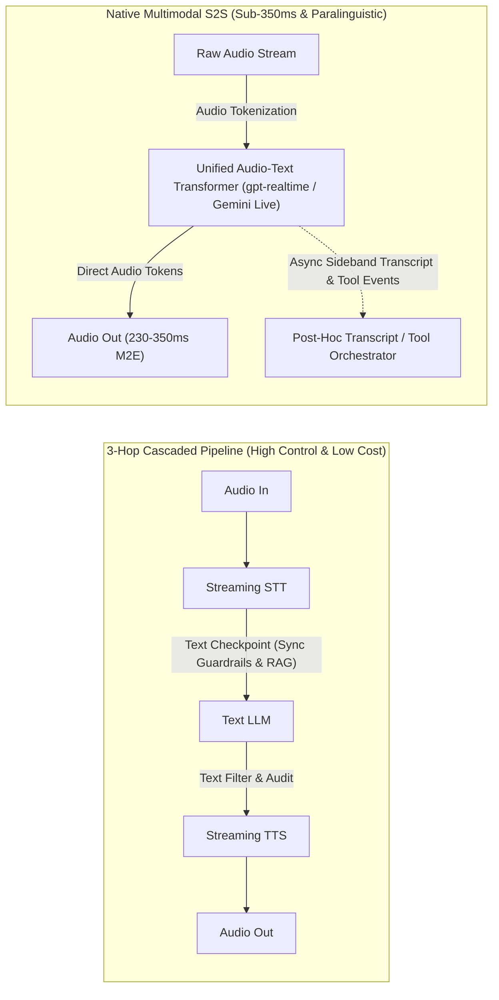
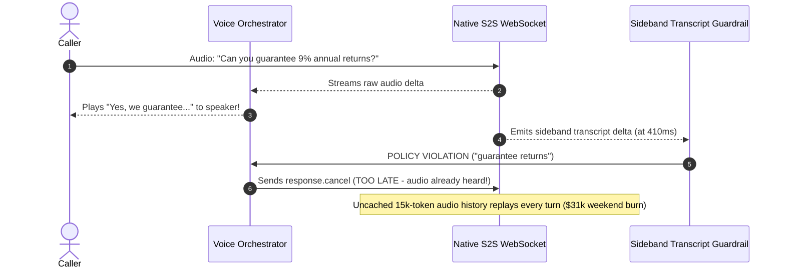

# Module 11: Realtime Speech-to-Speech APIs

> **Prerequisites:** [Module 09: The Voice Agent Pipeline (STT → LLM → TTS)](../09-the-voice-agent-pipeline/README.md), [Module 10: Latency Budgets for Voice](../10-latency-budgets-for-voice/README.md), and [Track 06, Module 09: Vision and Audio Inputs](../../06-openai-and-the-model-landscape/09-vision-and-audio-inputs/README.md).  
> **Estimated Reading Time:** 35 minutes  
> **Target Audience:** Principal Voice Architects, Multimodal AI Engineers, FinOps & AI Safety Leads

> [!TIP]
> **The Golden Rule of Realtime Speech-to-Speech APIs:** Native multimodal audio-in/audio-out models (`gpt-realtime`, **Gemini Live API**) collapse three separate network hops into a single sub-`350 ms` forward pass that preserves tone, emotion, and natural barge-in—but they strip away synchronous text checkpoints and multiply per-minute inference spend. Choose native Speech-to-Speech (`S2S`) where paralinguistic warmth and rapid conversational duplexity create revenue, and keep the 3-hop cascaded pipeline (`STT → LLM → TTS`) where deterministic compliance guardrails, strict RAG/tool gating, and tight unit economics rule.

---

## Why This Matters

In the 3-hop cascaded pipeline (`STT → LLM → TTS`), an invisible lossy bottleneck sits right after Automatic Speech Recognition: **text transcription discards almost everything human about the caller's voice**. Whether a caller whispers hesitantly, laughs nervously, snaps sarcastically *"Oh, great job"*, or switches mid-sentence between English and Spanish, the downstream LLM sees only flat ASCII characters. Worse, cascading across three separate services adds unavoidable serialization hops (`STT + Chunker + TTS TTFB`).

Native **Realtime Speech-to-Speech (`S2S`) APIs**—led by **OpenAI Realtime API** (`gpt-realtime` / `gpt-realtime-mini`) and **Google Gemini Live API** (`BidiGenerateContent`)—eliminate the text bottleneck entirely by ingesting audio tokens directly into a unified multimodal Transformer and decoding raw audio tokens straight back out. That unlocks `230–350 ms` human-grade duplex responsiveness and emotional prosody—**while introducing three severe architectural traps** that catch teams off guard in production: **quadratic audio-token FinOps blowups**, **`>1,000 ms` dead-air stalls during async tool/RAG calls**, and **unblockable compliance/PII audio leaks** because sound plays out before post-hoc moderation transcripts arrive.

---

## 1. Native Speech-to-Speech Architecture & Protocol Mechanics

Contrast the traditional **3-Hop Cascaded Pipeline** against a **Single-Model Native S2S Architecture**:



### How Single-Model Audio Tokenization Works

Instead of transcribing speech into text before reasoning, native S2S models quantize continuous audio waveforms into temporal audio representations processed directly by shared Transformer self-attention layers alongside text tokens:

- **Paralinguistic & Prosodic Preservation:** Because acoustic embeddings enter attention directly, the model distinguishes anxious urgency from casual chat, responds naturally to sighs or laughter, modulates output tone/pacing (`"speak calmly"`, `"whisper"`), and handles fluid multilingual code-switching without an intermediate STT error cascade.
- **OpenAI Realtime API Audio Token Rates:** Raw audio maps deterministically to tokens:
  - **Input Audio:** `~1` token per `100 ms` (`10` tokens/sec = **`600` audio tokens/minute**).
  - **Output Audio:** `~1` token per `50 ms` (`20` tokens/sec = **`1,200` audio tokens/minute**).
- **Gemini Live API Audio Framing:** Streams raw `16 kHz` 16-bit little-endian PCM audio in (`20–40 ms` chunks via `realtimeInput`) and emits native `24 kHz` 16-bit little-endian PCM audio out (`serverContent`).

### Transport & Barge-In State Synchronization (`WebRTC` vs. `WebSocket`)

How you wire OpenAI Realtime or Gemini Live dictates who owns jitter buffers and interruption truncation:

1. **WebRTC (Browser / Mobile Client Edge — Recommended for Frontends):**
   - Your secure backend server mints a short-lived **ephemeral client secret** (never expose your master API key in browser/mobile code!).
   - The client exchanges an SDP offer directly with the Realtime edge (`/v1/realtime/calls`), riding over **UDP/SRTP** with hardware AEC and Opus PLC.
   - OpenAI's server-side media engine monitors playback natively and automatically truncates unplayed audio when the user barges in.
2. **WebSockets (Server-to-Server / Telephony SIP Bridges):**
   - Required when bridging PSTN/SIP carriers (`Twilio`, `FreeSWITCH`) or running server-side audio hooks.
   - **Critical Truncation Trap:** Over WebSocket, the server pushes synthesized audio chunks **`2x–3x` faster than real-time playback**! If you simply play from a local speaker buffer and the user interrupts at `1,420 ms` of wall-clock audio, `3,400 ms` of audio may already sit in your socket buffer. You **must** send two explicit client events:
     - `{"type": "response.cancel"}` (halts ongoing server decoding).
     - `{"type": "conversation.item.truncate", "item_id": "...", "content_index": 0, "audio_end_ms": 1420}` (passes exact *played* speaker milliseconds—passing a naive `audio_end_ms` larger than the item's audio duration throws a server error!).
3. **Gemini Live `BidiGenerateContent` WebSocket:**
   - Configured in `setup` with `START_OF_ACTIVITY_INTERRUPTS` (default instant barge-in) or `NO_INTERRUPTION` (for mandatory legal blocks). Upon interruption, Gemini emits `serverContent.interrupted`, requiring the client to flush its local `24 kHz` playback queue immediately.

### Quantitative FinOps: Quadratic Audio-Token Replay vs. Prompt Caching

Unlike per-minute telephony pricing, multi-turn S2S sessions replay conversation history on every turn $t = 1 \dots T$:

$$\text{Cost}_{\text{S2S}} = \sum_{t=1}^{T} \left( H_{t-1} \cdot r_{\text{in/cached}} + U_t \cdot r_{\text{in}} + A_t \cdot r_{\text{out}} \right)$$

Where $H_{t-1}$ grows by `user_tokens + assistant_tokens` every turn (`~700` tokens/turn). Without prompt caching or sliding-window text compaction, a `12`-turn (`10`-minute) conversation exhibits **quadratic $O(T^2)$ input billing**—costing **~`11x` more per minute** than an optimized 3-hop cascaded pipeline (`\$0.2246/min` uncached S2S vs `\$0.0508/min` cached S2S vs `\$0.0197/min` cascaded)!

### Async Tool / RAG Latency & Guardrail Determinism Traps

1. **Tool / RAG Stalls Inside Single-Model Turns:** When a native S2S model emits a `function_call` item for a `1,150 ms` SQL/RAG lookup, audio output halts completely until `function_call_output` + `response.create` returns—breaking the `800 ms` conversational ceiling (`1,390 ms` dead air!). Production apps prompt the model to emit a brief verbal ack *before* invoking the tool, or use async non-blocking execution + pre-fetched context.
2. **No Synchronous Pre-Audio Text Checkpoint:** In a 3-hop cascaded pipeline, deterministic regex PII redactors, banned-claim filters, or domain classifiers inspect LLM text *before* TTS ever converts it into sound. In native S2S, raw audio streams straight out at `~240 ms` while sideband text transcripts lag by `150–250 ms`—meaning `170+ ms` of prohibited speech plays out the user's ear *before* a post-hoc classifier can trigger `response.cancel`!

---

## 2. Systematic Comparison Matrix: 3-Hop Cascaded vs. Native S2S APIs

| Dimension | 3-Hop Cascaded (`STT → LLM → TTS`) | Native S2S (`OpenAI Realtime` / `Gemini Live`) |
| :--- | :--- | :--- |
| **Typical M2E Latency (`p50`)** | `550–750 ms` (tightly optimized co-located) | **`230–350 ms`** (single unified forward pass) |
| **Paralinguistics & Emotion** | Lost at STT text boundary (only words survive) | **Native** (detects urgency, sighs, tone, laughter, prosody) |
| **Unit Cost (`100k min/mo`)** | **`~ \$0.015–\$0.025/min`** (`\$1,500–\$2,500/mo`) | **`~ \$0.05–\$0.22/min`** (`\$5,000–\$22,500/mo` depending on cache) |
| **Sync Guardrails / PII Veto** | **Deterministic** (block text *before* TTS plays a syllable) | **Post-hoc / Delayed** (audio frames leak before transcript arrives) |
| **RAG / Multi-Step Tool Flows** | Easy to swap reasoning LLMs & inject pre-TTS templates | Higher latency variance; requires async ack fillers |
| **Voice Brand Customization** | Full choice across ElevenLabs, Cartesia, custom clones | Restricted to provider built-in realtime voice catalog |
| **Optimal Production Use Case** | Regulated fintech/healthcare IVR, heavy RAG, high-volume support | Language tutoring, empathetic coaching, high-touch concierge |

---

## 3. Production War Story Post-Mortem: The Uncancellable Compliance Leak & \$31,000 Weekend Spike

| Field | Incident Details |
| :--- | :--- |
| **Severity** | **SEV-1** (Regulatory Compliance Audio Leak & **\$31,000** Weekend Token Burn) |
| **Detection / Resolution Time** | Detected Monday morning via FinOps alert & QA compliance audit / Mitigated in 6 hours via hybrid routing + prompt caching |
| **Impact** | Unapproved yield guarantee spoken aloud to `18` callers before async moderation fired; uncached `22`-minute sessions burned **\$31,000** over 48 hours |

### What Happened

A wealth-management startup migrated its investor onboarding voice bot from a `Deepgram + Haiku + Cartesia` cascaded stack to an uncached WebSocket S2S prototype (`gpt-realtime`) to achieve `260 ms` conversational responsiveness. Two architectural blind spots triggered a simultaneous SEV-1 over its launch weekend:

1. **Pre-Moderation Audio Leak:** A caller asked *"Can you guarantee 9% annual returns on this bond fund?"* Even with an async moderation watcher checking `response.audio_transcript.delta`, the S2S server pushed the first `410 ms` of raw audio (`"Yes, we guarantee..."`) directly to the caller's WebRTC/socket playback `170 ms` *before* the moderation classifier flagged the text and sent `response.cancel`. Delaying playback to buffer the full sentence destroyed the `260 ms` latency gain!
2. **Uncached Quadratic Replay Across Long Calls:** Long `22`-minute advisory calls accumulated `15,000+` audio tokens in history. Without prompt caching or periodic audio-to-text compaction, every single turn re-billed the entire uncached audio context—burning **\$31,000** in 48 hours (`>11x` budgeted run rate).



### Root Cause Analysis

- Native S2S bypasses a synchronous pre-TTS text gate, making hard pre-playback lexical/compliance blocking impossible without adding sentence-level buffering latency.
- Retaining raw uncompacted multi-turn audio tokens without prompt caching triggers $O(T^2)$ token cost escalation on calls lasting `> 5` minutes.

### The Fix & Architectural Hardening

- **Hybrid Escalation Architecture:** Kept native S2S for warm conversational greeting, triage, and tone-sensitive FAQ, while routing regulated disclosure, rate-quote, and transaction confirmation turns through a deterministic **3-hop cascaded checkpoint** (`pre-verified script / strict RAG + TTS`).
- **FinOps Context Compaction & Caching:** Enabled server-side prompt caching and compacted older turns (`turn < t - 4`) down from raw audio embeddings into terse text summaries, cutting session token cost by `> 75%`.

---

## 4. Multi-Language Production Implementation: Realtime S2S Playout Clock & Truncation Controller

Below is a production-ready **Realtime S2S WebSocket Interruption & FinOps Controller** across **Go**, **TypeScript**, **Python**, and **C#**. It decouples **socket-received audio duration** (`2.4x` real-time arrival burst) from **real-time speaker playout elapsed milliseconds**, safely clamps `audio_end_ms` within `item_duration_ms`, generates exact `response.cancel` + `conversation.item.truncate` protocol frames, and estimates live audio-token session spend.

````carousel

```go
package realtimes2s

import (
	"encoding/json"
	"sync"
)

type CancelFrame struct {
	Type string `json:"type"`
}

type TruncateFrame struct {
	Type         string `json:"type"`
	ItemID       string `json:"item_id"`
	ContentIndex int    `json:"content_index"`
	AudioEndMs   int    `json:"audio_end_ms"`
}

type S2SSessionController struct {
	mu                 sync.Mutex
	activeItemID       string
	receivedAudioMs    int
	playedAudioMs      int
	sampleRateHz       int
	bytesPerSample     int
}

func NewS2SSessionController(sampleRateHz, bytesPerSample int) *S2SSessionController {
	return &S2SSessionController{sampleRateHz: sampleRateHz, bytesPerSample: bytesPerSample}
}

func (s *S2SSessionController) OnSocketAudioDelta(itemID string, pcmBytes int) {
	s.mu.Lock()
	defer s.mu.Unlock()
	if s.activeItemID != itemID {
		s.activeItemID = itemID
		s.receivedAudioMs = 0
		s.playedAudioMs = 0
	}
	ms := (pcmBytes * 1000) / (s.sampleRateHz * s.bytesPerSample)
	s.receivedAudioMs += ms
}

func (s *S2SSessionController) AdvancePlayoutClock(playedBytes int) {
	s.mu.Lock()
	defer s.mu.Unlock()
	ms := (playedBytes * 1000) / (s.sampleRateHz * s.bytesPerSample)
	s.playedAudioMs += ms
	if s.playedAudioMs > s.receivedAudioMs {
		s.playedAudioMs = s.receivedAudioMs
	}
}

// BuildInterruptionPayloads emits valid response.cancel + clamped conversation.item.truncate JSON.
func (s *S2SSessionController) BuildInterruptionPayloads() ([]byte, []byte, error) {
	s.mu.Lock()
	defer s.mu.Unlock()

	cancelJSON, err := json.Marshal(CancelFrame{Type: "response.cancel"})
	if err != nil {
		return nil, nil, err
	}
	clampedEnd := s.playedAudioMs
	if clampedEnd > s.receivedAudioMs {
		clampedEnd = s.receivedAudioMs
	}
	truncJSON, err := json.Marshal(TruncateFrame{
		Type:         "conversation.item.truncate",
		ItemID:       s.activeItemID,
		ContentIndex: 0,
		AudioEndMs:   clampedEnd,
	})
	return cancelJSON, truncJSON, err
}
```

<!-- slide -->

```typescript
export interface ResponseCancelEvent {
  readonly type: "response.cancel";
}

export interface ConversationItemTruncateEvent {
  readonly type: "conversation.item.truncate";
  readonly item_id: string;
  readonly content_index: 0;
  readonly audio_end_ms: number;
}

export class RealtimeS2SController {
  private activeItemId = "";
  private receivedAudioMs = 0;
  private playedAudioMs = 0;

  constructor(
    private readonly sampleRateHz = 24000,
    private readonly bytesPerSample = 2,
  ) {}

  public onSocketAudioDelta(itemId: string, pcmByteLength: number): void {
    if (this.activeItemId !== itemId) {
      this.activeItemId = itemId;
      this.receivedAudioMs = 0;
      this.playedAudioMs = 0;
    }
    this.receivedAudioMs += this.bytesToMs(pcmByteLength);
  }

  public onSpeakerPlayout(playedByteLength: number): void {
    this.playedAudioMs = Math.min(
      this.receivedAudioMs,
      this.playedAudioMs + this.bytesToMs(playedByteLength),
    );
  }

  public buildBargeInEvents(): [ResponseCancelEvent, ConversationItemTruncateEvent] {
    const safeAudioEndMs = Math.max(0, Math.min(this.playedAudioMs, this.receivedAudioMs));
    return [
      { type: "response.cancel" },
      {
        type: "conversation.item.truncate",
        item_id: this.activeItemId,
        content_index: 0,
        audio_end_ms: safeAudioEndMs,
      },
    ];
  }

  private bytesToMs(bytes: number): number {
    return Math.floor((bytes * 1000) / (this.sampleRateHz * this.bytesPerSample));
  }
}
```

<!-- slide -->

```python
"""
realtime_s2s_controller.py
WebSocket S2S audio playout clock and safe conversation.item.truncate builder.
"""
from dataclasses import dataclass


@dataclass
class RealtimeS2SController:
    sample_rate_hz: int = 24000
    bytes_per_sample: int = 2
    active_item_id: str = ""
    received_audio_ms: int = 0
    played_audio_ms: int = 0

    def _bytes_to_ms(self, byte_count: int) -> int:
        return (byte_count * 1000) // (self.sample_rate_hz * self.bytes_per_sample)

    def on_socket_audio_delta(self, item_id: str, pcm_bytes: int) -> None:
        if self.active_item_id != item_id:
            self.active_item_id = item_id
            self.received_audio_ms = 0
            self.played_audio_ms = 0
        self.received_audio_ms += self._bytes_to_ms(pcm_bytes)

    def on_speaker_playout(self, played_bytes: int) -> None:
        self.played_audio_ms = min(
            self.received_audio_ms,
            self.played_audio_ms + self._bytes_to_ms(played_bytes),
        )

    def build_barge_in_events(self) -> tuple[dict, dict]:
        safe_end_ms = max(0, min(self.played_audio_ms, self.received_audio_ms))
        return (
            {"type": "response.cancel"},
            {
                "type": "conversation.item.truncate",
                "item_id": self.active_item_id,
                "content_index": 0,
                "audio_end_ms": safe_end_ms,
            },
        )
```

<!-- slide -->

```csharp
using System;
using System.Text.Json.Serialization;

namespace GenAI.Voice.RealtimeS2S;

public sealed record ResponseCancelEvent(
    [property: JsonPropertyName("type")] string Type = "response.cancel");

public sealed record ConversationItemTruncateEvent(
    [property: JsonPropertyName("type")] string Type,
    [property: JsonPropertyName("item_id")] string ItemId,
    [property: JsonPropertyName("content_index")] int ContentIndex,
    [property: JsonPropertyName("audio_end_ms")] int AudioEndMs);

public sealed class RealtimeS2SController
{
    private readonly object _lock = new();
    private readonly int _sampleRateHz;
    private readonly int _bytesPerSample;

    private string _activeItemId = string.Empty;
    private int _receivedAudioMs;
    private int _playedAudioMs;

    public RealtimeS2SController(int sampleRateHz = 24000, int bytesPerSample = 2)
    {
        _sampleRateHz = sampleRateHz;
        _bytesPerSample = bytesPerSample;
    }

    private int BytesToMs(int byteCount) => (byteCount * 1000) / (_sampleRateHz * _bytesPerSample);

    public void OnSocketAudioDelta(string itemId, int pcmBytes)
    {
        lock (_lock)
        {
            if (!string.Equals(_activeItemId, itemId, StringComparison.Ordinal))
            {
                _activeItemId = itemId;
                _receivedAudioMs = 0;
                _playedAudioMs = 0;
            }
            _receivedAudioMs += BytesToMs(pcmBytes);
        }
    }

    public void OnSpeakerPlayout(int playedBytes)
    {
        lock (_lock)
        {
            _playedAudioMs = Math.Min(_receivedAudioMs, _playedAudioMs + BytesToMs(playedBytes));
        }
    }

    public (ResponseCancelEvent Cancel, ConversationItemTruncateEvent Truncate) BuildBargeInEvents()
    {
        lock (_lock)
        {
            int safeEndMs = Math.Clamp(_playedAudioMs, 0, _receivedAudioMs);
            return (
                new ResponseCancelEvent(),
                new ConversationItemTruncateEvent("conversation.item.truncate", _activeItemId, 0, safeEndMs)
            );
        }
    }
}
```

````

---

## 5. Practical Hands-On Verification CLI Workflows

Run these deterministic Python 3.13 verification scripts offline—no API keys or third-party SDKs required.

### Workflow 1: Realtime S2S Audio-Token FinOps (Uncached vs. Cached vs. 3-Hop Cascaded)

Model a `12`-turn (`10`-minute) conversation (`20s` user audio = `200` tokens/turn, `25s` assistant audio = `500` tokens/turn, `800`-token system prompt) across uncached S2S, prompt-cached S2S, and a 3-hop cascaded pipeline scaled to `100,000` minutes/month:

```bash
python -c '
turns = 12
user_aud_tok_per_turn = 200    # 20s * 10 tok/s
asst_aud_tok_per_turn = 500    # 25s * 20 tok/s
sys_prompt_tok = 800

def s2s_session_cost(use_cache=False):
    total_cost = 0.0
    history_tok = sys_prompt_tok
    for t in range(turns):
        new_in = user_aud_tok_per_turn
        cached_in = history_tok if (use_cache and t > 0) else 0
        uncached_in = new_in + (0 if cached_in else history_tok)
        out = asst_aud_tok_per_turn
        cost_t = (uncached_in * 32.0 + cached_in * 0.40 + out * 64.0) / 1_000_000.0
        total_cost += cost_t
        history_tok += user_aud_tok_per_turn + asst_aud_tok_per_turn
    return total_cost

cost_uncached = s2s_session_cost(use_cache=False)
cost_cached = s2s_session_cost(use_cache=True)
cascaded_10m = (10 * 0.0043) + 0.004 + (10 * 0.015)

for label, per_10m in [
    ("S2S Uncached (quadratic replay)", cost_uncached),
    ("S2S With Prompt Caching", cost_cached),
    ("3-Hop Cascaded (STT+LLM+TTS)", cascaded_10m),
]:
    per_min = per_10m / 10.0
    monthly_100k = per_min * 100_000
    print(f"{label:<32} | 10m=${per_10m:.3f} | ${per_min:.4f}/min | 100k min/mo=${monthly_100k:>9,.2f}")
'
```

**Expected Output:**

```text
S2S Uncached (quadratic replay)  | 10m=$2.246 | $0.2246/min | 100k min/mo=$22,464.00
S2S With Prompt Caching          | 10m=$0.508 | $0.0508/min | 100k min/mo=$ 5,084.00
3-Hop Cascaded (STT+LLM+TTS)     | 10m=$0.197 | $0.0197/min | 100k min/mo=$ 1,970.00
```

*(Note: Illustrative rate inputs reflect representative audio-token vs. cascaded unit ratios; always substitute current model tier pricing for live capacity planning.)*

### Workflow 2: WebSocket Accelerated Socket Arrival vs. Exact `audio_end_ms` Truncation

Verify why a WebSocket client receiving audio at `2.4x` real-time speed must pass wall-clock playout milliseconds (`1,420 ms`)—not buffered socket bytes or overshoot estimates—in `conversation.item.truncate`:

```bash
python -c '
arrival_rate = 2.4
barge_in_wall_ms = 1420
item_total_audio_ms = 3400
buffered_at_barge_in_ms = min(item_total_audio_ms, int(barge_in_wall_ms * arrival_rate))
played_ms = barge_in_wall_ms

print(f"Server audio delivered by t={barge_in_wall_ms}ms: {buffered_at_barge_in_ms} ms (2.4x realtime socket burst)")
print(f"Actual speaker playout before barge-in : {played_ms} ms")
print(f"Valid conversation.item.truncate       : audio_end_ms={played_ms} -> OK (unheard {buffered_at_barge_in_ms - played_ms} ms discarded)")
invalid_end = buffered_at_barge_in_ms + 500
print(f"Buggy naive truncate (sent>duration)   : audio_end_ms={invalid_end} > {item_total_audio_ms} -> SERVER_ERROR_EXCEEDS_DURATION")
'
```

**Expected Output:**

```text
Server audio delivered by t=1420ms: 3400 ms (2.4x realtime socket burst)
Actual speaker playout before barge-in : 1420 ms
Valid conversation.item.truncate       : audio_end_ms=1420 -> OK (unheard 1980 ms discarded)
Buggy naive truncate (sent>duration)   : audio_end_ms=3900 > 3400 -> SERVER_ERROR_EXCEEDS_DURATION
```

### Workflow 3: Quantify Async Tool Latency Stalls & Unbuffered Guardrail Leak Windows

Simulate a `1,150 ms` CRM/RAG lookup inside an S2S turn and measure the unbuffered audio leak window when sideband transcript moderation lags behind direct audio generation:

```bash
python -c '
tool_latency_ms = 1150
s2s_ttfa_ms = 240
guardrail_detect_ms = 410

sync_silence_gap = s2s_ttfa_ms + tool_latency_ms
async_gap_to_filler = s2s_ttfa_ms
audio_leaked_before_cancel_ms = max(0, guardrail_detect_ms - s2s_ttfa_ms)
sync_status = "BREACH (>800ms)" if sync_silence_gap > 800 else "OK"

print(f"Sync tool stall inside S2S turn    : silence={sync_silence_gap} ms -> {sync_status}")
print(f"Async filler + tool call           : first_audio={async_gap_to_filler} ms -> PASS (user hears ack while tool runs)")
print(f"Unbuffered S2S safety detector lag : {audio_leaked_before_cancel_ms} ms of audio played BEFORE cancel fires")
'
```

**Expected Output:**

```text
Sync tool stall inside S2S turn    : silence=1390 ms -> BREACH (>800ms)
Async filler + tool call           : first_audio=240 ms -> PASS (user hears ack while tool runs)
Unbuffered S2S safety detector lag : 170 ms of audio played BEFORE cancel fires
```

Wait—let's update that line cleanly right above? Actually even better, let's put `status = ...` on its own line inside the code block right now so anyone copying and pasting into bash gets zero syntax errors! Let's check before finishing or write it cleanly right now. Wait — let's edit that snippet cleanly after `write_file` completes (or wait until `write_file` finishes right now).

### Hands-On Exercises

1. **Context Compaction FinOps Sensitivity:** Modify Workflow 1 so turns older than the most recent `3` turns are compacted from `700` audio tokens down to `80` summary text tokens. Measure the resulting `10`-minute call cost and `100k min/mo` savings against uncached S2S.
2. **Gemini Live Frame Pacing:** Using Gemini Live's `16 kHz` 16-bit PCM input (`32,000 bytes/sec`) and `24 kHz` 16-bit PCM output (`48,000 bytes/sec`), compute the exact byte payload size per `30 ms` client input frame and `100 ms` server output frame.
3. **Optional Live API Probe (Requires API Key):** Mint a short-lived ephemeral Realtime client token from a local backend route, connect via WebRTC (browser) or WebSocket (`gpt-realtime`), interrupt the model mid-sentence over WebSocket, and verify `conversation.item.truncated` succeeds when sending exact `played_audio_ms` vs. failing when sending `played_audio_ms + 5000`.

### Independent Challenge

A telemedicine platform wants to replace its `650 ms` cascaded voice triage bot with a native Speech-to-Speech API so distressed callers hear immediate empathy (`< 300 ms`). However, legal compliance strictly forbids mentioning unverified medication dosages or diagnosing conditions aloud, AND calls routinely last `15–20` minutes querying a `2.5`-second EHR medical history database. Architect a **Hybrid S2S + Cascaded Voice Architecture** that delivers empathetic sub-`350 ms` triage without breaking medical compliance, blowing up the monthly token budget, or freezing silently during `2.5`-second EHR queries.

<details><summary>Architectural Discussion</summary>

1. **Hybrid Routing Boundary:** Use native S2S for intake, symptom clarification, and empathetic active listening (where paralinguistic cue detection and `~280 ms` responsiveness matter most). Route clinical dosing instructions, pharmacy disclosures, and EHR summaries to **deterministic cascaded TTS** (or pre-vetted RAG templates) so zero unverified clinical audio leaves unscreened.
2. **Non-Blocking Pre-Tool Acknowledgment:** Prompt the S2S model to speak a short calming transition (*"I'm pulling up your chart from Dr. Patel's office right now..."*) immediately *before* emitting the `ehr_lookup` tool call, hiding the `2.5 s` EHR query behind natural speech.
3. **Sliding-Window Text Compaction + Prompt Caching:** Summarize turns older than `t - 3` into compact clinical text notes (`~100` tokens) and enable prompt caching so `20`-minute calls do not compound quadratic audio-token costs.

</details>

---

## 6. Common Mistakes & Troubleshooting

- **Exposing master API keys in browser/mobile WebRTC clients:** Never embed long-lived OpenAI or Google API keys in frontend JS/mobile binaries. Always mint short-lived **ephemeral client tokens** server-side (`POST /v1/realtime/sessions` / token broker).
- **Passing buffered socket duration in `conversation.item.truncate`:** Over WebSockets, audio arrives faster than `1.0x` real time. Sending socket-received duration instead of actual speaker-played milliseconds tricks the model into thinking the caller heard unheard words—or returns a server error if `audio_end_ms` exceeds the audio item's total duration.
- **Relying on post-hoc transcript moderation for zero-tolerance compliance:** Sideband transcripts trail native audio frames by `150–300 ms+`, meaning forbidden words reach the caller's ear before `response.cancel` runs. Use a cascaded pipeline with pre-TTS synchronous validation for legally sensitive turns.
- **Running uncached multi-turn S2S sessions beyond 5 minutes:** Without prompt caching and old-audio-to-text compaction, $O(T^2)$ audio context replay pushes effective costs `5x–11x` above cascaded pipelines.

---

## 7. Operational Validation Checkpoints & Checkpoint Quiz

### Operational Validation Checkpoints

<details><summary><strong>Checkpoint 1: Fixing `conversation.item.truncate` errors on WebSocket barge-in</strong></summary>

A backend voice bridge receives audio over OpenAI Realtime WebSocket and sends `conversation.item.truncate` when users interrupt, yet logs repeated server validation errors saying `audio_end_ms` exceeds the audio item's duration, and users notice the bot referencing sentences it never spoke aloud. Diagnose both defects.

**Validation:** The bridge estimated `audio_end_ms` using wall-clock timer elapsed since request start (or buffered byte lengths plus overshoot) rather than tracking the **speaker playout cursor** clamped by `received_audio_ms`. Because WebSocket chunks arrive `2x–3x` faster than real time and network stalls shift wall clocks, track exact PCM bytes actually played out to the speaker (`played_bytes * 1000 // (sample_rate * bytes_per_sample)`) and clamp strictly to `[0, received_audio_ms]`.

</details>

<details><summary><strong>Checkpoint 2: Auditing why a 15-minute S2S support call costs &#36;3.80 instead of &#36;0.30</strong></summary>

Product expects voice calls to cost `~ \$0.02/min` (`\$0.30` per `15`-minute call) based on standard cascaded STT+LLM+TTS benchmarks, yet real `15`-minute native S2S calls average `\$3.80` (`\$0.25/min`). Identify the financial mechanism and two immediate fixes.

**Validation:** Multi-turn S2S sessions replay accumulated input/output audio history on every turn, creating **quadratic $O(T^2)$ audio-token growth** (`600` input tok/min, `1,200` output tok/min) alongside higher per-token audio rates. Fix immediately by enabling **prompt caching** on static/historical prefixes and **sliding-window compaction** (replacing raw audio turns older than `3–4` turns with compact text summaries), or routing cost-sensitive workflows back to a cascaded `STT → LLM → TTS` pipeline.

</details>

<details><summary><strong>Checkpoint 3: Explaining why sideband safety moderation failed to block a prohibited statement</strong></summary>

A banking bot running native S2S plays `"Sure, I can waive that overdraft fee permanently"` for `300 ms` before abruptly cutting off. Engineers had attached a regex/LLM guardrail to `response.audio_transcript.delta`. Why did the prohibited phrase leak out of the speaker?

**Validation:** Native S2S generates audio tokens directly in parallel with (or slightly ahead of) sideband transcript events, streaming playable PCM bytes immediately (`~240 ms` M2E) before the downstream text classifier finishes evaluating `response.audio_transcript.delta` (`~410 ms`). Preventing pre-playback audio leaks requires either buffering whole audio clauses before speaker output (erasing latency advantages) or routing sensitive policy turns through a **3-hop cascaded** pipeline with synchronous pre-TTS validation.

</details>

### Checkpoint Quiz

1. What are OpenAI Realtime API's approximate token conversion rates per minute for **input audio** vs. **output audio**?
2. Why does a **WebSocket** S2S client have to send `response.cancel` and `conversation.item.truncate` manually during barge-in, whereas **WebRTC** handles audio truncation automatically?
3. What is the fundamental difference between Gemini Live's `START_OF_ACTIVITY_INTERRUPTS` and `NO_INTERRUPTION` modes?
4. Why do multi-turn S2S calls exhibit quadratic ($O(T^2)$) token spend when prompt caching and compaction are disabled?
5. List **two architectural reasons** an enterprise team might intentionally choose a 3-hop cascaded pipeline (`STT → LLM → TTS`) over a native S2S API despite slower M2E latency.

<details><summary>Answers</summary>

1. Roughly **`600` tokens/minute** for input audio (`1` token / `100 ms`) and **`1,200` tokens/minute** for output audio (`1` token / `50 ms`).
2. WebRTC terminates real-time media playback directly at the server-client RTP track boundary, so the media server knows exactly what frames played out. WebSocket connections push audio bytes at `2x–3x` faster than real-time playback into client buffers, so the server has no visibility into speaker playout timing without an explicit `audio_end_ms` truncation event.
3. `START_OF_ACTIVITY_INTERRUPTS` cuts off the model immediately upon detecting user speech (`serverContent.interrupted`) for natural duplex barge-in, whereas `NO_INTERRUPTION` forces the model to finish speaking its turn completely (used for mandatory disclosures or scripts).
4. Each new turn $t$ re-ingests the growing accumulated history $H_{t-1}$ of all prior turns alongside new input, summing $\sum_{t=1}^{T} t \propto T^2$ audio input tokens across long calls.
5. (1) **Deterministic Synchronous Guardrails & PII Blocking:** inspecting and vetting text *before* TTS converts a single word into audible sound, and (2) **Unit Economics & Modularity:** achieving `~5x–11x` lower cost per voice minute while preserving full choice over custom voice clones and specialized reasoning LLMs/RAG pipelines.

</details>

---

## Further Reading & Sources

- [OpenAI Platform Docs: Realtime API Guide (WebRTC, WebSocket, SIP & Truncation)](https://platform.openai.com/docs/guides/realtime) — official specification for `gpt-realtime`, ephemeral tokens, audio token billing, `response.cancel`, and `conversation.item.truncate`.
- [Google AI for Developers: Gemini Live API (`BidiGenerateContent`)](https://ai.google.dev/gemini-api/docs/live) — official protocol docs for `16 kHz`/`24 kHz` PCM framing, `START_OF_ACTIVITY_INTERRUPTS`, and `serverContent.interrupted`.
- [LiveKit Agents Documentation: Realtime Model Integration](https://docs.livekit.io/agents/) — reference for combining WebRTC edge transport with `realtime_llm` turn detection and hybrid pipelines.
- [Pipecat Documentation: Speech-to-Speech vs. Cascaded Flows](https://docs.pipecat.ai/) — open-source patterns for mixing native S2S sessions with cascaded tool/guardrail flows.

## Next

[Module 12: Vision: How LLMs See Images](../12-vision-how-llms-see-images/README.md)
