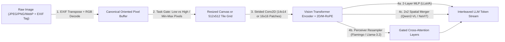
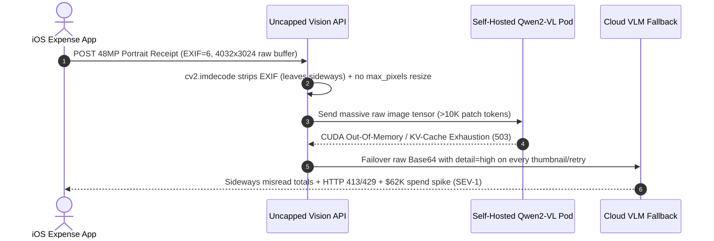

# Module 12: Vision: How LLMs See Images

> **Prerequisites:** [Track 02, Module 14: The Complete Transformer Block](../../02-transformer-architecture/14-the-complete-transformer-block/README.md), [Track 02, Module 11: Rotary Position Embeddings](../../02-transformer-architecture/11-rotary-position-embeddings/README.md), and [Track 06, Module 09: Vision and Audio Inputs](../../06-openai-and-the-model-landscape/09-vision-and-audio-inputs/README.md).  
> **Estimated Reading Time:** 35 minutes  
> **Target Audience:** AI Backend Engineers, Multimodal Inference Engineers, LLM Systems Architects

> [!TIP]
> **The Golden Rule of Vision-Language Ingestion:** Never treat an image as a "free attachment" and never pipe raw camera `4K`/`48MP` PNGs or un-transposed EXIF photos directly into a Vision-Language Model (`VLM`). Every image enters the LLM context window as `85` to `10,000+` visual patch tokens alongside massive HTTP Base64 payloads: always apply EXIF orientation transposition first, downscale to the model's native tile/patch ceiling, and dynamically gate `detail: "low"` vs. `detail: "high"` (or Qwen2-VL `min_pixels`/`max_pixels`) by task type before inference.

---

## Why This Matters

In text-only LLM pipelines, input cost and prefill latency are obvious because BPE token counts correlate directly with string length. When engineers add multimodal image inputs (`image_url` / `input_image`), that intuition breaks immediately—an innocent-looking `3 MB` PNG screenshot or `12 MB` smartphone photo can silently inject thousands of visual tokens, bloat HTTP bodies with `+33%` Base64 overhead, and spike Time-to-First-Token (`TTFT`) across concurrent requests.

In production multimodal backends, three subtle failures dominate post-launch incidents:

1. **Unbounded Resolution & KV-Cache Collapse:** Naive dynamic-resolution VLMs (like unconfigured `NaViT` / `Qwen2-VL` without `max_pixels`) turn a single `4K` (`3840x2160`) screenshot into **`10,766` visual tokens**, consuming `~588 MB` of FP16 GQA KV-cache VRAM for a single turn and blowing past TPM rate limits.
2. **EXIF Orientation Blindness:** Modern smartphones capture portrait receipts as landscape pixel buffers tagged with `EXIF Orientation = 6` (`90° CW`). OpenCV (`cv2.imread`) and raw image decoders ignore EXIF metadata by default—feeding the VLM a sideways document that causes systematic field extraction errors.
3. **Blind `detail: "high"` Over-Provisioning:** Using `detail: "high"` (`765`–`1,105` tokens) on avatar moderation, thumbnail classification, or coarse frame triage wastes `9x`–`13x` input spend compared to `detail: "low"` (`85` tokens) with negligible accuracy gain.

Understanding how pixels actually map into Transformer embeddings—from ViT patch convolutions to projectors, tiling math, and 2D/M-RoPE positional grids—gives you complete deterministic control over multimodal accuracy, TTFT, and VRAM.

---

## 1. How Vision-Language Models Encode Pixels into Tokens

A decoder-only LLM cannot ingest raw `uint8` RGB byte arrays. Instead, a **Vision-Language Model (`VLM`)** wraps a specialized Vision Transformer (`ViT`, Dosovitskiy et al., `arXiv:2010.11929`) and a **Vision-Language Connector (Projector)** in front of the LLM's autoregressive backbone:

1. **EXIF Normalize & Resize/Tile:** The preprocessor applies EXIF orientation tags (`1–8`), converts to RGB, and maps arbitrary dimensions $(W, H)$ onto the encoder's supported grid—either padding/resizing to a fixed square (`336x336`), slicing into overlapping/non-overlapping fixed tiles (`512x512` in OpenAI, `448x448` in InternVL), or aligning dimensions to patch multiples (`28x28` in Qwen2-VL).
2. **ViT Patch Embedding:** An image tensor $\mathbf{X} \in \mathbb{R}^{H \times W \times 3}$ is partitioned into non-overlapping $P \times P$ patches (typically $P = 14$ in SigLIP / CLIP-ViT-L/14 or $P = 16$ in classic ViT). A strided 2D convolution (kernel $P \times P$, stride $P$) flattens and linearly projects each patch into $D_{\text{vis}}$ dimensions:

$$N_{\text{patches}} = \left\lfloor \frac{H}{P} \right\rfloor \times \left\lfloor \frac{W}{P} \right\rfloor, \qquad \mathbf{z}_0 = [\mathbf{x}_p^{(1)}\mathbf{E};\; \dots;\; \mathbf{x}_p^{(N)}\mathbf{E}] + \mathbf{E}_{\text{pos}}$$

3. **2D / Multimodal Positional Encoding:** Unlike 1D text sequences, visual patches carry 2D $(y, x)$ spatial adjacency. Older encoders add fixed learned 2D embeddings (requiring interpolation or tiling when resolution changes), whereas dynamic-resolution VLMs like **Qwen2-VL** (`arXiv:2409.12191`) inject **Multimodal Rotary Position Embedding (`M-RoPE`)**, decomposing rotary frequencies across Temporal, Height, and Width axes.
4. **Vision-Language Projector:** ViT hidden vectors ($D_{\text{vis}}$, e.g. `1024` or `1152`) must be projected into the LLM embedding space ($D_{\text{LLM}}$, e.g. `3584` or `4096`) and optionally spatially compressed before entering the LLM decoder.
5. **Interleaved Token Fusion:** Projected visual tokens replace special placeholder tokens (`<image>` / `<|image_pad|>`) directly inside the text prompt sequence, allowing full causal or bidirectional-prefix self-attention across text and image regions.



### Three Dominant Vision-Language Connector Architectures

Every major VLM family balances **token compression** against **spatial text fidelity** differently:

1. **Direct MLP Projector (`LLaVA-1.5 / 1.6`, `arXiv:2304.08485`):**
   A lightweight 2-layer GeLU Multi-Layer Perceptron (`Linear -> GELU -> Linear`) maps every ViT patch embedding straight into the LLM's token stream. At `336x336` with $P=14$, a single crop emits $(336/14)^2 = 576$ visual tokens. Preserves fine spatial cues cleanly, though multi-tile extensions (`LLaVA-NeXT`) quickly hit `2,880+` tokens per image (`5` crops $\times$ `576`).
2. **Perceiver Resampler & Gated Cross-Attention (`Flamingo`, `arXiv:2204.14198` & `Llama-3.2-Vision`):**
   Instead of dumping all spatial patches into the LLM context window, a **Perceiver Resampler** learns $K$ fixed latent query vectors (e.g., `64` or `128` queries) that cross-attend over the ViT output grid—emitting a constant-length visual representation regardless of input patch count. In `Flamingo` and `Llama-3.2-Vision`, gated cross-attention layers injected periodically inside the LLM decoder attend to these visual latents, preventing visual tokens from displacing the text KV cache—though tight latent compression can lose dense `8pt` tabular characters.
3. **Native Patch-Packing (`NaViT`, `arXiv:2307.06304`) & Dynamic Resolution (`Qwen2-VL`, `InternVL`, OpenAI Tiling):**
   Modern frontier and open-weight models abandon fixed `224x224` or `336x336` square squashing. **Qwen2-VL** processes arbitrary aspect ratios as packed variable-length ViT patch sequences (`14x14`), then applies a `2x2` spatial patch merger so **`1` LLM visual token represents `28x28` pixels**—bounded strictly by configurable `[min_pixels, max_pixels]` hyperparameters!

---

## 2. Exact Image Token, Payload & Cost Math

Before shipping any vision endpoint, instrument your ingestion gateway with deterministic token and memory accounting across providers.

### A. OpenAI High-Res Tiling Formula (`detail: "low"` vs. `detail: "high"`)

Per the official OpenAI Images and Vision specification (`GPT-4o` / `GPT-4o-mini` tile pricing):

- **`detail: "low"`:** The server resizes the image to fit `512 x 512` and bills a flat **`85` tokens** regardless of original aspect ratio.
- **`detail: "high"`:**
  1. First, if $\max(W, H) > 2048$, scale down proportionally so the longest edge equals `2048px`.
  2. Next, if $\min(W_1, H_1) > 768$, scale down proportionally so the shortest edge equals `768px`.
  3. Finally, cover the scaled canvas $(W', H')$ with $512 \times 512$ square tiles (`170` tokens per tile) plus the `85`-token low-res overview:

$$T_{\text{OAI-high}}(W', H') = 85 + 170 \cdot \left\lceil \frac{W'}{512} \right\rceil \cdot \left\lceil \frac{H'}{512} \right\rceil$$

*(Note: Newer OpenAI patch-based models such as `gpt-4.1-mini` / `o4-mini` count $32 \times 32$ pixel patches capped at `1,536` patches multiplied by a model factor, while Anthropic Claude scales images above `1568px` / `1.15 MP` and bills approximately $\lceil (W' \cdot H') / 750 \rceil$ tokens—so always verify your pinned model snapshot's token table!)*

### B. Qwen2-VL Native `28x28` Dynamic Resolution Formula

With a `14x14` ViT patch and `2x2` spatial merger (`factor = 28`), Qwen2-VL maps $(W, H)$ bounded within `[min_pixels, max_pixels]` (default e.g. `min_pixels = 256 * 28 * 28`, `max_pixels = 1280 * 28 * 28`) to:

$$W' = \max\!\left(28,\; \left\lfloor \frac{W / \beta}{28} \right\rfloor \cdot 28\right), \quad H' = \max\!\left(28,\; \left\lfloor \frac{H / \beta}{28} \right\rfloor \cdot 28\right), \quad T_{\text{Qwen2VL}} = \frac{W'}{28} \cdot \frac{H'}{28} + 2$$

where $\beta = \sqrt{(W \cdot H) / \text{max\_pixels}}$ whenever $W \cdot H > \text{max\_pixels}$ (plus `2` vision boundary tokens `<|vision_start|>` and `<|vision_end|>`).

### C. HTTP Base64 Inflation, KV-Cache VRAM & TTFT Impact

- **Base64 Payload Inflation:** Inline `data:image/jpeg;base64,...` increases wire payload size by $\frac{4}{3} \approx 1.333\times$. Sending an uncompressed `48MP` (`8064x6048`) camera PNG produces a **`~102 MB` Base64 JSON body**, exceeding typical `20 MB` API gateway caps before inference even starts.
- **FP16 GQA KV-Cache Footprint:** Each visual token injected into the decoder allocates persistent Key and Value tensors across all $L$ layers. For an `8B` GQA model (`L = 28`, `H_kv = 4`, `D_head = 128`, `fp16 = 2` bytes):

$$M_{\text{KV/tok}} = 2 \cdot 2 \cdot L \cdot H_{\text{kv}} \cdot D_{\text{head}} = 57{,}344\text{ bytes} \approx 56\text{ KB/token}$$

At `16` concurrent unresized `2,300`-token images in a multi-turn chat (`37,200` tokens total), a single request locks **`~2.0 GB` of GPU KV-cache VRAM** just for visual history—and drives prefill TTFT above `1.0` second!

---

## 3. Systematic Comparison Matrix: VLM Visual Encoding Paradigms

| Paradigm | Representative Models | Visual Token Unit | Token Cost (`1920x1080` UI) | Strengths | Failure Modes & Operational Risks |
| :--- | :--- | :--- | :--- | :--- | :--- |
| **Fixed Square + MLP** | `LLaVA-1.5` (`CLIP-ViT-L/14@336`) | `14x14` patch (`576` tokens fixed) | `576` (squashed to `336x336`) | Simple linear projector; tiny predictable token count | Severe blurring on `16:9` widescreen UI & dense PDFs |
| **Perceiver / Cross-Attn** | `Flamingo`, `Llama-3.2-Vision` | Fixed latent queries (`64–128` per crop) | Fixed cross-attn states (`~1,024`–`2,048` internal) | Decouples text context window from raw pixel resolution | Small $K$ bottlenecks tiny dense text; custom serving graph |
| **Fixed-Grid High-Res Tiling** | `OpenAI GPT-4o` (`512x512`), `InternVL` (`448x448`) | `85` base + `170` per `512x512` tile | `1,105` tokens (`6` tiles @ `1365x768`) | Clean `detail: "low"` (`85` tok) toggle; crisp `768px`-short detail | Tile seam cuts across narrow text; `300 DPI` uploads still downscaled |
| **Native Dynamic Patch-Pack** | `NaViT`, `Qwen2-VL / 2.5-VL` | `28x28` merged spatial token (`14x14` $\rightarrow$ `2x2`) | `1,224` capped (`10,766` if uncapped!) | Native aspect ratio + M-RoPE spatial fidelity; no crop distortion | Unbounded `max_pixels` explodes KV cache & OOMs GPU on `4K` images |

---

## 4. Production War Story Post-Mortem: The \$62,000 Unresized 4K & EXIF-Rotated Receipt Outage

| Field | Incident Details |
| :--- | :--- |
| **Severity** | **SEV-1** (GPU Inference Pool OOM Crashes, `429`/`413` Gateway Failures & **\$62,000** Monthly Runaway Token Spend) |
| **Detection / Resolution Time** | Detected 36 hours after mobile receipt-scanner launch / Mitigated in 2 hours via edge EXIF + pixel-ceiling preflight gate |
| **Impact** | `31%` of portrait smartphone receipt scans failed extraction (`EXIF Orientation = 6` rendered sideways); self-hosted `Qwen2-VL-7B` vLLM pods crashed with `CUDA OOM` on `4K` desktop screenshots while cloud fallback incurred **\$62,000** annualized excess input token burn |

### What Happened

An expense-automation platform shipped a hybrid receipt + desktop invoice analyzer backed by `Qwen2-VL-7B` on vLLM (with cloud `GPT-4o` overflow fallback). Two seemingly harmless defaults collided in production:

1. **Missing `max_pixels` Cap & Raw Client Uploads:** The Python microservice loaded uploaded PNGs directly without capping `max_pixels` or downscaling on the gateway. When finance users pasted `4K` (`3840x2160`) monitor screenshots and `48MP` (`8064x6048`) smartphone photos, Base64 HTTP payloads jumped to `17–102 MB`, tripping upstream gateway timeouts (`HTTP 413`), while self-hosted `Qwen2-VL` expanded `4K` screenshots to `10,766` visual tokens—exhausting vLLM's KV-cache block pool under 8 concurrent requests.
2. **EXIF Orientation Stripping:** The preprocessing helper converted images via `cv2.imdecode` and re-encoded stripped JPEGs. iOS camera uploads stored `4032x3024` landscape buffers with `EXIF Orientation = 6`, so the stripped JPEGs arrived rotated `90°` sideways—causing line-item amounts to misalign completely.
3. **Zero `detail: "low"` Triage:** Every uploaded thumbnail and duplicate icon hit cloud fallback with `detail: "high"` (`765–1,105` tokens) instead of `detail: "low"` (`85` tokens).



### Root Cause Analysis

- Image decoders that ignore EXIF tags silently rotate portrait camera captures by `90°` or `270°`.
- Leaving dynamic-resolution VLMs without explicit `[min_pixels, max_pixels]` or gateway downscaling allows client pixel counts to trigger quadratic/linear KV-cache exhaustion.
- Defaulting non-OCR classification/triage workloads to `detail: "high"` multiplies input token bills by `9x–13x`.

### Architectural Hardening & Verified Fix

- **EXIF Transpose Before Resize:** Applied `ImageOps.exif_transpose()` immediately upon decode so pixel layout matches human orientation before stripping metadata.
- **Hard Edge Resolution & Byte Ceiling:** Clamped uploaded images on the gateway (`longest_edge <= 2048`, `shortest_edge <= 768` for OCR/UI; `<= 512` for coarse classification) and compressed to JPEG `Q=85` (`~180 KB` vs `17+ MB` PNG).
- **Task-Gated `detail` & `max_pixels`:** Enforced `max_pixels = 1280 * 28 * 28` on self-hosted `Qwen2-VL` and routed non-text categorization to `detail: "low"` (`85` tokens), dropping p99 TTFT by `78%` and eliminating `CUDA OOM` completely.

---

## 5. Multi-Language Production Implementation: Vision Ingestion & Token Budget Gate

Below is a production-hardened **Vision Ingestion & Token Budget Gate** across **Go**, **TypeScript**, **Python**, and **C#**. It implements EXIF orientation normalization (`orientations 5–8` swap dimensions), task-based `detail: "low"` vs. `"high"` routing, exact OpenAI `85 + 170 * T` tiling math, Qwen2-VL `28x28` bounded pixel sizing, and hard per-request token/payload budget rejection.

````carousel

```go
package visiongate

import (
	"fmt"
	"math"
)

type DetailMode string

const (
	DetailLow  DetailMode = "low"
	DetailHigh DetailMode = "high"
)

type VisionPreprocessPlan struct {
	OrientedWidth  int
	OrientedHeight int
	TargetWidth    int
	TargetHeight   int
	Detail         DetailMode
	OpenAITiles    int
	OpenAITokens   int
	Qwen2VLTokens  int
	Allowed        bool
	RejectReason   string
}

var highDetailTasks = map[string]bool{
	"ocr":           true,
	"table_extract": true,
	"ui_grounding":  true,
	"small_defect":  true,
}

// PlanVisionIngestion enforces EXIF transpose, task-gated detail, OpenAI/Qwen2-VL bounds, and hard token caps.
func PlanVisionIngestion(rawW, rawH, exifOrientation int, taskKind string, maxTokensAllowed int) VisionPreprocessPlan {
	if rawW <= 0 || rawH <= 0 {
		return VisionPreprocessPlan{Allowed: false, RejectReason: "invalid non-positive image dimensions"}
	}
	w, h := rawW, rawH
	if exifOrientation >= 5 && exifOrientation <= 8 {
		w, h = rawH, rawW
	}

	detail := DetailLow
	if highDetailTasks[taskKind] {
		detail = DetailHigh
	}

	tw, th := w, h
	var oaiTiles, oaiTokens int
	if detail == DetailLow {
		scale := math.Min(1.0, 512.0/float64(maxInt(w, h)))
		tw = maxInt(1, int(math.Round(float64(w)*scale)))
		th = maxInt(1, int(math.Round(float64(h)*scale)))
		oaiTiles = 0
		oaiTokens = 85
	} else {
		if maxInt(tw, th) > 2048 {
			s := 2048.0 / float64(maxInt(tw, th))
			tw = int(math.Round(float64(tw) * s))
			th = int(math.Round(float64(th) * s))
		}
		if minInt(tw, th) > 768 {
			s := 768.0 / float64(minInt(tw, th))
			tw = int(math.Round(float64(tw) * s))
			th = int(math.Round(float64(th) * s))
		}
		tx := (tw + 511) / 512
		ty := (th + 511) / 512
		oaiTiles = tx * ty
		oaiTokens = 85 + 170*oaiTiles
	}

	// Qwen2-VL 28px grid clamped to [256*28^2, 1280*28^2]
	const minPx = 256.0 * 28.0 * 28.0
	const maxPx = 1280.0 * 28.0 * 28.0
	px := float64(tw * th)
	qw, qh := tw, th
	if px > maxPx {
		beta := math.Sqrt(px / maxPx)
		qw = maxInt(28, int(math.Floor(float64(qw)/beta/28.0))*28)
		qh = maxInt(28, int(math.Floor(float64(qh)/beta/28.0))*28)
	} else if px < minPx {
		beta := math.Sqrt(minPx / px)
		qw = int(math.Ceil(float64(qw)*beta/28.0)) * 28
		qh = int(math.Ceil(float64(qh)*beta/28.0)) * 28
	} else {
		qw = maxInt(28, int(math.Round(float64(qw)/28.0))*28)
		qh = maxInt(28, int(math.Round(float64(qh)/28.0))*28)
	}
	qwenTokens := (qw/28)*(qh/28) + 2

	if oaiTokens > maxTokensAllowed {
		return VisionPreprocessPlan{
			OrientedWidth: w, OrientedHeight: h, TargetWidth: tw, TargetHeight: th,
			Detail: detail, OpenAITiles: oaiTiles, OpenAITokens: oaiTokens, Qwen2VLTokens: qwenTokens,
			Allowed: false, RejectReason: fmt.Sprintf("visual tokens %d exceed cap %d", oaiTokens, maxTokensAllowed),
		}
	}

	return VisionPreprocessPlan{
		OrientedWidth: w, OrientedHeight: h, TargetWidth: tw, TargetHeight: th,
		Detail: detail, OpenAITiles: oaiTiles, OpenAITokens: oaiTokens, Qwen2VLTokens: qwenTokens,
		Allowed: true,
	}
}

func maxInt(a, b int) int {
	if a > b {
		return a
	}
	return b
}

func minInt(a, b int) int {
	if a < b {
		return a
	}
	return b
}
```

<!-- slide -->

```typescript
export type VisionDetail = "low" | "high";

export interface VisionIngestionPlan {
  readonly orientedWidth: number;
  readonly orientedHeight: number;
  readonly targetWidth: number;
  readonly targetHeight: number;
  readonly detail: VisionDetail;
  readonly openAiTiles: number;
  readonly openAiTokens: number;
  readonly qwen2VlTokens: number;
  readonly allowed: boolean;
  readonly rejectReason?: string;
}

const HIGH_DETAIL_TASKS = new Set([
  "ocr",
  "table_extract",
  "ui_grounding",
  "small_defect",
]);

export function planVisionIngestion(
  rawWidth: number,
  rawHeight: number,
  exifOrientation: number,
  taskKind: string,
  maxTokensAllowed = 1500,
): VisionIngestionPlan {
  if (rawWidth <= 0 || rawHeight <= 0) {
    return {
      orientedWidth: 0,
      orientedHeight: 0,
      targetWidth: 0,
      targetHeight: 0,
      detail: "low",
      openAiTiles: 0,
      openAiTokens: 0,
      qwen2VlTokens: 0,
      allowed: false,
      rejectReason: "Image width and height must be positive integers",
    };
  }

  // Orientations 5-8 rotate 90 or 270 degrees, swapping width and height
  const swapAxes = exifOrientation >= 5 && exifOrientation <= 8;
  const orientedWidth = swapAxes ? rawHeight : rawWidth;
  const orientedHeight = swapAxes ? rawWidth : rawHeight;
  const detail: VisionDetail = HIGH_DETAIL_TASKS.has(taskKind) ? "high" : "low";

  let targetWidth = orientedWidth;
  let targetHeight = orientedHeight;
  let openAiTiles = 0;
  let openAiTokens = 85;

  if (detail === "low") {
    const scale = Math.min(1.0, 512 / Math.max(orientedWidth, orientedHeight));
    targetWidth = Math.max(1, Math.round(orientedWidth * scale));
    targetHeight = Math.max(1, Math.round(orientedHeight * scale));
  } else {
    if (Math.max(targetWidth, targetHeight) > 2048) {
      const s = 2048 / Math.max(targetWidth, targetHeight);
      targetWidth = Math.round(targetWidth * s);
      targetHeight = Math.round(targetHeight * s);
    }
    if (Math.min(targetWidth, targetHeight) > 768) {
      const s = 768 / Math.min(targetWidth, targetHeight);
      targetWidth = Math.round(targetWidth * s);
      targetHeight = Math.round(targetHeight * s);
    }
    openAiTiles = Math.ceil(targetWidth / 512) * Math.ceil(targetHeight / 512);
    openAiTokens = 85 + 170 * openAiTiles;
  }

  const minPixels = 256 * 28 * 28;
  const maxPixels = 1280 * 28 * 28;
  const px = targetWidth * targetHeight;
  let qw = targetWidth;
  let qh = targetHeight;
  if (px > maxPixels) {
    const beta = Math.sqrt(px / maxPixels);
    qw = Math.max(28, Math.floor(qw / beta / 28) * 28);
    qh = Math.max(28, Math.floor(qh / beta / 28) * 28);
  } else if (px < minPixels) {
    const beta = Math.sqrt(minPixels / px);
    qw = Math.ceil((qw * beta) / 28) * 28;
    qh = Math.ceil((qh * beta) / 28) * 28;
  } else {
    qw = Math.max(28, Math.round(qw / 28) * 28);
    qh = Math.max(28, Math.round(qh / 28) * 28);
  }
  const qwen2VlTokens = (qw / 28) * (qh / 28) + 2;

  if (openAiTokens > maxTokensAllowed) {
    return {
      orientedWidth,
      orientedHeight,
      targetWidth,
      targetHeight,
      detail,
      openAiTiles,
      openAiTokens,
      qwen2VlTokens,
      allowed: false,
      rejectReason: `Estimated ${openAiTokens} tokens exceeds ceiling ${maxTokensAllowed}`,
    };
  }

  return {
    orientedWidth,
    orientedHeight,
    targetWidth,
    targetHeight,
    detail,
    openAiTiles,
    openAiTokens,
    qwen2VlTokens,
    allowed: true,
  };
}
```

<!-- slide -->

```python
"""
vision_ingestion_gate.py
Deterministic EXIF transpose, task-based detail gating, and OpenAI / Qwen2-VL token budget calculator.
"""
from dataclasses import dataclass
import math


HIGH_DETAIL_TASKS = frozenset({"ocr", "table_extract", "ui_grounding", "small_defect"})


@dataclass(frozen=True)
class VisionPreprocessPlan:
    oriented_size: tuple[int, int]
    resized_size: tuple[int, int]
    detail: str
    openai_tiles: int
    openai_tokens: int
    qwen2vl_tokens: int
    allowed: bool
    reject_reason: str = ""


def plan_vision_ingestion(
    raw_width: int,
    raw_height: int,
    exif_orientation: int = 1,
    task_kind: str = "classify",
    max_tokens_allowed: int = 1500,
) -> VisionPreprocessPlan:
    if raw_width <= 0 or raw_height <= 0:
        return VisionPreprocessPlan((0, 0), (0, 0), "low", 0, 0, 0, False, "non-positive dimensions")

    w, h = (raw_height, raw_width) if exif_orientation in (5, 6, 7, 8) else (raw_width, raw_height)
    detail = "high" if task_kind in HIGH_DETAIL_TASKS else "low"

    tw, th = w, h
    if detail == "low":
        scale = min(1.0, 512.0 / max(tw, th))
        tw, th = max(1, int(round(tw * scale))), max(1, int(round(th * scale)))
        oai_tiles, oai_tokens = 0, 85
    else:
        if max(tw, th) > 2048:
            s = 2048.0 / max(tw, th)
            tw, th = int(round(tw * s)), int(round(th * s))
        if min(tw, th) > 768:
            s = 768.0 / min(tw, th)
            tw, th = int(round(tw * s)), int(round(th * s))
        oai_tiles = math.ceil(tw / 512) * math.ceil(th / 512)
        oai_tokens = 85 + 170 * oai_tiles

    min_px, max_px = 256 * 28 * 28, 1280 * 28 * 28
    px = tw * th
    qw, qh = tw, th
    if px > max_px:
        beta = math.sqrt(px / max_px)
        qw = max(28, math.floor(qw / beta / 28) * 28)
        qh = max(28, math.floor(qh / beta / 28) * 28)
    elif px < min_px:
        beta = math.sqrt(min_px / px)
        qw = math.ceil(qw * beta / 28) * 28
        qh = math.ceil(qh * beta / 28) * 28
    else:
        qw = max(28, round(qw / 28) * 28)
        qh = max(28, round(qh / 28) * 28)
    qwen_tokens = (qw // 28) * (qh // 28) + 2

    if oai_tokens > max_tokens_allowed:
        return VisionPreprocessPlan(
            (w, h), (tw, th), detail, oai_tiles, oai_tokens, qwen_tokens,
            allowed=False,
            reject_reason=f"visual token cost {oai_tokens} exceeds cap {max_tokens_allowed}",
        )

    return VisionPreprocessPlan((w, h), (tw, th), detail, oai_tiles, oai_tokens, qwen_tokens, True)
```

<!-- slide -->

```csharp
using System;
using System.Collections.Generic;

namespace GenAI.Multimodal.Vision;

public sealed record VisionIngestionPlan(
    int OrientedWidth,
    int OrientedHeight,
    int TargetWidth,
    int TargetHeight,
    string Detail,
    int OpenAiTiles,
    int OpenAiTokens,
    int Qwen2VlTokens,
    bool Allowed,
    string RejectReason = "");

public static class VisionIngestionGate
{
    private static readonly HashSet<string> HighDetailTasks = new(StringComparer.Ordinal)
    {
        "ocr",
        "table_extract",
        "ui_grounding",
        "small_defect",
    };

    public static VisionIngestionPlan PlanIngestion(
        int rawWidth,
        int rawHeight,
        int exifOrientation = 1,
        string taskKind = "classify",
        int maxTokensAllowed = 1500)
    {
        if (rawWidth <= 0 || rawHeight <= 0)
            return new VisionIngestionPlan(0, 0, 0, 0, "low", 0, 0, 0, false, "Dimensions must be positive.");

        bool swapAxes = exifOrientation is >= 5 and <= 8;
        int w = swapAxes ? rawHeight : rawWidth;
        int h = swapAxes ? rawWidth : rawHeight;
        string detail = HighDetailTasks.Contains(taskKind) ? "high" : "low";

        int tw = w, th = h;
        int tiles = 0, oaiTokens = 85;
        if (detail == "low")
        {
            double scale = Math.Min(1.0, 512.0 / Math.Max(tw, th));
            tw = Math.Max(1, (int)Math.Round(tw * scale));
            th = Math.Max(1, (int)Math.Round(th * scale));
        }
        else
        {
            if (Math.Max(tw, th) > 2048)
            {
                double s = 2048.0 / Math.Max(tw, th);
                tw = (int)Math.Round(tw * s);
                th = (int)Math.Round(th * s);
            }
            if (Math.Min(tw, th) > 768)
            {
                double s = 768.0 / Math.Min(tw, th);
                tw = (int)Math.Round(tw * s);
                th = (int)Math.Round(th * s);
            }
            tiles = ((tw + 511) / 512) * ((th + 511) / 512);
            oaiTokens = 85 + 170 * tiles;
        }

        const double minPx = 256.0 * 28.0 * 28.0;
        const double maxPx = 1280.0 * 28.0 * 28.0;
        double px = (double)tw * th;
        int qw = tw, qh = th;
        if (px > maxPx)
        {
            double beta = Math.Sqrt(px / maxPx);
            qw = Math.Max(28, (int)Math.Floor(qw / beta / 28.0) * 28);
            qh = Math.Max(28, (int)Math.Floor(qh / beta / 28.0) * 28);
        }
        else if (px < minPx)
        {
            double beta = Math.Sqrt(minPx / px);
            qw = (int)Math.Ceiling(qw * beta / 28.0) * 28;
            qh = (int)Math.Ceiling(qh * beta / 28.0) * 28;
        }
        else
        {
            qw = Math.Max(28, (int)Math.Round(qw / 28.0) * 28);
            qh = Math.Max(28, (int)Math.Round(qh / 28.0) * 28);
        }
        int qwenTokens = (qw / 28) * (qh / 28) + 2;

        if (oaiTokens > maxTokensAllowed)
        {
            return new VisionIngestionPlan(
                w, h, tw, th, detail, tiles, oaiTokens, qwenTokens, false,
                $"Estimated {oaiTokens} visual tokens exceed cap {maxTokensAllowed}.");
        }

        return new VisionIngestionPlan(w, h, tw, th, detail, tiles, oaiTokens, qwenTokens, true);
    }
}
```

````

---

## 6. Practical Hands-On Verification CLI Workflows

Run these deterministic Python 3.13 verification scripts offline—zero third-party libraries or API keys needed.

### Workflow 1: Compare OpenAI High-Res Tiling vs. Capped & Uncapped Qwen2-VL (`28x28`) Across Resolutions

Inspect how image dimensions drive token allocation and Base64 payload bloat across thumbnails, `1080p` UI captures, `4K` monitors, and `48MP` camera photos:

```bash
python -c '
import math

def openai_high_tokens(w: int, h: int) -> tuple[int, int, int, int]:
    if max(w, h) > 2048:
        scale = 2048.0 / max(w, h)
        w, h = int(round(w * scale)), int(round(h * scale))
    if min(w, h) > 768:
        scale = 768.0 / min(w, h)
        w, h = int(round(w * scale)), int(round(h * scale))
    tx, ty = math.ceil(w / 512), math.ceil(h / 512)
    return w, h, tx * ty, 85 + 170 * (tx * ty)

def qwen2vl_tokens(w: int, h: int, min_px: int = 256 * 28 * 28, max_px: int = 1280 * 28 * 28) -> tuple[int, int, int]:
    px = w * h
    if px > max_px:
        beta = math.sqrt(px / max_px)
        h = max(28, math.floor(h / beta / 28) * 28)
        w = max(28, math.floor(w / beta / 28) * 28)
    elif px < min_px:
        beta = math.sqrt(min_px / px)
        h = math.ceil(h * beta / 28) * 28
        w = math.ceil(w * beta / 28) * 28
    else:
        h = max(28, round(h / 28) * 28)
        w = max(28, round(w / 28) * 28)
    return w, h, (w // 28) * (h // 28) + 2

samples = [("Thumbnail", 320, 240), ("Square 1K", 1024, 1024), ("1080p UI", 1920, 1080), ("4K Monitor", 3840, 2160), ("48MP Phone", 8064, 6048)]
for name, w, h in samples:
    ow, oh, tiles, otok = openai_high_tokens(w, h)
    qw, qh, qtok = qwen2vl_tokens(w, h)
    uncapped_tok = math.ceil(w / 28) * math.ceil(h / 28) + 2
    raw_b64_mb = (w * h * 3 * 0.55 * 4 / 3) / (1024 * 1024)
    dims = f"{w}x{h}"
    print(f"{name:<11} {dims:<9} | OAI_high={otok:>4} tok ({tiles}t @ {ow}x{oh}) | Qwen_cap={qtok:>4} tok ({qw}x{qh}) | Uncapped_28px={uncapped_tok:>6} tok | PNG_B64~{raw_b64_mb:>5.1f}MB")
'
```

**Expected Output:**

```text
Thumbnail   320x240   | OAI_high= 255 tok (1t @ 320x240) | Qwen_cap= 268 tok (532x392) | Uncapped_28px=   110 tok | PNG_B64~  0.2MB
Square 1K   1024x1024 | OAI_high= 765 tok (4t @ 768x768) | Qwen_cap=1227 tok (980x980) | Uncapped_28px=  1371 tok | PNG_B64~  2.2MB
1080p UI    1920x1080 | OAI_high=1105 tok (6t @ 1365x768) | Qwen_cap=1224 tok (1316x728) | Uncapped_28px=  2693 tok | PNG_B64~  4.4MB
4K Monitor  3840x2160 | OAI_high=1105 tok (6t @ 1365x768) | Qwen_cap=1224 tok (1316x728) | Uncapped_28px= 10766 tok | PNG_B64~ 17.4MB
48MP Phone  8064x6048 | OAI_high= 765 tok (4t @ 1024x768) | Qwen_cap=1232 tok (1148x840) | Uncapped_28px= 62210 tok | PNG_B64~102.3MB
```

Notice that sending raw `4K` or `48MP` images burns `17.4–102.3 MB` over the network even though OpenAI caps `detail: "high"` at `1365x768` / `1024x768`—and an uncapped native `28px`-patch model blows up to **`10,766`–`62,210` tokens**!

### Workflow 2: EXIF Orientation Normalization & Task-Based Detail Router

Verify how `EXIF Orientation = 6` (`90° CW`) and `EXIF Orientation = 8` (`270° CW`) swap portrait buffers before resizing, and how task routing separates `detail: "low"` (`85` tok) from `detail: "high"`:

```bash
python -c '
def preprocess_vision_frame(raw_w: int, raw_h: int, exif_orientation: int, task_kind: str) -> tuple[str, str, str, int]:
    w, h = (raw_h, raw_w) if exif_orientation in (5, 6, 7, 8) else (raw_w, raw_h)
    high_res_tasks = {"ocr", "table_extract", "ui_grounding", "small_defect"}
    detail = "high" if task_kind in high_res_tasks else "low"
    max_long, max_short = (2048, 768) if detail == "high" else (512, 512)
    scale = min(1.0, max_long / max(w, h))
    nw, nh = int(round(w * scale)), int(round(h * scale))
    if min(nw, nh) > max_short:
        s2 = max_short / min(nw, nh)
        nw, nh = int(round(nw * s2)), int(round(nh * s2))
    tiles = ((nw + 511) // 512) * ((nh + 511) // 512)
    tok = 85 if detail == "low" else 85 + 170 * tiles
    return f"{w}x{h}", detail, f"{nw}x{nh}", tok

jobs = [
    ("Mobile Receipt (EXIF=6)", 4032, 3024, 6, "ocr"),
    ("Product Thumbnail (EXIF=1)", 2400, 2400, 1, "classify_category"),
    ("Rotated Portrait UI (EXIF=8)", 2560, 1440, 8, "ui_grounding"),
]
for label, rw, rh, ori, kind in jobs:
    tr, dt, rs, tk = preprocess_vision_frame(rw, rh, ori, kind)
    print(f"{label:<29} -> transposed={tr} | detail={dt:<4} | resized={rs:<9} | tokens={tk}")
'
```

**Expected Output:**

```text
Mobile Receipt (EXIF=6)       -> transposed=3024x4032 | detail=high | resized=768x1024  | tokens=765
Product Thumbnail (EXIF=1)    -> transposed=2400x2400 | detail=low  | resized=512x512   | tokens=85
Rotated Portrait UI (EXIF=8)  -> transposed=1440x2560 | detail=high | resized=768x1365  | tokens=1105
```

### Workflow 3: Vision KV-Cache VRAM, TTFT & Spend Sweep Across Image Batches

Measure how multi-image prompts (`1` to `16` images) impact FP16 GQA KV-cache memory, estimated prefill TTFT, and `10,000`-request cost at `\$2.50 / 1M` input tokens:

```bash
python -c '
def vlm_prefill_budget(concurrent_imgs: int, tokens_per_img: int, text_tokens: int = 400, layers: int = 28, kv_heads: int = 4, head_dim: int = 128, price_per_1m: float = 2.50):
    total_vis = concurrent_imgs * tokens_per_img
    total_ctx = total_vis + text_tokens
    kv_bytes_per_tok = 2 * 2 * layers * kv_heads * head_dim
    kv_mb = (total_ctx * kv_bytes_per_tok) / (1024 * 1024)
    est_ttft_ms = 22.0 + (total_ctx / 35_000) * 1000.0
    cost_10k_reqs = (total_ctx / 1_000_000) * price_per_1m * 10_000
    print(f"imgs={concurrent_imgs:<2} vis_tok/img={tokens_per_img:<4} -> total_ctx={total_ctx:<6} tok | KV_VRAM={kv_mb:>5.1f} MB | est_TTFT={est_ttft_ms:>6.1f} ms | 10k_reqs=${cost_10k_reqs:>6.2f}")

for n, tpi in [(1, 85), (1, 765), (8, 85), (8, 1105), (16, 2300)]:
    vlm_prefill_budget(n, tpi)
'
```

**Expected Output:**

```text
imgs=1  vis_tok/img=85   -> total_ctx=485    tok | KV_VRAM= 26.5 MB | est_TTFT=  35.9 ms | 10k_reqs=$ 12.12
imgs=1  vis_tok/img=765  -> total_ctx=1165   tok | KV_VRAM= 63.7 MB | est_TTFT=  55.3 ms | 10k_reqs=$ 29.12
imgs=8  vis_tok/img=85   -> total_ctx=1080   tok | KV_VRAM= 59.1 MB | est_TTFT=  52.9 ms | 10k_reqs=$ 27.00
imgs=8  vis_tok/img=1105 -> total_ctx=9240   tok | KV_VRAM=505.3 MB | est_TTFT= 286.0 ms | 10k_reqs=$231.00
imgs=16 vis_tok/img=2300 -> total_ctx=37200  tok | KV_VRAM=2034.4 MB | est_TTFT=1084.9 ms | 10k_reqs=$930.00
```

### Hands-On Exercises

1. **Aspect-Ratio Edge Calculator:** Extend Workflow 1 to compute OpenAI `detail: "high"` tokens for an ultra-wide `3000x500` panoramic banner (`6:1` aspect ratio). Notice why `max(w, h) > 2048` shrinks it to `2048x341` (`4` horizontal `512px` tiles = `765` tokens) rather than `4` square crops, and test Anthropic's `ceil((w * h) / 750)` rule on the same image.
2. **Pillow EXIF & JPEG Stripper Utility (Local Image):** Using `Pillow` (`PIL.Image` and `PIL.ImageOps.exif_transpose`), write a `15`-line preflight script that loads a portrait phone photo, transposes pixels, downscales to `max_short=768`, saves as `JPEG Q=85` with EXIF stripped, and verifies byte size drops `> 10x`.
3. **Optional Live API Probe (Requires API Key):** Submit the same dense `1024x1024` receipt PNG to a frontier VLM (`openai` or `anthropic` Python SDK) once with `detail: "low"` and once with `detail: "high"`, and log `usage.prompt_tokens` alongside field-extraction accuracy on `8pt` line-item numbers.

### Independent Challenge

A fashion marketplace runs an automated product-listing moderator that receives up to `12` user-uploaded photos per listing (`4000x3000` JPEGs straight from iOS/Android) to classify item category, detect brand logos, and read care-label text. Right now, every listing uploads `12` full Base64 PNGs at `detail: "high"` in a single API call, driving `\$42,000/month` in VLM spend, frequent `413 Payload Too Large` failures, and `18%` errors on sideways care labels. Design a **two-stage vision pipeline** (without writing code yet) that cuts VLM token spend by `> 70%`, eliminates `413` errors, and fixes sideways label errors.

<details><summary>Architectural Discussion</summary>

First, run `ImageOps.exif_transpose()` on all `12` uploads immediately on ingest, downscale to `<= 1024px` JPEG `Q=85`, and store in object storage rather than passing multi-megabyte raw PNGs. Second, split the call into a **two-stage funnel**: (1) pass all `12` resized frames in `detail: "low"` (`12 * 85 = 1,020` tokens) to classify the listing category and identify *which 1 or 2 frames* actually show the care label or logo; (2) re-submit *only those 1–2 selected frames* at `detail: "high"` (`~765` tokens each). Total visual tokens drop from `12 * 765 = 9,180` tokens to `1,020 + 765 = 1,785` tokens (**`80.5%` spend reduction**) while fixing sideways EXIF orientation and keeping HTTP payloads `< 2 MB`.

</details>

---

## 7. Common Mistakes & Troubleshooting

- **Calling `cv2.imread` or `PIL` without `exif_transpose()`:** OpenCV ignores EXIF `Orientation` flags, leaving `iOS`/`Android` portrait images rotated `90°` or `270°`. Always transpose pixel buffers before stripping metadata or computing aspect ratios.
- **Sending `4K` PNGs over JSON Base64 expecting the VLM to "see sharper":** OpenAI's `detail: "high"` still resizes images down to `2048px` max / `768px` short side (`~1365x768`), so pushing a `17 MB` `4K` PNG wastes HTTP latency and payload caps for zero extra visual resolution—unless you crop specific sub-regions first!
- **Leaving `max_pixels` unset on dynamic-resolution open-weight VLMs (`Qwen2-VL` / `InternVL`):** Without explicit pixel ceilings (`1280 * 28 * 28`), a single large upload triggers tens of thousands of patch tokens and crashes GPU KV-cache pools under concurrency.
- **Squashing multi-column screenshots down to `512x512` (`detail: "low"`):** While `85` tokens works well for scene classification or image triage, `512x512` blurs `10pt` OCR text and UI labels below recognition limits. Route by task taxonomy, never one size fits all.

---

## 8. Operational Validation Checkpoints & Checkpoint Quiz

### Operational Validation Checkpoints

<details><summary><strong>Checkpoint 1: Diagnosing why a 1920x1080 and 3840x2160 screenshot bill identical OpenAI tokens but crash self-hosted Qwen2-VL</strong></summary>

A team migrates a UI screenshot analyzer from cloud `GPT-4o` (`detail: "high"`) to a self-hosted `Qwen2-VL-7B` server with default processor settings. Both `1080p` and `4K` (`3840x2160`) screenshots cost `1,105` tokens on OpenAI, yet `4K` uploads suddenly trigger `CUDA OOM` on the self-hosted server. Explain the exact mathematical cause.

**Validation:** OpenAI `detail: "high"` clamps every image to `max_long = 2048` and `max_short = 768` before tiling into `512x512` squares, so both `1920x1080` and `3840x2160` scale to `1365x768` (`6` tiles = `85 + 170 * 6 = 1,105` tokens). Uncapped `Qwen2-VL` uses native dynamic `28x28` spatial tokens without forced `768px` downscaling, turning `3840x2160` into $\lceil 3840/28 \rceil \cdot \lceil 2160/28 \rceil + 2 = 10{,}766$ tokens (`9.7x` larger prefill and KV cache), causing OOM. Fix by configuring `max_pixels = 1280 * 28 * 28` and pre-resizing at the gateway.

</details>

<details><summary><strong>Checkpoint 2: Auditing an EXIF orientation regression on mobile document capture</strong></summary>

Accuracy on mobile invoice scans drops `25%` immediately after a backend image pipeline replaces Pillow with a fast C++ JPEG transcoder. Desktop PDF uploads remain `99%` accurate. Identify the failure and verification test.

**Validation:** Smartphone cameras write raw sensor landscape arrays (`4032x3024`) plus an `EXIF Orientation = 6` (`90° CW`) tag. The C++ transcoder decoded pixels without honoring EXIF orientation and stripped metadata when re-encoding, feeding sideways receipts to the VLM. Verify by adding a regression fixture with `Orientation = 6` and asserting `oriented_height > oriented_width` post-decode.

</details>

<details><summary><strong>Checkpoint 3: Designing a `detail: "low"` -> `detail: "high"` multi-image cost gate</strong></summary>

A real-estate agent sends `10` property photos per listing to find water-damage cracks and read serial plates on HVAC units. How do you avoid spending `10 * 1,105 = 11,050` visual tokens on every listing without sacrificing fine-text OCR?

**Validation:** Run a two-pass gate: pass all `10` images at `detail: "low"` (`10 * 85 = 850` tokens) to select the `1–2` photos containing HVAC serial plates or defects, then crop/re-submit *only* those candidates at `detail: "high"` (`765–1,105` tokens each), keeping total visual tokens near `~2,400` (`> 78%` savings) with full OCR fidelity.

</details>

### Checkpoint Quiz

1. In a standard ViT encoder with patch size $P = 14$ processing a `336x336` image (`LLaVA-1.5`), how many visual patch embeddings are produced before projection?
2. Contrast how **Direct MLP (`LLaVA`)**, **Perceiver Resampler (`Flamingo` / `Llama-3.2-Vision`)**, and **Spatial Merger (`Qwen2-VL`)** bridge ViT outputs to the LLM decoder.
3. Calculate the exact OpenAI `detail: "high"` token count for a `2000 x 1600` image step by step.
4. Why does sending an uncompressed `48MP` PNG over inline `data:image/png;base64,...` harm reliability even when the cloud API caps visual tokens internally?
5. Which EXIF orientation values require swapping width and height during preprocessing?

<details><summary>Answers</summary>

1. $(336 / 14) \times (336 / 14) = 24 \times 24 = 576$ patch embeddings.
2. **Direct MLP** projects every ViT patch (`1:1`) directly into the LLM token stream; **Perceiver Resampler** compresses arbitrary ViT patches into a fixed number $K$ of learned queries injected via cross-attention; **Qwen2-VL's spatial merger** groups adjacent `2x2` `14x14` patches (`1` token per `28x28` pixels) and preserves native aspect ratio with M-RoPE.
3. (1) Both sides $\le 2048$, so no step-1 shrink. (2) Shortest side `1600 > 768`, so scale by $768 / 1600 = 0.48 \rightarrow 960 \times 768$. (3) Tiles: $\lceil 960 / 512 \rceil \times \lceil 768 / 512 \rceil = 2 \times 2 = 4$ tiles. (4) Total = $85 + 170 \times 4 = 765$ tokens.
4. Base64 expands binary size by `~33%` (`4/3`), turning a `48MP` PNG into a `~102 MB` JSON request body that trips gateway HTTP size caps (`413`), client memory spikes, and socket latency *before* server-side resizing runs.
5. Orientations `5`, `6`, `7`, and `8` involve `90°` or `270°` rotations (and/or transposes), swapping pixel width and height.

</details>

---

## Further Reading & Sources

- [An Image is Worth 16x16 Words: Transformers for Image Recognition at Scale (Dosovitskiy et al., 2020)](https://arxiv.org/abs/2010.11929) — foundational Vision Transformer (`ViT`) patch-projection architecture.
- [Visual Instruction Tuning — LLaVA (Liu et al., 2023)](https://arxiv.org/abs/2304.08485) — simple MLP vision-language projection into causal LLMs.
- [Flamingo: a Visual Language Model for Few-Shot Learning (Alayrac et al., 2022)](https://arxiv.org/abs/2204.14198) — Perceiver Resampler and gated cross-attention connectors.
- [Patch n' Pack: NaViT (Dehghani et al., 2023)](https://arxiv.org/abs/2307.06304) & [Qwen2-VL (Wang et al., 2024)](https://arxiv.org/abs/2409.12191) — variable-aspect native patch packing, `2x2` spatial merging, and M-RoPE.
- [OpenAI Docs: Images and Vision](https://platform.openai.com/docs/guides/images-vision) — official `detail: "low"` / `"high"` scaling and `512x512` tiling rules.
- [Anthropic Docs: Vision](https://docs.anthropic.com/en/docs/build-with-claude/vision) — resizing ceilings (`1568px` / `1.15 MP`) and token budgeting guidelines.

## Next

[Module 13: Vision Use Cases: OCR, Documents, UI](../13-vision-use-cases-ocr-documents-ui/README.md)
