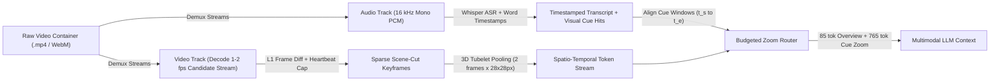
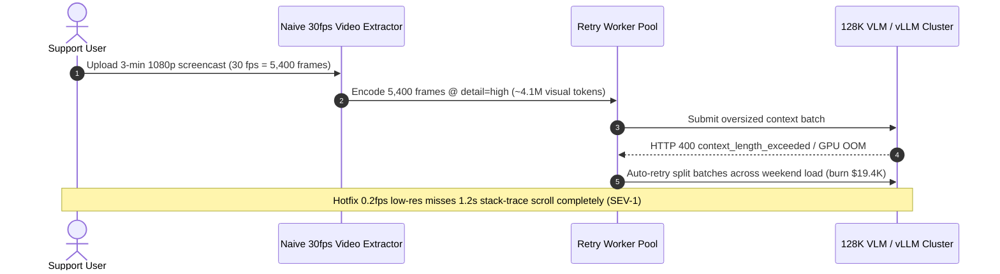

# Module 14: Video Understanding

> **Prerequisites:** [Module 03: Running Whisper in Practice](../03-running-whisper-in-practice/README.md), [Module 12: Vision: How LLMs See Images](../12-vision-how-llms-see-images/README.md), and [Module 13: Vision Use Cases: OCR, Documents, UI](../13-vision-use-cases-ocr-documents-ui/README.md).  
> **Estimated Reading Time:** 35 minutes  
> **Target Audience:** AI Backend Engineers, Multimodal Search & Indexing Architects, Video Infrastructure Developers

> [!TIP]
> **The Golden Rule of Video Understanding:** Never decode raw `30 fps` or `60 fps` video frames blindly into an LLM context window. A single `30`-minute `1080p` clip at `30 fps` generates `54,000` frames—over **`41,000,000` visual tokens** (`> 2.2 TB` of KV cache!). Always demux audio (`Whisper ASR`) and video (`FFmpeg`) in parallel, prune static frames with **scene-cut L1 keyframe sampling** and **spatio-temporal 3D tubelet pooling**, run temporal overviews at `detail: "low"` (`85` tok/frame), and escalate *only* ASR-cue or motion-aligned windows to `detail: "high"` (`765+` tok) under a hard per-minute token cap.

---

## Why This Matters

Engineers moving from single-image VLMs to video QA often try the simplest possible loop: open an `.mp4` with OpenCV or FFmpeg, read frames at native framerate (`30 fps`), encode them into Base64 JPEGs, and pack them into `messages` or a local vLLM prompt.

Within seconds, that pipeline fails catastrophically on three fronts:

1. **Immediate Context-Window & VRAM Collapse:** At `765` visual tokens per frame, a mere `10`-second `30 fps` clip consumes `229,500` tokens—already overflowing a `128K` context window! A `30`-minute meeting or engineering screencast (`54,000` frames) blows up to **`41.3 million` tokens**, requiring `2,206 GB` of FP16 GQA KV-cache memory and billing **`\$103.28` per single query** at `\$2.50 / 1M` input tokens.
2. **Uniform Stride Blindness & Redundancy:** Dropping blindly to `0.5 fps` (`1` frame every `2` seconds) cuts token count `60x`, yet still wastes `85%` of frames on motionless PowerPoint slides while cleanly **skipping** a `400 ms` error toast or UI modal that appeared between ticks.
3. **Ignoring the Audio Track:** Video is rarely silent pixels alone. On screencasts, lectures, and support recordings, **Whisper ASR timestamps** pinpoint *exact* seconds when a speaker says `"look at this red stack trace"`—letting your router zoom into `detail: "high"` on `3` critical seconds while keeping the other `29` minutes compressed!

---

## 1. Dual-Stream Video Ingestion & Spatio-Temporal Compression

Production video understanding splits an `.mp4` container into two synchronized tracks: a tiny, information-dense **Speech/Audio track** (`Whisper` / `Faster-Whisper`) and a compressed **Keyframe/Tubelet Visual track**:



### Quantitative Mechanics: Token Explosion vs. 3D Pooling & Adaptive Keyframes

1. **Naive Dense Decoding Collapse:** Given video duration $D_{\text{sec}}$, decode framerate $F_{\text{fps}}$, and per-frame tokens $T_{\text{frame}}$:

$$T_{\text{naive}} = D_{\text{sec}} \cdot F_{\text{fps}} \cdot T_{\text{frame}}$$

For a `30`-minute (`1,800 s`) screencast at `30 fps` and `765` tokens/frame: $T_{\text{naive}} = 1{,}800 \cdot 30 \cdot 765 = 41{,}310{,}000$ tokens. Even assuming an aggressive `56 KB/token` GQA KV-cache footprint (8B model), serving that single video requires `~2.21 TB` of GPU memory!

2. **Spatio-Temporal 3D Patch Compression (`Qwen2-VL` / `VideoLLaMA` Tubelets):**
   Instead of running 2D ViT patches independently over every frame, modern native video VLMs (such as **Qwen2-VL**, `arXiv:2409.12191`) embed **3D spatio-temporal tubelets** of size $P_t \times P_h \times P_w$ (e.g., `2 frames x 14 x 14 pixels`) followed by a `2x2` spatial merger—emitting **`1` visual token per `2` frames $\times 28 \times 28$ pixels**, stamped with **3D M-RoPE** `(temporal_id, height_id, width_id)` coordinates! Pooling adjacent frames temporally by $P_{\text{temp}}$ divides frame token volume cleanly:

$$T_{\text{pooled}} = \left\lceil \frac{N_{\text{kept}}}{P_{\text{temp}}} \right\rceil \cdot T_{\text{spatial}}$$

3. **Scene-Cut + Heartbeat Adaptive Keyframe Sampling:**
   Decode candidate frames cheaply on CPU via `FFmpeg` at `1–2 fps` (or native video codec I-frames / motion vectors) and compute a fast downsampled luminance/histogram delta $L_1(f_t, f_{\text{last}})$. Emit a keyframe *only* when:
   - $L_1(f_t, f_{\text{last}}) \ge \tau_{\text{cut}}$ (**scene transition / UI popup**), OR
   - $t - t_{\text{last}} \ge \Delta t_{\text{max}}$ (**heartbeat floor**, e.g. `10 s`, guaranteeing slow gradual pans aren't forgotten).

   On typical meetings, tutorials, and software demos, scene-cut deduplication reduces kept frames by **`75%–90%`** before a single VLM token is spent!

4. **Dual-Stream Whisper ASR + Targeted High-Res Zoom:**
   Transcribing `30` minutes of audio with Whisper produces `~4,500` text tokens (`~\$0.006` in API cost or `< 3 s` on an L4 GPU)—roughly **`1,000x` cheaper than pixels**. Scanning ASR timestamps for visual deictic cues (`"look at"`, `"red error"`, `"on slide"`, `"terminal"`, `"click here"`) allows a two-tier budget allocator to render baseline keyframes at `detail: "low"` (`85` tok) and spend `detail: "high"` (`765` tok) *exclusively* on ASR-aligned critical moments!

---

## 2. Systematic Comparison Matrix: Video Tokenization & Sampling Strategies

| Strategy | Effective Rate (`30m` Video) | Total Tokens (`30m`) | Est. Cost (`\$2.50/1M`) | Temporal Precision | Failure Mode |
| :--- | :--- | :--- | :--- | :--- | :--- |
| **Naive Dense `30 fps`** | `54,000` frames | `41,310,000` | `\$103.28` | Frame-accurate (`33 ms`) | Instant OOM (`2.2 TB` KV cache) & context overflow |
| **Uniform `2 fps` (`high`)** | `3,600` frames | `2,754,000` | `\$6.88` | `500 ms` grid | Exceeds `1M–2M` context limits; `85%` static waste |
| **Uniform `1 fps` + `2x` Tubelets (`low` res)** | `1,800` frames pooled (`900` steps) | `230,400` | `\$0.58` | `1.0 s` grid | Blurs dense UI/code text; still fails `128K` context |
| **Scene-Cut L1 + `2x` Pool** | `~216` keyframes (`12%` keep) | `27,648` | `\$0.07` | Event-triggered | Misses subtle un-moved text updates if $\tau_{\text{cut}}$ is too high |
| **Dual-Stream ASR + Cue Zoom** | `~180` low (`85` tok) + `8` high (`765` tok) | `~21,420` | `\$0.05` | Speech + event synced | Depends on audio track quality; silent video falls back to L1 |

*(Note on Native Cloud Video APIs: Managed endpoints like the Google Gemini Video API automatically sample uploaded `.mp4` streams near `1 fps` at `~258` tokens/frame low-res or `~66`–`300` tokens/sec with interleaved audio tokens—making them convenient for `<= 1 hour` uploads, while explicit pre-sampling + ASR alignment remains essential whenever targeting `128K`-context models, strict latency SLAs, or self-hosted `vLLM` clusters.)*

---

## 3. Production War Story Post-Mortem: The Support Screencast 30-fps OOM & Context Window Collapse

| Field | Incident Details |
| :--- | :--- |
| **Severity** | **SEV-1** (Inference Worker Crash Loop & **\$19,400** Weekend Test-Run Token Burn) |
| **Detection / Resolution Time** | Detected 4 hours after enabling customer `.mp4` bug-report uploads / Mitigated in 90 minutes via scene-cut + ASR cue router |
| **Impact** | `100%` of uploaded customer screen recordings `> 45 seconds` crashed `128K`-context requests with `400 context_length_exceeded` or drove self-hosted vLLM nodes into swap OOM; automated retry workers re-queued failed jobs `5` times before alerting |

### What Happened

A developer-support platform added *"Upload a screen recording of your bug"* to its AI triage bot. The backend engineer wired OpenCV `VideoCapture` straight into the VLM gateway:

1. **Raw `30 fps` Extraction:** Every frame of a `3`-minute (`180 s`) `1080p` bug screencast was dumped at `30 fps` (`5,400` frames). Even after capping at `250` frames in one code branch, an unguarded batch evaluator iterated across all `5,400` frames (`4.13M` tokens!).
2. **Retry Amplification on `400` / `503`:** When the `128K` cloud VLM rejected massive frames or the self-hosted `Qwen2-VL` worker crashed from KV-cache pressure, the Celery retry loop re-extracted and re-submitted partial chunks repeatedly over a weekend load test.
3. **Blurred Low-Res Fallback:** An emergency hotfix changed `fps=0.2` (`1` frame every `5` seconds) at `detail="low"`, which fit the context window—but missed the `1.2`-second stack-trace terminal scroll entirely because no ASR transcript guided where to zoom!



### Root Cause Analysis

- Feeding native `30 fps` frames without temporal deduplication wastes tokens exponentially on motionless UI captures.
- Uniform ultra-low sampling (`0.2 fps`) misses brief diagnostic error popups unless guided by scene-cut deltas and spoken audio timestamps.
- Missing pre-inference token-budget enforcement allowed oversized payloads to reach the model and trigger costly retry loops.

### Architectural Hardening & Verified Fix

- **Parallel FFmpeg Scene-Cut + Faster-Whisper:** Extracted `16 kHz` audio for Whisper ASR alongside `2 fps` candidate frames filtered by `L1` luminance diff (`>= 18.0`) + `10 s` heartbeat ceiling.
- **ASR-Guided High-Res Escalation Under Cap:** Encoded baseline keyframes at `detail: "low"` (`85` tok) and selectively upgraded frames overlapping ASR error/UI cues (`"stack trace"`, `"red error"`, `"console"`) to `detail: "high"` (`765` tok) within a strict `20,000`-token per-video ceiling—eliminating OOMs and cutting triage cost by `99%`.

---

## 4. Multi-Language Production Implementation: Dual-Stream Video Keyframe & ASR Zoom Router

Below is a production-hardened **Scene-Cut Keyframe Deduplicator & Dual-Stream ASR-Aligned Zoom Budget Router** across **Go**, **TypeScript**, **Python**, and **C#**.

````carousel

```go
package videounderstanding

import (
	"fmt"
	"math"
)

type FrameSig struct {
	TimestampSec float64
	Histogram    [4]int
}

type AsrSegment struct {
	StartSec float64
	EndSec   float64
	Text     string
}

type FrameDecision struct {
	TimestampSec float64
	Reason       string
	DetailMode   string // "LOW_OVERVIEW" | "HIGH_ZOOM" | "LOW_CAP_FALLBACK"
	Tokens       int
	MatchedCue   string
}

// SampleSceneKeyframes keeps frames on L1 visual transitions or maxGapSec heartbeat intervals.
func SampleSceneKeyframes(frames []FrameSig, diffThresh, maxGapSec float64) []FrameSig {
	var kept []FrameSig
	lastIdx := -1
	for i, f := range frames {
		if lastIdx < 0 {
			kept = append(kept, f)
			lastIdx = i
			continue
		}
		prev := frames[lastIdx]
		var diffSum float64
		for k := 0; k < 4; k++ {
			diffSum += math.Abs(float64(f.Histogram[k] - prev.Histogram[k]))
		}
		l1 := diffSum / 4.0
		if l1 >= diffThresh || (f.TimestampSec-prev.TimestampSec) >= maxGapSec {
			kept = append(kept, f)
			lastIdx = i
		}
	}
	return kept
}

// AllocateZoomBudget reserves 85-token low overviews and upgrades ASR cue frames to 765-token high detail within budgetTok.
func AllocateZoomBudget(keyframes []FrameSig, asr []AsrSegment, budgetTok int) ([]FrameDecision, int, error) {
	reserve := len(keyframes) * 85
	if reserve > budgetTok {
		return nil, 0, fmt.Errorf("reserve %d exceeds budget %d", reserve, budgetTok)
	}
	upgradePool := budgetTok - reserve
	cueWords := []string{"look at", "error", "red", "slide", "chart", "terminal"}

	var plan []FrameDecision
	used := 0
	for _, kf := range keyframes {
		cue := "-"
		for _, seg := range asr {
			if kf.TimestampSec >= seg.StartSec-1.0 && kf.TimestampSec <= seg.EndSec+1.0 && containsAny(seg.Text, cueWords) {
				cue = seg.Text
				break
			}
		}
		mode := "LOW_OVERVIEW"
		extra := 0
		if cue != "-" {
			if upgradePool >= 680 {
				upgradePool -= 680
				extra = 680
				mode = "HIGH_ZOOM"
			} else {
				mode = "LOW_CAP_FALLBACK"
			}
		}
		cost := 85 + extra
		used += cost
		plan = append(plan, FrameDecision{
			TimestampSec: kf.TimestampSec,
			Reason:       "KEYFRAME",
			DetailMode:   mode,
			Tokens:       cost,
			MatchedCue:   cue,
		})
	}
	return plan, used, nil
}

func containsAny(s string, subs []string) bool {
	lower := make([]byte, len(s))
	for i := 0; i < len(s); i++ {
		c := s[i]
		if c >= 'A' && c <= 'Z' {
			c += 'a' - 'A'
		}
		lower[i] = c
	}
	ls := string(lower)
	for _, sub := range subs {
		if len(sub) <= len(ls) {
			for i := 0; i <= len(ls)-len(sub); i++ {
				if ls[i:i+len(sub)] == sub {
					return true
				}
			}
		}
	}
	return false
}
```

<!-- slide -->

```typescript
export interface FrameSignature {
  readonly timestampSec: number;
  readonly bins: readonly [number, number, number, number];
}

export interface AsrSegment {
  readonly startSec: number;
  readonly endSec: number;
  readonly text: string;
}

export interface VideoFramePlan {
  readonly timestampSec: number;
  readonly mode: "LOW_OVERVIEW" | "HIGH_ZOOM" | "LOW_CAP_FALLBACK";
  readonly tokens: number;
  readonly matchedCue: string;
}

const VISUAL_CUES = ["look at", "error", "red", "slide", "chart", "terminal"];

export function sampleSceneKeyframes(
  frames: readonly FrameSignature[],
  diffThresh = 18.0,
  maxGapSec = 10.0,
): FrameSignature[] {
  const kept: FrameSignature[] = [];
  let lastKept: FrameSignature | null = null;

  for (const frame of frames) {
    if (!lastKept) {
      kept.push(frame);
      lastKept = frame;
      continue;
    }
    const l1 =
      frame.bins.reduce((acc, val, idx) => acc + Math.abs(val - lastKept!.bins[idx]), 0) /
      frame.bins.length;

    if (l1 >= diffThresh || frame.timestampSec - lastKept.timestampSec >= maxGapSec) {
      kept.push(frame);
      lastKept = frame;
    }
  }
  return kept;
}

export function allocateDualStreamZoomBudget(
  keyframes: readonly FrameSignature[],
  asrSegments: readonly AsrSegment[],
  budgetTokens: number,
): { plan: VideoFramePlan[]; usedTokens: number } {
  const reserve = keyframes.length * 85;
  if (reserve > budgetTokens) {
    throw new RangeError(`Overview reserve (${reserve}) exceeds token budget (${budgetTokens})`);
  }

  const cueWindows = asrSegments.filter((seg) =>
    VISUAL_CUES.some((w) => seg.text.toLowerCase().includes(w)),
  );

  let upgradePool = budgetTokens - reserve;
  let usedTokens = 0;
  const plan: VideoFramePlan[] = [];

  for (const kf of keyframes) {
    const cueHit = cueWindows.find(
      (seg) => kf.timestampSec >= seg.startSec - 1.0 && kf.timestampSec <= seg.endSec + 1.0,
    );
    let mode: VideoFramePlan["mode"] = "LOW_OVERVIEW";
    let extra = 0;
    if (cueHit) {
      if (upgradePool >= 680) {
        upgradePool -= 680;
        extra = 680;
        mode = "HIGH_ZOOM";
      } else {
        mode = "LOW_CAP_FALLBACK";
      }
    }
    const tokens = 85 + extra;
    usedTokens += tokens;
    plan.push({
      timestampSec: kf.timestampSec,
      mode,
      tokens,
      matchedCue: cueHit ? cueHit.text : "-",
    });
  }

  return { plan, usedTokens };
}
```

<!-- slide -->

```python
"""
video_keyframe_router.py
Scene-cut L1 keyframe deduplicator and dual-stream ASR cue-triggered high-res zoom router.
"""
from dataclasses import dataclass


CUE_KEYWORDS = ("look at", "error", "red", "slide", "chart", "terminal", "click")


@dataclass(frozen=True)
class FrameSignature:
    timestamp_sec: float
    bins: tuple[int, int, int, int]


@dataclass(frozen=True)
class AsrSegment:
    start_sec: float
    end_sec: float
    text: str


@dataclass(frozen=True)
class KeyframePlanItem:
    timestamp_sec: float
    mode: str
    tokens: int
    cue_text: str


def sample_scene_keyframes(
    frames: list[FrameSignature],
    diff_thresh: float = 18.0,
    max_gap_sec: float = 10.0,
) -> list[FrameSignature]:
    kept: list[FrameSignature] = []
    last_kept: FrameSignature | None = None
    for frame in frames:
        if last_kept is None:
            kept.append(frame)
            last_kept = frame
            continue
        l1 = sum(abs(a - b) for a, b in zip(frame.bins, last_kept.bins)) / len(frame.bins)
        if l1 >= diff_thresh or (frame.timestamp_sec - last_kept.timestamp_sec) >= max_gap_sec:
            kept.append(frame)
            last_kept = frame
    return kept


def allocate_dual_stream_budget(
    keyframes: list[FrameSignature],
    asr_segments: list[AsrSegment],
    budget_tokens: int,
) -> tuple[list[KeyframePlanItem], int]:
    reserve = len(keyframes) * 85
    if reserve > budget_tokens:
        raise ValueError(f"Reserve {reserve} tokens exceeds total video budget {budget_tokens}")

    cue_windows = [
        seg for seg in asr_segments if any(kw in seg.text.lower() for kw in CUE_KEYWORDS)
    ]
    upgrade_pool = budget_tokens - reserve
    plan: list[KeyframePlanItem] = []
    used_tokens = 0

    for kf in keyframes:
        matched = next(
            (s.text for s in cue_windows if (s.start_sec - 1.0) <= kf.timestamp_sec <= (s.end_sec + 1.0)),
            "-",
        )
        if matched != "-" and upgrade_pool >= 680:
            upgrade_pool -= 680
            extra, mode = 680, "HIGH_ZOOM"
        elif matched != "-":
            extra, mode = 0, "LOW_CAP_FALLBACK"
        else:
            extra, mode = 0, "LOW_OVERVIEW"
        cost = 85 + extra
        used_tokens += cost
        plan.append(KeyframePlanItem(kf.timestamp_sec, mode, cost, matched))

    return plan, used_tokens
```

<!-- slide -->

```csharp
using System;
using System.Collections.Generic;
using System.Linq;

namespace GenAI.Multimodal.Video;

public sealed record FrameSignature(double TimestampSec, int[] Bins);

public sealed record AsrSegment(double StartSec, double EndSec, string Text);

public sealed record KeyframePlanItem(double TimestampSec, string Mode, int Tokens, string CueText);

public static class VideoKeyframeRouter
{
    private static readonly string[] CueWords = { "look at", "error", "red", "slide", "chart", "terminal", "click" };

    public static IReadOnlyList<FrameSignature> SampleSceneKeyframes(
        IEnumerable<FrameSignature> frames,
        double diffThresh = 18.0,
        double maxGapSec = 10.0)
    {
        var kept = new List<FrameSignature>();
        FrameSignature? lastKept = null;

        foreach (var frame in frames)
        {
            if (lastKept is null)
            {
                kept.Add(frame);
                lastKept = frame;
                continue;
            }
            double sumDiff = 0;
            for (int i = 0; i < frame.Bins.Length; i++)
                sumDiff += Math.Abs(frame.Bins[i] - lastKept.Bins[i]);
            double l1 = sumDiff / frame.Bins.Length;

            if (l1 >= diffThresh || (frame.TimestampSec - lastKept.TimestampSec) >= maxGapSec)
            {
                kept.Add(frame);
                lastKept = frame;
            }
        }
        return kept;
    }

    public static (IReadOnlyList<KeyframePlanItem> Plan, int UsedTokens) AllocateDualStreamBudget(
        IReadOnlyList<FrameSignature> keyframes,
        IReadOnlyList<AsrSegment> asrSegments,
        int budgetTokens)
    {
        int reserve = keyframes.Count * 85;
        if (reserve > budgetTokens)
            throw new ArgumentException($"Reserve ({reserve}) exceeds budget ({budgetTokens}).");

        var cueWindows = asrSegments
            .Where(s => CueWords.Any(w => s.Text.Contains(w, StringComparison.OrdinalIgnoreCase)))
            .ToList();

        int upgradePool = budgetTokens - reserve;
        int usedTokens = 0;
        var plan = new List<KeyframePlanItem>(keyframes.Count);

        foreach (var kf in keyframes)
        {
            var hit = cueWindows.FirstOrDefault(s =>
                kf.TimestampSec >= s.StartSec - 1.0 && kf.TimestampSec <= s.EndSec + 1.0);
            string mode = "LOW_OVERVIEW";
            int extra = 0;
            if (hit is not null)
            {
                if (upgradePool >= 680)
                {
                    upgradePool -= 680;
                    extra = 680;
                    mode = "HIGH_ZOOM";
                }
                else
                {
                    mode = "LOW_CAP_FALLBACK";
                }
            }
            int cost = 85 + extra;
            usedTokens += cost;
            plan.Add(new KeyframePlanItem(kf.TimestampSec, mode, cost, hit?.Text ?? "-"));
        }

        return (plan, usedTokens);
    }
}
```

````

---

## 5. Practical Hands-On Verification CLI Workflows

Run these deterministic Python 3.13 verification scripts offline—zero third-party libraries or API keys required.

### Workflow 1: 30-Minute `1080p` Video Token, KV-Cache VRAM & Spend Collapse Sweep

Compare naive `30 fps` decoding against uniform stride, `2x` spatio-temporal pooling, and scene-cut keyframe compression across a `30`-minute video:

```bash
python -c '
def video_token_budget(duration_min: int, fps: float, tok_per_frame: int, temporal_pool: int = 1, keyframe_ratio: float = 1.0, price_per_1m: float = 2.50):
    raw_frames = int(duration_min * 60 * fps)
    kept_frames = max(1, int(round(raw_frames * keyframe_ratio)))
    effective_tok = (kept_frames * tok_per_frame) // max(1, temporal_pool)
    kv_gb = (effective_tok * 57_344) / (1024 ** 3)
    cost_usd = (effective_tok / 1_000_000) * price_per_1m
    print(f"fps={fps:<4} pool={temporal_pool}x keep={keyframe_ratio*100:>5.1f}% -> frames={kept_frames:>5} | vis_tok={effective_tok:>10,} | KV_VRAM={kv_gb:>6.2f} GB | cost=${cost_usd:>6.2f}")

print("=== 30-Minute 1080p Video Token & KV-Cache Sweep ===")
video_token_budget(30, 30.0, 765, temporal_pool=1, keyframe_ratio=1.00)
video_token_budget(30, 2.0,  765, temporal_pool=1, keyframe_ratio=1.00)
video_token_budget(30, 1.0,  256, temporal_pool=1, keyframe_ratio=1.00)
video_token_budget(30, 1.0,  256, temporal_pool=2, keyframe_ratio=1.00)
video_token_budget(30, 1.0,  256, temporal_pool=2, keyframe_ratio=0.12)
'
```

**Expected Output:**

```text
=== 30-Minute 1080p Video Token & KV-Cache Sweep ===
fps=30.0 pool=1x keep=100.0% -> frames=54000 | vis_tok=41,310,000 | KV_VRAM=2206.19 GB | cost=$103.28
fps=2.0  pool=1x keep=100.0% -> frames= 3600 | vis_tok= 2,754,000 | KV_VRAM=147.08 GB | cost=$  6.88
fps=1.0  pool=1x keep=100.0% -> frames= 1800 | vis_tok=   460,800 | KV_VRAM= 24.61 GB | cost=$  1.15
fps=1.0  pool=2x keep=100.0% -> frames= 1800 | vis_tok=   230,400 | KV_VRAM= 12.30 GB | cost=$  0.58
fps=1.0  pool=2x keep= 12.0% -> frames=  216 | vis_tok=    27,648 | KV_VRAM=  1.48 GB | cost=$  0.07
```

Look at that `1,494x` reduction: dropping from `41.31M` tokens (`2.21 TB` KV cache, `\$103.28`) down to `27,648` tokens (`1.48 GB` KV cache, `\$0.07`) puts an entire `30`-minute screencast well inside a standard `32K–128K` context window!

### Workflow 2: Scene-Cut `L1` Keyframe Deduplicator & Heartbeat Gate

Simulate a `15`-frame `1-fps` sequence with static slides (`0–4s`), a slide transition (`5s`), and gentle camera drift (`6–15s`), confirming `80%` frame pruning while keeping both the scene transition and `10s` continuity heartbeat:

```bash
python -c '
def sample_scene_keyframes(frame_sigs: list[tuple[float, list[int]]], diff_thresh: float = 18.0, max_gap_sec: float = 10.0) -> list[tuple[float, str]]:
    keyframes = []
    last_kept_sig = None
    last_kept_t = -999.0
    for t_sec, sig in frame_sigs:
        if last_kept_sig is None:
            keyframes.append((t_sec, "INIT_KEYFRAME"))
            last_kept_sig, last_kept_t = sig, t_sec
            continue
        l1_diff = sum(abs(a - b) for a, b in zip(sig, last_kept_sig)) / len(sig)
        if l1_diff >= diff_thresh:
            keyframes.append((t_sec, f"SCENE_CUT(L1={l1_diff:.1f})"))
            last_kept_sig, last_kept_t = sig, t_sec
        elif (t_sec - last_kept_t) >= max_gap_sec:
            keyframes.append((t_sec, f"HEARTBEAT(gap={t_sec-last_kept_t:.0f}s)"))
            last_kept_sig, last_kept_t = sig, t_sec
    return keyframes

stream = [
    (0.0, [10, 10, 10, 10]), (1.0, [10, 11, 10, 10]), (2.0, [11, 10, 10, 10]), (3.0, [10, 10, 11, 10]),
    (4.0, [10, 10, 10, 11]), (5.0, [85, 80, 75, 90]), (6.0, [86, 80, 76, 89]), (7.0, [85, 82, 75, 90]),
    (8.0, [86, 81, 77, 89]), (9.0, [85, 80, 76, 90]), (10.0, [86, 81, 75, 89]), (11.0, [85, 81, 76, 90]),
    (12.0, [86, 80, 75, 90]), (13.0, [85, 81, 76, 90]), (15.0, [85, 81, 76, 90]),
]
kept = sample_scene_keyframes(stream, diff_thresh=18.0, max_gap_sec=10.0)
print(f"Input frames={len(stream)} -> Kept keyframes={len(kept)} ({(1 - len(kept)/len(stream))*100:.1f}% token savings)")
for t, reason in kept:
    print(f"  t={t:>4.1f}s -> {reason}")
'
```

**Expected Output:**

```text
Input frames=15 -> Kept keyframes=3 (80.0% token savings)
  t= 0.0s -> INIT_KEYFRAME
  t= 5.0s -> SCENE_CUT(L1=72.5)
  t=15.0s -> HEARTBEAT(gap=10s)
```

### Workflow 3: Dual-Stream Whisper ASR Cue Alignment & Budgeted `HIGH_ZOOM` Escalation

Verify how ASR timestamps elevate critical moments (`t=12.5s`) from `85` tokens to `765` tokens while respecting a hard `1,400`-token ceiling (`t=25.0s` gracefully falls back to `LOW_CAP_FALLBACK`):

```bash
python -c '
def dual_stream_zoom_router(keyframes: list[float], asr_segments: list[tuple[float, float, str]], budget_tok: int = 1600) -> None:
    cue_words = ("look at", "error", "red", "slide", "chart", "click", "terminal")
    cue_windows = [(s, e, txt) for s, e, txt in asr_segments if any(w in txt.lower() for w in cue_words)]
    used_tok = 0
    plan = []
    reserve = len(keyframes) * 85
    if reserve > budget_tok:
        raise ValueError("Budget too tight even for low-res temporal overview")
    upgrade_pool = budget_tok - reserve
    for t in keyframes:
        matched = [txt for s, e, txt in cue_windows if (s - 1.0) <= t <= (e + 1.0)]
        want_high = len(matched) > 0
        extra = 680 if (want_high and upgrade_pool >= 680) else 0
        if extra:
            upgrade_pool -= extra
            mode = "HIGH_ZOOM"
        elif want_high:
            mode = "LOW_CAP_FALLBACK"
        else:
            mode = "LOW_OVERVIEW"
        cost = 85 + extra
        used_tok += cost
        plan.append((t, mode, cost, matched[0] if matched else "-"))
    for t, mode, cost, cue in plan:
        print(f"  t={t:>5.1f}s | {mode:<16} | tok={cost:>3} | cue={cue}")
    print(f"Total Video Context Budget Used: {used_tok}/{budget_tok} tokens across {len(plan)} aligned frames")

asr = [
    (2.0, 5.5, "Welcome everyone to the deployment retrospective"),
    (11.0, 14.5, "Look at the red latency spike in the terminal chart here"),
    (24.0, 27.5, "Now check slide four showing the retry error curve"),
]
frames = [0.0, 5.0, 12.5, 18.0, 25.0, 30.0]
dual_stream_zoom_router(frames, asr, budget_tok=1400)
'
```

**Expected Output:**

```text
  t=  0.0s | LOW_OVERVIEW     | tok= 85 | cue=-
  t=  5.0s | LOW_OVERVIEW     | tok= 85 | cue=-
  t= 12.5s | HIGH_ZOOM        | tok=765 | cue=Look at the red latency spike in the terminal chart here
  t= 18.0s | LOW_OVERVIEW     | tok= 85 | cue=-
  t= 25.0s | LOW_CAP_FALLBACK | tok= 85 | cue=Now check slide four showing the retry error curve
  t= 30.0s | LOW_OVERVIEW     | tok= 85 | cue=-
Total Video Context Budget Used: 1190/1400 tokens across 6 aligned frames
```

### Hands-On Exercises

1. **Per-Minute Cost Sweeper:** Modify Workflow 1 to print `cost_per_minute` across `10`, `30`, and `120`-minute lecture videos, verifying the maximum safe FPS + pooling tier that keeps a `120`-minute lecture under a `128K` context limit (`<= 100,000` visual tokens leaving `28K` for transcript + prompt).
2. **FFmpeg I-Frame + Audio Demux Command (Local CLI):** Write the two `ffmpeg` shell commands needed to (a) demux `16 kHz` mono PCM WAV (`-ar 16000 -ac 1`) and (b) extract keyframes using FFmpeg's `select='gt(scene,0.25)'` filter with `-vsync vfr` and frame timestamps (`showinfo`).
3. **Priority Cue Ranking:** Extend Workflow 3 so when `upgrade_pool` cannot satisfy all cue matches, frames matching high-severity cues (`"error"`, `"stack trace"`) take priority over generic cues (`"slide"`) instead of strictly first-come-first-served.

### Independent Challenge

A security operations center wants to index `500` hours/day of screen-recorded incident troubleshooting sessions and physical facility CCTV clips (`1080p`, `30 fps`) so analysts can search `"Where did the engineer edit nginx.conf and trigger a 502 error?"` and inspect exact config lines. Running a VLM across all `500` hours (`54M` frames/day) is financially impossible. Design a multi-stage indexing & query architecture combining **Whisper ASR**, **scene-cut keyframe deduplication**, **sparse low-res embeddings/captions**, and **on-demand high-res VLM frame zoom** within a `\$50/day` budget.

<details><summary>Architectural Discussion</summary>

First, demux audio and run local `Faster-Whisper` (`~3–5` GPU-hours total for `500` hours of audio on a single T4/L4 GPU = `~\$3/day`) to generate timestamped transcripts indexed in BM25 + dense RAG. Second, pass video through an `FFmpeg` scene-cut filter (`gt(scene, 0.20)` + `15 s` heartbeat), keeping roughly `~150,000` sparse keyframes/day instead of `54,000,000` frames (`360x` reduction). Third, index lightweight low-res captions or CLIP/SigLIP image embeddings over those keyframes so visual-only queries (CCTV or silent screens) match timestamp windows cheaply. At query time, retrieve only the top `3–5` matching `[t_start, t_end]` windows (`~15–20` keyframes) and invoke the frontier VLM at `detail: "high"` exclusively on those retrieved frames (`~15,000` tokens/query), keeping total daily compute well under `\$50/day`.

</details>

---

## 6. Common Mistakes & Troubleshooting

- **Extracting `30 fps` frames before inspecting video duration:** Even a `2`-minute user screen recording explodes to `3,600` frames (`~2.75M` tokens). Always enforce `max_frames` and duration caps *prior* to FFmpeg decode.
- **Using uniform `0.1 fps` without scene-cut detection:** A `10`-second uniform stride frequently skips `2`-second error alerts or terminal stack traces that appear and disappear between sampling ticks.
- **Throwing away the audio track during video QA:** Ignoring Whisper ASR forces the VLM to read subtitles/slides visually across hundreds of frames instead of retrieving exact timestamps from `1,000x`-cheaper speech tokens.
- **Mixing `detail: "high"` indiscriminately across all keyframes:** Burning `765` tokens on every frame collapses budget on long videos; reserve high resolution for ASR-matched or motion-spike keyframes and run temporal context at `85` tokens.

---

## 7. Operational Validation Checkpoints & Checkpoint Quiz

### Operational Validation Checkpoints

<details><summary><strong>Checkpoint 1: Diagnosing why a 15-minute video hits context overflow despite 2 fps downsampling</strong></summary>

A developer downsamples a `15`-minute (`900 s`) demo video from `30 fps` down to `2 fps` (`1,800` frames) and sends `detail: "high"` (`765` tokens/frame) to a `1M`-token multimodal model—yet still hits `context_length_exceeded`. Check the math.

**Validation:** At `2 fps`, `900 s * 2 = 1,800` frames $\times 765$ tokens/frame $= 1{,}377{,}000$ visual tokens alone—exceeding `1,000,000` tokens before system prompt, ASR transcript, or output headroom! Switch to scene-cut keyframe deduplication (`~180` frames), apply `2x` temporal pooling or `detail: "low"` (`85` tok) for overview (`15,300` tokens), and zoom `detail: "high"` only on `8–12` cue frames (`~25K` tokens total).

</details>

<details><summary><strong>Checkpoint 2: Auditing silent failure on a uniform 5-second stride video pipeline</strong></summary>

A QA team tests a bug-report video agent using uniform `1`-frame-every-`5`-seconds sampling. When a developer clicks `"Deploy"`, a red `HTTP 502` toast flashes for `1.5` seconds between `t = 11.0s` and `t = 12.5s`, and the agent insists no error ever occurred. How do you cure this without restoring `30 fps`?

**Validation:** Add two lightweight signals: (1) run CPU-cheap **scene-cut L1 diffing** on a `2 fps` decode stream so sudden UI modal/toast appearance spikes `L1 >= diff_thresh` and captures `t = 11.5s` immediately, and (2) align **Whisper ASR timestamps** (`"oh look, 502 error"`) to trigger `HIGH_ZOOM` capture inside `[t_start - 1s, t_end + 1s]`.

</details>

<details><summary><strong>Checkpoint 3: Enforcing predictable per-video token and cost ceilings</strong></summary>

How should a dual-stream video router behave when a `45`-minute webinar contains `35` separate `"look at this slide"` ASR cues, yet the turn budget permits at most `12,000` visual tokens?

**Validation:** First reserve `85` tokens per baseline keyframe (`N_kf * 85`) so temporal continuity across the full `45` minutes never goes blind. Compute remaining `upgrade_pool = budget - reserve`, allocate `+680`-token `HIGH_ZOOM` upgrades to the highest-priority cues until `upgrade_pool < 680`, and gracefully tag remaining cue frames as `LOW_CAP_FALLBACK` (`85` tokens) rather than exceeding the `12,000`-token SLA.

</details>

### Checkpoint Quiz

1. How many raw visual tokens does `30` minutes of `30 fps` video at `765` tokens/frame produce without deduplication or temporal pooling?
2. What is **spatio-temporal 3D tubelet compression** (`Qwen2-VL`), and how does it reduce frame token counts compared to independent 2D image encoding?
3. Why combine **L1 scene-cut detection** with a **`max_gap_sec` heartbeat** when sampling keyframes?
4. Why is transcribing audio with Whisper *before* visual frame selection such a massive lever for video cost and accuracy?
5. What happens if your dual-stream zoom router upgrades ASR cue frames unconditionally without reserving `LOW_OVERVIEW` tokens first?

<details><summary>Answers</summary>

1. $1{,}800\text{ s} \times 30\text{ fps} \times 765\text{ tok/frame} = 41{,}310{,}000$ tokens.
2. Instead of encoding single 2D frames independently, 3D convolutions group $P_t$ consecutive frames (e.g., `2` frames $\times 14 \times 14$ patches + `2x2` spatial merger = `1` token per `2` frames $\times 28 \times 28$ px), cutting token count by $P_t\times$ while preserving short-term motion context and 3D M-RoPE timestamps.
3. Scene-cut thresholding drops `80%+` of static redundant frames while immediately catching sudden transitions; the `max_gap_sec` heartbeat guarantees slow continuous motion or gradual fades still emit periodic anchor keyframes.
4. Speech transcription is `~1,000x` cheaper per minute than high-res pixels and directly reveals *when* visual details matter (`"look at this error trace"`), allowing overview frames at `85` tokens and targeted `765`-token zoom only on cue-aligned segments.
5. Early dense cues can exhaust the entire token budget, leaving later chapters completely invisible (`0` frames). Reserving `85` tokens per keyframe first guarantees full timeline coverage while capping high-res zooms cleanly.

</details>

---

## Further Reading & Sources

- [Qwen2-VL: Enhancing Vision-Language Model's Perception of the World at Any Resolution (Wang et al., 2024)](https://arxiv.org/abs/2409.12191) — `2 x 14 x 14` 3D spatio-temporal patch compression and 3D M-RoPE for unified image/video modeling.
- [Google Gemini API Docs: Video Understanding](https://ai.google.dev/gemini-api/docs/video-understanding) — managed Files API ingestion, native `1 fps` sampling, timestamp querying, and audio-visual context limits.
- [Hugging Face Transformers Docs: `Qwen2-VL` / Image-Text-to-Text](https://huggingface.co/docs/transformers/model_doc/qwen2_vl) — configuring `fps`, `min_pixels`, and `max_pixels` safely in production video inference.
- [OpenAI Docs: Images and Vision](https://platform.openai.com/docs/guides/images-vision) — `detail: "low"` vs. `detail: "high"` frame token budgeting used when packing extracted keyframes.

## Next

[Module 15: Capstone Project](../15-capstone-project/README.md)
