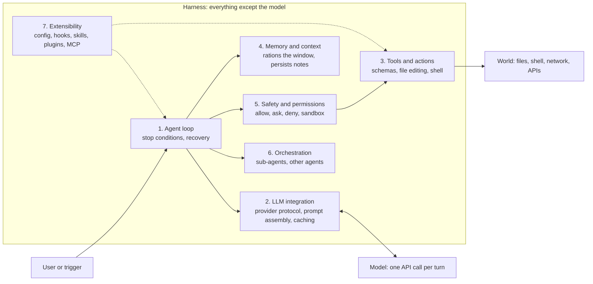

# Module 00: What an Agent Harness Is

> **Prerequisites:** [Module 03: Building a ReAct Agent From Scratch](../../10-ai-agents/03-building-a-react-agent-from-scratch/README.md) and [Module 06: Tool Execution and Error Handling](../../10-ai-agents/06-tool-execution-and-error-handling/README.md).  
> **Estimated Reading Time:** 35 minutes  
> **Target Audience:** AI Backend Engineers, Agent Platform Engineers, Developer-Tool Builders

> [!TIP]
> **The Golden Rule of Harnesses:** An agent is a model plus a harness, and the harness is **everything that is not the model**: the loop, the tools, the context, the safety controls, the orchestration and the extension points. The same model scores differently in different harnesses, so when an agent misbehaves, look at the harness first, and change one thing at a time so you can measure what each change was worth.

---

## Why This Matters

In 2024 a research group gave one model, `GPT-4 Turbo`, a plain Linux shell and asked it to fix real GitHub issues from the `SWE-bench Lite` set. It resolved **11.00%** of them. The same model, on the same issues, resolved **18.00%** once it was given an interface built for it: a compact edit command that runs a linter, a summarised search, a file viewer that shows a window of 100 lines. That is a 64% relative improvement, measured in Table 1 of the SWE-agent paper, and the model did not change. Everything around it did.

That "everything around it" now has a name. In 2026 the practitioner write-up *The Anatomy of an Agent Harness* put it in one line: **Agent = Model + Harness**, where "a harness is every piece of code, configuration, and execution logic that isn't the model itself." A source-code study of eleven production coding agents (Claude Code, Codex CLI, Gemini CLI, Aider, OpenHands, OpenClaw and others) uses the same definition and calls the discipline of building that runtime **harness engineering**.

If you are a backend engineer, this should sound familiar, because most of a harness is ordinary backend work: a loop with stop conditions, timeouts, budgets, authorization, sandboxing, retries, logs and traces. The model is one network call inside it. When someone says "the model is not good enough", the first question is whether the harness let it succeed: did a tool return 40,000 tokens of log, was there any limit on steps, was the "never delete files" rule written in the prompt instead of in code?

By the end of this module you will be able to:

- name the **seven subsystems** of a harness and say what each one is responsible for;
- build a **minimum viable harness** in about 80 lines, in Python, TypeScript, Go or C#, that runs offline against a scripted model;
- show, by taking each subsystem away in turn, what it was protecting you from;
- read an interface ablation (like SWE-agent's) and tell a harness effect from a model effect.

---

## 1. Architectural Mental Model & Core Mechanics

The model is a function from text to text. It can describe an action ("call `read_file` with this path") but it cannot do anything. The harness is the program that reads that description, decides whether to carry it out, carries it out, and shows the result to the model on the next turn:



### The Seven Subsystems

The 2026 source-code study (Barbaste et al., arXiv:2609.00006) read about four million lines of Python, TypeScript and Rust across eleven coding agents and organises what it found around seven canonical subsystems, with a minimal and a maximal implementation of each. The table uses the study's names. The "minimal" and "maximal" columns are examples the study reports for each part; they show how wide the range is.

| # | Subsystem | The question it answers | Minimal form (reported) | Maximal form (reported) |
| :-- | :--- | :--- | :--- | :--- |
| 1 | **Agent loop** | When do we call the model again, and when do we stop? | Mini-SWE-Agent: a linear loop over one bash tool | OpenHands: an event-sourced conversation over a persistent log, with parallel action batches |
| 2 | **LLM integration** | How do we talk to the provider and build the prompt? | One model call and one prompt template | Hermes: five owned transports and 29 provider profiles |
| 3 | **Tools and actions** | What can the agent do, and how is it described to the model? | Bash only | Claude Code: 43 typed tools with deferred loading |
| 4 | **Memory and context** | What does the model see this turn, and what survives the session? | Unbounded linear history | Codex: an agent-maintained memory that persists across sessions |
| 5 | **Safety and permissions** | What runs, what asks first, what is forbidden? | Cost and step limits | Codex: policy rules, an LLM approval reviewer and an OS sandbox on three platforms |
| 6 | **Orchestration** | Can the agent spawn or call other agents? | None: Aider is single-agent by design | Claude Code: recursive composition of agents |
| 7 | **Extensibility** | How do users add capability without forking? | Python protocols (structural typing) | Pi: an everything-is-an-extension runtime |

Two findings from the same study are worth carrying into your own design. First, none of the eleven runtimes imports a general-purpose agent framework; each wrote its own loop. Second, none retrieves code with vector embeddings; the study describes the field as relying on hand-rolled async loops and deterministic retrieval. Skills (a folder with a `SKILL.md`) were adopted by nine of the eleven, more than MCP servers (eight of eleven).

### Model Proposes, Harness Disposes

The most important property of a harness is where the decision to act is made. In every design above, the model only *proposes*: it emits a tool call as text. A rule such as "never delete outside the project" is enforced by code that sits between the proposal and the execution, so it holds even when the model is wrong, confused, or tricked by text it read in a web page. OpenClaw's README states the principle in one line: its architecture follows "trusted gateway, untrusted execution, policy enforced by code", and its documentation says that policy is enforced in code, not requested of the model.

A rule in the system prompt is a request. A rule in the harness is a control. You need both kinds of rules, but only the second kind can be audited.

### A Harness Is Not a Framework

Anthropic's December 2024 essay *Building Effective Agents* draws the line this way: **workflows** are "systems where LLMs and tools are orchestrated through predefined code paths", while **agents** are "systems where LLMs dynamically direct their own processes and tool usage", and agents are "typically just LLMs using tools based on environmental feedback in a loop." Its advice on tooling matches what the eleven-system study found: "start by using LLM APIs directly: many patterns can be implemented in a few lines of code", and "if you do use a framework, ensure you understand the underlying code."

That is why this track builds a harness by hand. The part that decides whether your agent is reliable (what the model sees, what it may do, when it stops) is small enough to own, and a framework that hides it makes it harder to debug, not easier.

---

## 2. Systematic Comparison Matrix: Four Ways to Put a Model in a Loop

| Approach | Who picks the next step | Where policy lives | What you own | The failure you will meet |
| :--- | :--- | :--- | :--- | :--- |
| **Workflow** (fixed code path) | Your code | Your code | The whole path | Brittle when the task does not fit the path you drew |
| **Framework agent** | The model, inside the framework's loop | Framework hooks plus your callbacks | Your tools and prompts; not the loop | You end up reading the framework to find out why a step happened |
| **Minimum viable harness** (this module) | The model | Your code, between proposal and execution | About 80 lines | No memory beyond history, no real sandbox, a toy policy |
| **Production harness** | The model | Layers: rules, approvals, an OS sandbox | All seven subsystems | The operating cost and attack surface of a platform |

The columns to read are the third and fourth. The approaches differ less in how clever the loop is than in who is able to say "no", and in how much of the behaviour you can see and change.

---

## 3. Evidence Case Study: The Interface Ablation Behind SWE-agent

This section uses a real measurement instead of a story, because the point of a harness is that its effect can be measured.

### What Was Measured

The SWE-agent paper (Yang et al., 2024, arXiv:2405.15793) holds the model fixed, `GPT-4 Turbo`, and the task set fixed, `SWE-bench Lite`, and changes the agent-computer interface (ACI) one decision at a time. The numbers below are read from Tables 1 and 3 of the paper.

| Interface | Resolved | Average cost per task |
| :--- | ---: | ---: |
| Shell only (a plain shell) | **11.00%** | $1.46 |
| SWE-agent (its ACI) | **18.00%** | $1.67 |

Then each part of the ACI is removed or swapped for the obvious alternative:

| Decision | Default (SWE-agent) | Variant | Resolved | Change |
| :--- | :--- | :--- | ---: | ---: |
| Editing | One edit command, linted | No edit command | 10.3% | -7.7 |
| Editing | One edit command, linted | Edit without the linter | 15.0% | -3.0 |
| Search | Summarised results | Iterative search | 12.0% | -6.0 |
| Search | Summarised results | No search command | 15.7% | -2.3 |
| File viewer | 100 lines at a time | 30 lines | 14.3% | -3.7 |
| File viewer | 100 lines at a time | The full file | 12.7% | -5.3 |
| Context | Last 5 observations | The full history | 15.0% | -3.0 |
| Context | Last 5 observations | No demonstration | 16.3% | -1.7 |

The default scored 18.0% in every group. **All eight variants were worse than the default**, by between 1.7 and 7.7 percentage points.

### Why the Interface Changed the Result

The paper's explanation is practical. Human-oriented shell tools are inefficient for a model: searching with the shell's own tools is slow going for it, and editing by redirection or `sed` is error-prone and gives no immediate feedback when it goes wrong. A single edit command that runs a linter and reports the error back turns a silent failure into an observation the model can act on. A viewer that shows 100 lines at a time keeps the context small enough to stay useful. Keeping only the last five observations does the same for history.

### What a Harness Builder Takes From It

- **Interface decisions are experiments.** Each row above is one decision, measured. Treat your own tool descriptions, output formats and limits the same way, and keep a fixed task set so you can run them (Track 15 builds that set).
- **Tool results are part of the prompt.** The linter message in the edit tool is worth 3.0 points. Write error messages for the model that will read them.
- **Bound what the model reads.** The viewer window and the history length both have a size that works, and the unbounded setting (the full file, the full history) was the worst variant in both of those groups.
- **Be careful what you generalise.** These are one model, one benchmark and one date. The lesson is that harness choices are worth measuring, not that these exact numbers carry over to your agent.

---

## 4. Multi-Language Production Implementation: A Minimum Viable Harness

Below is a **minimum viable harness** in **Go**, **TypeScript**, **Python** and **C#**. It has a loop with a step limit, a tool registry, a policy gate with `allow` / `ask` / `deny`, an output budget, and errors that are returned to the model as observations. The model is a stand-in: a function from "how many steps so far" to the next action, so the program runs offline with no API key. Replace that one function with a call to a model provider and nothing else changes.

Run them with `go run harness.go`, `node harness.ts` (Node 24 or newer), `python harness.py` and `dotnet run Harness.cs` (.NET 10 SDK). All four print the same transcript, which is shown in Workflow 1 below.

````carousel

```go
// A minimum viable agent harness: loop, tools, policy, output budget, step limit. No network, no API key.
package main

import (
	"fmt"
	"strings"
)

type Args map[string]string

// Action is a tool call, or the final answer when Final is set.
type Action struct {
	Tool  string
	Args  Args
	Final string
}

var files = map[string]string{"/work/todo.txt": "buy milk\nwrite tests\n", "/work/big.txt": strings.Repeat("x", 130)}

var tools = map[string]func(Args) (string, error){
	"read_file": func(a Args) (string, error) {
		content, ok := files[a["path"]]
		if !ok {
			return "", fmt.Errorf("no such file: %s", a["path"])
		}
		return content, nil
	},
	"write_file": func(a Args) (string, error) {
		files[a["path"]] = a["content"]
		return fmt.Sprintf("wrote %d bytes to %s", len(a["content"]), a["path"]), nil
	},
	"shell": func(a Args) (string, error) { return "ran: " + a["cmd"], nil },
}

// decide: the policy lives in the harness, never in the prompt.
func decide(tool string, a Args) (verdict, reason string) {
	if tool == "shell" && strings.Contains(a["cmd"], "rm ") {
		return "deny", "rule: destructive command (rm)"
	}
	if tool == "write_file" && !strings.HasPrefix(a["path"], "/work/") {
		return "ask", "needs approval: path outside /work/"
	}
	return "allow", ""
}

type Result struct {
	Transcript          []string
	Steps, Denied, Errs int
	Stop                string
}

func run(model func(n int) Action, approver func(string, Args) bool, maxSteps, maxObs int) Result {
	r := Result{}
	for step := 1; step <= maxSteps; step++ {
		action := model(len(r.Transcript))
		if action.Final != "" {
			r.Transcript = append(r.Transcript, fmt.Sprintf("step %d final %s", step, action.Final))
			r.Steps, r.Stop = step, "final"
			return r
		}
		verdict, reason := decide(action.Tool, action.Args)
		if verdict == "ask" && !approver(action.Tool, action.Args) {
			verdict, reason = "deny", reason+" (approver said no)"
		}
		if verdict == "deny" {
			r.Denied++
			r.Transcript = append(r.Transcript, fmt.Sprintf("step %d %s DENIED %s", step, action.Tool, reason))
			continue
		}
		obs, err := tools[action.Tool](action.Args)
		status := "ok"
		if err != nil { // the model sees the error and can recover
			obs, status = err.Error(), "ERROR"
			r.Errs++
		}
		if len(obs) > maxObs {
			obs = fmt.Sprintf("%s...[+%d chars]", obs[:maxObs], len(obs)-maxObs)
		}
		r.Transcript = append(r.Transcript, fmt.Sprintf("step %d %s %s %s", step, action.Tool, status, strings.ReplaceAll(obs, "\n", "|")))
	}
	r.Steps, r.Stop = maxSteps, "step_limit"
	return r
}

func report(name string, model func(n int) Action) {
	fmt.Println("run: " + name)
	r := run(model, func(string, Args) bool { return false }, 8, 60)
	for _, line := range r.Transcript {
		fmt.Println(line)
	}
	fmt.Printf("result: steps=%d denied=%d errors=%d stop=%s\n", r.Steps, r.Denied, r.Errs, r.Stop)
}

func main() {
	script := []Action{
		{Tool: "read_file", Args: Args{"path": "/work/todo.txt"}},
		{Tool: "read_file", Args: Args{"path": "/work/big.txt"}},
		{Tool: "write_file", Args: Args{"path": "/work/summary.txt", "content": "2 tasks"}},
		{Tool: "write_file", Args: Args{"path": "/etc/passwd", "content": "x"}},
		{Tool: "shell", Args: Args{"cmd": "rm -rf /work"}},
		{Tool: "read_file", Args: Args{"path": "/work/missing.txt"}},
		{Final: "done"},
	}
	runaway := Action{Tool: "read_file", Args: Args{"path": "/work/todo.txt"}}
	report("scripted", func(n int) Action { return script[n] })
	report("runaway", func(int) Action { return runaway })
}
```

```typescript
// A minimum viable agent harness: loop, tools, policy, output budget, step limit. No network, no API key.
type Args = Record<string, string>;
type Action = { tool: string; args: Args } | { final: string };
type Verdict = { verdict: "allow" | "ask" | "deny"; reason: string };

const FILES: Record<string, string> = { "/work/todo.txt": "buy milk\nwrite tests\n", "/work/big.txt": "x".repeat(130) };

const TOOLS: Record<string, (args: Args) => string> = {
  read_file: (args) => {
    if (!(args.path in FILES)) throw new Error(`no such file: ${args.path}`);
    return FILES[args.path];
  },
  write_file: (args) => {
    FILES[args.path] = args.content;
    return `wrote ${args.content.length} bytes to ${args.path}`;
  },
  shell: (args) => `ran: ${args.cmd}`,
};

// The policy lives in the harness, never in the prompt.
function decide(tool: string, args: Args): Verdict {
  if (tool === "shell" && args.cmd.includes("rm ")) return { verdict: "deny", reason: "rule: destructive command (rm)" };
  if (tool === "write_file" && !args.path.startsWith("/work/")) return { verdict: "ask", reason: "needs approval: path outside /work/" };
  return { verdict: "allow", reason: "" };
}

function run(model: (n: number) => Action, approver: (tool: string, args: Args) => boolean, maxSteps = 8, maxObs = 60) {
  const transcript: string[] = [];
  let denied = 0;
  let errors = 0;
  for (let step = 1; step <= maxSteps; step++) {
    const action = model(transcript.length);
    if ("final" in action) {
      transcript.push(`step ${step} final ${action.final}`);
      return { transcript, steps: step, denied, errors, stop: "final" };
    }
    let { verdict, reason } = decide(action.tool, action.args);
    if (verdict === "ask" && !approver(action.tool, action.args)) {
      verdict = "deny";
      reason += " (approver said no)";
    }
    if (verdict === "deny") {
      denied++;
      transcript.push(`step ${step} ${action.tool} DENIED ${reason}`);
      continue;
    }
    let obs: string;
    let status = "ok";
    try {
      obs = TOOLS[action.tool](action.args);
    } catch (e) {
      obs = (e as Error).message; // the model sees the error and can recover
      status = "ERROR";
      errors++;
    }
    if (obs.length > maxObs) obs = obs.slice(0, maxObs) + `...[+${obs.length - maxObs} chars]`;
    transcript.push(`step ${step} ${action.tool} ${status} ${obs.replaceAll("\n", "|")}`);
  }
  return { transcript, steps: maxSteps, denied, errors, stop: "step_limit" };
}

const SCRIPT: Action[] = [
  { tool: "read_file", args: { path: "/work/todo.txt" } },
  { tool: "read_file", args: { path: "/work/big.txt" } },
  { tool: "write_file", args: { path: "/work/summary.txt", content: "2 tasks" } },
  { tool: "write_file", args: { path: "/etc/passwd", content: "x" } },
  { tool: "shell", args: { cmd: "rm -rf /work" } },
  { tool: "read_file", args: { path: "/work/missing.txt" } },
  { final: "done" },
];
const RUNAWAY: Action = { tool: "read_file", args: { path: "/work/todo.txt" } };

function report(name: string, model: (n: number) => Action) {
  console.log(`run: ${name}`);
  const r = run(model, () => false);
  r.transcript.forEach((line) => console.log(line));
  console.log(`result: steps=${r.steps} denied=${r.denied} errors=${r.errors} stop=${r.stop}`);
}

report("scripted", (n) => SCRIPT[n]);
report("runaway", () => RUNAWAY);
```

```python
"""A minimum viable agent harness: loop, tools, policy, output budget, step limit. No network, no API key."""

FILES = {"/work/todo.txt": "buy milk\nwrite tests\n", "/work/big.txt": "x" * 130}


def read_file(args):
    path = args["path"]
    if path not in FILES:
        raise FileNotFoundError(f"no such file: {path}")
    return FILES[path]


def write_file(args):
    FILES[args["path"]] = args["content"]
    return f"wrote {len(args['content'])} bytes to {args['path']}"


def shell(args):
    return f"ran: {args['cmd']}"


TOOLS = {"read_file": read_file, "write_file": write_file, "shell": shell}


def decide(tool, args):
    """The policy lives in the harness, never in the prompt. Returns (verdict, reason)."""
    if tool == "shell" and "rm " in args["cmd"]:
        return "deny", "rule: destructive command (rm)"
    if tool == "write_file" and not args["path"].startswith("/work/"):
        return "ask", "needs approval: path outside /work/"
    return "allow", ""


def run(model, approver, max_steps=8, max_obs=60):
    transcript, denied, errors = [], 0, 0
    for step in range(1, max_steps + 1):
        action = model(len(transcript))
        if "final" in action:
            transcript.append(f"step {step} final {action['final']}")
            return transcript, step, denied, errors, "final"
        tool, args = action["tool"], action["args"]
        verdict, reason = decide(tool, args)
        if verdict == "ask" and not approver(tool, args):
            verdict, reason = "deny", reason + " (approver said no)"
        if verdict == "deny":
            denied += 1
            transcript.append(f"step {step} {tool} DENIED {reason}")
            continue
        try:
            obs, status = TOOLS[tool](args), "ok"
        except Exception as exc:  # the model sees the error and can recover
            obs, status = str(exc), "ERROR"
            errors += 1
        if len(obs) > max_obs:
            obs = obs[:max_obs] + f"...[+{len(obs) - max_obs} chars]"
        transcript.append(f"step {step} {tool} {status} {obs.replace(chr(10), '|')}")
    return transcript, max_steps, denied, errors, "step_limit"


SCRIPT = [
    {"tool": "read_file", "args": {"path": "/work/todo.txt"}},
    {"tool": "read_file", "args": {"path": "/work/big.txt"}},
    {"tool": "write_file", "args": {"path": "/work/summary.txt", "content": "2 tasks"}},
    {"tool": "write_file", "args": {"path": "/etc/passwd", "content": "x"}},
    {"tool": "shell", "args": {"cmd": "rm -rf /work"}},
    {"tool": "read_file", "args": {"path": "/work/missing.txt"}},
    {"final": "done"},
]
RUNAWAY = {"tool": "read_file", "args": {"path": "/work/todo.txt"}}


def report(name, model):
    print(f"run: {name}")
    transcript, steps, denied, errors, stop = run(model, lambda tool, args: False)
    for line in transcript:
        print(line)
    print(f"result: steps={steps} denied={denied} errors={errors} stop={stop}")


if __name__ == "__main__":
    report("scripted", lambda n: SCRIPT[n])
    report("runaway", lambda n: RUNAWAY)
```

```csharp
// A minimum viable agent harness: loop, tools, policy, output budget, step limit. No network, no API key.
using System;
using System.Collections.Generic;

var files = new Dictionary<string, string> { ["/work/todo.txt"] = "buy milk\nwrite tests\n", ["/work/big.txt"] = new string('x', 130) };

var tools = new Dictionary<string, Func<Dictionary<string, string>, string>>
{
    ["read_file"] = a => files.TryGetValue(a["path"], out var content) ? content : throw new Exception($"no such file: {a["path"]}"),
    ["write_file"] = a => { files[a["path"]] = a["content"]; return $"wrote {a["content"].Length} bytes to {a["path"]}"; },
    ["shell"] = a => $"ran: {a["cmd"]}",
};

// The policy lives in the harness, never in the prompt.
(string Verdict, string Reason) Decide(string tool, Dictionary<string, string> a)
{
    if (tool == "shell" && a["cmd"].Contains("rm ")) return ("deny", "rule: destructive command (rm)");
    if (tool == "write_file" && !a["path"].StartsWith("/work/", StringComparison.Ordinal)) return ("ask", "needs approval: path outside /work/");
    return ("allow", "");
}

(List<string> Transcript, int Steps, int Denied, int Errors, string Stop) Run(
    Func<int, Action> model, Func<string, Dictionary<string, string>, bool> approver, int maxSteps = 8, int maxObs = 60)
{
    var transcript = new List<string>();
    int denied = 0, errors = 0;
    for (int step = 1; step <= maxSteps; step++)
    {
        var action = model(transcript.Count);
        if (action.Final is not null)
        {
            transcript.Add($"step {step} final {action.Final}");
            return (transcript, step, denied, errors, "final");
        }
        var (verdict, reason) = Decide(action.Tool!, action.Args!);
        if (verdict == "ask" && !approver(action.Tool!, action.Args!)) (verdict, reason) = ("deny", reason + " (approver said no)");
        if (verdict == "deny")
        {
            denied++;
            transcript.Add($"step {step} {action.Tool} DENIED {reason}");
            continue;
        }
        string obs, status = "ok";
        try { obs = tools[action.Tool!](action.Args!); }
        catch (Exception e) { obs = e.Message; status = "ERROR"; errors++; } // the model sees the error and can recover
        if (obs.Length > maxObs) obs = obs[..maxObs] + $"...[+{obs.Length - maxObs} chars]";
        transcript.Add($"step {step} {action.Tool} {status} {obs.Replace("\n", "|")}");
    }
    return (transcript, maxSteps, denied, errors, "step_limit");
}

void Report(string name, Func<int, Action> model)
{
    Console.WriteLine($"run: {name}");
    var r = Run(model, (tool, args) => false);
    foreach (var line in r.Transcript) Console.WriteLine(line);
    Console.WriteLine($"result: steps={r.Steps} denied={r.Denied} errors={r.Errors} stop={r.Stop}");
}

var script = new[]
{
    new Action("read_file", new() { ["path"] = "/work/todo.txt" }),
    new Action("read_file", new() { ["path"] = "/work/big.txt" }),
    new Action("write_file", new() { ["path"] = "/work/summary.txt", ["content"] = "2 tasks" }),
    new Action("write_file", new() { ["path"] = "/etc/passwd", ["content"] = "x" }),
    new Action("shell", new() { ["cmd"] = "rm -rf /work" }),
    new Action("read_file", new() { ["path"] = "/work/missing.txt" }),
    new Action(null, null, "done"),
};
var runaway = new Action("read_file", new() { ["path"] = "/work/todo.txt" });
Report("scripted", n => script[n]);
Report("runaway", _ => runaway);

// An action is a tool call, or the final answer when Final is set.
record Action(string? Tool, Dictionary<string, string>? Args, string? Final = null);
```

````

### What Each Part Is For

| Code | Subsystem | What it does in this program |
| :--- | :--- | :--- |
| `run` and the `for` loop | 1. Agent loop | Calls the model, executes the action, appends to the transcript, stops on a final answer or at `max_steps` |
| `model(n)` | 2. LLM integration | The seam where a provider call goes; here a scripted list |
| `TOOLS` / `tools` | 3. Tools and actions | A registry of named functions; errors become observations |
| `max_obs` truncation | 4. Memory and context | A budget on what one observation can add to the context |
| `decide` and the approver | 5. Safety and permissions | Rule-based `deny`, `ask` for a human, otherwise `allow` |
| (none) | 6. Orchestration | Out of scope; see Track 12 |
| (none) | 7. Extensibility | Out of scope; see Module 04 |

The policy here is **deliberately naive**: a substring test and a prefix test. Exercise 2 breaks it. Real policy engines parse commands and resolve paths, which is Module 03.

---

## 5. Practical Hands-On Verification CLI Workflows

Everything below is plain Python 3, offline, with no third-party packages and no API keys. The outputs are copied from real runs.

### Workflow 1: Run the Harness and Read the Transcript

Save the Python tab above as `harness.py` and run it:

```bash
python harness.py
```

```text
run: scripted
step 1 read_file ok buy milk|write tests|
step 2 read_file ok xxxxxxxxxxxxxxxxxxxxxxxxxxxxxxxxxxxxxxxxxxxxxxxxxxxxxxxxxxxx...[+70 chars]
step 3 write_file ok wrote 7 bytes to /work/summary.txt
step 4 write_file DENIED needs approval: path outside /work/ (approver said no)
step 5 shell DENIED rule: destructive command (rm)
step 6 read_file ERROR no such file: /work/missing.txt
step 7 final done
result: steps=7 denied=2 errors=1 stop=final
run: runaway
step 1 read_file ok buy milk|write tests|
step 2 read_file ok buy milk|write tests|
step 3 read_file ok buy milk|write tests|
step 4 read_file ok buy milk|write tests|
step 5 read_file ok buy milk|write tests|
step 6 read_file ok buy milk|write tests|
step 7 read_file ok buy milk|write tests|
step 8 read_file ok buy milk|write tests|
result: steps=8 denied=0 errors=0 stop=step_limit
```

Read it as a story. Step 2 shows the output budget: a 130-character file came back as 60 characters plus a note that 70 more were cut. Step 4 asked to write outside `/work/`, the policy said `ask`, the approver (always "no" here) refused. Step 5 is a rule-based `deny`. Step 6 is a tool error that came back as text instead of crashing the loop. In the second run the model never finishes, and the loop stops on its own at step 8.

### Workflow 2: Take One Subsystem Out at a Time

Save this as `ablate.py` next to `harness.py`. It reuses the same scripted model and removes one protection per trial:

```python
"""Take one subsystem out of the harness at a time and see what the same scripted model can now do."""
import harness

INITIAL = dict(harness.FILES)
ALLOW_ALL = lambda tool, args: ("allow", "")
REAL_DECIDE = harness.decide


def trial(name, *, decide=REAL_DECIDE, max_steps=8, max_obs=60, model=None, script=True):
    harness.FILES.clear()
    harness.FILES.update(INITIAL)
    harness.decide = decide
    pick = (lambda n: harness.SCRIPT[n]) if script else (lambda n: harness.RUNAWAY)
    transcript, steps, denied, errors, stop = harness.run(pick, lambda tool, args: False, max_steps, max_obs)
    harmful = int("/etc/passwd" in harness.FILES) + sum("ran: rm" in line for line in transcript)
    returned = sum(len(line) for line in transcript)
    print(f"{name:<22} stop={stop:<10} steps={steps:<5} harmful_actions={harmful} transcript_chars={returned}")


trial("full harness")
trial("no step limit", max_steps=1000, script=False)
trial("no policy", decide=ALLOW_ALL)
trial("no output budget", max_obs=10**9)
trial("step limit, runaway", script=False)
```

```bash
python ablate.py
```

```text
full harness           stop=final      steps=7     harmful_actions=0 transcript_chars=390
no step limit          stop=step_limit steps=1000  harmful_actions=0 transcript_chars=42893
no policy              stop=final      steps=7     harmful_actions=2 transcript_chars=343
no output budget       stop=final      steps=7     harmful_actions=0 transcript_chars=446
step limit, runaway    stop=step_limit steps=8     harmful_actions=0 transcript_chars=328
```

How to read it:

- **No policy:** `harmful_actions=2`. The write to `/etc/passwd` and the `rm -rf /work` both ran, and the model needed no jailbreak to do it, only the script's request. (Both are simulated here; in a real harness they would be real.)
- **No step limit:** a cap of 1000 stands in for "unlimited", since a truly unlimited loop would not return. The runaway model made 1000 model calls and the transcript grew to 42,893 characters. Against a paid API, each of those is a request you are billed for.
- **No output budget:** the transcript grows by the full size of every observation. Here that is only 56 characters; a real log file or `git diff` is thousands.

### Workflow 3: What a Linear History Costs

Context is not free, because every call re-sends everything the harness kept. Save this as `context_growth.py`:

```python
"""How much a linear history costs: tokens sent to the model over a run, under three ways of keeping tool output.
Model arithmetic, not a measurement: 4 characters per token, every call re-sends the whole kept history, prompt caching ignored."""

CHARS_PER_TOKEN = 4
OBS_CHARS = 4000          # one tool observation: a file view, a test log
STEPS = 50                # model calls in one run
KEEP_LAST = 5             # the "last N observations" policy


def tokens(chars):
    return chars // CHARS_PER_TOKEN


def total_input_tokens(kept_chars_at_call):
    return sum(tokens(kept_chars_at_call(k)) for k in range(1, STEPS + 1))


policies = {
    "keep every observation": lambda k: (k - 1) * OBS_CHARS,
    "truncate each to 500 chars": lambda k: (k - 1) * 500,
    f"last {KEEP_LAST} observations only": lambda k: min(k - 1, KEEP_LAST) * OBS_CHARS,
}

base = total_input_tokens(policies["keep every observation"])
print(f"{STEPS} model calls, one {OBS_CHARS}-char observation per call")
for name, kept in policies.items():
    total = total_input_tokens(kept)
    print(f"{name:<30} total_input_tokens={total:>9,}  ({total / base:5.1%} of keeping everything)  last_call_tokens={tokens(kept(STEPS)):>7,}")
```

```bash
python context_growth.py
```

```text
50 model calls, one 4000-char observation per call
keep every observation         total_input_tokens=1,225,000  (100.0% of keeping everything)  last_call_tokens= 49,000
truncate each to 500 chars     total_input_tokens=  153,125  (12.5% of keeping everything)  last_call_tokens=  6,125
last 5 observations only       total_input_tokens=  235,000  (19.2% of keeping everything)  last_call_tokens=  5,000
```

This is **model arithmetic, not a measurement**: it assumes four characters per token, ignores prompt caching, and uses one 4,000-character observation per call. The shape is what matters. Keeping every observation makes the last call 49,000 tokens and the whole run 1,225,000 input tokens, because the cost of call *k* grows with *k* and the total grows with the square of the number of steps. Truncating each observation to 500 characters, or keeping only the last five, cuts the total to 12.5% and 19.2%. SWE-agent's "last 5 observations" row in Section 3 is the same idea, and it scored higher than the full history.

### Hands-On Exercises

1. **Add a cost stop.** Give `run` a `max_tokens` budget (estimate with four characters per token) and stop with `stop="budget"` when the transcript passes it. Test it with the runaway model, and decide whether the step limit or the budget fires first when observations are large.
2. **Break the policy.** The `write_file` rule is `path.startswith("/work/")`. Call `decide("write_file", {"path": "/work/../etc/passwd", "content": "x"})` and read the verdict. Then write a version that normalises the path with `posixpath.normpath` before the prefix test and confirm the bypass is closed. (Symbolic links need more than this; Module 03 covers them.)
3. **Let the model recover.** Write a second script where, after the `ERROR no such file` observation, the model reads the correct path and finishes. Check that the harness passed the error text back unchanged, and explain why returning the Python traceback instead would be a worse observation.

### Independent Challenge

Your team wants an internal on-call agent that can read service logs, run a small set of diagnostic commands, and restart a service after a human approves it. Using the seven subsystems, write down for each one the **minimal form you would ship first**, what you would leave out on purpose, and the one measurement you would take before letting it run unattended.

<details><summary>Architectural Discussion</summary>

1. **Agent loop:** a step limit and a wall-clock timeout, with a clear `stop` reason in the transcript. Leave out parallel actions.
2. **LLM integration:** one provider behind one function, with retries for transport errors only. Leave out multi-provider routing until a second provider is needed.
3. **Tools:** `read_log(service, lines)` with a hard cap on lines, `run_diagnostic(name)` over an allow-list of named commands (not a free shell), `restart(service)`. A free-form shell is the simplest tool to build and the hardest to make safe, so start from named commands.
4. **Memory and context:** the output budget from this module and no cross-session memory. A fresh run starts from the alert text.
5. **Safety:** `restart` is `ask`, everything that writes is `deny` by default, and the credentials the agent holds can only read logs and restart one named service. The rules live in code.
6. **Orchestration:** none.
7. **Extensibility:** none yet; add diagnostics by editing the allow-list in review.

**What to measure first:** replay 20 past incidents (alert text only) and record how often the agent reaches the same diagnosis a human did, what each run cost, and how many actions were denied. Without that fixed set, you cannot tell a harness improvement from luck, which is exactly the problem Section 3 solved with a fixed task set.

</details>

---

## 6. Common Mistakes & Troubleshooting

- **Putting policy in the prompt.** "Never run `rm`" is a hope. Enforce it in code between the model's proposal and the execution, and log every denial.
- **Changing the model and the harness in the same release.** Table 1 and Table 3 show harness changes alone moving results by up to 7.7 points. If you change both, you cannot say which one helped or hurt.
- **Returning raw tool output.** A 2 MB log, a `git diff`, or a stack trace fills the window and pushes the task out of it. Truncate, summarise, or write it to a file and return the path.
- **No stop conditions.** Without a step limit, a wall-clock limit and a budget, a confused model loops until something else stops it. Return the reason you stopped so the next turn, or the human, can see it.
- **Adopting a framework before you can write the loop.** If you cannot say what your agent sends to the model on turn 5, you cannot debug it. Write the 80 lines once.
- **Treating tool errors as crashes.** An exception that kills the loop teaches the model nothing. Return the message as an observation and let the model correct itself, up to your step limit.

---

## 7. Operational Validation Checkpoints & Checkpoint Quiz

### Operational Validation Checkpoints

<details><summary><strong>Checkpoint 1: Was it the model or the harness?</strong></summary>

A teammate says the agent got worse after you upgraded the model, but the same week you also changed how tool results are formatted. How do you find out which change caused it?

**Validation:** Run a fixed task set twice more, changing one thing each time: the old model with the new formatting, and the new model with the old formatting. The SWE-agent ablations show that harness changes alone move results by 1.7 to 7.7 points on a fixed model, so a change that large from formatting is entirely plausible. Without the fixed set and the one-change rule, the question has no answer.

</details>

<details><summary><strong>Checkpoint 2: Why a prompt rule is not a policy</strong></summary>

Your system prompt says "never delete files outside the project". Why does that not count as a safety control, and what does?

**Validation:** A prompt rule asks the model to behave; the model can ignore it, misread it, or be talked out of it by text it reads during the task. A control is code between the proposal and the execution that refuses the action regardless of what the model says. In Workflow 1 the `rm -rf /work` call was denied by `decide` before any tool ran, and the model had no say. Keep the prompt rule (it reduces how often the model tries) and add the code rule (it guarantees what happens when it does).

</details>

<details><summary><strong>Checkpoint 3: The three limits</strong></summary>

The runaway model never finishes. Which three limits should a harness have, and what does each one protect?

**Validation:** A **step limit** protects against loops that make no progress (Workflow 2: 8 steps against 1000). A **wall-clock timeout** protects against a single step that hangs, such as a slow tool or a stalled provider call. A **token or cost budget** protects your bill, because Workflow 3 showed that cost grows with the square of the number of steps when history is kept. Whichever fires first should be recorded as the `stop` reason.

</details>

### Checkpoint Quiz

1. State the formula for an agent, and give the definition of a harness.
2. Name the seven subsystems of a harness.
3. In Table 1 of the SWE-agent paper, what changed between the 11.00% row and the 18.00% row, and what stayed fixed?
4. Why is a rule in the system prompt not a safety control?
5. Why does keeping every tool observation make the total input tokens grow with the square of the number of steps, and which two policies in `context_growth.py` bring it down?

<details><summary>Answers</summary>

1. **Agent = Model + Harness.** A harness is every piece of code, configuration and execution logic that is not the model itself: the loop, tools, context handling, safety controls, orchestration and extension points.
2. The agent loop; LLM integration; tools and actions; memory and context; safety and permissions; orchestration; extensibility.
3. The interface changed, from a plain shell to SWE-agent's agent-computer interface. The model (`GPT-4 Turbo`) and the task set (`SWE-bench Lite`) stayed fixed. The result went from 11.00% to 18.00%.
4. A prompt is a request to the model, which can ignore, misread or be talked out of it. A safety control is code between the model's proposal and the action, which refuses regardless of what the model says, and which you can test and audit.
5. Each call re-sends the whole kept history, so call *k* sends about *k* observations and the sum over *N* calls is proportional to *N* squared. Truncating each observation, and keeping only the last few observations, both bound what each call carries (12.5% and 19.2% of the total in the workflow).

</details>

---

## Further Reading & Sources

- [Harness Engineering: Anatomy, Architecture, and Evolution of Coding Agents, a Source-Code Study of Eleven Systems (Barbaste et al., 2026)](https://arxiv.org/abs/2609.00006) — the seven-subsystem breakdown, the minimal and maximal forms, and the cross-system findings used in Section 1.
- [The Anatomy of an Agent Harness (Vivek Trivedy, LangChain, 10 March 2026)](https://www.langchain.com/blog/the-anatomy-of-an-agent-harness) — the "Agent = Model + Harness" framing and its definition of a harness.
- [Building Effective Agents (Anthropic, 19 December 2024)](https://www.anthropic.com/research/building-effective-agents) — workflows versus agents, the advice to start with plain API calls, and the section on agent-computer interfaces.
- [SWE-agent: Agent-Computer Interfaces Enable Automated Software Engineering (Yang et al., 2024)](https://arxiv.org/abs/2405.15793) — the interface ablation in Tables 1 and 3 used in Section 3.
- [mini-swe-agent](https://github.com/SWE-agent/mini-swe-agent) — a deliberately minimal harness: about 100 lines for the agent class, bash as the only tool, a linear history.
- [Effective Harnesses for Long-Running Agents (Justin Young, Anthropic Engineering, 26 November 2025)](https://www.anthropic.com/engineering/effective-harnesses-for-long-running-agents) — how a harness carries work across many context windows; used in Module 02.
- [Why OpenClaw (OpenClaw documentation)](https://docs.openclaw.ai/start/why-openclaw) — the "trusted gateway, untrusted execution, policy enforced by code" design, studied in Module 05.

## Next

[Module 01: Tools and the Agent-Computer Interface](../01-tools-and-the-agent-computer-interface/README.md)
