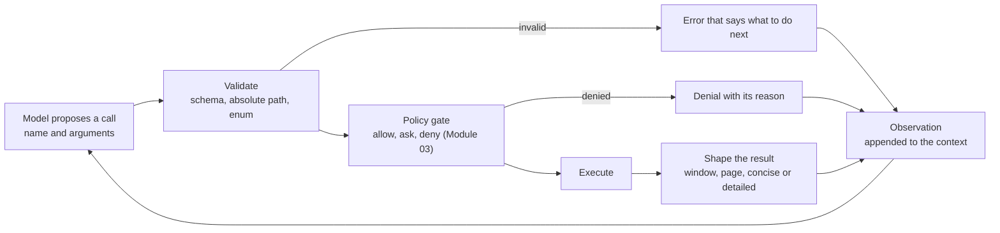

# Module 01: Tools and the Agent-Computer Interface

> **Prerequisites:** [Module 00: What an Agent Harness Is](../00-what-an-agent-harness-is/README.md) and [Module 04: Tools: Definition and Schemas](../../10-ai-agents/04-tools-definition-and-schemas/README.md).  
> **Estimated Reading Time:** 35 minutes  
> **Target Audience:** AI Backend Engineers, Agent Platform Engineers, Developer-Tool Builders

> [!TIP]
> **The Golden Rule of Agent Tools:** A tool is a contract between deterministic code and a non-deterministic reader, so design it for the reader. Give it few, clearly named tools, arguments that are hard to get wrong, results that are bounded, and errors that say what to do next. When a model keeps making the same mistake, change the tool before you change the prompt.

---

## Why This Matters

While building its coding agent for `SWE-bench`, Anthropic found that the model made mistakes with tools that took relative file paths once the agent had moved out of the root directory. They did not fix it with a longer prompt. As they describe it in *Building Effective Agents*, they "changed the tool to always require absolute filepaths", and the mistakes stopped. Anthropic calls this **poka-yoke**: change the arguments so that it is harder to make the mistake.

That one story contains the whole module. The model reads your tool's name, description, parameters and results on every turn, so those four things are the interface the agent works through. SWE-agent's authors call it the **agent-computer interface (ACI)** and measured what it is worth (Module 00, Section 3): taking away the editor's linter cost 3.0 points, and removing the edit command altogether cost 7.7. The tool is where you remove a whole class of mistakes at once.

After this module you will be able to:

- design a small set of tools using the rules from SWE-agent and from Anthropic's tool-writing guidance;
- build a `view` and an `edit` tool with absolute paths only, a bounded window, a unique-match rule, a lint gate and errors that guide the next call, in four languages;
- measure how much context a tool result and a tool definition add, and cap both;
- test a tool against the mistakes a model is likely to make, before a model ever calls it.

---

## 1. Architectural Mental Model & Core Mechanics

A tool call is not a function call. It crosses from a probabilistic caller to deterministic code and back, and both directions need a guard. Every request is validated, checked against policy and executed; every result is shaped before it reaches the model; every failure becomes text the model can act on:



### Tools Are Prompts

Anthropic's guidance (Ken Aizawa, *Writing Effective Tools for AI Agents*, September 2025) defines a tool as "a new kind of software which reflects a contract between deterministic systems and non-deterministic agents". It follows that tools should not be written "the way we'd write functions and APIs for other developers or systems." Describe each tool as you would to a new hire, and name parameters unambiguously: the article's example is `user_id` instead of `user`. The name, the description and the parameter names are all text the model reads, so they are prompt engineering.

### Fewer, Higher-Level Tools

"More tools don't always lead to better outcomes." For an address book, consider `search_contacts` or `message_contact` instead of `list_contacts`, which would dump every record into the context. Where a task needs several calls in a fixed order, consolidate them: rather than `list_users`, `list_events` and `create_event`, offer `schedule_event`, which finds availability and books the meeting. Group related tools under a common prefix (`asana_projects_search`, `asana_users_search`); the article notes that prefix versus suffix naming had measurable effects on its evaluations.

### Arguments That Are Hard to Get Wrong

Poka-yoke is a design habit. In the code below, a path must be absolute, or the tool refuses it and says so. An edit must match exactly one place, or the tool lists where it matched and asks for more context. A view may cover at most 100 lines, or the tool says how many were asked for. Each rule removes a mistake that a model would otherwise make now and then, and that you would otherwise find in a transcript at 2 a.m.

### Results Are Context

Whatever a tool returns is appended to the context and re-sent on every later call (Module 00, Workflow 3). The guidance is to return "only high signal information", to avoid low-level identifiers such as `uuid` and `mime_type` unless the next step needs them, and to offer a `response_format` switch. Anthropic's example: a detailed response took 206 tokens and a concise one 72, about a third. Bound the size as well: use pagination, filtering or truncation with sensible defaults. For Claude Code, Anthropic says it restricts tool responses to 25,000 tokens by default. When you do truncate, say so in a way that steers: "showing 10 of 250, call again with `offset=10`".

### Errors That Teach

An error message is the next prompt. `400 Bad Request` or a stack trace tells the model nothing; `old text matches 2 places (lines 2, 5); include more surrounding text to make it unique` tells it exactly what to change. The linter in SWE-agent's edit command is the same idea: it turns a silent failure into an observation. Write every error string for a reader who cannot ask a follow-up question.

### How Many Tools

Tool definitions occupy the context window on every call, before any work happens. Section 3 puts numbers on it. The mitigation that the harness study (Module 00) found in the largest system is **deferred loading**: Claude Code ships 43 typed tools but does not put them all in front of the model at once.

---

## 2. Systematic Comparison Matrix: Four Ways to Give an Agent a Computer

| Style | What the model sees | Strength | Cost or risk | Example |
| :--- | :--- | :--- | :--- | :--- |
| **Bash only** | One tool: run a command | Tiny definition; works with almost any model | Every mistake is a shell mistake; no linter; output is unbounded unless you wrap it | mini-swe-agent: no tools other than bash |
| **Typed interface tools** | A few commands built for the task (view, edit, search) | Bounded, validated, with guided errors | You design, version and test them | SWE-agent's ACI |
| **Service tools (MCP)** | Many tools from many servers | Integrates SaaS and internal APIs quickly | Definitions pile up in the window (Section 3) | Five servers, 58 tools in Anthropic's example |
| **Code execution** | One tool: run code that calls the others | Intermediate results stay out of the context | Needs a real sandbox (Module 03) | Anthropic's programmatic tool calling |

No row wins everywhere. The matrix is a map of trade-offs: the further down you go, the more capability you get per token of context, and the more you depend on the harness to keep it safe.

---

## 3. Evidence Case Study: What Tool Definitions Cost

Anthropic's November 2025 article *Introducing Advanced Tool Use on the Claude Developer Platform* (Bin Wu) reports measurements on the cost of tool definitions. These are vendor-reported figures from internal evaluations of features that were in beta at the time, so read them as an order of magnitude and a way of measuring, not as a benchmark you can reproduce.

### What Was Measured

A five-server setup: GitHub, Slack, Sentry, Grafana and Splunk.

| Server | Tools | Tokens of definitions (approx.) |
| :--- | ---: | ---: |
| GitHub | 35 | 26K |
| Slack | 11 | 21K |
| Sentry | 5 | 3K |
| Grafana | 5 | 3K |
| Splunk | 2 | 2K |
| **Total** | **58** | **about 55K** |

That is about 55K tokens of definitions "before the conversation starts". The article adds that adding Jira (about 17K tokens on its own) pushes the overhead past 100K, and that Anthropic itself had seen tool definitions consume 134K tokens before it optimised.

Its remedies, with the results it reports:

- **Tool search** (tools marked `defer_loading: true` stay out of the prompt until needed). In the article's comparison, about 77K tokens were used before any work began with all definitions loaded, against about 8.7K with tool search; the article summarises this as an 85% reduction in token usage. On its internal evaluations of MCP tool use, accuracy rose from 49% to 74% for Opus 4 and from 79.5% to 88.1% for Opus 4.5.
- **Programmatic tool calling** (the model writes code that calls tools, so intermediate results never enter its context). Average tokens on complex research tasks fell from 43,588 to 27,297, a 37% reduction.
- **Tool use examples** (sample calls beside the schema, for patterns that a JSON schema cannot express). Accuracy on complex parameter handling rose from 72% to 90% in the article's internal tests.

### Why Fewer Definitions Helped

The article presents the saving as context preserved: with definitions deferred, about 95% of the window is left for the task in its example, instead of being spent on the catalogue. The accuracy numbers are consistent with that explanation, but the article does not isolate the cause, so treat it as likely rather than proven.

### What a Harness Builder Takes From It

- **A definition is a recurring cost.** It occupies the window on every call. Count the tokens of your own tool list the way you count a database query.
- **Load what you need.** Keep a small core set in front of the model and let it discover the rest on demand.
- **Keep large intermediate data out of the context.** If a step produces 50 KB of rows that the next step only filters, let code do the filtering.
- **Measure on your tasks.** Both the saving and the accuracy change depend on your tools and your model. Build the fixed task set first (Track 15, and Track 18 on evaluation harnesses).

---

## 4. Multi-Language Production Implementation: View and Edit Tools With Guard Rails

Below are two tools, `view` and `edit`, in **Go**, **TypeScript**, **Python** and **C#**. They implement every rule from this module: absolute paths only, a view window of at most 100 lines, an edit that must match exactly one place, a lint gate that refuses an edit that would unbalance the brackets, and errors that tell the model what to do. The "filesystem" is an in-memory map so the program is safe to run anywhere. The linter is a toy (it counts brackets); a real one parses the language.

Run them with `go run tools.go`, `node tools.ts` (Node 24 or newer), `python tools.py` and `dotnet run Tools.cs` (.NET 10 SDK). All four print the same transcript, shown in Workflow 1.

````carousel

```go
// Two tools built with the interface rules from SWE-agent and Anthropic's tool guidance: absolute paths only, a bounded view window,
// a unique match for every edit, a lint gate, and errors that say what to do next. No network, no API key.
package main

import (
	"fmt"
	"strconv"
	"strings"
)

const maxViewLines = 100
const open, closing = "([{", ")]}"

var files = map[string]string{"/work/app.py": "def total(items):\n    return sum(i.price for i in items)\n# pricing\ndef tax(amount):\n    return amount * 0.2\n"}

// lint is a toy linter: brackets must balance. It returns an error message, or "".
func lint(text string) string {
	type mark struct {
		ch   rune
		line int
	}
	var stack []mark
	line := 1
	for _, ch := range text {
		switch {
		case ch == '\n':
			line++
		case strings.ContainsRune(open, ch):
			stack = append(stack, mark{ch, line})
		case strings.ContainsRune(closing, ch):
			if len(stack) == 0 {
				return fmt.Sprintf("unexpected '%c' at line %d", ch, line)
			}
			opener := stack[len(stack)-1]
			stack = stack[:len(stack)-1]
			if strings.IndexRune(open, opener.ch) != strings.IndexRune(closing, ch) {
				return fmt.Sprintf("mismatched '%c' at line %d", ch, line)
			}
		}
	}
	if len(stack) > 0 {
		top := stack[len(stack)-1]
		return fmt.Sprintf("unbalanced '%c' at line %d", top.ch, top.line)
	}
	return ""
}

func checkPath(path string) string {
	if !strings.HasPrefix(path, "/") {
		return fmt.Sprintf("path must be absolute (start with /), got '%s'", path)
	}
	if _, ok := files[path]; !ok {
		return "no such file: " + path
	}
	return ""
}

func view(path string, start, end int) (bool, string) {
	if problem := checkPath(path); problem != "" {
		return false, problem
	}
	if end-start+1 > maxViewLines {
		return false, fmt.Sprintf("range too large: at most %d lines per view, asked for %d", maxViewLines, end-start+1)
	}
	lines := strings.Split(strings.TrimRight(files[path], "\n"), "\n")
	if end > len(lines) {
		end = len(lines)
	}
	body := make([]string, 0, end-start+1)
	for n := start; n <= end; n++ {
		body = append(body, fmt.Sprintf("%d: %s", n, lines[n-1]))
	}
	return true, fmt.Sprintf("%s lines %d-%d of %d\n%s", path, start, end, len(lines), strings.Join(body, "\n"))
}

func edit(path, old, replacement string) (bool, string) {
	if problem := checkPath(path); problem != "" {
		return false, problem
	}
	if old == "" {
		return false, "old text must not be empty"
	}
	text := files[path]
	var starts []string
	first := -1
	for from := 0; ; {
		at := strings.Index(text[from:], old)
		if at < 0 {
			break
		}
		at += from
		if first < 0 {
			first = at
		}
		starts = append(starts, strconv.Itoa(strings.Count(text[:at], "\n")+1))
		from = at + len(old)
	}
	if len(starts) == 0 {
		return false, fmt.Sprintf("old text not found in %s; view the file and copy the text exactly", path)
	}
	if len(starts) > 1 {
		return false, fmt.Sprintf("old text matches %d places (lines %s); include more surrounding text to make it unique", len(starts), strings.Join(starts, ", "))
	}
	updated := text[:first] + replacement + text[first+len(old):]
	if problem := lint(updated); problem != "" {
		return false, "not applied: lint error: " + problem
	}
	files[path] = updated
	return true, fmt.Sprintf("edited %s: 1 replacement (line %s)", path, starts[0])
}

func show(label string, ok bool, text string) {
	lines := strings.Split(text, "\n")
	status := "error"
	if ok {
		status = "ok"
	}
	fmt.Println(label)
	fmt.Printf("  %s: %s\n", status, lines[0])
	for _, line := range lines[1:] {
		fmt.Println("  " + line)
	}
}

func main() {
	type call struct {
		label string
		run   func() (bool, string)
	}
	calls := []call{
		{"view app.py 1-5", func() (bool, string) { return view("app.py", 1, 5) }},
		{"view /work/app.py 1-500", func() (bool, string) { return view("/work/app.py", 1, 500) }},
		{"view /work/app.py 1-5", func() (bool, string) { return view("/work/app.py", 1, 5) }},
		{"edit 'return' -> 'yield'", func() (bool, string) { return edit("/work/app.py", "return", "yield") }},
		{"edit 'amount * 0.25' -> 'x'", func() (bool, string) { return edit("/work/app.py", "amount * 0.25", "x") }},
		{"edit 'amount * 0.2' -> '(amount * 0.25'", func() (bool, string) { return edit("/work/app.py", "amount * 0.2", "(amount * 0.25") }},
		{"edit 'amount * 0.2' -> 'amount * 0.25'", func() (bool, string) { return edit("/work/app.py", "amount * 0.2", "amount * 0.25") }},
		{"view /work/app.py 4-5", func() (bool, string) { return view("/work/app.py", 4, 5) }},
	}
	for _, c := range calls {
		ok, text := c.run()
		show(c.label, ok, text)
	}
}
```

<!-- slide -->

```typescript
// Two tools built with the interface rules from SWE-agent and Anthropic's tool guidance: absolute paths only, a bounded view window,
// a unique match for every edit, a lint gate, and errors that say what to do next. No network, no API key.
type Result = { ok: boolean; text: string };

const MAX_VIEW_LINES = 100;
const FILES: Record<string, string> = { "/work/app.py": "def total(items):\n    return sum(i.price for i in items)\n# pricing\ndef tax(amount):\n    return amount * 0.2\n" };
const OPEN = "([{";
const CLOSE = ")]}";

// A toy linter: brackets must balance. Returns an error message, or null.
function lint(text: string): string | null {
  const stack: { ch: string; line: number }[] = [];
  let line = 1;
  for (const ch of text) {
    if (ch === "\n") line++;
    else if (OPEN.includes(ch)) stack.push({ ch, line });
    else if (CLOSE.includes(ch)) {
      const opener = stack.pop();
      if (!opener) return `unexpected '${ch}' at line ${line}`;
      if (OPEN.indexOf(opener.ch) !== CLOSE.indexOf(ch)) return `mismatched '${ch}' at line ${line}`;
    }
  }
  if (stack.length > 0) {
    const top = stack[stack.length - 1];
    return `unbalanced '${top.ch}' at line ${top.line}`;
  }
  return null;
}

function checkPath(path: string): string | null {
  if (!path.startsWith("/")) return `path must be absolute (start with /), got '${path}'`;
  if (!(path in FILES)) return `no such file: ${path}`;
  return null;
}

function view(path: string, start: number, end: number): Result {
  const problem = checkPath(path);
  if (problem) return { ok: false, text: problem };
  if (end - start + 1 > MAX_VIEW_LINES) return { ok: false, text: `range too large: at most ${MAX_VIEW_LINES} lines per view, asked for ${end - start + 1}` };
  const lines = FILES[path].replace(/\n+$/, "").split("\n");
  end = Math.min(end, lines.length);
  const body = Array.from({ length: end - start + 1 }, (_, i) => `${start + i}: ${lines[start + i - 1]}`).join("\n");
  return { ok: true, text: `${path} lines ${start}-${end} of ${lines.length}\n${body}` };
}

function edit(path: string, old: string, replacement: string): Result {
  const problem = checkPath(path);
  if (problem) return { ok: false, text: problem };
  if (old === "") return { ok: false, text: "old text must not be empty" };
  const text = FILES[path];
  const starts: number[] = [];
  for (let at = text.indexOf(old); at !== -1; at = text.indexOf(old, at + old.length)) starts.push(text.slice(0, at).split("\n").length);
  if (starts.length === 0) return { ok: false, text: `old text not found in ${path}; view the file and copy the text exactly` };
  if (starts.length > 1) return { ok: false, text: `old text matches ${starts.length} places (lines ${starts.join(", ")}); include more surrounding text to make it unique` };
  const at = text.indexOf(old);
  const updated = text.slice(0, at) + replacement + text.slice(at + old.length);
  const lintError = lint(updated);
  if (lintError) return { ok: false, text: `not applied: lint error: ${lintError}` };
  FILES[path] = updated;
  return { ok: true, text: `edited ${path}: 1 replacement (line ${starts[0]})` };
}

function show(label: string, result: Result) {
  const [first, ...rest] = result.text.split("\n");
  console.log(label);
  console.log(`  ${result.ok ? "ok" : "error"}: ${first}`);
  for (const line of rest) console.log(`  ${line}`);
}

const CALLS: [string, () => Result][] = [
  ["view app.py 1-5", () => view("app.py", 1, 5)],
  ["view /work/app.py 1-500", () => view("/work/app.py", 1, 500)],
  ["view /work/app.py 1-5", () => view("/work/app.py", 1, 5)],
  ["edit 'return' -> 'yield'", () => edit("/work/app.py", "return", "yield")],
  ["edit 'amount * 0.25' -> 'x'", () => edit("/work/app.py", "amount * 0.25", "x")],
  ["edit 'amount * 0.2' -> '(amount * 0.25'", () => edit("/work/app.py", "amount * 0.2", "(amount * 0.25")],
  ["edit 'amount * 0.2' -> 'amount * 0.25'", () => edit("/work/app.py", "amount * 0.2", "amount * 0.25")],
  ["view /work/app.py 4-5", () => view("/work/app.py", 4, 5)],
];
for (const [label, call] of CALLS) show(label, call());
```

<!-- slide -->

```python
"""Two tools built with the interface rules from SWE-agent and Anthropic's tool guidance: absolute paths only, a bounded view window,
a unique match for every edit, a lint gate, and errors that say what to do next. No network, no API key."""

MAX_VIEW_LINES = 100
FILES = {"/work/app.py": "def total(items):\n    return sum(i.price for i in items)\n# pricing\ndef tax(amount):\n    return amount * 0.2\n"}
OPEN, CLOSE = "([{", ")]}"


def lint(text):
    """A toy linter: brackets must balance. Returns an error message, or None."""
    stack, line = [], 1
    for ch in text:
        if ch == "\n":
            line += 1
        elif ch in OPEN:
            stack.append((ch, line))
        elif ch in CLOSE:
            if not stack:
                return f"unexpected '{ch}' at line {line}"
            opener, _ = stack.pop()
            if OPEN.index(opener) != CLOSE.index(ch):
                return f"mismatched '{ch}' at line {line}"
    if stack:
        opener, at = stack[-1]
        return f"unbalanced '{opener}' at line {at}"
    return None


def check_path(path):
    if not path.startswith("/"):
        return f"path must be absolute (start with /), got '{path}'"
    if path not in FILES:
        return f"no such file: {path}"
    return None


def view(path, start, end):
    problem = check_path(path)
    if problem:
        return False, problem
    if end - start + 1 > MAX_VIEW_LINES:
        return False, f"range too large: at most {MAX_VIEW_LINES} lines per view, asked for {end - start + 1}"
    lines = FILES[path].rstrip("\n").split("\n")
    end = min(end, len(lines))
    body = "\n".join(f"{n}: {lines[n - 1]}" for n in range(start, end + 1))
    return True, f"{path} lines {start}-{end} of {len(lines)}\n{body}"


def edit(path, old, new):
    problem = check_path(path)
    if problem:
        return False, problem
    if not old:
        return False, "old text must not be empty"
    text = FILES[path]
    starts, at = [], text.find(old)
    while at != -1:
        starts.append(text.count("\n", 0, at) + 1)
        at = text.find(old, at + len(old))
    if not starts:
        return False, f"old text not found in {path}; view the file and copy the text exactly"
    if len(starts) > 1:
        return False, f"old text matches {len(starts)} places (lines {', '.join(map(str, starts))}); include more surrounding text to make it unique"
    updated = text.replace(old, new, 1)
    problem = lint(updated)
    if problem:
        return False, f"not applied: lint error: {problem}"
    FILES[path] = updated
    return True, f"edited {path}: 1 replacement (line {starts[0]})"


def show(label, result):
    ok, text = result
    first, *rest = text.split("\n")
    print(label)
    print(f"  {'ok' if ok else 'error'}: {first}")
    for line in rest:
        print(f"  {line}")


CALLS = [
    ("view app.py 1-5", lambda: view("app.py", 1, 5)),
    ("view /work/app.py 1-500", lambda: view("/work/app.py", 1, 500)),
    ("view /work/app.py 1-5", lambda: view("/work/app.py", 1, 5)),
    ("edit 'return' -> 'yield'", lambda: edit("/work/app.py", "return", "yield")),
    ("edit 'amount * 0.25' -> 'x'", lambda: edit("/work/app.py", "amount * 0.25", "x")),
    ("edit 'amount * 0.2' -> '(amount * 0.25'", lambda: edit("/work/app.py", "amount * 0.2", "(amount * 0.25")),
    ("edit 'amount * 0.2' -> 'amount * 0.25'", lambda: edit("/work/app.py", "amount * 0.2", "amount * 0.25")),
    ("view /work/app.py 4-5", lambda: view("/work/app.py", 4, 5)),
]

if __name__ == "__main__":
    for label, call in CALLS:
        show(label, call())
```

<!-- slide -->

```csharp
// Two tools built with the interface rules from SWE-agent and Anthropic's tool guidance: absolute paths only, a bounded view window,
// a unique match for every edit, a lint gate, and errors that say what to do next. No network, no API key.
using System;
using System.Collections.Generic;
using System.Linq;

const int MaxViewLines = 100;
const string Open = "([{", Close = ")]}";
var files = new Dictionary<string, string> { ["/work/app.py"] = "def total(items):\n    return sum(i.price for i in items)\n# pricing\ndef tax(amount):\n    return amount * 0.2\n" };

// A toy linter: brackets must balance. Returns an error message, or null.
string? Lint(string text)
{
    var stack = new Stack<(char Ch, int Line)>();
    int line = 1;
    foreach (char ch in text)
    {
        if (ch == '\n') line++;
        else if (Open.Contains(ch)) stack.Push((ch, line));
        else if (Close.Contains(ch))
        {
            if (stack.Count == 0) return $"unexpected '{ch}' at line {line}";
            var opener = stack.Pop();
            if (Open.IndexOf(opener.Ch) != Close.IndexOf(ch)) return $"mismatched '{ch}' at line {line}";
        }
    }
    if (stack.Count > 0) { var top = stack.Peek(); return $"unbalanced '{top.Ch}' at line {top.Line}"; }
    return null;
}

string? CheckPath(string path)
{
    if (!path.StartsWith('/')) return $"path must be absolute (start with /), got '{path}'";
    if (!files.ContainsKey(path)) return $"no such file: {path}";
    return null;
}

(bool Ok, string Text) View(string path, int start, int end)
{
    if (CheckPath(path) is { } problem) return (false, problem);
    if (end - start + 1 > MaxViewLines) return (false, $"range too large: at most {MaxViewLines} lines per view, asked for {end - start + 1}");
    var lines = files[path].TrimEnd('\n').Split('\n');
    end = Math.Min(end, lines.Length);
    var body = string.Join("\n", Enumerable.Range(start, end - start + 1).Select(n => $"{n}: {lines[n - 1]}"));
    return (true, $"{path} lines {start}-{end} of {lines.Length}\n{body}");
}

(bool Ok, string Text) Edit(string path, string old, string replacement)
{
    if (CheckPath(path) is { } problem) return (false, problem);
    if (old.Length == 0) return (false, "old text must not be empty");
    var text = files[path];
    var starts = new List<int>();
    for (int at = text.IndexOf(old, StringComparison.Ordinal); at != -1; at = text.IndexOf(old, at + old.Length, StringComparison.Ordinal))
        starts.Add(text[..at].Count(c => c == '\n') + 1);
    if (starts.Count == 0) return (false, $"old text not found in {path}; view the file and copy the text exactly");
    if (starts.Count > 1) return (false, $"old text matches {starts.Count} places (lines {string.Join(", ", starts)}); include more surrounding text to make it unique");
    int first = text.IndexOf(old, StringComparison.Ordinal);
    var updated = text[..first] + replacement + text[(first + old.Length)..];
    if (Lint(updated) is { } lintError) return (false, $"not applied: lint error: {lintError}");
    files[path] = updated;
    return (true, $"edited {path}: 1 replacement (line {starts[0]})");
}

void Show(string label, (bool Ok, string Text) result)
{
    var lines = result.Text.Split('\n');
    Console.WriteLine(label);
    Console.WriteLine($"  {(result.Ok ? "ok" : "error")}: {lines[0]}");
    foreach (var line in lines.Skip(1)) Console.WriteLine($"  {line}");
}

var calls = new (string Label, Func<(bool, string)> Run)[]
{
    ("view app.py 1-5", () => View("app.py", 1, 5)),
    ("view /work/app.py 1-500", () => View("/work/app.py", 1, 500)),
    ("view /work/app.py 1-5", () => View("/work/app.py", 1, 5)),
    ("edit 'return' -> 'yield'", () => Edit("/work/app.py", "return", "yield")),
    ("edit 'amount * 0.25' -> 'x'", () => Edit("/work/app.py", "amount * 0.25", "x")),
    ("edit 'amount * 0.2' -> '(amount * 0.25'", () => Edit("/work/app.py", "amount * 0.2", "(amount * 0.25")),
    ("edit 'amount * 0.2' -> 'amount * 0.25'", () => Edit("/work/app.py", "amount * 0.2", "amount * 0.25")),
    ("view /work/app.py 4-5", () => View("/work/app.py", 4, 5)),
};
foreach (var (label, run) in calls) Show(label, run());
```

````

### What Each Rule Is For

| Code | Rule | The mistake it removes |
| :--- | :--- | :--- |
| `check_path` | Absolute paths only | A relative path that resolves somewhere else once the working directory changes |
| `MAX_VIEW_LINES` | A bounded window | One call that fills the context with a whole file or log |
| `starts` (match positions) | An edit must match one place | Changing the wrong occurrence, or all of them |
| `lint` before the write | A gate on the result | Writing a file that no longer parses |
| Every message | Errors that say what to do | A retry loop with no new information |

---

## 5. Practical Hands-On Verification CLI Workflows

Everything below is plain Python 3, offline, with no third-party packages. The outputs are copied from real runs.

### Workflow 1: Call the Tools and Read the Errors

Save the Python tab as `tools.py` and run it:

```bash
python tools.py
```

```text
view app.py 1-5
  error: path must be absolute (start with /), got 'app.py'
view /work/app.py 1-500
  error: range too large: at most 100 lines per view, asked for 500
view /work/app.py 1-5
  ok: /work/app.py lines 1-5 of 5
  1: def total(items):
  2:     return sum(i.price for i in items)
  3: # pricing
  4: def tax(amount):
  5:     return amount * 0.2
edit 'return' -> 'yield'
  error: old text matches 2 places (lines 2, 5); include more surrounding text to make it unique
edit 'amount * 0.25' -> 'x'
  error: old text not found in /work/app.py; view the file and copy the text exactly
edit 'amount * 0.2' -> '(amount * 0.25'
  error: not applied: lint error: unbalanced '(' at line 5
edit 'amount * 0.2' -> 'amount * 0.25'
  ok: edited /work/app.py: 1 replacement (line 5)
view /work/app.py 4-5
  ok: /work/app.py lines 4-5 of 5
  4: def tax(amount):
  5:     return amount * 0.25
```

Every failure is a sentence the model can act on. The relative path is refused with the rule it broke. The 500-line request says what the limit is and what was asked. The ambiguous edit names both places it matched (lines 2 and 5). The lint failure says why the edit was not applied and leaves the file as it was; only the last, valid edit changed it, which the final view confirms (`0.25`).

### Workflow 2: How Much Context One Call Adds

Save this as `response_format.py`:

```python
"""One search tool, three ways to answer: how much context a single call can add.
Sizes are estimates at 4 characters per token, on made-up contact records."""
import json

CHARS_PER_TOKEN = 4
PAGE = 10
CONTACTS = [
    {"id": f"c{n:04d}", "name": f"Person {n}", "email": f"person{n}@example.com", "mime_type": "text/vcard",
     "created_at": "2024-01-15T09:30:00Z", "updated_at": "2025-06-02T14:05:00Z", "source": "import-batch-7",
     "labels": ["work", "newsletter"], "phone": f"+1-555-{n:04d}"}
    for n in range(1, 251)
]


def search(query, response_format="concise", offset=0):
    hits = [c for c in CONTACTS if query.lower() in c["name"].lower()]
    page = hits[offset:offset + PAGE]
    rows = [{"name": c["name"], "email": c["email"]} for c in page] if response_format == "concise" else page
    more = offset + PAGE < len(hits)
    return json.dumps({"matches": len(hits), "results": rows, "next_offset": offset + PAGE if more else None})


def tokens(text):
    return len(text) // CHARS_PER_TOKEN


concise = tokens(search("Person", "concise"))
detailed = tokens(search("Person", "detailed"))
everything = tokens(json.dumps(CONTACTS))
print(f"concise page ({PAGE} of 250 contacts): ~{concise:,} tokens")
print(f"detailed page ({PAGE} of 250 contacts): ~{detailed:,} tokens  ({detailed / concise:.1f}x the concise page)")
print(f"all 250 contacts, detailed, no paging: ~{everything:,} tokens  ({everything / concise:.0f}x one concise page)")
last = json.loads(search("Person", "concise", offset=240))
print(f"last page: {len(last['results'])} results, next_offset={last['next_offset']}")
```

```bash
python response_format.py
```

```text
concise page (10 of 250 contacts): ~147 tokens
detailed page (10 of 250 contacts): ~657 tokens  (4.5x the concise page)
all 250 contacts, detailed, no paging: ~16,321 tokens  (111x one concise page)
last page: 10 results, next_offset=None
```

Sizes are estimates at four characters per token, on made-up records, so do not carry the ratios over to your own data; Anthropic's own example, 206 tokens against 72, is nearer a factor of three than the 4.5 here. The shape is the point. A paged, concise answer costs about 150 tokens whatever the size of the address book, while "return everything" grows with it, here to more than a hundred times as much.

### Workflow 3: The Same Mistakes, Two Tools

Save this as `poka_yoke.py` next to `tools.py`. It sends five mistaken calls to a naive tool (it resolves relative paths silently, replaces every match, has no linter and no window limit) and to the designed one:

```python
"""The same five mistaken calls, sent to a naive edit/view tool and to the designed one in tools.py.
It shows what each tool DOES with a mistake, not how often a model makes it."""
import tools

CHARS_PER_TOKEN = 4
INITIAL = dict(tools.FILES)
tools.FILES["/work/big.log"] = "".join(f"line {n}: INFO request handled\n" for n in range(1, 5001))
INITIAL = dict(tools.FILES)


def naive_edit(files, path, old, new):
    path = path if path.startswith("/") else "/work/" + path          # resolves a relative path silently
    text = files[path]
    count = text.count(old)
    files[path] = text.replace(old, new)                              # replaces every match, no lint
    return f"accepted: {count} replacement(s)"


def naive_view(files, path, start, end):
    lines = files[path].rstrip("\n").split("\n")[start - 1:end]      # no cap on the window
    text = "\n".join(lines)
    return f"accepted: returned {len(lines):,} lines (~{len(text) // CHARS_PER_TOKEN:,} tokens)"


def designed(call):
    tools.FILES.clear()
    tools.FILES.update(INITIAL)
    ok, text = call()
    return ("accepted: " if ok else "error: ") + text.split("\n")[0]


def naive(call):
    files = dict(INITIAL)
    return call(files)


trials = [
    ("relative path", lambda f: naive_edit(f, "app.py", "0.2", "0.25"), lambda: tools.edit("app.py", "0.2", "0.25")),
    ("ambiguous old text", lambda f: naive_edit(f, "/work/app.py", "return", "yield"), lambda: tools.edit("/work/app.py", "return", "yield")),
    ("stale old text", lambda f: naive_edit(f, "/work/app.py", "amount * 0.25", "x"), lambda: tools.edit("/work/app.py", "amount * 0.25", "x")),
    ("edit that breaks syntax", lambda f: naive_edit(f, "/work/app.py", "amount * 0.2", "(amount * 0.2"), lambda: tools.edit("/work/app.py", "amount * 0.2", "(amount * 0.2")),
    ("view 1-5000 of a log", lambda f: naive_view(f, "/work/big.log", 1, 5000), lambda: tools.view("/work/big.log", 1, 5000)),
]

caught = 0
for name, naive_call, designed_call in trials:
    a, b = naive(naive_call), designed(designed_call)
    caught += b.startswith("error")
    print(f"{name}\n  naive tool:    {a}\n  designed tool: {b}")
print(f"mistakes caught with a message the model can act on: naive 0 of {len(trials)}, designed {caught} of {len(trials)}")
```

```bash
python poka_yoke.py
```

```text
relative path
  naive tool:    accepted: 1 replacement(s)
  designed tool: error: path must be absolute (start with /), got 'app.py'
ambiguous old text
  naive tool:    accepted: 2 replacement(s)
  designed tool: error: old text matches 2 places (lines 2, 5); include more surrounding text to make it unique
stale old text
  naive tool:    accepted: 0 replacement(s)
  designed tool: error: old text not found in /work/app.py; view the file and copy the text exactly
edit that breaks syntax
  naive tool:    accepted: 1 replacement(s)
  designed tool: error: not applied: lint error: unbalanced '(' at line 5
view 1-5000 of a log
  naive tool:    accepted: returned 5,000 lines (~39,723 tokens)
  designed tool: error: range too large: at most 100 lines per view, asked for 5000
mistakes caught with a message the model can act on: naive 0 of 5, designed 5 of 5
```

This shows what each tool **does** with a mistaken call; it is not a measurement of how often a model makes these mistakes. Read the naive column as five ways to be silently wrong: it reports success while it changed two places instead of one, changed nothing at all, wrote a file that no longer parses, or returned about 39,700 tokens, which by this module's estimate is more than the 25,000-token default that Anthropic says Claude Code applies to tool responses. The designed tool answers every one of them with a sentence.

### Hands-On Exercises

1. **Add `response_format` to `view`.** Concise returns only the numbered lines; detailed adds the header and the total line count. Measure both with the four-characters-per-token estimate and check that the concise form is the default.
2. **Make the ambiguity error cheaper to act on.** When an edit matches several places, include about 30 characters of context for each match. Re-run Workflow 3. What does the extra text cost, and when would the model need it?
3. **Write a regression test for a tool.** Put ten calls and the expected status and first 40 characters of each message in a table, and run it as a test. This is a tiny evaluation harness: it is how you find out that a change to a message broke the behaviour that depended on it (Track 18 builds the full version).

### Independent Challenge

You are giving a support agent access to a ticketing system (search tickets, read a ticket, add a comment, change status, issue a refund up to a limit) and a customer database. The vendors' APIs have 40 endpoints between them. Design the tool set the agent will see: which tools, what each is called, what arguments they take, what they return by default, what errors they give, and where the refund limit is enforced.

<details><summary>Architectural Discussion</summary>

1. **Consolidate by task, not by endpoint.** `find_customer_tickets(customer_email, status)` instead of `list_customers` then `get_customer` then `list_tickets`; `ticket_summary(ticket_id)` instead of three reads; `reply_to_ticket(ticket_id, message)` and `set_ticket_status(ticket_id, status)` where `status` is an enum, so an invalid value is impossible to send.
2. **Name and prefix.** `tickets_find`, `tickets_reply`, `tickets_set_status`, `billing_refund`: related tools sort together, and `ticket_id` is never just `id`.
3. **Return little by default.** Subject, status, last-updated and a 200-character preview, with a `response_format` switch for the full thread and a page size. Internal ids appear only when the next call needs them.
4. **Errors that teach.** `status must be one of: open, pending, solved; got 'closed'`. `ticket 8841 is assigned to another agent; ask the user whether to reassign it`.
5. **The refund limit lives in code, in the tool or the gate behind it, never in the prompt.** `billing_refund` should refuse amounts above the limit and should be `ask` for a human above a smaller threshold (Module 03). Give the tool a credential that cannot refund more than the limit even if the check had a bug.
6. **Test it before a model sees it.** Write the table of mistaken calls (wrong enum, missing ticket, a refund one cent over the limit) and check each returns the sentence you intended.

</details>

---

## 6. Common Mistakes & Troubleshooting

- **One tool per API endpoint.** Forty endpoints become forty tool definitions and a chain of calls for every task. Consolidate by what the agent is trying to do.
- **Vague names and bare identifiers.** A parameter called `user` or a result that returns only a `uuid` forces guesses or extra calls. Prefer `user_id`, and return a human-readable name next to the id.
- **Unbounded results.** A tool that can return a whole table or log will eventually do it, at the worst moment. Cap, page, and say that you did.
- **Opaque errors.** `Error 500` and tracebacks are not observations. Every error should say what was wrong and what to try.
- **Silent success.** A tool that reports "ok" when it changed nothing (the `0 replacement(s)` row in Workflow 3) makes the model believe a false thing. Fail loudly when the effect did not happen.
- **Fixing a recurring mistake in the prompt.** If the model keeps passing a relative path, add a rule to the prompt only after you have made the tool refuse it. The tool is where the fix is permanent.

---

## 7. Operational Validation Checkpoints & Checkpoint Quiz

### Operational Validation Checkpoints

<details><summary><strong>Checkpoint 1: Which tools would you consolidate?</strong></summary>

An agent has `list_users`, `list_events` and `create_event`, and for each meeting it makes five or six calls in a fixed order. What would you change, and what is the risk?

**Validation:** Replace the three with one task-shaped tool such as `schedule_event`, which finds availability and books the meeting, as Anthropic's guidance suggests. The risk is that the combined tool hides steps the agent sometimes needs to see; keep a read-only `find_availability` next to it so the agent can still look before it books.

</details>

<details><summary><strong>Checkpoint 2: Why not fix it in the prompt?</strong></summary>

The agent sometimes passes `app.py` instead of `/work/app.py`. A teammate proposes adding "always use absolute paths" to the system prompt. What do you do instead, and why?

**Validation:** Make the tool refuse relative paths with a message that states the rule, as Anthropic did for its SWE-bench tool. A prompt rule reduces how often the mistake happens; a refusing tool removes it, and the error message teaches the model on the spot. You can still add the prompt rule afterwards to save the wasted call.

</details>

<details><summary><strong>Checkpoint 3: Why list the line numbers in an ambiguity error?</strong></summary>

The edit tool could say only "old text is ambiguous". Why does it say `matches 2 places (lines 2, 5); include more surrounding text`?

**Validation:** The first form gives the model nothing to act on, so it will guess or retry the same call. The second says how many matches there are, where they are (so it can look at those lines) and what to change (add context to make the text unique). The error is the next prompt, and the model can only use what it contains.

</details>

### Checkpoint Quiz

1. What is poka-yoke in tool design, and what was Anthropic's example?
2. Why does Anthropic recommend `search_contacts` over `list_contacts`, and `schedule_event` over three separate tools?
3. In the five-server example, how many tools and roughly how many tokens of definitions are there before the conversation starts?
4. What are the two ways Section 1 says to keep a result from flooding the context?
5. A tool returns `ok` after a replacement that changed nothing. Why is that worse than an error?

<details><summary>Answers</summary>

1. Changing a tool's arguments or behaviour so that the mistake becomes hard or impossible to make. Anthropic's example: after the agent moved out of the root directory, the model made mistakes with relative file paths, so they changed the tool to always require absolute paths.
2. A `list` tool dumps every record into the context, while a search returns only what is needed. Consolidating `list_users`, `list_events` and `create_event` into `schedule_event` replaces a chain of calls the model must get right in order with one call that does the whole job.
3. 58 tools and about 55K tokens (GitHub 35 tools at about 26K, Slack 11 at about 21K, Sentry 5 at about 3K, Grafana 5 at about 3K, Splunk 2 at about 2K).
4. Return only high-signal fields, with a `response_format` switch (concise by default), and bound the size with pagination, filtering or truncation, saying that you did so the model knows to ask for more.
5. The model treats the report as true and carries on with a wrong picture of the world. An error is a fact it can act on; a false success is a wrong fact it will build on.

</details>

---

## Further Reading & Sources

- [Writing Effective Tools for AI Agents, with Agents (Ken Aizawa, Anthropic Engineering, 11 September 2025)](https://www.anthropic.com/engineering/writing-tools-for-agents) — the tool-as-contract definition, consolidation, namespacing, concise versus detailed responses and the 25,000-token default.
- [Introducing Advanced Tool Use on the Claude Developer Platform (Bin Wu, Anthropic Engineering, 24 November 2025)](https://www.anthropic.com/engineering/advanced-tool-use) — the cost of tool definitions, tool search, programmatic tool calling and tool use examples, with the figures quoted in Section 3.
- [Building Effective Agents (Anthropic, 19 December 2024)](https://www.anthropic.com/research/building-effective-agents) — the agent-computer interface section and the absolute-filepath example.
- [SWE-agent: Agent-Computer Interfaces Enable Automated Software Engineering (Yang et al., 2024)](https://arxiv.org/abs/2405.15793) — the interface ablation, including the edit-with-linting result.
- [mini-swe-agent](https://github.com/SWE-agent/mini-swe-agent) — the bash-only end of the spectrum.
- [Harness Engineering: Anatomy, Architecture, and Evolution of Coding Agents (Barbaste et al., 2026)](https://arxiv.org/abs/2609.00006) — the tools-and-actions subsystem across eleven systems, including typed tools with deferred loading.

## Next

[Module 02: Context Engineering, Memory and Long-Running Agents](../02-context-engineering-memory-and-long-running-agents/README.md)
