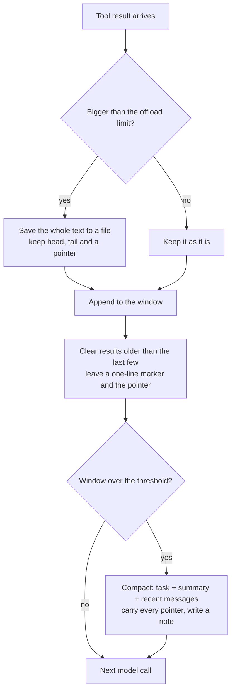

# Module 02: Context Engineering, Memory and Long-Running Agents

> **Prerequisites:** [Module 01: Tools and the Agent-Computer Interface](../01-tools-and-the-agent-computer-interface/README.md) and [Module 10: Memory: Short-Term and Scratchpad](../../10-ai-agents/10-memory-short-term-and-scratchpad/README.md).  
> **Estimated Reading Time:** 40 minutes  
> **Target Audience:** AI Backend Engineers, Agent Platform Engineers, Developer-Tool Builders

> [!TIP]
> **The Golden Rule of Context:** The context window is a finite resource that gets less reliable as it fills. Keep the smallest set of high-signal tokens in it, leave a pointer for everything you take out, and write progress down outside the window so that work survives the end of one.

---

## Why This Matters

In November 2025 Anthropic published what it had learned running coding agents across many context windows (*Effective Harnesses for Long-Running Agents*, Justin Young). The setup is simple: an agent works in discrete sessions, and each new session starts with no memory of the one before. Most real projects do not fit in one window. The article reports that compaction alone was not enough: even Opus 4.5 running in a loop across multiple windows, given only a high-level prompt, fell short of a production-quality web app.

It names two failure patterns. In the first, the agent tries to do too much at once, runs out of context in the middle of an implementation, and leaves a half-built, undocumented feature for the next session to trip over. In the second, a later session looks around, sees that a lot of progress has been made, and declares the job finished. Neither is a model that cannot code. Both are a harness that did not make progress legible across a boundary.

That is what context engineering is for. Anthropic defines it as "the set of strategies for curating and maintaining the optimal set of tokens (information) during LLM inference", and it covers everything that lands in the window, not just the prompt. A harness decides what goes in, what stays, what is replaced by a pointer, and what is written to a file for later. A bigger window helps but does not remove the problem, because (as Section 1 shows) more tokens in the window means less reliable recall of any one of them.

After this module you will be able to:

- explain **context rot** and why the window is a budget rather than a bucket;
- build a context manager that **offloads** large results, **clears** old ones, **compacts** the history and **keeps pointers** to everything it removed, in four languages;
- compare context policies by arithmetic, and check which facts survive each one;
- design the **initializer and coding-agent** pattern that carries a project across windows.

---

## 1. Architectural Mental Model & Core Mechanics

Every turn, the harness builds the model's input from five claimants: the system prompt and tool definitions (fixed), the conversation history (growing), tool results (spiky), files and documents it chose to load (on demand), and notes the agent wrote earlier (re-read when needed). The context manager is the part of the harness that keeps their total under a budget without throwing away what the task needs:



### Context Is a Budget

Anthropic's *Effective Context Engineering for AI Agents* (Rajasekaran et al., September 2025) describes **context rot**: as the number of tokens in the window grows, the model's ability to accurately recall information from it decreases. Its explanation is an "attention budget": every token can attend to every other token, which "results in n² pairwise relationships for n tokens", so attention is stretched thin as the context grows, and context has to be treated as a finite resource with diminishing returns. Chroma's July 2025 technical report *Context Rot* (Hong, Troynikov and Huber) tested 18 models with inputs of increasing length and found that performance becomes increasingly unreliable as input length grows, even on simple tasks. The causes are not fully understood, so treat the mechanism as an explanation and the behaviour as the evidence.

The practical conclusion is Anthropic's guiding principle: find "the smallest set of high-signal tokens that maximize the likelihood of your desired outcome", and "do the simplest thing that works".

### Four Techniques

1. **Offload large results.** When a tool returns something big, save the whole text to a file and keep only the head, the tail and a pointer in the window. LangChain's harness write-up calls this tool-output offloading. The agent can read the file again if it needs the middle.
2. **Clear old results.** A tool result that was needed three steps ago is usually dead weight. Anthropic calls clearing old tool results "one of the safest lightest touch forms of compaction". Leave a one-line marker (and the pointer, if the result was saved) so the transcript still makes sense.
3. **Compact.** When the window nears its limit, summarise the history and continue in a fresh window with the summary. In Claude Code, per the article, the agent continues with the compressed context plus the five most recently accessed files; the summary preserves architectural decisions, unresolved bugs and implementation details, and discards redundant output.
4. **Write notes outside the window.** The agent keeps a notes file (the article's examples are a to-do list and a `NOTES.md`) and re-reads it when needed. In Anthropic's Pokémon example, an agent kept coherent progress across thousands of steps with notes such as the number of steps spent training in one area and the levels gained toward a target.

### Just-in-Time Retrieval

Instead of loading everything up front, an agent can keep lightweight identifiers (file paths, saved queries, links) and load the data when it needs it, with tools. Claude Code works this way, while also placing a project instructions file in the context at the start: a hybrid. The trade-off is that exploring at run time is slower than having the data ready, and needs good tool guidance to avoid wasting context (Module 01).

### Sub-Agents as Context Isolation

A lead agent can hand a sub-task to a sub-agent that works in a clean window and returns only "a condensed, distilled summary of its work (often 1,000-2,000 tokens)". The detailed search context stays in the sub-agent's window and the lead keeps only the result. Track 12 covers orchestration; here the point is that a sub-agent is also a context-management tool.

### Long-Running Agents: Make Progress Legible

The long-running article's solution is a pair of prompts over one harness. An **initializer agent** runs in the first session and sets up `init.sh` (how to start the app), a `claude-progress.txt` log, an initial git commit, and a **feature list** as JSON with every feature marked `"passes": false`. Every later session is a **coding agent**: it reads the progress file and git history, runs `init.sh`, does a basic end-to-end check, picks **one** feature, finishes it, commits, and updates the log. The two agents differ only in their first prompt; the system prompt, tools and harness are the same. The authors chose JSON for the feature list because the model is less likely to overwrite it than a Markdown file, and told agents they may only change the `passes` field.

---

## 2. Systematic Comparison Matrix: Five Ways to Keep the Window Small

| Technique | What it does | What it can lose | Best for | Cost |
| :--- | :--- | :--- | :--- | :--- |
| **Offload large results** | Head, tail and a pointer in the window; the whole text in a file | The middle, unless the agent reads the file | Logs, diffs, search output | A file read when the middle matters |
| **Clear old results** | Replaces old results with a marker | Detail the agent might need again | Long tool-use loops | Almost none, if a pointer is left |
| **Compaction** | A summary replaces the older history | Whatever the summary omits, such as a decision | Long back-and-forth | A summarising call, and the risk of a bad summary |
| **Notes outside the window** | The agent writes down what matters | Nothing, if the agent writes well | Work with clear milestones | The agent must decide what to record |
| **Sub-agents** | A clean window per sub-task, a short result back | The sub-agent's working detail | Parallel research and search | Coordination, and the lead sees only the summary |

The techniques stack. The workflows below measure the first three together and then test what survives.

---

## 3. Evidence Case Study: Why Long Tasks Fail Across Windows

This section uses documented observations, not a story. Two sources, both public.

### What Was Observed

The Anthropic long-running article (Nov 26, 2025) describes building a clone of claude.ai across many sessions with Opus 4.5, with a feature list of over 200 items. Its summary table lists four failure modes and the mitigation for each. The agents also tended to mark features as complete after unit tests or `curl` checks, without testing the behaviour end to end:

| Failure | Mitigation |
| :--- | :--- |
| Declares victory too early | A feature list; work on one feature per session |
| Leaves bugs or undocumented progress | Git commits and progress notes; start each session with a basic end-to-end check |
| Marks features done prematurely | Self-verify, marking a feature passing only after careful testing |
| Wastes time working out how to run the app | An `init.sh` script |

On testing, the article reports that prompting the agent to use browser automation (the Puppeteer MCP server) and to test as a human user "dramatically improved performance". It also states the limits: the agent's vision is limited, and browser-native alert modals were invisible to the tool, so features that relied on them were buggier. It reports no benchmark numbers, and it lists open questions: whether one general agent beats a set of specialised ones, and whether the approach generalises beyond full-stack web development.

### Why It Is Relevant Here

Every mitigation in the table is a harness decision, and none is about the model. Most of them are **artifacts that persist outside the window** (a feature list, progress notes, git history, a start script), which is the fourth technique of Section 1 applied at project scale.

### What a Harness Builder Takes From It

- **Make the state of the work readable by a stranger.** Each session is a new engineer with amnesia. Write for that engineer: a progress log, a list of what is done and what is not, and commits that leave the code mergeable.
- **Constrain the unit of work.** One feature per session bounds what can be left half-finished.
- **Put the verification in the harness, not in the model's good intentions.** The session-start check and the "only mark passing after testing" rule are procedures the harness can enforce or prompt for.
- **Be careful with what this proves.** It is a vendor article without measurements, about one project and one model. It is evidence that these failure patterns occur and that these mitigations were used, not a measured effect size.

---

## 4. Multi-Language Production Implementation: A Context Manager With Pointers

Below is a **context manager** in **Go**, **TypeScript**, **Python** and **C#**. It implements the three window-shrinking techniques from Section 1 and carries a pointer through each: a large result is **offloaded** to a file (head, tail and a pointer stay), results older than the last three are **cleared** (the marker keeps the pointer), and when the window passes 80% of its budget the history is **compacted** into a summary that carries every pointer the compacted messages held and writes a line to the progress notes. The "model" is a script of ten tool results of different sizes, so the program is deterministic and offline. Tokens are estimated at four characters each.

Run them with `go run context.go`, `node context.ts` (Node 24 or newer), `python context.py` and `dotnet run Context.cs` (.NET 10 SDK). All four print the same run, shown in Workflow 1.

````carousel

```go
// A context manager for an agent harness: offload big tool results to files, clear old ones, compact when the window fills,
// and keep progress notes outside the window. Deterministic and offline. Tokens are estimated at 4 characters each.
package main

import (
	"fmt"
	"strings"
)

const (
	maxTokens        = 400
	compactAtPercent = 80
	offloadChars     = 800
	head, tail       = 120, 60
	keepToolResults  = 3
	keepRecent       = 4
)

type message struct {
	first, last int
	role, text  string
	full        int
	path        string
}

type window struct {
	messages  []message
	files     map[string]string
	fileOrder []string
	notes     []string
}

func newWindow(task string) *window {
	return &window{messages: []message{{0, 0, "user", task, len(task), ""}}, files: map[string]string{}}
}

func (w *window) tokens() int {
	sum := 0
	for _, m := range w.messages {
		sum += len(m.text) / 4
	}
	return sum
}

func (w *window) addAssistant(step int, text string) {
	w.messages = append(w.messages, message{step, step, "assistant", text, len(text), ""})
}

func (w *window) addToolResult(step int, original string) []string {
	var events []string
	size := len(original)
	text := original
	path := ""
	if size > offloadChars { // 1. offload: keep the head and the tail, save the whole text where the agent can read it again
		path = fmt.Sprintf("/notes/obs-%d.txt", step)
		w.files[path] = original
		w.fileOrder = append(w.fileOrder, path)
		text = fmt.Sprintf("%s ...[%d chars omitted, full text in %s]... %s", original[:head], size-head-tail, path, original[size-tail:])
		events = append(events, fmt.Sprintf("offloaded %d chars", size))
	}
	w.messages = append(w.messages, message{step, step, "tool", text, size, path})
	var results []int
	for i, m := range w.messages {
		if m.role == "tool" {
			results = append(results, i)
		}
	}
	for k := 0; k < len(results)-keepToolResults; k++ { // 2. clear: an older result stays only as a one-line marker, with its pointer if it was saved
		m := &w.messages[results[k]]
		if !strings.HasPrefix(m.text, "[cleared") {
			pointer := ""
			if m.path != "" {
				pointer = ", full text in " + m.path
			}
			m.text = fmt.Sprintf("[cleared: result of step %d, %d chars%s]", m.first, m.full, pointer)
			events = append(events, fmt.Sprintf("cleared step %d", m.first))
		}
	}
	if w.tokens()*100 > maxTokens*compactAtPercent && len(w.messages) > keepRecent+1 { // 3. compact
		before := w.tokens()
		older := w.messages[1 : len(w.messages)-keepRecent]
		first, last := older[0].first, older[0].last
		var paths []string // the summary keeps every pointer the compacted messages held
		for _, m := range older {
			first, last = min(first, m.first), max(last, m.last)
			if m.path != "" {
				paths = append(paths, m.path)
			}
		}
		joined, saved := strings.Join(paths, ", "), ""
		if joined != "" {
			saved = "; saved: " + joined
		}
		summary := message{first, last, "summary", fmt.Sprintf("[summary: steps %d-%d compacted, details in /notes/progress.md%s]", first, last, saved), 0, joined}
		kept := append([]message{w.messages[0], summary}, w.messages[len(w.messages)-keepRecent:]...)
		w.messages = kept
		w.notes = append(w.notes, fmt.Sprintf("step %d: compacted steps %d-%d", step, first, last))
		events = append(events, fmt.Sprintf("compacted steps %d-%d (%d -> %d tokens)", first, last, before, w.tokens()))
	}
	return events
}

func observation(step, size int) string {
	return strings.Repeat(fmt.Sprintf("r%d ", step), size)[:size]
}

func main() {
	w := newWindow("Fix the failing billing test.")
	sizes := []int{300, 2500, 400, 5000, 350, 700, 3000, 200, 450, 6000}
	for i, size := range sizes {
		step := i + 1
		w.addAssistant(step, fmt.Sprintf("step %d: call tool %d", step, step))
		events := w.addToolResult(step, observation(step, size))
		joined := strings.Join(events, ", ")
		if joined == "" {
			joined = "-"
		}
		fmt.Printf("step %-2d result=%-5d window_tokens=%-5d messages=%-2d %s\n", step, size, w.tokens(), len(w.messages), joined)
	}
	fmt.Println("final window:")
	for _, m := range w.messages {
		text := m.text
		if len(text) > 110 {
			text = text[:107] + "..."
		}
		fmt.Printf("  %-9s %s\n", m.role, text)
	}
	var saved []string
	for _, path := range w.fileOrder {
		saved = append(saved, fmt.Sprintf("%s (%d chars)", path, len(w.files[path])))
	}
	fmt.Println("saved files:", strings.Join(saved, ", "))
	fmt.Println("notes:", strings.Join(w.notes, "; "))
}
```

```typescript
// A context manager for an agent harness: offload big tool results to files, clear old ones, compact when the window fills,
// and keep progress notes outside the window. Deterministic and offline. Tokens are estimated at 4 characters each.
const MAX_TOKENS = 400;
const COMPACT_AT_PERCENT = 80;
const OFFLOAD_CHARS = 800;
const HEAD = 120;
const TAIL = 60;
const KEEP_TOOL_RESULTS = 3;
const KEEP_RECENT = 4;

type Message = { first: number; last: number; role: string; text: string; full: number; path: string };

class Window {
  messages: Message[];
  files = new Map<string, string>();
  notes: string[] = [];

  constructor(task: string) {
    this.messages = [{ first: 0, last: 0, role: "user", text: task, full: task.length, path: "" }];
  }

  tokens(): number {
    return this.messages.reduce((sum, m) => sum + Math.floor(m.text.length / 4), 0);
  }

  addAssistant(step: number, text: string) {
    this.messages.push({ first: step, last: step, role: "assistant", text, full: text.length, path: "" });
  }

  addToolResult(step: number, original: string): string[] {
    const events: string[] = [];
    const size = original.length;
    let text = original;
    let path = "";
    if (size > OFFLOAD_CHARS) {
      // 1. offload: keep the head and the tail, save the whole text where the agent can read it again
      path = `/notes/obs-${step}.txt`;
      this.files.set(path, original);
      text = `${original.slice(0, HEAD)} ...[${size - HEAD - TAIL} chars omitted, full text in ${path}]... ${original.slice(-TAIL)}`;
      events.push(`offloaded ${size} chars`);
    }
    this.messages.push({ first: step, last: step, role: "tool", text, full: size, path });
    const results = this.messages.filter((m) => m.role === "tool");
    for (const m of results.slice(0, Math.max(0, results.length - KEEP_TOOL_RESULTS))) {
      // 2. clear: an older result stays only as a one-line marker, with its pointer if it was saved
      if (!m.text.startsWith("[cleared")) {
        const pointer = m.path ? `, full text in ${m.path}` : "";
        m.text = `[cleared: result of step ${m.first}, ${m.full} chars${pointer}]`;
        events.push(`cleared step ${m.first}`);
      }
    }
    if (this.tokens() * 100 > MAX_TOKENS * COMPACT_AT_PERCENT && this.messages.length > KEEP_RECENT + 1) {
      // 3. compact
      const before = this.tokens();
      const older = this.messages.slice(1, this.messages.length - KEEP_RECENT);
      const first = Math.min(...older.map((m) => m.first));
      const last = Math.max(...older.map((m) => m.last));
      const paths = older.filter((m) => m.path).map((m) => m.path); // the summary keeps every pointer the compacted messages held
      const saved = paths.length > 0 ? `; saved: ${paths.join(", ")}` : "";
      const summary: Message = { first, last, role: "summary", full: 0, path: paths.join(", "), text: `[summary: steps ${first}-${last} compacted, details in /notes/progress.md${saved}]` };
      this.messages = [this.messages[0], summary, ...this.messages.slice(-KEEP_RECENT)];
      this.notes.push(`step ${step}: compacted steps ${first}-${last}`);
      events.push(`compacted steps ${first}-${last} (${before} -> ${this.tokens()} tokens)`);
    }
    return events;
  }
}

function observation(step: number, size: number): string {
  return `r${step} `.repeat(size).slice(0, size);
}

const window = new Window("Fix the failing billing test.");
const sizes = [300, 2500, 400, 5000, 350, 700, 3000, 200, 450, 6000];
sizes.forEach((size, i) => {
  const step = i + 1;
  window.addAssistant(step, `step ${step}: call tool ${step}`);
  const events = window.addToolResult(step, observation(step, size));
  console.log(`step ${String(step).padEnd(2)} result=${String(size).padEnd(5)} window_tokens=${String(window.tokens()).padEnd(5)} messages=${String(window.messages.length).padEnd(2)} ${events.join(", ") || "-"}`);
});
console.log("final window:");
for (const m of window.messages) {
  const text = m.text.length <= 110 ? m.text : m.text.slice(0, 107) + "...";
  console.log(`  ${m.role.padEnd(9)} ${text}`);
}
console.log("saved files:", [...window.files].map(([path, text]) => `${path} (${text.length} chars)`).join(", "));
console.log("notes:", window.notes.join("; "));
```

```python
"""A context manager for an agent harness: offload big tool results to files, clear old ones, compact when the window fills,
and keep progress notes outside the window. Deterministic and offline. Tokens are estimated at 4 characters each."""

MAX_TOKENS, COMPACT_AT_PERCENT = 400, 80
OFFLOAD_CHARS, HEAD, TAIL = 800, 120, 60
KEEP_TOOL_RESULTS, KEEP_RECENT = 3, 4


class Window:
    def __init__(self, task):
        self.messages = [{"first": 0, "last": 0, "role": "user", "text": task, "full": len(task), "path": ""}]
        self.files = {}
        self.notes = []

    def tokens(self):
        return sum(len(m["text"]) // 4 for m in self.messages)

    def add_assistant(self, step, text):
        self.messages.append({"first": step, "last": step, "role": "assistant", "text": text, "full": len(text), "path": ""})

    def add_tool_result(self, step, text):
        events, size, path = [], len(text), ""
        if size > OFFLOAD_CHARS:  # 1. offload: keep the head and the tail, save the whole text where the agent can read it again
            path = f"/notes/obs-{step}.txt"
            self.files[path] = text
            text = f"{text[:HEAD]} ...[{size - HEAD - TAIL} chars omitted, full text in {path}]... {text[-TAIL:]}"
            events.append(f"offloaded {size} chars")
        self.messages.append({"first": step, "last": step, "role": "tool", "text": text, "full": size, "path": path})
        results = [m for m in self.messages if m["role"] == "tool"]
        for m in results[:-KEEP_TOOL_RESULTS]:  # 2. clear: an older result stays only as a one-line marker, with its pointer if it was saved
            if not m["text"].startswith("[cleared"):
                pointer = f", full text in {m['path']}" if m["path"] else ""
                m["text"] = f"[cleared: result of step {m['first']}, {m['full']} chars{pointer}]"
                events.append(f"cleared step {m['first']}")
        if self.tokens() * 100 > MAX_TOKENS * COMPACT_AT_PERCENT and len(self.messages) > KEEP_RECENT + 1:  # 3. compact
            before = self.tokens()
            older = self.messages[1:-KEEP_RECENT]
            first, last = min(m["first"] for m in older), max(m["last"] for m in older)
            paths = [m["path"] for m in older if m["path"]]  # the summary keeps every pointer the compacted messages held
            saved = f"; saved: {', '.join(paths)}" if paths else ""
            summary = {"first": first, "last": last, "role": "summary", "full": 0, "path": ", ".join(paths),
                       "text": f"[summary: steps {first}-{last} compacted, details in /notes/progress.md{saved}]"}
            self.messages = [self.messages[0], summary] + self.messages[-KEEP_RECENT:]
            self.notes.append(f"step {step}: compacted steps {first}-{last}")
            events.append(f"compacted steps {first}-{last} ({before} -> {self.tokens()} tokens)")
        return events


def observation(step, size):
    return (f"r{step} " * size)[:size]


def main():
    window = Window("Fix the failing billing test.")
    sizes = [300, 2500, 400, 5000, 350, 700, 3000, 200, 450, 6000]
    for step, size in enumerate(sizes, start=1):
        window.add_assistant(step, f"step {step}: call tool {step}")
        events = window.add_tool_result(step, observation(step, size))
        print(f"step {step:<2} result={size:<5} window_tokens={window.tokens():<5} messages={len(window.messages):<2} {', '.join(events) or '-'}")
    print("final window:")
    for m in window.messages:
        text = m["text"] if len(m["text"]) <= 110 else m["text"][:107] + "..."
        print(f"  {m['role']:<9} {text}")
    print("saved files:", ", ".join(f"{path} ({len(text)} chars)" for path, text in window.files.items()))
    print("notes:", "; ".join(window.notes))


if __name__ == "__main__":
    main()
```

```csharp
// A context manager for an agent harness: offload big tool results to files, clear old ones, compact when the window fills,
// and keep progress notes outside the window. Deterministic and offline. Tokens are estimated at 4 characters each.
using System;
using System.Collections.Generic;
using System.Linq;

const int MaxTokens = 400, CompactAtPercent = 80, OffloadChars = 800, Head = 120, Tail = 60, KeepToolResults = 3, KeepRecent = 4;

var messages = new List<Message> { new(0, 0, "user", "Fix the failing billing test.", 29) };
var files = new List<(string Path, string Text)>();
var notes = new List<string>();

int Tokens() => messages.Sum(m => m.Text.Length / 4);

List<string> AddToolResult(int step, string original)
{
    var events = new List<string>();
    int size = original.Length;
    string text = original, path = "";
    if (size > OffloadChars) // 1. offload: keep the head and the tail, save the whole text where the agent can read it again
    {
        path = $"/notes/obs-{step}.txt";
        files.Add((path, original));
        text = $"{original[..Head]} ...[{size - Head - Tail} chars omitted, full text in {path}]... {original[^Tail..]}";
        events.Add($"offloaded {size} chars");
    }
    messages.Add(new Message(step, step, "tool", text, size) { Path = path });
    var results = messages.Where(m => m.Role == "tool").ToList();
    foreach (var m in results.Take(Math.Max(0, results.Count - KeepToolResults))) // 2. clear: an older result stays only as a one-line marker, with its pointer if it was saved
    {
        if (!m.Text.StartsWith("[cleared", StringComparison.Ordinal))
        {
            var pointer = m.Path.Length > 0 ? $", full text in {m.Path}" : "";
            m.Text = $"[cleared: result of step {m.First}, {m.Full} chars{pointer}]";
            events.Add($"cleared step {m.First}");
        }
    }
    if (Tokens() * 100 > MaxTokens * CompactAtPercent && messages.Count > KeepRecent + 1) // 3. compact
    {
        int before = Tokens();
        var older = messages.Skip(1).Take(messages.Count - 1 - KeepRecent).ToList();
        int first = older.Min(m => m.First), last = older.Max(m => m.Last);
        var paths = older.Where(m => m.Path.Length > 0).Select(m => m.Path).ToList(); // the summary keeps every pointer the compacted messages held
        var saved = paths.Count > 0 ? $"; saved: {string.Join(", ", paths)}" : "";
        var summary = new Message(first, last, "summary", $"[summary: steps {first}-{last} compacted, details in /notes/progress.md{saved}]", 0) { Path = string.Join(", ", paths) };
        messages = new List<Message> { messages[0], summary }.Concat(messages.TakeLast(KeepRecent)).ToList();
        notes.Add($"step {step}: compacted steps {first}-{last}");
        events.Add($"compacted steps {first}-{last} ({before} -> {Tokens()} tokens)");
    }
    return events;
}

string Observation(int step, int size) => string.Concat(Enumerable.Repeat($"r{step} ", size))[..size];

var sizes = new[] { 300, 2500, 400, 5000, 350, 700, 3000, 200, 450, 6000 };
for (int i = 0; i < sizes.Length; i++)
{
    int step = i + 1, size = sizes[i];
    var text = $"step {step}: call tool {step}";
    messages.Add(new Message(step, step, "assistant", text, text.Length));
    var events = AddToolResult(step, Observation(step, size));
    Console.WriteLine($"step {step,-2} result={size,-5} window_tokens={Tokens(),-5} messages={messages.Count,-2} {(events.Count > 0 ? string.Join(", ", events) : "-")}");
}
Console.WriteLine("final window:");
foreach (var m in messages)
{
    var text = m.Text.Length <= 110 ? m.Text : m.Text[..107] + "...";
    Console.WriteLine($"  {m.Role,-9} {text}");
}
Console.WriteLine("saved files: " + string.Join(", ", files.Select(f => $"{f.Path} ({f.Text.Length} chars)")));
Console.WriteLine("notes: " + string.Join("; ", notes));

class Message(int first, int last, string role, string text, int full)
{
    public int First = first, Last = last, Full = full;
    public string Role = role, Text = text, Path = "";
}
```

````

### What Each Part Is For

| Code | Technique | What it protects |
| :--- | :--- | :--- |
| `size > OFFLOAD_CHARS` branch | Offload | The window from one huge result; the middle stays recoverable |
| `[cleared: ... full text in path]` | Clear, with a pointer | The window from stale results, without losing the way back |
| The compaction block | Compact | The window from slow growth; carries `saved:` pointers forward |
| `notes` and `/notes/progress.md` | Notes outside the window | A record that survives the window it describes |
| `COMPACT_AT_PERCENT` | A threshold | When compaction runs; too tight and it runs every step (Workflow 1) |

---

## 5. Practical Hands-On Verification CLI Workflows

Everything below is plain Python 3, offline, with no third-party packages. The outputs are copied from real runs.

### Workflow 1: Watch the Manager Work

Save the Python tab as `context.py` and run it:

```bash
python context.py
```

```text
step 1  result=300   window_tokens=86    messages=3  -
step 2  result=2500  window_tokens=149   messages=5  offloaded 2500 chars
step 3  result=400   window_tokens=253   messages=7  -
step 4  result=5000  window_tokens=250   messages=9  offloaded 5000 chars, cleared step 1
step 5  result=350   window_tokens=299   messages=11 cleared step 2
step 6  result=700   window_tokens=303   messages=6  cleared step 3, compacted steps 1-4 (387 -> 303 tokens)
step 7  result=3000  window_tokens=275   messages=6  offloaded 3000 chars, compacted steps 1-5 (366 -> 275 tokens)
step 8  result=200   window_tokens=150   messages=6  compacted steps 1-6 (329 -> 150 tokens)
step 9  result=450   window_tokens=266   messages=8  -
step 10 result=6000  window_tokens=289   messages=10 offloaded 6000 chars, cleared step 7
final window:
  user      Fix the failing billing test.
  summary   [summary: steps 1-6 compacted, details in /notes/progress.md; saved: /notes/obs-2.txt, /notes/obs-4.txt]
  assistant step 7: call tool 7
  tool      [cleared: result of step 7, 3000 chars, full text in /notes/obs-7.txt]
  assistant step 8: call tool 8
  tool      r8 r8 r8 r8 r8 r8 r8 r8 r8 r8 r8 r8 r8 r8 r8 r8 r8 r8 r8 r8 r8 r8 r8 r8 r8 r8 r8 r8 r8 r8 r8 r8 r8 r8 r8 r8...
  assistant step 9: call tool 9
  tool      r9 r9 r9 r9 r9 r9 r9 r9 r9 r9 r9 r9 r9 r9 r9 r9 r9 r9 r9 r9 r9 r9 r9 r9 r9 r9 r9 r9 r9 r9 r9 r9 r9 r9 r9 r9...
  assistant step 10: call tool 10
  tool      r10 r10 r10 r10 r10 r10 r10 r10 r10 r10 r10 r10 r10 r10 r10 r10 r10 r10 r10 r10 r10 r10 r10 r10 r10 r10 r10...
saved files: /notes/obs-2.txt (2500 chars), /notes/obs-4.txt (5000 chars), /notes/obs-7.txt (3000 chars), /notes/obs-10.txt (6000 chars)
notes: step 6: compacted steps 1-4; step 7: compacted steps 1-5; step 8: compacted steps 1-6
```

Read the `events` column. Steps 2, 4, 7 and 10 offload a large result. From step 4, results older than the last three are cleared. At step 6 the window passes 320 tokens (80% of 400) and the history is compacted, from 387 to 303 tokens. Then the manager compacts again at steps 7 and 8: each compaction folds the previous summary into a new one ("steps 1-4", "1-5", "1-6"). That is **compaction thrash**: the budget is too tight for the four recent messages that are always kept, so the window crosses the threshold again immediately. In a real harness each compaction is a model call, so the fix is hysteresis (compact down to well below the threshold) or a larger budget. Exercise 1 asks you to add it.

Look also at the final window: the cleared marker for step 7 still says `full text in /notes/obs-7.txt`, and the summary line lists, after `saved:`, the files saved by the steps it replaced.

### Workflow 2: Compare Policies by Arithmetic

Save this as `policies.py` next to `context.py`. It runs the same ten results under four policies by switching the manager's limits off one at a time:

```python
"""The same ten tool results under four context policies: how big the window gets, and how much the model would read over the run.
Model arithmetic on the sizes in context.py (4 characters per token), not a measurement of any provider."""
import context

SIZES = [300, 2500, 400, 5000, 350, 700, 3000, 200, 450, 6000]
DEFAULT_OFFLOAD, DEFAULT_KEEP, DEFAULT_MAX = context.OFFLOAD_CHARS, context.KEEP_TOOL_RESULTS, context.MAX_TOKENS
NEVER = 10**9


def run(offload, keep, max_tokens):
    context.OFFLOAD_CHARS, context.KEEP_TOOL_RESULTS, context.MAX_TOKENS = offload, keep, max_tokens
    window = context.Window("Fix the failing billing test.")
    reads = peak = 0
    for step, size in enumerate(SIZES, start=1):
        window.add_assistant(step, f"step {step}: call tool {step}")
        window.add_tool_result(step, context.observation(step, size))
        reads += window.tokens()
        peak = max(peak, window.tokens())
    return peak, reads


policies = [
    ("keep everything", (NEVER, NEVER, NEVER)),
    ("offload big results", (DEFAULT_OFFLOAD, NEVER, NEVER)),
    ("offload + clear old results", (DEFAULT_OFFLOAD, DEFAULT_KEEP, NEVER)),
    ("offload + clear + compact", (DEFAULT_OFFLOAD, DEFAULT_KEEP, DEFAULT_MAX)),
]
baseline = None
for name, settings in policies:
    peak, reads = run(*settings)
    baseline = baseline or reads
    print(f"{name:<30} peak_window={peak:>5,}  read_over_10_calls={reads:>6,}  ({reads / baseline:5.1%} of keeping everything)")
```

```bash
python policies.py
```

```text
keep everything                peak_window=4,772  read_over_10_calls=22,487  (100.0% of keeping everything)
offload big results            peak_window=  884  read_over_10_calls= 4,852  (21.6% of keeping everything)
offload + clear old results    peak_window=  408  read_over_10_calls= 2,907  (12.9% of keeping everything)
offload + clear + compact      peak_window=  303  read_over_10_calls= 2,320  (10.3% of keeping everything)
```

This is **model arithmetic, not a measurement**: four characters per token, the sizes from the script, and the "read" column is the window size added up over the ten steps, ignoring prompt caching. The shape is what matters. Offloading alone removes about four fifths of what the model reads, because four of the ten results are over 2,000 characters. Clearing and compaction then take it to about a tenth. The peak window falls from 4,772 tokens to 303.

### Workflow 3: What Survives?

Shrinking the window is only safe if what the task needs survives. Save this as `notes_survive.py`. It plants three facts early in the run (a design decision in an assistant message, a failing test in a short result, a root cause in the middle of a large result) and asks, at the end, where each one still exists. A saved file counts only if a pointer to it is still visible:

```python
"""What survives the manager from context.py: three facts the agent saw early, with and without notes written outside the window.
A saved file only counts if a pointer to it is still visible. It checks where each fact still exists, not whether a model would use it."""
import context

FACTS = {
    "decision": "store money as integer cents",
    "failing test": "FAILED test_refund_rounding: expected 1999 got 2000",
    "root cause": "ROOT CAUSE: float arithmetic in refund_amount()",
}
SIZES = [300, 400, 400, 5000, 350, 700, 3000, 200, 450, 6000]


def result_text(step, size):
    text = context.observation(step, size)
    if step == 2:                                              # a short result, so it is never offloaded
        return (FACTS["failing test"] + " " + text)[:size]
    if step == 4:                                              # a big result: the fact is in the middle, past the kept head and tail
        middle = size // 2
        return text[:middle] + " " + FACTS["root cause"] + " " + text[middle:size - len(FACTS["root cause"]) - 2]
    return text


def run(write_notes):
    window, notes = context.Window("Fix the failing billing test."), []
    for step, size in enumerate(SIZES, start=1):
        said = f"step {step}: call tool {step}" if step != 1 else f"step 1: decision: {FACTS['decision']}"
        window.add_assistant(step, said)
        window.add_tool_result(step, result_text(step, size))
        if write_notes and step in (1, 2, 4):                   # the agent records what it just learned
            notes.append({1: FACTS["decision"], 2: FACTS["failing test"], 4: FACTS["root cause"]}[step])
    return window, notes


def where(fact, window, notes):
    """Returns (where it is, whether an agent could still get to it)."""
    if any(fact in m["text"] for m in window.messages):
        return "in the window", True
    if any(fact in line for line in notes):
        return "in /notes/progress.md", True
    for path, text in window.files.items():
        if fact in text:
            seen = any(path in m["text"] for m in window.messages) or any(path in line for line in notes)
            return (f"in {path}", True) if seen else (f"in {path}, no pointer", False)
    return "LOST", False


outcomes = {}
for label, write in (("without notes", False), ("with notes", True)):
    window, notes = run(write)
    outcomes[label] = {name: where(fact, window, notes) for name, fact in FACTS.items()}
print(f"{'fact':<14} {'without notes':<26} with notes")
for name in FACTS:
    print(f"{name:<14} {outcomes['without notes'][name][0]:<26} {outcomes['with notes'][name][0]}")
for label, found in outcomes.items():
    print(f"{label}: {sum(reachable for _, reachable in found.values())} of {len(FACTS)} facts reachable")
```

```bash
python notes_survive.py
```

```text
fact           without notes              with notes
decision       LOST                       in /notes/progress.md
failing test   LOST                       in /notes/progress.md
root cause     in /notes/obs-4.txt        in /notes/progress.md
without notes: 1 of 3 facts reachable
with notes: 3 of 3 facts reachable
```

Without notes, the decision and the failing test are **gone**: one was compacted away, the other cleared. Only the root cause is reachable, because it was big enough to be offloaded and the pointer travelled through the compaction. With the agent writing a line to the notes file when it learns something, all three survive. This checks where facts exist, not whether a model would find and use them; it is the mechanical precondition for that.

### Hands-On Exercises

1. **Add hysteresis.** When compaction triggers, keep shrinking (fewer recent messages, or a shorter summary) until the window is under 50% of the budget, not just under the threshold. Re-run Workflow 1 and report how many compactions happen and what each costs in tokens.
2. **Follow a pointer.** Add a `read_saved(path, start, end)` tool that reuses the bounded `view` from Module 01 for files under `/notes/`. Show an agent that finds `/notes/obs-4.txt` in the summary after step 6 and reads the middle of the result to recover the root cause.
3. **Break the pointer, then find it.** Delete the `saved:` part of the summary in `context.py`, copy the file, and run `notes_survive.py` against it. Which fact becomes unreachable, and why does the notes policy still protect the other two?

### Independent Challenge

You are running a coding agent for six hours against a 40,000-line repository, in a sequence of context windows. Specify its context policy: what stays in the window at all times, what is offloaded and when, what the agent must write down, when it compacts and when it starts a fresh window from the progress file instead, and what the first five minutes of every new window look like.

<details><summary>Architectural Discussion</summary>

1. **Always in the window:** the system prompt, a short tool list (deferred loading for the rest, Module 01), the current task, and the last few steps.
2. **Offload:** any tool result over a fixed size (the manager's `OFFLOAD_CHARS`), keeping head, tail and a pointer. Test output and `git diff` are the usual offenders.
3. **Write down:** decisions and their reasons ("money is stored as integer cents"), what is verified and what is not, and the next step. Notes are cheap and the window will not remember them.
4. **Compact** when the window passes a threshold, down to well below it (hysteresis), carrying every pointer. A compaction is a summarising call, so count it in the cost model.
5. **Fresh window from a progress file** when a unit of work finishes (one feature, as in the long-running article), not in the middle of one. The handoff is the progress log, the feature list and the git history.
6. **The first five minutes of a window:** read the progress log and recent commits, run the start script, run a basic end-to-end check, pick one unfinished item. This is the article's start-of-session routine.
7. **What to measure:** how often the agent re-does finished work or declares an unfinished project done, over a fixed set of long tasks (Track 18). That rate is the thing the policy exists to lower.

</details>

---

## 6. Common Mistakes & Troubleshooting

- **Compacting only when the window is full, down to just under the limit.** Each compaction costs a model call and the window crosses the line again at once (the thrash in Workflow 1). Compact earlier and shrink further.
- **Clearing or compacting without leaving a pointer.** The data still exists on disk but nobody can find it. In Workflow 3 the same file is reachable or not depending on whether its path is still visible.
- **Summaries that drop decisions.** A summary keeps what the summariser thinks matters. Write decisions and constraints to a notes file as you go, so they do not depend on a summary.
- **Treating a bigger window as the fix.** Context rot means more tokens are not free. Use the extra room, but still budget it.
- **Letting the model rewrite the progress record.** The long-running article chose a JSON feature list and told agents they could change only the `passes` field, because the model was less likely to overwrite JSON than Markdown. Make the state hard to damage.
- **No verification at the start of a session.** A new window that trusts the previous one's claims inherits its mistakes. Run the app and a basic check before starting new work.

---

## 7. Operational Validation Checkpoints & Checkpoint Quiz

### Operational Validation Checkpoints

<details><summary><strong>Checkpoint 1: The summary lost a decision</strong></summary>

After a compaction your agent starts storing money as floats again, against a decision made early in the session. What went wrong, and what two changes prevent it?

**Validation:** The decision lived only in the history, and the summary did not keep it. Prevent it by writing decisions to a notes file at the moment they are made (Workflow 3: "decision" is reachable only with notes), and by having the harness re-read the notes file at the start of each window, so the decision is in front of the model whether or not the summary kept it.

</details>

<details><summary><strong>Checkpoint 2: A result was cleared and the agent cannot find it</strong></summary>

The agent needs the middle of a build log it saw eight steps ago. The log is saved on disk, but the agent does not know its name. Which part of the manager failed?

**Validation:** The pointer. Clearing replaced the result with a marker; if the marker (and, after compaction, the summary) does not carry the file path, the saved file exists but is unreachable. The manager's `[cleared: ... full text in /notes/obs-N.txt]` and the summary's `saved:` list exist for this reason, and Exercise 3 shows the failure when they are removed.

</details>

<details><summary><strong>Checkpoint 3: Why one feature per session?</strong></summary>

The long-running article tells the coding agent to work on one feature at a time. Which failure does that rule address, and what does it make cheaper?

**Validation:** It addresses the agent trying to do too much, running out of context in the middle of an implementation, and leaving a half-built, undocumented feature. A unit of work small enough to finish inside one window means a window boundary falls between features rather than inside one, which makes the handoff a clean commit and a progress note instead of a mess to untangle.

</details>

### Checkpoint Quiz

1. What is context rot, and what explanation does Anthropic give for it?
2. Name the four window-shrinking techniques in Section 1 and say which one the long-running article applies at project scale.
3. In Workflow 3, why are the "decision" and "failing test" facts lost without notes while the "root cause" survives?
4. What is compaction thrash, and what is the usual fix?
5. What are the two artifacts the initializer agent sets up besides the initial git commit, and what do the later coding sessions do with them first?

<details><summary>Answers</summary>

1. As the number of tokens in the window grows, the model's ability to accurately recall information from it decreases. Anthropic explains it with an attention budget: every token attends to every other token (n squared pairwise relationships), so attention is stretched thin as the context grows.
2. Offload large results, clear old results, compact, and write notes outside the window. Notes outside the window, in the form of a feature list, a progress file and git history, is the one the long-running article applies at project scale.
3. The decision was in an assistant message, which compaction replaced with a summary; the failing test was in a short result that was cleared. Neither was big enough to be offloaded, so nothing saved them. The root cause was in a large result that was offloaded, and its pointer was carried into the summary, so it stayed reachable.
4. Compaction that runs again and again because it brings the window only just under the threshold, so the next step crosses it. Each compaction costs a model call. Compact earlier and shrink further (hysteresis), or raise the budget.
5. `init.sh` (how to start the app) and `claude-progress.txt` (a log of work done), plus a JSON feature list with every feature marked as not passing. Later sessions read the progress file and the git history, run `init.sh`, and run a basic end-to-end check before choosing one feature to work on.

</details>

---

## Further Reading & Sources

- [Effective Context Engineering for AI Agents (Rajasekaran, Dixon, Ryan and Hadfield, Anthropic Engineering, 29 September 2025)](https://www.anthropic.com/engineering/effective-context-engineering-for-ai-agents) — context rot, the attention budget, compaction, structured note-taking, sub-agents and just-in-time retrieval.
- [Effective Harnesses for Long-Running Agents (Justin Young, Anthropic Engineering, 26 November 2025)](https://www.anthropic.com/engineering/effective-harnesses-for-long-running-agents) — the initializer and coding-agent pattern, the feature list, the failure modes and mitigations in Section 3.
- [Context Rot: How Increasing Input Tokens Impacts LLM Performance (Hong, Troynikov and Huber, Chroma, 14 July 2025)](https://trychroma.com/research/context-rot) — the 18-model study of how performance varies with input length.
- [The Anatomy of an Agent Harness (Vivek Trivedy, LangChain, 10 March 2026)](https://www.langchain.com/blog/the-anatomy-of-an-agent-harness) — tool-output offloading, compaction and the filesystem as a harness primitive.
- [Harness Engineering: Anatomy, Architecture, and Evolution of Coding Agents (Barbaste et al., 2026)](https://arxiv.org/abs/2609.00006) — the memory and context subsystem, from an unbounded linear history to an agent-maintained cross-session memory.

## Next

[Module 03: Safety, Permissions and Sandboxing](../03-safety-permissions-and-sandboxing/README.md)
