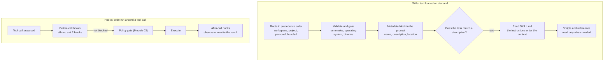

# Module 04: Skills, Hooks and Extensibility

> **Prerequisites:** [Module 02: Context Engineering, Memory and Long-Running Agents](../02-context-engineering-memory-and-long-running-agents/README.md), [Module 03: Safety, Permissions and Sandboxing](../03-safety-permissions-and-sandboxing/README.md) and [Module 08: Primitive: Tools](../../13-model-context-protocol-mcp/08-primitive-tools/README.md).  
> **Estimated Reading Time:** 40 minutes  
> **Target Audience:** AI Backend Engineers, Agent Platform Engineers, Developer-Tool Builders

> [!TIP]
> **The Golden Rule of Extensibility:** Skills inform and hooks enforce. Put capability in text that the harness loads only when it is needed, put guarantees in code that the harness always runs, and decide in advance which way each fails: a hook that crashes should not quietly let the dangerous call through, and a skill from a stranger is code you have not read.

---

## Why This Matters

The seventh subsystem of a harness, in the source-code study from Module 00, is **extensibility**: how users and ecosystems add capability without forking the harness. The study reports two findings about it. Skills (a folder with a `SKILL.md`) were adopted by nine of the eleven systems, more than MCP servers (eight of eleven); and behavioural policy is shifting from prompt prose to configuration. Both are the same trend. The things that used to live in a long system prompt (how we release, what you may not run) are moving into files the harness loads when needed and code it runs every time.

That makes the extension surface the place where a harness is most useful, and also where it is most exposed. A skill is text that an agent will follow, and sometimes text that a *person* will follow. In February 2026 researchers audited the public skill registry of a popular open-source agent and found 341 malicious skills out of 2,857, most of them from one campaign. Section 3 reads that case through this module.

After this module you will be able to:

- write a skill that follows the open **Agent Skills** format, and explain **progressive disclosure** and why it exists;
- build a skill loader with validation, precedence, gating and a **prompt budget**, and say what happens to a library of 200 skills;
- build a **hook** chain and state, for each way a hook can fail, whether the call runs;
- review a third-party skill the way you would review a dependency.

---

## 1. Architectural Mental Model & Core Mechanics

The two mechanisms look alike from outside (both are files you drop in a folder) and work in opposite ways. A skill adds *knowledge*: the harness puts a one-line description in front of the model and loads the rest only when the model decides it needs it. A hook adds *control*: the harness runs it every time, whatever the model thinks:



### Skills Are Folders of Text

The open **Agent Skills** specification (agentskills.io) defines a skill as a directory containing at least a `SKILL.md`: YAML frontmatter followed by Markdown instructions. The frontmatter has two required fields:

- `name`: 1 to 64 characters, lowercase letters, digits and hyphens only, not starting or ending with a hyphen, with no consecutive hyphens, and **matching the name of its parent directory**.
- `description`: 1 to 1,024 characters, saying both what the skill does and when to use it, with the keywords that help an agent recognise a relevant task. The specification's own examples: "Extracts text and tables from PDF files, fills PDF forms, and merges multiple PDFs. Use when working with PDF documents or when the user mentions PDFs, forms, or document extraction" is good, and "Helps with PDFs" is poor.

There are optional fields (`license`; `compatibility`, up to 500 characters, for environment requirements; `metadata`, a map of strings; and `allowed-tools`, marked experimental) and three optional directories: `scripts/` for executable code, `references/` for documents read on demand, and `assets/` for templates and data.

### Progressive Disclosure

The specification says agents load skills progressively, in three levels:

1. **Metadata**, about 100 tokens: the `name` and `description` of *every* skill, loaded at startup.
2. **Instructions**, under 5,000 tokens recommended: the whole `SKILL.md` body, loaded when the skill is activated.
3. **Resources**, as needed: files in `scripts/`, `references/` and `assets/`, loaded only when required.

It recommends keeping `SKILL.md` under 500 lines, moving detail into referenced files one level deep, and notes that "the agent will load this entire file once it's decided to activate a skill". This is Module 02's rule applied to capability: the window holds the catalogue, not the library.

### The Prompt Budget

Level 1 is not free. OpenClaw's documentation describes what happens when it is too big: eligible skills are compiled into a compact XML block in the system prompt, at a cost of about 97 characters per skill plus the lengths of its name, description and location; if the block exceeds `skills.limits.maxSkillsPromptChars`, names and locations are kept first, then shortened descriptions, and descriptions are dropped if no budget remains. When enabled, a `skills_search` tool returns names and descriptions without instructions, and `skills_read` loads the full `SKILL.md` of one skill by exact name. The loader below implements the same degradation, and Workflow 2 shows where it breaks.

### Precedence and Gating

When the same skill name exists in several places, one must win. OpenClaw's order, highest first, is: workspace skills, project agent skills, personal agent skills, managed skills, workshop skills, then bundled skills, then extra directories. Gating decides whether a skill that was found is *eligible*: OpenClaw reads requirements from the skill's `metadata.openclaw` block (binaries that must be on `PATH`, environment variables, config values) and an operating-system filter, so a skill that needs `pdftotext` does not appear on a machine without it. These are harness features, not part of the open specification, whose `compatibility` field is free text for humans and agents.

### Hooks: Deterministic Control

A prompt asks; a hook decides. Claude Code's hooks reference lists dozens of events (33 on the page when this module was written), including `SessionStart`, `UserPromptSubmit`, `PreToolUse`, `PostToolUse`, `Stop` and `PreCompact`. For a `PreToolUse` hook the harness sends the tool name and input as JSON on standard input, and the hook answers with an **exit code**:

| Exit code | What the harness does |
| :--- | :--- |
| `0` | Success. Any JSON output is applied (a `permissionDecision` of `allow`, `deny`, `ask` or `defer`); with no decision, the call continues through the normal permission flow |
| `2` | A blocking error: the call is blocked, and what the hook wrote to standard error is shown to the model as the reason. The page says that exit 2 "blocks even when your hook prints JSON", so an `allow` decision cannot override it |
| Any other (for example `1`) | A non-blocking error: **the call goes ahead** |

The page is explicit about the consequence: "If your hook is meant to enforce a policy, use `exit 2`." Matching hooks for an event run in parallel, and a handler defined in several settings files runs once. A command hook's default timeout is 600 seconds, and on `PreToolUse` a hook that times out does not block the call unless the hook is configured with `"onFailure": "block"`. The same page notes that hook filtering is best effort, so hard allow and deny rules belong in the permission system (Module 03).

OpenClaw's plugin hooks follow a different contract. Its `before_tool_call` hook can return `{ block: true }`, which is terminal, and a later `{ block: false }` does not clear an earlier block; `message_sending` works the same way with `{ cancel: true }`. Two harnesses, two contracts: read the one you are building on.

### Fail Open or Fail Closed

When a hook crashes, hangs or exits with an unexpected code, the harness has to choose between letting the call proceed (**fail open**) and refusing it (**fail closed**). Claude Code's documented default for a `PreToolUse` hook that errors or times out is to let it proceed, with an option to block. Neither default is wrong, but each is a decision: a hook that exists to protect production should fail closed, and an audit hook that logs every call probably should not stop work when the log is full. Workflow 3 tries five hook behaviours under both choices.

### Skills, MCP and Hooks

They answer different questions. An **MCP server** (Track 13) gives the agent new *tools and resources* over a protocol. A **skill** gives it *instructions and scripts* it can follow, loaded on demand. A **hook** gives *the harness* a place to run its own code around a call. The source-code study found skills in nine of eleven systems and MCP in eight; most real harnesses use all three, and the question for each is the same: who wrote it, and what can it do?

---

## 2. Systematic Comparison Matrix: Four Ways to Extend a Harness

| Mechanism | What it adds | Loaded | Trust question | Best for |
| :--- | :--- | :--- | :--- | :--- |
| **Skill** | Instructions and optional scripts | Metadata at startup; the rest on demand | Who wrote the text the agent (or you) will follow? | Procedures, domain knowledge, team conventions |
| **MCP server** | Tools and resources over a protocol | Tool definitions up front or deferred (Module 01) | What can the server's tools reach, and what does it return? | Integrating a service the agent should call |
| **Hook** | Harness-side code around events | Every time the event fires | The hook is code with the user's permissions | Enforcement, audit, formatting, notifications |
| **Native plugin** | Code that runs inside the harness | At startup | OpenClaw's documentation says native plugins run in-process and are not sandboxed | Deep integration, new channels, new runtimes |

The rows differ most in the last two columns. As you go down, more is trusted and less is sandboxed, and a mistake or an attacker has more to work with.

---

## 3. Evidence Case Study: ClawHavoc, When the Skill Registry Is the Attack Surface

This section is built from a published security audit and press coverage of it, and it keeps to what the sources state.

### What Happened

On 2 February 2026 *The Hacker News* reported (Ravie Lakshmanan, "Researchers Find 341 Malicious ClawHub Skills Stealing Data from OpenClaw Users") on an audit by Koi Security, with researcher Oren Yomtov, of ClawHub, the public skill registry for OpenClaw. It audited all 2,857 skills available at the time and found **341 malicious**, **335** of them apparently from one campaign that it named **ClawHavoc**. Another researcher, Paul McCarty of OpenSourceMalware, independently flagged the same campaign.

The ClawHavoc skills posed as popular utilities: typosquats of ClawHub itself, cryptocurrency wallet tools, Polymarket bots, YouTube utilities, auto-updaters, finance and social media tools. Their documentation contained a **"Prerequisites" section** telling the user to install something first. On Windows, that meant downloading a password-protected archive from a GitHub repository, which contained a trojan with keylogging to capture API keys and credentials. On macOS, it meant pasting an install script into the Terminal, which fetched further stages and ended with a binary consistent with the Atomic Stealer (AMOS) malware. The other six malicious skills used different techniques: a reverse-shell backdoor hidden in otherwise working code, and a skill that sent the agent's stored credentials to an external webhook.

The registry was open by default: anyone could upload skills, and the only restriction was that the publisher's GitHub account had to be at least a week old. Later audits found more malicious skills as the registry grew; the counts differ between reports and dates, so this module does not quote them. In response, OpenClaw's creator added a reporting feature: signed-in users can flag a skill, each user can have up to 20 active reports, and a skill with more than three unique reports is hidden by default.

### What It Shows, Read Through the Harness

This is the analysis of this module, not a finding of the report:

- **A skill is a software supply chain.** Its text is read by an agent that has tools, and by a person who may paste what it says. A registry of skills has the same problems as a registry of packages.
- **The attack did not need the agent to be tricked.** Several of these skills worked through the *person*: the prerequisite step asked them to run a command by hand, which no policy gate in the harness could see or stop.
- **A low bar to publish is a cheap attack.** "A GitHub account at least a week old" is a delay, not an identity check.

OpenClaw's own documentation now tells operators to treat third-party skills as untrusted code, to read them before enabling them, and to prefer sandboxed runs for untrusted inputs. ClawHub shows the latest security-scan state of a skill before it is installed, `openclaw skills verify` verifies a skill's trust envelope, an install policy can run a trusted local command before an install proceeds, and archive uploads are off by default. Press coverage also reports that Koi released a scanner (Clawdex) and cautioned that it will not catch every malicious skill.

### What a Harness Builder Takes From It

- **Review a skill like a dependency.** Read `SKILL.md` and every script, check who published it, pin the version, and treat an install step that tells you to run something yourself as a red flag.
- **Run skills with the least authority.** A skill's scripts should go through the same policy gate and sandbox as any other tool call (Module 03), with credentials that are scoped to the task.
- **Make provenance visible.** Show where a skill came from, who published it and what scanning it has had, at the moment of installing it.
- **Do not rely on scanning alone.** Even its authors say it will miss some.

---

## 4. Multi-Language Production Implementation: A Skill Loader and a Hook Chain

Below are a **skill loader** and a **hook chain** in **Go**, **TypeScript**, **Python** and **C#**, in one program. The loader reads skill files from two roots (workspace first, bundled second), **validates** each name and description against the Agent Skills rules, applies **precedence** (the first root to supply a name wins), **gates** on operating system and installed binaries, and builds the **prompt block** within a character budget by degrading from full descriptions to 30-character ones to names only. The hook chain runs five hooks on every call and applies the exit-code contract from Section 1: exit 2 or a JSON `deny` blocks, anything else does not, and a hook that crashes fails open or closed according to a setting. The files, the `PATH` and the hooks are in memory, so the program is safe to run anywhere.

The hooks are modelled on Claude Code's documented behaviour, not copied from it: the real exit-code contract, timeouts and `onFailure` setting are in its hooks reference, and the toy applies the failure setting to crashes only.

Run them with `go run extend.go`, `node extend.ts` (Node 24 or newer), `python extend.py` and `dotnet run Extend.cs` (.NET 10 SDK). All four print the same output, shown in Workflow 1.

````carousel

```go
// The two extension surfaces of a harness in one offline program.
// Skills: folders of text the harness loads on demand, checked against the Agent Skills naming rules, ordered by precedence, gated by operating system
// and installed binaries, and listed in the prompt within a character budget.
// Hooks: code the harness runs around every tool call, modelled on how Claude Code documents its PreToolUse hooks (exit code 2 blocks; a crash or any
// other exit code does not, unless you say so). In-memory files, a fake PATH, no network.
package main

import (
	"errors"
	"fmt"
	"sort"
	"strings"
)

const hostOS = "linux"
const nameChars = "abcdefghijklmnopqrstuvwxyz0123456789-"

var path = map[string]bool{"git": true, "python": true}
var roots = [][2]string{{"workspace", "/work/skills/"}, {"bundled", "/bundled/skills/"}} // earlier roots win
var files = map[string]string{
	"/work/skills/pdf-notes/SKILL.md":     "---\nname: pdf-notes\ndescription: Turn a PDF into short study notes\nrequires_bins: pdftotext\n---\nRun pdftotext on the file, split the text by headings, and write five bullets per section.\nKeep quotations under 25 words.",
	"/work/skills/release/SKILL.md":       "---\nname: release\ndescription: Cut a release: bump the version, tag it and write the changelog\nrequires_bins: git\n---\n1. Run the tests.\n2. Bump the version in one commit.\n3. Tag it and push the tag only.\n4. Paste the merged pull requests into CHANGELOG.md.",
	"/work/skills/Deploy/SKILL.md":        "---\nname: Deploy\ndescription: Deploy to staging\n---\nRun the deploy script.",
	"/bundled/skills/release/SKILL.md":    "---\nname: release\ndescription: Older bundled release helper\n---\nBump the version and tag it.",
	"/bundled/skills/sql-review/SKILL.md": "---\nname: sql-review\ndescription: Review a SQL migration for long locks and missing rollbacks\n---\nList every statement that takes a lock, say how long it holds it on a large table, and ask for a rollback script.",
	"/bundled/skills/mac-notes/SKILL.md":  "---\nname: mac-notes\ndescription: Create a note in the Notes app\nos: darwin\n---\nUse osascript to create the note.",
}

type skill struct{ name, path, description, body, state string }

func parse(text string) (map[string]string, string) {
	lines := strings.Split(text, "\n")
	meta := map[string]string{}
	i := 1
	for lines[i] != "---" {
		at := strings.Index(lines[i], ": ")
		meta[lines[i][:at]] = lines[i][at+2:]
		i++
	}
	return meta, strings.Join(lines[i+1:], "\n")
}

func problem(meta map[string]string, folder string) string {
	name, description := meta["name"], meta["description"]
	if name == "" || len(name) > 64 || strings.Trim(name, nameChars) != "" {
		return "name must be 1-64 lowercase letters, digits or hyphens"
	}
	if strings.HasPrefix(name, "-") || strings.HasSuffix(name, "-") || strings.Contains(name, "--") {
		return "name must not start or end with a hyphen or contain '--'"
	}
	if name != folder {
		return fmt.Sprintf("name must match its folder (%s)", folder)
	}
	if description == "" || len(description) > 1024 {
		return "description must be 1-1024 characters"
	}
	return ""
}

func load() []skill {
	var found []skill
	seen := map[string]string{}
	for _, root := range roots {
		var paths []string
		for p := range files {
			if strings.HasPrefix(p, root[1]) {
				paths = append(paths, p)
			}
		}
		sort.Strings(paths)
		for _, p := range paths {
			meta, body := parse(files[p])
			parts := strings.Split(p, "/")
			state := ""
			if bad := problem(meta, parts[len(parts)-2]); bad != "" {
				state = "invalid: " + bad
			} else if by, ok := seen[meta["name"]]; ok {
				state = "shadowed by " + by
			} else {
				seen[meta["name"]] = root[0]
				missing := ""
				for _, b := range strings.Split(meta["requires_bins"], ",") {
					if b != "" && !path[b] && missing == "" {
						missing = b
					}
				}
				if osName, ok := meta["os"]; ok && osName != hostOS {
					state = "skipped: os: " + osName + " only"
				} else if missing != "" {
					state = "skipped: missing binary: " + missing
				} else {
					state = "loaded"
				}
			}
			found = append(found, skill{meta["name"], p, meta["description"], body, state})
		}
	}
	return found
}

// promptBlock is the list the model always sees. Full descriptions first, then 30-character ones, then names only; "none" if even that does not fit.
func promptBlock(skills []skill, budget int) (string, string) {
	line := func(s skill, level string) string {
		if level == "names" {
			return fmt.Sprintf(`<skill name="%s" location="%s"/>`, s.name, s.path)
		}
		text := s.description
		if level == "short" && len(text) > 30 {
			text = text[:30]
		}
		return fmt.Sprintf(`<skill name="%s" location="%s">%s</skill>`, s.name, s.path, text)
	}
	for _, level := range []string{"full", "short", "names"} {
		var lines []string
		for _, s := range skills {
			lines = append(lines, line(s, level))
		}
		if text := strings.Join(lines, "\n"); len(text) <= budget {
			return level, text
		}
	}
	return "none", ""
}

var auditLog []string

type hook struct {
	name string
	run  func(call string) (code int, decision, message string, err error)
}

var hooks = []hook{
	{"audit", func(call string) (int, string, string, error) { auditLog = append(auditLog, call); return 0, "", "", nil }},
	{"no_force_push", func(call string) (int, string, string, error) {
		if strings.Contains(call, "--force") {
			return 2, "", "force push is not allowed", nil
		}
		return 0, "", "", nil
	}},
	{"allow_all", func(string) (int, string, string, error) { return 0, "allow", "", nil }},
	{"docs_check", func(call string) (int, string, string, error) {
		if strings.HasPrefix(call, "release") {
			return 1, "", "docs not updated", nil
		}
		return 0, "", "", nil
	}},
	{"flaky_linter", func(call string) (int, string, string, error) {
		if strings.HasPrefix(call, "deploy") {
			return 0, "", "", errors.New("linter crashed")
		}
		return 0, "", "", nil
	}},
}

func runHooks(call, onFailure string) ([]string, string) {
	var notes []string
	blocked, failed := "", ""
	for _, h := range hooks { // every hook runs, as Claude Code runs matching hooks in parallel
		code, decision, message, err := h.run(call)
		if err != nil {
			if failed == "" {
				failed = fmt.Sprintf("hook %s failed: %s", h.name, err)
			}
			notes = append(notes, fmt.Sprintf("%s: failed (%s)", h.name, err))
			continue
		}
		if (code == 2 || decision == "deny") && blocked == "" {
			blocked = fmt.Sprintf("blocked by %s: %s", h.name, message)
		}
		note := fmt.Sprintf("%s: exit %d", h.name, code)
		if decision != "" {
			note += ", " + decision
		}
		if message != "" && code == 1 {
			note += " (" + message + ")"
		}
		notes = append(notes, note)
	}
	switch {
	case blocked != "":
		return notes, blocked
	case failed != "" && onFailure == "block":
		return notes, "blocked: " + failed
	case failed != "":
		return notes, fmt.Sprintf("allowed, but %s (fails open)", failed)
	}
	return notes, "allowed"
}

func main() {
	skills := load()
	fmt.Println("skills:")
	for _, s := range skills {
		fmt.Printf("  %-11s %-64s %s\n", s.name, s.state, s.path)
	}
	var loaded []skill
	for _, s := range skills {
		if s.state == "loaded" {
			loaded = append(loaded, s)
		}
	}
	fmt.Println("prompt block by budget:")
	for _, budget := range []int{330, 250, 150, 100} {
		level, text := promptBlock(loaded, budget)
		fmt.Printf("  budget %3d: level=%-5s chars=%d\n", budget, level, len(text))
	}
	_, all := promptBlock(loaded, 1000000)
	var sizes []string
	for _, s := range loaded {
		sizes = append(sizes, fmt.Sprintf("%s %d chars", s.name, len(s.body)))
	}
	fmt.Printf("always in the prompt: %d chars for %d skills; read on demand: %s\n", len(all), len(loaded), strings.Join(sizes, ", "))
	fmt.Println("skills_read release:")
	for _, s := range loaded {
		if s.name == "release" {
			for _, line := range strings.Split(s.body, "\n") {
				fmt.Println("  " + line)
			}
		}
	}
	fmt.Println("hooks:")
	for _, c := range [][2]string{{"ls", "allow"}, {"git push --force origin main", "allow"}, {"release v2", "allow"}, {"deploy staging", "allow"}, {"deploy staging", "block"}} {
		notes, verdict := runHooks(c[0], c[1])
		fmt.Printf("  %s (on_failure=%s)\n", c[0], c[1])
		for _, note := range notes {
			fmt.Println("    " + note)
		}
		fmt.Println("    -> " + verdict)
	}
	fmt.Printf("audit log: %d calls recorded\n", len(auditLog))
}
```

```typescript
// The two extension surfaces of a harness in one offline program.
// Skills: folders of text the harness loads on demand, checked against the Agent Skills naming rules, ordered by precedence, gated by operating system
// and installed binaries, and listed in the prompt within a character budget.
// Hooks: code the harness runs around every tool call, modelled on how Claude Code documents its PreToolUse hooks (exit code 2 blocks; a crash or any
// other exit code does not, unless you say so). In-memory files, a fake PATH, no network.
type Skill = { name: string; path: string; description: string; body: string; state: string };
type HookResult = [code: number, decision: string, message: string];

const OS = "linux";
const PATH = new Set(["git", "python"]);
const NAME_CHARS = "abcdefghijklmnopqrstuvwxyz0123456789-";
const ROOTS: [string, string][] = [["workspace", "/work/skills/"], ["bundled", "/bundled/skills/"]]; // earlier roots win
const FILES: Record<string, string> = {
  "/work/skills/pdf-notes/SKILL.md": "---\nname: pdf-notes\ndescription: Turn a PDF into short study notes\nrequires_bins: pdftotext\n---\nRun pdftotext on the file, split the text by headings, and write five bullets per section.\nKeep quotations under 25 words.",
  "/work/skills/release/SKILL.md": "---\nname: release\ndescription: Cut a release: bump the version, tag it and write the changelog\nrequires_bins: git\n---\n1. Run the tests.\n2. Bump the version in one commit.\n3. Tag it and push the tag only.\n4. Paste the merged pull requests into CHANGELOG.md.",
  "/work/skills/Deploy/SKILL.md": "---\nname: Deploy\ndescription: Deploy to staging\n---\nRun the deploy script.",
  "/bundled/skills/release/SKILL.md": "---\nname: release\ndescription: Older bundled release helper\n---\nBump the version and tag it.",
  "/bundled/skills/sql-review/SKILL.md": "---\nname: sql-review\ndescription: Review a SQL migration for long locks and missing rollbacks\n---\nList every statement that takes a lock, say how long it holds it on a large table, and ask for a rollback script.",
  "/bundled/skills/mac-notes/SKILL.md": "---\nname: mac-notes\ndescription: Create a note in the Notes app\nos: darwin\n---\nUse osascript to create the note.",
};

function parse(text: string): [Record<string, string>, string] {
  const lines = text.split("\n");
  const meta: Record<string, string> = {};
  let i = 1;
  while (lines[i] !== "---") {
    const at = lines[i].indexOf(": ");
    meta[lines[i].slice(0, at)] = lines[i].slice(at + 2);
    i++;
  }
  return [meta, lines.slice(i + 1).join("\n")];
}

function problem(meta: Record<string, string>, folder: string): string | null {
  const name = meta.name ?? "";
  const description = meta.description ?? "";
  if (!name || name.length > 64 || [...name].some((c) => !NAME_CHARS.includes(c))) return "name must be 1-64 lowercase letters, digits or hyphens";
  if (name.startsWith("-") || name.endsWith("-") || name.includes("--")) return "name must not start or end with a hyphen or contain '--'";
  if (name !== folder) return `name must match its folder (${folder})`;
  if (!description || description.length > 1024) return "description must be 1-1024 characters";
  return null;
}

function load(): Skill[] {
  const found: Skill[] = [];
  const seen = new Map<string, string>();
  for (const [root, prefix] of ROOTS) {
    for (const path of Object.keys(FILES).filter((p) => p.startsWith(prefix)).sort()) {
      const [meta, body] = parse(FILES[path]);
      const bad = problem(meta, path.split("/").at(-2)!);
      let state: string;
      if (bad) state = `invalid: ${bad}`;
      else if (seen.has(meta.name)) state = `shadowed by ${seen.get(meta.name)}`;
      else {
        seen.set(meta.name, root);
        const missing = (meta.requires_bins ?? "").split(",").filter((b) => b && !PATH.has(b));
        if ((meta.os ?? OS) !== OS) state = `skipped: os: ${meta.os} only`;
        else if (missing.length > 0) state = `skipped: missing binary: ${missing[0]}`;
        else state = "loaded";
      }
      found.push({ name: meta.name, path, description: meta.description, body, state });
    }
  }
  return found;
}

// The list the model always sees. Full descriptions first, then 30-character ones, then names only; "none" if even that does not fit.
function promptBlock(skills: Skill[], budget: number): [string, string] {
  const line = (s: Skill, level: string) => {
    if (level === "names") return `<skill name="${s.name}" location="${s.path}"/>`;
    const text = level === "full" ? s.description : s.description.slice(0, 30);
    return `<skill name="${s.name}" location="${s.path}">${text}</skill>`;
  };
  for (const level of ["full", "short", "names"]) {
    const text = skills.map((s) => line(s, level)).join("\n");
    if (text.length <= budget) return [level, text];
  }
  return ["none", ""];
}

const LOG: string[] = [];
const HOOKS: [string, (call: string) => HookResult][] = [
  ["audit", (call) => { LOG.push(call); return [0, "", ""]; }],
  ["no_force_push", (call) => (call.includes("--force") ? [2, "", "force push is not allowed"] : [0, "", ""])],
  ["allow_all", () => [0, "allow", ""]],
  ["docs_check", (call) => (call.startsWith("release") ? [1, "", "docs not updated"] : [0, "", ""])],
  ["flaky_linter", (call) => { if (call.startsWith("deploy")) throw new Error("linter crashed"); return [0, "", ""]; }],
];

function runHooks(call: string, onFailure: string): [string[], string] {
  const notes: string[] = [];
  let blocked: string | null = null;
  let failed: string | null = null;
  for (const [name, hook] of HOOKS) { // every hook runs, as Claude Code runs matching hooks in parallel
    let result: HookResult;
    try {
      result = hook(call);
    } catch (error) {
      failed = failed ?? `hook ${name} failed: ${(error as Error).message}`;
      notes.push(`${name}: failed (${(error as Error).message})`);
      continue;
    }
    const [code, decision, message] = result;
    if (code === 2 || decision === "deny") blocked = blocked ?? `blocked by ${name}: ${message}`;
    notes.push(`${name}: exit ${code}` + (decision ? `, ${decision}` : "") + (message && code === 1 ? ` (${message})` : ""));
  }
  if (blocked) return [notes, blocked];
  if (failed && onFailure === "block") return [notes, `blocked: ${failed}`];
  if (failed) return [notes, `allowed, but ${failed} (fails open)`];
  return [notes, "allowed"];
}

const skills = load();
console.log("skills:");
for (const s of skills) console.log(`  ${s.name.padEnd(11)} ${s.state.padEnd(64)} ${s.path}`);
const loaded = skills.filter((s) => s.state === "loaded");
console.log("prompt block by budget:");
for (const budget of [330, 250, 150, 100]) {
  const [level, text] = promptBlock(loaded, budget);
  console.log(`  budget ${String(budget).padStart(3)}: level=${level.padEnd(5)} chars=${text.length}`);
}
const always = promptBlock(loaded, 1_000_000)[1].length;
console.log(`always in the prompt: ${always} chars for ${loaded.length} skills; read on demand:`, loaded.map((s) => `${s.name} ${s.body.length} chars`).join(", "));
console.log("skills_read release:");
for (const line of loaded.find((s) => s.name === "release")!.body.split("\n")) console.log(`  ${line}`);
console.log("hooks:");
for (const [call, onFailure] of [["ls", "allow"], ["git push --force origin main", "allow"], ["release v2", "allow"], ["deploy staging", "allow"], ["deploy staging", "block"]]) {
  const [notes, verdict] = runHooks(call, onFailure);
  console.log(`  ${call} (on_failure=${onFailure})`);
  for (const note of notes) console.log(`    ${note}`);
  console.log(`    -> ${verdict}`);
}
console.log(`audit log: ${LOG.length} calls recorded`);
```

```python
"""The two extension surfaces of a harness in one offline program.
Skills: folders of text the harness loads on demand, checked against the Agent Skills naming rules, ordered by precedence, gated by operating system
and installed binaries, and listed in the prompt within a character budget.
Hooks: code the harness runs around every tool call, modelled on how Claude Code documents its PreToolUse hooks (exit code 2 blocks; a crash or any
other exit code does not, unless you say so). In-memory files, a fake PATH, no network."""

OS, PATH = "linux", {"git", "python"}
NAME_CHARS = "abcdefghijklmnopqrstuvwxyz0123456789-"
ROOTS = [("workspace", "/work/skills/"), ("bundled", "/bundled/skills/")]  # earlier roots win
FILES = {
    "/work/skills/pdf-notes/SKILL.md": "---\nname: pdf-notes\ndescription: Turn a PDF into short study notes\nrequires_bins: pdftotext\n---\nRun pdftotext on the file, split the text by headings, and write five bullets per section.\nKeep quotations under 25 words.",
    "/work/skills/release/SKILL.md": "---\nname: release\ndescription: Cut a release: bump the version, tag it and write the changelog\nrequires_bins: git\n---\n1. Run the tests.\n2. Bump the version in one commit.\n3. Tag it and push the tag only.\n4. Paste the merged pull requests into CHANGELOG.md.",
    "/work/skills/Deploy/SKILL.md": "---\nname: Deploy\ndescription: Deploy to staging\n---\nRun the deploy script.",
    "/bundled/skills/release/SKILL.md": "---\nname: release\ndescription: Older bundled release helper\n---\nBump the version and tag it.",
    "/bundled/skills/sql-review/SKILL.md": "---\nname: sql-review\ndescription: Review a SQL migration for long locks and missing rollbacks\n---\nList every statement that takes a lock, say how long it holds it on a large table, and ask for a rollback script.",
    "/bundled/skills/mac-notes/SKILL.md": "---\nname: mac-notes\ndescription: Create a note in the Notes app\nos: darwin\n---\nUse osascript to create the note.",
}


def parse(text):
    lines = text.split("\n")
    meta, i = {}, 1
    while lines[i] != "---":
        key, value = lines[i].split(": ", 1)
        meta[key] = value
        i += 1
    return meta, "\n".join(lines[i + 1:])


def problem(meta, folder):
    name, description = meta.get("name", ""), meta.get("description", "")
    if not name or len(name) > 64 or any(c not in NAME_CHARS for c in name):
        return "name must be 1-64 lowercase letters, digits or hyphens"
    if name.startswith("-") or name.endswith("-") or "--" in name:
        return "name must not start or end with a hyphen or contain '--'"
    if name != folder:
        return f"name must match its folder ({folder})"
    if not description or len(description) > 1024:
        return "description must be 1-1024 characters"
    return None


def load():
    found, seen = [], {}
    for root, prefix in ROOTS:
        for path in sorted(p for p in FILES if p.startswith(prefix)):
            meta, body = parse(FILES[path])
            entry = {"name": meta["name"], "path": path, "description": meta["description"], "body": body}
            bad = problem(meta, path.split("/")[-2])
            if bad:
                entry["state"] = f"invalid: {bad}"
            elif meta["name"] in seen:
                entry["state"] = f"shadowed by {seen[meta['name']]}"
            else:
                seen[meta["name"]] = root
                missing = [b for b in meta.get("requires_bins", "").split(",") if b and b not in PATH]
                if meta.get("os", OS) != OS:
                    entry["state"] = f"skipped: os: {meta['os']} only"
                elif missing:
                    entry["state"] = f"skipped: missing binary: {missing[0]}"
                else:
                    entry["state"] = "loaded"
            found.append(entry)
    return found


def prompt_block(skills, budget):
    """The list the model always sees. Full descriptions first, then 30-character ones, then names only; "none" if even that does not fit."""
    def line(s, level):
        if level == "names":
            return f'<skill name="{s["name"]}" location="{s["path"]}"/>'
        text = s["description"] if level == "full" else s["description"][:30]
        return f'<skill name="{s["name"]}" location="{s["path"]}">{text}</skill>'
    for level in ("full", "short", "names"):
        text = "\n".join(line(s, level) for s in skills)
        if len(text) <= budget:
            return level, text
    return "none", ""


LOG = []


def audit(call):
    LOG.append(call)
    return 0, "", ""


def no_force_push(call):
    return (2, "", "force push is not allowed") if "--force" in call else (0, "", "")


def allow_all(call):
    return 0, "allow", ""


def docs_check(call):
    return (1, "", "docs not updated") if call.startswith("release") else (0, "", "")


def flaky_linter(call):
    if call.startswith("deploy"):
        raise RuntimeError("linter crashed")
    return 0, "", ""


HOOKS = [("audit", audit), ("no_force_push", no_force_push), ("allow_all", allow_all), ("docs_check", docs_check), ("flaky_linter", flaky_linter)]


def run_hooks(call, on_failure):
    notes, blocked, failed = [], None, None
    for name, hook in HOOKS:  # every hook runs, as Claude Code runs matching hooks in parallel
        try:
            code, decision, message = hook(call)
        except Exception as error:
            failed = failed or f"hook {name} failed: {error}"
            notes.append(f"{name}: failed ({error})")
            continue
        if code == 2 or decision == "deny":
            blocked = blocked or f"blocked by {name}: {message}"
        notes.append(f"{name}: exit {code}" + (f", {decision}" if decision else "") + (f" ({message})" if message and code == 1 else ""))
    if blocked:
        return notes, blocked
    if failed and on_failure == "block":
        return notes, f"blocked: {failed}"
    if failed:
        return notes, f"allowed, but {failed} (fails open)"
    return notes, "allowed"


def main():
    skills = load()
    print("skills:")
    for s in skills:
        print(f"  {s['name']:<11} {s['state']:<64} {s['path']}")
    loaded = [s for s in skills if s["state"] == "loaded"]
    print("prompt block by budget:")
    for budget in (330, 250, 150, 100):
        level, text = prompt_block(loaded, budget)
        print(f"  budget {budget:>3}: level={level:<5} chars={len(text)}")
    always = len(prompt_block(loaded, 10**6)[1])
    print(f"always in the prompt: {always} chars for {len(loaded)} skills; read on demand:",
          ", ".join(f"{s['name']} {len(s['body'])} chars" for s in loaded))
    print("skills_read release:")
    for line in next(s for s in loaded if s["name"] == "release")["body"].split("\n"):
        print(f"  {line}")
    print("hooks:")
    for call, on_failure in (("ls", "allow"), ("git push --force origin main", "allow"), ("release v2", "allow"), ("deploy staging", "allow"), ("deploy staging", "block")):
        notes, verdict = run_hooks(call, on_failure)
        print(f"  {call} (on_failure={on_failure})")
        for note in notes:
            print(f"    {note}")
        print(f"    -> {verdict}")
    print(f"audit log: {len(LOG)} calls recorded")


if __name__ == "__main__":
    main()
```

```csharp
// The two extension surfaces of a harness in one offline program.
// Skills: folders of text the harness loads on demand, checked against the Agent Skills naming rules, ordered by precedence, gated by operating system
// and installed binaries, and listed in the prompt within a character budget.
// Hooks: code the harness runs around every tool call, modelled on how Claude Code documents its PreToolUse hooks (exit code 2 blocks; a crash or any
// other exit code does not, unless you say so). In-memory files, a fake PATH, no network.
using System;
using System.Collections.Generic;
using System.Linq;

const string HostOs = "linux", NameChars = "abcdefghijklmnopqrstuvwxyz0123456789-";
var path = new HashSet<string> { "git", "python" };
var roots = new[] { ("workspace", "/work/skills/"), ("bundled", "/bundled/skills/") }; // earlier roots win
var files = new Dictionary<string, string>
{
    ["/work/skills/pdf-notes/SKILL.md"] = "---\nname: pdf-notes\ndescription: Turn a PDF into short study notes\nrequires_bins: pdftotext\n---\nRun pdftotext on the file, split the text by headings, and write five bullets per section.\nKeep quotations under 25 words.",
    ["/work/skills/release/SKILL.md"] = "---\nname: release\ndescription: Cut a release: bump the version, tag it and write the changelog\nrequires_bins: git\n---\n1. Run the tests.\n2. Bump the version in one commit.\n3. Tag it and push the tag only.\n4. Paste the merged pull requests into CHANGELOG.md.",
    ["/work/skills/Deploy/SKILL.md"] = "---\nname: Deploy\ndescription: Deploy to staging\n---\nRun the deploy script.",
    ["/bundled/skills/release/SKILL.md"] = "---\nname: release\ndescription: Older bundled release helper\n---\nBump the version and tag it.",
    ["/bundled/skills/sql-review/SKILL.md"] = "---\nname: sql-review\ndescription: Review a SQL migration for long locks and missing rollbacks\n---\nList every statement that takes a lock, say how long it holds it on a large table, and ask for a rollback script.",
    ["/bundled/skills/mac-notes/SKILL.md"] = "---\nname: mac-notes\ndescription: Create a note in the Notes app\nos: darwin\n---\nUse osascript to create the note.",
};

(Dictionary<string, string> Meta, string Body) Parse(string text)
{
    var lines = text.Split('\n');
    var meta = new Dictionary<string, string>();
    int i = 1;
    while (lines[i] != "---")
    {
        int at = lines[i].IndexOf(": ", StringComparison.Ordinal);
        meta[lines[i][..at]] = lines[i][(at + 2)..];
        i++;
    }
    return (meta, string.Join("\n", lines.Skip(i + 1)));
}

string? Problem(Dictionary<string, string> meta, string folder)
{
    var name = meta.GetValueOrDefault("name", "");
    var description = meta.GetValueOrDefault("description", "");
    if (name.Length == 0 || name.Length > 64 || name.Any(c => !NameChars.Contains(c))) return "name must be 1-64 lowercase letters, digits or hyphens";
    if (name.StartsWith('-') || name.EndsWith('-') || name.Contains("--", StringComparison.Ordinal)) return "name must not start or end with a hyphen or contain '--'";
    if (name != folder) return $"name must match its folder ({folder})";
    if (description.Length == 0 || description.Length > 1024) return "description must be 1-1024 characters";
    return null;
}

List<Skill> Load()
{
    var found = new List<Skill>();
    var seen = new Dictionary<string, string>();
    foreach (var (root, prefix) in roots)
    {
        foreach (var p in files.Keys.Where(k => k.StartsWith(prefix, StringComparison.Ordinal)).OrderBy(k => k, StringComparer.Ordinal))
        {
            var (meta, body) = Parse(files[p]);
            string state;
            if (Problem(meta, p.Split('/')[^2]) is { } bad) state = $"invalid: {bad}";
            else if (seen.TryGetValue(meta["name"], out var by)) state = $"shadowed by {by}";
            else
            {
                seen[meta["name"]] = root;
                var missing = meta.GetValueOrDefault("requires_bins", "").Split(',').Where(b => b.Length > 0 && !path.Contains(b)).ToList();
                if (meta.GetValueOrDefault("os", HostOs) != HostOs) state = $"skipped: os: {meta["os"]} only";
                else if (missing.Count > 0) state = $"skipped: missing binary: {missing[0]}";
                else state = "loaded";
            }
            found.Add(new Skill(meta["name"], p, meta["description"], body, state));
        }
    }
    return found;
}

// The list the model always sees. Full descriptions first, then 30-character ones, then names only; "none" if even that does not fit.
(string Level, string Text) PromptBlock(List<Skill> skills, int budget)
{
    string Line(Skill s, string level)
    {
        if (level == "names") return $"<skill name=\"{s.Name}\" location=\"{s.Path}\"/>";
        var text = level == "full" || s.Description.Length <= 30 ? s.Description : s.Description[..30];
        return $"<skill name=\"{s.Name}\" location=\"{s.Path}\">{text}</skill>";
    }
    foreach (var level in new[] { "full", "short", "names" })
    {
        var text = string.Join("\n", skills.Select(s => Line(s, level)));
        if (text.Length <= budget) return (level, text);
    }
    return ("none", "");
}

var auditLog = new List<string>();
var hooks = new (string Name, Func<string, (int Code, string Decision, string Message)> Run)[]
{
    ("audit", call => { auditLog.Add(call); return (0, "", ""); }),
    ("no_force_push", call => call.Contains("--force", StringComparison.Ordinal) ? (2, "", "force push is not allowed") : (0, "", "")),
    ("allow_all", _ => (0, "allow", "")),
    ("docs_check", call => call.StartsWith("release", StringComparison.Ordinal) ? (1, "", "docs not updated") : (0, "", "")),
    ("flaky_linter", call => call.StartsWith("deploy", StringComparison.Ordinal) ? throw new InvalidOperationException("linter crashed") : (0, "", "")),
};

(List<string> Notes, string Verdict) RunHooks(string call, string onFailure)
{
    var notes = new List<string>();
    string? blocked = null, failed = null;
    foreach (var (name, run) in hooks) // every hook runs, as Claude Code runs matching hooks in parallel
    {
        (int Code, string Decision, string Message) result;
        try { result = run(call); }
        catch (Exception error)
        {
            failed ??= $"hook {name} failed: {error.Message}";
            notes.Add($"{name}: failed ({error.Message})");
            continue;
        }
        if (result.Code == 2 || result.Decision == "deny") blocked ??= $"blocked by {name}: {result.Message}";
        notes.Add($"{name}: exit {result.Code}" + (result.Decision.Length > 0 ? $", {result.Decision}" : "") + (result.Message.Length > 0 && result.Code == 1 ? $" ({result.Message})" : ""));
    }
    if (blocked is not null) return (notes, blocked);
    if (failed is not null && onFailure == "block") return (notes, $"blocked: {failed}");
    if (failed is not null) return (notes, $"allowed, but {failed} (fails open)");
    return (notes, "allowed");
}

var skills = Load();
Console.WriteLine("skills:");
foreach (var s in skills) Console.WriteLine($"  {s.Name,-11} {s.State,-64} {s.Path}");
var loaded = skills.Where(s => s.State == "loaded").ToList();
Console.WriteLine("prompt block by budget:");
foreach (var budget in new[] { 330, 250, 150, 100 })
{
    var (level, text) = PromptBlock(loaded, budget);
    Console.WriteLine($"  budget {budget,3}: level={level,-5} chars={text.Length}");
}
var always = PromptBlock(loaded, 1_000_000).Text.Length;
Console.WriteLine($"always in the prompt: {always} chars for {loaded.Count} skills; read on demand: {string.Join(", ", loaded.Select(s => $"{s.Name} {s.Body.Length} chars"))}");
Console.WriteLine("skills_read release:");
foreach (var line in loaded.First(s => s.Name == "release").Body.Split('\n')) Console.WriteLine($"  {line}");
Console.WriteLine("hooks:");
foreach (var (call, onFailure) in new[] { ("ls", "allow"), ("git push --force origin main", "allow"), ("release v2", "allow"), ("deploy staging", "allow"), ("deploy staging", "block") })
{
    var (notes, verdict) = RunHooks(call, onFailure);
    Console.WriteLine($"  {call} (on_failure={onFailure})");
    foreach (var note in notes) Console.WriteLine($"    {note}");
    Console.WriteLine($"    -> {verdict}");
}
Console.WriteLine($"audit log: {auditLog.Count} calls recorded");

record Skill(string Name, string Path, string Description, string Body, string State);
```

````

### What Each Part Is For

| Code | Mechanism | What it protects |
| :--- | :--- | :--- |
| `problem` | Name and description rules from the specification | A skill whose name does not match its folder, or has an illegal character, never loads |
| `ROOTS` order and `seen` | Precedence | The workspace copy of `release` shadows the older bundled one |
| `OS`, `PATH` and `requires_bins` | Gating | A skill that needs `pdftotext` does not appear without it |
| `prompt_block` levels | The prompt budget | The catalogue stays inside the budget, degrading in a defined order |
| `skills_read` (the body, on demand) | Progressive disclosure | Instructions cost context only for the skill that is used |
| `run_hooks` | The hook contract | Exit 2 and `deny` block; a crash follows the failure setting |

---

## 5. Practical Hands-On Verification CLI Workflows

Everything below is plain Python 3, offline, with no third-party packages. The outputs are copied from real runs.

### Workflow 1: Load Skills, Build the Prompt, Run Hooks

Save the Python tab as `extend.py` and run it:

```bash
python extend.py
```

```text
skills:
  Deploy      invalid: name must be 1-64 lowercase letters, digits or hyphens  /work/skills/Deploy/SKILL.md
  pdf-notes   skipped: missing binary: pdftotext                               /work/skills/pdf-notes/SKILL.md
  release     loaded                                                           /work/skills/release/SKILL.md
  mac-notes   skipped: os: darwin only                                         /bundled/skills/mac-notes/SKILL.md
  release     shadowed by workspace                                            /bundled/skills/release/SKILL.md
  sql-review  loaded                                                           /bundled/skills/sql-review/SKILL.md
prompt block by budget:
  budget 330: level=full  chars=274
  budget 250: level=short chars=212
  budget 150: level=names chars=138
  budget 100: level=none  chars=0
always in the prompt: 274 chars for 2 skills; read on demand: release 138 chars, sql-review 113 chars
skills_read release:
  1. Run the tests.
  2. Bump the version in one commit.
  3. Tag it and push the tag only.
  4. Paste the merged pull requests into CHANGELOG.md.
hooks:
  ls (on_failure=allow)
    audit: exit 0
    no_force_push: exit 0
    allow_all: exit 0, allow
    docs_check: exit 0
    flaky_linter: exit 0
    -> allowed
  git push --force origin main (on_failure=allow)
    audit: exit 0
    no_force_push: exit 2
    allow_all: exit 0, allow
    docs_check: exit 0
    flaky_linter: exit 0
    -> blocked by no_force_push: force push is not allowed
  release v2 (on_failure=allow)
    audit: exit 0
    no_force_push: exit 0
    allow_all: exit 0, allow
    docs_check: exit 1 (docs not updated)
    flaky_linter: exit 0
    -> allowed
  deploy staging (on_failure=allow)
    audit: exit 0
    no_force_push: exit 0
    allow_all: exit 0, allow
    docs_check: exit 0
    flaky_linter: failed (linter crashed)
    -> allowed, but hook flaky_linter failed: linter crashed (fails open)
  deploy staging (on_failure=block)
    audit: exit 0
    no_force_push: exit 0
    allow_all: exit 0, allow
    docs_check: exit 0
    flaky_linter: failed (linter crashed)
    -> blocked: hook flaky_linter failed: linter crashed
audit log: 5 calls recorded
```

Read it in three parts. **Skills:** `Deploy` is rejected because its name has an uppercase letter and does not match the specification. `pdf-notes` is skipped because `pdftotext` is not on the fake `PATH`. The bundled `release` is shadowed by the workspace one, and `mac-notes` is skipped by the operating-system filter. Only `release` and `sql-review` load. **Budget:** as the budget shrinks the block degrades from full descriptions to short ones to names only, and below 138 characters nothing fits. **Progressive disclosure:** only the 274 characters of metadata are always in the prompt; the 138-character body of `release` is read on demand. **Hooks:** the force push is blocked by `no_force_push` even though `allow_all` said `allow`; `docs_check` exited 1 and the release call went ahead; and the `flaky_linter` crash lets `deploy staging` through when the harness fails open and stops it when it fails closed.

### Workflow 2: What a Growing Library Does to the Prompt

Save this as `library_size.py` next to `extend.py`. It reuses the loader's prompt-block function on synthetic skills (a name, a description of about 100 characters, a path), with a budget of 8,000 characters. The budget is a parameter, not a recommendation:

```python
"""What a growing skill library does to the prompt: the same loader as extend.py, with synthetic skills and a prompt budget of 8,000 characters.
The skills are made up (a name, a 100-character description, a path like a real one); the budget is a parameter, not a recommendation."""
import extend

BUDGET = 8000


def make_skills(n):
    return [
        {"name": f"skill-{i:03d}", "path": f"/work/skills/skill-{i:03d}/SKILL.md", "description": f"Does task number {i}: " + "x" * 74}
        for i in range(n)
    ]


def search(skills, query, limit=3):
    """The alternative to listing everything: the model asks, the harness returns the best few. Here, a crude word match."""
    words = query.lower().split()
    scored = sorted(skills, key=lambda s: -sum(w in s["description"].lower() for w in words))
    return scored[:limit]


print(f"{'skills':>6}  {'level':<6} {'chars in prompt':>16}  descriptions the model can read")
for n in (5, 20, 40, 60, 100, 200):
    skills = make_skills(n)
    level, text = extend.prompt_block(skills, BUDGET)
    visible = n if level == "full" else (f"{n} (cut to 30 characters)" if level == "short" else "0 (names only)" if level == "names" else "none: not even the names fit")
    print(f"{n:>6}  {level:<6} {len(text):>16,}  {visible}")

skills = make_skills(200)
names_only = len(extend.prompt_block(skills, 10**9)[1])
level_names = "\n".join(f'<skill name="{s["name"]}" location="{s["path"]}"/>' for s in skills)
found = search(skills, "task number 150")
answer = "\n".join(f'<skill name="{s["name"]}" location="{s["path"]}">{s["description"]}</skill>' for s in found)
print(f"200 skills, names only, every turn: {len(level_names):,} chars; a search that returns {len(found)} skills: {len(answer):,} chars, on the turn it is asked")
```

```bash
python library_size.py
```

```text
skills  level   chars in prompt  descriptions the model can read
     5  full                849  5
    20  full              3,409  20
    40  full              6,829  40
    60  short             6,359  60 (cut to 30 characters)
   100  names             6,899  0 (names only)
   200  none                  0  none: not even the names fit
200 skills, names only, every turn: 13,799 chars; a search that returns 3 skills: 511 chars, on the turn it is asked
```

Up to 40 skills the model reads every description. At 60 the harness has already cut each one to 30 characters, at 100 the descriptions are gone and the model sees only names, and at 200 **not even the names fit**: the model cannot see that any skill exists. Listing everything every turn does not scale. The last line shows the alternative OpenClaw describes: let the model ask. A search that returns three skills costs about 500 characters, on the turn it is asked, instead of about 13,800 on every turn.

### Workflow 3: The Exit-Code Contract of a Policy Hook

Save this as `hook_contract.py` next to `extend.py`. It runs the dangerous call `rm -rf /` past one policy hook at a time, written five ways, under both failure settings:

```python
"""The exit-code contract of a blocking hook, tried five ways and under two harness defaults. Modelled on how Claude Code documents PreToolUse hooks:
exit code 2 blocks, a JSON deny blocks, any other non-zero exit code is a non-blocking error, and a hook that crashes or times out does not block
unless the harness is told to fail closed. It runs the dangerous call "rm -rf /" past one policy hook at a time."""
import extend

CALL = "rm -rf /"


def exits_2(call):
    return 2, "", "destructive command"


def exits_1(call):
    return 1, "", "destructive command"


def prints_deny(call):
    return 0, "deny", "destructive command"


def crashes(call):
    raise RuntimeError("hook crashed")


def exits_2_but_says_allow(call):
    return 2, "allow", "destructive command"


VARIANTS = [
    ("exits 2", exits_2),
    ("prints a JSON deny, exits 0", prints_deny),
    ("exits 2 and also says allow", exits_2_but_says_allow),
    ("exits 1", exits_1),
    ("crashes (or times out)", crashes),
]

print(f"{'what the policy hook does':<32} {'harness fails open':<22} harness fails closed")
for name, hook in VARIANTS:
    extend.HOOKS[:] = [("policy", hook)]
    row = []
    for on_failure in ("allow", "block"):
        _, verdict = extend.run_hooks(CALL, on_failure)
        row.append("BLOCKED" if verdict.startswith("blocked") else "RUNS")
    print(f"{name:<32} {row[0]:<22} {row[1]}")
```

```bash
python hook_contract.py
```

```text
what the policy hook does        harness fails open     harness fails closed
exits 2                          BLOCKED                BLOCKED
prints a JSON deny, exits 0      BLOCKED                BLOCKED
exits 2 and also says allow      BLOCKED                BLOCKED
exits 1                          RUNS                   RUNS
crashes (or times out)           RUNS                   BLOCKED
```

Three of the five blocking styles work under either setting: exiting 2, printing a JSON `deny`, and exiting 2 while also saying `allow` (exit 2 wins). A hook that **exits 1 does not block**, under either setting, because that is the contract: a non-zero exit other than 2 is a non-blocking error. This is the commonest mistake with hooks, since in a shell script `exit 1` feels like "fail". A hook that **crashes** (or times out) blocks only when the harness fails closed. The table is the argument for testing every enforcement hook with a call that should be blocked and checking that it is.

### Hands-On Exercises

1. **Add `skills_search` and `skills_read`.** Implement both as tools for the loader: search returns names and descriptions only, read returns the body of one named skill. Show that the 200-skill library of Workflow 2 now works, and measure what a turn costs.
2. **Compare two hook contracts.** Add an OpenClaw-style chain (hooks run in order, and the first `block: true` is terminal) beside the parallel one. Write a test where they differ, for example an audit hook placed after the blocking hook, and say which behaviour you want for audit logging.
3. **Validate more of the specification.** Extend `problem` with two more rules from the Agent Skills specification: a `SKILL.md` over 500 lines is a warning, and a reference to a file more than one directory level below the skill root is an error. Write the failing skill files first.

### Independent Challenge

Your company wants engineers to share skills with each other and with the agents they run. Design the rules for an internal skill registry: who can publish and how, how a skill is verified before anyone can install it, which skills may run scripts and under what sandbox, which hooks every session must run, how skills are updated, and what happens when one is found to be malicious.

<details><summary>Architectural Discussion</summary>

1. **Publish:** only authenticated employees, through a pull request to a registry repository, with a code owner reviewing every change to `SKILL.md` and `scripts/`. No anonymous upload, and no "account older than a week" as the bar.
2. **Verify:** automated checks (the specification's validator, a script scanner, a check that no install step asks a person to run a command by hand), then human review. Record who reviewed which version.
3. **Pin:** installs name a version or a commit, not "latest", and an update is a reviewed change.
4. **Scripts:** a skill's scripts run through the permission policy and the sandbox of Module 03, with credentials scoped to the task, and never with the user's full shell. A skill that needs network access says so in `compatibility` and the policy has to allow it.
5. **Hooks every session runs:** secret scanning on file writes, a deny on writes to production configuration, and an audit log written by the harness. The enforcement hooks exit 2 and are configured to fail closed.
6. **Provenance in the interface:** show the publisher, the version and the review status when someone installs or enables a skill.
7. **When a skill is found malicious:** remove it from the registry, publish which versions were affected, tell everyone who installed it, and rotate the credentials those sessions could reach. Make the removal a standing procedure, because the first time you need it will not be calm.
8. **What to measure:** how many installed skills were reviewed, how long a review takes, how many hook calls were blocked, and how many sessions ran with a hook disabled.

</details>

---

## 6. Common Mistakes & Troubleshooting

- **A policy hook that exits 1.** In Claude Code's contract that is a non-blocking error and the call runs. Enforcement hooks must exit 2, and you should test one with a call it ought to block.
- **Choosing fail open by accident.** If you never decided what a crashing hook does, the harness decided for you. Decide per hook: protection hooks fail closed, convenience hooks may fail open.
- **A skill description that says what but not when.** The model chooses from the description alone, so "Helps with PDFs" is almost never selected. Say what the skill does and when to use it, and name the keywords.
- **Putting everything in `SKILL.md`.** The body loads whole once the skill is active. Keep it short and move detail into referenced files that load only when needed.
- **Listing every skill every turn.** Past a few dozen, the budget degrades and then the catalogue disappears (Workflow 2). Offer search and read tools.
- **Installing a skill you have not read.** It is text that an agent, or you, will follow. A prerequisite step that asks you to run a command yourself is the pattern behind ClawHavoc.
- **Trusting the hook filter as your only control.** Claude Code's page calls hook filtering best effort. Put hard rules in the permission system as well (Module 03).

---

## 7. Operational Validation Checkpoints & Checkpoint Quiz

### Operational Validation Checkpoints

<details><summary><strong>Checkpoint 1: The library that went blind</strong></summary>

Your team has installed 200 skills and the agent never seems to use any of them. What is probably happening, and what do you change?

**Validation:** The prompt block exceeded its budget and degraded: first descriptions were cut, then dropped, and at this size not even the names fit (Workflow 2), so the model cannot see that any skill exists. Stop listing everything every turn. Keep a small set of always-visible skills and give the model a search tool and a read tool, so it asks for what it needs and the harness returns a few.

</details>

<details><summary><strong>Checkpoint 2: The blocking hook that did not block</strong></summary>

A teammate's hook prints "destructive command" and runs `exit 1` for any `rm -rf`. The agent ran one anyway. Why, and what is the fix?

**Validation:** In the documented contract only exit code 2 blocks a `PreToolUse` call; any other non-zero code is a non-blocking error and the call proceeds (Workflow 3, row "exits 1": RUNS under both settings). Change the hook to exit 2, or to print a JSON `permissionDecision` of `deny`, and add a test that calls it with `rm -rf` and checks the answer is a block.

</details>

<details><summary><strong>Checkpoint 3: "Prerequisites: paste this into your terminal"</strong></summary>

A skill's `SKILL.md` says to run an install command by hand before using it. What is the risk, and which controls from this module and Module 03 apply?

**Validation:** The command runs outside the harness, as the user, so no hook or policy gate sees it. This is the technique reported for ClawHavoc. Treat the skill as untrusted code: do not run the step, read the skill and its scripts before enabling it, check the publisher and version, and run the skill's own scripts through the permission policy and sandbox. A review rule that rejects any skill whose instructions ask a person to run a command is cheap and would have caught that campaign's pattern.

</details>

### Checkpoint Quiz

1. What are the two required fields of a `SKILL.md`, and what constraints does the Agent Skills specification put on `name`?
2. Name the three levels of progressive disclosure and what each loads.
3. Which exit code blocks a Claude Code `PreToolUse` hook, and what happens on any other non-zero code?
4. What happens by default when a `PreToolUse` hook times out, and how do you change it?
5. How did the ClawHavoc skills get a person to run malicious code, and what stopped anyone from publishing them?

<details><summary>Answers</summary>

1. `name` and `description`. The name is 1 to 64 characters of lowercase letters, digits and hyphens, with no leading or trailing hyphen and no consecutive hyphens, and it must match the parent directory's name.
2. Metadata (name and description of every skill, about 100 tokens each, at startup); instructions (the full `SKILL.md`, under 5,000 tokens recommended, when the skill is activated); resources (files in `scripts/`, `references/` and `assets/`, only as needed).
3. Exit code 2 blocks, with the standard error shown to the model as the reason. Any other non-zero code, such as 1, is a non-blocking error and the call goes ahead.
4. It does not block the call. Configure the hook with `"onFailure": "block"` to fail closed.
5. Their documentation had a "Prerequisites" section telling the user to install something first: a password-protected archive on Windows, an install script pasted into the Terminal on macOS. The only bar to publishing was a GitHub account at least a week old.

</details>

---

## Further Reading & Sources

- [Agent Skills Specification (agentskills.io)](https://agentskills.io/specification) — the `SKILL.md` format, the field constraints, the directory layout and progressive disclosure.
- [Skills (OpenClaw documentation)](https://docs.openclaw.ai/tools/skills) — precedence, gating, the prompt budget, `skills_search` and `skills_read`, and the security notes on third-party skills.
- [Agent Loop (OpenClaw documentation)](https://docs.openclaw.ai/concepts/agent-loop) — the plugin hook list and the terminal-block semantics of `before_tool_call`.
- [Hooks reference (Claude Code documentation)](https://code.claude.com/docs/en/hooks) — the event list, the `PreToolUse` input, exit-code semantics, JSON decisions, parallel execution and timeouts.
- [Researchers Find 341 Malicious ClawHub Skills Stealing Data from OpenClaw Users (Ravie Lakshmanan, The Hacker News, 2 February 2026)](https://thehackernews.com/2026/02/researchers-find-341-malicious-clawhub.html) — the audit, the fake prerequisites and the registry's response used in Section 3.
- [Harness Engineering: Anatomy, Architecture, and Evolution of Coding Agents (Barbaste et al., 2026)](https://arxiv.org/abs/2609.00006) — the extensibility subsystem and the adoption of skills and MCP across eleven systems.

## Next

[Module 05: OpenClaw, a Harness as a Platform](../05-openclaw-a-harness-as-a-platform/README.md)
