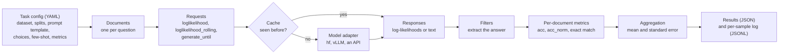

# Module 00: Anatomy of an Evaluation Harness

> **Prerequisites:** [Module 01: Building an Eval Dataset](../../15-evaluation-observability-and-safety/01-building-an-eval-dataset/README.md) and [Module 05: Benchmark Suites and Their Limits](../../15-evaluation-observability-and-safety/05-benchmark-suites-and-their-limits/README.md).  
> **Estimated Reading Time:** 40 minutes  
> **Target Audience:** AI Backend Engineers, ML Platform Engineers, Model Evaluation Leads

> [!TIP]
> **The Golden Rule of Evaluation Harnesses:** A score belongs to a model *and* to the harness that produced it: the dataset, the prompt, the way the answer is scored and the number of questions. Publish all of them with the number, and never compare two scores that came from different harnesses.

---

## Why This Matters

In June 2023 the Hugging Face team noticed that the MMLU scores on the Open LLM Leaderboard for LLaMA models, computed with EleutherAI's evaluation harness, were much lower than the ones in the LLaMA paper. They traced it to the fact that there were three implementations of the same benchmark in use. For `llama-65b`, on the same questions, they measured **0.488** with the Harness, **0.637** with HELM and **0.636** with the original code. The model had not changed, and neither had the questions. What changed was how the question was written and how the answer was scored. In their words, "evaluations are strongly tied to their implementations–down to minute details such as prompts and tokenization".

A harness is the program that sits between a model and a number. It loads a dataset, turns each item into a prompt, sends requests to the model, scores the answers, aggregates them and writes a log. Each of those steps hides a decision, and each decision can move a score by more than the gap between two models that people argue over. This module opens the harness up. It shows the pipeline, the three kinds of request a harness sends, why the same model scores differently under different scoring rules, and how much uncertainty a small test set leaves. It uses a real run of EleutherAI's `lm-evaluation-harness` for the details that matter.

After this module you will be able to:

- draw the pipeline of an evaluation harness and name what each stage decides;
- explain the difference between a **log-likelihood** request and a **generation** request, and what `acc` and `acc_norm` compare;
- build a small harness with a request cache and several scoring rules, in four languages, and audit a published set of scores for ranking changes between implementations;
- run a real harness on a tiny model, read its results and its sample log, and recompute its numbers from the log;
- say how many questions you need before a difference between two scores means anything.

---

## 1. Architectural Mental Model & Core Mechanics

Every harness has the same skeleton. EleutherAI's `lm-evaluation-harness` ("a framework for few-shot evaluation of language models", MIT licensed, the backend for the Open LLM Leaderboard) is a good one to study, because its pieces are visible in the files it writes:



### A Task Is Data Plus Decisions

A task in `lm-evaluation-harness` is a YAML file. The configuration that the harness echoes into its results for HellaSwag, a commonsense benchmark, shows the decisions in one place:

| Key | Value in the run below | What it decides |
| :--- | :--- | :--- |
| `task` | `hellaswag` | The name, and the thing you ask for with `--tasks` |
| `dataset_path` | `Rowan/hellaswag` | Where the questions come from |
| `validation_split` | `validation` | Which split is evaluated here (`test_split` is `null` in this config; the run reports 10,042 questions in the task) |
| `doc_to_text` | `{{query}}` | How a document becomes the prompt |
| `doc_to_choice` | `choices` | The candidate answers |
| `doc_to_target` | `{{label}}` | Which one is right |
| `output_type` | `multiple_choice` | How the model is asked: compare the likelihood of each choice |
| `num_fewshot` | `0` | How many worked examples go in front of the question |
| `metric_list` | `acc`, `acc_norm`, each aggregated with `mean`, higher is better | What is computed per document, and how it is combined |

None of these is a detail. Change `doc_to_text` and you have a different benchmark; change `num_fewshot` and you have a different score; change the metric and the same predictions give a different number.

### Three Kinds of Request

The harness's model guide says any model class must implement three methods, each answering one request type:

- **`loglikelihood`**: the request holds a context string and a target string, and the answer is the log probability of the target given the context, plus whether greedy decoding would have produced the target. Multiple-choice tasks use it: one request per choice, then compare.
- **`loglikelihood_rolling`**: one string, and the answer is the log likelihood of the whole text with no starting context. It is used to measure perplexity.
- **`generate_until`**: a string and generation parameters such as stop sequences and a maximum length, and the answer is the generated text. Free-form tasks use it, and the answer is then extracted and compared with the target.

A model that can only be called as a chat API cannot give a log-likelihood, so some harnesses can run some tasks only for some models. That limit shapes which benchmarks exist for which models.

### Scoring a Multiple-Choice Question

For a multiple-choice task the harness sends one `loglikelihood` request per choice and picks the choice with the best score. How the choice is written and what counts as the score are the decisions behind the Hugging Face finding below:

- **Answer letters.** The prompt lists the choices as A to D, and the model is scored on the letters. The original MMLU code compares the probabilities of the four letters.
- **Answer text.** The prompt is just the question, and each choice's full text is scored. The EleutherAI harness as of January 2023 compared the probabilities of the full answer sequence, with the option of dividing the sum by the number of tokens.
- **Generate and match.** The model writes the next token or tokens and the harness checks whether it matches the expected letter. HELM did this.
- **Normalisation.** A long answer has a lower total log-likelihood than a short one just for being long, so harnesses report a length-normalised variant next to the plain one. In this module's run `acc_norm` matched the choice with the highest log-likelihood *per character of the choice* on all 20 questions (Workflow 3 recomputes it). The harness pages this module draws on do not define the metric, so check the documentation for your version.

### Caching, Aggregation and Uncertainty

Different metrics ask about the same things. `acc` and `acc_norm` are computed from the same log-likelihoods, so a harness caches requests by their content and asks the model once. The cache is also why a re-run is fast, and it is keyed by model and prompt format, because a different chat template makes a different request.

Per-document scores are combined with a mean, and the harness reports a **standard error** beside it. For an accuracy, that is the binomial standard error, the square root of p(1 - p) divided by n - 1, which Workflow 3 reproduces from the numbers in the real table. It shrinks only with the square root of the number of questions: with 20 questions an accuracy near 0.5 carries a standard error of 0.11, with 100 it is 0.05, with 1,000 it is 0.016.

### What Gets Logged

With `--log_samples` the harness writes one JSON line per document: the document, the target, the `arguments` (the context and continuation of each request), the raw responses, the filtered responses, the per-document metrics, and hashes of the prompt and target. That file is the thing to read when a number surprises you. It shows the exact prompt, the exact scores, and which questions the model got wrong.

---

## 2. Systematic Comparison Matrix: Four Ways to Score a Multiple-Choice Question

| Scoring rule | What is compared | Strength | Weakness | Seen in |
| :--- | :--- | :--- | :--- | :--- |
| **Letter probabilities** | The model's probability for each of A, B, C and D after a prompt that lists the choices | One short request per choice; ignores answer length | Depends on the model understanding the lettered format, and on any position bias | The original MMLU code |
| **Answer-text log-likelihood (sum)** | The total log-probability of each choice's full text | Needs no lettered format | Favours short answers, since each extra token costs probability | The EleutherAI harness as of January 2023 |
| **Answer-text log-likelihood (normalised)** | The same, divided by the length of the choice | Removes most of the length bias | The normaliser (characters, bytes or tokens) is a choice that changes scores | Reported as `acc_norm` by `lm-evaluation-harness` |
| **Generate and match** | The text the model generates, checked against the expected answer | Resembles how the model will really be used | Needs answer extraction; sensitive to formatting and stop rules | HELM |

None of these is the right one. They measure slightly different things, which is exactly why the number alone is not portable.

---

## 3. Evidence Case Study: One Benchmark, Three Implementations

This section is built from the Hugging Face post *What's going on with the Open LLM Leaderboard?* (Fourrier, Habib, Launay and Wolf, 23 June 2023), and keeps to what it reports.

### What Was Measured

The post compared MMLU scores for the same models under three implementations: HELM, the EleutherAI Evaluation Harness as of January 2023 (the version that produced the first leaderboard numbers), and the original code from the benchmark's authors. All three used five-shot prompts, but they differed in small details of the prompt (whether a "Question:" prefix or a "Choices:" label is added, and whether a topic line is included) and, more importantly, in how the answer was scored: the original compared the probabilities of the four answer letters, HELM generated text and checked whether it matched the expected letter, and the Harness compared the log-likelihoods of the full answer sequences.

| Model | HELM | Harness | Original |
| :--- | ---: | ---: | ---: |
| llama-65b | 0.637 | 0.488 | 0.636 |
| falcon-40b | 0.571 | 0.527 | 0.558 |
| llama-30b | 0.583 | 0.457 | 0.584 |
| gpt-neox-20b | 0.256 | 0.333 | 0.262 |
| llama-13b | 0.471 | 0.377 | 0.470 |
| llama-7b | 0.339 | 0.342 | 0.351 |
| falcon-7b | 0.278 | 0.350 | 0.254 |
| RedPajama-INCITE-7B-Base | 0.275 | 0.340 | 0.269 |

The three implementations disagree about the order, not just the level. Under the Harness, `falcon-40b` (0.527) beats `llama-65b` (0.488) and `llama-30b` (0.457); under HELM and the original, `llama-65b` and `llama-30b` are both above it. At the bottom, `falcon-7b` is the lowest of the eight under the original code and above `llama-7b`, `gpt-neox-20b` and `RedPajama-INCITE-7B-Base` under the Harness.

### What Was Done About It

The post says that "these different implementations of the same benchmark give widely different numbers and even change the ranking order of the models on the leaderboard". The leaderboard team decided to keep using community-maintained evaluation libraries. It reports that, while the post was being written, the EleutherAI harness community updated its MMLU evaluation to make it similar to the original implementation, and that the team was updating the full leaderboard with the new version of the harness.

### What a Harness User Takes From It

- **A bare score is not a measurement of a model.** It is a measurement of a model in a harness. Record the harness, its version, the prompt, the shots and the scoring rule next to every number.
- **Do not compare across harnesses.** A model that is 0.14 lower in one harness than in another is not worse.
- **Check whether a ranking survives the implementation.** Workflow 1 does that audit on the table above and counts the pairs that swap order.
- **Prefer a version-pinned task.** The task file carries a `version` (it is `1` for HellaSwag in the run below), which is how you know two runs used the same definition.

---

## 4. Multi-Language Production Implementation: A Harness Pipeline and a Ranking Audit

Below is a program in **Go**, **TypeScript**, **Python** and **C#** with two parts.

**Part 1** is a miniature harness. A task of six multiple-choice documents, a prompt template in two forms (plain, and lettered with the choices listed), a model behind one function, a **cache** keyed by the request so that identical requests are scored once, and three scoring rules (letters, answer text summed, answer text per character) run over the same task. It logs what the model got wrong. The model is a toy, made up for this module with three deliberate weaknesses: it prefers short answers, the first choice, and the letter A. That is what lets the mechanisms show up in six questions. It is not a model of any real language model.

**Part 2** is an **audit** of the real Hugging Face table above: it ranks the eight models under each implementation, and counts the pairs of models whose order changes between implementations.

Run them with `go run evalh.go`, `node evalh.ts` (Node 24 or newer), `python evalh.py` and `dotnet run Evalh.cs` (.NET 10 SDK). All four print the same output, shown in Workflow 1.

````carousel

```go
// The anatomy of an evaluation harness in two parts, offline.
// Part 1, the pipeline: a task (documents plus a prompt template), requests built from it, a model behind one function (a toy here), a cache so that identical requests
// are scored once, three scoring rules over the same task, and a log of what the model got wrong.
// Part 2, the audit: published MMLU scores for eight models under three implementations (Hugging Face, June 2023), and how much their rankings agree.
// The toy model and its documents are made up to make the mechanisms visible; the audit data is real.
package main

import (
	"fmt"
	"sort"
	"strings"
)

type doc struct {
	question string
	choices  []string
	gold     int
	knows    bool // does the toy model "know" it?
}

var docs = []doc{
	{"Which planet is closest to the Sun?", []string{"Mercury", "Venus", "Earth", "Mars"}, 0, true},
	{"What is the chemical symbol for sodium?", []string{"So", "Na", "Sd", "S"}, 1, true},
	{"Which gas do plants absorb for photosynthesis?", []string{"Oxygen", "Nitrogen", "Carbon dioxide", "Helium"}, 2, false},
	{"Who wrote Pride and Prejudice?", []string{"Charles Dickens", "Jane Austen", "Mark Twain", "Leo Tolstoy"}, 1, true},
	{"What is the largest ocean on Earth?", []string{"Atlantic Ocean", "Indian Ocean", "Arctic Ocean", "Pacific Ocean"}, 3, false},
	{"How many sides does a hexagon have?", []string{"Five", "Six", "Seven", "Eight"}, 1, false},
}

const letters = "ABCD"

var rules = []string{"letters", "text, sum", "text, per character"}

func contextPlain(d doc) string { return "Question: " + d.question + "\nAnswer:" }

func contextLettered(d doc) string {
	var lines []string
	for i, c := range d.choices {
		lines = append(lines, fmt.Sprintf("%c. %s", letters[i], c))
	}
	return "Question: " + d.question + "\nChoices:\n" + strings.Join(lines, "\n") + "\nAnswer:"
}

// toyLogprob returns centi-nats (hundredths of a nat). Every character costs 7; a document the toy knows gives its right answer a bonus of 120; and when the prompt
// lists the choices, the toy leans towards the letters A and B. Three weaknesses on purpose: it prefers short answers, and the first choice, and the letter A.
func toyLogprob(context, continuation string) int {
	score := -7 * len(continuation)
	var d doc
	for _, candidate := range docs {
		if strings.Contains(context, candidate.question) {
			d = candidate
			break
		}
	}
	goldText, goldLetter := " "+d.choices[d.gold], " "+string(letters[d.gold])
	if d.knows && (continuation == goldText || (continuation == goldLetter && strings.Contains(context, "Choices:"))) {
		score += 120
	}
	if strings.Contains(context, "Choices:") && (continuation == " A" || continuation == " B") {
		if continuation == " A" {
			score += 25
		} else {
			score += 10
		}
	}
	return score
}

type harness struct {
	model        func(context, continuation string) int
	cache        map[[2]string]int
	built, calls int
}

func (h *harness) loglikelihood(context, continuation string) int {
	h.built++
	key := [2]string{context, continuation}
	if _, ok := h.cache[key]; !ok { // an identical request is answered from the cache, not the model
		h.calls++
		h.cache[key] = h.model(context, continuation)
	}
	return h.cache[key]
}

func requestsFor(rule string, d doc) (string, []string) {
	var continuations []string
	if rule == "letters" {
		for i := 0; i < 4; i++ {
			continuations = append(continuations, " "+string(letters[i]))
		}
		return contextLettered(d), continuations
	}
	for _, c := range d.choices {
		continuations = append(continuations, " "+c)
	}
	return contextPlain(d), continuations
}

// pick returns the index of the best score; ties go to the lowest index. With lengths, it compares score per character without floating point.
func pick(scores, lengths []int) int {
	best := 0
	for i := 1; i < len(scores); i++ {
		better := scores[i] > scores[best]
		if lengths != nil {
			better = scores[i]*lengths[best] > scores[best]*lengths[i]
		}
		if better {
			best = i
		}
	}
	return best
}

func evaluate(h *harness) (map[string][]bool, []string) {
	results := map[string][]bool{}
	var log []string
	for _, rule := range rules {
		for n, d := range docs {
			context, continuations := requestsFor(rule, d)
			var scores, lengths []int
			for _, c := range continuations {
				scores = append(scores, h.loglikelihood(context, c))
				lengths = append(lengths, len(c))
			}
			if rule != "text, per character" {
				lengths = nil
			}
			guess := pick(scores, lengths)
			results[rule] = append(results[rule], guess == d.gold)
			if guess != d.gold {
				log = append(log, fmt.Sprintf("  doc %d wrong under '%s': chose '%s', gold '%s'", n, rule, d.choices[guess], d.choices[d.gold]))
			}
		}
	}
	return results, log
}

type mmluRow struct {
	name   string
	scores [3]int
}

// Published MMLU scores in thousandths (Fourrier, Habib, Launay and Wolf, Hugging Face blog, 23 June 2023): HELM, the EleutherAI Harness of the time, the original code.
var mmlu = []mmluRow{
	{"llama-65b", [3]int{637, 488, 636}},
	{"falcon-40b", [3]int{571, 527, 558}},
	{"llama-30b", [3]int{583, 457, 584}},
	{"gpt-neox-20b", [3]int{256, 333, 262}},
	{"llama-13b", [3]int{471, 377, 470}},
	{"llama-7b", [3]int{339, 342, 351}},
	{"falcon-7b", [3]int{278, 350, 254}},
	{"RedPajama-INCITE-7B-Base", [3]int{275, 340, 269}},
}

var implementations = []string{"HELM", "Harness", "Original"}

func ranking(column int) []string {
	sorted := append([]mmluRow(nil), mmlu...)
	sort.SliceStable(sorted, func(i, j int) bool { return sorted[i].scores[column] > sorted[j].scores[column] })
	var names []string
	for _, row := range sorted {
		names = append(names, row.name)
	}
	return names
}

func flips(a, b int) []string {
	var out []string
	for i := 0; i < len(mmlu); i++ {
		for j := i + 1; j < len(mmlu); j++ {
			x, y := mmlu[i], mmlu[j]
			if (x.scores[a]-y.scores[a])*(x.scores[b]-y.scores[b]) < 0 {
				winner, loser := y.name, x.name
				if x.scores[a] > y.scores[a] {
					winner, loser = x.name, y.name
				}
				out = append(out, fmt.Sprintf("%s beats %s under %s, loses under %s", winner, loser, implementations[a], implementations[b]))
			}
		}
	}
	return out
}

func main() {
	h := &harness{model: toyLogprob, cache: map[[2]string]int{}}
	results, log := evaluate(h)
	fmt.Println("part 1: the pipeline")
	fmt.Printf("requests built: %d, model calls: %d, cache hits: %d\n", h.built, h.calls, h.built-h.calls)
	for _, rule := range rules {
		correct := 0
		var marks []string
		for _, r := range results[rule] {
			if r {
				correct++
				marks = append(marks, "1")
			} else {
				marks = append(marks, "0")
			}
		}
		fmt.Printf("  %-20s %d/%d correct   %s\n", rule, correct, len(results[rule]), strings.Join(marks, " "))
	}
	fmt.Println("sample log (what the model got wrong):")
	for _, line := range log {
		fmt.Println(line)
	}
	fmt.Println("part 2: the audit")
	for column, name := range implementations {
		fmt.Printf("  %-9s %s\n", name, strings.Join(ranking(column), " > "))
	}
	total := len(mmlu) * (len(mmlu) - 1) / 2
	for _, pair := range [][2]int{{0, 2}, {1, 2}, {0, 1}} {
		fmt.Printf("  %s vs %s: %d of %d pairs change order\n", implementations[pair[0]], implementations[pair[1]], len(flips(pair[0], pair[1])), total)
	}
	for _, line := range flips(1, 2) {
		fmt.Println("    " + line)
	}
}
```

<!-- slide -->

```typescript
// The anatomy of an evaluation harness in two parts, offline.
// Part 1, the pipeline: a task (documents plus a prompt template), requests built from it, a model behind one function (a toy here), a cache so that identical requests
// are scored once, three scoring rules over the same task, and a log of what the model got wrong.
// Part 2, the audit: published MMLU scores for eight models under three implementations (Hugging Face, June 2023), and how much their rankings agree.
// The toy model and its documents are made up to make the mechanisms visible; the audit data is real.
type Doc = [question: string, choices: string[], gold: number, knows: boolean]; // does the toy model "know" it?

const DOCS: Doc[] = [
  ["Which planet is closest to the Sun?", ["Mercury", "Venus", "Earth", "Mars"], 0, true],
  ["What is the chemical symbol for sodium?", ["So", "Na", "Sd", "S"], 1, true],
  ["Which gas do plants absorb for photosynthesis?", ["Oxygen", "Nitrogen", "Carbon dioxide", "Helium"], 2, false],
  ["Who wrote Pride and Prejudice?", ["Charles Dickens", "Jane Austen", "Mark Twain", "Leo Tolstoy"], 1, true],
  ["What is the largest ocean on Earth?", ["Atlantic Ocean", "Indian Ocean", "Arctic Ocean", "Pacific Ocean"], 3, false],
  ["How many sides does a hexagon have?", ["Five", "Six", "Seven", "Eight"], 1, false],
];
const LETTERS = "ABCD";
const RULES = ["letters", "text, sum", "text, per character"];

const contextPlain = (doc: Doc) => `Question: ${doc[0]}\nAnswer:`;
const contextLettered = (doc: Doc) => `Question: ${doc[0]}\nChoices:\n` + doc[1].map((c, i) => `${LETTERS[i]}. ${c}`).join("\n") + "\nAnswer:";

// Centi-nats (hundredths of a nat). Every character costs 7; a document the toy knows gives its right answer a bonus of 120; and when the prompt lists the
// choices, the toy leans towards the letters A and B. Three weaknesses on purpose: it prefers short answers, and the first choice, and the letter A.
function toyLogprob(context: string, continuation: string): number {
  let score = -7 * continuation.length;
  const doc = DOCS.find((d) => context.includes(d[0]))!;
  const goldText = " " + doc[1][doc[2]];
  const goldLetter = " " + LETTERS[doc[2]];
  if (doc[3] && (continuation === goldText || (continuation === goldLetter && context.includes("Choices:")))) score += 120;
  if (context.includes("Choices:") && (continuation === " A" || continuation === " B")) score += continuation === " A" ? 25 : 10;
  return score;
}

class Harness {
  model: (context: string, continuation: string) => number;
  cache = new Map<string, number>();
  built = 0;
  calls = 0;

  constructor(model: (context: string, continuation: string) => number) {
    this.model = model;
  }

  loglikelihood(context: string, continuation: string): number {
    this.built++;
    const key = JSON.stringify([context, continuation]);
    if (!this.cache.has(key)) { // an identical request is answered from the cache, not the model
      this.calls++;
      this.cache.set(key, this.model(context, continuation));
    }
    return this.cache.get(key)!;
  }
}

function requestsFor(rule: string, doc: Doc): [string, string[]] {
  if (rule === "letters") return [contextLettered(doc), [0, 1, 2, 3].map((i) => " " + LETTERS[i])];
  return [contextPlain(doc), doc[1].map((c) => " " + c)];
}

// Index of the best score; ties go to the lowest index. With lengths, compares score per character without floating point.
function pick(scores: number[], lengths?: number[]): number {
  let best = 0;
  for (let i = 1; i < scores.length; i++) {
    const better = lengths === undefined ? scores[i] > scores[best] : scores[i] * lengths[best] > scores[best] * lengths[i];
    if (better) best = i;
  }
  return best;
}

function evaluate(harness: Harness): [Record<string, boolean[]>, string[]] {
  const results: Record<string, boolean[]> = {};
  const log: string[] = [];
  for (const rule of RULES) {
    results[rule] = [];
    DOCS.forEach((doc, n) => {
      const [context, continuations] = requestsFor(rule, doc);
      const scores = continuations.map((c) => harness.loglikelihood(context, c));
      const guess = pick(scores, rule === "text, per character" ? continuations.map((c) => c.length) : undefined);
      results[rule].push(guess === doc[2]);
      if (guess !== doc[2]) log.push(`  doc ${n} wrong under '${rule}': chose '${doc[1][guess]}', gold '${doc[1][doc[2]]}'`);
    });
  }
  return [results, log];
}

// Published MMLU scores in thousandths (Fourrier, Habib, Launay and Wolf, Hugging Face blog, 23 June 2023): HELM, the EleutherAI Harness of the time, the original code.
const MMLU: [string, [number, number, number]][] = [
  ["llama-65b", [637, 488, 636]],
  ["falcon-40b", [571, 527, 558]],
  ["llama-30b", [583, 457, 584]],
  ["gpt-neox-20b", [256, 333, 262]],
  ["llama-13b", [471, 377, 470]],
  ["llama-7b", [339, 342, 351]],
  ["falcon-7b", [278, 350, 254]],
  ["RedPajama-INCITE-7B-Base", [275, 340, 269]],
];
const IMPLEMENTATIONS = ["HELM", "Harness", "Original"];

const ranking = (column: number) => [...MMLU].sort((a, b) => b[1][column] - a[1][column]).map((m) => m[0]);

function flips(a: number, b: number): string[] {
  const out: string[] = [];
  for (let i = 0; i < MMLU.length; i++) {
    for (let j = i + 1; j < MMLU.length; j++) {
      const [x, sx] = MMLU[i];
      const [y, sy] = MMLU[j];
      if ((sx[a] - sy[a]) * (sx[b] - sy[b]) < 0) {
        const [winner, loser] = sx[a] > sy[a] ? [x, y] : [y, x];
        out.push(`${winner} beats ${loser} under ${IMPLEMENTATIONS[a]}, loses under ${IMPLEMENTATIONS[b]}`);
      }
    }
  }
  return out;
}

const harness = new Harness(toyLogprob);
const [results, log] = evaluate(harness);
console.log("part 1: the pipeline");
console.log(`requests built: ${harness.built}, model calls: ${harness.calls}, cache hits: ${harness.built - harness.calls}`);
for (const rule of RULES) console.log(`  ${rule.padEnd(20)} ${results[rule].filter(Boolean).length}/${results[rule].length} correct   ` + results[rule].map((r) => (r ? "1" : "0")).join(" "));
console.log("sample log (what the model got wrong):");
for (const line of log) console.log(line);
console.log("part 2: the audit");
IMPLEMENTATIONS.forEach((name, column) => console.log(`  ${name.padEnd(9)} ` + ranking(column).join(" > ")));
const total = (MMLU.length * (MMLU.length - 1)) / 2;
for (const [a, b] of [[0, 2], [1, 2], [0, 1]]) console.log(`  ${IMPLEMENTATIONS[a]} vs ${IMPLEMENTATIONS[b]}: ${flips(a, b).length} of ${total} pairs change order`);
for (const line of flips(1, 2)) console.log("    " + line);
```

<!-- slide -->

```python
"""The anatomy of an evaluation harness in two parts, offline.
Part 1, the pipeline: a task (documents plus a prompt template), requests built from it, a model behind one function (a toy here), a cache so that identical requests
are scored once, three scoring rules over the same task, and a log of what the model got wrong.
Part 2, the audit: published MMLU scores for eight models under three implementations (Hugging Face, June 2023), and how much their rankings agree.
The toy model and its documents are made up to make the mechanisms visible; the audit data is real."""

DOCS = [  # (question, choices, gold index, does the toy model "know" it?)
    ("Which planet is closest to the Sun?", ["Mercury", "Venus", "Earth", "Mars"], 0, True),
    ("What is the chemical symbol for sodium?", ["So", "Na", "Sd", "S"], 1, True),
    ("Which gas do plants absorb for photosynthesis?", ["Oxygen", "Nitrogen", "Carbon dioxide", "Helium"], 2, False),
    ("Who wrote Pride and Prejudice?", ["Charles Dickens", "Jane Austen", "Mark Twain", "Leo Tolstoy"], 1, True),
    ("What is the largest ocean on Earth?", ["Atlantic Ocean", "Indian Ocean", "Arctic Ocean", "Pacific Ocean"], 3, False),
    ("How many sides does a hexagon have?", ["Five", "Six", "Seven", "Eight"], 1, False),
]
LETTERS = "ABCD"
RULES = ["letters", "text, sum", "text, per character"]


def context_plain(doc):
    return f"Question: {doc[0]}\nAnswer:"


def context_lettered(doc):
    return f"Question: {doc[0]}\nChoices:\n" + "\n".join(f"{LETTERS[i]}. {c}" for i, c in enumerate(doc[1])) + "\nAnswer:"


def toy_logprob(context, continuation):
    """Centi-nats (hundredths of a nat). Every character costs 7; a document the toy knows gives its right answer a bonus of 120; and when the prompt lists the
    choices, the toy leans towards the letters A and B. Three weaknesses on purpose: it prefers short answers, and the first choice, and the letter A."""
    score = -7 * len(continuation)
    doc = next(d for d in DOCS if d[0] in context)
    gold_text, gold_letter = " " + doc[1][doc[2]], " " + LETTERS[doc[2]]
    if doc[3] and (continuation == gold_text or (continuation == gold_letter and "Choices:" in context)):
        score += 120
    if "Choices:" in context and continuation in (" A", " B"):
        score += 25 if continuation == " A" else 10
    return score


class Harness:
    def __init__(self, model):
        self.model, self.cache, self.built, self.calls = model, {}, 0, 0

    def loglikelihood(self, context, continuation):
        self.built += 1
        key = (context, continuation)
        if key not in self.cache:  # an identical request is answered from the cache, not the model
            self.calls += 1
            self.cache[key] = self.model(context, continuation)
        return self.cache[key]


def requests_for(rule, doc):
    if rule == "letters":
        return context_lettered(doc), [" " + LETTERS[i] for i in range(4)]
    return context_plain(doc), [" " + c for c in doc[1]]


def pick(scores, lengths=None):
    """Index of the best score; ties go to the lowest index. With lengths, compares score per character without floating point."""
    best = 0
    for i in range(1, len(scores)):
        better = scores[i] > scores[best] if lengths is None else scores[i] * lengths[best] > scores[best] * lengths[i]
        best = i if better else best
    return best


def evaluate(harness):
    results, log = {rule: [] for rule in RULES}, []
    for rule in RULES:
        for n, doc in enumerate(DOCS):
            context, continuations = requests_for(rule, doc)
            scores = [harness.loglikelihood(context, c) for c in continuations]
            guess = pick(scores, [len(c) for c in continuations] if rule == "text, per character" else None)
            results[rule].append(guess == doc[2])
            if guess != doc[2]:
                log.append(f"  doc {n} wrong under '{rule}': chose {doc[1][guess]!r}, gold {doc[1][doc[2]]!r}")
    return results, log


# Published MMLU scores in thousandths (Fourrier, Habib, Launay and Wolf, Hugging Face blog, 23 June 2023): HELM, the EleutherAI Harness of the time, the original code.
MMLU = [
    ("llama-65b", (637, 488, 636)),
    ("falcon-40b", (571, 527, 558)),
    ("llama-30b", (583, 457, 584)),
    ("gpt-neox-20b", (256, 333, 262)),
    ("llama-13b", (471, 377, 470)),
    ("llama-7b", (339, 342, 351)),
    ("falcon-7b", (278, 350, 254)),
    ("RedPajama-INCITE-7B-Base", (275, 340, 269)),
]
IMPLEMENTATIONS = ["HELM", "Harness", "Original"]


def ranking(column):
    return [name for name, scores in sorted(MMLU, key=lambda m: -m[1][column])]


def flips(a, b):
    out = []
    for i in range(len(MMLU)):
        for j in range(i + 1, len(MMLU)):
            (x, sx), (y, sy) = MMLU[i], MMLU[j]
            if (sx[a] - sy[a]) * (sx[b] - sy[b]) < 0:
                winner, loser = (x, y) if sx[a] > sy[a] else (y, x)
                out.append(f"{winner} beats {loser} under {IMPLEMENTATIONS[a]}, loses under {IMPLEMENTATIONS[b]}")
    return out


def main():
    harness = Harness(toy_logprob)
    results, log = evaluate(harness)
    print("part 1: the pipeline")
    print(f"requests built: {harness.built}, model calls: {harness.calls}, cache hits: {harness.built - harness.calls}")
    for rule in RULES:
        print(f"  {rule:<20} {sum(results[rule])}/{len(results[rule])} correct   " + " ".join("1" if r else "0" for r in results[rule]))
    print("sample log (what the model got wrong):")
    for line in log:
        print(line)
    print("part 2: the audit")
    for column, name in enumerate(IMPLEMENTATIONS):
        print(f"  {name:<9} " + " > ".join(ranking(column)))
    total = len(MMLU) * (len(MMLU) - 1) // 2
    for a, b in ((0, 2), (1, 2), (0, 1)):
        print(f"  {IMPLEMENTATIONS[a]} vs {IMPLEMENTATIONS[b]}: {len(flips(a, b))} of {total} pairs change order")
    for line in flips(1, 2):
        print("    " + line)


if __name__ == "__main__":
    main()
```

<!-- slide -->

```csharp
// The anatomy of an evaluation harness in two parts, offline.
// Part 1, the pipeline: a task (documents plus a prompt template), requests built from it, a model behind one function (a toy here), a cache so that identical requests
// are scored once, three scoring rules over the same task, and a log of what the model got wrong.
// Part 2, the audit: published MMLU scores for eight models under three implementations (Hugging Face, June 2023), and how much their rankings agree.
// The toy model and its documents are made up to make the mechanisms visible; the audit data is real.
using System;
using System.Collections.Generic;
using System.Linq;

const string Letters = "ABCD";
string[] rules = { "letters", "text, sum", "text, per character" };
// (question, choices, gold index, does the toy model "know" it?)
var docs = new (string Question, string[] Choices, int Gold, bool Knows)[]
{
    ("Which planet is closest to the Sun?", new[] { "Mercury", "Venus", "Earth", "Mars" }, 0, true),
    ("What is the chemical symbol for sodium?", new[] { "So", "Na", "Sd", "S" }, 1, true),
    ("Which gas do plants absorb for photosynthesis?", new[] { "Oxygen", "Nitrogen", "Carbon dioxide", "Helium" }, 2, false),
    ("Who wrote Pride and Prejudice?", new[] { "Charles Dickens", "Jane Austen", "Mark Twain", "Leo Tolstoy" }, 1, true),
    ("What is the largest ocean on Earth?", new[] { "Atlantic Ocean", "Indian Ocean", "Arctic Ocean", "Pacific Ocean" }, 3, false),
    ("How many sides does a hexagon have?", new[] { "Five", "Six", "Seven", "Eight" }, 1, false),
};

string ContextPlain(string question) => $"Question: {question}\nAnswer:";
string ContextLettered(string question, string[] choices) => $"Question: {question}\nChoices:\n" + string.Join("\n", choices.Select((c, i) => $"{Letters[i]}. {c}")) + "\nAnswer:";

// Centi-nats (hundredths of a nat). Every character costs 7; a document the toy knows gives its right answer a bonus of 120; and when the prompt lists the
// choices, the toy leans towards the letters A and B. Three weaknesses on purpose: it prefers short answers, and the first choice, and the letter A.
int ToyLogprob(string context, string continuation)
{
    int score = -7 * continuation.Length;
    var doc = docs.First(d => context.Contains(d.Question, StringComparison.Ordinal));
    var goldText = " " + doc.Choices[doc.Gold];
    var goldLetter = " " + Letters[doc.Gold];
    bool lettered = context.Contains("Choices:", StringComparison.Ordinal);
    if (doc.Knows && (continuation == goldText || (continuation == goldLetter && lettered))) score += 120;
    if (lettered && (continuation == " A" || continuation == " B")) score += continuation == " A" ? 25 : 10;
    return score;
}

var cache = new Dictionary<(string, string), int>();
int built = 0, calls = 0;
int LogLikelihood(string context, string continuation)
{
    built++;
    var key = (context, continuation);
    if (!cache.ContainsKey(key)) // an identical request is answered from the cache, not the model
    {
        calls++;
        cache[key] = ToyLogprob(context, continuation);
    }
    return cache[key];
}

(string Context, List<string> Continuations) RequestsFor(string rule, string question, string[] choices) =>
    rule == "letters"
        ? (ContextLettered(question, choices), Enumerable.Range(0, 4).Select(i => " " + Letters[i]).ToList())
        : (ContextPlain(question), choices.Select(c => " " + c).ToList());

// Index of the best score; ties go to the lowest index. With lengths, compares score per character without floating point.
int Pick(List<int> scores, List<int>? lengths = null)
{
    int best = 0;
    for (int i = 1; i < scores.Count; i++)
    {
        bool better = lengths is null ? scores[i] > scores[best] : scores[i] * lengths[best] > scores[best] * lengths[i];
        if (better) best = i;
    }
    return best;
}

var results = rules.ToDictionary(r => r, _ => new List<bool>());
var log = new List<string>();
foreach (var rule in rules)
{
    for (int n = 0; n < docs.Length; n++)
    {
        var doc = docs[n];
        var (context, continuations) = RequestsFor(rule, doc.Question, doc.Choices);
        var scores = continuations.Select(c => LogLikelihood(context, c)).ToList();
        int guess = Pick(scores, rule == "text, per character" ? continuations.Select(c => c.Length).ToList() : null);
        results[rule].Add(guess == doc.Gold);
        if (guess != doc.Gold) log.Add($"  doc {n} wrong under '{rule}': chose '{doc.Choices[guess]}', gold '{doc.Choices[doc.Gold]}'");
    }
}

// Published MMLU scores in thousandths (Fourrier, Habib, Launay and Wolf, Hugging Face blog, 23 June 2023): HELM, the EleutherAI Harness of the time, the original code.
var mmlu = new (string Name, int[] Scores)[]
{
    ("llama-65b", new[] { 637, 488, 636 }),
    ("falcon-40b", new[] { 571, 527, 558 }),
    ("llama-30b", new[] { 583, 457, 584 }),
    ("gpt-neox-20b", new[] { 256, 333, 262 }),
    ("llama-13b", new[] { 471, 377, 470 }),
    ("llama-7b", new[] { 339, 342, 351 }),
    ("falcon-7b", new[] { 278, 350, 254 }),
    ("RedPajama-INCITE-7B-Base", new[] { 275, 340, 269 }),
};
string[] implementations = { "HELM", "Harness", "Original" };

List<string> Flips(int a, int b)
{
    var output = new List<string>();
    for (int i = 0; i < mmlu.Length; i++)
        for (int j = i + 1; j < mmlu.Length; j++)
        {
            var (x, sx) = mmlu[i];
            var (y, sy) = mmlu[j];
            if ((sx[a] - sy[a]) * (sx[b] - sy[b]) < 0)
            {
                var (winner, loser) = sx[a] > sy[a] ? (x, y) : (y, x);
                output.Add($"{winner} beats {loser} under {implementations[a]}, loses under {implementations[b]}");
            }
        }
    return output;
}

Console.WriteLine("part 1: the pipeline");
Console.WriteLine($"requests built: {built}, model calls: {calls}, cache hits: {built - calls}");
foreach (var rule in rules) Console.WriteLine($"  {rule,-20} {results[rule].Count(r => r)}/{results[rule].Count} correct   " + string.Join(" ", results[rule].Select(r => r ? "1" : "0")));
Console.WriteLine("sample log (what the model got wrong):");
foreach (var line in log) Console.WriteLine(line);
Console.WriteLine("part 2: the audit");
for (int column = 0; column < implementations.Length; column++)
    Console.WriteLine($"  {implementations[column],-9} " + string.Join(" > ", mmlu.OrderByDescending(m => m.Scores[column]).Select(m => m.Name)));
int total = mmlu.Length * (mmlu.Length - 1) / 2;
foreach (var (a, b) in new[] { (0, 2), (1, 2), (0, 1) }) Console.WriteLine($"  {implementations[a]} vs {implementations[b]}: {Flips(a, b).Count} of {total} pairs change order");
foreach (var line in Flips(1, 2)) Console.WriteLine("    " + line);
```

````

### What Each Part Is For

| Code | Stage | What it shows |
| :--- | :--- | :--- |
| `DOCS`, `context_plain`, `context_lettered` | Task and prompt | The prompt is a template; two templates make two benchmarks |
| `Harness.loglikelihood` and its cache | Requests and caching | Identical requests are answered once |
| `requests_for` and `pick` | Scoring rules | The same documents, three rules, three answers |
| `toy_logprob` | The model seam | One function; replace it with a real adapter and nothing else changes |
| `evaluate` and its log | Per-sample log | You can read which question went wrong under which rule |
| `MMLU`, `ranking`, `flips` | The audit | Rankings from real published numbers, and the pairs that swap |

---

## 5. Practical Hands-On Verification CLI Workflows

### Workflow 1: The Pipeline and the Audit (offline)

Save the Python tab as `evalh.py` and run it. Plain Python 3, no packages, no network:

```bash
python evalh.py
```

```text
part 1: the pipeline
requests built: 72, model calls: 48, cache hits: 24
  letters              3/6 correct   1 1 0 1 0 0
  text, sum            4/6 correct   1 1 0 1 0 1
  text, per character  3/6 correct   1 1 0 1 0 0
sample log (what the model got wrong):
  doc 2 wrong under 'letters': chose 'Oxygen', gold 'Carbon dioxide'
  doc 4 wrong under 'letters': chose 'Atlantic Ocean', gold 'Pacific Ocean'
  doc 5 wrong under 'letters': chose 'Five', gold 'Six'
  doc 2 wrong under 'text, sum': chose 'Oxygen', gold 'Carbon dioxide'
  doc 4 wrong under 'text, sum': chose 'Indian Ocean', gold 'Pacific Ocean'
  doc 2 wrong under 'text, per character': chose 'Oxygen', gold 'Carbon dioxide'
  doc 4 wrong under 'text, per character': chose 'Atlantic Ocean', gold 'Pacific Ocean'
  doc 5 wrong under 'text, per character': chose 'Five', gold 'Six'
part 2: the audit
  HELM      llama-65b > llama-30b > falcon-40b > llama-13b > llama-7b > falcon-7b > RedPajama-INCITE-7B-Base > gpt-neox-20b
  Harness   falcon-40b > llama-65b > llama-30b > llama-13b > falcon-7b > llama-7b > RedPajama-INCITE-7B-Base > gpt-neox-20b
  Original  llama-65b > llama-30b > falcon-40b > llama-13b > llama-7b > RedPajama-INCITE-7B-Base > gpt-neox-20b > falcon-7b
  HELM vs Original: 2 of 28 pairs change order
  Harness vs Original: 5 of 28 pairs change order
  HELM vs Harness: 3 of 28 pairs change order
    falcon-40b beats llama-65b under Harness, loses under Original
    falcon-40b beats llama-30b under Harness, loses under Original
    falcon-7b beats gpt-neox-20b under Harness, loses under Original
    falcon-7b beats llama-7b under Harness, loses under Original
    falcon-7b beats RedPajama-INCITE-7B-Base under Harness, loses under Original
```

**Part 1.** The pipeline built 72 requests and called the model 48 times, because the two text rules ask for the same 24 log-likelihoods and the cache answers the second set. The same toy scores **3 of 6** under the letter rule, **4 of 6** under the summed text rule and **3 of 6** under the per-character rule. Read the log: the toy prefers short answers, so under the summed rule it picks `Indian Ocean` for the ocean question but gets the hexagon question right because `Six` is the shortest choice; under the per-character rule every wrong choice scores the same, so the first one wins. The model did not change between rows; the rule did.

**Part 2.** Of the 28 pairs of models, **5** swap order between the Harness and the original, **3** between HELM and the Harness, and **2** between HELM and the original (both of those are near-ties at the bottom). The five Harness-versus-original swaps are `falcon-40b` over `llama-65b` and `llama-30b`, and `falcon-7b` over three of the smaller models. A leaderboard built on one implementation would have told a different story from one built on another.

### Workflow 2: A Real Harness on a Tiny Model (needs a network)

This one is not offline. It installs a CPU build of PyTorch and `lm-evaluation-harness`, downloads a very small model (`sshleifer/tiny-gpt2`) and the HellaSwag dataset, and evaluates the first 20 questions. Use a virtual environment or a throwaway container; it needs about 1 GB of packages.

```bash
pip install torch --index-url https://download.pytorch.org/whl/cpu
pip install "lm_eval[hf]"
lm_eval --model hf --model_args pretrained=sshleifer/tiny-gpt2 --tasks hellaswag --limit 20 --device cpu --batch_size 4 --log_samples --output_path results
```

This is the output of that command with `lm_eval` 0.4.13 (the run also printed progress bars and warnings that are left out):

```text
hf ({'pretrained': 'sshleifer/tiny-gpt2'}), gen_kwargs: ({}), limit: 20.0, num_fewshot: None, batch_size: 4
|  Tasks  |Version|Filter|n-shot| Metric |   |Value|   |Stderr|
|---------|------:|------|-----:|--------|---|----:|---|-----:|
|hellaswag|      1|none  |     0|acc     |↑  | 0.25|±  |0.0993|
|         |       |none  |     0|acc_norm|↑  | 0.40|±  |0.1124|
```

It writes two files under `results/`:

```text
results/sshleifer__tiny-gpt2/results_<time>.json
results/sshleifer__tiny-gpt2/samples_hellaswag_<time>.jsonl
```

Read the table. The harness built 80 `loglikelihood` requests (20 questions times 4 endings). The tiny model is close to chance, which is 0.25 on a four-way choice: `acc` is **0.25** and `acc_norm` is **0.40**. Both carry a standard error of about 0.1. That is a difference of 0.15 between two metrics computed from the same predictions on the same 20 questions, and you cannot say anything from it. `--limit` is useful for checking that a run works, and worthless for ranking.

The first line of the sample log shows the requests and responses behind the first question (shortened here):

```text
doc_id: 0
target: '3'   (the index of the right ending)
arguments.gen_args_0: ('Roof shingle removal: A man is sitting on a r...', ' is using wrap to wrap a pair of skis.')
arguments.gen_args_1: ('Roof shingle removal: A man is sitting on a r...', ' is ripping level tiles off.')
arguments.gen_args_2: ('Roof shingle removal: A man is sitting on a r...', " is holding a rubik's cube.")
arguments.gen_args_3: ('Roof shingle removal: A man is sitting on a r...', ' starts pulling up roofing on a roof.')
filtered_resps: (-119.020, False), (-64.9711, False), (-86.6067, False), (-97.3060, False)
metrics: ['acc', 'acc_norm']   acc: 0.0   acc_norm: 0.0
```

Each of the four requests is a context and a continuation, and each answer is a log-likelihood and whether greedy decoding would have produced the continuation. The highest total log-likelihood, -64.97, is the second ending, but the right answer is ending 3, so `acc` is 0 for this question.

### Workflow 3: Recompute the Harness's Numbers From Its Log

A number you cannot recompute is a number you have to trust. Save this as `recompute.py` and point it at the samples file from Workflow 2:

```python
"""Recompute lm-evaluation-harness's accuracy numbers from its own --log_samples file, and see how the standard error behaves.
usage: python recompute.py results/<model>/samples_hellaswag_<time>.jsonl"""
import json
import math
import sys

rows = [json.loads(line) for line in open(sys.argv[1], encoding="utf-8")]
n = len(rows)


def argmax(values):
    return max(range(len(values)), key=lambda i: values[i])


def stderr(p, n):
    return math.sqrt(p * (1 - p) / (n - 1))  # the binomial standard error, with n - 1 in the denominator


correct = correct_norm = agree = 0
for row in rows:
    gold = int(row["target"])
    log_likelihoods = [float(ll) for ll, _is_greedy in row["filtered_resps"]]  # one request per choice: (context, continuation) -> (log-likelihood, is_greedy)
    lengths = [len(choice) for choice in row["doc"]["choices"]]
    acc = argmax(log_likelihoods) == gold                                      # acc: the choice with the highest total log-likelihood
    norm = argmax([ll / size for ll, size in zip(log_likelihoods, lengths)]) == gold  # acc_norm: the same, per character of the choice
    correct += acc
    correct_norm += norm
    agree += (acc == bool(row["acc"])) and (norm == bool(row["acc_norm"]))

print(f"samples: {n}   requests: {sum(len(r['filtered_resps']) for r in rows)}")
print(f"acc       {correct}/{n} = {correct / n:.2f}   stderr {stderr(correct / n, n):.4f}")
print(f"acc_norm  {correct_norm}/{n} = {correct_norm / n:.2f}   stderr {stderr(correct_norm / n, n):.4f}")
print(f"agreement with the logged per-sample acc and acc_norm: {agree} of {n}")
print("how the standard error of an accuracy near 0.5 shrinks with the number of samples:")
for size in (20, 100, 1000, 10042):
    print(f"  n = {size:>6}   stderr {stderr(0.5, size):.4f}")
```

```bash
python recompute.py results/sshleifer__tiny-gpt2/samples_hellaswag_<time>.jsonl
```

```text
samples: 20   requests: 80
acc       5/20 = 0.25   stderr 0.0993
acc_norm  8/20 = 0.40   stderr 0.1124
agreement with the logged per-sample acc and acc_norm: 20 of 20
how the standard error of an accuracy near 0.5 shrinks with the number of samples:
  n =     20   stderr 0.1147
  n =    100   stderr 0.0503
  n =   1000   stderr 0.0158
  n =  10042   stderr 0.0050
```

Three things are confirmed. `acc` is the highest total log-likelihood and `acc_norm` is the highest log-likelihood per character of the choice, because recomputing them reproduces the harness's per-question values on all 20 questions. The standard error in the table is the binomial one, sqrt(p(1 - p) / (n - 1)): 0.0993 for 5 of 20 and 0.1124 for 8 of 20. And the last lines show what it takes to get an interval narrower than a few points: the full HellaSwag validation set, 10,042 questions, gives a standard error of 0.005.

### Hands-On Exercises

1. **Add generate-and-match.** Add a fourth rule to the toy: the model "generates" the highest-scoring letter after the lettered prompt, and the harness checks it against the gold letter. Does it agree with the letter rule? Which rule does HELM's approach correspond to, and why might its scores differ from the others on real models?
2. **Make a ranking flip.** Add a second toy model with different weaknesses (it prefers long answers, and the letter D). Find two models whose order under the summed text rule is the reverse of their order under the letter rule. Then explain why this is a demonstration of the mechanism and not evidence about real models; the real evidence is the Hugging Face table.
3. **Run a second task.** Repeat Workflow 2 with `--tasks arc_easy` and `--limit 100`. Compare the standard errors with the ones from 20 questions, and look at the first sample in the log.
4. **Read the config.** Open the `results_<time>.json` file from Workflow 2 and find the `configs.hellaswag` block. List every key that would change the benchmark if you edited it, and every key that would change only how the answer is scored.

### Independent Challenge

Your team must choose between two open-weight models for a contract-clause extraction feature. Specify the evaluation: where the questions come from, which harness and which request type, the prompt and the number of examples, how an answer is scored, how many questions you need, what you record next to every score, and how you check that your conclusion does not depend on the implementation.

<details><summary>Architectural Discussion</summary>

1. **Questions:** a private, labelled set built from real contracts (Track 15, Module 01), held out from anything the models could have seen. Public benchmarks only shortlist.
2. **Request type:** extraction is a generation task, so `generate_until` with a stop sequence and a strict output schema, scored by exact match on parsed fields. A multiple-choice proxy would measure something else.
3. **Prompt and shots:** the production prompt, unchanged, with the same number of examples the product will use. Run it under two or three paraphrases to see how much the score moves.
4. **Scoring:** field-level precision and recall, reported separately, with the parser's failure rate. A model that often breaks the schema is not rescued by a high average.
5. **Sample size:** work backwards from the difference you care about. If a gap of three points would change the decision, you need a standard error well under one point, which is about 2,500 questions at an accuracy near 0.5, so build the set accordingly, or use a paired comparison on the same items.
6. **Record next to every score:** harness and version, task version, the prompt, the number of shots, the model and its revision, the decoding parameters, the number of questions and the standard error. Keep the sample log.
7. **Implementation sensitivity:** run both models under at least two harness configurations, such as two prompt formats or two answer-extraction rules, and check that the order holds. If it flips, the data cannot choose between the models.
8. **What to write in the decision:** the numbers with their standard errors, what would have changed the decision, and what was not tested.

</details>

---

## 6. Common Mistakes & Troubleshooting

- **Comparing a score from one harness with a score from another.** Llama-65b was 0.488 in one and 0.636 in another. Compare only like with like.
- **Reporting a number without its standard error.** With 20 questions, a difference of 0.15 is noise. With 100, a difference of 0.05 still is.
- **Trusting `--limit` runs.** They are smoke tests for the pipeline. Use the full set, or a set large enough for the difference that matters.
- **Changing the prompt and keeping the benchmark's name.** A different `doc_to_text` or number of shots is a different benchmark. Version it.
- **Not reading the sample log.** The log shows the exact prompt, the scores and the wrong answers. Most surprises are visible in the first ten lines.
- **Using a chat model without its template, or a base model with one.** The request changes, and so does the score. Make the template part of the recorded setup.
- **Letting a cache hide a changed setting.** A cache keyed only on the text of the request can answer a different model or format from a stale entry. Key it on everything that changes the answer.

---

## 7. Operational Validation Checkpoints & Checkpoint Quiz

### Operational Validation Checkpoints

<details><summary><strong>Checkpoint 1: The same model, two numbers</strong></summary>

A vendor says its model scores 0.64 on MMLU; your run of the same model scores 0.49. What do you check before you accuse anyone?

**Validation:** The implementation. Compare the harness and version, the prompt (a `Question:` prefix, a `Choices:` label, a topic line), the number of shots, and how the answer is scored (letters, answer text, generation). The Hugging Face investigation found a gap of this size for `llama-65b` between three implementations of one benchmark. Match the setup to the vendor's before drawing any conclusion about the model.

</details>

<details><summary><strong>Checkpoint 2: Is 0.40 better than 0.25?</strong></summary>

A smoke test on 20 questions reports `acc` 0.25 and `acc_norm` 0.40, each with a standard error of about 0.1. A teammate says the normalised metric is clearly better for this model. What do you reply?

**Validation:** Both numbers come from the same predictions on the same 20 questions, and both have a standard error near 0.1, so the difference of 0.15 is within what chance produces. It may reflect the length normalisation working, but 20 questions cannot tell. Run the full set (10,042 questions would give a standard error of 0.005) and compare again.

</details>

<details><summary><strong>Checkpoint 3: Where did the extra model calls go?</strong></summary>

Your harness reports 72 requests built and 48 model calls. Where did the 24 go, and why is that good?

**Validation:** The cache answered them. Two scoring rules asked for the same 24 log-likelihoods, so the second set was served from the cache. That is why a harness can report several metrics, such as `acc` and `acc_norm`, for the price of one pass over the model.

</details>

### Checkpoint Quiz

1. Name the three request types a model must serve in `lm-evaluation-harness`, and what each returns.
2. Why do the three MMLU implementations in the Hugging Face post give different scores for the same model?
3. What do `acc` and `acc_norm` compare, as recomputed in Workflow 3?
4. What is the standard error of an accuracy of 0.4 on 20 questions, and what does it say about a difference of 0.15?
5. What should be recorded next to every benchmark score?

<details><summary>Answers</summary>

1. `loglikelihood` (the log probability of a target given a context, and whether greedy decoding would produce it), `loglikelihood_rolling` (the log likelihood of a whole text with no context, for perplexity) and `generate_until` (generated text, until a stop sequence or a length limit).
2. They differ in small details of the prompt and, more importantly, in how the answer is scored: the original compared the probabilities of the answer letters, HELM generated text and matched it to the letter, and the Harness compared the log-likelihoods of the full answer sequences.
3. `acc` is the choice with the highest total log-likelihood; `acc_norm` is the choice with the highest log-likelihood per character of the choice. Recomputing them reproduced the harness's values on all 20 questions.
4. About 0.11 (the square root of 0.4 times 0.6, divided by 19). A difference of 0.15 is only about 1.3 standard errors, so it cannot be told from chance.
5. The harness and its version, the task and its version, the prompt, the number of shots, the model and its revision, the decoding parameters, the number of questions and the standard error.

</details>

---

## Further Reading & Sources

- [What's going on with the Open LLM Leaderboard? (Fourrier, Habib, Launay and Wolf, Hugging Face blog, 23 June 2023)](https://huggingface.co/blog/open-llm-leaderboard-mmlu) — the three MMLU implementations and the table in Section 3.
- [Lessons from the Trenches on Reproducible Evaluation of Language Models (Biderman et al., 2024)](https://arxiv.org/abs/2405.14782) — three years of experience building `lm-evaluation-harness`, on sensitivity to the evaluation setup and on reproducibility.
- [EleutherAI/lm-evaluation-harness](https://github.com/EleutherAI/lm-evaluation-harness) — the harness used in Workflow 2: install, command line, tasks and backends.
- [The model guide (lm-evaluation-harness documentation)](https://github.com/EleutherAI/lm-evaluation-harness/blob/main/docs/model_guide.md) — the three request types and the `Instance` objects.
- [The new task guide (lm-evaluation-harness documentation)](https://github.com/EleutherAI/lm-evaluation-harness/blob/main/docs/new_task_guide.md) — the YAML keys of a task.
- [Measuring Massive Multitask Language Understanding (Hendrycks et al., 2020)](https://arxiv.org/abs/2009.03300) — the MMLU benchmark itself.
- [Module 05: Benchmark Suites and Their Limits](../../15-evaluation-observability-and-safety/05-benchmark-suites-and-their-limits/README.md) — contamination, format sensitivity and why a private suite gates decisions.

## Next

[Module 01: Evaluation in Practice: Harnesses, Inspect and Regression Gates](../01-evaluation-in-practice-harnesses-inspect-and-regression-gates/README.md)
